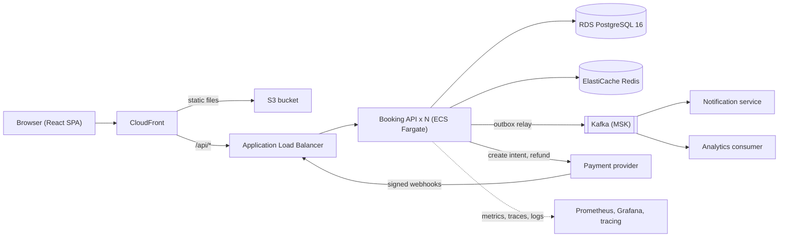
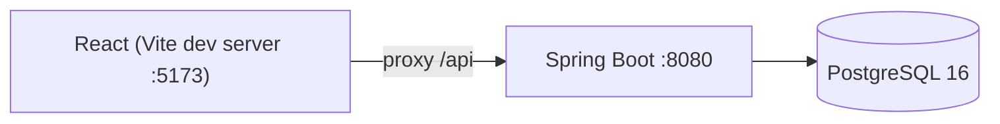
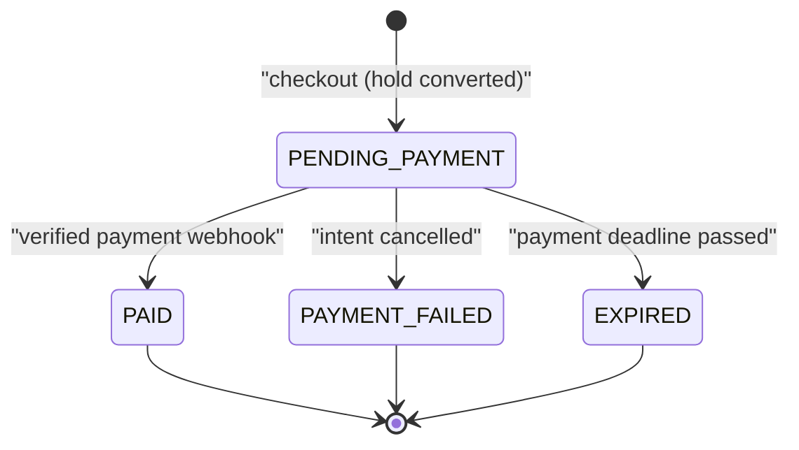
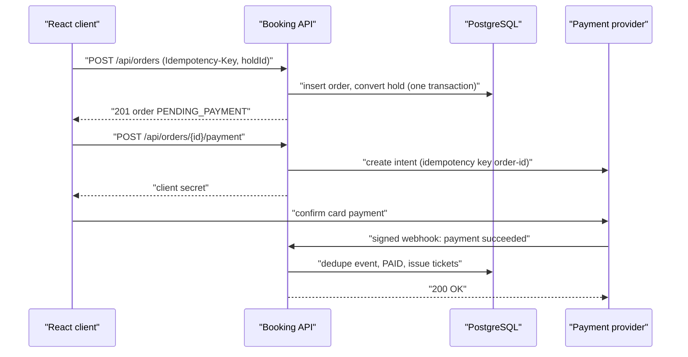
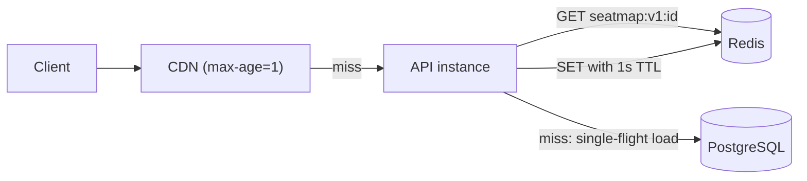
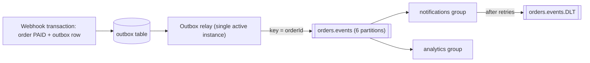
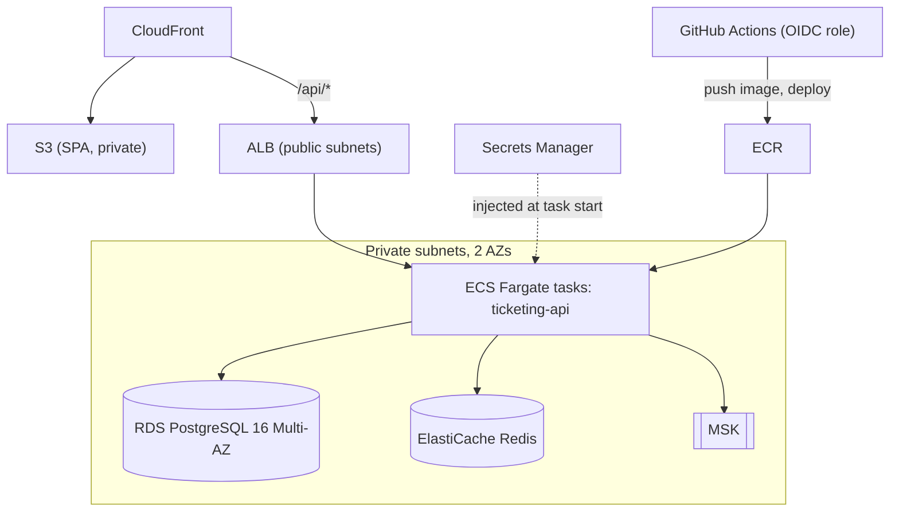
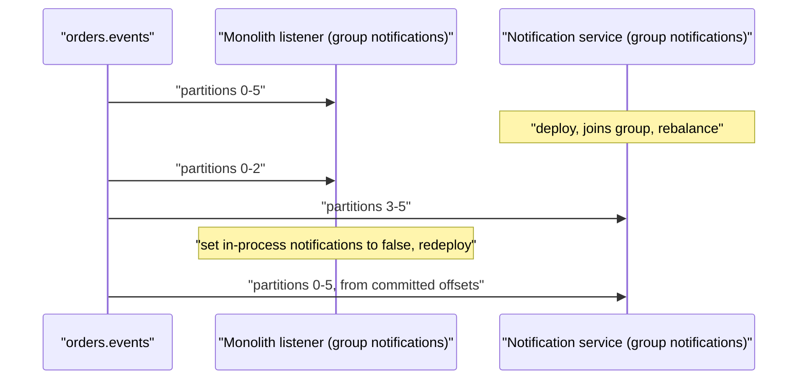

## Overview {#overview}

A concert goes on sale at 10:00. Fifty thousand seats, half a million people refreshing the page at 09:59. In the first minute, thousands of people click the same front-row seat within the same few milliseconds. Exactly one of them may get it. Everyone else must be told quickly and honestly that it is gone, nobody may be charged for a seat they did not get, nobody may be charged twice because their phone retried a request, and a seat abandoned in someone's basket must come back on sale after a few minutes.

That is the system you will build: a **ticket booking platform with flash-sale behaviour**. It is small enough to finish alone, and hard enough that almost every topic in the curriculum turns up as a real need rather than as an exercise. You will not add Redis because "systems have Redis", or Kafka because "systems have Kafka". You will add each piece when a measurement or a failure tells you to, and you will write down what it costs.

### What you build

The finished product has three kinds of users. **Customers** browse events, pick seats on a seat map, hold them for a few minutes, and pay. **Organizers** create events and see sales. **Admins** can see everything and fix problems. Behind those screens the system must:

- show a live seat map that thousands of people poll at once;
- let a customer **hold** seats for ten minutes, and guarantee that two customers can never hold or buy the same seat;
- turn a hold into an order, take payment through an external payment provider, and issue tickets only when the payment is confirmed;
- release seats automatically when holds or unpaid orders expire;
- send confirmation emails and analytics events without slowing down checkout;
- survive retries, duplicate requests, slow dependencies and crashed instances without corrupting data.

The stack is fixed so you practise the tools named in the curriculum: **React 19 + TypeScript 5** (Vite) for the frontend, **Java 21 + Spring Boot 3** for the backend, **PostgreSQL 16** as the source of truth, **Redis 7** for caching and rate limiting, **Apache Kafka** for asynchronous events, **Docker** for every environment, and **AWS** for production.

### Why this project teaches the whole curriculum

Ticketing has a property most CRUD apps lack: **contention on a small number of rows**. A blog with a million readers is easy because readers do not fight over the same thing. A flash sale is hard because the most desirable seats are a few hundred rows that everyone writes to at the same moment. That single property forces you to understand isolation levels, row locks, MVCC, idempotency, caching staleness, queueing, back-pressure and horizontal scaling, because the naive version of each one breaks visibly. When it breaks, you can measure it, which is what makes the lessons stick.

It is also a money system. Payments add an external dependency you do not control, webhooks that arrive late, twice, or out of order, and a state machine where some transitions must never happen. That brings in reliability patterns (retries, compensation, dead-letter queues) for reasons you will feel rather than memorise.

A quick capacity estimate shows why the architecture has to evolve. Assume 500,000 people arrive in the first five minutes and each polls the seat map every two seconds:

| Quantity | Arithmetic | Result |
|---|---|---|
| Seat-map reads | 500,000 users × 0.5 requests/s | 250,000 reads/s |
| Hold attempts | ~10 attempts per seat × 50,000 seats ÷ 300 s | ~1,700 writes/s |
| Successful holds | bounded by seats | ≤ 50,000 in total |
| Payment webhooks | one per paid order, spread over ~15 minutes | ~55/s |

The read side is two orders of magnitude larger than the write side, and the write side is concentrated on a tiny, hot set of rows. Those two facts drive almost every decision in the guide: reads are served from caches, writes are made correct with database constraints and conditional updates, and the expensive work that does not have to happen during checkout is pushed onto Kafka. You will work at a smaller scale on a laptop (2,000 seats, around 2,000 requests per second) but the shape of the problem is the same.

### The architecture you will end with



Read the diagram from left to right. The browser only ever talks to CloudFront, so the single-page app and the API share one origin and you never fight CORS in production. Every booking request reaches a stateless API instance; any instance can serve any request because all shared state lives in PostgreSQL (truth) or Redis (fast, disposable copies and counters). Anything that can happen after the customer gets a response, such as emails, analytics and ticket PDFs, leaves the API as a Kafka event written through the outbox. Only one piece, notifications, has been extracted into its own service, and Milestone 10 explains why that one and not the others.

### How the milestones map to the architecture evolution

| Stage | Milestones | What changes |
|---|---|---|
| Simple monolith | 1–2 | One Spring Boot app, one database, one React app |
| Modular monolith | 3–4 | Feature modules with enforced boundaries; the full booking domain |
| Caching | 5 | Redis in front of hot reads; rate limits at the edge of the write path |
| Async processing | 6 | Kafka with a transactional outbox; retries and dead-letter topics |
| Identify bottlenecks | 7–8 | Telemetry first, then load tests that point at the real constraint |
| Horizontal scaling | 8–9 | Stateless replicas, connection budgets, AWS deployment |
| Selective service separation | 10 | Extract one service, deliberately, and count the cost |

Identifying bottlenecks appears after caching and async here, not before, for a practical reason: you need observability (Milestone 7) to identify anything honestly. In Milestones 5 and 6 you add caching and Kafka for reasons you can already argue from the capacity table; in Milestone 8 you check whether those arguments held.

### How to use this guide

Work through the milestones in order; each one assumes the code from the previous one. Every milestone has the same shape. **Goal** says what exists at the end. **Concepts you will use** links the curriculum lessons to read first if a term is unfamiliar. **Architecture and design decisions** explains *why* the code is shaped the way it is, including the alternatives you are rejecting. **Implementation steps** walk through the real code. **Tasks** is your checklist, and **Completion criteria** are checks you can run, not feelings. Do not move on until the criteria pass; most later milestones lean on an earlier guarantee.

Keep a file called `DECISIONS.md` in the repository and write one short entry per significant decision: the context, the options, what you chose and what it costs. By the end you will have an architecture decision record that is worth more in an interview than the code itself.

> [!TIP] Budget your time
> The `minutes` estimate covers reading. Building the whole project realistically takes 60–100 hours. Milestones 3 and 4 are the heart of it; if you only have a weekend, do Milestones 1–4 well rather than all ten badly.

## Milestone 1 — Monolith skeleton {#m1}

### Goal

A running Spring Boot application backed by PostgreSQL, with a versioned schema for events, seats and orders, a read API for the seat map, a React shell that renders it, and an integration test that runs against a real PostgreSQL in a container. Everything starts with one command.

### Concepts you will use

- [[d4-single-server]] and [[d7-monolith-modular-monolith]] — why the first version is deliberately one deployable unit.
- [[c6-package-by-feature]] and [[c6-project-structure]] — organising code by business capability from the first commit.
- [[c7-schema-design]], [[c7-constraints]], [[c7-unique-constraint]] and [[c7-identity-columns]] — encoding rules in the schema, not only in Java.
- [[c8-flyway-liquibase]] and [[c7-schema-migrations]] — versioned, repeatable schema changes.
- [[c8-entities]] and [[c8-enum-mapping]] — mapping tables to JPA entities.
- [[c6-rest-controllers]] and [[c6-record-dtos]] — the HTTP layer and why it does not return entities.
- [[c14-compose]] and [[c14-compose-depends-health]] — local infrastructure as code.
- [[c13-testcontainers]] and [[c6-testcontainers-serviceconnection]] — integration tests against the real database.
- [[b2-vite-typescript]], [[b4-react-router]] and [[b4-tanstack-query]] — the frontend shell and server-state fetching.

### Architecture and design decisions

**Start with a monolith, organised as if it might not stay one.** A single deployable is the right first architecture: one build, one process to debug, one database transaction can cover everything, and you can change your mind about boundaries with an IDE refactor instead of a cross-team migration. The cost of a monolith is not that it is one process; it is the tangle that grows when every class can call every other class. So from the first commit, organise packages **by feature** (`catalog`, `identity`, `booking`, `payment`, `notification`) rather than by layer (`controllers`, `services`, `repositories`). A feature package owns its controller, service, repository and entities. Later, in Milestone 4, you will make those boundaries enforceable; in Milestone 10 you will see that this is what makes extraction cheap.

**PostgreSQL is the source of truth, and the schema enforces the rules it can.** Application code has bugs and can run in many copies at once; a constraint runs inside the database for every writer. A seat's position is unique within an event, prices cannot be negative, and statuses come from a fixed set. Those go into the schema as `UNIQUE` and `CHECK` constraints. This sounds like belt-and-braces now; in Milestone 3 a constraint will be the thing that actually prevents an oversell.

**Model seats as rows, not a counter.** For general-admission tickets you could store `remaining = 5000` and decrement it. Assigned seating needs one row per seat, because the customer chooses a specific seat and two customers must not get the same one. One row per seat also makes contention visible and testable: the "hot rows" are literal rows. A 50,000-seat stadium is 50,000 rows, which is tiny for PostgreSQL.

**Flyway owns the schema; Hibernate never creates tables.** With `spring.jpa.hibernate.ddl-auto=update`, the schema is whatever Hibernate guessed last time it started, which differs between machines and cannot express partial indexes, check constraints or data migrations. Flyway runs numbered SQL files in order and records them in `flyway_schema_history`, so every environment converges on the same schema. Set `ddl-auto` to `none`, and let integration tests catch mapping mistakes.

**Controllers return DTOs, never entities.** Serialising a JPA entity couples your public API to your table layout, can trigger lazy-loading queries during JSON rendering, and leaks fields you did not mean to publish. Java records make DTOs one line each.



### Implementation steps

1. **Create the repository layout.** Use a single repository with two applications and shared infrastructure:

```text title="Repository layout"
ticketing/
  backend/            Spring Boot 3, Java 21, Gradle
  frontend/           React 19, TypeScript 5, Vite
  infra/              docker-compose.yml, Prometheus config, k6 scripts
  DECISIONS.md
```

2. **Generate the backend.** Use Spring Initializr or write the build file directly. The versions below are the baseline for the whole guide; use the newest 3.5.x patch when you start.

```kotlin title="backend/build.gradle.kts"
plugins {
    java
    id("org.springframework.boot") version "3.5.0"
    id("io.spring.dependency-management") version "1.1.7"
}

group = "dev.ticketing"
version = "0.1.0"

java {
    toolchain { languageVersion = JavaLanguageVersion.of(21) }
}

repositories { mavenCentral() }

dependencies {
    implementation("org.springframework.boot:spring-boot-starter-web")
    implementation("org.springframework.boot:spring-boot-starter-data-jpa")
    implementation("org.springframework.boot:spring-boot-starter-validation")
    implementation("org.springframework.boot:spring-boot-starter-actuator")
    implementation("org.flywaydb:flyway-core")
    implementation("org.flywaydb:flyway-database-postgresql")
    runtimeOnly("org.postgresql:postgresql")

    testImplementation("org.springframework.boot:spring-boot-starter-test")
    testImplementation("org.springframework.boot:spring-boot-testcontainers")
    testImplementation("org.testcontainers:junit-jupiter")
    testImplementation("org.testcontainers:postgresql")
    testRuntimeOnly("org.junit.platform:junit-platform-launcher")
}

tasks.test { useJUnitPlatform() }
```

Two lines deserve a comment. Since Flyway 10, database support is split into modules, so `flyway-database-postgresql` is required or Flyway refuses to start against PostgreSQL. The Spring Boot plugin's dependency management supplies versions for Flyway, the PostgreSQL driver and Testcontainers, which is why those lines have no version numbers; pinning them yourself is how you end up with incompatible combinations.

3. **Start PostgreSQL with Docker Compose.** The health check matters: without it, `depends_on` only waits for the container to *start*, not for PostgreSQL to accept connections.

```yaml title="infra/docker-compose.yml"
services:
  postgres:
    image: postgres:16-alpine
    environment:
      POSTGRES_DB: ticketing
      POSTGRES_USER: ticketing
      POSTGRES_PASSWORD: ticketing
    ports:
      - "5432:5432"
    volumes:
      - pgdata:/var/lib/postgresql/data
    healthcheck:
      test: ["CMD-SHELL", "pg_isready -U ticketing -d ticketing"]
      interval: 5s
      timeout: 3s
      retries: 10

volumes:
  pgdata:
```

4. **Write the first migration.** This is the schema for the catalogue and for orders. Holds, users and payments arrive in later migrations, which is deliberate: you will practise evolving a schema that already has data.

```sql title="backend/src/main/resources/db/migration/V1__catalog_and_orders.sql"
CREATE TABLE events (
    id             BIGINT GENERATED ALWAYS AS IDENTITY PRIMARY KEY,
    name           TEXT        NOT NULL,
    venue          TEXT        NOT NULL,
    starts_at      TIMESTAMPTZ NOT NULL,
    sale_opens_at  TIMESTAMPTZ NOT NULL,
    status         TEXT        NOT NULL DEFAULT 'DRAFT'
                   CHECK (status IN ('DRAFT', 'ON_SALE', 'CLOSED'))
);

CREATE TABLE seats (
    id           BIGINT GENERATED ALWAYS AS IDENTITY PRIMARY KEY,
    event_id     BIGINT  NOT NULL REFERENCES events (id),
    section      TEXT    NOT NULL,
    row_label    TEXT    NOT NULL,
    seat_number  INT     NOT NULL CHECK (seat_number > 0),
    price_cents  INT     NOT NULL CHECK (price_cents >= 0),
    status       TEXT    NOT NULL DEFAULT 'AVAILABLE'
                 CHECK (status IN ('AVAILABLE', 'HELD', 'SOLD')),
    version      BIGINT  NOT NULL DEFAULT 0,
    CONSTRAINT uq_seat_position UNIQUE (event_id, section, row_label, seat_number)
);

-- The seat map query filters by event; the unique constraint's index already
-- starts with event_id, so it serves that query without a second index.

CREATE TABLE orders (
    id           UUID        PRIMARY KEY,
    event_id     BIGINT      NOT NULL REFERENCES events (id),
    status       TEXT        NOT NULL,
    total_cents  INT         NOT NULL CHECK (total_cents >= 0),
    created_at   TIMESTAMPTZ NOT NULL DEFAULT now(),
    updated_at   TIMESTAMPTZ NOT NULL DEFAULT now()
);

CREATE TABLE order_items (
    order_id     UUID   NOT NULL REFERENCES orders (id),
    seat_id      BIGINT NOT NULL REFERENCES seats (id),
    price_cents  INT    NOT NULL,
    PRIMARY KEY (order_id, seat_id)
);
```

Notice what each choice buys. `GENERATED ALWAYS AS IDENTITY` is the SQL-standard replacement for `SERIAL` and stops anyone accidentally inserting their own ids. `TIMESTAMPTZ` stores an absolute instant, so "sale opens at 10:00 in London" means the same thing to a server in Virginia. Prices are integer cents because floating-point cannot represent most decimal amounts exactly. Orders use `UUID` keys because, later, the client and other services will refer to orders and you do not want sequential ids that leak your sales volume or can be guessed. The comment about indexes is a habit worth building: before adding an index, check whether an existing one already serves the query, because each index slows every write.

5. **Seed development data separately from schema.** Put seed scripts in a different folder and only include it in the `dev` profile, so production never receives fake events.

```sql title="backend/src/main/resources/db/seed/V1000__dev_seed.sql"
INSERT INTO events (name, venue, starts_at, sale_opens_at, status)
VALUES ('Arena Rock Night', 'City Arena', now() + interval '30 days', now(), 'ON_SALE');

INSERT INTO seats (event_id, section, row_label, seat_number, price_cents)
SELECT e.id, s.section, chr(64 + r), n,
       CASE s.section WHEN 'FLOOR' THEN 12000 ELSE 6000 END
FROM events e
CROSS JOIN (VALUES ('FLOOR'), ('BALCONY')) AS s (section)
CROSS JOIN generate_series(1, 20) AS r
CROSS JOIN generate_series(1, 50) AS n
WHERE e.name = 'Arena Rock Night';
```

Two sections × 20 rows (A to T, via `chr(64 + r)`) × 50 seats gives 2,000 seats, which is the size used by the load tests later. The version number 1000 keeps seed scripts ordered after any real migration you will write in this project.

```yaml title="backend/src/main/resources/application.yml"
spring:
  application:
    name: ticketing-api
  datasource:
    url: jdbc:postgresql://localhost:5432/ticketing
    username: ticketing
    password: ticketing
  jpa:
    hibernate:
      ddl-auto: none
    open-in-view: false
  flyway:
    locations: classpath:db/migration

---
spring:
  config:
    activate:
      on-profile: dev
  flyway:
    locations: classpath:db/migration,classpath:db/seed
```

`open-in-view: false` turns off the Open Session in View filter, which otherwise keeps a database connection checked out for the whole HTTP request, including JSON rendering. Under flash-sale load, connections are the scarcest resource you have, and you want each one returned as soon as the transaction ends.

6. **Map the seat entity and write the read path.** The `catalog` package owns events and seats for now.

```java title="backend/src/main/java/dev/ticketing/catalog/Seat.java"
package dev.ticketing.catalog;

import jakarta.persistence.*;

@Entity
@Table(name = "seats")
public class Seat {

    public enum Status { AVAILABLE, HELD, SOLD }

    @Id
    private Long id;

    @Column(name = "event_id", nullable = false)
    private Long eventId;

    private String section;

    @Column(name = "row_label")
    private String rowLabel;

    @Column(name = "seat_number")
    private int seatNumber;

    @Column(name = "price_cents")
    private int priceCents;

    @Enumerated(EnumType.STRING)
    private Status status;

    @Version
    private long version;

    protected Seat() { }   // required by JPA

    public Long getId() { return id; }
    public Long getEventId() { return eventId; }
    public String getSection() { return section; }
    public String getRowLabel() { return rowLabel; }
    public int getSeatNumber() { return seatNumber; }
    public int getPriceCents() { return priceCents; }
    public Status getStatus() { return status; }
    public void setStatus(Status status) { this.status = status; }
}
```

`EnumType.STRING` stores `'AVAILABLE'` rather than the ordinal `0`; with ordinals, reordering the enum silently corrupts every row. The `@Version` field is mapped now and becomes important in Milestone 3. There is no `@GeneratedValue` because seats are created by SQL, not by Java, in this project.

```java title="backend/src/main/java/dev/ticketing/catalog/SeatRepository.java"
package dev.ticketing.catalog;

import java.util.List;
import org.springframework.data.jpa.repository.JpaRepository;

public interface SeatRepository extends JpaRepository<Seat, Long> {
    List<Seat> findByEventIdOrderBySectionAscRowLabelAscSeatNumberAsc(long eventId);
}
```

```java title="backend/src/main/java/dev/ticketing/catalog/SeatMapController.java"
package dev.ticketing.catalog;

import java.util.List;
import org.springframework.web.bind.annotation.*;

@RestController
@RequestMapping("/api/events/{eventId}/seats")
class SeatMapController {

    record SeatView(long id, String section, String row, int number,
                    int priceCents, String status) { }

    private final SeatRepository seats;

    SeatMapController(SeatRepository seats) { this.seats = seats; }

    @GetMapping
    List<SeatView> seatMap(@PathVariable long eventId) {
        return seats.findByEventIdOrderBySectionAscRowLabelAscSeatNumberAsc(eventId).stream()
                .map(s -> new SeatView(s.getId(), s.getSection(), s.getRowLabel(),
                        s.getSeatNumber(), s.getPriceCents(), s.getStatus().name()))
                .toList();
    }
}
```

The controller is package-private and the DTO is a nested record. Nothing outside `catalog` needs to know they exist, and keeping visibility tight is the cheapest boundary enforcement Java offers. Add an `EventController` with `GET /api/events` and `GET /api/events/{id}` the same way.

7. **Write the first integration test.** Spring Boot 3.1+ can wire a Testcontainers container straight into the datasource with `@ServiceConnection`, so the test needs no URL juggling.

```java title="backend/src/test/java/dev/ticketing/catalog/SeatMapIT.java"
package dev.ticketing.catalog;

import static org.springframework.test.web.servlet.request.MockMvcRequestBuilders.get;
import static org.springframework.test.web.servlet.result.MockMvcResultMatchers.*;

import org.junit.jupiter.api.Test;
import org.springframework.beans.factory.annotation.Autowired;
import org.springframework.boot.test.autoconfigure.web.servlet.AutoConfigureMockMvc;
import org.springframework.boot.test.context.SpringBootTest;
import org.springframework.boot.testcontainers.service.connection.ServiceConnection;
import org.springframework.test.context.ActiveProfiles;
import org.springframework.test.web.servlet.MockMvc;
import org.testcontainers.containers.PostgreSQLContainer;
import org.testcontainers.junit.jupiter.Container;
import org.testcontainers.junit.jupiter.Testcontainers;

@SpringBootTest
@AutoConfigureMockMvc
@Testcontainers
@ActiveProfiles("dev")
class SeatMapIT {

    @Container
    @ServiceConnection
    static PostgreSQLContainer<?> postgres = new PostgreSQLContainer<>("postgres:16-alpine");

    @Autowired MockMvc mvc;

    @Test
    void returnsTheSeededSeatMap() throws Exception {
        mvc.perform(get("/api/events/1/seats"))
           .andExpect(status().isOk())
           .andExpect(jsonPath("$.length()").value(2000))
           .andExpect(jsonPath("$[0].status").value("AVAILABLE"));
    }
}
```

Testing against real PostgreSQL rather than H2 matters for this project in particular. Locking behaviour, `SKIP LOCKED`, data-modifying CTEs and partial indexes are exactly the features later milestones depend on, and H2 either lacks them or behaves differently. A test that passes on H2 tells you nothing about a race on PostgreSQL.

8. **Create the React shell.** Scaffold with `npm create vite@latest frontend -- --template react-ts`, then add `@tanstack/react-query` and `react-router`. Proxy `/api` to Spring Boot so the browser sees a single origin in development, mirroring the CloudFront setup in production.

```ts title="frontend/vite.config.ts"
import { defineConfig } from 'vite'
import react from '@vitejs/plugin-react'

export default defineConfig({
  plugins: [react()],
  server: {
    proxy: { '/api': 'http://localhost:8080' },
  },
})
```

```tsx title="frontend/src/features/seatmap/SeatMap.tsx"
import { useQuery } from '@tanstack/react-query'

export type SeatStatus = 'AVAILABLE' | 'HELD' | 'SOLD'

export interface SeatView {
  id: number
  section: string
  row: string
  number: number
  priceCents: number
  status: SeatStatus
}

async function fetchSeats(eventId: number): Promise<SeatView[]> {
  const res = await fetch(`/api/events/${eventId}/seats`)
  if (!res.ok) throw new Error(`Seat map failed: ${res.status}`)
  return res.json() as Promise<SeatView[]>
}

export function SeatMap({ eventId }: { eventId: number }) {
  const { data, isPending, error } = useQuery({
    queryKey: ['seats', eventId],
    queryFn: () => fetchSeats(eventId),
    refetchInterval: 2000, // a flash sale changes by the second
  })

  if (isPending) return <p>Loading seats…</p>
  if (error) return <p role="alert">Could not load seats.</p>

  return (
    <div className="seat-grid">
      {data.map((s) => (
        <button
          key={s.id}
          disabled={s.status !== 'AVAILABLE'}
          aria-label={`${s.section} row ${s.row} seat ${s.number}`}
          className={`seat seat--${s.status.toLowerCase()}`}
        >
          {s.number}
        </button>
      ))}
    </div>
  )
}
```

TanStack Query owns the server state: caching per `queryKey`, de-duplicating requests when two components ask for the same seat map, and re-polling every two seconds. Polling is the simplest correct choice for now; note in `DECISIONS.md` that 250,000 polls per second at full scale is the number that will force caching in Milestone 5. Each seat is a real `<button>` with an `aria-label`, so the seat map is usable with a keyboard and a screen reader from the start; retrofitting accessibility onto a canvas-based seat map later is far harder.

### Tasks

- [ ] Create the repository layout and `DECISIONS.md` with an entry for "monolith first, packaged by feature"
- [ ] Bring up PostgreSQL with `docker compose up -d` and confirm the health check reports healthy
- [ ] Write `V1__catalog_and_orders.sql` and the dev seed; start the app with `--spring.profiles.active=dev`
- [ ] Implement `GET /api/events`, `GET /api/events/{id}` and `GET /api/events/{id}/seats` with record DTOs
- [ ] Add a `@RestControllerAdvice` that returns RFC 9457 `ProblemDetail` bodies for not-found and validation errors
- [ ] Write `SeatMapIT` and a second test that asserts inserting a duplicate seat position violates `uq_seat_position`
- [ ] Scaffold the React app with the Vite proxy, an event list page and the seat map page

### Completion criteria

- `./gradlew test` passes with Testcontainers starting `postgres:16-alpine`; no test uses H2.
- `SELECT version, description FROM flyway_schema_history` shows V1 and, in dev, V1000.
- `curl localhost:8080/api/events/1/seats | jq length` prints `2000`.
- Inserting a second seat with the same event, section, row and number fails with SQLSTATE `23505` (unique violation).
- The React seat map renders 2,000 buttons, and the network tab shows a seat-map request every two seconds to `/api/...` on the Vite origin, with no CORS errors.

## Milestone 2 — Authentication and authorization {#m2}

### Goal

Customers can register and log in; the API issues short-lived signed access tokens; every booking endpoint knows *who* is calling (authentication) and checks *whether they may* do it (authorization), both by role and by ownership of the specific resource.

### Concepts you will use

- [[c9-authentication]] and [[c9-authz-after-authn]] — the two separate questions every request answers.
- [[c9-password-hashing]], [[c9-bcrypt-cost]] and [[c9-password-encoder-spring]] — storing passwords so a database leak is not a credential leak.
- [[c9-session-vs-token-auth]] and [[c9-jwt-vs-opaque]] — choosing the token model.
- [[c9-jwt]], [[c9-jwt-structure]] and [[c9-resource-server-jwt]] — signed tokens validated by Spring Security.
- [[c9-security-filter-chain]] and [[c9-csrf-disable-stateless]] — configuring the request pipeline.
- [[c9-rbac]], [[c9-roles-authorities-scopes]] and [[c9-preauthorize-spel]] — role checks.
- [[c9-broken-access-control]] — the object-level checks roles cannot do.
- [[c9-localstorage-xss]], [[c9-refresh-token-rotation]] and [[b6-auth-refresh]] — where the browser keeps tokens.
- [[b4-protected-routes]] — guarding routes in React.

### Architecture and design decisions

**Why tokens rather than server sessions?** A server-side session stores login state in the server's memory (or a shared store) and gives the browser a cookie with the session id. It is simple and revocable. The cost appears in Milestone 8, when you run several API instances: either every instance must reach a shared session store, or the load balancer must pin each user to one instance (sticky sessions), which defeats even load spreading exactly when a flash sale needs it. A **signed access token** (a JWT) carries the user id and roles inside it, with a signature the server can verify using only a key. Any instance can authenticate any request with no lookup. The price is revocation: a stolen token stays valid until it expires. You pay that price down by making access tokens short-lived (15 minutes) and, as a stretch task, adding rotating refresh tokens.

**Why issue tokens yourself with a symmetric key?** In a company you would usually delegate login to an identity provider (Cognito, Auth0, Keycloak) using OAuth 2.0 / OpenID Connect, and your API would validate tokens against the provider's public keys (JWKS). Building a tiny issuer here teaches what those providers do. You sign with HMAC-SHA256 (HS256) and a 256-bit secret because issuer and validator are the same application. The moment a second service needs to validate tokens, switch to an asymmetric algorithm (RS256 or ES256) so validators only hold the public key; record that trigger in `DECISIONS.md`.

**Authorization has two layers, and the second is the one people forget.** Role-based checks answer "may a CUSTOMER call `POST /api/orders` at all?". They cannot answer "may customer 42 read order `9f3c…`?". That is an object-level check, and missing it is the most common serious API vulnerability, called Broken Object Level Authorization in the OWASP API Top 10. The rule in this project: every query for a user-owned resource includes the owner in the `WHERE` clause, and a resource that exists but belongs to someone else returns `404`, not `403`, so attackers cannot discover which ids exist.

**CSRF protection is disabled, and that is safe only because of how the token travels.** Cross-site request forgery works because browsers attach cookies automatically to cross-site requests. A bearer token in an `Authorization` header is never attached automatically, so a forged request from another site arrives unauthenticated. If you later move the token into a cookie, CSRF protection must come back on.

### Implementation steps

1. **Add dependencies and the users table.**

```kotlin title="backend/build.gradle.kts (additions)"
implementation("org.springframework.boot:spring-boot-starter-security")
implementation("org.springframework.boot:spring-boot-starter-oauth2-resource-server")
testImplementation("org.springframework.security:spring-security-test")
```

```sql title="db/migration/V2__users.sql"
CREATE TABLE users (
    id             BIGINT GENERATED ALWAYS AS IDENTITY PRIMARY KEY,
    email          TEXT        NOT NULL,
    password_hash  TEXT        NOT NULL,
    role           TEXT        NOT NULL CHECK (role IN ('CUSTOMER', 'ORGANIZER', 'ADMIN')),
    created_at     TIMESTAMPTZ NOT NULL DEFAULT now()
);

-- Emails are case-insensitive in practice; enforce uniqueness on the lowered form.
CREATE UNIQUE INDEX uq_users_email ON users (lower(email));

ALTER TABLE events ADD COLUMN organizer_id BIGINT REFERENCES users (id);
ALTER TABLE orders ADD COLUMN user_id BIGINT REFERENCES users (id);
```

The expression index on `lower(email)` prevents `Ana@x.com` and `ana@x.com` from becoming two accounts, a bug a plain `UNIQUE (email)` allows. The new foreign-key columns are nullable because existing rows have no owner; a later migration can backfill and add `NOT NULL`, the usual expand-then-contract approach.

2. **Configure token signing and validation.**

```java title="backend/src/main/java/dev/ticketing/identity/JwtConfig.java"
package dev.ticketing.identity;

import com.nimbusds.jose.jwk.source.ImmutableSecret;
import java.util.Base64;
import javax.crypto.SecretKey;
import javax.crypto.spec.SecretKeySpec;
import org.springframework.beans.factory.annotation.Value;
import org.springframework.context.annotation.*;
import org.springframework.security.oauth2.jose.jws.MacAlgorithm;
import org.springframework.security.oauth2.jwt.*;
import org.springframework.security.oauth2.server.resource.authentication.*;

@Configuration
class JwtConfig {

    private final SecretKey key;

    JwtConfig(@Value("${ticketing.jwt.secret-base64}") String secretBase64) {
        byte[] bytes = Base64.getDecoder().decode(secretBase64);
        if (bytes.length < 32) throw new IllegalStateException("JWT secret must be >= 256 bits");
        this.key = new SecretKeySpec(bytes, "HmacSHA256");
    }

    @Bean
    JwtEncoder jwtEncoder() {
        return new NimbusJwtEncoder(new ImmutableSecret<>(key));
    }

    @Bean
    JwtDecoder jwtDecoder() {
        return NimbusJwtDecoder.withSecretKey(key).macAlgorithm(MacAlgorithm.HS256).build();
    }

    @Bean
    JwtAuthenticationConverter jwtAuthenticationConverter() {
        var authorities = new JwtGrantedAuthoritiesConverter();
        authorities.setAuthoritiesClaimName("roles");  // our claim, not the default "scope"
        authorities.setAuthorityPrefix("ROLE_");        // so hasRole("CUSTOMER") works
        var converter = new JwtAuthenticationConverter();
        converter.setJwtGrantedAuthoritiesConverter(authorities);
        return converter;
    }
}
```

The secret comes from configuration, never from source code. In development it lives in an untracked `.env` file; in production, AWS Secrets Manager injects it (Milestone 9). The length check fails fast at startup instead of producing weak tokens. Pinning the decoder to `HS256` matters: historic JWT libraries accepted whatever algorithm the token header claimed, including `none`.

3. **Issue tokens at login.**

```java title="backend/src/main/java/dev/ticketing/identity/AuthController.java"
package dev.ticketing.identity;

import jakarta.validation.Valid;
import jakarta.validation.constraints.*;
import java.time.Duration;
import java.time.Instant;
import java.util.List;
import org.springframework.http.HttpStatus;
import org.springframework.security.crypto.password.PasswordEncoder;
import org.springframework.security.oauth2.jose.jws.MacAlgorithm;
import org.springframework.security.oauth2.jwt.*;
import org.springframework.web.bind.annotation.*;
import org.springframework.web.server.ResponseStatusException;

@RestController
@RequestMapping("/api/auth")
class AuthController {

    record LoginRequest(@Email @NotBlank String email, @NotBlank String password) { }
    record TokenResponse(String accessToken, Instant expiresAt) { }

    private static final Duration TTL = Duration.ofMinutes(15);

    private final UserRepository users;
    private final PasswordEncoder encoder;
    private final JwtEncoder jwtEncoder;
    private final String dummyHash;

    AuthController(UserRepository users, PasswordEncoder encoder, JwtEncoder jwtEncoder) {
        this.users = users;
        this.encoder = encoder;
        this.jwtEncoder = jwtEncoder;
        this.dummyHash = encoder.encode("timing-equaliser");
    }

    @PostMapping("/login")
    TokenResponse login(@Valid @RequestBody LoginRequest req) {
        var user = users.findByEmailIgnoreCase(req.email());
        // Always run one hash comparison so response time does not reveal
        // whether the email exists.
        String hash = user.map(UserAccount::passwordHash).orElse(dummyHash);
        boolean ok = encoder.matches(req.password(), hash);
        if (user.isEmpty() || !ok) {
            throw new ResponseStatusException(HttpStatus.UNAUTHORIZED, "Invalid credentials");
        }
        var u = user.get();
        Instant now = Instant.now();
        var claims = JwtClaimsSet.builder()
                .issuer("ticketing-api")
                .subject(String.valueOf(u.id()))
                .issuedAt(now)
                .expiresAt(now.plus(TTL))
                .claim("roles", List.of(u.role()))
                .build();
        var header = JwsHeader.with(MacAlgorithm.HS256).build();
        String token = jwtEncoder.encode(JwtEncoderParameters.from(header, claims)).getTokenValue();
        return new TokenResponse(token, now.plus(TTL));
    }
}
```

The same error message for "unknown email" and "wrong password", plus a dummy hash comparison, closes two user-enumeration leaks: one through the message, one through timing. BCrypt is deliberately slow (around 50–100 ms at the default cost of 10), so skipping it for unknown emails would make them measurably faster. Define the `PasswordEncoder` bean with `PasswordEncoderFactories.createDelegatingPasswordEncoder()`, which writes a `{bcrypt}` prefix into each hash so you can migrate to Argon2 later without invalidating existing passwords. Registration is a similar endpoint that validates input, hashes the password and inserts a `CUSTOMER`.

4. **Define the security filter chain.**

```java title="backend/src/main/java/dev/ticketing/identity/SecurityConfig.java"
package dev.ticketing.identity;

import org.springframework.context.annotation.*;
import org.springframework.http.HttpMethod;
import org.springframework.security.config.annotation.method.configuration.EnableMethodSecurity;
import org.springframework.security.config.annotation.web.builders.HttpSecurity;
import org.springframework.security.config.http.SessionCreationPolicy;
import org.springframework.security.crypto.factory.PasswordEncoderFactories;
import org.springframework.security.crypto.password.PasswordEncoder;
import org.springframework.security.oauth2.server.resource.authentication.JwtAuthenticationConverter;
import org.springframework.security.web.SecurityFilterChain;

@Configuration
@EnableMethodSecurity
class SecurityConfig {

    @Bean
    SecurityFilterChain api(HttpSecurity http, JwtAuthenticationConverter converter) throws Exception {
        return http
            .csrf(csrf -> csrf.disable()) // bearer tokens are not sent automatically by browsers
            .sessionManagement(s -> s.sessionCreationPolicy(SessionCreationPolicy.STATELESS))
            .authorizeHttpRequests(auth -> auth
                .requestMatchers(HttpMethod.POST, "/api/auth/**").permitAll()
                .requestMatchers(HttpMethod.GET, "/api/events/**").permitAll()
                .requestMatchers("/api/webhooks/**").permitAll() // verified by signature instead
                .requestMatchers("/actuator/health/**").permitAll()
                .requestMatchers(HttpMethod.POST, "/api/events").hasRole("ORGANIZER")
                .requestMatchers("/api/admin/**").hasRole("ADMIN")
                .anyRequest().authenticated())
            .oauth2ResourceServer(o -> o.jwt(jwt -> jwt.jwtAuthenticationConverter(converter)))
            .build();
    }

    @Bean
    PasswordEncoder passwordEncoder() {
        return PasswordEncoderFactories.createDelegatingPasswordEncoder();
    }
}
```

Rules are evaluated top to bottom and the first match wins, so specific rules come before `anyRequest()`. `anyRequest().authenticated()` makes the default *deny unless logged in*: a new endpoint you forget to list is protected rather than public, which is the fail-closed choice. Webhooks are public at this layer because the payment provider has no user token; Milestone 4 authenticates them with an HMAC signature.

5. **Enforce ownership in queries, and owner checks in method security.**

```java title="backend/src/main/java/dev/ticketing/booking/OrderQueryController.java"
@GetMapping("/api/orders/{orderId}")
OrderView get(@PathVariable UUID orderId, @AuthenticationPrincipal Jwt jwt) {
    long userId = Long.parseLong(jwt.getSubject());
    return orders.findByIdAndUserId(orderId, userId)   // owner is part of the lookup
            .map(OrderView::from)
            .orElseThrow(() -> new ResponseStatusException(HttpStatus.NOT_FOUND));
}
```

```java title="backend/src/main/java/dev/ticketing/catalog/EventAdminController.java"
@PutMapping("/api/events/{eventId}")
@PreAuthorize("hasRole('ADMIN') or @eventAccess.isOrganizer(#eventId, authentication)")
EventView update(@PathVariable long eventId, @Valid @RequestBody UpdateEvent body) {
    return events.update(eventId, body);
}
```

`@eventAccess` refers to a Spring bean named `eventAccess` with a method that loads the event and compares `organizer_id` to the token subject. Keeping that logic in a bean, not inline SpEL, makes it unit-testable. Method security only works on calls that go through the Spring proxy, so a call from another method inside the same class bypasses it; keep these annotations on controller or service entry points.

6. **Keep the token in memory on the frontend.**

```tsx title="frontend/src/features/auth/AuthContext.tsx"
import { createContext, useContext, useState, type ReactNode } from 'react'

interface Session { accessToken: string; expiresAt: string }
interface AuthValue {
  session: Session | null
  login: (email: string, password: string) => Promise<void>
  logout: () => void
}

const AuthContext = createContext<AuthValue | null>(null)

export function AuthProvider({ children }: { children: ReactNode }) {
  const [session, setSession] = useState<Session | null>(null)

  async function login(email: string, password: string) {
    const res = await fetch('/api/auth/login', {
      method: 'POST',
      headers: { 'Content-Type': 'application/json' },
      body: JSON.stringify({ email, password }),
    })
    if (!res.ok) throw new Error('Invalid email or password')
    setSession((await res.json()) as Session)
  }

  return (
    <AuthContext.Provider value={{ session, login, logout: () => setSession(null) }}>
      {children}
    </AuthContext.Provider>
  )
}

export function useAuth(): AuthValue {
  const ctx = useContext(AuthContext)
  if (!ctx) throw new Error('useAuth must be used inside <AuthProvider>')
  return ctx
}
```

Storing the token in React state rather than `localStorage` means a cross-site scripting bug cannot read it from storage after the fact, though an attacker running script in your page can still make requests while it is open. The trade-off is that a page refresh logs the user out. The standard fix is a refresh token in an `HttpOnly`, `Secure`, `SameSite=Strict` cookie scoped to `/api/auth/refresh`, rotated on every use; it is listed as a stretch task because it reintroduces cookies, and therefore CSRF considerations, for that one endpoint.

### Tasks

- [ ] Write `V2__users.sql`, the `UserAccount` entity and repository
- [ ] Implement register and login; generate a 256-bit secret with `openssl rand -base64 32` and load it from the environment
- [ ] Configure the filter chain, the JWT decoder and the roles converter
- [ ] Protect `GET /api/orders/{id}` with an owner-scoped query; add the `eventAccess` bean and `@PreAuthorize` on event updates
- [ ] Add the auth context, a login page and a `RequireAuth` route wrapper in React; attach `Authorization: Bearer` in one shared `apiFetch` helper
- [ ] Stretch: refresh tokens in an `HttpOnly` cookie with rotation and reuse detection

### Completion criteria

- A request to `POST /api/orders` without a token gets `401`; with a token whose signature was altered by one character gets `401`; with an expired token gets `401`.
- A `CUSTOMER` token calling `POST /api/events` gets `403`; an `ORGANIZER` token succeeds.
- Customer A requesting customer B's order id gets `404`, verified by a MockMvc test using `jwt()` from `spring-security-test`.
- Login with an unknown email and with a wrong password return identical bodies and status codes.
- `SELECT password_hash FROM users LIMIT 1` starts with `{bcrypt}$2a$10$`.

## Milestone 3 — Seat inventory and concurrency-safe holds {#m3}

### Goal

A customer can hold up to eight seats for ten minutes. Under any number of concurrent requests, a seat is held by at most one customer. You prove it with a test that fires 50 simultaneous requests at the same seat, first against a deliberately broken implementation (the test fails) and then against the correct one (exactly one request succeeds, every time).

### Concepts you will use

- [[c3-race-conditions]] and [[c3-check-then-act]] — the bug you are about to write on purpose.
- [[c7-transactions]], [[c7-isolation-levels]] and [[c7-read-committed]] — what PostgreSQL guarantees by default, and what it does not.
- [[c7-mvcc]] and [[c7-row-locks]] — how concurrent updates to one row are serialised.
- [[c8-pessimistic-locking]], [[c8-optimistic-locking]], [[c8-version-column]] and [[c8-optimistic-retry]] — the classic alternatives.
- [[c7-nowait-skip-locked]] — non-blocking locking for "any available seat" queries.
- [[c7-deadlocks]] and [[c7-lock-ordering]] — why multi-seat holds need a consistent order.
- [[c13-concurrency-tests]] and [[c13-postgres-container]] — making a race reproducible in a test.
- [[d10-ticket-oversell]] and [[d10-ticket-holds-locks]] — the system-design view of this exact problem.

### Architecture and design decisions

**The bug: check-then-act.** The obvious code reads the seat, checks that it is `AVAILABLE`, and then writes `HELD`. Under PostgreSQL's default isolation level, Read Committed, each statement sees data committed before *that statement* began. Two transactions can both run the `SELECT`, both see `AVAILABLE`, and both run the `UPDATE`. The second `UPDATE` waits for the first transaction's row lock, but once the first commits, the second proceeds: its `UPDATE` has no condition on status, so it overwrites the first update. Both customers are told "you have the seat". This is a **lost update**, and no amount of careful Java fixes it while the check and the write are separate statements that do not hold a lock in between.

The timeline makes it concrete:

| Time | Transaction A (customer 1) | Transaction B (customer 2) |
|---|---|---|
| t1 | `SELECT status` → `AVAILABLE` | |
| t2 | | `SELECT status` → `AVAILABLE` |
| t3 | `UPDATE seats SET status='HELD'` (takes row lock) | |
| t4 | | `UPDATE seats SET status='HELD'` (waits for lock) |
| t5 | `COMMIT` → "success" | lock granted, update applies |
| t6 | | `COMMIT` → "success" — oversold |

**Four correct designs.** Every correct solution makes the check and the write atomic with respect to other writers. They differ in *where* the waiting happens and what the loser experiences.

| Approach | Mechanism | Loser's experience | Fits when |
|---|---|---|---|
| Conditional update | `UPDATE … WHERE status = 'AVAILABLE'`, check row count | Blocks briefly, then 0 rows → `409` | Hot rows, short transactions (this project) |
| Pessimistic lock | `SELECT … FOR UPDATE`, then check and write | Blocks until the winner commits, then sees `HELD` | Complex checks that need several reads first |
| Optimistic lock | `@Version` column; `UPDATE … WHERE version = ?` | Commit fails with a conflict → retry or `409` | Low contention; long user think-time |
| Unique constraint | Insert a row whose key is the seat; duplicates fail | Unique violation → `409` | "At most one X per Y" invariants |

**This project uses the conditional update for holds, and a unique constraint as the final guard for sold tickets.** The conditional update is one statement, holds its row locks only for the milliseconds of a short transaction, and needs no retry loop. Why is it correct under Read Committed? When transaction B's `UPDATE` finds a row that A has locked, PostgreSQL waits; when A commits, PostgreSQL re-reads the *newest* version of that row and re-evaluates B's `WHERE` clause against it. The newest version says `HELD`, the condition fails, and B updates zero rows. The database, not your code, is the referee.

Optimistic locking is the wrong default here, even though it is excellent elsewhere. Under heavy contention, 50 requests for one seat produce 1 success and 49 failed commits, each of which did all its work before finding out. Optimistic locking shines when conflicts are rare, such as an organizer editing an event description, and you will use it there.

**Multi-seat holds need all-or-nothing behaviour and a lock order.** Holding seats 14, 15 and 16 must either hold all three or none. Run the conditional update for all requested ids in one transaction; if fewer rows changed than were requested, throw, and the transaction rolls back the partial update. Two customers requesting overlapping sets in different orders could deadlock: A locks 14 then wants 15 while B locks 15 then wants 14. SQL does not promise the order in which an `UPDATE … WHERE id IN (…)` visits rows. PostgreSQL detects deadlocks after `deadlock_timeout` (1 second by default) and aborts one transaction with SQLSTATE `40P01`, so correctness is preserved, but a one-second stall on the hottest rows is costly. Either lock rows explicitly in id order first, or treat `40P01` as a retryable error. This guide sorts the ids and, when profiling shows deadlocks, adds the explicit ordered lock.

**Why a separate `holds` table?** A hold is a business object with an owner, an expiry and a lifecycle (`ACTIVE`, `CONVERTED`, `EXPIRED`, `RELEASED`). Seats point at the hold that owns them through `hold_id`. That pointer is what makes later operations safe: releasing an expired hold only touches seats whose `hold_id` still equals that hold, so it can never release a seat someone else has since taken.

### Implementation steps

1. **Add holds and the seat pointer.**

```sql title="db/migration/V3__holds.sql"
CREATE TABLE holds (
    id          UUID        PRIMARY KEY,
    user_id     BIGINT      NOT NULL REFERENCES users (id),
    event_id    BIGINT      NOT NULL REFERENCES events (id),
    status      TEXT        NOT NULL
                CHECK (status IN ('ACTIVE', 'CONVERTED', 'EXPIRED', 'RELEASED')),
    expires_at  TIMESTAMPTZ NOT NULL,
    created_at  TIMESTAMPTZ NOT NULL DEFAULT now()
);

-- The expiry sweeper scans only active holds, ordered by expiry.
CREATE INDEX idx_holds_active_expiry ON holds (expires_at) WHERE status = 'ACTIVE';

ALTER TABLE seats ADD COLUMN hold_id UUID REFERENCES holds (id);

-- A held seat must name its hold; an available seat must not.
ALTER TABLE seats ADD CONSTRAINT chk_seat_hold
    CHECK ((status = 'AVAILABLE') = (hold_id IS NULL) OR status = 'SOLD');
```

The partial index contains only `ACTIVE` holds, so it stays small even after millions of expired ones accumulate. The check constraint encodes an invariant the code must keep: if a bug ever sets `HELD` without a hold id, the database rejects it immediately instead of leaving an orphaned seat nobody can buy.

2. **Write the broken version on purpose.** Put it in the test sources so it can never ship.

```java title="backend/src/test/java/dev/ticketing/booking/NaiveHoldService.java"
package dev.ticketing.booking;

import java.util.UUID;
import org.springframework.jdbc.core.simple.JdbcClient;
import org.springframework.stereotype.Service;
import org.springframework.transaction.annotation.Transactional;

@Service
class NaiveHoldService {

    private final JdbcClient jdbc;

    NaiveHoldService(JdbcClient jdbc) { this.jdbc = jdbc; }

    @Transactional
    UUID hold(long userId, long eventId, long seatId) throws InterruptedException {
        String status = jdbc.sql("SELECT status FROM seats WHERE id = :id")
                .param("id", seatId).query(String.class).single();
        if (!status.equals("AVAILABLE")) throw new SeatsUnavailableException();

        Thread.sleep(20); // widen the window so the race reproduces on every run

        UUID holdId = UUID.randomUUID();
        jdbc.sql("""
                INSERT INTO holds (id, user_id, event_id, status, expires_at)
                VALUES (:id, :user, :event, 'ACTIVE', now() + interval '10 minutes')
                """).param("id", holdId).param("user", userId).param("event", eventId).update();
        jdbc.sql("UPDATE seats SET status = 'HELD', hold_id = :hold WHERE id = :id")
                .param("hold", holdId).param("id", seatId).update();
        return holdId;
    }
}
```

The `Thread.sleep(20)` is honest scaffolding: in production the window between check and act is opened by garbage-collection pauses, slow networks and CPU scheduling, and it is small, so the bug appears once in thousands of sales. Widening it makes the test deterministic. `JdbcClient` (Spring Framework 6.1+) is used for the booking write path because these are a handful of precise SQL statements; JPA's dirty checking would add an extra read and hide the exact SQL you need to reason about.

3. **Write the race test.**

```java title="backend/src/test/java/dev/ticketing/booking/OversellRaceIT.java"
package dev.ticketing.booking;

import static org.assertj.core.api.Assertions.assertThat;

import java.util.ArrayList;
import java.util.List;
import java.util.concurrent.*;
import java.util.concurrent.atomic.AtomicInteger;
import org.junit.jupiter.api.*;
import org.springframework.beans.factory.annotation.Autowired;
import org.springframework.boot.test.context.SpringBootTest;
import org.springframework.boot.testcontainers.service.connection.ServiceConnection;
import org.springframework.jdbc.core.simple.JdbcClient;
import org.springframework.test.context.ActiveProfiles;
import org.testcontainers.containers.PostgreSQLContainer;
import org.testcontainers.junit.jupiter.Container;
import org.testcontainers.junit.jupiter.Testcontainers;

@SpringBootTest
@Testcontainers
@ActiveProfiles("dev")
class OversellRaceIT {

    @Container
    @ServiceConnection
    static PostgreSQLContainer<?> postgres = new PostgreSQLContainer<>("postgres:16-alpine");

    interface Attempt { void run(long userId) throws Exception; }

    static final long EVENT = 1, SEAT = 1;
    static final int CONTENDERS = 50;

    @Autowired JdbcClient jdbc;
    @Autowired HoldService holds;
    @Autowired NaiveHoldService naive;

    List<Long> userIds;

    @BeforeEach
    void reset() {
        jdbc.sql("""
                INSERT INTO users (email, password_hash, role)
                SELECT 'racer' || g || '@test.dev', 'x', 'CUSTOMER' FROM generate_series(1, 50) g
                ON CONFLICT DO NOTHING
                """).update();
        jdbc.sql("UPDATE seats SET status = 'AVAILABLE', hold_id = NULL").update();
        jdbc.sql("DELETE FROM holds").update();
        userIds = jdbc.sql("SELECT id FROM users ORDER BY id LIMIT 50").query(Long.class).list();
    }

    int race(Attempt attempt) throws Exception {
        var startGate = new CountDownLatch(1);
        var successes = new AtomicInteger();
        try (var pool = Executors.newVirtualThreadPerTaskExecutor()) {
            List<Future<?>> futures = new ArrayList<>();
            for (int i = 0; i < CONTENDERS; i++) {
                long userId = userIds.get(i);
                futures.add(pool.submit(() -> {
                    startGate.await();               // everyone starts together
                    try {
                        attempt.run(userId);
                        successes.incrementAndGet();
                    } catch (SeatsUnavailableException lost) {
                        // the expected outcome for 49 of the 50
                    }
                    return null;
                }));
            }
            startGate.countDown();
            for (Future<?> f : futures) f.get(30, TimeUnit.SECONDS); // surface real errors
        }
        return successes.get();
    }

    @Test
    void naiveCheckThenActOversells() throws Exception {
        int winners = race(userId -> naive.hold(userId, EVENT, SEAT));
        assertThat(winners).isGreaterThan(1);    // documents the bug
    }

    @Test
    void conditionalUpdateHasExactlyOneWinner() throws Exception {
        int winners = race(userId -> holds.hold(userId, EVENT, List.of(SEAT)));
        assertThat(winners).isEqualTo(1);
        long holdsForSeat = jdbc.sql("SELECT count(*) FROM holds WHERE status = 'ACTIVE'")
                .query(Long.class).single();
        assertThat(holdsForSeat).isEqualTo(1);   // the losers' holds were rolled back
    }
}
```

The `CountDownLatch` is the important part of a concurrency test: without it, threads start one after another and the "race" is mostly sequential. Virtual threads (Java 21) make 50 blocking tasks cheap; they will queue for the ten connections in the default HikariCP pool, which is fine, because contention on the seat row is what you are testing. `f.get(...)` re-throws any unexpected exception, so a bug such as a constraint violation fails the test loudly instead of being counted as "lost". Run it: the naive test passes (proving the oversell), and the second test fails until you write the real service.

4. **Implement the correct hold.**

```java title="backend/src/main/java/dev/ticketing/booking/HoldService.java"
package dev.ticketing.booking;

import java.time.OffsetDateTime;
import java.util.List;
import java.util.UUID;
import org.springframework.jdbc.core.simple.JdbcClient;
import org.springframework.stereotype.Service;
import org.springframework.transaction.annotation.Transactional;

@Service
public class HoldService {

    public record HoldResult(UUID holdId, List<Long> seatIds, OffsetDateTime expiresAt) { }

    static final int MAX_SEATS_PER_HOLD = 8;

    private final JdbcClient jdbc;

    HoldService(JdbcClient jdbc) { this.jdbc = jdbc; }

    @Transactional
    public HoldResult hold(long userId, long eventId, List<Long> requested) {
        List<Long> seatIds = requested.stream().distinct().sorted().toList();
        if (seatIds.isEmpty() || seatIds.size() > MAX_SEATS_PER_HOLD) {
            throw new IllegalArgumentException("Hold between 1 and " + MAX_SEATS_PER_HOLD + " seats");
        }

        UUID holdId = UUID.randomUUID();
        OffsetDateTime expiresAt = jdbc.sql("""
                INSERT INTO holds (id, user_id, event_id, status, expires_at)
                VALUES (:id, :user, :event, 'ACTIVE', now() + interval '10 minutes')
                RETURNING expires_at
                """)
                .param("id", holdId).param("user", userId).param("event", eventId)
                .query(OffsetDateTime.class).single();

        // Check and write in ONE statement: PostgreSQL re-evaluates the WHERE clause
        // against the newest row version after waiting for a concurrent writer.
        int held = jdbc.sql("""
                UPDATE seats
                   SET status = 'HELD', hold_id = :hold, version = version + 1
                 WHERE event_id = :event
                   AND id IN (:ids)
                   AND status = 'AVAILABLE'
                """)
                .param("hold", holdId).param("event", eventId).param("ids", seatIds)
                .update();

        if (held != seatIds.size()) {
            // Unchecked exception: @Transactional rolls back the hold row and any seats we did take.
            throw new SeatsUnavailableException();
        }
        return new HoldResult(holdId, seatIds, expiresAt);
    }
}
```

Walk through it in order. Normalising the input (`distinct().sorted()`) prevents a client from sending the same seat twice to fool the row-count check, and gives a stable order. The hold row is inserted first so the seats' foreign key has something to point at. Expiry uses the database clock (`now()`), not `Instant.now()` in Java; with several API instances, their clocks can drift apart by seconds, while every comparison against `expires_at` will also happen inside PostgreSQL, so one clock decides everything. The `UPDATE` includes `event_id` so a client cannot hold a seat from another event by guessing its id. Finally, the row count is the whole answer: anything less than "all requested seats" means someone else won at least one, and throwing rolls back everything. `SeatsUnavailableException` is a plain `RuntimeException`; map it to `409 Conflict` with a `ProblemDetail` in your controller advice.

5. **Know the alternatives in code.** You will not ship these for holds, but you should be able to write and defend them.

```java title="Pessimistic and optimistic variants (SeatRepository)"
// Pessimistic: lock rows in id order, then inspect them in Java.
@Lock(LockModeType.PESSIMISTIC_WRITE)                  // SELECT ... FOR UPDATE
@Query("select s from Seat s where s.eventId = :eventId and s.id in :ids order by s.id")
List<Seat> lockSeats(long eventId, Collection<Long> ids);

// Optimistic: plain load; Hibernate adds "AND version = ?" to the UPDATE at flush
// and throws ObjectOptimisticLockingFailureException if another transaction got there first.
List<Seat> findByEventIdAndIdIn(long eventId, Collection<Long> ids);
```

For general admission ("any two seats in the balcony"), the best tool is `SKIP LOCKED`, which lets concurrent buyers take *different* rows instead of queueing for the same ones:

```sql title="Best-available selection without queueing"
SELECT id
  FROM seats
 WHERE event_id = :event AND section = 'BALCONY' AND status = 'AVAILABLE'
 ORDER BY row_label, seat_number
 LIMIT 2
   FOR UPDATE SKIP LOCKED;
```

Rows already locked by another transaction are skipped rather than waited for, so a thousand concurrent "best available" requests spread across a thousand different seat pairs. The trade-off is that "best" becomes approximate: a buyer may get row C while row B is momentarily locked by a transaction that then rolls back.

6. **Handle conflicts in the UI.** Define one fetch helper with a typed error, then a hold mutation that refreshes the seat map when it loses.

```ts title="frontend/src/lib/api.ts"
export class ApiError extends Error {
  constructor(public status: number, public title: string, public retryAfter?: number) {
    super(`${status} ${title}`)
  }
}

export async function apiFetch<T>(path: string, init: RequestInit & { token?: string } = {}): Promise<T> {
  const headers = new Headers(init.headers)
  headers.set('Content-Type', 'application/json')
  if (init.token) headers.set('Authorization', `Bearer ${init.token}`)
  const res = await fetch(path, { ...init, headers })
  if (!res.ok) {
    const body = await res.json().catch(() => ({ title: res.statusText }))
    const retry = res.headers.get('Retry-After')
    throw new ApiError(res.status, body.title ?? 'Request failed', retry ? Number(retry) : undefined)
  }
  return (res.status === 204 ? undefined : await res.json()) as T
}
```

```tsx title="frontend/src/features/hold/useHold.ts"
import { useMutation, useQueryClient } from '@tanstack/react-query'
import { apiFetch, ApiError } from '../../lib/api'
import { useAuth } from '../auth/AuthContext'

export interface HoldResult { holdId: string; seatIds: number[]; expiresAt: string; serverTime: string }

export function useHold(eventId: number) {
  const qc = useQueryClient()
  const { session } = useAuth()
  return useMutation({
    mutationFn: (seatIds: number[]) =>
      apiFetch<HoldResult>(`/api/events/${eventId}/holds`, {
        method: 'POST',
        token: session?.accessToken,
        body: JSON.stringify({ seatIds }),
      }),
    onError: (err) => {
      // Someone else won: our seat map is stale, so refresh it immediately.
      if (err instanceof ApiError && err.status === 409) {
        void qc.invalidateQueries({ queryKey: ['seats', eventId] })
      }
    },
  })
}
```

A `409` is not an error in the user's eyes; it is information. The component shows "Those seats were just taken — the map has been updated" and keeps the user's other selections, and the immediate invalidation means they see the truth without waiting for the next two-second poll.

### Tasks

- [ ] Write `V3__holds.sql` and confirm the check constraint rejects `UPDATE seats SET status='HELD' WHERE id=1` without a hold id
- [ ] Implement `NaiveHoldService` in test sources and watch `naiveCheckThenActOversells` pass
- [ ] Implement `HoldService` and `POST /api/events/{id}/holds`; map `SeatsUnavailableException` to `409`
- [ ] Make `conditionalUpdateHasExactlyOneWinner` pass ten runs in a row (`./gradlew test --rerun-tasks`)
- [ ] Add a multi-seat race: 50 users each request two seats from an overlapping set of three; assert no seat ends with two holds and log any `40P01` deadlocks
- [ ] Reject holds for events that are not `ON_SALE` or whose `sale_opens_at` is in the future, inside the same `UPDATE` (join on `events`)
- [ ] Use `@Version` optimistic locking for organizer edits to event details, returning `409` on conflict
- [ ] Write a `DECISIONS.md` entry comparing the four approaches with your measured results

### Completion criteria

- The naive race test reliably shows more than one winner; the real race test shows exactly one winner in ten consecutive runs.
- After the real race test, `SELECT count(*) FROM seats WHERE hold_id IS NOT NULL` is `1` and there is exactly one `ACTIVE` hold.
- Holding `[14, 15, 16]` when 15 is already held returns `409`, and seats 14 and 16 remain `AVAILABLE` (all-or-nothing).
- In the browser, two windows logged in as different users clicking the same seat produce one success and one "seat just taken" message with a refreshed map.

## Milestone 4 — Expiry, idempotent checkout and the payment workflow {#m4}

### Goal

Holds expire automatically and their seats return to sale. A customer converts a hold into an order with a checkout request that is safe to retry. Payment goes through an external provider; tickets are issued only when a verified webhook confirms payment, and a payment that arrives after the order expired is refunded rather than silently kept. At the end, the code is a modular monolith whose boundaries are checked by a test.

### Concepts you will use

- [[c6-enable-scheduling]] and [[c6-scheduling-cluster-trap]] — background jobs, and the trap of running them on every instance.
- [[c7-data-modifying-cte]] and [[c7-nowait-skip-locked]] — expiring and releasing in one statement, safely across instances.
- [[c12-idempotency]], [[c12-idempotency-keys]], [[c12-db-unique-guards]] and [[c7-upsert]] — making retries harmless.
- [[d2-state]] — modelling the order lifecycle as a state machine.
- [[d10-payments]], [[d10-payment-idempotency]] and [[c4-webhooks]] — integrating with a payment provider.
- [[c8-transactional-boundaries]] — why external calls stay outside database transactions.
- [[c12-compensation]] — refunding instead of rolling back money.
- [[c7-partial-indexes]] — "one valid ticket per seat" as a constraint.
- [[b6-forms-checkout-ux]] — the checkout experience under retries and timeouts.

### Architecture and design decisions

**Expiry: a sweeper, made safe for many instances.** A hold that is never paid must release its seats. You could set a timer per hold in memory, but timers die with the process and do not survive a deploy. Instead, the expiry time is data (`expires_at`), and a scheduled job periodically expires overdue holds. The trap is that in Milestone 8 you will run several instances, and `@Scheduled` runs on *every* one of them. Rather than electing a leader, make the job safe to run concurrently: each run claims a batch of overdue holds with `FOR UPDATE SKIP LOCKED`, so two instances process different holds instead of fighting over the same ones.

**Expiry and checkout race; the hold row is the referee.** A customer might click "Pay" at 9 minutes 59.9 seconds while the sweeper runs. Both actions are conditional updates on the same hold row: checkout does `WHERE status = 'ACTIVE' AND expires_at > now()`, the sweeper does `WHERE status = 'ACTIVE' AND expires_at < now()`. Whichever locks the row first changes its status, and the other's condition then fails. There is no window in which both succeed.

**Idempotency: the same request twice must have the effect of once.** Networks fail *after* the server has done the work: the checkout succeeded, but the response was lost, and the client retries. Without protection, the retry creates a second order. The fix is an **idempotency key**: the client generates a unique key per checkout attempt (a UUID), sends it in an `Idempotency-Key` header, and reuses it for every retry of that attempt. The server stores the key with the result and, on seeing it again, returns the stored result instead of acting again. Here the order itself is the stored result: `orders` gets `UNIQUE (user_id, idempotency_key)`, and the insert uses `ON CONFLICT DO NOTHING`. Two simultaneous requests with the same key are handled by the unique index: the second insert waits for the first transaction, then does nothing, and replays the first order. If the same key arrives with a *different* hold, that is a client bug, answered with `422 Unprocessable Content`.

**The order is a state machine, enforced in SQL.** An order starts `PENDING_PAYMENT` and ends `PAID`, `PAYMENT_FAILED` or `EXPIRED`. No terminal state can change. Writing this as an enum documents it; enforcing it with `UPDATE orders SET status = :to WHERE id = :id AND status = :from` makes it hold under concurrency, because two transitions racing on the same order cannot both match `status = :from`.



A declined card does not move the order to `PAYMENT_FAILED`; the customer can try another card until the deadline. Only the provider's final cancellation of the payment intent is terminal.

**Never hold a database transaction open across a network call.** Calling the payment provider inside the checkout transaction would keep row locks and a pooled connection for however long the provider takes (hundreds of milliseconds normally, 30 seconds when it is having a bad day). Under flash-sale load that drains the connection pool in seconds. So checkout is split: a short transaction creates the order; then, outside any transaction, the API asks the provider for a payment intent, passing `order-<id>` as the provider's own idempotency key so a retried call cannot create two intents.

**Webhooks are untrusted, duplicated and late.** The provider tells you about payment outcomes by calling your webhook endpoint. Anyone on the internet can call that URL, so each request is authenticated with an HMAC signature over the body and a timestamp. Providers deliver *at least once*, so the same event can arrive twice; a table keyed by the provider's event id makes the second delivery a no-op. And an event can arrive after the order expired and its seats were resold. You cannot roll back a card payment; you **compensate** by refunding. The webhook records a pending refund in the same transaction, and a separate job performs it.

**The last line of defence is a constraint.** Every mechanism above could have a bug. A partial unique index on tickets, "at most one `VALID` ticket per seat", means that even a buggy code path cannot issue two valid tickets for one seat: the second insert fails and the transaction rolls back.



### Implementation steps

1. **Extend the schema.**

```sql title="db/migration/V4__checkout_and_payments.sql"
ALTER TABLE orders
    ADD COLUMN hold_id           UUID UNIQUE REFERENCES holds (id),
    ADD COLUMN idempotency_key   TEXT,
    ADD COLUMN payment_deadline  TIMESTAMPTZ,
    ADD COLUMN payment_intent_id TEXT,
    ADD CONSTRAINT chk_order_status
        CHECK (status IN ('PENDING_PAYMENT', 'PAID', 'PAYMENT_FAILED', 'EXPIRED')),
    ADD CONSTRAINT uq_order_idempotency UNIQUE (user_id, idempotency_key);

CREATE INDEX idx_orders_pending_deadline ON orders (payment_deadline)
    WHERE status = 'PENDING_PAYMENT';

CREATE TABLE tickets (
    id         UUID        PRIMARY KEY DEFAULT gen_random_uuid(),
    seat_id    BIGINT      NOT NULL REFERENCES seats (id),
    order_id   UUID        NOT NULL REFERENCES orders (id),
    status     TEXT        NOT NULL CHECK (status IN ('VALID', 'REFUNDED')),
    issued_at  TIMESTAMPTZ NOT NULL DEFAULT now()
);

-- The oversell guard of last resort: one valid ticket per seat, ever.
CREATE UNIQUE INDEX uq_valid_ticket_per_seat ON tickets (seat_id) WHERE status = 'VALID';

CREATE TABLE payment_events (
    provider_event_id TEXT        PRIMARY KEY,
    received_at       TIMESTAMPTZ NOT NULL DEFAULT now()
);

CREATE TABLE refunds (
    order_id           UUID        PRIMARY KEY REFERENCES orders (id),
    payment_intent_id  TEXT        NOT NULL,
    status             TEXT        NOT NULL CHECK (status IN ('PENDING', 'DONE')),
    created_at         TIMESTAMPTZ NOT NULL DEFAULT now()
);
```

The partial unique index is the reason tickets have a status instead of being deleted on refund: a refunded ticket stays as history, stops counting toward the index, and the seat can be sold again. `hold_id UNIQUE` on orders means a hold can be checked out once, whatever idempotency key is used; a second checkout of the same hold under a new key fails with a unique violation, which the controller advice maps to `409`.

2. **Expire holds and orders in single statements.**

```java title="backend/src/main/java/dev/ticketing/booking/ExpirySweeper.java"
package dev.ticketing.booking;

import org.slf4j.Logger;
import org.slf4j.LoggerFactory;
import org.springframework.jdbc.core.simple.JdbcClient;
import org.springframework.scheduling.annotation.Scheduled;
import org.springframework.stereotype.Component;
import org.springframework.transaction.annotation.Transactional;

@Component
class ExpirySweeper {

    private static final Logger log = LoggerFactory.getLogger(ExpirySweeper.class);
    private final JdbcClient jdbc;

    ExpirySweeper(JdbcClient jdbc) { this.jdbc = jdbc; }

    @Scheduled(fixedDelay = 5_000)
    @Transactional
    public void expireHolds() {
        int released = jdbc.sql("""
                WITH due AS (
                    SELECT id FROM holds
                     WHERE status = 'ACTIVE' AND expires_at < now()
                     ORDER BY expires_at
                     LIMIT 500
                       FOR UPDATE SKIP LOCKED
                ), expired AS (
                    UPDATE holds h SET status = 'EXPIRED'
                      FROM due WHERE h.id = due.id
                    RETURNING h.id
                )
                UPDATE seats s SET status = 'AVAILABLE', hold_id = NULL
                  FROM expired WHERE s.hold_id = expired.id AND s.status = 'HELD'
                """).update();
        if (released > 0) log.info("Released {} seats from expired holds", released);
    }

    @Scheduled(fixedDelay = 5_000)
    @Transactional
    public void expireUnpaidOrders() {
        jdbc.sql("""
                WITH due AS (
                    SELECT id, hold_id FROM orders
                     WHERE status = 'PENDING_PAYMENT' AND payment_deadline < now()
                     ORDER BY payment_deadline
                     LIMIT 500
                       FOR UPDATE SKIP LOCKED
                ), expired AS (
                    UPDATE orders o SET status = 'EXPIRED', updated_at = now()
                      FROM due WHERE o.id = due.id
                    RETURNING o.hold_id
                )
                UPDATE seats s SET status = 'AVAILABLE', hold_id = NULL
                  FROM expired WHERE s.hold_id = expired.hold_id AND s.status = 'HELD'
                """).update();
    }
}
```

Each job is one round trip. The first CTE claims up to 500 due rows and skips any another instance has locked; the second changes their status and returns their ids; the outer `UPDATE` releases exactly the seats that still point at those holds. A seat that has since been taken by someone else has a different `hold_id` and is untouched. `fixedDelay` (rather than `fixedRate`) waits five seconds *after* a run finishes, so a slow run never overlaps itself. Enable scheduling with `@EnableScheduling` on a configuration class. Expiry is therefore up to about five seconds late, which is acceptable; write that down as a known behaviour, and make the UI's countdown, not the sweeper, the thing the user watches.

3. **Model the state machine.**

```java title="backend/src/main/java/dev/ticketing/booking/OrderStatus.java"
package dev.ticketing.booking;

public enum OrderStatus {
    PENDING_PAYMENT, PAID, PAYMENT_FAILED, EXPIRED;

    public boolean canTransitionTo(OrderStatus next) {
        return switch (this) {
            case PENDING_PAYMENT -> next == PAID || next == PAYMENT_FAILED || next == EXPIRED;
            case PAID, PAYMENT_FAILED, EXPIRED -> false;   // terminal states
        };
    }
}
```

The `switch` expression has no `default`, so the compiler forces you to decide what happens when someone adds a status such as `REFUNDED`. The enum is the documentation and the unit-testable rule; the SQL `WHERE status = :from` is the concurrency-safe enforcement. Use both: call `canTransitionTo` before issuing the update so an impossible transition is a programming error, not a silent zero-row update.

4. **Implement idempotent checkout.**

```java title="backend/src/main/java/dev/ticketing/booking/CheckoutService.java"
package dev.ticketing.booking;

import java.util.Optional;
import java.util.UUID;
import org.springframework.jdbc.core.simple.JdbcClient;
import org.springframework.stereotype.Service;
import org.springframework.transaction.annotation.Transactional;

@Service
public class CheckoutService {

    public record CheckoutResult(UUID orderId, boolean replayed) { }

    private final JdbcClient jdbc;

    CheckoutService(JdbcClient jdbc) { this.jdbc = jdbc; }

    @Transactional
    public CheckoutResult checkout(long userId, UUID holdId, String idempotencyKey) {
        UUID orderId = UUID.randomUUID();

        // 1. Claim the idempotency key. A concurrent duplicate waits on the unique
        //    index, then inserts nothing once we commit.
        Optional<UUID> inserted = jdbc.sql("""
                INSERT INTO orders (id, user_id, event_id, hold_id, idempotency_key,
                                    status, total_cents, payment_deadline)
                SELECT :id, :user, h.event_id, h.id, :key, 'PENDING_PAYMENT', 0,
                       now() + interval '15 minutes'
                  FROM holds h WHERE h.id = :hold AND h.user_id = :user
                ON CONFLICT (user_id, idempotency_key) DO NOTHING
                RETURNING id
                """)
                .param("id", orderId).param("user", userId).param("hold", holdId)
                .param("key", idempotencyKey)
                .query(UUID.class).optional();

        if (inserted.isEmpty()) {
            return replayOrReject(userId, holdId, idempotencyKey);
        }

        // 2. Convert the hold. Fails if it expired, was released or belongs to someone else.
        int converted = jdbc.sql("""
                UPDATE holds SET status = 'CONVERTED'
                 WHERE id = :hold AND user_id = :user
                   AND status = 'ACTIVE' AND expires_at > now()
                """).param("hold", holdId).param("user", userId).update();
        if (converted != 1) throw new HoldNotActiveException(); // rolls back the order too

        // 3. Copy held seats into order items and compute the total in one statement.
        Integer total = jdbc.sql("""
                WITH items AS (
                    INSERT INTO order_items (order_id, seat_id, price_cents)
                    SELECT :order, id, price_cents FROM seats
                     WHERE hold_id = :hold AND status = 'HELD'
                    RETURNING price_cents
                )
                UPDATE orders SET total_cents = (SELECT coalesce(sum(price_cents), 0) FROM items)
                 WHERE id = :order
                RETURNING total_cents
                """).param("order", orderId).param("hold", holdId)
                .query(Integer.class).single();
        if (total == 0) throw new HoldNotActiveException();

        return new CheckoutResult(orderId, false);
    }

    private CheckoutResult replayOrReject(long userId, UUID holdId, String key) {
        record Existing(UUID id, UUID holdId) { }
        Existing existing = jdbc.sql("""
                SELECT id, hold_id FROM orders WHERE user_id = :user AND idempotency_key = :key
                """).param("user", userId).param("key", key)
                .query(Existing.class).optional()
                .orElseThrow(HoldNotActiveException::new); // hold not found or not owned
        if (!existing.holdId().equals(holdId)) {
            throw new IdempotencyKeyReusedException();     // same key, different request → 422
        }
        return new CheckoutResult(existing.id(), true);
    }
}
```

Trace the three cases. **First request**: the insert returns an id, the hold converts, items are copied, and the order is returned. **Retry after a lost response**: the insert conflicts on `(user_id, idempotency_key)` and returns nothing; the existing order has the same hold, so the same order id is returned with `replayed = true`, and no second order or hold conversion happens. **Expired hold**: the insert succeeds, the hold update matches zero rows, and the exception rolls back the insert, so a later retry with the same key gets the same honest answer rather than a half-created order. If the `SELECT` in the insert finds no hold (wrong id or another user's hold), nothing is inserted and the replay lookup finds nothing, which also ends as `HoldNotActiveException`. The controller maps `replayed` to `200` with an `Idempotent-Replayed: true` header and a fresh checkout to `201`; both carry the same body.

5. **Create the payment intent outside the transaction, and verify webhooks.** Define a `PaymentGateway` interface (`createIntent(orderId, amountCents, idempotencyKey)` and `refund(intentId, idempotencyKey)`) with a fake implementation that, after a short delay, posts a signed webhook back to your API with a configurable failure rate. The real provider later replaces only that class.

```java title="backend/src/main/java/dev/ticketing/payment/WebhookSignatureVerifier.java"
package dev.ticketing.payment;

import static java.nio.charset.StandardCharsets.UTF_8;

import java.security.GeneralSecurityException;
import java.security.MessageDigest;
import java.time.Instant;
import java.util.HexFormat;
import javax.crypto.Mac;
import javax.crypto.spec.SecretKeySpec;
import org.springframework.beans.factory.annotation.Value;
import org.springframework.stereotype.Component;

@Component
class WebhookSignatureVerifier {

    private static final long TOLERANCE_SECONDS = 300;
    private final SecretKeySpec key;

    WebhookSignatureVerifier(@Value("${ticketing.payments.webhook-secret}") String secret) {
        this.key = new SecretKeySpec(secret.getBytes(UTF_8), "HmacSHA256");
    }

    boolean isValid(String rawBody, String timestamp, String signatureHex) {
        try {
            long sentAt = Long.parseLong(timestamp);
            if (Math.abs(Instant.now().getEpochSecond() - sentAt) > TOLERANCE_SECONDS) {
                return false;                               // stale: possible replay
            }
            Mac mac = Mac.getInstance("HmacSHA256");
            mac.init(key);
            byte[] expected = mac.doFinal((timestamp + "." + rawBody).getBytes(UTF_8));
            byte[] given = HexFormat.of().parseHex(signatureHex);
            return MessageDigest.isEqual(expected, given);  // constant-time comparison
        } catch (IllegalArgumentException | GeneralSecurityException e) {
            return false;                                   // bad number or hex, or crypto error
        }
    }
}
```

Three details make this verifier sound. The signature covers the **raw body bytes**, so the controller must accept `@RequestBody String` and verify before parsing; re-serialising parsed JSON can change whitespace or field order and break the signature. Including the timestamp in the signed content and rejecting old timestamps stops an attacker replaying a captured valid webhook next week. `MessageDigest.isEqual` compares in time independent of where the first differing byte is, so response timing does not leak the correct signature byte by byte.

```java title="backend/src/main/java/dev/ticketing/payment/PaymentWebhookService.java"
@Service
class PaymentWebhookService {

    private final JdbcClient jdbc;
    private final OrderPayments orders;   // booking module's public API

    PaymentWebhookService(JdbcClient jdbc, OrderPayments orders) {
        this.jdbc = jdbc;
        this.orders = orders;
    }

    @Transactional
    public void apply(PaymentEvent event) {
        int fresh = jdbc.sql("""
                INSERT INTO payment_events (provider_event_id) VALUES (:id)
                ON CONFLICT DO NOTHING
                """).param("id", event.id()).update();
        if (fresh == 0) return;                          // duplicate delivery: already handled

        switch (event.type()) {
            case PAYMENT_SUCCEEDED -> {
                boolean accepted = orders.markPaidAndIssueTickets(event.orderId());
                if (!accepted) {                         // order expired first: compensate
                    jdbc.sql("""
                            INSERT INTO refunds (order_id, payment_intent_id, status)
                            VALUES (:order, :intent, 'PENDING') ON CONFLICT DO NOTHING
                            """).param("order", event.orderId())
                                .param("intent", event.paymentIntentId()).update();
                }
            }
            case PAYMENT_CANCELED -> orders.markPaymentFailed(event.orderId());
        }
    }
}
```

`OrderPayments.markPaidAndIssueTickets` (in the booking module) runs the guarded transition `PENDING_PAYMENT → PAID`; if it matches one row, it marks the order's seats `SOLD` and inserts one `VALID` ticket per order item, all in the caller's transaction. If the transition matches zero rows, the order already expired, and the method returns `false`. Everything (dedupe row, transition, tickets, refund request) commits or rolls back together, so a crash halfway leaves no trace and the provider's retry starts clean. A `RefundJob` scheduled like the sweepers picks up `PENDING` refunds, calls `gateway.refund(intentId, "refund-" + orderId)`, and marks them `DONE`; the idempotency key makes a crash between those two steps harmless.

6. **Make the module boundaries checkable.** You now have four feature packages that call each other. Add Spring Modulith's verification test, which treats each direct sub-package of `dev.ticketing` as a module, allows other modules to use only the public types in a module's top-level package, and fails on dependency cycles.

```kotlin title="backend/build.gradle.kts (additions)"
dependencyManagement {
    imports { mavenBom("org.springframework.modulith:spring-modulith-bom:1.4.0") }
}
dependencies {
    testImplementation("org.springframework.modulith:spring-modulith-starter-test")
}
```

```java title="backend/src/test/java/dev/ticketing/ModularityTests.java"
package dev.ticketing;

import org.junit.jupiter.api.Test;
import org.springframework.modulith.core.ApplicationModules;

class ModularityTests {

    @Test
    void moduleBoundariesAreRespected() {
        ApplicationModules.of(TicketingApplication.class).verify();
    }
}
```

The first run usually fails, and that is the point. A typical failure: `booking` calls `payment` to create intents, and `payment` calls `booking` to mark orders paid, which is a cycle. The fix is to move the "create payment intent" endpoint into `payment`, which then depends on a small public `OrderLookup` interface in `booking`, so dependencies point one way: `payment → booking`. This is the step from "a monolith with packages" to a **modular monolith**: boundaries are now a build failure, not a convention.

7. **Generate the idempotency key once per checkout attempt in React.**

```tsx title="frontend/src/features/checkout/useCheckout.ts"
import { useState } from 'react'
import { useMutation } from '@tanstack/react-query'
import { apiFetch, ApiError } from '../../lib/api'
import { useAuth } from '../auth/AuthContext'

interface OrderView { orderId: string; status: string; totalCents: number }

export function useCheckout(holdId: string) {
  const { session } = useAuth()
  // Created once per mounted checkout: every retry of THIS attempt reuses it.
  const [idempotencyKey] = useState(() => crypto.randomUUID())

  return useMutation({
    mutationFn: () =>
      apiFetch<OrderView>('/api/orders', {
        method: 'POST',
        token: session?.accessToken,
        headers: { 'Idempotency-Key': idempotencyKey },
        body: JSON.stringify({ holdId }),
      }),
    // Retrying is safe only because the server deduplicates by key.
    retry: (failures, err) =>
      failures < 3 && (!(err instanceof ApiError) || err.status >= 500),
  })
}
```

The lazy `useState` initialiser runs once, so a re-render does not mint a new key, while a genuinely new checkout (a new mount) gets a fresh one. The retry rule retries network failures and `5xx` responses, never `409` or `422`, because repeating a request the server has rejected for a business reason cannot help. For the countdown, return `serverTime` alongside `expiresAt` and compute the deadline as `Date.now() + (expiresAt - serverTime)`, so a customer's wrong device clock does not show a wrong countdown.

### Tasks

- [ ] Write `V4__checkout_and_payments.sql`; prove the partial unique index rejects a second `VALID` ticket for one seat
- [ ] Implement both sweepers and enable scheduling; test that a hold with `expires_at` in the past is expired within ten seconds
- [ ] Implement `CheckoutService`, the order endpoints and `Idempotency-Key` validation (required, at most 64 characters)
- [ ] Implement the fake gateway, the signed webhook endpoint, `PaymentWebhookService`, `OrderPayments` and `RefundJob`
- [ ] Add `ModularityTests` and fix every boundary violation it reports
- [ ] Build the checkout page with the hold countdown, the payment step and clear messages for expiry and failure
- [ ] Write a test that sends the same webhook body twice and asserts one set of tickets
- [ ] Write a test where the order expires before the success webhook arrives, and assert a `PENDING` refund exists and no ticket was issued

### Completion criteria

- Twenty concurrent `POST /api/orders` requests with the same key and hold produce exactly one order row; all twenty responses carry the same order id.
- Reusing a key with a different hold returns `422`; checking out an expired hold returns `409` and creates no order.
- A webhook with a bad signature, or a timestamp older than five minutes, returns `401` and changes nothing.
- After a duplicated success webhook, the order has exactly as many `VALID` tickets as order items.
- The late-payment test leaves the order `EXPIRED`, a `refunds` row `PENDING` (then `DONE` after the job runs) and zero tickets.
- `ModularityTests` passes, and `SELECT seat_id FROM tickets WHERE status='VALID' GROUP BY seat_id HAVING count(*) > 1` returns no rows after every test run.

## Milestone 5 — Caching and rate limiting with Redis {#m5}

### Goal

The seat map and event pages are served from Redis, so seat-map polling no longer reaches PostgreSQL on every request. Concurrent cache misses for the same key are collapsed into one database query. Hold and checkout endpoints are protected by a per-user token-bucket rate limiter that answers `429 Too Many Requests` with a `Retry-After` header.

### Concepts you will use

- [[c10-cache-aside]], [[c10-cache-hit-miss]] and [[c10-when-not-to-cache]] — the default caching pattern and its limits.
- [[c10-invalidation]] and [[c10-invalidate-on-write]] — keeping cached data acceptably fresh.
- [[c10-stampede]], [[c10-ttl-jitter]] and [[c10-hot-keys]] — what goes wrong when thousands of clients want one key.
- [[c4-cache-control]] — letting the CDN cache too.
- [[c12-rate-limiting]], [[c12-token-bucket-leaky]] and [[c10-token-bucket-redis]] — limiting how fast each client may write.
- [[c10-lua-scripting]] and [[c10-rate-limit-atomicity]] — why the limiter runs inside Redis.
- [[c12-retry-after]] and [[c12-load-shedding]] — telling clients when to come back, and refusing work you cannot do.
- [[d10-ticket-flash-sale]] — the system-design view of flash-sale traffic.

### Architecture and design decisions

**Cache reads whose staleness is harmless; never cache the decision.** The seat map is the perfect cache candidate: it is read hundreds of times more often than it changes, and a seat map one second out of date does no damage, because the hold endpoint consults PostgreSQL and refuses a seat that was taken in the meantime. The cache *advises*, the database *decides*. What must never come from a cache is the answer to "is this seat free to hold?" That stays a conditional `UPDATE` against PostgreSQL.

**Cache-aside, with a TTL chosen per kind of data.** In **cache-aside**, the application checks Redis first; on a miss it reads the database and writes the result into Redis with an expiry. It is simple and fails gracefully: if Redis is empty or down, the system is slower, not wrong. The time-to-live (TTL) is the staleness budget. Event details (name, venue, time) change rarely, so they get ten minutes plus random jitter, with explicit invalidation when an organizer edits them. The seat map gets **one second** and no invalidation. That sounds tiny, but at 2,000 requests per second for one event, a one-second TTL turns 2,000 database queries per second into at most one per second per instance.

**Why not invalidate the seat map on every hold?** Because during a flash sale, holds happen hundreds of times per second. Deleting the key on each one means the cache is almost always empty and every reader misses. Short TTLs bound staleness without that churn. The general rule: invalidate on write when writes are rare and staleness is costly; use short TTLs when writes are frequent and staleness is cheap.

**Stampedes: many misses at the same instant.** When a hot key expires, every request that arrives before it is refilled misses and queries the database. With one-second TTLs that happens every second. The guard here is **single-flight** inside each instance: the first request for a key does the load, and concurrent requests for the same key wait for that result. With *N* instances, the database sees at most *N* seat-map queries per refresh. (A distributed lock could reduce it to one, at the cost of extra Redis round trips and lock-expiry edge cases; with a handful of instances the local version is the better trade.) Jitter on longer TTLs stops many keys written at the same moment from expiring at the same moment.

**Rate limiting protects fairness and the write path.** Without limits, a script can fire 500 hold requests per second for one account and win more than its share, and a buggy client can retry in a tight loop. A **token bucket** gives each user a bucket of, say, 10 tokens that refills at 2 tokens per second; each request spends one. Bursts up to 10 are allowed, sustained traffic is capped at 2 per second. Because there are several API instances, the bucket must live in Redis, and because read-modify-write on a bucket is itself a race (two instances read 1 token, both allow), the whole update runs as one **Lua script**, which Redis executes atomically.

**When Redis is down.** For reads, fall back to the database through the single-flight path. For rate limiting, fail *open* (allow the request) and rely on the database's own protection plus connection-pool limits; failing closed would turn a cache outage into a full booking outage. Write both choices into `DECISIONS.md`, because they are exactly the questions an interviewer asks.



### Implementation steps

1. **Add Redis.**

```yaml title="infra/docker-compose.yml (addition under services)"
  redis:
    image: redis:7-alpine
    command: ["redis-server", "--maxmemory", "256mb", "--maxmemory-policy", "allkeys-lru"]
    ports:
      - "6379:6379"
    healthcheck:
      test: ["CMD", "redis-cli", "ping"]
      interval: 5s
      retries: 10
```

`allkeys-lru` lets Redis evict the least recently used keys when memory is full, which is right for a cache. Rate-limit buckets also live here; they are small and expire on their own, and losing one merely resets a user's bucket to full. Add `implementation("org.springframework.boot:spring-boot-starter-data-redis")` and set `spring.data.redis.host`.

2. **Cache the seat map with single-flight loading.**

```java title="backend/src/main/java/dev/ticketing/catalog/SeatMapCache.java"
package dev.ticketing.catalog;

import java.time.Duration;
import java.util.concurrent.CompletableFuture;
import java.util.concurrent.ConcurrentHashMap;
import java.util.function.LongFunction;
import org.slf4j.Logger;
import org.slf4j.LoggerFactory;
import org.springframework.data.redis.core.StringRedisTemplate;
import org.springframework.stereotype.Component;

@Component
class SeatMapCache {

    private static final Logger log = LoggerFactory.getLogger(SeatMapCache.class);
    private static final Duration TTL = Duration.ofSeconds(1);

    private final StringRedisTemplate redis;
    private final ConcurrentHashMap<Long, CompletableFuture<String>> inFlight = new ConcurrentHashMap<>();

    SeatMapCache(StringRedisTemplate redis) { this.redis = redis; }

    String get(long eventId, LongFunction<String> loadJsonFromDb) {
        String key = "seatmap:v1:" + eventId;
        try {
            String cached = redis.opsForValue().get(key);
            if (cached != null) return cached;
        } catch (RuntimeException e) {
            log.warn("Redis read failed, falling back to database", e);
        }

        CompletableFuture<String> mine = new CompletableFuture<>();
        CompletableFuture<String> leader = inFlight.putIfAbsent(eventId, mine);
        if (leader != null) return leader.join();      // someone is already loading it

        try {
            String fresh = loadJsonFromDb.apply(eventId);
            try {
                redis.opsForValue().set(key, fresh, TTL);
            } catch (RuntimeException e) {
                log.warn("Redis write failed", e);       // serve the fresh value anyway
            }
            mine.complete(fresh);
            return fresh;
        } catch (RuntimeException e) {
            mine.completeExceptionally(e);
            throw e;
        } finally {
            inFlight.remove(eventId, mine);
        }
    }
}
```

Read the flow carefully. A hit returns immediately. On a miss, `putIfAbsent` decides atomically which request becomes the loader for this event; everyone else waits on the loader's future. The loader removes its entry in `finally`, using the two-argument `remove` so it cannot accidentally remove a newer loader's future. The cached value is the already-serialised JSON string, so a hit costs no object mapping at all. The `v1` in the key is a schema version: when the JSON shape changes, bump it, and old entries expire on their own instead of being misread by new code.

3. **Let the CDN help.** Return the JSON with `Cache-Control: public, max-age=1`. In production CloudFront can then serve repeated requests for the same seat map from the edge, which is the only realistic way to absorb 250,000 reads per second; Redis protects the database, the CDN protects the API.

```java title="SeatMapController (updated handler)"
@GetMapping(produces = MediaType.APPLICATION_JSON_VALUE)
ResponseEntity<String> seatMap(@PathVariable long eventId) {
    String json = cache.get(eventId, seatMapQuery::loadJson);
    return ResponseEntity.ok()
            .cacheControl(CacheControl.maxAge(1, TimeUnit.SECONDS).cachePublic())
            .body(json);
}
```

4. **Invalidate event details after commit.** When an organizer updates an event, publish an application event and delete the cache key only after the transaction commits.

```java title="backend/src/main/java/dev/ticketing/catalog/EventCacheInvalidator.java"
@Component
class EventCacheInvalidator {

    private final StringRedisTemplate redis;

    EventCacheInvalidator(StringRedisTemplate redis) { this.redis = redis; }

    @TransactionalEventListener(phase = TransactionPhase.AFTER_COMMIT)
    void on(EventDetailsChanged change) {
        redis.delete("event:v1:" + change.eventId());
    }
}
```

Deleting *before* commit has a bug: a concurrent reader can miss, read the old row (the update is not yet committed), and put the old value back into the cache, where it stays for the full TTL. Deleting after commit shrinks that window to a reader who read the database immediately before the commit and writes to Redis immediately after the delete. That residual race is rare and bounded by the TTL, which is why every cache entry has one, even "invalidated" ones.

5. **Write the token bucket as a Lua script.**

```lua title="backend/src/main/resources/redis/token_bucket.lua"
-- KEYS[1] = bucket key; ARGV[1] = capacity; ARGV[2] = refill per second; ARGV[3] = cost
local capacity = tonumber(ARGV[1])
local rate     = tonumber(ARGV[2])
local cost     = tonumber(ARGV[3])

-- Use Redis's clock so every API instance agrees on "now".
local t   = redis.call('TIME')
local now = tonumber(t[1]) * 1000 + math.floor(tonumber(t[2]) / 1000)

local state  = redis.call('HMGET', KEYS[1], 'tokens', 'ts')
local tokens = tonumber(state[1]) or capacity
local last   = tonumber(state[2]) or now

tokens = math.min(capacity, tokens + (math.max(0, now - last) / 1000) * rate)

local allowed, retry_ms = 0, 0
if tokens >= cost then
  tokens = tokens - cost
  allowed = 1
else
  retry_ms = math.ceil((cost - tokens) / rate * 1000)
end

redis.call('HSET', KEYS[1], 'tokens', tostring(tokens), 'ts', tostring(now))
redis.call('PEXPIRE', KEYS[1], math.ceil(capacity / rate * 1000) + 1000)
return { allowed, retry_ms }
```

The script computes refill lazily: it stores the token count and the time of the last update, and on each call adds the tokens earned since then. No background process refills anything. Tokens are stored with `tostring` because Redis converts Lua numbers in replies to integers, truncating fractions, and fractional tokens matter at low rates. The expiry removes idle buckets once they would be full anyway, so memory stays proportional to *active* users. Calling `TIME` and then writing is allowed because Redis 7 replicates scripts by their effects, not by re-running them.

6. **Apply the limiter to write endpoints.**

```java title="backend/src/main/java/dev/ticketing/platform/RateLimitInterceptor.java"
@Component
class RateLimitInterceptor implements HandlerInterceptor {

    @SuppressWarnings("rawtypes")
    private static final RedisScript<List> SCRIPT =
            RedisScript.of(new ClassPathResource("redis/token_bucket.lua"), List.class);

    private final StringRedisTemplate redis;

    RateLimitInterceptor(StringRedisTemplate redis) { this.redis = redis; }

    @Override
    public boolean preHandle(HttpServletRequest req, HttpServletResponse res, Object handler) {
        if (!"POST".equals(req.getMethod())) return true;
        Authentication auth = SecurityContextHolder.getContext().getAuthentication();
        if (auth == null || !auth.isAuthenticated()) return true; // security already handled it

        String key = "rl:write:" + auth.getName();
        try {
            List<?> r = redis.execute(SCRIPT, List.of(key), "10", "2", "1");
            if (((Long) r.get(0)) == 1L) return true;
            long retrySeconds = Math.max(1, (long) Math.ceil(((Long) r.get(1)) / 1000.0));
            res.setStatus(429);
            res.setHeader("Retry-After", String.valueOf(retrySeconds));
            res.setContentType("application/problem+json");
            res.getWriter().write("{\"title\":\"Too many requests\",\"status\":429}");
            return false;
        } catch (RuntimeException | IOException e) {
            return true; // fail open: a Redis outage must not stop all bookings
        }
    }
}
```

Register it for `/api/events/*/holds` and `/api/orders/**` in a `WebMvcConfigurer`. The interceptor runs inside the `DispatcherServlet`, after Spring Security's filter chain, so the authenticated user is already in the `SecurityContextHolder`; `auth.getName()` is the JWT subject, the user id. The script is loaded once and executed with `EVALSHA`, so Redis does not re-parse it on every call. On the client, `ApiError.retryAfter` from Milestone 3 drives a "please wait N seconds" message and disables the button for that long, instead of letting the user hammer it.

### Tasks

- [ ] Add Redis to Compose and the Redis starter; configure host and timeouts (`spring.data.redis.timeout=200ms`)
- [ ] Implement `SeatMapCache`, serve the seat map as cached JSON with `Cache-Control: public, max-age=1`
- [ ] Cache event details for ten minutes plus up to 60 seconds of random jitter; invalidate after commit
- [ ] Write a test that 200 concurrent seat-map requests on a cold cache cause exactly one SQL query (count via a `DataSource` proxy or `pg_stat_statements`)
- [ ] Implement the Lua token bucket and the interceptor; test that the 11th immediate request returns `429` with `Retry-After`
- [ ] Stop Redis during a manual test and confirm the seat map still loads and holds still work
- [ ] Show the `Retry-After` countdown on the hold and checkout buttons in React

### Completion criteria

- With Redis running, polling the seat map from 50 browser tabs produces at most about one seat-map query per second per API instance in PostgreSQL's logs.
- A hold still returns `409` for a seat that the (stale) cached map showed as available: the cache never overrides the database.
- Eleven rapid holds from one user give ten responses that are not `429` and one `429` with `Retry-After: 1`; a different user is unaffected.
- With Redis stopped, all endpoints keep working (slower), and logs show the fallback warnings.

## Milestone 6 — Asynchronous processing with Kafka {#m6}

### Goal

When an order is paid, an `OrderPaid` event reliably reaches Kafka through a transactional outbox, even if Kafka is down at that moment. Consumers send ticket emails and record analytics, process each event effectively once despite redelivery, retry transient failures with back-off, and move poison messages to a dead-letter topic instead of blocking the partition.

### Concepts you will use

- [[c11-eda]] and [[c11-what-is-kafka]] — events, topics and why a log rather than a queue.
- [[c11-outbox]], [[c11-transactional-outbox]] and [[d4-outbox-cdc]] — the dual-write problem and its fix.
- [[c11-partitions]], [[c11-partition-keys]] and [[c11-partition-order]] — ordering per order id.
- [[c11-producers]], [[c11-acks]] and [[c11-idempotent-producer]] — durable publishing.
- [[c11-consumer-groups]], [[c11-offsets]] and [[c11-at-least-once]] — how consumers share work and what "delivered" means.
- [[c11-idempotent-consumers]] and [[c11-dedupe-keys]] — making redelivery harmless.
- [[c11-retries]], [[c11-retry-topics]], [[c11-dlq]] and [[c11-dlq-replay]] — handling failures without losing or blocking messages.
- [[c12-poison-messages]], [[c12-exponential-backoff]] and [[c12-jitter]] — reliability vocabulary.

### Architecture and design decisions

**What belongs off the request path?** Checkout and webhooks must be fast and reliable. Sending an email (a slow third-party API), rendering a ticket PDF, updating a sales dashboard and notifying a fraud system are all things the customer does not need to wait for, and a failure in any of them must not fail the payment. They become consumers of events. The webhook handler's job shrinks to "make the database true and record that something happened".

**The dual-write problem.** The tempting code is: commit the `PAID` transition, then call `kafkaTemplate.send(...)`. If the process crashes between the two, or Kafka is unreachable, the order is paid but no email is ever sent. Reversing the order is worse: an event announces a payment that then rolls back. Two separate systems cannot be updated atomically without a distributed transaction, which Kafka and PostgreSQL do not share.

The **transactional outbox** removes the second write from the critical moment. In the same database transaction that marks the order `PAID`, insert a row into an `outbox` table describing the event. Either both commit or neither does. A separate **relay** reads unpublished outbox rows, sends them to Kafka, and marks them published. If Kafka is down, rows accumulate and are sent when it recovers. If the relay crashes after sending but before marking, the row is sent again on restart, so delivery is **at least once**, and consumers must be idempotent. That is a deliberate trade: duplicates are manageable, lost events are not.

The polling relay is the simplest outbox implementation. The production alternative is change data capture (Debezium reading PostgreSQL's write-ahead log), which has lower latency and no polling load but adds Kafka Connect to operate. Start with polling; record the trigger for switching (for example, relay lag above a second at peak).

**Keys, partitions and ordering.** Kafka guarantees order only within a partition. Keying every event by order id sends all events for one order to the same partition, so `OrderPaid` and a later `OrderRefunded` are consumed in that order. Six partitions allow up to six consumers in a group to work in parallel. There is one subtlety: if several relay instances poll concurrently with `SKIP LOCKED`, two events for the same order could be picked by different instances and sent out of order. Either run the relay on a single instance at a time (a PostgreSQL advisory lock is enough), or make consumers tolerate reordering by checking the order's current state. This guide uses the advisory lock.

**Retries: blocking versus non-blocking.** When a consumer fails on a message, the default Spring Kafka error handler retries it in place with back-off. That keeps ordering but **blocks the partition**: every message behind it waits. After a bounded number of attempts the message goes to a **dead-letter topic** (DLT) and the partition moves on. Errors that can never succeed (malformed JSON, an unknown event type) skip retries and go straight to the DLT. The alternative, `@RetryableTopic`, moves failing messages through separate retry topics so the main partition keeps flowing, at the cost of ordering. For emails, short blocking retries are fine; for a high-volume analytics stream, non-blocking retries would be the better choice.



### Implementation steps

1. **Run Kafka locally in KRaft mode.** The official `apache/kafka` image runs without ZooKeeper. When you set any `KAFKA_` variable, the image stops using its defaults, so the full listener configuration is required.

```yaml title="infra/docker-compose.yml (addition under services)"
  kafka:
    image: apache/kafka:3.8.0
    ports:
      - "29092:29092"
    environment:
      KAFKA_NODE_ID: 1
      KAFKA_PROCESS_ROLES: broker,controller
      KAFKA_LISTENERS: PLAINTEXT://:9092,HOST://:29092,CONTROLLER://:9093
      KAFKA_ADVERTISED_LISTENERS: PLAINTEXT://kafka:9092,HOST://localhost:29092
      KAFKA_LISTENER_SECURITY_PROTOCOL_MAP: PLAINTEXT:PLAINTEXT,HOST:PLAINTEXT,CONTROLLER:PLAINTEXT
      KAFKA_CONTROLLER_LISTENER_NAMES: CONTROLLER
      KAFKA_CONTROLLER_QUORUM_VOTERS: 1@kafka:9093
      KAFKA_INTER_BROKER_LISTENER_NAME: PLAINTEXT
      KAFKA_OFFSETS_TOPIC_REPLICATION_FACTOR: 1
      KAFKA_TRANSACTION_STATE_LOG_REPLICATION_FACTOR: 1
      KAFKA_TRANSACTION_STATE_LOG_MIN_ISR: 1
      KAFKA_GROUP_INITIAL_REBALANCE_DELAY_MS: 0
```

Two listeners exist because clients must connect to the address the broker *advertises*. Containers on the Compose network use `kafka:9092`; the app running on your laptop uses `localhost:29092`. Getting this wrong is the most common local Kafka problem: the first connection succeeds, then the client is told to reconnect to an address it cannot reach.

2. **Create the outbox and the consumer dedupe table.**

```sql title="db/migration/V5__outbox.sql"
CREATE TABLE outbox (
    id            BIGINT GENERATED ALWAYS AS IDENTITY PRIMARY KEY,
    event_id      UUID        NOT NULL UNIQUE DEFAULT gen_random_uuid(),
    aggregate_id  TEXT        NOT NULL,
    event_type    TEXT        NOT NULL,
    payload       JSONB       NOT NULL,
    created_at    TIMESTAMPTZ NOT NULL DEFAULT now(),
    published_at  TIMESTAMPTZ
);

CREATE INDEX idx_outbox_unpublished ON outbox (id) WHERE published_at IS NULL;

CREATE TABLE processed_events (
    consumer      TEXT        NOT NULL,
    event_id      UUID        NOT NULL,
    processed_at  TIMESTAMPTZ NOT NULL DEFAULT now(),
    PRIMARY KEY (consumer, event_id)
);
```

The partial index makes "find unpublished rows" cheap even when the table holds millions of published ones. Schedule a job to delete published rows older than a few days so the table does not grow forever.

3. **Write to the outbox inside the business transaction.** In `OrderPayments.markPaidAndIssueTickets`, after issuing tickets:

```java title="booking/OrderPayments.java (excerpt)"
jdbc.sql("""
        INSERT INTO outbox (aggregate_id, event_type, payload)
        VALUES (:orderId, 'OrderPaid', CAST(:payload AS jsonb))
        """)
    .param("orderId", orderId.toString())
    .param("payload", json.writeValueAsString(
            new OrderPaid(orderId, userId, eventId, totalCents, seatIds)))
    .update();
```

Because this uses the same `JdbcClient` and runs inside the webhook's `@Transactional` method, it shares the transaction. If ticket issuing fails, the outbox row disappears with it; if it commits, the event is guaranteed to be published eventually.

4. **Relay outbox rows to Kafka.**

```java title="backend/src/main/java/dev/ticketing/platform/OutboxRelay.java"
@Component
class OutboxRelay {

    record Row(long id, UUID eventId, String aggregateId, String eventType, String payload) { }

    static final String TOPIC = "orders.events";
    private final JdbcClient jdbc;
    private final KafkaTemplate<String, String> kafka;

    OutboxRelay(JdbcClient jdbc, KafkaTemplate<String, String> kafka) {
        this.jdbc = jdbc;
        this.kafka = kafka;
    }

    @Scheduled(fixedDelay = 200)
    @Transactional
    public void relay() throws Exception {
        // Only one instance relays at a time; the lock is released at commit.
        boolean leader = jdbc.sql("SELECT pg_try_advisory_xact_lock(42001)")
                .query(Boolean.class).single();
        if (!leader) return;

        List<Row> batch = jdbc.sql("""
                SELECT id, event_id, aggregate_id, event_type, payload::text AS payload
                  FROM outbox WHERE published_at IS NULL
                 ORDER BY id LIMIT 200
                """).query(Row.class).list();
        if (batch.isEmpty()) return;

        List<CompletableFuture<SendResult<String, String>>> sends = new ArrayList<>();
        for (Row row : batch) {
            var record = new ProducerRecord<>(TOPIC, row.aggregateId(), row.payload());
            record.headers().add("event-id", row.eventId().toString().getBytes(UTF_8));
            record.headers().add("event-type", row.eventType().getBytes(UTF_8));
            sends.add(kafka.send(record));
        }
        for (var send : sends) send.get(10, TimeUnit.SECONDS);  // all acknowledged, or throw

        jdbc.sql("UPDATE outbox SET published_at = now() WHERE id IN (:ids)")
            .param("ids", batch.stream().map(Row::id).toList())
            .update();
    }
}
```

`pg_try_advisory_xact_lock` returns `true` for exactly one transaction at a time across all instances and releases automatically at commit or rollback, so if the leader dies, the next poll on another instance takes over. Sending the whole batch and then waiting for every acknowledgement is much faster than waiting for each send in turn, and with the idempotent producer, order within each partition is preserved. If any send fails, the exception rolls back nothing harmful (the rows were never marked) and the batch is retried in 200 ms, possibly re-sending some messages: that is the at-least-once contract. This transaction does wait on Kafka, unlike the request path, but it is one connection in a background job, not hundreds of request threads.

5. **Configure producers and consumers.**

```yaml title="application.yml (Kafka section)"
spring:
  kafka:
    bootstrap-servers: localhost:29092
    producer:
      acks: all
      key-serializer: org.apache.kafka.common.serialization.StringSerializer
      value-serializer: org.apache.kafka.common.serialization.StringSerializer
      properties:
        enable.idempotence: true
        delivery.timeout.ms: 30000
    consumer:
      auto-offset-reset: earliest
      key-deserializer: org.apache.kafka.common.serialization.StringDeserializer
      value-deserializer: org.apache.kafka.common.serialization.StringDeserializer
```

`acks: all` means the leader acknowledges only after all in-sync replicas have the record, so an acknowledged event survives a broker failure (on a one-broker laptop this is trivially true; it matters on MSK). Idempotence, the default since Kafka 3.0 clients but worth stating, stops producer retries from writing duplicates into the log. Spring Kafka commits offsets itself after the listener returns, so a message is marked consumed only after it was processed.

6. **Declare topics and the error handler.**

```java title="backend/src/main/java/dev/ticketing/platform/KafkaConfig.java"
@Configuration
class KafkaConfig {

    @Bean
    NewTopic ordersEvents() {
        return TopicBuilder.name("orders.events").partitions(6).replicas(1).build();
    }

    @Bean
    NewTopic ordersEventsDlt() {
        // Same partition count: the recoverer publishes to the failed record's partition number.
        return TopicBuilder.name("orders.events.DLT").partitions(6).replicas(1).build();
    }

    @Bean
    DefaultErrorHandler kafkaErrorHandler(KafkaTemplate<String, String> template) {
        var recoverer = new DeadLetterPublishingRecoverer(template);
        var backOff = new ExponentialBackOffWithMaxRetries(4);
        backOff.setInitialInterval(500);
        backOff.setMultiplier(2.0);
        backOff.setMaxInterval(5_000);
        var handler = new DefaultErrorHandler(recoverer, backOff);
        handler.addNotRetryableExceptions(JsonProcessingException.class, IllegalArgumentException.class);
        return handler;
    }
}
```

Spring Boot wires a single `CommonErrorHandler` bean into its auto-configured listener container factory. A failing record is retried four times (after 0.5, 1, 2 and 4 seconds), then published to `orders.events.DLT` with headers recording the original topic, partition, offset and exception. Retry delays are short on purpose: a blocking retry holds the whole partition, so total retry time should be seconds, not minutes. Set replicas to 3 on MSK.

7. **Write an idempotent consumer.**

```java title="backend/src/main/java/dev/ticketing/notification/TicketEmailListener.java"
@Component
class TicketEmailListener {

    private final JdbcClient jdbc;
    private final ObjectMapper json;
    private final EmailSender email;

    TicketEmailListener(JdbcClient jdbc, ObjectMapper json, EmailSender email) {
        this.jdbc = jdbc;
        this.json = json;
        this.email = email;
    }

    @KafkaListener(topics = "orders.events", groupId = "notifications")
    @Transactional
    public void on(ConsumerRecord<String, String> record) throws JsonProcessingException {
        Header type = record.headers().lastHeader("event-type");
        if (type == null || !"OrderPaid".equals(new String(type.value(), UTF_8))) return;

        OrderPaid event = json.readValue(record.value(), OrderPaid.class);
        UUID eventId = UUID.fromString(new String(record.headers().lastHeader("event-id").value(), UTF_8));

        int fresh = jdbc.sql("""
                INSERT INTO processed_events (consumer, event_id) VALUES ('notifications', :id)
                ON CONFLICT DO NOTHING
                """).param("id", eventId).update();
        if (fresh == 0) return;                                 // already handled

        email.sendTicketConfirmation(event.userId(), event.orderId(), eventId.toString());
    }
}
```

The dedupe row and the side effect share a transaction: if sending throws, the row rolls back and the retry will try again. But be precise about what this achieves. If the email is sent and the commit then fails, the redelivered message sends a second email. No consumer can make an external side effect exactly-once on its own. The fix is to pass the event id as an idempotency key to the email provider if it supports one; otherwise accept rare duplicate emails, which is why emails are a good first consumer and charging a card is not. The listener lives in the `notification` module and depends on nothing in `booking` except the published event shape.

### Tasks

- [ ] Add Kafka to Compose, `spring-kafka` to the build, and the topic beans
- [ ] Write `V5__outbox.sql`; insert `OrderPaid` (and `OrderExpired`) into the outbox inside the existing transactions
- [ ] Implement `OutboxRelay` with the advisory lock; add a cleanup job for old published rows
- [ ] Implement `TicketEmailListener` with a fake `EmailSender` that logs, and an analytics listener in its own group
- [ ] Configure `DefaultErrorHandler` with a dead-letter topic; mark deserialisation errors as not retryable
- [ ] Build an admin endpoint that replays a DLT message back to `orders.events` after a fix, preserving the `event-id` header
- [ ] Test with Testcontainers (`org.testcontainers:kafka`): stop Kafka, pay an order, start Kafka, assert the email is sent once

### Completion criteria

- With Kafka stopped, paying an order still succeeds; `SELECT count(*) FROM outbox WHERE published_at IS NULL` grows, then drops to `0` within seconds of Kafka restarting.
- Producing the same `OrderPaid` record twice results in one email log line and one `processed_events` row.
- A message with malformed JSON lands in `orders.events.DLT` immediately; a message whose handler throws a transient error is retried four times before landing there; messages behind it are processed afterwards.
- `kafka-consumer-groups.sh --describe --group notifications` shows lag returning to `0` after a burst of 1,000 paid orders.

## Milestone 7 — Observability {#m7}

### Goal

Every request produces a structured JSON log line carrying a trace id, every important operation produces metrics, and a single trace follows a booking from the browser request through PostgreSQL, Redis and Kafka to the email consumer. A Grafana dashboard shows the health of a sale at a glance, and written SLOs with burn-rate alerts define what "healthy" means.

### Concepts you will use

- [[c16-observability-foundations]], [[c16-three-pillars]] and [[c16-use-red-golden]] — what to measure and why.
- [[c16-structured-logging]], [[c6-structured-logging-boot]] and [[c16-mdc-context]] — logs that machines can query.
- [[c16-correlation-ids]] and [[c16-log-metric-trace-join]] — jumping between logs, metrics and traces.
- [[c16-micrometer]], [[c16-counters-gauges]], [[c16-histograms-summaries]] and [[c16-high-cardinality-labels]] — metrics in Spring.
- [[c16-prometheus]], [[c16-promql-basics]] and [[c16-red-use-boards]] — collecting and charting them.
- [[c16-tracing]], [[c16-spans-traces]] and [[c16-otel]] — distributed tracing with OpenTelemetry.
- [[c12-slos]], [[c12-sli-slo-sla]], [[c12-error-budgets]] and [[c16-burn-rate-alerts]] — turning measurements into commitments.
- [[c6-actuator]] and [[c6-actuator-security]] — exposing operational endpoints safely.

### Architecture and design decisions

**Observability comes before scaling.** The next milestone is about finding bottlenecks. Without telemetry, "finding" means guessing, and the guess is usually wrong: teams add Redis when the problem was a missing index, or add instances when the problem was lock contention that more instances make worse. So you instrument first.

**Three signals, joined by one id.** **Logs** tell you what happened to one request in detail. **Metrics** tell you how the whole system is behaving as numbers over time, cheaply. **Traces** tell you where the time went across components for one request. Each is weak alone. A latency alert (metric) leads to an example slow trace (trace), whose id finds the exact log lines (logs). That chain only works if every log line carries the trace id, which Micrometer Tracing puts into the logging context (MDC) automatically.

**What to measure.** For each endpoint, the **RED** method: Rate, Errors, Duration. For each resource, **USE**: Utilisation, Saturation, Errors. Spring Boot gives you most of this for free: `http.server.requests` timers per URI template, HikariCP pool gauges, JVM memory and garbage collection, Kafka client metrics. You add business metrics that no framework knows about: holds won versus lost, checkouts by outcome, active holds, outbox lag, and the one number that must always be zero, oversold seats.

**Cardinality is a budget.** Every distinct combination of label values is a separate time series in Prometheus. Labelling a metric with `userId` creates one series per user and can take down your monitoring during exactly the event you need it for. Label with small, fixed sets (`outcome=won|conflict|rate_limited`); put per-user detail in logs and traces, which are designed for it. Spring tags HTTP metrics with the URI *template* (`/api/events/{eventId}/holds`), not the raw path, for the same reason.

**SLOs make "good enough" explicit.** A **service level indicator** (SLI) is a measured ratio, such as the fraction of hold requests answered without a server error. A **service level objective** (SLO) is the target for it, say 99.9% over 28 days. The remaining 0.1% is the **error budget**: you may spend it on risky deploys or tolerate it from dependencies, and when it runs out, reliability work takes priority. Alerting on budget **burn rate** (how fast you are consuming it) pages on real customer impact and ignores brief blips, unlike alerting on "CPU above 80%".

| SLI | SLO | Why this one |
|---|---|---|
| Hold requests not answered with `5xx` | 99.9% over 28 days | Server errors during a sale lose customers permanently |
| Hold requests answered within 300 ms | 99% during sale windows | Slow answers cause retries, which add load |
| Seat-map data age | 99% of reads under 2 s old | Stale maps cause futile holds and frustration |
| Ticket email sent after payment | 99% within 2 minutes | Customers contact support when emails are late |
| Oversold seats | Exactly 0, always | An invariant, not an SLO: any violation pages immediately |

### Implementation steps

1. **Add the telemetry dependencies.**

```kotlin title="backend/build.gradle.kts (additions)"
implementation("io.micrometer:micrometer-registry-prometheus")
implementation("io.micrometer:micrometer-tracing-bridge-otel")
implementation("io.opentelemetry:opentelemetry-exporter-otlp")
```

2. **Configure logs, metrics and traces.**

```yaml title="application.yml (observability section)"
logging:
  structured:
    format:
      console: ecs          # JSON lines in Elastic Common Schema (Spring Boot 3.4+)

management:
  server:
    port: 8081              # operational endpoints never go through the public load balancer
  endpoints:
    web:
      exposure:
        include: health, info, prometheus
  endpoint:
    health:
      probes:
        enabled: true       # /actuator/health/liveness and /readiness
  metrics:
    distribution:
      percentiles-histogram:
        http.server.requests: true
  tracing:
    sampling:
      probability: 1.0      # sample everything locally; lower it in production
  otlp:
    tracing:
      endpoint: http://localhost:4318/v1/traces

spring:
  kafka:
    template:
      observation-enabled: true
    listener:
      observation-enabled: true
```

Each setting earns its place. Structured ECS output turns every log line into JSON with `trace.id` and `span.id` fields taken from the MDC, so a log system can filter by trace. A separate management port means `/actuator/prometheus` is reachable by Prometheus inside the network but never exposed through the public load balancer, which matters because metrics reveal internals. Percentile histograms publish bucket counts, which can be aggregated across instances; client-side percentiles cannot (you cannot average p99s). Kafka observation propagates trace context in record headers, so a consumer's span joins the producer's trace.

3. **Add business metrics.**

```java title="backend/src/main/java/dev/ticketing/booking/BookingMetrics.java"
package dev.ticketing.booking;

import io.micrometer.core.instrument.*;
import org.springframework.jdbc.core.simple.JdbcClient;
import org.springframework.stereotype.Component;

@Component
public class BookingMetrics {

    private final Counter holdsWon, holdsConflict;
    private final Timer checkoutTimer;

    BookingMetrics(MeterRegistry registry, JdbcClient jdbc) {
        holdsWon = Counter.builder("booking.holds").tag("outcome", "won")
                .description("Hold attempts by outcome").register(registry);
        holdsConflict = Counter.builder("booking.holds").tag("outcome", "conflict").register(registry);
        checkoutTimer = Timer.builder("booking.checkout")
                .publishPercentileHistogram().register(registry);

        // Evaluated on each scrape (every 15 s), not on every request.
        Gauge.builder("outbox.oldest.unpublished.seconds", jdbc, j -> j.sql("""
                    SELECT coalesce(extract(epoch FROM now() - min(created_at)), 0)
                      FROM outbox WHERE published_at IS NULL
                    """).query(Double.class).single())
             .register(registry);
    }

    public void holdWon() { holdsWon.increment(); }
    public void holdConflict() { holdsConflict.increment(); }
    public Timer checkoutTimer() { return checkoutTimer; }
}
```

Prometheus will show these as `booking_holds_total{outcome="won"}`, `booking_checkout_seconds_bucket{le="…"}` and `outbox_oldest_unpublished_seconds`. The outbox gauge measures *age*, not count: 10,000 unpublished rows that are 50 ms old are healthy, while three rows that are ten minutes old mean the relay is stuck. Age is the symptom customers feel (late emails), so it is what you alert on.

4. **Return the trace id to the client.** When a customer reports a failed checkout, support can ask for the id shown in the error message and find the exact trace.

```java title="backend/src/main/java/dev/ticketing/platform/TraceIdResponseFilter.java"
@Component
class TraceIdResponseFilter extends OncePerRequestFilter {

    private final Tracer tracer;

    TraceIdResponseFilter(Tracer tracer) { this.tracer = tracer; }

    @Override
    protected void doFilterInternal(HttpServletRequest req, HttpServletResponse res,
                                    FilterChain chain) throws ServletException, IOException {
        Span span = tracer.currentSpan();
        if (span != null) res.setHeader("X-Trace-Id", span.context().traceId());
        chain.doFilter(req, res);
    }
}
```

`Tracer` and `Span` are Micrometer Tracing's types (`io.micrometer.tracing`). Spring Boot registers its HTTP observation filter with very high precedence, and this component filter has the default lowest precedence, so by the time it runs the server span exists. In React, show the id in error toasts: "Something went wrong (reference 4bf92f35…)".

5. **Run Prometheus, Grafana and Jaeger locally.**

```yaml title="infra/docker-compose.yml (additions under services)"
  prometheus:
    image: prom/prometheus:v2.54.1
    volumes:
      - ./prometheus.yml:/etc/prometheus/prometheus.yml:ro
    ports:
      - "9090:9090"
  grafana:
    image: grafana/grafana:11.2.0
    ports:
      - "3000:3000"
  jaeger:
    image: jaegertracing/all-in-one:1.60.0
    ports:
      - "16686:16686"   # UI
      - "4318:4318"     # OTLP over HTTP
```

```yaml title="infra/prometheus.yml"
global:
  scrape_interval: 15s
scrape_configs:
  - job_name: ticketing-api
    metrics_path: /actuator/prometheus
    dns_sd_configs:
      - names: ["api"]       # Compose DNS returns one address per replica
        type: A
        port: 8081
```

DNS service discovery makes Prometheus scrape every replica individually once you scale the API in Milestone 8; scraping through a load balancer would hit a random instance each time and produce nonsense. (While the API runs on your laptop rather than in Compose, use a `static_configs` target of `host.docker.internal:8081` instead.)

6. **Build the sale dashboard and alerts.** The core queries:

```text title="PromQL for the sale dashboard"
# Hold rate by outcome
sum by (outcome) (rate(booking_holds_total[1m]))

# p99 hold latency across all instances (aggregate buckets first, then take the quantile)
histogram_quantile(0.99, sum by (le) (
  rate(http_server_requests_seconds_bucket{uri="/api/events/{eventId}/holds"}[5m])))

# Connection pool saturation: requests waiting for a database connection
sum(hikaricp_connections_pending)

# Fast-burn alert for the 99.9% availability SLO (14.4x burn over 1h, confirmed over 5m)
(
  sum(rate(http_server_requests_seconds_count{uri="/api/events/{eventId}/holds",status=~"5.."}[1h]))
  / sum(rate(http_server_requests_seconds_count{uri="/api/events/{eventId}/holds"}[1h]))
) > (14.4 * 0.001)
and
(
  sum(rate(http_server_requests_seconds_count{uri="/api/events/{eventId}/holds",status=~"5.."}[5m]))
  / sum(rate(http_server_requests_seconds_count{uri="/api/events/{eventId}/holds"}[5m]))
) > (14.4 * 0.001)
```

A burn rate of 14.4 sustained for one hour consumes 2% of a 28-day budget (14.4 × 1 h ÷ 672 h ≈ 2.1%), which is worth waking someone for. The second, five-minute window stops the alert from continuing to fire long after the problem is fixed. Put the panels in this order, top to bottom: holds by outcome, hold p99 against the 300 ms line, `5xx` rate, Hikari pending, outbox age, Kafka consumer lag. That order follows the request from the customer inward, so the first red panel from the top is usually closest to the symptom and the lowest red panel closest to the cause.

### Tasks

- [ ] Add the dependencies and configuration; confirm logs are JSON with `trace.id`
- [ ] Add `BookingMetrics` and call it from `HoldService` and `CheckoutService`
- [ ] Add the trace-id response header and display it in frontend error messages
- [ ] Run Prometheus, Grafana and Jaeger; build the six-panel dashboard and export it as JSON into `infra/grafana/`
- [ ] Store the W3C `traceparent` with each outbox row and send it as a Kafka header, so the email consumer's span joins the original webhook trace
- [ ] Write the SLO table into `DECISIONS.md` and create the burn-rate alert rule
- [ ] Add a nightly reconciliation job that counts seats with more than one `VALID` ticket and exports it as a gauge with an alert on any value above zero

### Completion criteria

- Searching logs for one trace id returns the controller, service and SQL-error lines for that request and nothing else.
- Jaeger shows one trace for a paid order containing the webhook request, the JDBC spans, the outbox relay send and the consumer's processing span.
- `curl localhost:8081/actuator/prometheus | grep booking_holds_total` shows both outcomes; `curl localhost:8080/actuator/prometheus` returns `404` (not exposed on the public port).
- Injecting failures (for example, stopping PostgreSQL for two minutes during a load test) fires the burn-rate alert, and it resolves within about five minutes of recovery.

## Milestone 8 — Load testing, bottlenecks and horizontal scaling {#m8}

### Goal

A repeatable k6 load test simulates a flash sale against 2,000 seats. You run it, use the Milestone 7 telemetry to find the actual bottleneck, fix it, and repeat until the hold endpoint meets its latency SLO at 2,000 requests per second. Then you run three API replicas behind a load balancer and show that throughput scales and correctness still holds.

### Concepts you will use

- [[c13-load-testing]], [[c13-k6-jmeter-gatling]] and [[c13-soak-spike]] — designing a meaningful test.
- [[d4-queueing-saturation]] — Little's Law and why latency explodes near saturation.
- [[c12-saturation-signals]] and [[c16-p50-p95-p99]] — reading the results honestly.
- [[c7-hikari-pgbouncer]], [[c7-max-connections]] and [[c3-pool-sizing]] — sizing connection pools.
- [[c7-lock-monitoring]], [[c7-explain]] and [[c7-pg-stat-statements]] — finding what the database is waiting on.
- [[c7-partial-indexes]] and [[c7-concurrent-index-build]] — fixing a slow query without downtime.
- [[c6-virtual-threads-boot]] — what changes when threads stop being the limit.
- [[d4-stateless-vs-stateful]], [[d4-horizontal-vs-vertical]], [[d4-load-balancing]] and [[c14-compose-scaling]] — running many identical instances.

### Architecture and design decisions

**Test the scenario, not the endpoint.** A useful load test reproduces the shape of real traffic: arrival rate ramping sharply at sale opening, most customers reading the seat map, and hold attempts concentrated on the best seats. Uniformly random seat choices would spread load across 2,000 rows and hide the contention problem entirely. The script below sends 70% of hold attempts to the first 200 seats.

**Open versus closed models.** A *closed* model (a fixed number of virtual users, each waiting for its response before sending the next request) slows down when the server slows down, so it hides overload: the test politely backs off. Real customers do not. An *open* model fixes the **arrival rate** regardless of response time; if the system cannot keep up, requests queue and latency grows, which is what really happens at 10:00. k6's `ramping-arrival-rate` executor is an open model.

**Little's Law tells you how many connections you need.** The average number of requests in a system equals arrival rate times average time in the system: *L = λ × W*. If holds arrive at 2,000 per second and each holds a database connection for 5 ms, on average 2,000 × 0.005 = 10 connections are busy. If lock waits stretch that to 35 ms, you need 70, and a pool of 10 means requests queue for connections, which adds more waiting, which makes the queue longer. That feedback loop is why latency does not rise gently near saturation; it falls off a cliff.

**Bigger pools are usually not the fix.** PostgreSQL runs one process per connection. Past a point, more concurrent connections mean more context switching and lock contention, and throughput drops. A common starting point from the PostgreSQL community is about `(CPU cores × 2) + effective disks` *active* connections for the whole database server. Across all API instances, total pool size must stay under the server's `max_connections` (100 by default) with room left for migrations, admin sessions and the sweepers. The real fix is almost always to make each connection's work shorter.

**Statelessness is what makes horizontal scaling a configuration change.** An instance is safe to clone when it keeps nothing that another instance needs: no in-memory sessions (JWTs from Milestone 2), no local rate-limit counters (Redis from Milestone 5), no jobs that break when run twice (`SKIP LOCKED` sweepers, the advisory-locked relay), and no files on local disk. Caches like the in-process single-flight map are fine because they hold only disposable copies.

### Implementation steps

1. **Package the API as a container image.** Running several replicas needs an image; Milestone 9 deploys the same one.

```dockerfile title="backend/Dockerfile"
# syntax=docker/dockerfile:1
FROM eclipse-temurin:21-jdk AS build
WORKDIR /src
COPY gradlew settings.gradle.kts build.gradle.kts ./
COPY gradle gradle
RUN ./gradlew --no-daemon dependencies > /dev/null   # cached layer: dependencies only
COPY src src
RUN ./gradlew --no-daemon bootJar -x test \
 && java -Djarmode=tools -jar build/libs/*.jar extract --layers --launcher --destination /extracted

FROM eclipse-temurin:21-jre
RUN useradd --system --uid 10001 app
WORKDIR /app
COPY --from=build /extracted/dependencies/ ./
COPY --from=build /extracted/spring-boot-loader/ ./
COPY --from=build /extracted/snapshot-dependencies/ ./
COPY --from=build /extracted/application/ ./
USER app
EXPOSE 8080 8081
ENTRYPOINT ["java", "-XX:MaxRAMPercentage=75", "org.springframework.boot.loader.launch.JarLauncher"]
```

The multi-stage build keeps the JDK and Gradle out of the runtime image. Spring Boot 3.3+'s `jarmode=tools extract --layers` splits the application into layers ordered from least to most frequently changed, so a code-only change rebuilds and pushes only the small `application` layer, not 80 MB of dependencies. The container runs as an unprivileged user, and `MaxRAMPercentage` sizes the heap from the container's memory limit rather than the host's.

2. **Write the k6 flash-sale script.** The script mints tokens with the load-test environment's signing secret, so 5,000 distinct users can be simulated without 5,000 slow BCrypt logins. Never do this against production; the secret is for the test environment only.

```js title="infra/k6/flash-sale.js"
import http from 'k6/http'
import { check } from 'k6'
import crypto from 'k6/crypto'
import encoding from 'k6/encoding'
import { Counter } from 'k6/metrics'

const BASE = __ENV.BASE_URL || 'http://localhost:8080'
const SECRET = encoding.b64decode(__ENV.JWT_SECRET_B64) // ArrayBuffer of the HS256 key
const USERS = 5000          // seeded with ids 1..5000 in the load-test database
const holdsWon = new Counter('holds_won')

http.setResponseCallback(http.expectedStatuses({ min: 200, max: 299 }, 409, 429))

export const options = {
  scenarios: {
    flash_sale: {
      executor: 'ramping-arrival-rate',
      startRate: 100,
      timeUnit: '1s',
      preAllocatedVUs: 300,
      maxVUs: 2000,
      stages: [
        { target: 2000, duration: '30s' }, // the doors open
        { target: 2000, duration: '2m' },
        { target: 0, duration: '15s' },
      ],
    },
  },
  thresholds: {
    http_req_failed: ['rate<0.01'],
    'http_req_duration{name:hold}': ['p(95)<300', 'p(99)<800'],
    'http_req_duration{name:seatmap}': ['p(95)<100'],
    dropped_iterations: ['count<100'],
  },
}

function b64url(obj) {
  return encoding.b64encode(JSON.stringify(obj), 'rawurl')
}

function mintToken(userId) {
  const now = Math.floor(Date.now() / 1000)
  const unsigned = `${b64url({ alg: 'HS256', typ: 'JWT' })}.${b64url({
    iss: 'ticketing-api', sub: String(userId), roles: ['CUSTOMER'], iat: now, exp: now + 3600,
  })}`
  return `${unsigned}.${crypto.hmac('sha256', SECRET, unsigned, 'base64rawurl')}`
}

export default function () {
  const token = mintToken(1 + Math.floor(Math.random() * USERS))

  const map = http.get(`${BASE}/api/events/1/seats`, { tags: { name: 'seatmap' } })
  check(map, { 'seat map ok': (r) => r.status === 200 })

  // 70% of buyers want the best 200 seats: this is what creates contention.
  const seatId = Math.random() < 0.7
    ? 1 + Math.floor(Math.random() * 200)
    : 1 + Math.floor(Math.random() * 2000)

  const res = http.post(`${BASE}/api/events/1/holds`, JSON.stringify({ seatIds: [seatId] }), {
    headers: { 'Content-Type': 'application/json', Authorization: `Bearer ${token}` },
    tags: { name: 'hold' },
  })
  check(res, { 'hold answered': (r) => [200, 201, 409, 429].includes(r.status) })
  if (res.status === 200 || res.status === 201) holdsWon.add(1)
}
```

The response callback tells k6 that `409` (seat taken) and `429` (rate-limited) are *expected* outcomes; otherwise k6 would count every lost race as a failed request and the error-rate threshold would be meaningless. `dropped_iterations` counts arrivals k6 could not start because it ran out of virtual users, a sign that the system (or the load generator) cannot keep up. Run it with `k6 run -e JWT_SECRET_B64=... infra/k6/flash-sale.js`, from a different machine than the system under test if you can, so k6 does not compete with the API for CPU.

3. **Check correctness after every run.** Performance without correctness is worthless. Holds last ten minutes, longer than the test, so every won hold should still be visible:

```sql title="infra/k6/verify.sql"
-- Must equal the k6 "holds_won" counter exactly.
SELECT count(*) AS held_seats FROM seats WHERE status = 'HELD';

-- Must be 0: every held seat points at exactly one active hold.
SELECT count(*) AS orphaned
  FROM seats s LEFT JOIN holds h ON h.id = s.hold_id
 WHERE s.status = 'HELD' AND (h.id IS NULL OR h.status <> 'ACTIVE');
```

If `held_seats` differs from `holds_won`, either a request was told it won without the seat being held (an oversell bug) or the seat was held without the client being told (a timeout after commit, a lesser bug that idempotency handles for checkout but not for holds). Either way you investigate before tuning anything.

4. **Run the baseline and read the telemetry.** A typical first run on a laptop looks like the table below. These numbers are illustrative; yours will differ, and the point is the reasoning.

| Run | Change | Hold p99 | Hikari pending (peak) | What the telemetry showed |
|---|---|---|---|---|
| 1 | Baseline, 1 instance, pool 10 | 2.4 s | ~190 | DB CPU only 35%; traces show hold transactions spending most time waiting |
| 2 | Losers skip locked rows | 140 ms | ~5 | Lock waits gone; API CPU now ~90% |
| 3 | Partial index on `seats(hold_id)` | 130 ms | ~3 | Sweeper query drops from sequential scan to index scan |
| 4 | 3 replicas behind nginx | 45 ms | 0 | API CPU ~35% per instance; DB CPU ~50% |

Run 1 is the instructive one. The pool was exhausted, yet the database was mostly idle, so the database was not short of capacity; connections were being *held* while doing nothing. `pg_stat_activity` confirms it:

```sql title="What are connections waiting for?"
SELECT wait_event_type, wait_event, count(*)
  FROM pg_stat_activity
 WHERE datname = 'ticketing' AND state = 'active'
 GROUP BY 1, 2
 ORDER BY 3 DESC;
```

Most active sessions show `wait_event_type = 'Lock'`, `wait_event = 'transactionid'`: they are queued behind another transaction's row lock on a hot seat. This is the conditional update from Milestone 3 behaving exactly as designed, correct but slow under contention. Forty requests for seat 7 form a queue; each waits for the one in front to commit, only to find the seat taken and update zero rows. Every one of them occupies a pooled connection while waiting. Adding instances here would make it worse: more concurrent losers queueing on the same rows.

5. **Fix 1: make losers fail fast.** A loser does not need to wait to learn that it lost. Lock candidate rows with `SKIP LOCKED` inside the update:

```sql title="HoldService update, revised"
UPDATE seats
   SET status = 'HELD', hold_id = :hold, version = version + 1
 WHERE id IN (
        SELECT id FROM seats
         WHERE event_id = :event AND id IN (:ids) AND status = 'AVAILABLE'
         ORDER BY id
           FOR UPDATE SKIP LOCKED)
```

If another transaction currently holds a lock on a requested seat, the subquery skips it, the row count comes back short, and the request gets `409` immediately instead of waiting. Correctness is unchanged: a row that is not locked is locked by this subquery and re-checked against `status = 'AVAILABLE'` on its newest version, and the `ORDER BY id` gives a consistent lock order for multi-seat holds, removing the deadlock risk discussed in Milestone 3. The one behavioural difference is that if the current lock holder later rolls back, this request was refused for a seat that turned out to be free. That is an acceptable trade for a flash sale; the seat map shows it as available a second later. Re-run `OversellRaceIT` to prove the invariant still holds.

6. **Fix 2: find the slow query.** `pg_stat_statements` ranks queries by total time. The hold-expiry sweeper's final `UPDATE … WHERE s.hold_id = expired.id` appears near the top, and `EXPLAIN` shows a sequential scan over `seats`. There is no index on `hold_id`. Add a partial index, built without blocking writes:

```sql title="db/migration/V6__seat_hold_index.sql"
CREATE INDEX CONCURRENTLY IF NOT EXISTS idx_seats_hold_id
    ON seats (hold_id) WHERE hold_id IS NOT NULL;
```

`CONCURRENTLY` builds the index without taking a lock that blocks inserts and updates, which matters on a live system, but it cannot run inside a transaction. Keep it as the only statement in its migration: Flyway recognises `CREATE INDEX CONCURRENTLY` on PostgreSQL and runs that migration outside a transaction. The partial predicate keeps the index tiny, since at any moment only held or sold seats have a `hold_id`.

7. **Size the pool and decide on virtual threads.**

```yaml title="application.yml (pool and threads)"
spring:
  datasource:
    hikari:
      maximum-pool-size: 20
      connection-timeout: 2000   # ms: fail fast with 503 instead of queueing for 30 s
  threads:
    virtual:
      enabled: true              # Spring Boot 3.2+: Tomcat and @Async use virtual threads
```

With virtual threads, Tomcat no longer caps concurrency at its 200 platform threads, so thousands of requests can be in flight and the connection pool becomes the real limit. That is acceptable only with a short `connection-timeout`, so excess requests are rejected quickly rather than piling up. Two Java 21 cautions: a virtual thread that blocks while inside a `synchronized` block pins its carrier thread (fixed in JDK 24 by JEP 491), and every library on the hot path should avoid that pattern; the PostgreSQL JDBC driver and HikariCP already use `ReentrantLock` internally for this reason. Verify with `-Djdk.tracePinnedThreads=short` during a load test.

8. **Scale out to three replicas.**

```yaml title="infra/docker-compose.yml (api and load balancer)"
  api:
    build: ../backend
    environment:
      SPRING_PROFILES_ACTIVE: loadtest
      SPRING_DATASOURCE_URL: jdbc:postgresql://postgres:5432/ticketing
      SPRING_DATA_REDIS_HOST: redis
      SPRING_KAFKA_BOOTSTRAP_SERVERS: kafka:9092
      TICKETING_JWT_SECRETBASE64: ${JWT_SECRET_B64}   # relaxed binding: dashes are dropped
    deploy:
      replicas: 3
    depends_on:
      postgres:
        condition: service_healthy
  lb:
    image: nginx:1.27-alpine
    ports:
      - "8080:80"
    volumes:
      - ./nginx.conf:/etc/nginx/conf.d/default.conf:ro
    depends_on:
      - api
```

```nginx title="infra/nginx.conf"
upstream api_backend {
    server api:8080;        # Docker DNS returns one address per replica at nginx start-up
    keepalive 64;           # reuse upstream connections instead of a TCP handshake per request
}

server {
    listen 80;
    location / {
        proxy_pass http://api_backend;
        proxy_http_version 1.1;
        proxy_set_header Connection "";
        proxy_set_header X-Forwarded-For $proxy_add_x_forwarded_for;
    }
}
```

Three replicas × 20 connections = 60, safely under PostgreSQL's default 100. nginx resolves `api` once at start-up and round-robins across the addresses it got, so start it after the replicas (or restart it after scaling); a production load balancer like the AWS ALB tracks targets dynamically. No sticky sessions are configured, and none are needed. Re-run the load test and the correctness check.

### Tasks

- [ ] Build the image; confirm `docker run` starts the app as UID 10001 (`docker exec … id`)
- [ ] Create a `loadtest` profile with the seed for 5,000 users and the test JWT secret
- [ ] Write `flash-sale.js` and `verify.sql`; run the baseline and save k6's summary with `--summary-export`
- [ ] Use Grafana, Jaeger and `pg_stat_activity` to identify the first bottleneck before changing anything; write the diagnosis in `DECISIONS.md`
- [ ] Apply the `SKIP LOCKED` revision and re-run `OversellRaceIT` and the multi-seat race test
- [ ] Add `V6__seat_hold_index.sql` and compare `EXPLAIN (ANALYZE, BUFFERS)` output for the sweeper before and after
- [ ] Scale to three replicas behind nginx and repeat the test; then run a 30-minute soak test at 50% load and watch for memory growth or connection leaks
- [ ] Record each run in a results table with p95, p99, error rate, peak pool pending and the change made

### Completion criteria

- At 2,000 arrivals per second, k6 reports hold `p(95) < 300 ms`, `p(99) < 800 ms`, `http_req_failed < 1%` and fewer than 100 dropped iterations, with all thresholds green.
- `verify.sql` shows `held_seats` equal to `holds_won` and zero orphaned seats after every run, including the three-replica run.
- Grafana shows load spread roughly evenly across the three replicas, and killing one replica mid-test (`docker kill`) causes a brief error spike but no correctness violation.
- Your results table explains each improvement with a specific signal (a metric, trace or query plan), not a guess.

## Milestone 9 — Deployment on AWS with Docker and CI/CD {#m9}

### Goal

The system runs on AWS: the React app from S3 behind CloudFront, the API as several Fargate tasks behind an Application Load Balancer, PostgreSQL on RDS, Redis on ElastiCache and Kafka on MSK, all in private subnets. Secrets come from Secrets Manager. A GitHub Actions pipeline tests every push, builds and pushes an image, and performs a rolling deployment with automatic rollback, with no long-lived AWS keys stored anywhere.

### Concepts you will use

- [[c14-dockerfile]], [[c14-multi-stage]] and [[c14-non-root-user]] — the image you built in Milestone 8.
- [[c15-ecs]], [[c15-fargate-vs-ec2-launch]] and [[c15-ecr-registry]] — running containers on AWS.
- [[c15-vpc-subnets-routing]] and [[c15-security-groups]] — network isolation.
- [[c15-alb-nlb-clb]], [[c15-lb-health-checks]] and [[c15-cloudfront]] — getting traffic in.
- [[c15-rds]], [[c15-rds-multi-az-read-replicas]] and [[c15-elasticache-overview]] — managed data stores.
- [[c15-secrets-manager]] and [[c15-iam-policies-least-privilege]] — credentials without hard-coding.
- [[c14-github-actions]], [[c14-pipeline-stages]] and [[c14-pipeline-secrets]] — the delivery pipeline.
- [[c6-graceful-shutdown]], [[c6-liveness-readiness]] and [[c12-rolling-deploy-safety]] — deploying without dropping requests.
- [[d5-online-migrations]] — changing the schema while old and new code both run.
- [[c15-auto-scaling]] and [[c15-cost-explorer-budgets]] — capacity and cost.

### Architecture and design decisions

**Choose the simplest hosting that teaches what you need.** There is a spectrum, and each step trades money and operational effort for resilience.

| Option | What runs where | Strengths | Costs and limits |
|---|---|---|---|
| One EC2 instance with Docker Compose | Everything on one VM | Cheapest; identical to local | Single point of failure; you patch the OS; no rolling deploys |
| ECS Fargate with managed data stores | API on Fargate; RDS, ElastiCache, MSK | No servers to patch; multi-AZ; rolling deploys; scales by task count | More AWS concepts; MSK and NAT gateways cost money even when idle |
| EKS (Kubernetes) | Everything on a Kubernetes cluster | Portable; richest ecosystem | Cluster to operate; overkill for one team and one service |

This guide uses ECS on Fargate because it matches what many backend teams run and exposes the concepts that matter (tasks, services, load-balancer health checks, IAM roles) without a Kubernetes control plane. If cost matters more than realism, deploy the one-VM option first and treat the rest as a design exercise. Whatever you choose, create an AWS Budget with an email alert before creating anything else; MSK, NAT gateways and idle RDS instances are the classic surprise bills, so tear them down when you are not using them.

**Network layout.** Use one VPC across two Availability Zones. Only the ALB (and the NAT gateway) sit in public subnets. API tasks, RDS, ElastiCache and MSK live in private subnets with no public addresses. Security groups form a chain: the ALB may reach the API on 8080; only the API's security group may reach PostgreSQL on 5432, Redis on 6379 and MSK on its IAM port 9098; and the ALB accepts traffic only from CloudFront's managed prefix list. A compromised laptop on the internet cannot even open a TCP connection to the database.

**One origin through CloudFront.** CloudFront has two origins: the S3 bucket (default behaviour, private, read through Origin Access Control) and the ALB for `/api/*`. The browser sees one domain, so there is no CORS configuration, and the refresh-token cookie from Milestone 2 can be `SameSite=Strict`. The `/api/*` behaviour forwards the `Authorization` header and honours the origin's `Cache-Control`, so the one-second seat-map caching from Milestone 5 now happens at hundreds of edge locations, while everything else passes through uncached.

**Deploys must not drop requests or break the schema.** ECS replaces tasks gradually: it starts new ones, waits for the ALB health check to pass, then drains and stops old ones. Three pieces must cooperate. The readiness endpoint (`/actuator/health/readiness`) tells the ALB when a task can take traffic. On `SIGTERM`, Spring Boot's graceful shutdown (the default since Boot 3.4) stops accepting new requests, lets in-flight ones finish and marks readiness as refusing traffic. And the ALB's deregistration delay (set it to about 30 seconds, down from the 300-second default) must be shorter than the ECS stop timeout. Schema changes follow **expand and contract**: during a rolling deploy, old and new code run side by side against one database, so every migration must work with both. Renaming a column takes three releases (add the new column and write both; backfill and read the new one; drop the old one), never one.

**Scale before the spike, not during it.** Target-tracking auto scaling (for example, keep average CPU at 60%) reacts in minutes; a flash sale goes from idle to peak in seconds. Use scheduled scaling to raise the desired task count 15 minutes before a sale opens, and let target tracking handle the long tail. Check that the extra tasks fit the database's connection budget first: ten tasks × 20 connections is 200, which needs a larger RDS instance or RDS Proxy.



### Implementation steps

1. **Provision the infrastructure as code.** Use Terraform, AWS CDK or CloudFormation rather than console clicks, so the environment can be recreated and torn down. Create: the VPC and subnets; RDS PostgreSQL 16 (Multi-AZ for production, single-AZ for learning) with automated backups; ElastiCache for Redis with in-transit encryption; an MSK cluster (MSK Serverless is simplest, but it requires IAM authentication); an ECR repository; an ECS cluster and service; the ALB and target group; the S3 bucket and CloudFront distribution; and Secrets Manager entries for the database password, the JWT secret and the webhook secret.

2. **Add a production profile.** It contains only what differs from the defaults; secrets arrive as environment variables.

```yaml title="backend/src/main/resources/application-prod.yml"
spring:
  datasource:
    url: jdbc:postgresql://${DB_HOST}:5432/ticketing?sslmode=verify-full&sslrootcert=/app/rds-ca.pem
    username: ticketing_app
    hikari:
      maximum-pool-size: 20
  data:
    redis:
      host: ${REDIS_HOST}
      ssl:
        enabled: true
  kafka:
    bootstrap-servers: ${KAFKA_BOOTSTRAP}
    properties:
      security.protocol: SASL_SSL
      sasl.mechanism: AWS_MSK_IAM
      sasl.jaas.config: software.amazon.msk.auth.iam.IAMLoginModule required;
      sasl.client.callback.handler.class: software.amazon.msk.auth.iam.IAMClientCallbackHandler
  lifecycle:
    timeout-per-shutdown-phase: 25s

management:
  tracing:
    sampling:
      probability: 0.1
```

`sslmode=verify-full` encrypts the database connection *and* checks the server's certificate against the RDS certificate bundle you copy into the image, which prevents a man-in-the-middle; `require` would encrypt without verifying who you are talking to. The MSK settings need the `software.amazon.msk:aws-msk-iam-auth` library on the classpath; the task's IAM role then authorises Kafka access, so no Kafka password exists at all. Trace sampling drops to 10% because recording every request at production volume costs real money; keep errors fully sampled at the collector if your tracing backend supports tail-based sampling.

3. **Define the ECS task.**

```json title="infra/ecs/task-definition.json"
{
  "family": "ticketing-api",
  "networkMode": "awsvpc",
  "requiresCompatibilities": ["FARGATE"],
  "cpu": "1024",
  "memory": "2048",
  "executionRoleArn": "arn:aws:iam::123456789012:role/ticketing-api-execution",
  "taskRoleArn": "arn:aws:iam::123456789012:role/ticketing-api-task",
  "containerDefinitions": [
    {
      "name": "api",
      "image": "PLACEHOLDER",
      "essential": true,
      "portMappings": [{ "containerPort": 8080 }, { "containerPort": 8081 }],
      "environment": [
        { "name": "SPRING_PROFILES_ACTIVE", "value": "prod" },
        { "name": "DB_HOST", "value": "ticketing.abc123.eu-west-1.rds.amazonaws.com" }
      ],
      "secrets": [
        {
          "name": "SPRING_DATASOURCE_PASSWORD",
          "valueFrom": "arn:aws:secretsmanager:eu-west-1:123456789012:secret:ticketing/db-AbCdEf:password::"
        },
        {
          "name": "TICKETING_JWT_SECRETBASE64",
          "valueFrom": "arn:aws:secretsmanager:eu-west-1:123456789012:secret:ticketing/jwt-GhIjKl"
        }
      ],
      "logConfiguration": {
        "logDriver": "awslogs",
        "options": {
          "awslogs-group": "/ecs/ticketing-api",
          "awslogs-region": "eu-west-1",
          "awslogs-stream-prefix": "api"
        }
      },
      "stopTimeout": 40
    }
  ]
}
```

Two roles, two purposes. The **execution role** is used by ECS itself to pull the image and read the listed secrets at start-up, so it needs `secretsmanager:GetSecretValue` on exactly those ARNs. The **task role** is what your application code runs as: permission to connect to MSK, and nothing else. The `:password::` suffix extracts one JSON key from a secret that stores several. The image is a placeholder because the pipeline substitutes the exact image built from the commit. Configure the target group's health check on port 8081, path `/actuator/health/readiness`, and enable the ECS deployment circuit breaker with rollback, so a release whose tasks never become healthy is reverted automatically.

4. **Build the pipeline.**

```yaml title=".github/workflows/deploy.yml"
name: build-and-deploy
on:
  push:
    branches: [main]

permissions:
  id-token: write   # lets the job request an OIDC token to assume an AWS role
  contents: read

jobs:
  test:
    runs-on: ubuntu-latest
    steps:
      - uses: actions/checkout@v4
      - uses: actions/setup-java@v4
        with:
          distribution: temurin
          java-version: '21'
      - uses: gradle/actions/setup-gradle@v4
      - name: Unit and Testcontainers integration tests
        run: ./gradlew test
        working-directory: backend
      - name: Frontend type-check and tests
        run: npm ci && npm run build && npm test -- --run
        working-directory: frontend

  deploy-api:
    needs: test
    runs-on: ubuntu-latest
    environment: production
    steps:
      - uses: actions/checkout@v4
      - uses: aws-actions/configure-aws-credentials@v4
        with:
          role-to-assume: arn:aws:iam::123456789012:role/github-deploy
          aws-region: eu-west-1
      - id: ecr
        uses: aws-actions/amazon-ecr-login@v2
      - id: image
        run: |
          IMAGE="${{ steps.ecr.outputs.registry }}/ticketing-api:${{ github.sha }}"
          docker build -t "$IMAGE" backend
          docker push "$IMAGE"
          echo "uri=$IMAGE" >> "$GITHUB_OUTPUT"
      - id: taskdef
        uses: aws-actions/amazon-ecs-render-task-definition@v1
        with:
          task-definition: infra/ecs/task-definition.json
          container-name: api
          image: ${{ steps.image.outputs.uri }}
      - uses: aws-actions/amazon-ecs-deploy-task-definition@v2
        with:
          task-definition: ${{ steps.taskdef.outputs.task-definition }}
          cluster: ticketing
          service: ticketing-api
          wait-for-service-stability: true

  deploy-web:
    needs: test
    runs-on: ubuntu-latest
    environment: production
    steps:
      - uses: actions/checkout@v4
      - uses: aws-actions/configure-aws-credentials@v4
        with:
          role-to-assume: arn:aws:iam::123456789012:role/github-deploy
          aws-region: eu-west-1
      - run: npm ci && npm run build
        working-directory: frontend
      - name: Upload hashed assets with long cache, index.html with no-cache
        run: |
          aws s3 sync frontend/dist s3://ticketing-web --delete \
            --exclude index.html --cache-control "public,max-age=31536000,immutable"
          aws s3 cp frontend/dist/index.html s3://ticketing-web/index.html \
            --cache-control "no-cache"
          aws cloudfront create-invalidation \
            --distribution-id "${{ vars.CF_DISTRIBUTION_ID }}" --paths /index.html
```

The pipeline holds no AWS access keys. GitHub issues a short-lived OpenID Connect token for this workflow run, and AWS exchanges it for temporary credentials for the `github-deploy` role, whose trust policy only accepts tokens from this repository's `main` branch. Images are tagged with the commit SHA, never only `latest`, so every running task can be traced to exact code and a rollback is "deploy the previous SHA". Vite puts content hashes in asset file names, so those can be cached for a year; only `index.html`, which references them, must always be revalidated. Flyway runs at application start-up: the first new task applies pending migrations while holding Flyway's database lock, and the others wait, which is why migrations must be backward-compatible with the code still running.

### Tasks

- [ ] Create an AWS Budget alert, then provision the VPC, data stores, ECR, ECS, ALB, S3 and CloudFront with infrastructure as code
- [ ] Create the three secrets and the two least-privilege IAM roles; verify the task role cannot read the secrets
- [ ] Add `application-prod.yml`, the MSK IAM library and the RDS CA bundle to the image
- [ ] Configure the target group health check on `/actuator/health/readiness` (port 8081) and a 30-second deregistration delay
- [ ] Set up GitHub OIDC trust and the workflow; protect the `production` environment with a required reviewer
- [ ] Practise an expand-and-contract migration: add a `display_name` column used by the new version while the old version still runs
- [ ] Add scheduled scaling that raises the task count before a sale, and target tracking on CPU for everything else
- [ ] Run the k6 test against the deployed environment at a scale your budget allows, then tear down the expensive resources

### Completion criteria

- `https://<your-distribution>/` serves the app and `/api/events` returns data, while the ALB's own DNS name refuses direct connections from your laptop.
- `psql` from your laptop to the RDS endpoint times out (no route), proving the database is private.
- Pushing a commit deploys it with no failed requests during a background `k6` run at low load (`http_req_failed` stays at 0).
- Deploying an image whose readiness check never passes triggers the circuit breaker and leaves the previous version serving traffic.
- No AWS access key exists in the repository, the GitHub secrets list or any image layer (`docker history` and a secret scanner find nothing).

## Milestone 10 — Selective service separation {#m10}

### Goal

You extract exactly one module, notifications, into its own deployable service with its own database, cut over without losing or duplicating more than a handful of emails, and write down a reasoned decision for every other module explaining why it stays in the monolith, including what it would cost to extract it.

### Concepts you will use

- [[d7-monolith-vs-microservices]] and [[d7-microservices]] — what services buy and what they cost.
- [[d7-boundaries-conways-law]] — boundaries follow teams and data, not layers.
- [[d7-strangler-migration]] — replacing a piece of a running system incrementally.
- [[c11-consumer-groups]] and [[c11-rebalancing]] — moving consumers between processes.
- [[c11-schema-evolution]] and [[c13-consumer-driven-contracts]] — keeping event contracts compatible.
- [[d4-distributed-transactions]], [[d4-2pc]], [[c11-saga]] and [[c11-choreography-orchestration]] — what replaces a database transaction across services.
- [[c12-partial-failure]], [[c12-timeouts]] and [[c12-circuit-breakers]] — the failure modes a network call adds.

### Architecture and design decisions

**Extraction is a cost you pay for a specific benefit.** A service boundary turns a method call into a network call that can be slow, fail, or succeed without you hearing about it. It turns one transaction into several that can disagree. It adds a pipeline, a dashboard, an on-call surface and a contract to version. Those costs are worth paying only for a concrete gain: independent scaling of a part with very different load, fault isolation from a part that fails differently, a separate security or compliance scope, or a separate team that needs to deploy on its own schedule. "It feels cleaner" is not on the list; the modular monolith from Milestone 4 already gives you clean boundaries.

**Evaluate every module against those gains.**

| Module | Benefit of extracting | Cost of extracting | Decision |
|---|---|---|---|
| Notifications | Fault isolation from slow email providers; scales with event volume; already talks only through Kafka | Small: no synchronous calls, no shared transactions | **Extract** |
| Payments | Smaller PCI-compliance scope; a payments team could own it | Webhook handling and ticket issuing must stay atomic; would need a saga | Not yet; revisit if a separate team forms |
| Booking (holds, orders) | Independent scaling of the hot path | Holds, orders and tickets rely on single-database transactions; extracting means sagas and compensations on the most critical path | **Keep** |
| Catalog (events, seat map reads) | Read scaling | Caching and the CDN already absorb reads | Keep |

Notifications is the right first candidate for structural reasons, not because emails matter less. It already communicates only by consuming events, so the network boundary is already there; it owns its own table (`processed_events` for its consumer name) and shares no transaction with anything else. Extracting it is mostly moving code.

**Why booking stays.** Consider what extracting inventory (seats and holds) from orders would mean. Today, checkout converts a hold and creates an order in one transaction; either both happen or neither. With two services and two databases, that becomes a **saga**: reserve seats in the inventory service, create the order in the order service, and if the second step fails, run a compensating action to release the seats. Every step needs idempotency, every compensation needs retries, and there are new intermediate states (seats reserved but no order yet) that the seat map, the sweepers and support tools must understand. Two-phase commit across the two databases would avoid sagas but blocks when the coordinator fails and is rarely supported by modern infrastructure. All of that buys independent scaling that Milestone 8 showed you do not need: three identical monolith replicas met the SLO.

**Cut over by moving the consumer group.** Kafka makes the notification cutover clean. Both the monolith's listener and the new service use the same consumer group id, `notifications`. While both run, Kafka divides partitions between them, so each event is still processed by exactly one of them, and committed offsets carry over automatically when the monolith's listener is switched off. The only duplicates come from rebalances (a partition moving mid-batch), and you can remove even those by seeding the new service's dedupe table with the last few hours of processed event ids.



### Implementation steps

1. **Freeze the contract first.** The `OrderPaid` event is now an API between two deployables. Publish its JSON Schema in a shared location and add a test on the producer side that serialises a real `OrderPaid` and validates it against the schema, and one on the consumer side that deserialises the schema's example. The evolution rule from now on: add optional fields freely; never remove, rename or change the type of a field without a new event version (`OrderPaid.v2`) published alongside the old one until all consumers have moved.

2. **Make the in-process listener switchable.**

```java title="monolith: notification/TicketEmailListener.java (annotation added)"
@Component
@ConditionalOnProperty(name = "ticketing.notifications.in-process",
                       havingValue = "true", matchIfMissing = true)
class TicketEmailListener {
    // unchanged from Milestone 6
}
```

`matchIfMissing = true` keeps today's behaviour by default, so nothing changes until you deliberately flip the property. The flag is the rollback plan: if the new service misbehaves, set it back to `true` and redeploy the monolith.

3. **Create the notification service.** Generate a new Spring Boot 3 application with only `spring-kafka`, JDBC, Flyway, actuator and the tracing dependencies. Copy the listener, the `EmailSender` and the `OrderPaid` record; give it its own PostgreSQL database (a separate RDS instance, or at least a separate database and credentials on the same instance) with its own `processed_events` table. It uses `groupId = "notifications"`, exactly as before. It needs no access to booking tables at all; if you find yourself wanting to query `orders` from it, put the missing field into the event instead.

4. **Seed dedupe state, deploy, and observe.** Copy the last 24 hours of `processed_events` rows for the `notifications` consumer into the new database. Deploy the service as its own ECS service with its own pipeline, dashboard (consumer lag, emails sent, DLT size) and alerts. Watch Kafka rebalance and confirm partitions are split between the monolith and the new service.

5. **Cut over, then clean up.** Set `TICKETING_NOTIFICATIONS_INPROCESS=false` on the monolith and redeploy. The new service takes all six partitions from the committed offsets. After a week without incidents, delete the notification code from the monolith; until then it is your instant rollback.

6. **Write the costs down.** In `DECISIONS.md`, record what the extraction actually cost: new pipeline minutes, an extra database, one more dashboard, the contract tests, and the hours spent. Compare it with what you gained. This record, more than the code, is what demonstrates engineering judgement.

### Tasks

- [ ] Publish the `OrderPaid` JSON Schema with producer and consumer contract tests
- [ ] Add the `@ConditionalOnProperty` switch to the monolith listener
- [ ] Build and deploy the notification service with its own database, pipeline, dashboard and alerts
- [ ] Seed its dedupe table, run both in the same consumer group, then cut over
- [ ] Measure duplicates and gaps during cutover by comparing email logs with `OrderPaid` events
- [ ] Write a one-page decision record for each module in the table above, including what would make you change the decision
- [ ] Stretch: design (on paper) the saga that extracting inventory would require, with each step's compensation and idempotency key

### Completion criteria

- During cutover under a steady stream of paid orders, every `OrderPaid` event produces exactly one email, or the duplicates are explained by a logged rebalance and number fewer than five.
- Stopping the notification service for ten minutes does not affect checkout latency or error rate; consumer lag grows and then drains to zero after restart.
- Changing a field type in `OrderPaid` without a version bump fails the contract tests in CI before merge.
- `DECISIONS.md` contains a reasoned keep-or-extract decision for every module, with the trigger that would reverse it.

## Quick revision {#quick-revision}

- **Start as a monolith packaged by feature**, enforce module boundaries with a test (Spring Modulith), and extract a service only for a named benefit: scaling, fault isolation, compliance scope or team independence.
- **PostgreSQL decides; everything else advises.** Caches, seat maps and UI state can be stale. The conditional `UPDATE … WHERE status = 'AVAILABLE'` and the row count it returns decide who gets a seat.
- **Check-then-act across two statements is a race** under Read Committed. Make the check and the write one atomic operation: a conditional update, `SELECT … FOR UPDATE`, an optimistic `@Version`, or a unique constraint.
- Under Read Committed, a blocked `UPDATE` **re-evaluates its `WHERE` clause** on the newest row version after the lock holder commits, which is why the conditional update is correct.
- **`SKIP LOCKED`** lets concurrent workers take different rows (sweepers, outbox, best-available seats) and lets hold losers fail fast instead of queueing.
- **Constraints are the last line of defence:** `UNIQUE` seat positions, a `CHECK` tying `HELD` to a `hold_id`, and a partial unique index allowing one `VALID` ticket per seat.
- **Expiry is data plus a sweeper**, safe on many instances with `FOR UPDATE SKIP LOCKED`; release only seats whose `hold_id` still points at the expired hold.
- **Idempotency keys** turn retries into replays: `UNIQUE (user_id, idempotency_key)` plus `ON CONFLICT DO NOTHING`; same key with a different request is `422`.
- **State machines are enforced with `WHERE status = :from`** so racing transitions cannot both win; terminal states never change.
- **No network calls inside database transactions** on the request path; call the payment provider after commit with its own idempotency key.
- **Webhooks:** verify an HMAC over the raw body and a timestamp, compare in constant time, dedupe by provider event id, and compensate (refund) late payments.
- **Cache-aside** with TTLs per data type; short TTLs instead of invalidation for frequently changing data; invalidate rarely changing data after commit; single-flight against stampedes.
- **Token bucket in Redis via Lua** for atomic, cluster-wide rate limits; answer `429` with `Retry-After`; fail open if Redis is down.
- **Transactional outbox** solves the dual write: event row in the business transaction, relay to Kafka, at-least-once delivery, idempotent consumers keyed by event id.
- **Kafka ordering is per partition**: key by order id; blocking retries preserve order but stall the partition; the DLT receives poison messages after bounded retries.
- **Observe before optimising:** RED per endpoint, USE per resource, business metrics, low-cardinality labels, trace ids in every log line, SLOs with burn-rate alerts.
- **Little's Law (L = λW)** links throughput, latency and the connections you need; shorten work per connection before enlarging pools.
- **Stateless instances** (JWTs, Redis-backed limits, concurrency-safe jobs) make horizontal scaling a replica count; total pool size must fit the database's `max_connections`.
- **Deploy safely:** readiness checks, graceful shutdown, short deregistration delay, expand-and-contract migrations, SHA-tagged images, OIDC instead of stored keys, scheduled scaling before a sale.

```quiz
Q: Two transactions run `UPDATE seats SET status = 'HELD' WHERE id = 7 AND status = 'AVAILABLE'` at the same moment under Read Committed. What happens?
- [ ] Both succeed, because Read Committed allows lost updates
- [ ] The second fails with a serialization error and must be retried
- [x] The second waits for the first to commit, re-checks the WHERE clause on the new row version, and updates zero rows
- [ ] Both update the row, and the later commit overwrites the earlier one
> A blocked UPDATE in PostgreSQL re-evaluates its WHERE condition against the newest committed version once the lock is released. The row now says HELD, so the condition fails and zero rows change. Lost updates happen with separate SELECT and UPDATE statements, not with one conditional UPDATE; serialization errors belong to Repeatable Read and Serializable.

Q: Why does the outbox relay make delivery at-least-once rather than exactly-once?
- [ ] Kafka producers cannot guarantee that a send succeeded
- [x] The relay can crash after Kafka acknowledges a batch but before it marks the rows published, so they are sent again
- [ ] Consumers commit offsets before processing messages
- [ ] PostgreSQL may roll back an outbox row after it was committed
> The send and the "mark published" update are two systems that cannot be updated atomically. A crash between them leaves rows unmarked, and the next poll re-sends them. That is why every consumer deduplicates by event id. Committed rows are never rolled back, and the idempotent producer prevents duplicates from producer retries, but not from the relay re-sending.

Q: The load test shows the connection pool exhausted while PostgreSQL CPU is at 35%. What is the most likely cause, and the right first fix?
- [ ] The database is too small; move to a larger instance
- [ ] The pool is too small; raise it to 200 connections
- [x] Connections are held while waiting on row locks for hot seats; make losing requests fail fast with SKIP LOCKED
- [ ] The API needs more replicas to spread the load
> An idle database with an exhausted pool means connections are busy waiting, not working. pg_stat_activity shows Lock waits on hot rows. A bigger instance or pool does not shorten the waits, and more replicas add more waiters to the same queue. Skipping locked rows lets losers learn they lost immediately and return their connection.

Q: Why is notifications extracted as a service while booking stays in the monolith?
- [ ] Notifications are less important, so a failure there is acceptable
- [x] Notifications already communicate only through Kafka and share no transactions, while booking relies on single-database transactions that would become sagas
- [ ] Booking has too much code to move in one milestone
- [ ] Spring Boot cannot run Kafka consumers and HTTP controllers in one process
> Extraction cost depends on coupling. Notifications already has an asynchronous boundary and its own data, so extracting it is mostly moving code, and it gains fault isolation. Booking's correctness rests on atomic transactions across holds, orders and tickets; splitting it requires sagas and compensations on the most critical path, for a scaling benefit the load tests showed was unnecessary.
```

## Key takeaways {#key-takeaways}

- Correctness under concurrency comes from the database: atomic conditional updates, row locks and constraints, proven with a test that makes the race reproducible. Java-side checks alone can never prevent an oversell.
- Every retry-prone operation needs an idempotency key or a natural dedupe key, and every external effect (payments, emails) needs a plan for duplicates and for compensation, because exactly-once side effects across systems do not exist.
- Caches, rate limiters and message brokers each trade some consistency or immediacy for capacity. Add them when a number justifies them, and write down the staleness or delivery semantics you accepted.
- Measure before you change anything. In a contention-heavy system, the bottleneck is often waiting rather than working, and the fix is to shorten or avoid the wait, not to add hardware.
- Horizontal scaling is earned by statelessness and bounded by shared resources: the database connection budget, hot rows and partition counts scale differently from API instances.
- Architecture should evolve one justified step at a time. A well-bounded modular monolith is a legitimate destination, and extracting a service is a trade you make for a named benefit, with its costs recorded.
