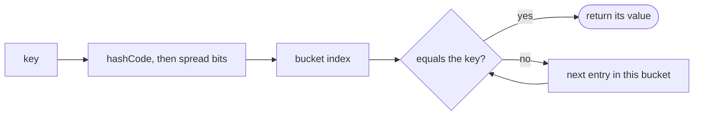
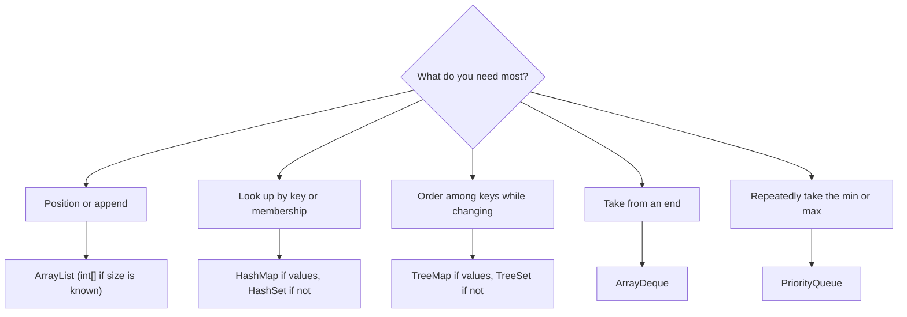

## Introduction

Almost every algorithm needs somewhere to keep things while it works. A breadth-first search needs a line of nodes waiting to be visited. A duplicate check needs a record of what it has already seen. Dijkstra's shortest-path algorithm needs to pull out the closest unvisited node, again and again. A plain Java array can store values, but it has a fixed length and offers nothing else: no "add one more", no "have I seen this?", no "give me the smallest".

Java's **Collections Framework** is the standard library's answer: a set of ready-made, well-tested data structures in the `java.util` package. It contains growable lists, hash tables, balanced binary search trees, double-ended queues and binary heaps, all behind a consistent set of interfaces. In an interview or a contest you will rarely implement one of these yourself; you will be expected to pick the right one instantly and know what each operation costs.

That choice matters more than it looks. The same algorithm can be O(n²) with one collection and O(n) with another, because one structure answers "have I seen this value?" by scanning every element, while another answers it in constant time. This lesson first draws the map of the framework, then studies **ArrayList** — the class you will use most — in depth, and then gives each of the other workhorses its own section: [[a1-hashmap|HashMap]], [[a1-hashset|HashSet]], [[a1-treemap|TreeMap]], [[a1-treeset|TreeSet]], [[a1-deque|Deque]] and [[a1-priorityqueue|PriorityQueue]].

## Before you start

You should be comfortable with:

- **Java basics** — classes, methods, `int` versus `long`, arrays and the `for` loop. See [[a1-java-syntax-competitive]].
- **Big-O notation** — what O(1), O(log n) and O(n) mean. See [[a1-time-complexity]]. Each cost in this lesson is explained, so a rough understanding is enough.

Ordering objects with `Comparator` appears in the tree and heap sections; it is introduced here as needed and taught fully in [[a1-comparable-comparator]].

## The intuition: choose by the question you ask

Imagine a kitchen. You keep cutlery in a drawer divided by type, spices on a rack sorted alphabetically, and orders on a ticket rail where the oldest ticket is cooked first. Nobody stores everything in one big box, because each storage system is built to make one kind of question fast: "where are the spoons?", "is there any cumin left?", "what do I cook next?".

Collections work the same way. Each one is designed to make a particular question cheap:

| The question your algorithm keeps asking | Collection to reach for | Cost of that question |
|---|---|---|
| "What is at position `i`?" or "add to the end" | `ArrayList` | O(1) |
| "What value is stored under this key?" | `HashMap` | O(1) on average |
| "Have I seen this before?" | `HashSet` | O(1) on average |
| "What is the next key larger than `x`?" | `TreeMap` / `TreeSet` | O(log n) |
| "Take from the front or the back" | `ArrayDeque` | O(1) |
| "Give me the smallest (or largest) right now" | `PriorityQueue` | O(log n) to remove, O(1) to look |

When you meet a new problem, say the operation out loud first — "I need to check membership inside a loop" — and the table tells you the structure. The rest of this lesson explains *why* each structure answers its question at that cost, which is what lets you reason about problems the table does not cover.

## The map of the framework

The framework is organised as a family of **interfaces** — contracts that say what operations are available — and **classes** that implement those contracts in different ways. There are two separate families.

**`Collection`** is the root for groups of individual elements that you can loop over. Its three main sub-interfaces are:

- **`List`** — an ordered sequence that allows duplicates and supports access by index (`get(3)`).
- **`Set`** — a group in which each element appears at most once. The central question is membership.
- **`Queue`** and its extension **`Deque`** — elements are taken out in a defined order: first-in-first-out, last-in-first-out, or by priority.

**`Map`** is the second family, and it is *not* a `Collection`. A map stores **key → value** pairs, and its central operation is looking up a value by its key.

```mermaid title="The interfaces you will use, and the class you usually construct for each"
flowchart TB
    C["Collection"] --> L["List"]
    C --> S["Set"]
    C --> Q["Queue"]
    Q --> D["Deque"]
    L --> AL["ArrayList"]
    S --> HS["HashSet"]
    S --> TS["TreeSet (sorted)"]
    D --> AD["ArrayDeque"]
    Q --> PQ["PriorityQueue"]
    M["Map (separate family)"] --> HM["HashMap"]
    M --> TM["TreeMap (sorted)"]
```

Notice that the sorted classes (`TreeSet`, `TreeMap`) implement richer interfaces called `NavigableSet` and `NavigableMap`, which add the "next larger" and "next smaller" queries. You will meet those methods in their sections.

### Declare the interface, construct the class

The standard way to create a collection is:

```java
List<Integer> nums = new ArrayList<>();
Map<String, Integer> count = new HashMap<>();
Deque<Integer> stack = new ArrayDeque<>();
```

The angle brackets are **generics**: `List<Integer>` means "a list whose elements are `Integer`s", and the compiler rejects any attempt to add a `String` to it. The empty `<>` on the right, called the **diamond**, tells Java to infer the type from the left side.

The variable's declared type is the *interface* (`List`), while the object is a specific *class* (`ArrayList`). This habit, called **programming to the interface**, means the rest of your code depends only on the operations `List` promises. If you later decide you need a different implementation, you change one word on one line.

Collections hold objects, not primitives, so you write `List<Integer>` rather than `List<int>`. Java converts between `int` and `Integer` automatically — **autoboxing** and **unboxing** — which is convenient but costs memory and time, a point that becomes important later.

## ArrayList: a resizable array

An **`ArrayList`** is the framework's ordered, indexable list, and the one you will construct most often. It solves the main limitation of a plain array: you do not need to know the length in advance. You add elements, and the list grows to fit them.

```java title="ListBasics.java"
import java.util.*;

public class ListBasics {
    public static void main(String[] args) {
        List<Integer> a = new ArrayList<>();
        a.add(30);                     // [30]
        a.add(10);                     // [30, 10]
        a.add(20);                     // [30, 10, 20]
        a.add(0, 99);                  // insert at index 0: [99, 30, 10, 20]
        System.out.println(a + " size=" + a.size());

        System.out.println(a.get(2));  // index access
        a.set(2, 11);                  // overwrite index 2
        System.out.println(a.contains(11) + " " + a.indexOf(20));

        Collections.sort(a);           // ascending, in place
        System.out.println(a);
    }
}
```

```output
[99, 30, 10, 20] size=4
10
true 3
[11, 20, 30, 99]
```

`add(x)` appends, `add(i, x)` inserts at position `i` and shifts everything after it, `get(i)` reads, `set(i, x)` overwrites, `size()` returns the number of elements, and `contains` and `indexOf` search. Printing a collection calls its `toString`, which shows the elements in brackets. Those methods look equally simple, but their costs are very different, and the reason is how the list is built.

### How ArrayList works inside

Inside every `ArrayList` is an ordinary Java array, plus an integer called **size**. The array's length is the list's **capacity** — how many elements it can hold before it must grow. The size is how many slots are actually in use. Slots from `size` to `capacity - 1` exist but are empty.

- `get(i)` checks that `i < size` and then reads `array[i]`. Arrays support jumping directly to any index, so this is O(1).
- `add(x)` at the end writes `x` into `array[size]` and increments `size` — also O(1), *as long as there is a free slot*.
- When `size == capacity`, there is no free slot. The list allocates a new, larger array, copies every existing element into it, and then adds `x`. That copy is O(n).

In current JDKs, a list created with `new ArrayList<>()` starts with no storage at all, allocates room for 10 elements on the first `add`, and from then on grows the capacity by half each time it fills up (new capacity ≈ old capacity × 1.5). Here is what happens as you add 100 elements one at a time:

| Elements added so far | Capacity before growing | New capacity | Elements copied by this growth |
|---|---|---|---|
| 1 | 0 | 10 | 0 |
| 11 | 10 | 15 | 10 |
| 16 | 15 | 22 | 15 |
| 23 | 22 | 33 | 22 |
| 34 | 33 | 49 | 33 |
| 50 | 49 | 73 | 49 |
| 74 | 73 | 109 | 73 |

Across all 100 adds, the list copied 10 + 15 + 22 + 33 + 49 + 73 = 202 elements — about two copies per element added. That observation is the whole idea behind the next claim.

### Why appending is amortized O(1)

One `add` can cost O(n), so why is appending called O(1)? Because expensive adds are rare, and they get rarer as the list grows. The right question is not "what does one add cost in the worst case?" but "what do `n` adds cost in total?". That is called **amortized** analysis: the total cost divided by the number of operations.

When the list reaches size `n`, the most recent growth copied at most `n` elements, the growth before that at most `n / 1.5`, the one before that `n / 1.5²`, and so on. The total is at most

`n + n/1.5 + n/1.5² + … = n × 1 / (1 − 1/1.5) = 3n`

So `n` appends do O(n) work in total — at most about three copies per element plus the writes themselves — which is O(1) per append on average. The guarantee depends on growing by a *multiplying factor*. If the list grew by a fixed 10 slots each time, it would copy 10 + 20 + 30 + … + n elements, which is O(n²) in total. This is the standard answer to the interview question "how would you implement a dynamic array?".

> [!TIP] Pre-size when you know the size
> If you know roughly how many elements are coming, write `new ArrayList<>(n)`. The list allocates that capacity once and never copies. It is a small constant-factor win, and it also avoids wasting memory when you create many small lists.

### What each operation costs

The middle of the list is where `ArrayList` is weak. To `add(0, x)`, every existing element must move one slot to the right to open a gap at the front; to `remove(0)`, every element after it moves one slot left to close the gap. Both are O(n). `contains(x)` and `indexOf(x)` have no shortcut either: they compare `x` with each element in turn, using `equals`, until they find it.

| Operation | Time | Why |
|---|---|---|
| `get(i)`, `set(i, x)` | O(1) | Direct index into the backing array |
| `add(x)` at the end | O(1) amortized | Occasional growth copies everything, spread over many adds |
| `add(i, x)` | O(n − i) | Elements from `i` onwards shift right |
| `remove(i)` | O(n − i) | Elements after `i` shift left |
| `remove(size() - 1)` | O(1) | Nothing after it to shift |
| `contains(x)`, `indexOf(x)` | O(n) | Linear scan using `equals` |
| `Collections.sort(list)` / `list.sort(cmp)` | O(n log n) | TimSort, a stable merge-sort variant |

**Stable** means elements that compare as equal keep their original relative order — useful when you sort records by one field after sorting them by another.

### The two remove methods

`List` has two methods called `remove`: `remove(int index)` deletes the element *at a position*, and `remove(Object o)` deletes the first element *equal to* `o`. With a `List<Integer>`, the compiler picks by the argument's static type, and the result surprises almost everyone once:

```java title="RemoveTrap.java"
import java.util.*;

public class RemoveTrap {
    public static void main(String[] args) {
        List<Integer> a = new ArrayList<>(List.of(5, 2, 8, 2));
        a.remove(2);                      // an int: removes INDEX 2 (the 8)
        System.out.println(a);

        List<Integer> b = new ArrayList<>(List.of(5, 2, 8, 2));
        b.remove(Integer.valueOf(2));     // an Integer: removes the first VALUE 2
        System.out.println(b);
    }
}
```

```output
[5, 2, 2]
[5, 8, 2]
```

When you mean a value, say so with `Integer.valueOf(x)`. (`List.of(...)` creates an unmodifiable list; wrapping it in `new ArrayList<>(...)` makes a modifiable copy.)

### Removing while you iterate

Removing elements from a list while looping over it with a for-each loop is a classic crash. The for-each loop uses an **iterator** behind the scenes, and `ArrayList`'s iterator is **fail-fast**: it remembers how many structural changes the list had when iteration started, and if that number changes underneath it, it throws `ConcurrentModificationException` rather than continue with a confused position.

```java title="SafeRemoval.java"
import java.util.*;

public class SafeRemoval {
    public static void main(String[] args) {
        List<Integer> a = new ArrayList<>(List.of(1, 2, 3, 4, 5, 6));
        try {
            for (int x : a) {
                if (x % 2 == 0) a.remove(Integer.valueOf(x));
            }
        } catch (ConcurrentModificationException e) {
            System.out.println("for-each + remove: " + e.getClass().getSimpleName());
        }

        List<Integer> b = new ArrayList<>(List.of(1, 2, 3, 4, 5, 6));
        b.removeIf(x -> x % 2 == 0);        // one pass, O(n)
        System.out.println(b);

        List<Integer> c = new ArrayList<>(List.of(1, 2, 3, 4, 5, 6));
        Iterator<Integer> it = c.iterator();
        while (it.hasNext()) {
            if (it.next() % 2 == 0) it.remove();   // the iterator's own remove is safe
        }
        System.out.println(c);
    }
}
```

```output
for-each + remove: ConcurrentModificationException
[1, 3, 5]
[1, 3, 5]
```

The safe options are `removeIf` (shortest, and a single O(n) pass), `Iterator.remove()`, an index loop that runs *backwards* so that shifting never affects indices you have not visited yet, or building a new list of the elements you keep. The fail-fast check is best-effort, so occasionally the broken loop ends early without an exception — skipping elements silently — which is worse. Never rely on it; just do not modify a list inside a for-each over it. The mechanism is covered in [[c1-fail-fast]].

### Lists of lists: the adjacency list

Graphs are usually stored as an **adjacency list**: for each node, a list of its neighbours. Different nodes have different numbers of neighbours, so a list of lists fits naturally.

```java title="Adjacency.java"
import java.util.*;

public class Adjacency {
    public static void main(String[] args) {
        int n = 4;
        int[][] edges = {{0, 1}, {0, 2}, {1, 2}, {2, 3}};
        List<List<Integer>> adj = new ArrayList<>();
        for (int i = 0; i < n; i++) adj.add(new ArrayList<>());   // one empty list per node
        for (int[] e : edges) {
            adj.get(e[0]).add(e[1]);     // undirected: store both directions
            adj.get(e[1]).add(e[0]);
        }
        for (int u = 0; u < n; u++) System.out.println(u + " -> " + adj.get(u));
    }
}
```

```output
0 -> [1, 2]
1 -> [0, 2]
2 -> [0, 1, 3]
3 -> [2]
```

The inner lists must be created before use: `adj.get(u)` on an empty outer list throws `IndexOutOfBoundsException`, and a forgotten inner `new ArrayList<>()` means there is nothing to add to. Graph representations are studied in [[a8-adjacency-list]].

### When ArrayList is the wrong tool

`ArrayList` is the right default for "collect values, then index or sort them". It is the wrong tool in three common situations, each of which has a better structure later in this lesson:

- **A queue that removes from the front.** `remove(0)` shifts the whole list every time, making a BFS O(n²). Use `ArrayDeque`.
- **Membership tests inside a loop.** `contains` scans the whole list each call. Use `HashSet`.
- **Looking up values by key.** A list of pairs that you scan is a slow map. Use `HashMap`.

And when you know `n` in advance and only store numbers, an `int[]` beats `ArrayList<Integer>`: each boxed `Integer` is a separate object of about 16 bytes plus a 4-byte reference, versus 4 bytes for a raw `int`. The `LinkedList` class is almost never the answer in problem-solving; inserting in its middle is O(1) only once you already hold a position, finding that position is O(n), and its nodes are scattered in memory.

```quiz
Q: An ArrayList has size 1,000. Which operation is the slowest?
- [ ] `get(999)`
- [ ] `add(x)` when there is spare capacity
- [x] `add(0, x)`
- [ ] `remove(999)`
> Inserting at index 0 must shift all 1,000 existing elements one slot right, so it is O(n). Reading any index is a direct array access, appending into spare capacity writes one slot, and removing the last element shifts nothing.

Q: Why is appending to an ArrayList called amortized O(1) even though one append can copy the whole array?
- [ ] Java copies arrays in constant time
- [x] Capacity grows by a constant factor, so the total copying over n appends is O(n)
- [ ] The array is never copied; new elements go into a linked node
- [ ] Appends are O(log n) and Big-O rounds this to O(1)
> With 1.5× growth, the copies made while reaching size n total at most n + n/1.5 + n/1.5² + … ≈ 3n. Dividing O(n) total work by n operations gives O(1) each. Growing by a fixed amount instead would make the total O(n²).

Q: `List<Integer> a = new ArrayList<>(List.of(4, 7, 1));` What does `a.remove(1)` remove?
- [ ] The value 1, leaving [4, 7]
- [x] The element at index 1, leaving [4, 1]
- [ ] Nothing; it throws because the types are ambiguous
- [ ] The first element, leaving [7, 1]
> The argument `1` is an `int`, so Java chooses `remove(int index)`. To remove the value 1, pass an `Integer`: `a.remove(Integer.valueOf(1))`.
```

## HashMap {#a1-hashmap}

A **`HashMap<K, V>`** stores **key → value** pairs and finds the value for any key in O(1) time on average. It is the tool behind frequency counts, "have I seen the complement of this number?", "where did I first see this value?", grouping items by a property, and caching results. If one data structure had to be named as the most useful in interviews, it would be this one.

### The problem it solves

An array already maps keys to values when the keys are the integers `0` to `n − 1`: `count[x]++` counts occurrences of `x` in O(1). But many problems use keys that cannot be array indices — values up to 10⁹, negative numbers, strings, coordinate pairs. Storing pairs in a list and scanning for the key costs O(n) per lookup. A hash map keeps the O(1) lookup for *any* key type.

### How hashing works

A `HashMap` is an array of **buckets**. To store a key, it turns the key into an integer with the key's `hashCode()` method, mixes the bits a little, and reduces the result to a bucket index (in OpenJDK, `(capacity − 1) & (h ^ (h >>> 16))`, which works because the capacity is always a power of two). The entry goes into that bucket. To look a key up, the map computes the same bucket index and only examines that bucket.

Two different keys can produce the same bucket index. This is a **collision**, and it is normal. Entries that share a bucket are kept in a short linked chain, and the map uses the key's **`equals`** method to find the exact entry within the chain. So two methods cooperate: `hashCode` chooses the bucket, `equals` picks the match inside it.



The map keeps buckets short by growing. Its **load factor** (0.75 by default) is the maximum ratio of entries to buckets; when the map exceeds it, the bucket array doubles (default initial capacity is 16) and every entry is redistributed. Like `ArrayList` growth, this costs O(n) occasionally and O(1) amortized per insertion. Since Java 8, a single bucket that grows past eight entries (once the table has at least 64 buckets) is converted into a small balanced tree, so even a badly colliding bucket costs O(log n) per lookup when the keys are `Comparable`, instead of O(n). The internals are covered in depth in [[c1-hashmap-internals]].

This design gives the map its one strict rule, the **`equals`/`hashCode` contract**: if `a.equals(b)`, then `a.hashCode() == b.hashCode()`. Break it and two equal keys can land in different buckets, so `get` looks in the wrong place and misses. `Integer`, `Long`, `String` and Java records already obey the contract. Your own classes must override both methods together — see [[a1-custom-classes]].

### The methods you will type

| Method | What it does |
|---|---|
| `put(k, v)` | Insert, or replace the value if `k` is present. Returns the old value or `null` |
| `get(k)` | The value for `k`, or `null` if absent |
| `getOrDefault(k, d)` | The value, or `d` if absent — the safe read for counts |
| `containsKey(k)` | Whether `k` is present |
| `merge(k, v, f)` | If absent, store `v`; otherwise store `f(old, v)` |
| `putIfAbsent(k, v)` | Store `v` only if `k` is absent; the first value wins |
| `computeIfAbsent(k, fn)` | If absent, store `fn(k)`; return the (existing or new) value |
| `remove(k)` | Delete the entry |
| `entrySet()`, `keySet()`, `values()` | Views for iteration |

The three "smart" methods each replace a clumsy `get` / null check / `put` sequence. `freq.merge(x, 1, Integer::sum)` is the counting idiom: start at 1, or add 1 to what is there. `graph.computeIfAbsent(u, key -> new ArrayList<>()).add(v)` creates a neighbour list the first time a node is seen and then appends to it. `first.putIfAbsent(x, i)` records only the first index at which `x` appears.

```java title="MapBasics.java"
import java.util.*;

public class MapBasics {
    public static void main(String[] args) {
        String[] words = {"apple", "pear", "apple", "fig", "pear", "apple"};
        Map<String, Integer> freq = new HashMap<>();
        for (String w : words) freq.merge(w, 1, Integer::sum);

        System.out.println(freq.get("apple"));            // 3
        System.out.println(freq.get("kiwi"));             // absent -> null
        System.out.println(freq.getOrDefault("kiwi", 0)); // absent -> default

        Map<Integer, List<String>> byLength = new HashMap<>();
        for (String w : words) {
            byLength.computeIfAbsent(w.length(), k -> new ArrayList<>()).add(w);
        }
        System.out.println(byLength.get(5));

        for (Map.Entry<String, Integer> e : new TreeMap<>(freq).entrySet()) {
            System.out.println(e.getKey() + "=" + e.getValue());   // sorted for display
        }
    }
}
```

```output
3
null
0
[apple, apple, apple]
apple=3
fig=1
pear=2
```

Iterate with `entrySet()` when you need both key and value; calling `get` for every key in `keySet()` does a second lookup for nothing. The final loop copies the map into a `TreeMap` only to print it in a predictable order — the next point explains why.

> [!WARNING] HashMap has no order
> Iteration order is unspecified and can change as the map grows. Small `Integer` keys often *appear* sorted, because `Integer.hashCode()` is the value itself — which teaches people a wrong rule that breaks on larger keys. Use `LinkedHashMap` for insertion order and `TreeMap` for sorted order.

### Worked example: Two Sum in one pass

*Given an array and a target, return the indices of two numbers that add up to the target.* The naive solution checks every pair, which is O(n²). The insight is that at index `i` you know exactly which partner you need: `target − nums[i]`. If you remember every value seen so far, with its index, the partner question becomes a single map lookup.

```java title="TwoSum.java"
import java.util.*;

public class TwoSum {
    static int[] twoSum(int[] nums, int target) {
        Map<Integer, Integer> seen = new HashMap<>();   // value -> index
        for (int i = 0; i < nums.length; i++) {
            int need = target - nums[i];
            Integer j = seen.get(need);                  // null if never seen
            if (j != null) return new int[]{j, i};
            seen.put(nums[i], i);                        // record AFTER checking
        }
        return new int[0];
    }

    public static void main(String[] args) {
        System.out.println(Arrays.toString(twoSum(new int[]{3, 8, 4, 6, 1}, 10)));
        System.out.println(Arrays.toString(twoSum(new int[]{5, 5}, 10)));
    }
}
```

```output
[2, 3]
[0, 1]
```

| `i` | `nums[i]` | `need` | `seen` before the check | Action |
|---|---|---|---|---|
| 0 | 3 | 7 | {} | not found; store 3→0 |
| 1 | 8 | 2 | {3→0} | not found; store 8→1 |
| 2 | 4 | 6 | {3→0, 8→1} | not found; store 4→2 |
| 3 | 6 | 4 | {3→0, 8→1, 4→2} | found 4 at index 2; return [2, 3] |

Checking *before* storing is what makes `[5, 5]` work and prevents pairing an element with itself. Time is O(n) — one pass, O(1) average per lookup — and space is O(n) for the map. The same "store what you have seen, look up what you need" idea powers [[a2-hashing]] and [[a2-frequency-counting]].

### Worked example: counting subarrays with a prefix-sum map

*Count the contiguous subarrays whose sum is exactly `k`* (values may be negative). Let `s` be the running sum up to the current index. A subarray ending here sums to `k` exactly when some earlier prefix sum equals `s − k`. So keep a map from each prefix sum to how many times it has occurred, and at every index add `count[s − k]` to the answer.

```java title="SubarraySum.java"
import java.util.*;

public class SubarraySum {
    static int count(int[] nums, int k) {
        Map<Integer, Integer> prefixCount = new HashMap<>();
        prefixCount.put(0, 1);                 // the empty prefix, before index 0
        int s = 0, ans = 0;
        for (int x : nums) {
            s += x;
            ans += prefixCount.getOrDefault(s - k, 0);   // query first...
            prefixCount.merge(s, 1, Integer::sum);       // ...then record
        }
        return ans;
    }

    public static void main(String[] args) {
        System.out.println(count(new int[]{1, 2, 1, -1, 2}, 3));
    }
}
```

```output
3
```

The prefix sums are 1, 3, 4, 3, 5. At the second prefix (3) the map contains 0 once, giving the subarray `[1, 2]`; at 4 it contains 1, giving `[2, 1]`; at the second 3 it contains 0, giving `[1, 2, 1, -1]`. The seed `0 → 1` represents subarrays that start at index 0, and querying before recording prevents counting an empty subarray when `k` is 0. This pattern is developed in [[a2-prefix-suffix]].

### Pitfalls

**`get` returning `null` is ambiguous.** `HashMap` allows one `null` key and any number of `null` values, so `null` from `get` can mean "absent" or "present with value `null`". `containsKey` separates the two.

**Unboxing a missing value crashes.** `int c = map.get(k);` throws `NullPointerException` when `k` is absent, because `null` cannot become an `int`. Use `getOrDefault(k, 0)`.

**Mutating a key after inserting it strands the entry.** The bucket was chosen from the key's hash at insertion time. If you change a field that `hashCode` uses, later lookups compute a different bucket and miss the entry, even though it is still inside. Use immutable keys: `Integer`, `String`, records.

**Dense integer keys want an array.** If keys are `0 … n` or letters `a`–`z`, an `int[]` is several times faster and smaller than a map, with no boxing.

**Not for concurrent writes.** `HashMap` is not thread-safe; shared mutable maps in servers use `ConcurrentHashMap` ([[c1-concurrenthashmap]]).

| Operation | Average | Worst case |
|---|---|---|
| `get`, `put`, `remove`, `containsKey` | O(1) | O(log n) for a treeified bucket of `Comparable` keys, O(n) otherwise |
| Iterate all entries | O(capacity + size) | same |

## HashSet {#a1-hashset}

A **`HashSet<E>`** is a collection of unique elements that answers "is this element in the set?" in O(1) time on average. It is the tool for detecting duplicates, recording visited nodes in a graph search, and computing unions and intersections. Where a `HashMap` stores a value for each key, a `HashSet` stores only the keys — and in fact OpenJDK's `HashSet` is implemented as a `HashMap` whose values are a shared dummy object.

### Set versus List versus Map

A `List` allows duplicates and is about positions: "what is at index 3?". A `Set` holds each value at most once and is about membership: "is 7 in here?". A `Map` attaches information to each key: "how many times has 7 appeared?". Choosing between them is a matter of naming what you need. If you only need yes/no membership, a `HashSet<E>` states that intent more clearly than a `HashMap<E, Boolean>` and costs the same.

Because it is built on a hash table, a `HashSet` relies on exactly the same `hashCode`/`equals` contract described in the [[a1-hashmap|HashMap]] section, and has no defined iteration order.

### `add` tells you whether the element was new

`add(e)` returns `true` if `e` was not present and has now been inserted, and `false` if it was already there (in which case the set is unchanged). That return value turns duplicate detection into a single line:

```java title="SetBasics.java"
import java.util.*;

public class SetBasics {
    public static void main(String[] args) {
        int[] nums = {4, 1, 4, 3, 1, 4};
        Set<Integer> seen = new HashSet<>();
        for (int x : nums) {
            if (!seen.add(x)) System.out.println("duplicate " + x);
        }
        System.out.println("distinct values: " + seen.size());

        Set<Integer> a = new TreeSet<>(List.of(1, 2, 3, 4));   // TreeSet only to print sorted
        Set<Integer> b = new HashSet<>(List.of(3, 4, 5));
        Set<Integer> union = new TreeSet<>(a);        union.addAll(b);
        Set<Integer> inter = new TreeSet<>(a);        inter.retainAll(b);
        Set<Integer> diff  = new TreeSet<>(a);        diff.removeAll(b);
        System.out.println(union + " " + inter + " " + diff);
    }
}
```

```output
duplicate 4
duplicate 1
duplicate 4
distinct values: 3
[1, 2, 3, 4, 5] [3, 4] [1, 2]
```

`contains(e)` tests membership without inserting, and `remove(e)` deletes; both are O(1) on average. `addAll`, `retainAll` and `removeAll` compute union, intersection and difference in place — so copy first if you still need the original.

### Worked example: longest consecutive sequence

*Given an unsorted array, find the length of the longest run of consecutive integers* (for `[100, 4, 200, 1, 3, 2]` the run is 1, 2, 3, 4, so the answer is 4) — in O(n). Sorting would take O(n log n). Checking, for each number, whether `x + 1`, `x + 2`, … exist by scanning the array would be O(n²) or worse.

With all numbers in a `HashSet`, each "does `x + 1` exist?" is O(1). The remaining danger is re-walking the same run from every one of its members. The fix is to start a walk only at the *beginning* of a run — a number `x` whose predecessor `x − 1` is absent.

```java title="LongestRun.java"
import java.util.*;

public class LongestRun {
    static int longest(int[] nums) {
        Set<Integer> set = new HashSet<>();
        for (int x : nums) set.add(x);
        int best = 0;
        for (int x : set) {
            if (set.contains(x - 1)) continue;   // not the start of a run
            int len = 1;
            while (set.contains(x + len)) len++;
            best = Math.max(best, len);
        }
        return best;
    }

    public static void main(String[] args) {
        System.out.println(longest(new int[]{100, 4, 200, 1, 3, 2}));
        System.out.println(longest(new int[]{0, 3, 7, 2, 5, 8, 4, 6, 0, 1}));
    }
}
```

```output
4
9
```

Every number is the start of at most one walk, and every number is stepped over by at most one walk (the one that starts its run), so the total work across all walks is O(n). Iterating over the set rather than the array also skips duplicates such as the repeated `0`.

### Visited sets and what to put in them

In a graph or grid search, a `HashSet` of visited states prevents processing a state twice: `if (!visited.add(state)) continue;`. Two details matter. First, store the right thing. To detect a cycle in a linked list, store the **node objects**, not their values — two different nodes can hold the same number. Second, the element must have value-based equality. An `int[]` uses identity for `equals` and `hashCode`, so two arrays `{1, 2}` are *different* elements:

```java title="ArrayKeys.java"
import java.util.*;

public class ArrayKeys {
    record Cell(int r, int c) {}

    public static void main(String[] args) {
        Set<int[]> arrays = new HashSet<>();
        arrays.add(new int[]{1, 2});
        System.out.println(arrays.contains(new int[]{1, 2}));   // identity: false

        Set<Cell> cells = new HashSet<>();
        cells.add(new Cell(1, 2));
        System.out.println(cells.contains(new Cell(1, 2)));     // value equality: true
    }
}
```

```output
false
true
```

A `record` (Java 16+) generates `equals` and `hashCode` from its fields, which makes it the cleanest key for coordinates and states. Alternatives are `List.of(r, c)` or encoding the pair into one number such as `r * cols + c`. When the possible values form a small dense range — letters `a`–`z`, cells of a grid — a `boolean[]` is faster still.

### When a set is not enough

A set cannot count. For "at most `k` distinct values in a window" or "is any value repeated three times", you need the number of occurrences, which means a `HashMap<E, Integer>`. And when you need the elements in sorted order or the nearest larger element, use a [[a1-treeset|TreeSet]]. If you need insertion order, `LinkedHashSet` keeps it at a small extra cost.

| Operation | Average | Notes |
|---|---|---|
| `add`, `remove`, `contains` | O(1) | Worst case degrades like `HashMap` |
| Iterate | O(capacity + size) | No defined order |
| `addAll(other)` | O(size of other) | Union in place |

## TreeMap {#a1-treemap}

A **`TreeMap<K, V>`** is a map that keeps its keys in sorted order. Like a `HashMap` it stores key → value pairs, but instead of a hash table it uses a **red-black tree** — a self-balancing binary search tree — so every basic operation costs O(log n), and in exchange it can answer questions a hash map cannot: "what is the smallest key?", "what is the largest key that is at most `x`?", "which keys fall between 10 and 20?".

### When order is the point

A `HashMap` is faster for plain lookups, so you choose `TreeMap` only when your algorithm needs *order among the keys while the map keeps changing*. Typical cases are a calendar that must reject overlapping bookings, a sweep over events in time order, or "for each query, find the closest stored value". If the keys never change after they are loaded, sorting an array once and binary searching it ([[a3-binary-search]]) is simpler and faster. If you only ever need the minimum, a [[a1-priorityqueue|PriorityQueue]] is lighter.

### How it works inside

A **binary search tree** stores each key in a node, with every key in the left subtree smaller and every key in the right subtree larger. Searching walks down from the root, going left or right at each node, so the cost is the height of the tree. An unbalanced tree can degenerate into a chain of height `n` — insert keys in sorted order into a naive tree and you get a linked list. A red-black tree prevents that by recolouring and rotating nodes after each insert or delete, which guarantees the height stays below about 2 log₂ n. That guarantee is why `TreeMap` promises O(log n) in the *worst* case, not merely on average. An in-order walk (left subtree, node, right subtree) visits keys in ascending order, which is why iterating a `TreeMap` yields sorted keys.

Keys must be comparable: either the key type implements `Comparable` (as `Integer` and `String` do), or you pass a `Comparator` to the constructor. The tree uses `compareTo`/`compare` for *everything*, including deciding whether two keys are the same — `equals` is not consulted. With natural ordering, a `null` key throws `NullPointerException`, because there is nothing to compare it with.

### Navigation methods

| Method | Returns | Example on keys {10, 20, 30} |
|---|---|---|
| `floorKey(x)` | Largest key ≤ `x`, or `null` | `floorKey(25)` → 20, `floorKey(20)` → 20 |
| `ceilingKey(x)` | Smallest key ≥ `x`, or `null` | `ceilingKey(25)` → 30 |
| `lowerKey(x)` | Largest key strictly < `x` | `lowerKey(20)` → 10 |
| `higherKey(x)` | Smallest key strictly > `x` | `higherKey(20)` → 30 |
| `firstKey()`, `lastKey()` | Smallest and largest key | 10, 30 |
| `pollFirstEntry()`, `pollLastEntry()` | Remove and return an end | removes 10 |
| `headMap(x)`, `tailMap(x)`, `subMap(a, b)` | Live views of a key range | `headMap(30)` → {10, 20} |

Each method has an `…Entry` twin (`floorEntry`, `ceilingEntry`, …) that returns the key and value together. All of the single-key queries are O(log n). The range methods return **views**, not copies: changes to the view write through to the map. By default `headMap(x)` excludes `x`, `tailMap(x)` includes it, and `subMap(a, b)` includes `a` and excludes `b`.

```java title="TreeMapNav.java"
import java.util.*;

public class TreeMapNav {
    public static void main(String[] args) {
        TreeMap<Integer, String> m = new TreeMap<>();
        m.put(30, "c");
        m.put(10, "a");
        m.put(20, "b");
        System.out.println(m);                                   // sorted by key
        System.out.println(m.floorKey(25) + " " + m.ceilingKey(25));
        System.out.println(m.lowerKey(20) + " " + m.higherKey(20));
        System.out.println(m.floorKey(5));                       // nothing <= 5
        System.out.println(m.firstKey() + " " + m.lastKey());
        System.out.println(m.headMap(30) + " " + m.tailMap(20));
    }
}
```

```output
{10=a, 20=b, 30=c}
20 30
10 30
null
10 30
{10=a, 20=b} {20=b, 30=c}
```

Navigation methods return `null` when no such key exists, so check before unboxing: `int f = m.floorKey(5);` would throw `NullPointerException`.

### Worked example: the sweep line

*Given meetings as `[start, end)` intervals, find the minimum number of rooms needed.* Think of time as a line. A meeting adds one to the number of occupied rooms at its start and subtracts one at its end. If you record those +1 and −1 events keyed by time and walk them in time order, the running total is the number of meetings in progress, and its maximum is the answer. A `TreeMap` keeps the events sorted as you add them.

```java title="MeetingRooms.java"
import java.util.*;

public class MeetingRooms {
    static int minRooms(int[][] meetings) {
        TreeMap<Integer, Integer> delta = new TreeMap<>();
        for (int[] m : meetings) {
            delta.merge(m[0], 1, Integer::sum);    // a meeting starts
            delta.merge(m[1], -1, Integer::sum);   // a meeting ends
        }
        int active = 0, best = 0;
        for (int change : delta.values()) {        // values in key (time) order
            active += change;
            best = Math.max(best, active);
        }
        return best;
    }

    public static void main(String[] args) {
        System.out.println(minRooms(new int[][]{{0, 30}, {5, 10}, {15, 20}}));
        System.out.println(minRooms(new int[][]{{5, 10}, {10, 15}}));
    }
}
```

```output
2
1
```

In the second case a meeting ends at 10 exactly when another starts. Both events merge into the same key with net change 0, so the count never reaches 2 — which matches half-open intervals, where `[5, 10)` and `[10, 15)` do not overlap. Building the map costs O(n log n) and the walk O(n). This pattern is a cousin of [[a2-difference-arrays]] for coordinates too large or sparse for an array.

### Worked example: rejecting overlapping bookings

A calendar stores booked intervals as `start → end`. To test a new booking `[s, e)`, only two existing bookings can conflict: the one starting at or before `s` (`floorEntry(s)`), which conflicts if it ends after `s`, and the one starting after `s` (`ceilingEntry(s)` — or `higherEntry`), which conflicts if it starts before `e`. Two O(log n) queries replace a scan of every booking:

```java
Map.Entry<Integer, Integer> prev = booked.floorEntry(s);
Map.Entry<Integer, Integer> next = booked.ceilingEntry(s);
boolean ok = (prev == null || prev.getValue() <= s) && (next == null || next.getKey() >= e);
if (ok) booked.put(s, e);
```

### Pitfalls

**It sorts keys, not values.** To find the key with the largest value, the value must be part of the key, or you need another structure.

**Two keys that compare as 0 are the same key.** A comparator that compares only part of an object merges distinct objects into one entry. Make the comparator distinguish everything that should be distinct.

**Never write a comparator as `a - b`.** The subtraction can overflow and flip the sign. Use `Integer.compare(a, b)`; see [[a1-comparable-comparator]].

**Do not mutate a key inside the tree.** Its position was decided by the old value.

| Operation | Time |
|---|---|
| `get`, `put`, `remove`, `containsKey` | O(log n) worst case |
| `floor`, `ceiling`, `lower`, `higher`, `first`, `last` | O(log n) |
| Full in-order iteration | O(n) |

## TreeSet {#a1-treeset}

A **`TreeSet<E>`** is a set that keeps its unique elements in sorted order. It is to `HashSet` what `TreeMap` is to `HashMap` — internally it is a `TreeMap` that stores only keys — so `add`, `remove` and `contains` cost O(log n), and it adds sorted iteration and nearest-neighbour queries: `first`, `last`, `floor`, `ceiling`, `lower`, `higher`, `pollFirst` and `pollLast`.

### When to choose it

Use a `TreeSet` when the algorithm mixes inserts and deletes with questions about *order*: "what is the largest element not exceeding `x`?", "is there an element within distance `t` of this one?", "remove the current smallest". If you only need membership, a [[a1-hashset|HashSet]] is faster. If you only need the current minimum or maximum, a [[a1-priorityqueue|PriorityQueue]] is lighter — but it cannot answer `floor` or remove an arbitrary element efficiently. If you only need sorted output once at the end, collect into a list and sort.

### Using it

```java title="TreeSetNav.java"
import java.util.*;

public class TreeSetNav {
    public static void main(String[] args) {
        TreeSet<Integer> s = new TreeSet<>(List.of(8, 3, 15, 1));
        System.out.println(s.add(3));                     // already present
        System.out.println(s);                            // sorted, no duplicates
        System.out.println(s.floor(7) + " " + s.ceiling(7));
        System.out.println(s.floor(0));                   // nothing <= 0
        System.out.println(s.first() + " " + s.last());
        System.out.println(s.pollFirst() + " " + s);      // remove the smallest
        System.out.println(s.headSet(15) + " " + s.descendingSet());
    }
}
```

```output
false
[1, 3, 8, 15]
3 8
null
1 15
1 [3, 8, 15]
[3, 8] [15, 8, 3]
```

`floor(7)` is 3 because 7 is absent and 3 is the greatest element still ≤ 7; `ceiling(7)` is the least element ≥ 7. Missing neighbours return `null`. `headSet`, `tailSet`, `subSet` and `descendingSet` are live views, as with `TreeMap`.

Elements must be `Comparable` or you must pass a `Comparator`; otherwise the first `add` throws `ClassCastException`. `null` elements are rejected. And as with `TreeMap`, the comparator alone defines equality: two different objects that compare as 0 are treated as duplicates and the second `add` returns `false`. That is a real trap when, say, you store intervals ordered only by their end time — two intervals with the same end silently collapse into one. Add a tie-breaker (such as an index) to the comparator whenever distinct objects can compare equal on the main key.

### Worked example: a near-duplicate in a sliding window

*Is there a pair of indices `i ≠ j` with `|i − j| ≤ k` and `|nums[i] − nums[j]| ≤ t`?* The naive solution compares each element with the previous `k`, which is O(nk). Keep the last `k` values in a `TreeSet`. For the new value `x`, the closest stored value not larger than `x` is `floor(x)` and the closest not smaller is `ceiling(x)`; if either is within `t`, the answer is yes. Then add `x` and remove the value that slid out of the window.

```java title="NearbyAlmostDuplicate.java"
import java.util.*;

public class NearbyAlmostDuplicate {
    static boolean check(int[] nums, int k, int t) {
        TreeSet<Long> window = new TreeSet<>();       // long: x - t cannot overflow
        for (int i = 0; i < nums.length; i++) {
            long x = nums[i];
            Long lo = window.floor(x);
            Long hi = window.ceiling(x);
            if ((lo != null && x - lo <= t) || (hi != null && hi - x <= t)) return true;
            window.add(x);
            if (i >= k) window.remove((long) nums[i - k]);   // keep at most k values
        }
        return false;
    }

    public static void main(String[] args) {
        System.out.println(check(new int[]{1, 2, 3, 1}, 3, 0));
        System.out.println(check(new int[]{1, 5, 9, 1, 5, 9}, 2, 3));
    }
}
```

```output
true
false
```

The window never holds more than `k` values, so each operation is O(log k) and the whole scan is O(n log k). Storing `long` values keeps `x - lo` safe when the inputs are near the `int` limits. A duplicate value inside the window would already have triggered `true` (its distance is 0 ≤ t), so the set's refusal to store duplicates does no harm here.

### Duplicates need a TreeMap of counts

A `TreeSet` cannot hold two equal values. When you need a sorted collection *with* duplicates — a **multiset** — use `TreeMap<Integer, Integer>` from value to count: add with `merge(x, 1, Integer::sum)`, and remove by decrementing and deleting the key when its count reaches zero. `firstKey()` and `floorKey(x)` then work exactly as on a set. This is a common building block for sliding-window medians and for "remove the smallest element that is at least `x`" greedy problems.

| Operation | `TreeSet` | `HashSet` |
|---|---|---|
| `add`, `remove`, `contains` | O(log n) | O(1) average |
| `first`, `last`, `floor`, `ceiling` | O(log n) | not available |
| Iterate | O(n), sorted | O(n), no order |

## Deque {#a1-deque}

A **deque** (pronounced "deck", short for *double-ended queue*) is a sequence you can add to and remove from at **both** ends. Java's `Deque` interface describes it, and **`ArrayDeque`** is the class you should use. With O(1) operations at either end, one `ArrayDeque` serves as a **stack** (last in, first out), a **queue** (first in, first out), or the both-ends structure that some algorithms need.

### Three jobs, one structure

A **queue** adds at the back and removes from the front, like a line at a shop. Breadth-first search uses one: the node discovered first is expanded first, which is why BFS explores in layers. A **stack** adds and removes at the same end, like a pile of plates. Depth-first search, matching brackets, undo history and evaluating expressions all use one. Some algorithms, such as the sliding-window maximum below, need to remove from both ends. A deque supports all three.

### How ArrayDeque works

`ArrayDeque` stores elements in a **circular array**: an array plus a `head` index and a `tail` index. Adding at the back writes at `tail` and advances it; adding at the front moves `head` one step back. When an index runs off one end of the array it wraps around to the other end, so neither operation ever shifts elements. When the array fills up, it is replaced with a larger one and the elements are copied, giving amortized O(1) per operation, as with `ArrayList`. There is no efficient `get(i)`; if you need indexing, you need a list.

### The method names

The `Deque` interface has a method for every combination of end and behaviour. The ones that matter:

| Purpose | Methods | On an empty deque |
|---|---|---|
| Queue: enqueue at the back | `offer(x)` = `offerLast(x)` | — |
| Queue: dequeue from the front | `poll()` = `pollFirst()` | returns `null` |
| Stack: push onto the top | `push(x)` = `addFirst(x)` | — |
| Stack: pop the top | `pop()` = `removeFirst()` | throws `NoSuchElementException` |
| Look at the front / top | `peek()` = `peekFirst()` | returns `null` |
| Look at the back | `peekLast()` | returns `null` |
| Remove from the back | `pollLast()` | returns `null` |

Notice that Java's stack methods work at the **front** (the "first" end) of the deque: `push` is `addFirst` and `pop` is `removeFirst`. That is why `peek()` returns the next element to be removed in *both* uses. The `add`/`remove`/`get` family throws an exception on failure, while the `offer`/`poll`/`peek` family returns a special value (`false` or `null`).

```java title="DequeBasics.java"
import java.util.*;

public class DequeBasics {
    public static void main(String[] args) {
        Deque<Integer> stack = new ArrayDeque<>();
        stack.push(1); stack.push(2); stack.push(3);
        System.out.println(stack + " pop=" + stack.pop() + " peek=" + stack.peek());

        Deque<Integer> queue = new ArrayDeque<>();
        queue.offer(1); queue.offer(2); queue.offer(3);
        System.out.println(queue + " poll=" + queue.poll() + " peek=" + queue.peek());

        Deque<Integer> empty = new ArrayDeque<>();
        System.out.println(empty.poll());                 // null, no exception
        try {
            empty.pop();
        } catch (NoSuchElementException e) {
            System.out.println("pop on empty throws");
        }
    }
}
```

```output
[3, 2, 1] pop=3 peek=2
[1, 2, 3] poll=1 peek=2
null
pop on empty throws
```

Printing the stack shows `[3, 2, 1]` — top first — because the most recent `push` went to the front.

### What not to use

**`java.util.Stack`** is a legacy class from Java 1.0. It extends `Vector`, so every call acquires a lock you do not need, and it inherits list methods that let code reach into the middle of the "stack". Its own documentation recommends `Deque` instead. **`ArrayList.remove(0)`** as a queue shifts every element on every dequeue, turning an O(V + E) BFS into O(V²). **`LinkedList`** implements `Deque` too, but allocates a node per element and is slower in practice. `ArrayDeque` also rejects `null` elements (with `NullPointerException`), so that `null` from `poll` always means "empty".

### Worked example: BFS distances

```java title="BfsDemo.java"
import java.util.*;

public class BfsDemo {
    public static void main(String[] args) {
        int n = 6;
        int[][] edges = {{0, 1}, {0, 2}, {1, 3}, {2, 3}, {3, 4}};   // node 5 is isolated
        List<List<Integer>> adj = new ArrayList<>();
        for (int i = 0; i < n; i++) adj.add(new ArrayList<>());
        for (int[] e : edges) { adj.get(e[0]).add(e[1]); adj.get(e[1]).add(e[0]); }

        int[] dist = new int[n];
        Arrays.fill(dist, -1);                 // -1 = not reached yet
        Deque<Integer> q = new ArrayDeque<>();
        dist[0] = 0;
        q.offer(0);
        while (!q.isEmpty()) {
            int u = q.poll();
            for (int v : adj.get(u)) {
                if (dist[v] == -1) {           // mark when ENQUEUED, not when polled
                    dist[v] = dist[u] + 1;
                    q.offer(v);
                }
            }
        }
        System.out.println(Arrays.toString(dist));
    }
}
```

```output
[0, 1, 1, 2, 3, -1]
```

Marking a node as reached when it is enqueued, rather than when it is dequeued, ensures each node enters the queue at most once. BFS itself is taught in [[a8-bfs]].

### Worked example: sliding-window maximum with a monotonic deque

*For every window of `k` consecutive elements, report the maximum.* Recomputing each window's maximum is O(nk). The trick is to keep a deque of **indices** whose values are in *decreasing* order from front to back. The front is then always the maximum of the current window. Two rules maintain it:

1. Before adding index `i`, pop from the **front** any index that has left the window (index ≤ `i − k`).
2. Pop from the **back** every index whose value is ≤ `a[i]`. Those elements are older *and* no larger than `a[i]`, so while `a[i]` is in the window they can never be the maximum.

```java title="WindowMax.java"
import java.util.*;

public class WindowMax {
    static int[] maxSlidingWindow(int[] a, int k) {
        int n = a.length;
        int[] ans = new int[n - k + 1];
        Deque<Integer> dq = new ArrayDeque<>();      // indices; values decrease front to back
        for (int i = 0; i < n; i++) {
            if (!dq.isEmpty() && dq.peekFirst() <= i - k) dq.pollFirst();   // left the window
            while (!dq.isEmpty() && a[dq.peekLast()] <= a[i]) dq.pollLast(); // can never win
            dq.offerLast(i);
            if (i >= k - 1) ans[i - k + 1] = a[dq.peekFirst()];
        }
        return ans;
    }

    public static void main(String[] args) {
        int[] a = {1, 3, -1, -3, 5, 3, 6, 7};
        System.out.println(Arrays.toString(maxSlidingWindow(a, 3)));
    }
}
```

```output
[3, 3, 5, 5, 6, 7]
```

| `i` | `a[i]` | Popped from front | Popped from back | Deque after (index:value) | Window max |
|---|---|---|---|---|---|
| 0 | 1 | — | — | 0:1 | — |
| 1 | 3 | — | 0:1 | 1:3 | — |
| 2 | −1 | — | — | 1:3, 2:−1 | 3 |
| 3 | −3 | — | — | 1:3, 2:−1, 3:−3 | 3 |
| 4 | 5 | 1:3 | 3:−3, 2:−1 | 4:5 | 5 |
| 5 | 3 | — | — | 4:5, 5:3 | 5 |
| 6 | 6 | — | 5:3, 4:5 | 6:6 | 6 |
| 7 | 7 | — | 6:6 | 7:7 | 7 |

The inner `while` looks like it could make this O(nk), but every index is pushed exactly once and popped at most once, so the total number of pops across the whole run is at most `n`. The algorithm is O(n) time and O(k) space. Flip the comparison (`>=`) and the front becomes the window minimum. The full pattern is taught in [[a5-monotonic-queue]].

Deques also power **0-1 BFS**, for graphs whose edge weights are only 0 or 1: a node reached by a weight-0 edge goes to the front (`offerFirst`), because its distance did not grow, and one reached by a weight-1 edge goes to the back. Polling from the front then processes nodes in distance order without a heap, in O(V + E). See [[a8-0-1-bfs]].

| Operation | `ArrayDeque` |
|---|---|
| Add or remove at either end | O(1) amortized |
| Peek at either end | O(1) |
| `contains`, remove from the middle | O(n) |

## PriorityQueue {#a1-priorityqueue}

A **`PriorityQueue<E>`** is a queue that always hands you the *best* element next rather than the oldest. By default "best" means smallest. Internally it is a **binary heap**, which makes adding an element and removing the best one O(log n), and looking at the best one O(1). It is the structure behind Dijkstra's algorithm, merging `k` sorted lists, "the `k` largest elements", event simulations and schedulers.

### Arrival order versus priority order

An `ArrayDeque` returns elements in the order they arrived. A `PriorityQueue` returns them in priority order, no matter when they arrived — like an emergency room, where the most urgent patient is seen first. The important limitation is that **only the front is guaranteed**. The rest of the heap is arranged just enough to find the next best element quickly; it is *not* sorted.

### How a binary heap works

A **binary heap** is a complete binary tree — every level full except possibly the last, which fills from the left — that satisfies the **heap property**: every parent is ≤ its children (for a min-heap). The root is therefore the minimum. Because the tree is complete, it is stored in a plain array with no pointers: the children of index `i` are at `2i + 1` and `2i + 2`, and its parent is at `(i − 1) / 2`.

- **`offer(x)`** places `x` in the next free slot at the bottom and **sifts it up**: while it is smaller than its parent, swap them. At most one swap per level.
- **`poll()`** removes the root, moves the last element into the root's place and **sifts it down**: while it is larger than its smaller child, swap them.
- **`peek()`** reads index 0.

A complete tree with `n` nodes has height about log₂ n, so sifting costs O(log n).

```mermaid title="A min-heap and the array that stores it: [1, 2, 4, 5, 3]"
flowchart TB
    A["index 0: 1"] --> B["index 1: 2"]
    A --> C["index 2: 4"]
    B --> D["index 3: 5"]
    B --> E["index 4: 3"]
```

### Using it

```java title="HeapBasics.java"
import java.util.*;

public class HeapBasics {
    public static void main(String[] args) {
        PriorityQueue<Integer> minHeap = new PriorityQueue<>();
        for (int x : new int[]{5, 1, 4, 2, 3}) minHeap.offer(x);
        System.out.println("peek=" + minHeap.peek() + " internal=" + minHeap);

        StringBuilder order = new StringBuilder();
        while (!minHeap.isEmpty()) order.append(minHeap.poll()).append(' ');
        System.out.println("poll order: " + order.toString().trim());

        PriorityQueue<Integer> maxHeap = new PriorityQueue<>(Comparator.reverseOrder());
        maxHeap.addAll(List.of(5, 1, 4, 2, 3));
        System.out.println("max first: " + maxHeap.poll() + " then " + maxHeap.poll());
    }
}
```

```output
peek=1 internal=[1, 2, 4, 5, 3]
poll order: 1 2 3 4 5
max first: 5 then 4
```

Printing the heap shows its internal array, `[1, 2, 4, 5, 3]` — the root is the minimum, but the rest is not sorted. Only repeated `poll` produces sorted order, and it empties the heap. A **max-heap** comes from passing a reversed comparator: `Comparator.reverseOrder()` for naturally ordered types, or a lambda such as `(a, b) -> Integer.compare(b, a)`. Never `(a, b) -> b - a`, which can overflow.

| Operation | Time | Notes |
|---|---|---|
| `offer(x)` | O(log n) | sift up |
| `poll()` | O(log n) | sift down; `null` if empty |
| `peek()` | O(1) | `null` if empty |
| `new PriorityQueue<>(collection)` | O(n) | builds the heap bottom-up ("heapify") |
| `contains(x)`, `remove(x)` | O(n) | linear scan of the array |
| Iteration | O(n) | no particular order |

`null` elements are not allowed. Elements that compare equal come out in an unspecified order, so add a tie-breaker to the comparator if the problem cares.

### Worked example: top `k` frequent elements

*Return the `k` most frequent values.* Sorting all distinct values by frequency is O(m log m) for `m` distinct values. When `k` is small there is a better idea: keep a **min-heap of size `k`** ordered by frequency. Its root is the *weakest* of the current top `k`. Offer each candidate; whenever the heap grows to `k + 1`, poll the root, discarding the weakest. What survives is the top `k`.

```java title="TopKFrequent.java"
import java.util.*;

public class TopKFrequent {
    static List<Integer> topK(int[] nums, int k) {
        Map<Integer, Integer> freq = new HashMap<>();
        for (int x : nums) freq.merge(x, 1, Integer::sum);

        // min-heap by frequency: the root is the weakest of the current top k
        PriorityQueue<Map.Entry<Integer, Integer>> heap =
                new PriorityQueue<>(Comparator.comparingInt(Map.Entry::getValue));
        for (Map.Entry<Integer, Integer> e : freq.entrySet()) {
            heap.offer(e);
            if (heap.size() > k) heap.poll();
        }
        List<Integer> result = new ArrayList<>();
        while (!heap.isEmpty()) result.add(heap.poll().getKey());
        Collections.reverse(result);                 // most frequent first
        return result;
    }

    public static void main(String[] args) {
        System.out.println(topK(new int[]{1, 1, 1, 2, 2, 3, 4, 4, 4, 4}, 2));
    }
}
```

```output
[4, 1]
```

Counting is O(n). Each of the `m` heap operations costs O(log k) because the heap never exceeds `k + 1` elements, so the total is O(n + m log k), and the heap uses O(k) space. Notice the counter-intuitive choice: to keep the *largest*, you use a *min*-heap, because the element you need to evict is the smallest of the survivors. The pattern is developed in [[a7-top-k]].

### Dijkstra without decrease-key

Dijkstra's algorithm repeatedly takes the unvisited node with the smallest known distance. When it finds a shorter path to a node already in the heap, a textbook heap would *decrease* that entry's key. `PriorityQueue` has no efficient way to do that — `remove(x)` is O(n). The standard workaround is **lazy deletion**: push a new `{node, distance}` pair and leave the old one in place. When a pair is polled, skip it if its distance no longer matches the best known distance.

```java
PriorityQueue<long[]> pq = new PriorityQueue<>(Comparator.comparingLong(p -> p[1]));
pq.offer(new long[]{src, 0});
while (!pq.isEmpty()) {
    long[] cur = pq.poll();
    int u = (int) cur[0];
    if (cur[1] != dist[u]) continue;   // stale entry: a shorter path was found later
    // relax each edge u -> v with weight w:
    //   if (dist[u] + w < dist[v]) { dist[v] = dist[u] + w; pq.offer(new long[]{v, dist[v]}); }
}
```

The heap can hold up to one entry per edge, so the running time is O(E log E), which is O(E log V). The full algorithm is in [[a8-dijkstra-priority-queue]]. The same heap merges `k` sorted lists: hold the current head of each list, poll the smallest, and offer that list's next element, for O(N log k) over `N` total elements — see [[a7-k-way-merge]]. Two heaps — a max-heap for the lower half and a min-heap for the upper half — maintain a running median ([[a7-running-median]]).

## Choosing the right collection

Every choice in this lesson comes down to one question: *what operation does the algorithm perform most often?* Name it, then pick the structure that makes it cheap.



| Class | Main strength | Typical cost | Order | Nulls |
|---|---|---|---|---|
| `ArrayList` | Index access, append | O(1) get, O(1) amortized add | Insertion | Allowed |
| `HashMap` | Lookup by key | O(1) average | None | One key, many values |
| `HashSet` | Membership | O(1) average | None | One element |
| `TreeMap` | Sorted keys, floor/ceiling | O(log n) | Sorted by key | No keys (natural order) |
| `TreeSet` | Sorted unique elements | O(log n) | Sorted | No |
| `ArrayDeque` | Both ends | O(1) amortized | Insertion | No |
| `PriorityQueue` | Current min or max | O(log n) offer/poll, O(1) peek | Only the root | No |

## In real systems

These classes are not interview props; they are the everyday building blocks of Java services. A `HashMap` is the in-memory cache in front of a database, the index from user ID to session, the request router's table from path to handler. A `LinkedHashMap` with access order is the classic least-recently-used cache ([[a4-lru-style]]). `ArrayDeque` and its concurrent relatives back work queues and task buffers. `PriorityQueue` schedules timers and retries by due time. `TreeMap` appears in rate limiters and time-series code that needs "all events between two timestamps". Libraries such as Guava add multisets and multimaps on top of exactly these ideas.

Two production concerns rarely come up in interviews but matter at work. First, none of these classes is thread-safe; shared mutable collections need `ConcurrentHashMap`, `ConcurrentLinkedDeque`, `PriorityBlockingQueue` and friends ([[c3-concurrent-collections]]). Second, boxing has a real memory cost: a `HashMap<Integer, Integer>` with a million entries uses tens of megabytes because every key, value and entry is a separate object, which is why performance-critical code sometimes uses primitive-specialised libraries.

## Trade-offs and alternatives

The framework trades a little speed and memory for generality. Every element is an object reference, so `ArrayList<Integer>` is several times larger than `int[]`, and hash-based structures add an entry object per element. When the keys are small dense integers, plain arrays (`int[] count = new int[26]`, `boolean[] visited`) beat maps and sets by a wide margin, and contest solutions use them whenever they can.

Hash structures are O(1) on *average*. Their performance depends on good hash codes, they have no order, and iterating them costs time proportional to their capacity. Tree structures are slower by a log factor but guarantee O(log n) and support order queries. A sorted array plus binary search offers the same queries as a tree with less memory, but only when the data does not change. A heap gives the minimum faster than a tree but cannot search or delete arbitrary elements efficiently. Choose by the operations you need, not by habit.

## Common mistakes

**`contains` on a list inside a loop.** Each call is O(n), so the loop becomes O(n²). Build a `HashSet` once and test membership against it.

**Using `ArrayList.remove(0)` as a queue.** Every dequeue shifts the whole list. Use `ArrayDeque` with `offer` and `poll`.

**Confusing `remove(int)` and `remove(Object)`.** On a `List<Integer>`, `remove(2)` removes index 2. Write `remove(Integer.valueOf(2))` to remove a value.

**Modifying a collection inside a for-each over it.** It throws `ConcurrentModificationException` (or silently skips elements). Use `removeIf` or an explicit iterator.

**Assuming a `HashMap` or `HashSet` has an order.** Use `LinkedHashMap`/`LinkedHashSet` for insertion order and `TreeMap`/`TreeSet` for sorted order.

**Unboxing a missing value.** `int c = map.get(k)` throws when `k` is absent. Use `getOrDefault`.

**Expecting a `PriorityQueue` to be sorted when printed or iterated.** Only the root is guaranteed. Poll repeatedly for sorted output.

**Mutable or array keys.** Keys whose `hashCode` changes, or `int[]` keys compared by identity, make lookups miss. Use records or other immutable value types.

**Comparators that subtract.** `(a, b) -> a - b` overflows for large values. Use `Integer.compare`.

> [!MISTAKE] Using java.util.Stack out of habit
> `Stack` is synchronized and exposes list operations. Declare `Deque<Integer> stack = new ArrayDeque<>();` and use `push`, `pop` and `peek` — which, remember, operate on the front of the deque.

## Interview perspective

Interviewers rarely ask "explain `HashMap`" in isolation; they watch which structure you reach for and whether you can justify it. Saying the reason out loud — "I need membership checks inside the loop, so a `HashSet` makes each check O(1) instead of O(n)" — is one of the clearest signals of competence you can give.

> [!INTERVIEW] What a strong answer sounds like
> "A brute-force pair check is O(n²). As I scan, I'll keep a `HashMap` from value to index, so for each element I can look up its complement in O(1) average time. That's O(n) time and O(n) extra space. If the input were already sorted, two pointers would get the same time with O(1) space."

Questions you should be able to answer:

- **List vs Set vs Map?** Ordered sequence with duplicates and indexing; unique elements for membership; key → value lookup. `Map` is not a `Collection`.
- **ArrayList vs LinkedList?** `ArrayList` has O(1) indexing and better memory locality; `LinkedList` only wins for inserts at a position you already hold, which is rare. Default to `ArrayList` (or `ArrayDeque` for queues).
- **How does a `HashMap` work, and what is its worst case?** Hash to a bucket, `equals` within the bucket, resize at load factor 0.75; collisions chain and, since Java 8, large buckets become trees, so the worst case is O(log n) for comparable keys, O(n) otherwise.
- **Why must `equals` and `hashCode` agree?** Lookups choose the bucket by hash, then compare with `equals`. Equal keys with different hashes are never compared.
- **`HashMap` vs `TreeMap`?** O(1) average and unordered versus O(log n) and sorted with floor/ceiling queries.
- **Kth largest element in O(n log k)?** A min-heap of size `k`; its root is the answer.
- **Why `ArrayDeque` over `Stack`?** No synchronisation overhead and a clean deque API; `Stack` is legacy.

A good follow-up to anticipate: *"What if the keys are all small integers?"* — then an array indexed by key is faster and smaller than any map.

## Practice

Work through these, naming the collection and its key operation before writing code.

1. **Contains Duplicate.** Return whether any value appears twice. Then return the first value that does.
2. **Valid Anagram.** Decide whether two strings are anagrams with a `HashMap`, then with an `int[26]`, and compare.
3. **Group Anagrams.** Group words that are anagrams, using `computeIfAbsent` with a sorted-letters key.
4. **First unique character.** Return the index of the first character that appears exactly once.
5. **Valid Parentheses.** Use an `ArrayDeque` as a stack.
6. **Kth Largest Element.** Solve with a min-heap of size `k`, and state the complexity.
7. **My Calendar I.** Implement booking with `TreeMap.floorEntry` and `ceilingEntry`.
8. **Sliding Window Maximum.** Implement the monotonic deque from memory and trace it on a new input.

The DSA explorer lists matching problems under each collection's topic; start with *Two Sum*, *Contains Duplicate* and *Top K Frequent Elements*.

## Quick revision {#quick-revision}

- Two families: `Collection` (`List`, `Set`, `Queue`/`Deque`) and `Map` (key → value). Declare the interface, construct the class.
- `ArrayList`: backing array + size; O(1) `get`/`set`, O(1) amortized append (1.5× growth, ≈3 copies per element total), O(n) insert/remove in the middle, O(n) `contains`.
- `remove(int)` removes an index; `remove(Integer.valueOf(x))` removes a value. Use `removeIf` or `Iterator.remove`, never remove inside for-each.
- `HashMap`: `hashCode` picks a bucket, `equals` picks the entry; load factor 0.75, doubles on resize; O(1) average. Idioms: `merge(x, 1, Integer::sum)`, `getOrDefault`, `computeIfAbsent`. No order. Immutable keys only.
- `HashSet`: a `HashMap` without values; `add` returns `false` for a duplicate. Arrays as elements compare by identity — use records.
- `TreeMap`/`TreeSet`: red-black tree, O(log n) worst case, sorted iteration, `floor`/`ceiling`/`lower`/`higher`/`first`/`last`/`pollFirst`. Comparator defines equality. No null keys with natural order. Multiset = `TreeMap<value, count>`.
- `ArrayDeque`: circular array, O(1) at both ends. Queue = `offer`/`poll`; stack = `push`/`pop` (both at the front); `peek` is the front. No nulls. Not `Stack`, not `remove(0)`.
- Monotonic deque: indices with decreasing values; pop expired from the front, smaller from the back; O(n).
- `PriorityQueue`: binary min-heap in an array; `offer`/`poll` O(log n), `peek` O(1), heapify O(n), `contains`/`remove(x)` O(n). Max-heap via `Comparator.reverseOrder()`. Iteration is not sorted.
- Top k largest: min-heap of size k. Dijkstra: push duplicates, skip stale polls.

| Need | Use |
|---|---|
| Index / append | `ArrayList` |
| Key → value | `HashMap` |
| Seen it? | `HashSet` |
| Sorted keys, nearest key | `TreeMap` / `TreeSet` |
| Stack or queue | `ArrayDeque` |
| Current min / max | `PriorityQueue` |
| Small dense integer keys | plain array |

## Key takeaways {#key-takeaways}

- Choose a collection by naming the operation your algorithm repeats most; the right structure often turns O(n²) into O(n) or O(n log n).
- `ArrayList` is a resizable array: indexing and appending are cheap, while the front and middle are expensive, and multiplicative growth is what makes appending amortized O(1).
- `HashMap` and `HashSet` give average O(1) lookups by hashing to a bucket and comparing with `equals`, which is why keys need consistent `equals`/`hashCode` and must not change.
- `TreeMap` and `TreeSet` cost O(log n) but keep order, answering floor, ceiling and range questions that hash structures cannot.
- `ArrayDeque` is Java's stack and queue; `PriorityQueue` is a binary heap that guarantees only its root, with O(log n) updates.
- When keys are small dense integers, a plain array beats every collection.
