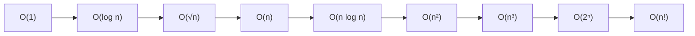

## Introduction

In [[a1-time-complexity]] you learned to count the steps an algorithm performs and describe the count with expressions such as O(n) or O(n²). That lesson used the notation informally: "O(n²)" meant "grows like n²". This lesson makes the notation precise, because a precise definition answers questions that intuition leaves open. Why is it legitimate to call `3n² + 10n + 5` simply O(n²)? Is a linear algorithm also O(n²)? Is O(2ⁿ) the same as O(3ⁿ)? Is O(log₂ n) the same as O(log₁₀ n)? Does "O(n log n)" describe the best case, the worst case, or something else?

**Big-O notation** is a way of describing the *growth rate* of a function — usually a function giving the number of steps, or the amount of memory, for an input of size `n` — while ignoring two things that do not affect how the function scales: **constant factors** (whether each step costs 1 or 5 units) and **lower-order terms** (an extra `10n` next to `3n²`). What remains is the *shape* of growth: logarithmic, linear, quadratic, exponential.

Engineers need this shared language because it lets two people compare algorithms without running them, on any hardware, and without arguing about micro-optimisations. "My approach is O(n log n) and yours is O(n²)" is a complete, meaningful comparison for large inputs. It is also the language every interviewer uses, and they will notice the difference between a candidate who can only recite "drop the constants" and one who can say *why* that is allowed.

## Before you start

- **Counting steps** — loops, nested loops, halving loops and recursion trees, and the idea of best, worst and average case. All of this is in [[a1-time-complexity]].
- **Space complexity** — Big-O applies to memory in exactly the same way as to time. See [[a1-space-complexity]].
- **Logarithms and exponents** — that log₂ 1,024 = 10 and that 2ⁿ doubles when `n` increases by one. Nothing deeper is needed.

## The intuition: zoom out until only the shape is left

Plot two cost functions, `f(n) = 100n` and `g(n) = n²`, for small `n`. At `n = 10`, `f` is 1,000 and `g` is 100: the "linear" algorithm is ten times slower. At `n = 100` they are equal. At `n = 1,000`, `f` is 100,000 and `g` is 1,000,000 — now `g` is ten times slower, and the gap keeps widening forever. Zoom out far enough and the constant 100 becomes irrelevant; the parabola always overtakes the line.

That is the whole idea of asymptotic analysis. **Asymptotic** means "as `n` grows without bound". We deliberately ask only about the zoomed-out picture, because for large inputs — the inputs where performance matters — the shape decides the outcome and the constants do not. The price is that Big-O says nothing about small inputs, where the line above was slower. You will see later in the lesson when that price matters.

## The formal definition

Here is the definition. Let `f(n)` and `g(n)` be functions from input sizes to non-negative numbers.

> `f(n)` is **O(g(n))** if there exist a positive constant `c` and a threshold `n₀` such that `f(n) ≤ c · g(n)` for every `n ≥ n₀`.

In words: past some input size, `f` never exceeds a fixed multiple of `g`. Two parts of the definition do all the work. The constant `c` is what lets us **ignore constant factors**: if `f(n) = 5n`, choosing `c = 5` shows it is O(n). The threshold `n₀` is what lets us **ignore small inputs**: whatever happens before `n₀` does not count.

Let us prove that `f(n) = 3n² + 10n + 5` is O(n²), so that "drop the lower terms" becomes a fact rather than a habit. For every `n ≥ 1`, we have `10n ≤ 10n²` and `5 ≤ 5n²`. Adding these to `3n²`:

```text
3n² + 10n + 5  ≤  3n² + 10n² + 5n²  =  18n²     for all n ≥ 1
```

So `c = 18` and `n₀ = 1` satisfy the definition, and `f(n)` is O(n²). The constants are not unique — `c = 4` works too once `n` is large enough — and the definition only asks that *some* pair exists.

You can watch the same fact numerically. The program below computes `f(n)` and divides it by `n²`.

```java title="Dominance.java"
public class Dominance {

    // Exact step count of some hypothetical algorithm: 3n^2 + 10n + 5.
    static long f(long n) {
        return 3 * n * n + 10 * n + 5;
    }

    public static void main(String[] args) {
        System.out.printf("%10s %22s %10s%n", "n", "f(n)", "f(n)/n^2");
        for (long n : new long[] {1, 10, 100, 1_000, 1_000_000}) {
            System.out.printf("%10d %22d %10.4f%n", n, f(n), (double) f(n) / (n * n));
        }
    }
}
```

```output
         n                   f(n)   f(n)/n^2
         1                     18    18.0000
        10                    405     4.0500
       100                  31005     3.1005
      1000                3010005     3.0100
   1000000          3000010000005     3.0000
```

The ratio starts at 18 — which is why `c = 18` was needed for `n₀ = 1` — and settles towards 3, the leading coefficient. A ratio that stays bounded as `n` grows is exactly what "f is O(n²)" means. If you divided by `n` instead, the ratio would grow without limit, which is why `f` is *not* O(n).

### Big-O is an upper bound, and it can be loose

Read the definition again: it only says `f` does not grow *faster* than `g`. It does not say `f` grows *as fast as* `g`. A linear function `5n` satisfies `5n ≤ 5 · n²` for all `n ≥ 1`, so it is technically O(n²). It is also O(n³) and O(2ⁿ). All of those statements are true, and all but O(n) are useless.

In practice, when someone says "this algorithm is O(n)", they mean the **tightest** bound they know. In interviews, always give the tight one. If you say "binary search is O(n)", you are not wrong in the strict sense, but you will be marked as wrong, because the expected answer is O(log n).

A note on notation: you will see both `f(n) = O(g(n))` and `f(n) ∈ O(g(n))`. The second is more honest — O(g(n)) is really the *set* of all functions bounded by a multiple of `g` — and it explains why the "equals sign" is not symmetric: `n = O(n²)` is true, but `n² = O(n)` is false.

## Rules for simplifying

The definition justifies a small set of rules. Each one follows from choosing `c` and `n₀` suitably.

**Constant factors disappear.** `O(5n)` is `O(n)` and `O(n²/2)` is `O(n²)`, because the constant can be absorbed into `c`. Never write a constant inside the O: `O(3n²)` is a sign that the simplification is unfinished.

**Lower-order terms disappear; the fastest-growing term stays.** `O(n² + n)` is `O(n²)` and `O(n + n log n)` is `O(n log n)`. The proof is the one above: each smaller term is at most a constant multiple of the largest one for large `n`. Be careful to drop the *smaller* term — reducing `n² + n` to O(n) is a real mistake that appears in interviews.

**Sums take the maximum; products multiply.** Two sequential phases costing O(f) and O(g) cost O(f + g), which is O(max(f, g)). A loop running O(f) times with a body costing O(g) costs O(f · g). These are the loop rules from the previous lesson, now justified.

**The base of a logarithm does not matter.** For any bases `a` and `b`, `logₐ n = log_b n / log_b a`, and `1 / log_b a` is a constant. So log₂ n, log₁₀ n and ln n are all O(log n), which is why the base is usually not written.

**Powers inside a logarithm become constants.** `log(n²) = 2 log n`, so O(log n²) is O(log n). Similarly `log(n!)` is Θ(n log n), a fact that explains why no comparison-based sort can beat O(n log n).

**The base of an exponential does matter.** This is where intuition from the logarithm rule breaks. 3ⁿ / 2ⁿ = 1.5ⁿ, which grows without bound, so 3ⁿ is *not* O(2ⁿ). Likewise 2²ⁿ = 4ⁿ, which is not O(2ⁿ). A constant in an exponent is not a constant factor.

**Variables that can be large are not constants.** If a heap of size `k` is updated `n` times, the cost is O(n log k). Simplifying it to O(n) is only valid if `k` is genuinely bounded by a constant — say, "the top 10" — and you should say so when you do it. Similarly, the size of the alphabet in a string problem is often treated as a constant (26 lowercase letters), but a problem over arbitrary Unicode text is different.

## The growth hierarchy

The common classes, from slowest-growing to fastest-growing, are:



Names worth knowing: O(1) is **constant**, O(log n) **logarithmic**, O(n) **linear**, O(n log n) **linearithmic**, O(n²) **quadratic**, O(n^k) for a fixed `k` **polynomial**, O(2ⁿ) and other `cⁿ` **exponential**, and O(n!) **factorial**.

Numbers make the differences tangible. This program prints a few of the classes for small inputs.

```java title="Growth.java"
public class Growth {
    public static void main(String[] args) {
        System.out.printf("%6s %8s %10s %12s %24s%n", "n", "log2 n", "n log2 n", "n^2", "2^n");
        for (int n : new int[] {10, 20, 30, 40, 60}) {
            double lg = Math.log(n) / Math.log(2);
            System.out.printf("%6d %8.1f %10.0f %12d %24d%n",
                    n, lg, n * lg, (long) n * n, 1L << n);
        }
    }
}
```

```output
     n   log2 n   n log2 n          n^2                      2^n
    10      3.3         33          100                     1024
    20      4.3         86          400                  1048576
    30      4.9        147          900               1073741824
    40      5.3        213         1600            1099511627776
    60      5.9        354         3600      1152921504606846976
```

Notice how differently the columns respond to the same change in `n`. Going from 20 to 40 doubles `n`: the quadratic column multiplies by 4, but the exponential column multiplies by about a million. That is the essential difference between polynomial and exponential growth. **Doubling `n` multiplies a polynomial by a constant** (2² = 4 for a quadratic, 2³ = 8 for a cubic). **Adding one to `n` multiplies an exponential by a constant** (2 for 2ⁿ). An exponential algorithm that handles `n = 40` in a day needs about two days for `n = 41` and about three years for `n = 50`. This is why `n ≤ 20` in a problem statement signals that exponential search is acceptable, and `n = 60` signals that it is not.

At the other end, the logarithm column hardly moves. log₂ of a million is about 20 and log₂ of a billion is about 30, which is why an O(log n) operation is, in practice, nearly as cheap as O(1).

## O, Ω and Θ

Big-O gives an upper bound. Two companion notations give a lower bound and a tight bound.

| Notation | Read as | Claim | Analogy |
|---|---|---|---|
| f = O(g) | "big O" | f grows **no faster** than g | f ≤ g |
| f = Ω(g) | "big Omega" | f grows **at least as fast** as g | f ≥ g |
| f = Θ(g) | "big Theta" | f grows **at the same rate** as g: both O(g) and Ω(g) | f = g |
| f = o(g) | "little o" | f grows **strictly slower** than g | f < g |
| f = ω(g) | "little omega" | f grows **strictly faster** than g | f > g |

Formally, `f` is **Ω(g)** if there are `c > 0` and `n₀` with `f(n) ≥ c · g(n)` for all `n ≥ n₀`, and `f` is **Θ(g)** if it is both O(g) and Ω(g). Our `3n² + 10n + 5` is Θ(n²): it is O(n²) as shown, and it is Ω(n²) because it is always at least `3n²`. By contrast, `5n` is O(n²) but not Θ(n²), because it is not Ω(n²). Little-o and little-omega are strict versions: `n` is o(n²), but `n²` is not o(n²).

The analogy column is only an analogy: these compare *growth rates*, not values. `100n` is O(n) even though `100n > n` for every `n`.

**Why do people say Big-O when they mean Θ?** Convention. In interviews and everyday engineering, "binary search is O(log n)" is understood to mean the tight bound. Use Θ when precision matters — for example when someone asks "is that bound tight?" — and know the difference so you can explain it.

### Bounds are not cases

A very common misconception is that O means worst case, Ω means best case and Θ means average case. That is wrong, and untangling it is a good test of understanding.

**Cases** (best, worst, average) choose *which function* you are describing. **Bounds** (O, Ω, Θ) describe *how that function grows*. They are independent: you can give a tight bound on any case.

Take insertion sort. Its worst case — reverse-sorted input — performs about n²/2 comparisons, so its *worst-case* running time is Θ(n²). Its best case — already-sorted input — performs about `n` comparisons, so its *best-case* running time is Θ(n). Both statements use Θ. What you can say about insertion sort over *all* inputs at once is that its running time is O(n²) (no input is worse than quadratic) and Ω(n) (no input is better than linear), but there is no single Θ that covers every input, because the best and worst cases grow differently.

So the precise version of "quicksort is O(n log n)" is "quicksort's *average-case* running time is Θ(n log n), and its *worst-case* running time is Θ(n²)".

### Worst case, average case, expected and amortized

Four different guarantees are often all written as "O(something)". Say which one you mean.

- **Worst case**: holds for every input of size `n`. `TreeMap.get` is O(log n) worst case.
- **Average case**: averaged over a distribution of inputs. `HashMap.get` is O(1) on average, assuming keys spread well across buckets.
- **Expected**: averaged over the algorithm's own random choices, for *every* input. Quicksort with a random pivot runs in expected O(n log n) on any input, including sorted input that would defeat a fixed first-element pivot.
- **Amortized**: averaged over any sequence of operations, guaranteed. `ArrayList.add` is O(1) amortized because occasional O(n) resizes total O(n) over `n` additions. The arithmetic is worked through in [[a1-time-complexity]].

## More than one variable

Real problems often have several independent sizes, and Big-O handles them directly. Keep every variable that can grow independently, and simplify only within what you know about their relationship.

- Merging two sorted lists of lengths `n` and `m` is **O(n + m)**. You cannot simplify to O(n) unless you know `m ≤ n`.
- Comparing every character of one string with every character of another is **O(n · m)**.
- BFS or DFS over a graph is **O(V + E)**. In a dense graph `E` can be up to about V², so the same algorithm is O(V²) there; in a sparse graph with E ≈ V it is O(V). Keeping both terms covers both cases. See [[a8-bfs]].
- Keeping the `k` largest of `n` elements in a heap is **O(n log k)**, which is better than sorting, O(n log n), when `k` is much smaller than `n`. See [[a7-top-k]].

## Recurrences

Recursive algorithms are described by a **recurrence**: an equation giving the cost on input size `n` in terms of the cost on smaller inputs. For merge sort, sorting `n` elements means sorting two halves and merging in linear time, so `T(n) = 2T(n/2) + n`. Solving the recurrence means finding its growth class. The recursion-tree method from [[a1-time-complexity]] — add up the work level by level — solves most interview recurrences. The common ones are worth recognising on sight:

| Recurrence | Solution | Why | Example |
|---|---|---|---|
| T(n) = T(n/2) + O(1) | O(log n) | log n levels, constant work each | Binary search |
| T(n) = T(n/2) + O(n) | O(n) | n + n/2 + n/4 + … ≤ 2n | Quickselect, expected, with good pivots |
| T(n) = 2T(n/2) + O(1) | O(n) | The tree has about 2n nodes, constant work each | Tree traversal of a balanced tree |
| T(n) = 2T(n/2) + O(n) | O(n log n) | log n levels, n work per level | Merge sort |
| T(n) = T(n − 1) + O(1) | O(n) | n levels, constant work each | Linear recursion over a list |
| T(n) = T(n − 1) + O(n) | O(n²) | n + (n − 1) + … + 1 | Selection sort written recursively |
| T(n) = 2T(n − 1) + O(1) | O(2ⁿ) | The number of calls doubles each level | Towers of Hanoi, subsets |

The pattern in the table is worth internalising. **Dividing** the problem size (n/2) gives logarithmic depth; **subtracting** from it (n − 1) gives linear depth. Then the total depends on how many subproblems each level spawns and how much non-recursive work each call does. The general tool for divide-and-conquer recurrences of the form `T(n) = aT(n/b) + f(n)` is called the **Master Theorem**; it compares `f(n)` with `n^(log_b a)` and is covered in algorithms textbooks, but the table above covers almost everything interviews ask.

## Worked examples

For each snippet, the reasoning matters more than the answer.

```java
// (1)
for (int i = 0; i < n; i++)
    for (int j = 0; j < 100; j++)
        work();
```

The inner loop runs exactly 100 times regardless of `n`. The total is 100n calls, which is **Θ(n)**. A nested loop is quadratic only when *both* bounds grow with the input.

```java
// (2)
for (int i = 1; i < n; i *= 2)
    for (int j = 0; j < i; j++)
        work();
```

The outer loop is a doubling loop, so it runs about log₂ n times — but the inner loop's length changes. It runs 1, 2, 4, …, up to less than `n` times. That geometric sum is less than `2n`, so the total is **Θ(n)**, not O(n log n). Multiplying "log n iterations" by "up to n each" gives a correct upper bound, O(n log n), but not a tight one.

```java
// (3)
for (int i = 0; i < n; i++)
    for (int j = 1; j < n; j *= 2)
        work();
```

Now the outer loop is linear and the inner loop is a full doubling loop every time, so the total is n · log₂ n, which is **Θ(n log n)**.

```java
// (4)
for (int i = 0; i * i < n; i++)
    work();
```

The loop stops once `i²` reaches `n`, that is, after about √n iterations: **Θ(√n)**. This shape appears in primality testing, where you only need to try divisors up to √n.

```java
// (5)
static int count(int n) {
    if (n <= 1) return 1;
    return count(n - 1) + count(n - 1);
}
```

Each call makes two calls on `n - 1`, so `T(n) = 2T(n − 1) + O(1)`, which is **Θ(2ⁿ)**. Replacing the two identical calls with one call stored in a variable gives `T(n) = T(n − 1) + O(1)`, which is Θ(n). The difference between those two versions — repeating work versus reusing it — is the entire idea behind dynamic programming ([[a11-memoization]]).

```quiz
Q: Which is the correct simplification of `O(n² + n log n + 1000)`?
- [ ] O(n log n), because it is in the middle
- [x] O(n²)
- [ ] O(n² + n log n), because both terms involve n
- [ ] O(1000), because constants dominate small inputs
> For large n, n² grows faster than n log n, and both grow faster than any constant. Each smaller term is at most a constant multiple of n² once n is large enough, so only n² remains.

Q: Is 3ⁿ in O(2ⁿ)?
- [ ] Yes, because 3 and 2 are both constants and constants are dropped
- [x] No, because 3ⁿ / 2ⁿ = 1.5ⁿ grows without bound, so no constant c works
- [ ] Yes, but only for n below 100
- [ ] It depends on the base of the logarithm
> Constant factors can be dropped, but a constant in the base of an exponential is not a factor. The ratio 1.5ⁿ eventually exceeds any c, so the definition cannot be satisfied.

Q: Insertion sort takes about n steps on sorted input and about n²/2 on reversed input. Which statement is correct?
- [ ] Its running time is Θ(n²) on every input
- [ ] Big-O describes its worst case and Ω describes its best case, so it is O(n²) and Ω(n²)
- [x] Its worst-case time is Θ(n²) and its best-case time is Θ(n)
- [ ] Its running time is Θ(n log n) on average because it is a sorting algorithm
> Cases choose which function you analyse; bounds describe that function's growth. The worst case grows like n² and the best case like n, and each has its own tight bound. Over all inputs together you can only say O(n²) and Ω(n).

Q: What is the tight bound for `for (int i = 1; i < n; i *= 2) for (int j = 0; j < i; j++) work();`?
- [ ] Θ(log n)
- [x] Θ(n)
- [ ] Θ(n log n)
- [ ] Θ(n²)
> The inner loop runs 1 + 2 + 4 + … up to less than n times, a geometric series that sums to less than 2n. O(n log n) is a true upper bound but not tight.
```

## When Big-O misleads

Big-O deliberately throws away information, and sometimes that information decides the result. Knowing when is part of using the notation well.

**Constants matter for small inputs.** Insertion sort is O(n²) and merge sort is O(n log n), yet insertion sort is faster on very small arrays because its inner loop is tiny and it allocates nothing. Real library sorts exploit this: Java's TimSort sorts short runs of a few dozen elements with binary insertion sort before merging them, and the primitive-array quicksort switches to insertion sort for small subarrays. The asymptotically better algorithm wins only once `n` is past the crossover point.

**Memory behaviour is invisible to Big-O.** Iterating over an `ArrayList` and over a `LinkedList` are both O(n), but the array version is usually several times faster, because its elements sit next to each other in memory and the CPU cache loads them in blocks, while the linked list jumps to a different place in memory for every node. For the same reason, a binary search over a large sorted array can be slower in practice than its O(log n) suggests, because each probe may miss the cache.

**"Constant" can hide a large input.** `HashMap.get` is O(1) on average *in the number of entries*, but computing the key's hash and comparing keys costs time proportional to the key's size. For `String` keys of length `L`, a lookup costs O(L) to compare characters (Java caches each string's hash after the first computation, but `equals` still scans). In a problem with `n` strings of length `L`, putting them all in a set is O(n · L), not O(n).

**O(1) does not mean fast.** It means the cost does not grow with `n`. An operation that always takes one second is O(1).

None of this makes Big-O less useful. It means Big-O is the first filter — it rules out approaches that cannot possibly scale — and measurement is the second, for choosing between approaches in the same class.

## In real systems

Engineers use asymptotic reasoning daily, usually informally. When choosing a data structure, the question "will we need lookups by key, ordered iteration, or both?" is really a question about which operations must be O(1), O(log n) or O(n). When reviewing a database query plan, a sequential scan is O(n) in the table size and an index lookup is O(log n), which is why adding an index can turn a query that takes seconds into one that takes a millisecond — and why the difference grows as the table does. When designing an API, returning "all results" is O(n) in response size and becomes a problem as data grows, which is why paginated endpoints exist. And capacity planning uses the same idea at a larger scale: if a component's cost grows quadratically with the number of users, it will become the bottleneck no matter how fast it is today.

## Common mistakes

**Dropping the wrong term.** `O(n² + n)` is O(n²), not O(n). Always keep the fastest-growing term.

**Leaving a sum or constant in the answer.** `O(n + n log n)` and `O(2n)` are unfinished. Simplify to `O(n log n)` and `O(n)`.

**Treating exponential bases like constant factors.** 2ⁿ and 3ⁿ are different classes; 2ⁿ⁺¹ = 2 · 2ⁿ is the same class as 2ⁿ, but 2²ⁿ is not.

**Merging independent variables.** O(n + m) is not O(n) unless you know `m` is at most proportional to `n`. O(n log k) is not O(n) unless `k` is a fixed constant.

**Confusing bounds with cases.** O is not "worst case" and Ω is not "best case". Name the case, then give the bound.

**Giving a loose bound.** Saying binary search is O(n) is technically true and practically wrong. Give the tightest bound you can justify.

## Interview perspective

Interviewers expect you to state complexity in Big-O for every solution and to be able to justify the simplification. The most common follow-ups probe whether you understand the notation or only the ritual.

> [!INTERVIEW] Questions to be ready for
> "Simplify `4n³ + n² log n + 7`." — O(n³), with the reason that each lower term is bounded by a constant times n³ for large n. "What is the difference between O and Θ?" — O is an upper bound that may be loose; Θ means the same function bounds it from above and below. "Is your hash-map solution really O(n)?" — On average, yes; in the worst case every key could collide, and keys of length L add a factor of L for hashing and comparison.

A strong signal is volunteering the precision the interviewer did not ask for: "O(n log n) average; the worst case is O(n²) with a fixed pivot, but this uses the library sort, which is O(n log n) in the worst case too." Another is noticing a tight bound below the obvious one, as in worked example 2. For presenting complexity naturally while coding under time pressure, see [[a14-complexity-in-interview]].

## Practice

1. Prove from the definition that `7n + 20` is O(n) by giving explicit `c` and `n₀`. Then prove it is not O(1).
2. Order these from slowest to fastest growth: `n log n`, `2ⁿ`, `√n`, `log n`, `n!`, `n²`, `100`, `n log² n`.
3. Decide true or false, with a reason: `n² = O(n³)`; `n³ = O(n²)`; `log₂ n = Θ(log₁₀ n)`; `2ⁿ⁺¹ = O(2ⁿ)`; `2²ⁿ = O(2ⁿ)`.
4. Give the tight bound of a loop where `i` runs from 1 to `n` and the inner loop runs from 1 to `n / i`. (Hint: the harmonic series 1 + 1/2 + … + 1/n is about ln n.)
5. Solve `T(n) = 3T(n/3) + n` and `T(n) = T(n/2) + n` by drawing recursion trees.
6. A solution inserts `n` strings, each of length up to `L`, into a `HashSet`. State its time complexity in terms of both variables.

## Quick revision {#quick-revision}

- f is O(g) if f(n) ≤ c · g(n) for all n ≥ n₀, for some constants c > 0 and n₀.
- `c` absorbs constant factors; `n₀` ignores small inputs. Big-O is an upper bound and may be loose; give the tight one.
- Ω is a lower bound; Θ means both O and Ω; o and ω are the strict versions.
- Cases (best, worst, average) choose the function; bounds (O, Ω, Θ) describe its growth. O is not "worst case".
- Simplify: drop constants and lower-order terms; sums take the max; nested work multiplies.
- Logarithm bases do not matter; exponential bases do (3ⁿ is not O(2ⁿ)).
- Keep independent variables: O(n + m), O(n · m), O(V + E), O(n log k).
- Hierarchy: 1 < log n < √n < n < n log n < n² < n³ < 2ⁿ < n!.
- Recurrences: T(n/2)+1 → log n; T(n/2)+n → n; 2T(n/2)+1 → n; 2T(n/2)+n → n log n; T(n−1)+1 → n; T(n−1)+n → n²; 2T(n−1)+1 → 2ⁿ.
- Big-O ignores constants, cache behaviour and key sizes; use it to rule approaches out, then measure within a class.

## Key takeaways {#key-takeaways}

- Big-O describes the growth rate of a cost, which is what matters for large inputs.
- The formal definition, with its constants `c` and `n₀`, is what justifies dropping constant factors and smaller terms.
- O, Ω and Θ are upper, lower and tight bounds; they are independent of whether you analyse the best, worst or average case.
- Simplify carefully: keep the fastest-growing term, keep independent variables, and remember that exponential bases are not constants.
- Recognising common recurrences lets you analyse recursive algorithms in seconds.
- Big-O is a filter, not a stopwatch; on small inputs and within a class, constants and memory behaviour decide.
