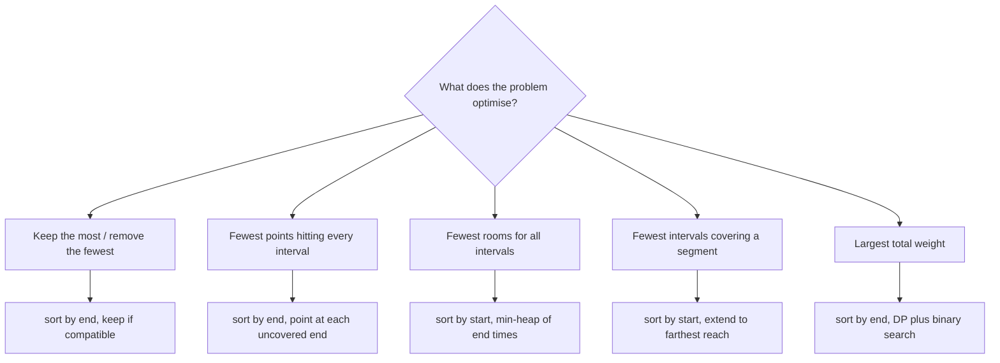

## Introduction

A conference has one lecture hall and eleven speakers who each want it for a fixed time slot. Several slots overlap, so not everyone can have the hall. Which talks should be accepted so that **as many talks as possible** take place?

That question is the **interval scheduling problem**, also called **activity selection**. Each request is an **interval** — a start time and an end time — and two requests conflict when their intervals overlap. You want the largest set of requests in which no two conflict.

The problem looks like it needs a search over all subsets, and a naive solution does exactly that. The surprise is that a one-line rule solves it optimally: *repeatedly accept the request that finishes earliest among those still compatible*. The whole algorithm is a sort followed by one pass.

This lesson is about that rule and its relatives. They are some of the cleanest examples of a **greedy algorithm** — an algorithm that builds its answer one irrevocable choice at a time, always taking whatever looks best right now. Greedy algorithms are fast and short, but they are only correct when you can prove the local choice never costs you the global optimum. Interval scheduling is where most engineers first learn to write those proofs, and the proof techniques you learn here — "greedy stays ahead" and the exchange argument — are the same ones used throughout [[a10-local-vs-global]].

You will meet interval scheduling in booking systems, CPU and network reservations, advertising slots, and in coding interviews under names such as *Non-overlapping Intervals*, *Minimum Number of Arrows to Burst Balloons*, *Meeting Rooms II*, *Video Stitching* and *Maximum Profit in Job Scheduling*.

## Before you start

- **Interval basics** — representing an interval as `[start, end]`, the overlap test, and Merge Intervals. [[a2-intervals]] covers these and introduces the end-sort rule this lesson proves in depth.
- **Sorting with a comparator** — `Arrays.sort` with a lambda, and why `Integer.compare` is used instead of subtraction. See [[a3-comparator-sorting]].
- **Priority queues** — `PriorityQueue` with `add`, `peek` and `poll`, each O(log n). See [[a7-priority-queues]]. Needed for room assignment.
- **Binary search for a boundary** — finding how many sorted values are `<= t`. See [[a3-lower-upper-bounds]]. Needed for the weighted version.
- **Big-O** — O(n log n) versus O(2ⁿ). See [[a1-big-o]].

## The intuition

Think of the lecture hall as a resource that is "used up" from the moment a talk starts until it ends. Whatever you accept first, every later talk must start after it finishes. So the first talk you accept is really a decision about **how much of the day you have left** for everything else.

Seen that way, the length of a talk and the time it starts are distractions. What matters is the moment the hall becomes free again. A talk that ends at 10:00 leaves the hall open from 10:00 onwards; a talk that ends at 11:00 leaves it open only from 11:00. Anything that fits after 11:00 also fits after 10:00, but not the other way round. So among the talks you could accept first, the one that ends earliest leaves you with a set of options that **contains** the options every other choice leaves. You cannot lose by taking it.

That containment is the heart of the proof you will see shortly. Keep the picture of "the hall becomes free at time `t`" in mind; every variation in this lesson asks a question about that moment.

## The problem, stated precisely

You are given `n` intervals `[sᵢ, eᵢ)` with `sᵢ < eᵢ`. Two intervals are **compatible** if they do not overlap. Find a largest set of pairwise compatible intervals.

The bracket notation matters. A **half-open** interval `[s, e)` includes its start and excludes its end, which is the natural model for bookings: a meeting from 9 to 10 and another from 10 to 11 do not clash, because the first has finished at exactly the moment the second begins. With half-open intervals, interval `b` can follow interval `a` when `b.start >= a.end`.

A **closed** interval `[s, e]` includes both ends. Balloons on a number line, inclusive day ranges and "the arrow hits the balloon if it is anywhere from `s` to `e`" are closed. Two closed intervals touching at a point do overlap, so `b` can follow `a` only when `b.start > a.end`.

Everything in this lesson works for both kinds; only that single comparison changes. Decide which kind your problem uses before writing any code — it is the most common source of off-by-one answers in interval problems.

## Why the obvious rules fail

The brute-force solution tries every subset of the intervals, checks whether its members are pairwise compatible, and keeps the largest valid one. There are 2ⁿ subsets and checking one takes O(n log n) (sort it and compare neighbours), so the total is O(2ⁿ · n log n). At `n = 40` that is already over a trillion subsets. We need a rule that picks intervals directly.

Several greedy rules sound reasonable. Each picks an interval by some criterion, deletes everything that overlaps it, and repeats. Here is how they fare on small inputs, checked against brute force (half-open intervals):

| Rule | Input that breaks it | Rule keeps | Optimum |
|---|---|---|---|
| Earliest start | `[1,100] [2,3] [4,5]` | 1 (`[1,100]`) | 2 |
| Shortest length | `[1,5] [4,7] [6,10]` | 1 (`[4,7]`) | 2 |
| Fewest conflicts | `[0,3] [3,6] [6,9] [9,12] [5,7]`, three copies of `[2,4]`, three of `[8,10]` | 3 | 4 |
| **Earliest end** | — | always optimal | — |

The first two failures are easy to see. Starting early says nothing about how long you block the resource — `[1,100]` starts first and wastes the whole day. Being short is closer to the right idea, but a short interval can sit across a boundary between two others: `[4,7]` overlaps both `[1,5]` and `[6,10]`, which are compatible with each other.

The third rule is the most convincing, because an interval with few conflicts seems to "cost" little. The counterexample shows why that reasoning is wrong. `[5,7]` has only two conflicts (`[3,6]` and `[6,9]`), while each of the four intervals in the optimal answer has three or four, inflated by the stacked copies of `[2,4]` and `[8,10]`. Choosing `[5,7]` destroys two members of the optimal chain at once, and no choice afterwards recovers. Counting conflicts measures the wrong thing: it does not care *which* intervals are lost.

> [!TIP] Break a greedy rule before you trust it
> When you suspect a greedy rule, spend two minutes trying to break it with three or four intervals. A counterexample this small takes seconds to check by hand, and finding one saves you from coding a wrong solution. If every attempt fails, that is the moment to look for a proof.

## Earliest finish time first

The rule that works:

1. Sort the intervals by end time.
2. Walk through them in that order. Keep the current interval if it is compatible with the last one kept (`start >= lastEnd` for half-open intervals); otherwise skip it.

Because the intervals are visited in order of end time, "the next compatible interval in sorted order" is exactly "the compatible interval that finishes earliest". And because every kept interval ends no later than the next one considered, comparing with the *last* kept interval is enough — all earlier kept intervals ended even sooner.

Two proofs follow. Learn both: they are the two standard ways to prove any greedy algorithm, and interviewers often ask "why does that work?" straight after you state the rule.

### Proof 1: greedy stays ahead

Let the greedy choices, in the order chosen, be `g₁, g₂, …, gₖ`, and let `o₁, o₂, …, oₘ` be any optimal solution sorted by end time. We want to show `k = m`.

**Claim.** For every `r ≤ k`, `end(gᵣ) ≤ end(oᵣ)`. In words: after `r` choices, greedy's resource is free at least as early as the optimal solution's.

- **Base case, `r = 1`.** `g₁` is the interval with the smallest end time of all, so `end(g₁) ≤ end(o₁)`.
- **Step.** Assume `end(gᵣ) ≤ end(oᵣ)`. The interval `oᵣ₊₁` starts at or after `end(oᵣ)`, because the optimal solution is compatible, and so it starts at or after `end(gᵣ)`. That means `oᵣ₊₁` is still available when greedy makes its `(r + 1)`-th choice. Greedy picks the earliest-ending available interval, so `end(gᵣ₊₁) ≤ end(oᵣ₊₁)`.

Now suppose the optimal solution were bigger, `m > k`. Then `oₖ₊₁` exists and starts at or after `end(oₖ) ≥ end(gₖ)`. It would be compatible with everything greedy chose, so greedy would not have stopped after `k` choices. That contradiction shows `m = k`: greedy is optimal.

This style of proof is called **greedy stays ahead**: define a measure of progress (here, "how early the resource frees up"), show by induction that greedy is never behind any other solution on that measure, and conclude that it cannot finish behind.

### Proof 2: the exchange argument

The second proof transforms an optimal solution into the greedy one without making it worse. Take any optimal solution `O`, and let `g` be the interval with the earliest end overall. Let `f` be the first interval of `O`. Since nothing ends before `g`, `end(g) ≤ end(f)`. Replace `f` by `g`. Every other member of `O` starts at or after `end(f)`, hence at or after `end(g)`, so the new set is still compatible and has the same size. So **some** optimal solution contains `g`.

After choosing `g`, what remains is the same problem on the intervals starting at or after `end(g)`, and the same argument applies to that smaller problem. Repeating it turns `O` into the greedy solution step by step, never losing an interval. This is an **exchange argument**: show that the greedy choice can be swapped into an optimal solution at no cost. [[a2-intervals]] uses it for the same problem; [[a10-local-vs-global]] explains when each proof style is the better tool.

## Implementation

The method below returns the chosen intervals, not only their count — real callers need to know *which* requests were accepted.

```java title="ActivitySelection.java"
import java.util.ArrayList;
import java.util.Arrays;
import java.util.List;

public class ActivitySelection {

    /** Returns a largest set of pairwise non-overlapping half-open intervals [start, end). */
    static List<int[]> selectMax(int[][] intervals) {
        int[][] byEnd = intervals.clone();                   // do not reorder the caller's array
        Arrays.sort(byEnd, (a, b) -> Integer.compare(a[1], b[1]));
        List<int[]> chosen = new ArrayList<>();
        long lastEnd = Long.MIN_VALUE;                       // nothing chosen yet
        for (int[] iv : byEnd) {
            if (iv[0] >= lastEnd) {                          // compatible with every choice so far
                chosen.add(iv);
                lastEnd = iv[1];
            }
        }
        return chosen;
    }

    static String show(List<int[]> list) {
        StringBuilder sb = new StringBuilder();
        for (int[] iv : list) sb.append(Arrays.toString(iv)).append(' ');
        return sb.toString().trim();
    }

    public static void main(String[] args) {
        int[][] requests = {
            {1, 4}, {3, 5}, {0, 6}, {5, 7}, {3, 9}, {5, 9},
            {6, 10}, {8, 11}, {8, 12}, {2, 14}, {12, 16}
        };
        System.out.println(show(selectMax(requests)));
        System.out.println(show(selectMax(new int[][]{{1, 2}, {2, 3}, {3, 4}})));  // touching
        System.out.println(show(selectMax(new int[][]{{5, 9}, {5, 9}, {5, 9}})));  // duplicates
        System.out.println(selectMax(new int[0][]).size());                        // empty
    }
}
```

```output
[1, 4] [5, 7] [8, 11] [12, 16]
[1, 2] [2, 3] [3, 4]
[5, 9]
0
```

A few choices in this code are deliberate. `intervals.clone()` copies the outer array so the caller's order is untouched; the inner `int[]` objects are shared, which is fine because nothing modifies them. The comparator uses `Integer.compare(a[1], b[1])` rather than `a[1] - b[1]`, because subtraction overflows when ends are far apart (for example `-2147483645` and `2147483647`) and silently breaks the sort. `lastEnd` starts at `Long.MIN_VALUE` instead of `0` so that intervals with negative or `Integer.MIN_VALUE` starts are still accepted first. The empty input needs no special case: the loop does not run and an empty list comes back.

The touching case shows the half-open convention at work: `[1,2]`, `[2,3]` and `[3,4]` are all kept because `2 >= 2` and `3 >= 3`. For closed intervals you would write `iv[0] > lastEnd`, and only `[1,2]` and `[3,4]` would be kept.

### Dry run

Sorted by end, the eleven requests are `[1,4] [3,5] [0,6] [5,7] [3,9] [5,9] [6,10] [8,11] [8,12] [2,14] [12,16]` — the input happens to be in that order already.

| Interval | `lastEnd` before | `start >= lastEnd`? | Action | `lastEnd` after |
|---|---|---|---|---|
| `[1,4]` | −∞ | yes | keep | 4 |
| `[3,5]` | 4 | 3 < 4 | skip | 4 |
| `[0,6]` | 4 | 0 < 4 | skip | 4 |
| `[5,7]` | 4 | 5 ≥ 4 | keep | 7 |
| `[3,9]` | 7 | 3 < 7 | skip | 7 |
| `[5,9]` | 7 | 5 < 7 | skip | 7 |
| `[6,10]` | 7 | 6 < 7 | skip | 7 |
| `[8,11]` | 7 | 8 ≥ 7 | keep | 11 |
| `[8,12]` | 11 | 8 < 11 | skip | 11 |
| `[2,14]` | 11 | 2 < 11 | skip | 11 |
| `[12,16]` | 11 | 12 ≥ 11 | keep | 16 |

Four talks. Compare with the stays-ahead claim: after each keep, `lastEnd` is the earliest moment *any* valid schedule with that many talks could free the hall.

## Complexity

Sorting `n` intervals costs **O(n log n)** comparisons. The scan visits each interval once and does O(1) work per visit, so it costs O(n). The total is O(n log n), dominated by the sort. If the input is already sorted by end — common when intervals come from a log or a timeline — the algorithm is O(n).

Extra space is O(n) for the copied array and the output list. Java's `Arrays.sort` on an array of objects (here `int[]` rows) is a stable merge sort variant (TimSort) and may itself allocate up to O(n) temporary space. If you are allowed to reorder the input and only need the count, the extra space beyond the sort is O(1).

## Variation: fewest removals and fewest points

Two popular problems are the activity-selection problem in disguise.

**Non-overlapping Intervals** asks for the minimum number of intervals to *remove* so the rest do not overlap. Removing the fewest is the same as keeping the most, so the answer is `n − selectMax(...).size()`. Mixing up "kept" and "removed" is a frequent slip; write down which one the problem asks for.

**Minimum Number of Arrows to Burst Balloons** asks for the fewest points such that every closed interval contains at least one point. This is called **interval point cover** (or *stabbing*). The greedy rule: sort by end, place a point at the end of the first interval not yet hit, and skip every interval that point hits. Placing the point at the interval's *end* is the same "as late as possible while still doing the job" idea — it hits the current interval and as many later ones as it can. [[a2-intervals]] gives the code; it differs from `selectMax` only in the comparison (`>` for closed intervals) and in what is counted.

There is a deeper connection worth knowing. The intervals at which greedy places points are pairwise disjoint — each new point is needed precisely because its interval starts after the previous point. Any valid set of points needs a separate point for each of those disjoint intervals, since no single point lies in two of them. So the greedy count is also a **lower bound** on every solution, which proves it optimal. In short: *the fewest points needed equals the most pairwise-disjoint intervals*, and one greedy pass computes both. Proving optimality by exhibiting a matching lower bound is the third proof style, after "stays ahead" and exchange.

```quiz
Q: Why does keeping the interval that ends earliest never hurt the final count?
- [ ] Because the earliest-ending interval is always the shortest
- [x] Because every interval compatible with any other first choice is also compatible with it, so it leaves at least as many options
- [ ] Because it has the fewest conflicts
- [ ] Because sorting by end time makes the input non-overlapping
> If `g` ends earliest and `f` is any other first choice, `end(g) <= end(f)`, so anything that can follow `f` can also follow `g`. That containment is what both proofs rely on. It is not about length: `[0,3]` can end earlier than the shorter `[2,4]`.

Q: An optimal solution has five intervals and greedy finds four. Which step of the stays-ahead proof shows this cannot happen?
- [ ] The base case `end(g1) <= end(o1)`
- [ ] The fact that sorting is O(n log n)
- [x] The fifth optimal interval would start after `end(g4)`, so greedy would have taken it
- [ ] The fact that the intervals are half-open
> Stays-ahead gives `end(g4) <= end(o4)`. The fifth optimal interval starts at or after `end(o4)`, hence after `end(g4)`, so it was available to greedy, which would have kept a fifth interval.
```

## Variation: assigning rooms

Now every request must be accepted, and you may use as many identical rooms as you like. What is the fewest rooms, and which meeting goes in which room? This is **interval partitioning**, known in interviews as *Meeting Rooms II*.

Start with a lower bound. The **depth** of a set of intervals is the largest number that overlap at a single instant. If four meetings are all running at 11:30, they need four different rooms, so *no* schedule uses fewer rooms than the depth.

The greedy algorithm processes meetings in order of **start** time and gives each one any room that is free at its start, opening a new room only when none is free. Why is that optimal? Suppose greedy opens room number `d + 1` (counting from 1) for a meeting starting at `s`. It does so only because all `d` existing rooms hold meetings that are still running at `s`. Those meetings started no later than `s` (we process in start order) and end after `s` (they are still running). Together with the new meeting, `d + 1` meetings contain the instant `s`, so the depth is at least `d + 1`. Greedy therefore never uses more rooms than the depth, and no algorithm can use fewer. It is optimal, by the same lower-bound style as the arrows proof.

To find a free room fast, keep the busy rooms in a min-heap ordered by the time each becomes free. The root is the room that frees up soonest; if even that room is still busy at `s`, every room is.

```java title="RoomAssignment.java"
import java.util.Arrays;
import java.util.PriorityQueue;

public class RoomAssignment {

    /** Assigns each half-open meeting a room number; returns room[i] for meeting i. */
    static int[] assignRooms(int[][] meetings) {
        int n = meetings.length;
        Integer[] order = new Integer[n];
        for (int i = 0; i < n; i++) order[i] = i;
        Arrays.sort(order, (a, b) -> Integer.compare(meetings[a][0], meetings[b][0]));

        // Each entry is {endTime, roomNumber}; the root is the room that frees up first.
        // Ties go to the lower room number so the output does not depend on heap internals.
        PriorityQueue<int[]> busy = new PriorityQueue<>((a, b) ->
                a[0] != b[0] ? Integer.compare(a[0], b[0]) : Integer.compare(a[1], b[1]));
        int[] room = new int[n];
        int roomsOpened = 0;
        for (int i : order) {
            int start = meetings[i][0];
            if (!busy.isEmpty() && busy.peek()[0] <= start) {
                room[i] = busy.poll()[1];          // reuse a room whose meeting has ended
            } else {
                room[i] = roomsOpened++;           // every open room is busy at `start`
            }
            busy.add(new int[]{meetings[i][1], room[i]});
        }
        return room;
    }

    public static void main(String[] args) {
        int[][] meetings = {{9, 10}, {9, 12}, {9, 10}, {11, 12}, {11, 13}, {13, 14}, {10, 11}};
        int[] room = assignRooms(meetings);
        System.out.println(Arrays.toString(room));
        System.out.println("rooms used: " + (Arrays.stream(room).max().orElse(-1) + 1));
    }
}
```

```output
[0, 1, 2, 2, 0, 1, 0]
rooms used: 3
```

The method sorts *indices* rather than the meetings themselves so that `room[i]` lines up with the caller's meeting `i`. Trace it in start order (Java's object sort is stable, so the three 9 o'clock meetings stay in input order):

| Meeting (index) | Root of `busy` before | Free? | Room | `busy` after (end:room) |
|---|---|---|---|---|
| `[9,10]` (0) | empty | — | new 0 | 10:0 |
| `[9,12]` (1) | 10:0 | 10 > 9 | new 1 | 10:0, 12:1 |
| `[9,10]` (2) | 10:0 | 10 > 9 | new 2 | 10:0, 10:2, 12:1 |
| `[10,11]` (6) | 10:0 | 10 ≤ 10 | reuse 0 | 10:2, 11:0, 12:1 |
| `[11,12]` (3) | 10:2 | 10 ≤ 11 | reuse 2 | 11:0, 12:1, 12:2 |
| `[11,13]` (4) | 11:0 | 11 ≤ 11 | reuse 0 | 12:1, 12:2, 13:0 |
| `[13,14]` (5) | 12:1 | 12 ≤ 13 | reuse 1 | 12:2, 13:0, 14:1 |

Three rooms, matching the depth: from 9 to 10, three meetings run at once.

Each meeting causes at most one `poll` and one `add`, each O(log n), so after the O(n log n) sort the loop is also O(n log n). The heap holds at most one entry per room, so space is O(n) in the worst case. If you need only the *number* of rooms, the two-sorted-arrays sweep in [[a2-intervals]] is shorter; the heap version earns its place when you must report the assignment.

> [!WARNING] Partitioning sorts by start, selection sorts by end
> Activity selection sorts by end because it decides which intervals to keep. Partitioning keeps every interval and decides only where each one goes, so it must see meetings in the order they begin. Fed in end order, the same code opens three rooms for `[0,1] [0,2] [2,3] [1,4]`: `[2,3]` takes the room `[0,1]` freed, and `[1,4]` then finds no free room, although two rooms suffice (`[0,1]` then `[1,4]`; `[0,2]` then `[2,3]`).

## Variation: covering a segment with the fewest intervals

A third question turns selection around: given intervals and a target segment `[0, T]`, choose the **fewest** intervals whose union covers the whole segment. *Video Stitching* (clips of a sporting event; cover the full broadcast) is the standard example, and it is the same problem as *Jump Game II* in disguise ([[a10-local-vs-global]]).

Suppose `[0, c]` is already covered. The next interval you add must start at or before `c`, otherwise a gap opens. Among those candidates, take the one that **reaches farthest**. The stays-ahead argument applies directly: after `r` choices, greedy covers a prefix at least as long as any other `r`-interval solution covers, because at every step it maximises the reach from a prefix that is already at least as long. So greedy reaches `T` in no more steps than any solution.

```java title="VideoStitching.java"
import java.util.Arrays;

public class VideoStitching {

    /** Fewest clips whose union covers [0, time], or -1 if impossible. */
    static int minClips(int[][] clips, int time) {
        int[][] s = clips.clone();
        Arrays.sort(s, (a, b) -> Integer.compare(a[0], b[0]));
        int covered = 0, used = 0, i = 0;
        while (covered < time) {
            int farthest = covered;
            // Every clip that starts inside the covered prefix is a candidate for the next pick.
            while (i < s.length && s[i][0] <= covered) {
                farthest = Math.max(farthest, s[i][1]);
                i++;
            }
            if (farthest == covered) return -1;      // a gap no clip can bridge
            used++;
            covered = farthest;
        }
        return used;
    }

    public static void main(String[] args) {
        int[][] clips = {{0, 2}, {4, 6}, {8, 10}, {1, 9}, {1, 5}, {5, 9}};
        System.out.println(minClips(clips, 10));
        System.out.println(minClips(new int[][]{{0, 1}, {1, 2}}, 5));
        System.out.println(minClips(new int[][]{{0, 4}, {2, 8}}, 5));
        System.out.println(minClips(new int[][]{{1, 4}}, 3));
        System.out.println(minClips(new int[][]{{0, 5}}, 0));
    }
}
```

```output
3
-1
2
-1
0
```

On the first input, sorted by start: `[0,2] [1,5] [1,9] [4,6] [5,9] [8,10]`. From `covered = 0`, only `[0,2]` starts in time, so the reach is 2. From 2, `[1,5]` and `[1,9]` qualify and the farthest reach is 9. From 9, the remaining three qualify and the reach is 10. Three clips: `[0,2]`, `[1,9]`, `[8,10]`.

The edge cases are each handled by one line. If no clip starts at or before `covered` and extends it, `farthest == covered` and the answer is `-1` — this catches both a gap in the middle and a first clip that starts after 0. A target of 0 is already covered, so the loop never runs. Each clip is examined once by the inner loop across the whole run, so after sorting the scan is O(n); the total is O(n log n).

## When greedy is not enough: weighted intervals

Now give each request a **weight** — the fee a speaker pays, or the profit of a job — and ask for a compatible set with the largest total weight. This is **weighted interval scheduling** (*Maximum Profit in Job Scheduling*), and no simple greedy rule solves it:

- *Earliest end* fails on `[1,3)` worth 1 and `[2,10)` worth 100: it keeps the first and loses 99.
- *Highest weight* fails on `[0,10)` worth 10 against `[0,5)` and `[5,10)` worth 9 each: it keeps 10 where 18 was possible.

The containment argument breaks because ending early is no longer the only thing that matters — an interval that ends late may be worth more than everything it blocks. When local rules fail like this, the standard escape is **dynamic programming**: consider each interval and compute the best total *with* it and *without* it, reusing answers to smaller subproblems ([[a11-1d-dp]]).

Sort the jobs by end time and number them 1 to `n`. Let `best[k]` be the largest total using only the first `k` jobs. Job `k` is either skipped, giving `best[k − 1]`, or taken. If it is taken, the other chosen jobs must end by its start; because the jobs are sorted by end, those are exactly the first `p` jobs for some `p`, and the best total among them is `best[p]`. So

`best[k] = max(best[k − 1], weight(k) + best[p(k)])`, where `p(k)` is the number of jobs among the first `k − 1` that end at or before job `k` starts.

Finding `p(k)` by scanning would cost O(n) per job and O(n²) overall. The ends are sorted, so a binary search for "how many ends are `<= start`" finds it in O(log n).

```java title="WeightedScheduling.java"
import java.util.Arrays;

public class WeightedScheduling {

    /** Maximum total profit of non-overlapping jobs; a job ending at t is compatible with
     *  a job starting at t. */
    static long maxProfit(int[] start, int[] end, int[] profit) {
        int n = start.length;
        Integer[] order = new Integer[n];
        for (int i = 0; i < n; i++) order[i] = i;
        Arrays.sort(order, (a, b) -> Integer.compare(end[a], end[b]));

        int[] ends = new int[n];                 // ends in sorted order, for binary search
        for (int k = 0; k < n; k++) ends[k] = end[order[k]];

        long[] best = new long[n + 1];           // best[k] = optimum using the first k jobs
        for (int k = 1; k <= n; k++) {
            int job = order[k - 1];
            int p = countEndingBy(ends, k - 1, start[job]);  // compatible earlier jobs
            long take = profit[job] + best[p];
            long skip = best[k - 1];
            best[k] = Math.max(take, skip);
        }
        return best[n];
    }

    /** Number of entries among ends[0..limit) that are <= t (ends is sorted). */
    static int countEndingBy(int[] ends, int limit, int t) {
        int low = 0, high = limit;               // answer lies in [low, high]
        while (low < high) {
            int mid = low + (high - low) / 2;
            if (ends[mid] <= t) low = mid + 1;
            else high = mid;
        }
        return low;
    }

    public static void main(String[] args) {
        System.out.println(maxProfit(new int[]{1, 2, 3, 3}, new int[]{3, 4, 5, 6},
                                     new int[]{50, 10, 40, 70}));
        System.out.println(maxProfit(new int[]{1, 2, 3, 4, 6}, new int[]{3, 5, 10, 6, 9},
                                     new int[]{20, 20, 100, 70, 60}));
        System.out.println(maxProfit(new int[]{1, 2}, new int[]{3, 10}, new int[]{1, 100}));
    }
}
```

```output
120
150
100
```

Trace the first input. Sorted by end, the jobs are `[1,3)` 50, `[2,4)` 10, `[3,5)` 40, `[3,6)` 70, so `ends = [3, 4, 5, 6]`.

| `k` | Job | `p(k)` | Take | Skip | `best[k]` |
|---|---|---|---|---|---|
| 1 | `[1,3)` 50 | 0 | 50 + 0 = 50 | 0 | 50 |
| 2 | `[2,4)` 10 | 0 (3 > 2) | 10 + 0 = 10 | 50 | 50 |
| 3 | `[3,5)` 40 | 1 (3 ≤ 3) | 40 + 50 = 90 | 50 | 90 |
| 4 | `[3,6)` 70 | 1 | 70 + 50 = 120 | 90 | 120 |

The answer, 120, takes `[1,3)` and `[3,6)`. Note that earliest-end greedy would have taken `[1,3)` then `[3,5)` for 90.

The sort is O(n log n), and each of the `n` steps does one O(log n) binary search, so the total is **O(n log n)** time and O(n) space. Totals use `long` because many large profits can exceed the `int` range. The search is limited to the first `k − 1` ends: later jobs end at or after job `k` ends, which is after it starts, so they could never be compatible anyway, and the limit keeps a zero-length job from counting itself.

The unweighted problem is the special case where every weight is 1, so this DP solves it too — at the same O(n log n) cost but with more code and memory. That is the usual relationship: a correct greedy is a DP whose "take or skip" decision you have proved you can make without looking at the alternatives.



## Recognising the pattern

Interval scheduling problems rarely say "interval". Look for these signals:

| Signal in the statement | Likely technique |
|---|---|
| Items have a start and an end on one shared resource; maximise how many fit | Earliest-end selection |
| "Minimum to remove so none overlap" | `n −` earliest-end selection |
| "Minimum arrows / points / stops so every range is hit" | Point cover: sort by end, place at end |
| "Minimum rooms / machines / platforms / CPUs" | Partitioning: sort by start, heap of ends (or sweep) |
| "Fewest clips / taps / ranges to cover `[0, T]`" | Covering: sort by start, farthest reach |
| Each item also has a profit, value or weight | DP over intervals sorted by end |
| Intervals arrive one at a time and must be accepted immediately | Sorted map of bookings, not a batch greedy ([[a1-treemap]]) |

*Minimum Number of Taps to Open to Water a Garden* is a covering problem where each tap `i` with range `r` becomes the interval `[i − r, i + r]`. *Minimum Platforms* at a railway station is partitioning. Translating the story into intervals is often the whole difficulty.

## In real systems

**Booking and reservation systems.** Meeting-room tools, hotel inventory and clinic appointment systems check compatibility exactly as above, usually with half-open time ranges. PostgreSQL even has a native range type with exclusion constraints, so the database can reject an overlapping booking for the same room (`EXCLUDE USING gist (room WITH =, during WITH &&)`, with the `btree_gist` extension for the equality part).

**Resource allocation.** Assigning jobs to the fewest machines, flights to gates, or trains to platforms is interval partitioning. Production schedulers add constraints — setup times, preferences, room sizes — that make the problem harder than the textbook version, but the heap-of-end-times core is often still there.

**Real-time and network reservations.** Reserving a link's bandwidth or a time-sliced channel for fixed windows is selection or partitioning on a timeline. When requests carry different values, operators move to weighted formulations, which is exactly where greedy stops being enough.

**Media and data coverage.** Stitching video segments, choosing the fewest backup snapshots that cover a retention window, or selecting replicas whose key ranges cover a whole keyspace are covering problems.

## Trade-offs and alternatives

| Approach | Time | Solves | Limitation |
|---|---|---|---|
| Brute force over subsets | O(2ⁿ · n log n) | Anything, including weighted | Unusable past about 25 intervals |
| Earliest-end greedy | O(n log n) | Max count, min removals, min points | Unweighted only |
| Start-order + min-heap | O(n log n) | Min rooms with assignment | Needs O(n) heap space |
| Start-order farthest reach | O(n log n) | Min intervals covering `[0, T]` | Unweighted only |
| Sort + DP + binary search | O(n log n) | Weighted selection | More code and O(n) memory |

The greedy versions are the right choice whenever their problem matches exactly: they are short, fast and easy to explain. The moment the problem adds a weight, a per-item cost, or a dependency between intervals ("if you accept A you must also accept B"), stop and re-check — those changes usually break the containment argument. If the input arrives online and decisions cannot wait for the whole list, no batch greedy applies; online versions are a separate problem with weaker guarantees.

## Common mistakes

> [!MISTAKE] Sorting by start for maximum selection
> Sorting by start and keeping whatever comes first fails on `[1,100] [2,3] [4,5]`. Start order is correct for *merging* and *partitioning*, end order for *selection* and *point cover*. Decide which question you are answering before choosing the key.

**Treating touching intervals the wrong way.** `[1,2]` and `[2,3]` are compatible as meetings (half-open, `>=`) but overlapping as balloons (closed, `>`). Using the wrong one changes answers on exactly the inputs interviewers test.

**Comparator subtraction.** `(a, b) -> a[1] - b[1]` overflows for widely separated values and can produce an inconsistent order, which in Java can even raise `IllegalArgumentException: Comparison method violates its general contract`. Always use `Integer.compare`.

**Initialising `lastEnd` to 0.** Intervals with negative coordinates, such as `[-5, -1]`, are then wrongly rejected. Start from `Long.MIN_VALUE`, or accept the first interval unconditionally.

**Returning kept when removed was asked, or the reverse.** Write the relationship `removed = n − kept` explicitly.

**Using greedy on weighted input.** If any interval has a value, test the earliest-end rule on the two counterexamples above; it will fail, and you need the DP.

## Interview perspective

Interval scheduling questions test two things: whether you pick the right sort key, and whether you can justify it. Stating the rule is not enough; interviewers routinely follow up with "why end time and not start time?"

> [!INTERVIEW] A strong justification in three sentences
> "Among the intervals I could take first, the one ending earliest frees the resource soonest, so anything that fits after another first choice also fits after it. That means I can swap it into any optimal solution without losing an interval. Repeating the argument on what's left shows the greedy answer is optimal."

Questions to be ready for:

- **Why not sort by start or by length?** Give the counterexamples `[1,100] [2,3] [4,5]` and `[1,5] [4,7] [6,10]`.
- **Meeting Rooms II: why is the heap size the answer?** Rooms needed equals the maximum overlap; a new room is opened only when every existing room is busy, which means that many meetings overlap at that instant.
- **What changes for closed intervals?** One comparison: `>=` becomes `>`, and in a sweep, starts are processed before ends at equal times.
- **What if each interval has a profit?** Greedy fails; sort by end and use `best[k] = max(best[k−1], w + best[p(k)])` with binary search for `p(k)`, O(n log n).
- **What if intervals arrive one at a time?** Keep accepted bookings in a `TreeMap` keyed by start and check the neighbours with `floorEntry` and `ceilingEntry`, O(log n) per request.

A good habit is to state the interval convention at the start ("I'll treat these as half-open, so touching is fine — is that right?"). It shows you know where the bugs live.

## Practice

1. **Non-overlapping Intervals.** Return the minimum number to remove. Then modify your code to return *which* ones.
2. **Minimum Number of Arrows to Burst Balloons.** Closed intervals; include coordinates near `Integer.MIN_VALUE` and `Integer.MAX_VALUE`.
3. **Meeting Rooms II**, both as a count and with room assignment. Check that back-to-back meetings share a room.
4. **Video Stitching** and **Minimum Number of Taps to Open to Water a Garden.** Convert each tap into an interval first.
5. **Maximum Length of Pair Chain.** Pairs `[a, b]` chain when `b < c`; recognise it as selection with a strict comparison.
6. **Maximum Profit in Job Scheduling.** Write the DP, then reconstruct the chosen jobs by walking `best` backwards.
7. **Prove it.** Write the stays-ahead proof for the covering algorithm in your own words.

The DSA explorer lists these problems under the Interval Scheduling topic.

## Quick revision {#quick-revision}

- Selection (max non-overlapping): sort by **end**, keep if `start >= lastEnd` (half-open) or `start > lastEnd` (closed).
- Earliest end leaves a superset of the options any other first choice leaves; proved by stays-ahead (`end(gᵣ) ≤ end(oᵣ)`) or by exchange.
- Earliest start, shortest and fewest-conflicts rules all have small counterexamples.
- Min removals `= n − max kept`. Min points (arrows) = max disjoint intervals; place each point at an interval's end.
- Rooms: sort by **start**, min-heap of `(end, room)`; reuse the root if `end <= start`, else open a room. Rooms = depth.
- Covering `[0, T]`: sort by start, among intervals starting `<= covered` take the farthest end; stuck means `-1`.
- Weighted: greedy fails; sort by end, `best[k] = max(best[k−1], w_k + best[p(k)])`, `p(k)` by binary search.
- All variants O(n log n) time, dominated by sorting; O(n) space.
- Comparators: `Integer.compare`, never subtraction; `lastEnd` starts at `Long.MIN_VALUE`.

## Key takeaways {#key-takeaways}

- The earliest-ending compatible interval is always a safe choice, because every option left by any other choice is also left by it.
- Greedy proofs come in three shapes you have now seen: greedy stays ahead, exchange arguments, and a matching lower bound (depth for rooms, disjoint intervals for points).
- Selection and point cover sort by end; merging, partitioning and covering sort by start.
- Half-open versus closed intervals changes exactly one comparison, and getting it wrong changes answers.
- Adding weights breaks the containment argument; weighted interval scheduling needs dynamic programming with binary search, still O(n log n).
