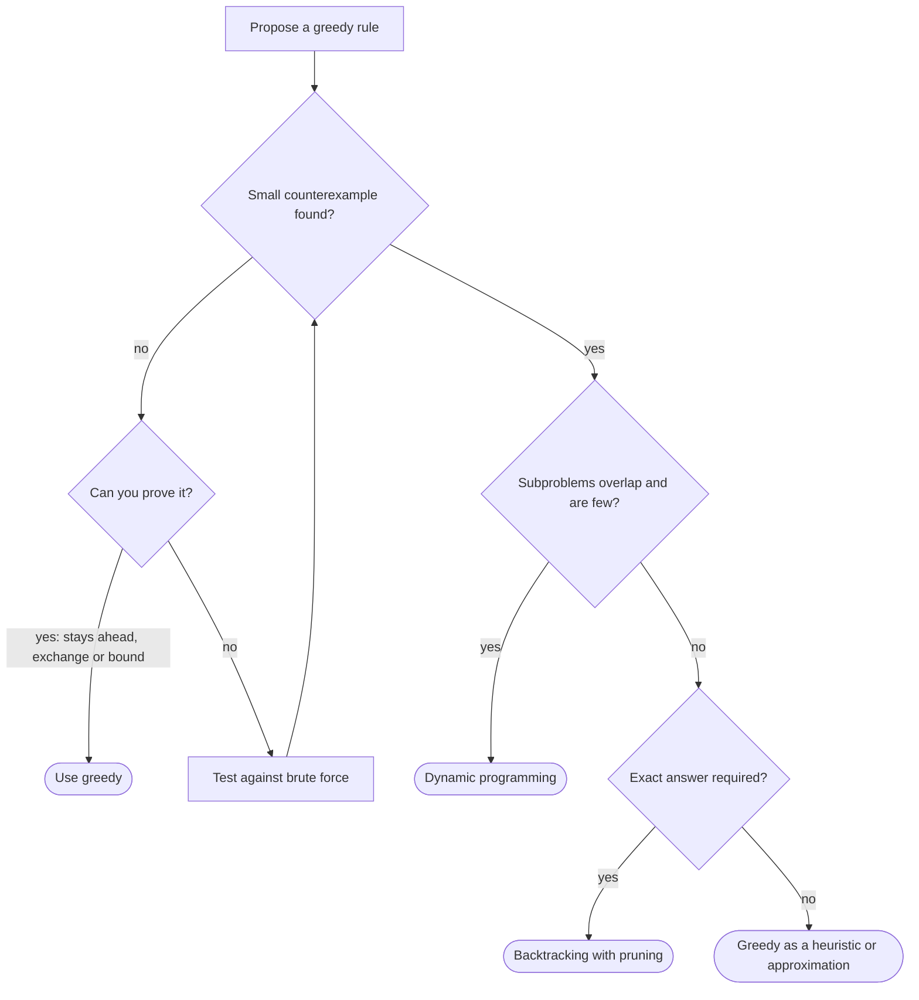

## Introduction

You need to pay 6 cents using coins worth 1, 3 and 4 cents, with as few coins as possible. The natural strategy — take the largest coin that fits, repeat — gives 4 + 1 + 1, three coins. But 3 + 3 uses two. Each step of the natural strategy was the best-looking step at the time, and the result is still wrong.

That is the central tension of greedy algorithms. A **greedy algorithm** builds an answer through a sequence of choices, each one the best by some local measure, and it never revisits a choice. When it works, it is the fastest and simplest algorithm available — often a sort and a loop. When it does not work, it gives a wrong answer *with no warning*: no exception, no failed assertion, only a number that is a little worse than the true optimum.

This lesson is about telling the two situations apart. A **local optimum** here means the best choice for the current step, judged without considering future steps. A **global optimum** is the best possible complete answer. The question in every greedy problem is whether a sequence of local optima is guaranteed to produce a global one. You will learn what properties make that guarantee hold, how to prove it, how to break a rule that does not have it, and what to reach for instead.

This skill is what interviewers are testing when they ask "how do you know that's optimal?" — and it is what separates a solution you can defend from one you memorised. It also matters in production, where greedy heuristics run everywhere, from compilers to caches, and engineers need to know whether a heuristic is exact or only good enough.

## Before you start

- **Interval scheduling** — earliest-finish-first and its two proofs, the first full greedy proof you will build on. See [[a10-interval-scheduling]].
- **Sort-and-scan greedy** — deriving a sort key with the adjacent-swap argument. See [[a10-sorting-greedy]].
- **Heap-based greedy** — greedy rules over a changing candidate set. See [[a10-heap-greedy]].
- **Dynamic programming basics** — solving a problem from optimal answers to smaller subproblems. See [[a11-1d-dp]] and [[a11-knapsack]]; this lesson only needs the idea, not the techniques.
- **Recursion and backtracking** — exploring all choices with pruning. See [[a9-pruning]].

## The intuition

Imagine climbing a mountain in thick fog. You can see only the ground around your feet, so you use a simple rule: always step in the direction that goes up most steeply. You will certainly reach *a* peak — a point where every direction goes down. Whether it is *the* summit depends on the landscape. On a single smooth cone, every uphill step leads to the top. On a range with foothills, the steepest step may lead you up a small hill, and from its top every direction is downhill, so the rule stops you there, far from the true summit.

Greedy algorithms face the same risk. Each choice is made with local information, and choices are never undone. The algorithm is correct only if the "landscape" of the problem has no foothills — no situation where the locally best step leads somewhere from which the best answer is unreachable.

The analogy has a limit worth stating. Hill climbing moves between complete solutions, while most greedy algorithms build a solution piece by piece. But the failure mode is identical: a choice that looks best now closes off the path to the best final answer. The coin example is a foothill — taking the 4 leaves an amount, 2, that only small coins can pay.

## Two properties that make greedy correct

Textbooks name two properties. Both are needed.

**Optimal substructure** means an optimal solution to the whole problem contains optimal solutions to the subproblems that remain after a choice. In activity selection, once you accept the first meeting, the rest of an optimal schedule must be an optimal schedule for the meetings that start after it — otherwise you could swap in a better one and improve the whole. Optimal substructure is also what dynamic programming relies on, so it does not by itself distinguish greedy problems from DP problems.

The **greedy-choice property** is the extra ingredient: *there is always an optimal solution that makes the greedy choice first*. In activity selection, some optimal schedule starts with the meeting that ends earliest; [[a10-interval-scheduling]] proves it. With this property, you never need to compare alternatives — you take the greedy choice, and optimal substructure guarantees that solving the remaining subproblem optimally finishes the job.

Put the two together and the algorithm is correct by induction: the first choice is safe by the greedy-choice property; the remaining problem has the same structure; repeat.

Coin change with `{1, 3, 4}` has optimal substructure — an optimal way to pay `x` that uses a coin `c` contains an optimal way to pay `x − c`. What it lacks is the greedy-choice property for "largest coin first": no optimal way to pay 6 uses a 4. That one missing property is the whole difference.

Seen this way, **a correct greedy algorithm is a dynamic programme in which you have proved that only one option at each step needs to be considered**. DP evaluates every choice and keeps the best; greedy evaluates one. That is why greedy is faster when it works, and why DP is the standard fallback when it does not.

## When local choices fail

Three classic failures show different ways a local rule can go wrong. Each comes with a program that demonstrates the failure on real input.

### Coin change: the rule depends on the input

Whether "largest coin first" is optimal depends on the denominations. A coin system for which greedy always gives the fewest coins is called **canonical**. The program below compares greedy with an exact dynamic-programming answer for every amount up to a bound.

```java title="CoinGreedyCheck.java"
import java.util.Arrays;

public class CoinGreedyCheck {

    /** Largest coin first; coins sorted ascending and contain 1, so it always finishes. */
    static int greedyCoins(int[] coins, int amount) {
        int count = 0;
        for (int i = coins.length - 1; i >= 0; i--) {
            count += amount / coins[i];
            amount %= coins[i];
        }
        return count;
    }

    /** Exact minimum number of coins for every amount 0..max (dynamic programming). */
    static int[] optimalCoins(int[] coins, int max) {
        int[] best = new int[max + 1];
        for (int a = 1; a <= max; a++) {
            best[a] = Integer.MAX_VALUE;
            for (int c : coins) {
                if (c <= a && best[a - c] + 1 < best[a]) best[a] = best[a - c] + 1;
            }
        }
        return best;
    }

    /** Smallest amount where greedy is worse than optimal, or -1 if none below the bound. */
    static int firstCounterexample(int[] coins) {
        int n = coins.length;
        int bound = n >= 2 ? coins[n - 1] + coins[n - 2] : 1;   // see the note below
        int[] best = optimalCoins(coins, bound);
        for (int a = 1; a < bound; a++) {
            if (greedyCoins(coins, a) > best[a]) return a;
        }
        return -1;
    }

    public static void main(String[] args) {
        int[][] systems = {{1, 5, 10, 25}, {1, 3, 4}, {1, 5, 10, 20, 25}, {1, 2, 5, 10, 20, 50}};
        for (int[] coins : systems) {
            int a = firstCounterexample(coins);
            String verdict = a < 0 ? "greedy is always optimal"
                    : "fails at " + a + ": greedy " + greedyCoins(coins, a)
                      + ", optimal " + optimalCoins(coins, a)[a];
            System.out.println(Arrays.toString(coins) + " " + verdict);
        }
    }
}
```

```output
[1, 5, 10, 25] greedy is always optimal
[1, 3, 4] fails at 6: greedy 3, optimal 2
[1, 5, 10, 20, 25] fails at 40: greedy 3, optimal 2
[1, 2, 5, 10, 20, 50] greedy is always optimal
```

The US coin set `{1, 5, 10, 25}` and the euro-style `{1, 2, 5, 10, 20, 50}` are canonical, which is why cashiers can make change greedily. Adding a 20-cent coin to the US set breaks it: for 40 cents greedy pays 25 + 10 + 5, while 20 + 20 is better.

The search stops below `largest + second largest` because of a known result (Kozen and Zaks, 1994): if greedy fails for a coin system at all, its smallest failing amount is below that sum. Without such a bound, "no counterexample found up to 1,000" would prove nothing. The exact DP — `best[a] = 1 + min over coins c of best[a − c]` — is the correct algorithm for arbitrary coins and is developed in [[a11-1d-dp]].

The lesson generalises: **a greedy rule can be correct for some inputs of a problem and wrong for others**. If an interviewer says "coins of arbitrary denominations", greedy is off the table.

### 0/1 knapsack: indivisibility breaks the exchange

In the fractional knapsack ([[a10-sorting-greedy]]) you may take part of an item, and taking items in order of value per unit weight is optimal. In the **0/1 knapsack**, each item is taken whole or not at all.

```java title="Knapsack01VsFractional.java"
public class Knapsack01VsFractional {

    public static void main(String[] args) {
        int[] value = {60, 100, 120};
        int[] weight = {10, 20, 30};          // ratios 6, 5, 4: already in ratio order
        int capacity = 50;

        // Greedy by ratio, whole items only.
        int room = capacity, greedy = 0;
        for (int i = 0; i < value.length; i++) {
            if (weight[i] <= room) {
                greedy += value[i];
                room -= weight[i];
            }
        }

        // Exact 0/1 optimum by trying every subset (fine for three items).
        int best = 0;
        for (int mask = 0; mask < (1 << value.length); mask++) {
            int v = 0, w = 0;
            for (int i = 0; i < value.length; i++) {
                if ((mask >> i & 1) == 1) { v += value[i]; w += weight[i]; }
            }
            if (w <= capacity) best = Math.max(best, v);
        }
        System.out.println("ratio greedy, whole items: " + greedy);
        System.out.println("true 0/1 optimum:          " + best);
    }
}
```

```output
ratio greedy, whole items: 160
true 0/1 optimum:          220
```

Greedy takes the two densest items (weight 30, value 160) and then cannot fit the 30-weight item into the remaining 20. The optimum skips the densest item and takes the other two (weight 50, value 220). The exchange argument that proves the fractional version — "move a little weight from a worse item to a better one" — needs to move *part* of an item, and that move does not exist here. Same problem shape, one rule changed, and greedy is no longer safe. The 0/1 version needs DP over capacity ([[a11-knapsack]]).

### Jump Game II: the right local measure matters

**Problem.** `nums[i]` is the maximum jump length from index `i`. Starting at index 0, reach the last index in the fewest jumps.

The tempting rule is "always jump as far as you can". On `[2, 3, 1, 1, 4]` it jumps from 0 to 2 (landing on a `1`), then to 3, then to 4: three jumps. The optimum jumps 0 → 1 → 4: two jumps. Jumping far *now* landed on a weak square.

A different local rule works: among the squares you can reach with the next jump, pick the one from which you can reach **farthest afterwards**. Index 1 reaches `1 + 3 = 4`; index 2 reaches only `2 + 1 = 3`. Both rules are greedy; one measures the wrong thing. The lesson here is that "is greedy correct for this problem?" is the wrong question. The right question is **"is this particular greedy rule correct?"**, and finding the right local measure is part of the solution. The full algorithm and its proof are below.

```quiz
Q: Coin change with denominations {1, 3, 4} has optimal substructure. Why does largest-coin-first still fail?
- [ ] Because coin change does not have optimal substructure after all
- [x] Because it lacks the greedy-choice property: no optimal way to pay 6 starts with the largest coin, 4
- [ ] Because the amounts are too small for greedy to work
- [ ] Because greedy is only correct for sorted input
> Optimal substructure says the rest of an optimal answer is optimal for what remains, which is true here. The greedy-choice property says some optimal answer makes the greedy choice; the only optimal way to pay 6 is 3 + 3, which never uses 4. Both properties are needed.

Q: Which statement about fractional and 0/1 knapsack is correct?
- [ ] Ratio greedy is optimal for both, because both share the same objective
- [ ] Ratio greedy is optimal for neither
- [x] Ratio greedy is optimal for fractional knapsack only, because its exchange argument moves part of an item
- [ ] Ratio greedy is optimal for 0/1 knapsack only
> The fractional proof swaps a small amount of weight from a lower-density item to a higher-density one. In 0/1 knapsack items cannot be split, so that swap is unavailable, and the 60/100/120 example shows greedy getting 160 against an optimum of 220.
```

## Three ways to prove a greedy algorithm correct

When you believe a rule is right, prove it with one of three standard arguments. Knowing all three lets you pick the one that fits the problem.

| Technique | What you show | Fits when | Examples |
|---|---|---|---|
| **Greedy stays ahead** | After each step, greedy is at least as good as any other solution on some progress measure | Progress is a single number that grows each step (end time, reach, coverage) | Activity selection, Jump Game II, refueling stops |
| **Exchange argument** | Any optimal solution can be changed, step by step, into the greedy one without getting worse | The answer is an ordering or a set and you can swap elements | Earliest end, SPT, Smith's rule, EDF, Huffman, Assign Cookies |
| **Matching bound** | Greedy's answer equals a lower (or upper) bound that every solution must respect | There is an obvious obstacle every solution faces | Meeting rooms (depth), arrows (disjoint intervals), EDF lateness |

**Stays ahead** has a fixed template. Define a measure after `r` steps (for example, the farthest index reachable with `r` jumps). Prove by induction that greedy's measure is at least any other solution's after every step. Conclude that greedy cannot finish later or with fewer items. [[a10-interval-scheduling]] works through it in full.

**Exchange** also has a template. Take an optimal solution that differs from greedy. Find the first place they differ, or an adjacent pair in the "wrong" order. Show that changing the optimal solution to agree with greedy there does not make it worse. Repeat until they agree everywhere. [[a10-sorting-greedy]] uses the adjacent-swap form to derive sort keys.

**Matching bound** is often the shortest. Find a quantity every solution must pay — the maximum number of meetings overlapping at one instant, for instance — and show greedy pays exactly that. Since nothing can do better than the bound and greedy meets it, greedy is optimal.

> [!IMPORTANT] Say the proof before you write the code
> A two-sentence argument ("some optimal answer takes the earliest-ending interval, because swapping it in can't create a conflict") is enough in an interview. If you cannot produce even that, treat the greedy rule as a guess and test it against brute force before relying on it.

## Worked proof: Jump Game and Jump Game II

**Jump Game.** Can you reach the last index at all?

Keep `farthest`, the largest index reachable using indices `0..i`. The key fact is that **the reachable indices always form a prefix**: if you can reach index `j` and jump up to `nums[j]`, you can land on any index between `j` and `j + nums[j]`, so there are no holes. Therefore index `i` is reachable exactly when `i <= farthest`. Scan left to right; if you ever find `i > farthest`, index `i` and everything after it are unreachable. This is an invariant-based proof — a close cousin of stays ahead.

**Jump Game II.** Now count the fewest jumps. Let the indices reachable in at most `k` jumps be the prefix `[0, endₖ]` (a prefix, by the same no-holes argument). The indices reachable in at most `k + 1` jumps form the prefix up to `max(i + nums[i])` over `i ≤ endₖ`. So the algorithm scans indices, tracking `farthest`; when the scan reaches `currentEnd` = `endₖ`, every index reachable in `k` jumps has been examined, so it spends one more jump and sets `currentEnd = farthest`. This is breadth-first search over an implicit graph, where each "level" is a range of indices, and it is optimal because it computes exactly the smallest `k` whose prefix contains the last index.

```java title="JumpGames.java"
public class JumpGames {

    /** Jump Game: can index n-1 be reached? nums[i] is the maximum jump length from i. */
    static boolean canJump(int[] nums) {
        int farthest = 0;                        // farthest index reachable so far
        for (int i = 0; i < nums.length; i++) {
            if (i > farthest) return false;      // i itself cannot be reached
            farthest = Math.max(farthest, i + nums[i]);
        }
        return true;
    }

    /** A tempting local rule: always take the longest jump available. Not optimal. */
    static int longestJumpRule(int[] nums) {
        int i = 0, jumps = 0;
        while (i < nums.length - 1) {
            if (nums[i] == 0) return -1;
            i += nums[i];
            jumps++;
        }
        return jumps;
    }

    /** Jump Game II: fewest jumps to reach n-1 (input guarantees it is reachable). */
    static int minJumps(int[] nums) {
        int jumps = 0, currentEnd = 0, farthest = 0;
        for (int i = 0; i < nums.length - 1; i++) {
            farthest = Math.max(farthest, i + nums[i]);
            if (i == currentEnd) {               // every index reachable in `jumps` is examined
                jumps++;
                currentEnd = farthest;
            }
        }
        return jumps;
    }

    public static void main(String[] args) {
        System.out.println(canJump(new int[]{2, 3, 1, 1, 4}) + " " + canJump(new int[]{3, 2, 1, 0, 4}));
        int[] nums = {2, 3, 1, 1, 4};
        System.out.println("longest-jump rule: " + longestJumpRule(nums));
        System.out.println("optimal:           " + minJumps(nums));
        System.out.println(minJumps(new int[]{0}) + " " + minJumps(new int[]{1, 1, 1, 1}));
    }
}
```

```output
true false
longest-jump rule: 3
optimal:           2
0 3
```

Trace `minJumps` on `[2, 3, 1, 1, 4]`:

| `i` | `i + nums[i]` | `farthest` | `i == currentEnd`? | `jumps` | `currentEnd` |
|---|---|---|---|---|---|
| 0 | 2 | 2 | yes | 1 | 2 |
| 1 | 4 | 4 | no | 1 | 2 |
| 2 | 3 | 4 | yes | 2 | 4 |
| 3 | 4 | 4 | no | 2 | 4 |

The first "level" is index 0; the second is indices 1–2, from which index 4 is reachable. Two jumps. The loop stops at `n − 2` deliberately: if it also ran at `i = n − 1` and that index happened to equal `currentEnd`, it would count a jump that is not needed. For `[3, 2, 1, 0, 4]`, `canJump` gets stuck: `farthest` stays at 3 because index 3 has a 0, and index 4 is greater than 3. Both algorithms are O(n) time and O(1) space.

## Worked proof: Gas Station

**Problem.** Stations on a circular road each give `gas[i]` fuel, and driving from station `i` to `i + 1` costs `cost[i]`. Starting with an empty tank, find the station from which you can drive all the way round, or `-1`. (The answer is unique when it exists.)

**Naive approach.** Try every start and simulate: O(n²).

**The greedy rule.** Scan once, keeping a running `tank` from the current candidate `start`. If `tank` goes negative at station `i`, set `start = i + 1` and reset the tank. At the end, return `start` if the total of `gas − cost` is non-negative, else `-1`.

**Why can the scan skip every station between `start` and `i`?** Starting at `start`, the tank was never negative before station `i`. So for any later station `k` up to `i`, you arrived at `k` with a non-negative tank. Starting fresh at `k` means arriving at the same stretch with *less or equal* fuel, so you run out by station `i` as well. One failure eliminates the whole block, which is why a single pass suffices.

**Why is the final `start` correct when the total is non-negative?** From `start` to the end of the array the tank never goes negative, by construction. Each block skipped before `start` had a negative total, so the stretch from index 0 to `start − 1` costs at most what those blocks cost together, and the fuel left at the end of the array, plus the overall total being non-negative, covers it. If the total is negative, no start can work, because no order of the same stations creates more fuel.

```java title="GasStation.java"
public class GasStation {

    /** Returns the unique start index that completes the circuit, or -1. */
    static int canCompleteCircuit(int[] gas, int[] cost) {
        int total = 0, tank = 0, start = 0;
        for (int i = 0; i < gas.length; i++) {
            int net = gas[i] - cost[i];
            total += net;
            tank += net;
            if (tank < 0) {          // cannot get from `start` past station i
                start = i + 1;       // so no station in start..i can be the answer
                tank = 0;
            }
        }
        return total >= 0 ? start : -1;
    }

    public static void main(String[] args) {
        System.out.println(canCompleteCircuit(new int[]{1, 2, 3, 4, 5}, new int[]{3, 4, 5, 1, 2}));
        System.out.println(canCompleteCircuit(new int[]{2, 3, 4}, new int[]{3, 4, 3}));
        System.out.println(canCompleteCircuit(new int[]{5}, new int[]{4}));
    }
}
```

```output
3
-1
0
```

For the first input, the net values are `[−2, −2, −2, 3, 3]`. The tank goes negative at stations 0, 1 and 2 in turn, moving `start` to 3. From 3, the tank goes to 3 and then 6. The total is 0, which is non-negative, so the answer is 3: starting there with 6 fuel left after station 4, the car covers the −6 of stations 0 to 2. For the second input the total is −1, so no start works. O(n) time, O(1) space.

## Hunting counterexamples systematically

Proofs establish correctness; counterexamples establish incorrectness, and they are usually faster to find. Use both directions.

**By hand.** Try the smallest inputs that create tension: two or three items where the greedy measure and the true objective pull in different directions. For a "largest first" rule, try a large item that blocks two medium ones. For a "shortest first" rule, try a short item that overlaps two compatible long ones. For ratios, try an item with the best ratio that wastes capacity.

**By program.** `CoinGreedyCheck` above is the general recipe in miniature:

1. Write the greedy algorithm.
2. Write an exact algorithm that is obviously correct, however slow: brute force over all subsets or orders, or a simple DP.
3. Generate many small inputs — all of them, if the space is small, or thousands of random ones with a fixed seed.
4. Compare the two answers and print the first input where they disagree.

Keep the inputs small (five to eight items) so brute force stays fast and the counterexample is easy to read. This is the same approach as property-based testing, and it is how the heap-greedy solutions in [[a10-heap-greedy]] were checked. If thousands of random inputs pass, you have evidence, not proof — but a single failure is proof that the rule is wrong.

## When greedy fails: what to use instead



**Dynamic programming** is the first fallback. Greedy failed because it committed to one option; DP keeps every option and picks the best, which is affordable when the number of distinct subproblems is small. Coin change (`best[amount]`), 0/1 knapsack (`best[item][capacity]`) and weighted interval scheduling ([[a10-interval-scheduling]]) all fall to DP after greedy fails.

**Greedy plus correction** sometimes rescues the approach. When a forward-only greedy fails because early choices turn out to be wrong, a heap of past choices can undo the worst one at O(log n) — the regret pattern in [[a10-heap-greedy]]. It still needs a proof.

**Backtracking with pruning** ([[a9-pruning]]) explores all choices when no polynomial algorithm is known, cutting branches that cannot beat the best answer found. Greedy is often useful *inside* it, to find a good first answer that makes the pruning bound tight.

**Greedy as an approximation.** For NP-hard problems, a greedy rule with a *proven ratio* is often the practical choice. Greedy set cover — repeatedly pick the set covering the most uncovered elements — is within a factor of about `ln n` of optimal. Longest-processing-time-first load balancing is within 4/3 of the optimal makespan. These are not optimal, and calling them optimal in an interview is a mistake; calling them "greedy with a guarantee" is correct.

> [!NOTE] Matroids: when greedy is always right
> There is a precise theory for one family of problems. If the feasible sets form a **matroid** — roughly, any feasible set can be grown by borrowing an element from any larger feasible set — then "repeatedly add the heaviest element that keeps the set feasible" finds a maximum-weight feasible set for every choice of weights. Kruskal's minimum spanning tree algorithm is the best-known instance. You will not need matroids in interviews, but they explain why some greedy algorithms work for *all* weights while others, such as largest-coin-first, depend on the input.

## In real systems

**Caching.** The optimal offline cache eviction policy, known as Belady's algorithm, is itself greedy: evict the item whose next use is farthest in the future, provably optimal by an exchange argument. Real caches cannot see the future, so they use greedy heuristics such as least-recently-used (LRU) that approximate it. Engineers who know the difference measure hit rates instead of assuming the heuristic is optimal.

**Compilers.** Linear-scan register allocation, used by several just-in-time compilers including HotSpot's client compiler, assigns registers greedily in one pass over live ranges. It is fast and good, not optimal — and that trade-off is deliberate, because a JIT must compile quickly.

**Networking.** Shortest-path routing with Dijkstra's algorithm is greedy and exactly optimal for non-negative link costs. With negative costs, the greedy "settle the closest vertex" step is no longer safe, and Bellman–Ford is used instead ([[a8-bellman-ford]]) — the same local-versus-global boundary in a production protocol.

**Payments and change-making.** Vending machines and cash registers pay change greedily because national coin systems are designed to be canonical.

## Trade-offs and alternatives

| Approach | Typical time | Guarantee | Cost of being wrong |
|---|---|---|---|
| Greedy with proof | O(n) or O(n log n) | Optimal | None |
| Greedy without proof | O(n) or O(n log n) | None | Silent wrong answers |
| Dynamic programming | Polynomial in the subproblem count | Optimal | More memory and code |
| Backtracking + pruning | Exponential worst case | Optimal | Slow on large inputs |
| Greedy approximation | Polynomial | Within a proven factor | Known, bounded gap |

The decision is not "greedy or not" in the abstract. It is whether *this* rule, for *this* objective and *these* constraints, has a proof. Change any of the three — weights, indivisibility, an arbitrary coin set, negative edges — and the answer can flip.

## Common mistakes

> [!MISTAKE] "The code is simple, so it must be right"
> Simplicity is evidence of nothing. Largest-coin-first is three lines and wrong for `{1, 3, 4}`. Every greedy needs either a proof or, at minimum, a passing brute-force comparison.

**Using fractional reasoning on indivisible items.** Ratio greedy solves fractional knapsack only.

**Assuming a greedy rule transfers between objectives.** Earliest end maximises the number of intervals, not their total weight; SPT minimises total completion time, not maximum lateness.

**Picking the wrong local measure.** In Jump Game II, "jump farthest now" is wrong and "reach farthest next" is right. If a greedy fails, try a different measure before abandoning greedy.

**Confusing a heuristic with an optimum.** A greedy rule that gives good answers on test data is not proven optimal. Say "heuristic" or "approximation" unless you have a proof.

**Testing only large random inputs.** Counterexamples to greedy rules are usually tiny and structured. Test exhaustively on small inputs.

## Interview perspective

Greedy questions are as much about reasoning as code. Interviewers listen for whether you *justify* the rule, and whether you notice when a variant breaks it.

> [!INTERVIEW] The pattern of a strong answer
> "My first idea is greedy: at each step take X. Before coding, let me check a small case that could break it… that works. Here's why it's safe: suppose an optimal solution doesn't take X first; swapping X in can't make it worse because … So some optimal solution agrees with greedy, and the rest is the same problem on a smaller input."

Questions to be ready for:

- **When does greedy work?** When the problem has optimal substructure and the greedy-choice property; prove the second with stays ahead, an exchange or a matching bound.
- **Give a counterexample for coin change.** `{1, 3, 4}`, amount 6: greedy 4 + 1 + 1, optimal 3 + 3.
- **Why does Jump Game's greedy work?** Reachable indices form a prefix, so tracking the farthest reach is enough.
- **Why does Gas Station skip a whole block?** Every station in the block was reached with non-negative fuel, so starting there fails at the same point or earlier.
- **0/1 knapsack by ratio?** Fails: 60/10, 100/20, 120/30 with capacity 50 gives 160 against an optimum of 220.
- **What do you do when greedy fails?** Usually DP; if the state space is too large, backtracking with pruning, or a greedy approximation when exactness is not required.

A strong move when you are unsure is to say so: "I believe greedy works here, but let me test it on a small tricky case first." Interviewers reward that more than a confident wrong answer.

## Practice

1. **Coin Change** — show greedy fails for `{1, 3, 4}`, then solve with DP. Run `CoinGreedyCheck` on three coin systems of your own.
2. **Jump Game** and **Jump Game II** — write both, and explain the prefix argument aloud.
3. **Gas Station** — prove the block-skipping step in writing.
4. **Partition Labels** — identify which proof technique fits ([[a10-sorting-greedy]]).
5. **Candy** — two passes, left-to-right and right-to-left; argue why one greedy pass is not enough.
6. **Best Time to Buy and Sell Stock II** — show that taking every positive day-to-day gain is optimal with an exchange argument.
7. **Counterexample practice** — for "keep the interval with the fewest conflicts", find a counterexample yourself before reading the one in [[a10-interval-scheduling]].
8. **Brute-force harness** — write a generic tester that compares any greedy function with an exhaustive solver on all inputs of size up to 6.

The DSA explorer lists these problems under the Local vs Global Optimum Reasoning topic.

## Quick revision {#quick-revision}

- Greedy = take the locally best choice, never revisit. Fast when correct; silently wrong when not.
- Correct when: **optimal substructure** (the rest of an optimal answer is optimal for the rest) **and** the **greedy-choice property** (some optimal answer makes the greedy choice).
- A correct greedy is a DP that provably needs only one option per step.
- Proofs: stays ahead (progress measure by induction), exchange (swap greedy's choice into an optimal answer), matching bound (greedy meets a bound everyone must pay).
- Classic failures: coins `{1, 3, 4}` at 6; `{1, 5, 10, 20, 25}` at 40; 0/1 knapsack 160 vs 220; "jump farthest now" in Jump Game II.
- Canonical coin systems (US, euro-style) are greedy-safe; check below `c_max + c_second` (Kozen and Zaks).
- Jump Game: reachable indices form a prefix → track farthest. Jump Game II: BFS by ranges → O(n).
- Gas Station: reset start after a negative tank; answer exists iff total ≥ 0.
- Counterexamples: tiny tense cases by hand; brute force vs greedy on all small inputs by program.
- Fallbacks: DP, greedy plus regret heap, backtracking with pruning, or greedy approximation with a proven ratio.

## Key takeaways {#key-takeaways}

- A greedy algorithm is correct only when the greedy-choice property holds on top of optimal substructure; the code being short proves nothing.
- Whether greedy works depends on the specific rule, objective and constraints — change any one and the answer can flip.
- Stays ahead, exchange and matching-bound arguments cover nearly every greedy proof you will need, and a two-sentence version is enough in an interview.
- Small counterexamples and brute-force comparison are the fastest way to reject a wrong rule.
- When greedy fails, dynamic programming is the usual replacement; greedy remains valuable as an approximation or as a first answer inside a search.
