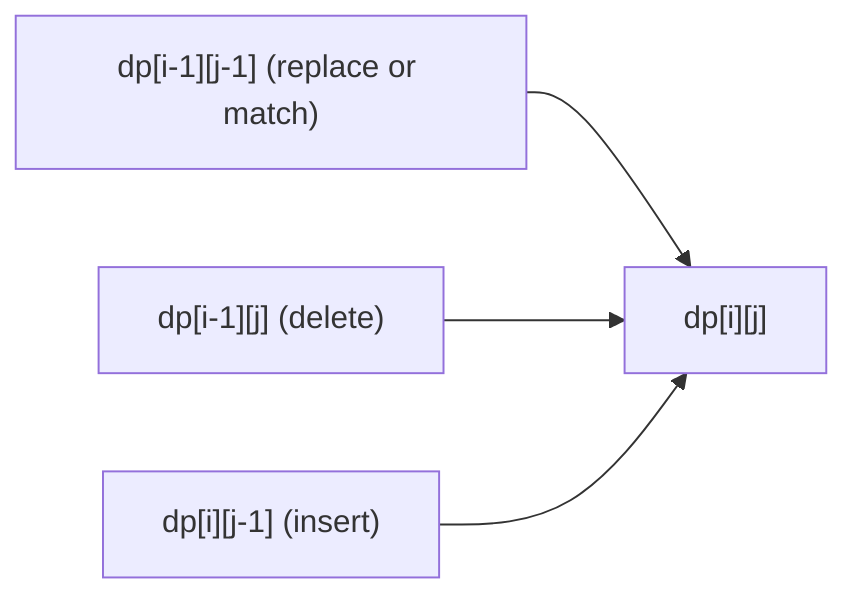

## Introduction

In [[a11-1d-dp]] every subproblem was named by one number: the answer for the first `i` houses, for amount `a`, for step `i` of a staircase. That works when the only thing that changes as you solve smaller and smaller versions of the problem is *how far along one sequence you are*.

Many problems have two things that change independently. Turning the word `horse` into `ros` with as few single-character edits as possible is a good example. After you have dealt with the end of each word, you are left with a smaller instance — some prefix of `horse` and some prefix of `ros` — and those two prefixes shrink at different rates. Knowing how much of `horse` is left does not tell you how much of `ros` is left. A single index cannot name the subproblem; it takes a pair `(i, j)`.

**Two-dimensional dynamic programming (2D DP)** is the family of solutions whose state is such a pair, stored in a table `dp[i][j]`. It covers a large share of interview DP problems: edit distance, [[a11-lcs|longest common subsequence]], counting and costing paths in a grid, [[a11-knapsack|0/1 knapsack]] with an item index and a capacity, and interval problems on `s[i..j]`. It is also the machinery behind real tools — spell checkers, file-diff utilities and DNA sequence alignment all fill tables of this shape.

The table itself is not the hard part. The hard part is the derivation: deciding what `dp[i][j]` means, which neighbouring cells it depends on, which cells are known without any work, and in what order to fill the rest so that every cell is ready when it is needed. This lesson teaches that derivation on a grid problem first, then in full on edit distance, then generalises it to fill orders and space reduction.

## Before you start

- **The five decisions** of a DP — state, recurrence, base cases, order of computation, where the answer lives — are taught in [[a11-memoization]]. This lesson applies them to two-index states; reread that section if any of the five feel unfamiliar.
- **Top-down versus bottom-up** — [[a11-memoization]] and [[a11-tabulation]]. You should be able to turn a recursive function with a cache into a loop that fills a table.
- **One-index DP** — [[a11-1d-dp]], especially the habit of writing a sentence for what `dp[i]` means before writing any code.
- **2D arrays in Java** — `int[][]`, row and column indices, and nested loops. See [[a2-matrix]].
- **Recursion** — [[a1-recursion]], for the brute-force versions that every derivation starts from.

## The intuition: when one index is not enough

A useful way to find the state of any DP is to write the brute-force recursion first and then ask: **which arguments change between calls?** Those arguments are the state. If one argument changes, you get a 1D table. If two arguments change independently, you get a 2D table.

For a grid, a recursive "cheapest way to reach this cell" function takes a row and a column. Moving down changes the row; moving right changes the column. Both are needed to say where you are, so the state is `(row, col)`.

For two strings, a recursive "how many edits to turn this prefix into that prefix" function takes a length of each string. One edit shortens the first prefix, another shortens the second, a third shortens both. Again two independent arguments.

A picture that helps: imagine the table as a map. Each cell is one subproblem. The recurrence draws arrows from a cell to the cells it reads. Filling the table is walking the map in an order where every arrow points to somewhere you have already been. Once you see DP as "cells plus arrows", the questions of order, space and reconstruction all become questions about the arrows.

## Where the second dimension comes from

Almost every 2D DP you will meet in interviews has a state from one of four sources. Recognising which one you are in tells you what `i` and `j` mean before you have written anything else.

| Source | State `dp[i][j]` means | Typical reads | Examples |
|---|---|---|---|
| Two sequences | Answer for the first `i` items of `A` and the first `j` items of `B` | `(i-1, j-1)`, `(i-1, j)`, `(i, j-1)` | Edit distance, [[a11-lcs]], distinct subsequences, interleaving strings |
| A grid | Answer for reaching (or leaving) cell `(i, j)` | Cell above, cell to the left | Minimum path sum, unique paths, dungeon game — see [[a11-grid-dp]] |
| Item plus a resource | Answer using the first `i` items with `j` units of capacity, budget or sum left | `(i-1, j)`, `(i-1, j - cost)` | [[a11-knapsack]], subset sum, coin change counting |
| An interval | Answer for the contiguous piece `s[i..j]` | Shorter intervals inside `[i, j]` | Palindromic substrings, burst balloons, matrix chain — see [[a11-partition-dp]] |

The first three usually fill row by row. Interval states are different: the dependency arrows point to *shorter* intervals, which changes the order, as you will see later in this lesson.

> [!TIP] Prefix lengths, not last indices
> For sequences, define `i` as a **length** ("the first `i` characters") rather than an index ("up to and including character `i`"). Length `0` is the empty prefix, which gives you a natural base case in row `0` and column `0` and removes every `-1` index from the recurrence. The cost is one translation you must never forget: the `i`-th character of the prefix is `a.charAt(i - 1)`.

## A first 2D table: the cheapest path through a grid

Start with a problem where the second dimension is easy to see. You are given a grid of non-negative costs. Starting at the top-left cell, you may move only right or down, and you want to reach the bottom-right cell paying the smallest total of the cells you step on.

```text
1  3  1
1  5  1
4  2  1
```

**Brute force.** From every cell there are two moves, and a path from the top-left to the bottom-right of an `r × c` grid makes `(r - 1) + (c - 1)` moves. Trying every path means choosing which of those moves are "down" — C(r + c − 2, r − 1) paths, which for a 20 × 20 grid is about 35 billion. That count grows exponentially with the grid size.

**Notice the overlap.** Many of those paths pass through the same cell, and once you are standing on a cell, how you got there does not affect how you continue. So the cheapest way to *reach* each cell is worth computing once.

Now apply the five decisions.

1. **State.** `dp[r][c]` = the minimum total cost of a path from `(0, 0)` to `(r, c)`, including both end cells.
2. **Recurrence.** Look at the *last* move into `(r, c)`. It came either from above, `(r - 1, c)`, or from the left, `(r, c - 1)`. Whichever it was, the path up to that neighbour should itself have been the cheapest — otherwise swapping in a cheaper prefix would give a cheaper full path. So `dp[r][c] = grid[r][c] + min(dp[r - 1][c], dp[r][c - 1])`.
3. **Base cases.** `dp[0][0] = grid[0][0]`. Cells in the top row have no cell above, so they can only be reached from the left; cells in the left column only from above.
4. **Order.** Each cell reads the cell above and the cell to the left. Filling rows top to bottom, and each row left to right, guarantees both are ready.
5. **Answer.** `dp[rows - 1][cols - 1]`.

The same table with a different combine step counts paths instead of costing them. If some cells are obstacles, the number of ways to reach a free cell is the ways to reach the cell above plus the ways to reach the cell to the left, and an obstacle cell has zero ways.

```java title="GridPaths.java"
public class GridPaths {

    // dp[r][c] = minimum sum of a path from (0,0) to (r,c), moving only right or down
    static int minPathSum(int[][] grid) {
        int rows = grid.length, cols = grid[0].length;
        int[][] dp = new int[rows][cols];
        for (int r = 0; r < rows; r++) {
            for (int c = 0; c < cols; c++) {
                if (r == 0 && c == 0) {
                    dp[r][c] = grid[0][0];
                } else if (r == 0) {
                    dp[r][c] = dp[r][c - 1] + grid[r][c];        // top row: only from the left
                } else if (c == 0) {
                    dp[r][c] = dp[r - 1][c] + grid[r][c];        // left column: only from above
                } else {
                    dp[r][c] = Math.min(dp[r - 1][c], dp[r][c - 1]) + grid[r][c];
                }
            }
        }
        return dp[rows - 1][cols - 1];
    }

    // ways[r][c] = number of paths from (0,0) to (r,c) that avoid obstacles (cells equal to 1)
    static long uniquePaths(int[][] obstacle) {
        int rows = obstacle.length, cols = obstacle[0].length;
        long[][] ways = new long[rows][cols];
        for (int r = 0; r < rows; r++) {
            for (int c = 0; c < cols; c++) {
                if (obstacle[r][c] == 1) {
                    ways[r][c] = 0;                              // nobody can stand here
                } else if (r == 0 && c == 0) {
                    ways[r][c] = 1;
                } else {
                    long fromTop = r > 0 ? ways[r - 1][c] : 0;
                    long fromLeft = c > 0 ? ways[r][c - 1] : 0;
                    ways[r][c] = fromTop + fromLeft;
                }
            }
        }
        return ways[rows - 1][cols - 1];
    }

    public static void main(String[] args) {
        int[][] grid = {
            {1, 3, 1},
            {1, 5, 1},
            {4, 2, 1}
        };
        System.out.println("min path sum = " + minPathSum(grid));

        int[][] obstacles = {
            {0, 0, 0},
            {0, 1, 0},
            {0, 0, 0}
        };
        System.out.println("paths avoiding the obstacle = " + uniquePaths(obstacles));
        System.out.println("paths when the start is blocked = "
            + uniquePaths(new int[][] {{1, 0}, {0, 0}}));
    }
}
```

```output
min path sum = 7
paths avoiding the obstacle = 2
paths when the start is blocked = 0
```

Here is the minimum-cost table as it is filled, row by row. Each value is the grid cost of that cell plus the smaller of the value above and the value to the left.

| `dp` | col 0 | col 1 | col 2 |
|---|---|---|---|
| row 0 | 1 | 1 + 3 = 4 | 4 + 1 = 5 |
| row 1 | 1 + 1 = 2 | 5 + min(4, 2) = 7 | 1 + min(5, 7) = 6 |
| row 2 | 2 + 4 = 6 | 2 + min(7, 6) = 8 | 1 + min(6, 8) = 7 |

The answer 7 corresponds to the path 1 → 3 → 1 → 1 → 1 along the top row and down the right column. You can recover it by starting at the bottom-right and repeatedly stepping to whichever of "above" or "left" holds the smaller value — the same walk-back idea used for edit distance below.

Two details in the code are worth noticing. The obstacle version uses `long`, because path counts grow quickly: an obstacle-free 17 × 17 grid already has C(32, 16) = 601,080,390 paths, and an 18 × 18 grid has C(34, 17) = 2,333,606,220, which overflows `int`. And the blocked start returns `0` without any special case, because the obstacle check runs before the start check. Grid DP has many more variants — paths that collect and spend health, two walkers moving at once, moves in more directions — and they are covered in [[a11-grid-dp]].

## Edit distance: deriving a 2D DP from scratch

The grid gave you the state for free: the grid *is* the table. Edit distance is the classic problem where you have to find the table yourself, so it is the one to learn the derivation on.

**The problem.** Given strings `a` and `b`, find the minimum number of operations that turn `a` into `b`, where one operation is inserting a character, deleting a character, or replacing one character with another. This number is the **edit distance** (also called **Levenshtein distance**, after Vladimir Levenshtein, who defined it in 1965).

For `a = "horse"` and `b = "ros"`, the answer is 3:

```text
horse  →  rorse   (replace 'h' with 'r')
rorse  →  rose    (delete the second 'r')
rose   →  ros     (delete 'e')
```

Fewer than three is impossible, though proving that by hand is already awkward. The DP will prove it for us.

### Step 1: brute force from the last characters

When you do not know where to begin, look at the **last** characters of both strings. Call the lengths of the parts still to be handled `i` (of `a`) and `j` (of `b`). The last characters are `a.charAt(i - 1)` and `b.charAt(j - 1)`.

- **They are equal.** Nothing needs to happen to them. Leave both alone and solve the problem for the first `i - 1` and first `j - 1` characters.
- **They differ.** Something must happen to the end of `a`, and there are exactly three useful things to do:
  - **Replace** `a`'s last character with `b`'s last character. Now the ends match, and what remains is `(i - 1, j - 1)`.
  - **Delete** `a`'s last character. `b` is untouched, so what remains is `(i - 1, j)`.
  - **Insert** `b`'s last character at the end of `a`. That new character matches `b`'s end, so `b` shrinks but all of `a`'s current characters are still there: `(i, j - 1)`.
- **One string is empty.** If `i == 0`, the only way to produce the first `j` characters of `b` is `j` insertions. If `j == 0`, the only way to reach the empty string is `i` deletions.

That analysis translates directly into a recursive function. Counting its calls shows the problem with it.

```java title="EditDistanceBrute.java"
public class EditDistanceBrute {
    static long calls = 0;

    // dist(i, j): fewest edits turning the first i chars of a into the first j chars of b
    static int dist(String a, int i, String b, int j) {
        calls++;
        if (i == 0) return j;                              // insert the remaining j chars
        if (j == 0) return i;                              // delete the remaining i chars
        if (a.charAt(i - 1) == b.charAt(j - 1)) return dist(a, i - 1, b, j - 1);
        int replace = dist(a, i - 1, b, j - 1);
        int delete = dist(a, i - 1, b, j);
        int insert = dist(a, i, b, j - 1);
        return 1 + Math.min(replace, Math.min(delete, insert));
    }

    public static void main(String[] args) {
        String[][] pairs = {
            {"horse", "ros"}, {"abcdef", "uvwxyz"}, {"abcdefgh", "stuvwxyz"},
            {"abcdefghij", "klmnopqrst"}, {"abcdefghijkl", "mnopqrstuvwx"}
        };
        for (String[] p : pairs) {
            calls = 0;
            int d = dist(p[0], p[0].length(), p[1], p[1].length());
            int states = (p[0].length() + 1) * (p[1].length() + 1);
            System.out.printf("%s -> %s: distance %d, %d calls, %d distinct states%n",
                p[0], p[1], d, calls, states);
        }
    }
}
```

```output
horse -> ros: distance 3, 77 calls, 24 distinct states
abcdef -> uvwxyz: distance 6, 13483 calls, 49 distinct states
abcdefgh -> stuvwxyz: distance 8, 398593 calls, 81 distinct states
abcdefghij -> klmnopqrst: distance 10, 12146179 calls, 121 distinct states
abcdefghijkl -> mnopqrstuvwx: distance 12, 377393953 calls, 169 distinct states
```

The answers are right, but look at the last two columns. Two 12-character strings with nothing in common cause 377 million calls, and the count multiplies by about thirty every time each string grows by two characters. Yet there are only 169 different `(i, j)` pairs the function can ever be called with. Every other call recomputes something already computed. That gap — exponentially many calls, polynomially many distinct arguments — is the signature of a DP problem.

### Step 2: name the state

The arguments that change between calls are `i` and `j`; `a` and `b` never change. So:

> `dp[i][j]` = the minimum number of operations that turn the first `i` characters of `a` into the first `j` characters of `b`.

Write this sentence down before any code. Every later decision is checked against it, and most DP bugs are a recurrence that quietly computes something other than what the sentence says.

### Step 3: the recurrence

Translating the three cases:

```text
if a[i-1] == b[j-1]:  dp[i][j] = dp[i-1][j-1]
else:                 dp[i][j] = 1 + min( dp[i-1][j-1],    replace
                                          dp[i-1][j],      delete from a
                                          dp[i][j-1] )     insert into a
```

Two questions are worth answering rather than taking on trust.

**Why is it enough to consider only the last characters?** Because every edit script, however it is ordered, must do *something* about the last character of `a` and must produce the last character of `b` somewhere. Either `a`'s last character survives and becomes `b`'s last character (a match or a replacement), or it is deleted at some point, or `b`'s last character was inserted. Those cases cover every possible script, and each leaves a smaller instance of the same problem. A recurrence that covers every way the last decision can go, and reduces each to a smaller state, is complete.

**Why, when the characters match, is it safe to skip the other two options?** Because `dp` values of neighbouring cells differ by at most one: adding one character to one string can change the distance by at most one edit. So `dp[i-1][j] + 1 ≥ dp[i-1][j-1]` and `dp[i][j-1] + 1 ≥ dp[i-1][j-1]`, meaning neither alternative can beat taking the match for free. If you are not sure about a shortcut like this in an interview, include all options — `min` over a superset of valid choices is still correct.

### Step 4: base cases

Row `0` is "turn the empty prefix of `a` into the first `j` characters of `b`": `dp[0][j] = j` insertions. Column `0` is "turn the first `i` characters of `a` into nothing": `dp[i][0] = i` deletions. These are exactly the two `if` lines at the top of the brute force, which is not a coincidence — the base cases of the table are the base cases of the recursion.

### Step 5: order of computation

`dp[i][j]` reads three cells: the one diagonally up-left, the one directly above and the one directly to the left.



All three arrows come from a smaller row, or from the same row and a smaller column. So filling rows from top to bottom, and each row from left to right, has every dependency ready. The answer is in `dp[m][n]`, where `m` and `n` are the full lengths.

### The implementation

```java title="EditDistance.java"
import java.util.ArrayList;
import java.util.Collections;
import java.util.List;

public class EditDistance {

    // dp[i][j] = fewest operations turning the first i chars of a into the first j chars of b
    static int[][] table(String a, String b) {
        int m = a.length(), n = b.length();
        int[][] dp = new int[m + 1][n + 1];
        for (int i = 0; i <= m; i++) dp[i][0] = i;        // delete all i characters
        for (int j = 0; j <= n; j++) dp[0][j] = j;        // insert all j characters

        for (int i = 1; i <= m; i++) {
            for (int j = 1; j <= n; j++) {
                if (a.charAt(i - 1) == b.charAt(j - 1)) {
                    dp[i][j] = dp[i - 1][j - 1];          // last chars agree: no cost
                } else {
                    int replace = dp[i - 1][j - 1];
                    int delete = dp[i - 1][j];
                    int insert = dp[i][j - 1];
                    dp[i][j] = 1 + Math.min(replace, Math.min(delete, insert));
                }
            }
        }
        return dp;
    }

    // Walk back from dp[m][n] to dp[0][0], re-deciding which case produced each cell
    static List<String> operations(String a, String b, int[][] dp) {
        List<String> ops = new ArrayList<>();
        int i = a.length(), j = b.length();
        while (i > 0 || j > 0) {
            if (i > 0 && j > 0 && a.charAt(i - 1) == b.charAt(j - 1)) {
                ops.add("keep '" + a.charAt(i - 1) + "'");
                i--; j--;
            } else if (i > 0 && j > 0 && dp[i][j] == dp[i - 1][j - 1] + 1) {
                ops.add("replace '" + a.charAt(i - 1) + "' with '" + b.charAt(j - 1) + "'");
                i--; j--;
            } else if (i > 0 && dp[i][j] == dp[i - 1][j] + 1) {
                ops.add("delete '" + a.charAt(i - 1) + "'");
                i--;
            } else {
                ops.add("insert '" + b.charAt(j - 1) + "'");
                j--;
            }
        }
        Collections.reverse(ops);                          // we collected them end-first
        return ops;
    }

    static void print(String a, String b, int[][] dp) {
        StringBuilder header = new StringBuilder("    ").append(String.format("%3s", "\"\""));
        for (char ch : b.toCharArray()) header.append(String.format("%3s", ch));
        System.out.println(header);
        for (int i = 0; i <= a.length(); i++) {
            String label = i == 0 ? "\"\"" : String.valueOf(a.charAt(i - 1));
            StringBuilder row = new StringBuilder(String.format("%4s", label));
            for (int j = 0; j <= b.length(); j++) row.append(String.format("%3d", dp[i][j]));
            System.out.println(row);
        }
    }

    public static void main(String[] args) {
        String a = "horse", b = "ros";
        int[][] dp = table(a, b);
        print(a, b, dp);
        System.out.println("distance = " + dp[a.length()][b.length()]);
        System.out.println(operations(a, b, dp));

        System.out.println("intention -> execution = "
            + table("intention", "execution")[9][9]);
        System.out.println("\"\" -> abc = " + table("", "abc")[0][3]);
    }
}
```

```output
     ""  r  o  s
  ""  0  1  2  3
   h  1  1  2  3
   o  2  2  1  2
   r  3  2  2  2
   s  4  3  3  2
   e  5  4  4  3
distance = 3
[replace 'h' with 'r', keep 'o', delete 'r', keep 's', delete 'e']
intention -> execution = 5
"" -> abc = 3
```

The table has `m + 1` rows and `n + 1` columns because of the extra empty-prefix row and column. Both base loops write `dp[0][0] = 0`, which is harmless. The double loop starts at `1`, so every read of `i - 1` or `j - 1` lands inside the table. The empty-string case `"" → "abc"` needs no special code: the table has one row, the base loop fills it with `0 1 2 3`, and the main loop does not run.

### Dry run on `horse` → `ros`

Read the printed table cell by cell. Rows are prefixes of `horse`, columns are prefixes of `ros`. A few cells show every case of the recurrence:

| Cell | Characters compared | Case | Computation | Value |
|---|---|---|---|---|
| `dp[1][1]` | `h` vs `r` | mismatch | 1 + min(diag 0, up 1, left 1) | 1 |
| `dp[2][2]` | `o` vs `o` | match | diag `dp[1][1]` | 1 |
| `dp[3][1]` | `r` vs `r` | match | diag `dp[2][0]` | 2 |
| `dp[3][2]` | `r` vs `o` | mismatch | 1 + min(diag 2, up 1, left 2) | 2 |
| `dp[4][3]` | `s` vs `s` | match | diag `dp[3][2]` | 2 |
| `dp[5][3]` | `e` vs `s` | mismatch | 1 + min(diag 3, up 2, left 4) | 3 |

Each value means something you can check by hand. `dp[3][1] = 2` says that turning `hor` into `r` takes two edits — delete `h` and `o`. `dp[2][2] = 1` says that turning `ho` into `ro` takes one edit — replace `h`. Checking a few cells against their meaning like this is the fastest way to catch a wrong recurrence.

### Recovering the edits

The table stores only numbers, but it remembers enough to rebuild the script. Starting at `dp[m][n]`, ask which case could have produced the value there: a match (characters equal), a replace (`dp[i-1][j-1] + 1` equals the cell), a delete (`dp[i-1][j] + 1` equals it) or an insert. Step to that neighbour and repeat until you reach `(0, 0)`. On `horse` → `ros` the walk is:

```text
(5,3) 'e' vs 's', 3 == up 2 + 1          → delete 'e'      → (4,3)
(4,3) 's' == 's'                          → keep 's'        → (3,2)
(3,2) 'r' vs 'o', 2 == up 1 + 1           → delete 'r'      → (2,2)
(2,2) 'o' == 'o'                          → keep 'o'        → (1,1)
(1,1) 'h' vs 'r', 1 == diag 0 + 1         → replace h with r → (0,0)
```

The steps come out from the end of the strings backwards, which is why the code reverses the list. When several neighbours qualify, there are several optimal scripts; the order of the `if` tests decides which one you get. The walk-back needs the **whole table**, which matters for space reduction below.

### Complexity

There are `(m + 1)(n + 1)` cells, and each is computed with a constant amount of work — one character comparison and at most three reads. So the time is **O(m · n)**. The table holds the same number of integers, so the space is also **O(m · n)**. For two 12-character strings that is 169 cells instead of 377 million calls.

A top-down version, with `dist(i, j)` caching its result in an `(m + 1) × (n + 1)` array, has the same O(m · n) time. It additionally uses recursion stack: each call reduces `i + j` by at least one, so the depth can reach `m + n`. For strings of tens of thousands of characters that can exceed Java's default thread stack, which is one reason to prefer the bottom-up table here.

> [!NOTE] The sibling you will meet next
> [[a11-lcs|Longest common subsequence]] uses the same state shape: `dp[i][j]` over prefixes of two strings, with `dp[i][j] = dp[i-1][j-1] + 1` when the last characters match and `max(dp[i-1][j], dp[i][j-1])` otherwise. The two are closely related: if only insertions and deletions are allowed, the edit distance is `m + n − 2 · LCS(a, b)`.

## Choosing a fill order from the dependency arrows

A bottom-up table is correct only if every cell is computed after all the cells it reads. For the problems above, "row by row, left to right" happened to work. The general rule is to **look at the arrows your recurrence draws and choose any order in which every arrow points backwards**.

| Recurrence reads | Valid orders |
|---|---|
| `(i-1, j)`, `(i, j-1)`, `(i-1, j-1)` | Rows top to bottom, each left to right (row-major); or columns left to right, each top to bottom (column-major); or anti-diagonals `i + j = 0, 1, 2, …` |
| `(i-1, j)`, `(i-1, j - cost)` only | Rows top to bottom; within a row any order, because nothing in row `i` is read |
| `(i+1, j)`, `(i, j-1)`, `(i+1, j-1)` — intervals | Rows **bottom to top** (`i` from `n - 1` down to `0`), each left to right; or by interval length `1, 2, 3, …` |
| `(i+1, j)`, `(i, j+1)` — suffix states | Rows bottom to top, each right to left |

The second row explains why knapsack can be compressed in a special way, covered in [[a11-knapsack]]. The third row is the one people get wrong. An **interval state** `dp[i][j]` describes the piece `s[i..j]`, and it reads shorter pieces nested inside it, such as `s[i+1..j-1]`. That cell is in the row *below*. If you loop `i` upwards, you read row `i + 1` before you have filled it.

Here is the effect on a concrete interval DP: counting palindromic substrings, where `pal[i][j]` is true when the ends match and the inside `s[i+1..j-1]` is a palindrome (or there is no inside).

```java title="PalindromeOrder.java"
public class PalindromeOrder {

    // pal[i][j] = true when s[i..j] (inclusive) reads the same both ways
    static int countCorrect(String s) {
        int n = s.length(), count = 0;
        boolean[][] pal = new boolean[n][n];
        for (int i = n - 1; i >= 0; i--) {                 // i descends: row i+1 is ready
            for (int j = i; j < n; j++) {                  // j ascends within the row
                boolean endsMatch = s.charAt(i) == s.charAt(j);
                pal[i][j] = endsMatch && (j - i < 2 || pal[i + 1][j - 1]);
                if (pal[i][j]) count++;
            }
        }
        return count;
    }

    // Same recurrence, rows in the wrong order: pal[i+1][j-1] is still false when read
    static int countWrongOrder(String s) {
        int n = s.length(), count = 0;
        boolean[][] pal = new boolean[n][n];
        for (int i = 0; i < n; i++) {
            for (int j = i; j < n; j++) {
                boolean endsMatch = s.charAt(i) == s.charAt(j);
                pal[i][j] = endsMatch && (j - i < 2 || pal[i + 1][j - 1]);
                if (pal[i][j]) count++;
            }
        }
        return count;
    }

    public static void main(String[] args) {
        for (String s : new String[] {"abba", "aaaa", "racecar"}) {
            System.out.println(s + ": correct=" + countCorrect(s)
                + " wrongOrder=" + countWrongOrder(s));
        }
    }
}
```

```output
abba: correct=6 wrongOrder=5
aaaa: correct=10 wrongOrder=7
racecar: correct=10 wrongOrder=7
```

The wrong order does not crash and does not read outside the array. It reads cells that still hold their default `false`, and silently undercounts: for `abba` it finds the six palindromes `a`, `b`, `b`, `a`, `bb` but misses `abba` itself, because when it computed `pal[0][3]` the cell `pal[1][2]` had not been filled yet. In `aaaa` and `racecar` it finds only the palindromes of length 1 and 2. A wrong fill order is one of the most common DP bugs precisely because Java's zero-initialised arrays make it fail quietly.

> [!IMPORTANT] Draw the arrows first
> Before writing the loops, draw one cell and arrows to each cell its recurrence reads. Then pick loop directions so that every arrow points to a cell an earlier iteration has written. If you cannot find such an order, the recurrence has a cycle and is not a valid DP as written.

Interval problems such as matrix-chain multiplication and burst balloons, where the recurrence tries every split point inside `[i, j]`, use the same ordering idea; they are taught in [[a11-partition-dp]].

## Saving space: from a table to rows

The full edit-distance table uses `(m + 1)(n + 1)` integers. But look at the arrows again: row `i` reads only row `i - 1` and itself. Once row `i` is complete, rows `0` to `i - 1` are never read again. So you need to keep at most two rows.

**Two rows.** Keep `prev` (row `i - 1`) and `cur` (row `i`). After finishing a row, swap the references so the new row becomes `prev`. Space drops to O(n).

**One row with a saved diagonal.** You can go further and overwrite a single array in place. Before `row[j]` is overwritten it still holds `dp[i-1][j]` (the "up" value), and `row[j - 1]` has already been overwritten with `dp[i][j-1]` (the "left" value). The only value that has been lost is the diagonal `dp[i-1][j-1]`, which was in `row[j - 1]` before it was overwritten. So save it in a variable as you go.

```java
static int oneRow(String a, String b) {
    int m = a.length(), n = b.length();
    int[] row = new int[n + 1];
    for (int j = 0; j <= n; j++) row[j] = j;
    for (int i = 1; i <= m; i++) {
        int diag = row[0];                             // dp[i-1][0]
        row[0] = i;                                    // dp[i][0]
        for (int j = 1; j <= n; j++) {
            int up = row[j];                           // still dp[i-1][j]
            int value = a.charAt(i - 1) == b.charAt(j - 1) ? diag
                : 1 + Math.min(diag, Math.min(up, row[j - 1]));
            diag = up;                                 // becomes dp[i-1][j-1] for j+1
            row[j] = value;
        }
    }
    return row[n];
}
```

This method appears inside the complete test program in the next section, which also prints `oneRow(horse, ros) = 3`. Because you may swap the roles of `a` and `b` (edit distance is symmetric: insert and delete swap roles), you can make the row as long as the *shorter* string, giving O(min(m, n)) space.

Space reduction has a price. The walk-back that recovered the edits needed every row, so **a rolled table gives you the number but not the script**. If an interviewer asks for both, keep the full table, or mention that Hirschberg's algorithm recovers the alignment in linear space by splitting the problem in half recursively — it is rarely expected beyond naming it.

## Checking a DP against brute force

A DP that passes the sample input can still be wrong on inputs the sample does not exercise: empty strings, repeated characters, one string a prefix of the other. The most reliable test is to compare against the brute force on many small random inputs. Small alphabets matter here — with only `a`, `b` and `c`, random strings share characters often, so matches, mismatches and ties all occur.

```java title="EditDistanceCheck.java"
import java.util.Random;

public class EditDistanceCheck {

    // Brute force: try all three operations at every mismatch, no caching
    static int brute(String a, int i, String b, int j) {
        if (i == 0) return j;
        if (j == 0) return i;
        if (a.charAt(i - 1) == b.charAt(j - 1)) return brute(a, i - 1, b, j - 1);
        return 1 + Math.min(brute(a, i - 1, b, j - 1),
                   Math.min(brute(a, i - 1, b, j), brute(a, i, b, j - 1)));
    }

    static int full(String a, String b) {
        int m = a.length(), n = b.length();
        int[][] dp = new int[m + 1][n + 1];
        for (int i = 0; i <= m; i++) dp[i][0] = i;
        for (int j = 0; j <= n; j++) dp[0][j] = j;
        for (int i = 1; i <= m; i++)
            for (int j = 1; j <= n; j++)
                dp[i][j] = a.charAt(i - 1) == b.charAt(j - 1) ? dp[i - 1][j - 1]
                    : 1 + Math.min(dp[i - 1][j - 1], Math.min(dp[i - 1][j], dp[i][j - 1]));
        return dp[m][n];
    }

    // Two rows: prev holds row i-1, cur is row i
    static int twoRows(String a, String b) {
        int m = a.length(), n = b.length();
        int[] prev = new int[n + 1], cur = new int[n + 1];
        for (int j = 0; j <= n; j++) prev[j] = j;
        for (int i = 1; i <= m; i++) {
            cur[0] = i;
            for (int j = 1; j <= n; j++) {
                cur[j] = a.charAt(i - 1) == b.charAt(j - 1) ? prev[j - 1]
                    : 1 + Math.min(prev[j - 1], Math.min(prev[j], cur[j - 1]));
            }
            int[] tmp = prev; prev = cur; cur = tmp;      // swap, do not allocate
        }
        return prev[n];
    }

    // One row: before overwriting row[j], save the old row[j-1] of the previous row (the diagonal)
    static int oneRow(String a, String b) {
        int m = a.length(), n = b.length();
        int[] row = new int[n + 1];
        for (int j = 0; j <= n; j++) row[j] = j;
        for (int i = 1; i <= m; i++) {
            int diag = row[0];                             // dp[i-1][0]
            row[0] = i;                                    // dp[i][0]
            for (int j = 1; j <= n; j++) {
                int up = row[j];                           // still dp[i-1][j]
                int value = a.charAt(i - 1) == b.charAt(j - 1) ? diag
                    : 1 + Math.min(diag, Math.min(up, row[j - 1]));
                diag = up;                                 // becomes dp[i-1][j-1] for j+1
                row[j] = value;
            }
        }
        return row[n];
    }

    static String randomWord(Random rnd) {
        int len = rnd.nextInt(8);                          // 0..7 characters, including empty
        StringBuilder sb = new StringBuilder();
        for (int k = 0; k < len; k++) sb.append((char) ('a' + rnd.nextInt(3)));
        return sb.toString();
    }

    public static void main(String[] args) {
        Random rnd = new Random(42);
        int trials = 2000;
        for (int t = 0; t < trials; t++) {
            String a = randomWord(rnd), b = randomWord(rnd);
            int expected = brute(a, a.length(), b, b.length());
            int[] got = {full(a, b), twoRows(a, b), oneRow(a, b)};
            for (int g : got) {
                if (g != expected) {
                    System.out.println("MISMATCH " + a + " " + b + " " + expected + " " + g);
                    return;
                }
            }
        }
        System.out.println("random tests passed: " + trials);
        System.out.println("oneRow(horse, ros) = " + oneRow("horse", "ros"));
    }
}
```

```output
random tests passed: 2000
oneRow(horse, ros) = 3
```

The fixed seed `42` makes the run repeatable: if a mismatch appears, rerunning reproduces it, and the printed pair is a small failing case you can trace by hand. In the two-row version, notice the swap at the end of each row — after the swap, `prev` holds the row just finished, which is why the method returns `prev[n]`. Forgetting that the answer is in `prev` rather than `cur` after the last swap is a classic slip that this kind of test catches immediately.

## How it works internally

**What a Java `int[][]` really is.** Java has no true two-dimensional array. `new int[m + 1][n + 1]` creates an array of `m + 1` references, each pointing to a separate `int[]` of length `n + 1`. Each row is contiguous in memory; different rows may not be next to each other. Two consequences follow. Iterating with the column index in the inner loop walks along one row's contiguous memory, which uses the CPU cache well; iterating columns in the outer loop jumps between row arrays on every step and is typically noticeably slower for large tables, even though the operation count is identical. And swapping two rows (`int[] tmp = prev; prev = cur; cur = tmp;`) swaps two references in constant time — no copying.

**Memory arithmetic.** An `int` is 4 bytes, so an `n × n` table of `int` costs about `4n²` bytes plus a small header per row (typically 16 bytes on a 64-bit JVM). Work it out before you allocate:

| Table size | Cells | Approximate memory as `int[][]` | Two rolled rows |
|---|---|---|---|
| 1,000 × 1,000 | 10⁶ | 4 MB | 8 KB |
| 5,000 × 5,000 | 2.5 × 10⁷ | 100 MB | 40 KB |
| 10,000 × 10,000 | 10⁸ | 400 MB | 80 KB |

A 10⁴ × 10⁴ table does not fit in a 256 MB memory limit, which is common on online judges, and it is a large allocation on a production server too. The time is about 10⁸ simple operations — a rough rule of thumb is that Java does this in around a second — so for that size, rolling the rows is what makes the solution feasible. If the constraints say both strings can be 10⁴ long and only the number is required, the interviewer is usually expecting the rolled version.

**Top-down on a 2D state.** Memoisation works exactly as in one dimension: a `int[m + 1][n + 1]` cache filled with a sentinel such as `-1`, checked at the top of the recursive function. It only computes the cells the recursion reaches, which can be far fewer than `(m + 1)(n + 1)` when many cells are unreachable. For edit distance most cells are reachable, so the bottom-up table does the same work with no recursion overhead and no risk of a deep stack.

## Recognising a 2D DP problem

When a new problem arrives, these signals point to a two-index state:

- **Two inputs that are consumed separately** — two strings, two arrays, a string and a pattern. Ask what you would do with their last elements. If the options shorten one or both, the state is a pair of prefix lengths.
- **A grid with restricted moves** — only right and down, or only to adjacent rows. The state is the cell.
- **Choices under a limit** — items with costs and a budget, numbers and a target sum. The state is (how many items considered, how much budget is left).
- **A contiguous range that splits** — "for the substring `s[i..j]`", "merge adjacent piles", "last balloon to burst in this range". The state is the interval.
- **The brute force has two changing arguments** and the number of distinct pairs is polynomial while the number of calls is exponential.

If the brute force has *three* changing arguments — for example two strings plus a count of remaining operations — the table is 3D. The same five decisions apply; only the memory arithmetic gets more urgent.

## In real systems

**Spell checking and fuzzy search.** "Did you mean" suggestions rank dictionary words by edit distance to what was typed. PostgreSQL ships a `levenshtein()` function in its `fuzzystrmatch` extension, and search engines built on Apache Lucene, such as Elasticsearch, support fuzzy queries that match terms within a small edit distance (at most 2). Production systems avoid filling a full table against every dictionary word: they stop early when a row's minimum exceeds the allowed distance, or compile the query into a Levenshtein automaton. Practical spell checkers also often add **transposition** of adjacent characters as a fourth operation (Damerau–Levenshtein), since swapped letters are a common typo.

**File differences.** `diff` and `git diff` compute a shortest script of line insertions and deletions between two files — the insert-and-delete version of this problem over lines instead of characters. Git's default algorithm (Myers) reaches the same answer as the table while exploring only the diagonals close to the optimal path, which is much faster when the files are similar.

**Sequence alignment in biology.** Aligning DNA or protein sequences with the Needleman–Wunsch algorithm is this same table with scores instead of unit costs: a reward for a match, penalties for mismatches and gaps. The Smith–Waterman variant finds the best-matching *local* region by allowing any cell to restart at zero.

**Routing and costs on grids.** Grid DP appears in image processing — seam carving, which removes the lowest-energy path of pixels to resize an image, fills exactly a "cheapest path from top to bottom" table.

## Trade-offs and alternatives

| Approach | Time | Space | Gives the solution itself? | Use when |
|---|---|---|---|---|
| Brute-force recursion | Exponential | O(m + n) stack | Yes | Only for tiny inputs and for testing |
| Memoised recursion | O(m · n) | O(m · n) + O(m + n) stack | Yes, from the cache | Many states are unreachable, or the recurrence is easier top-down |
| Full bottom-up table | O(m · n) | O(m · n) | Yes, by walking back | You need the edits, path or alignment |
| Two rows / one row | O(m · n) | O(min(m, n)) | No (number only) | Only the value is needed, or the table does not fit in memory |
| Specialised algorithms | Often much faster in practice | Varies | Varies | Very long, similar inputs (Myers diff), bounded distance checks |

The real cost of 2D DP is that both time and full-table space are a product of two input sizes. Time is usually acceptable up to around 10⁴ × 10⁴; full-table space often is not. When the problem has extra structure — a small maximum distance of interest, inputs that are mostly identical — specialised algorithms beat the generic table by a wide margin.

## Common mistakes

> [!MISTAKE] Mixing table indices with string indices
> With prefix-length states, `dp[i][j]` talks about characters `a.charAt(i - 1)` and `b.charAt(j - 1)`. Writing `a.charAt(i)` compares the wrong characters and throws `StringIndexOutOfBoundsException` on the last row. Decide once that `i` is a length, write the sentence, and use `i - 1` for the character every time.

**Forgetting the empty-prefix row and column.** Allocating `new int[m][n]` instead of `[m + 1][n + 1]` leaves no room for the empty prefix, which forces awkward special cases and usually an off-by-one somewhere. The extra row and column are the base cases; they are not wasted space.

**Initialising the base row and column to zero.** For edit distance, `dp[0][j]` is `j`, not `0`. Java fills new arrays with zeros, so forgetting the base loops gives answers that are too small and look plausible. Ask what each base cell *means* — "turn nothing into `j` characters" — and the value follows.

**Filling in an order that reads unfinished cells.** As the palindrome program showed, a wrong loop direction does not crash; it reads default values. Draw the dependency arrows and check every one points backwards in your loop order.

**Rolling rows and then trying to reconstruct.** After compression, earlier rows are gone. If the answer must include the path or the edits, keep the full table.

**Overwriting the diagonal in one-row compression.** In the single-array version, `row[j - 1]` already holds the new row's value by the time you compute `row[j]`. Using it as the diagonal mixes rows. Save the old value in a variable before overwriting.

**Overflow when counting.** Counting paths or subsequences grows exponentially. Use `long`, or the modulus the problem specifies, from the start.

## Interview perspective

Interviewers use 2D DP to test whether you can derive a recurrence rather than recite one. Edit distance, longest common subsequence, unique paths and minimum path sum are the most common openers; follow-ups usually push on space, reconstruction or a variant operation.

> [!INTERVIEW] What a strong answer sounds like
> "Let `dp[i][j]` be the fewest edits to turn the first `i` characters of `a` into the first `j` of `b`. Look at the last characters. If they match, it's `dp[i-1][j-1]`. Otherwise I replace, delete or insert, giving `1 + min` of the diagonal, the cell above and the cell to the left. Row 0 is `j` insertions and column 0 is `i` deletions. Every cell reads up, left or up-left, so I fill row by row. That's O(mn) time; since each row only needs the previous one I can get space down to O(min(m, n)), but then I lose the ability to print the edits."

Questions you should be able to answer:

- **Why `m + 1` by `n + 1`?** The extra row and column represent empty prefixes, which are the base cases.
- **What does each of the three neighbours mean in edit distance?** Diagonal: replace (or free match). Above: delete from `a`. Left: insert into `a`.
- **How would you return the actual edits?** Keep the full table and walk back from `dp[m][n]`, choosing a neighbour that explains the cell's value.
- **Reduce the space.** Two rows; or one row plus a saved diagonal; make the row the shorter string.
- **What if replace costs 2?** Change the `+ 1` on the diagonal branch to `+ 2`. Then replacement is never better than delete-plus-insert, and the answer becomes `m + n − 2 · LCS`.
- **Unique paths with obstacles — what changes?** Obstacle cells are `0`; the start is `0` if it is blocked. Use `long` for counts.
- **How do you know the loop order is right?** Every cell's dependencies are in an earlier row or an earlier column of the same row.

A frequent follow-up is: *"Your strings are 10⁵ characters long."* A full table would be 10¹⁰ cells, which is too much time as well as space. A good answer acknowledges that O(m · n) is the limit of this approach and asks whether the distance is known to be small — if it is at most `k`, only cells within `k` of the diagonal can matter, which gives O(k · n).

```quiz
Q: In the edit-distance table, which cell does `dp[i][j]` read for the "insert" operation?
- [ ] `dp[i-1][j]`
- [x] `dp[i][j-1]`
- [ ] `dp[i-1][j-1]`
- [ ] `dp[i+1][j]`
> Inserting `b`'s last character at the end of `a` makes that character match, so `b` shrinks by one while every character of `a` is still waiting to be handled: `(i, j-1)`. `dp[i-1][j]` is delete, because `a` shrinks while `b` does not.

Q: An interval DP computes `dp[i][j]` from `dp[i+1][j-1]`. Which loop order is correct?
- [ ] `i` from 0 up to n-1, `j` from i up to n-1
- [x] `i` from n-1 down to 0, `j` from i up to n-1
- [ ] `j` from n-1 down to i, `i` from 0 up to n-1
- [ ] Any order, because the table is initialised to zero
> `dp[i+1][j-1]` lives in the row below row `i`, so rows must be filled from the bottom up. Looping `i` upward reads that row before it has been written and silently uses default values, as the palindrome example showed (5 instead of 6 for "abba").

Q: You have rolled the edit-distance table down to a single array. What can you no longer do?
- [ ] Compute the edit distance
- [ ] Handle an empty first string
- [x] Walk back through the table to list the edits
- [ ] Use strings of different lengths
> The walk-back from `dp[m][n]` needs the values of earlier rows to decide which operation produced each cell. A single row keeps only the latest values, so you get the distance but not the script. Empty and unequal-length strings work fine with one row.

Q: A problem gives two arrays of length up to 10,000 and asks only for a number computed by a recurrence on `dp[i-1][j]`, `dp[i][j-1]` and `dp[i-1][j-1]`. What is the main concern with a full `int[10001][10001]` table?
- [ ] The time complexity is exponential
- [x] It needs about 400 MB of memory, more than a typical 256 MB limit
- [ ] Java cannot create arrays with more than 10,000 rows
- [ ] The recurrence cannot be filled in row-major order
> 10⁸ cells at 4 bytes each is about 400 MB. Time is O(mn), about 10⁸ operations, which is acceptable; space is the problem. Because each row reads only the previous row, two rolled rows (about 80 KB) solve it.
```

## Practice

Work through these in order. For each one, write the five decisions in words before you write code, and test against a brute force on small random inputs.

1. **Minimum path sum, then reconstruction.** Implement `minPathSum` and also return the path as a list of cells, by walking back from the bottom-right corner.
2. **Unique paths with obstacles in one row.** Reduce `uniquePaths` to a single `long[] ways` of length `cols`. Explain why left-to-right order works here without saving a diagonal.
3. **Delete operation for two strings.** Find the minimum number of deletions (from either string) to make two strings equal. Derive it directly with a 2D DP, then check your answer equals `m + n − 2 · LCS`.
4. **Edit distance with costs.** Insert costs `ci`, delete costs `cd`, replace costs `cr`. Change the recurrence and base cases, and verify against a brute force.
5. **Interleaving strings.** Decide whether `s3` is formed by interleaving `s1` and `s2` while keeping each one's order. Identify the state, the two possible "last character" choices and the base row and column.
6. **Longest palindromic subsequence.** Define `dp[i][j]` on the interval `s[i..j]`, derive the recurrence, and fill in a correct order.

The DSA explorer lists the matching problems under this topic; start with *Unique Paths*, *Minimum Path Sum*, *Edit Distance*, *Delete Operation for Two Strings* and *Interleaving String*.

## Quick revision {#quick-revision}

- A second dimension appears when two things change independently: two sequences, a grid cell, items plus capacity, or an interval.
- Find the state by writing the brute force and listing which arguments change between calls.
- Use prefix lengths: table size `(m + 1) × (n + 1)`; row 0 and column 0 are the empty-prefix base cases; character `i` of the prefix is `charAt(i - 1)`.
- Edit distance: match → `dp[i-1][j-1]`; else `1 + min(diag replace, up delete, left insert)`; `dp[i][0] = i`, `dp[0][j] = j`; `horse → ros = 3`.
- Grid: `dp[r][c] = grid[r][c] + min(up, left)`; first row and column have only one predecessor; obstacles give 0 ways.
- Fill order: choose loops so every dependency arrow points to an already-filled cell. Up/left reads → row-major. Interval reads `dp[i+1][j-1]` → `i` descending.
- Wrong order fails silently with Java's zero defaults.
- Time = cells × work per cell → O(m · n). Space O(m · n), or O(min(m, n)) with two rows or one row plus a saved diagonal.
- Rolling loses reconstruction; walking back needs the full table.
- 10⁴ × 10⁴ `int` cells ≈ 400 MB; compute memory before allocating.

| Problem | State | Recurrence | Base | Order |
|---|---|---|---|---|
| Edit distance | prefixes `i`, `j` | match: diag; else 1 + min(diag, up, left) | `dp[i][0]=i`, `dp[0][j]=j` | row-major |
| [[a11-lcs\|LCS]] | prefixes `i`, `j` | match: diag + 1; else max(up, left) | row 0, col 0 = 0 | row-major |
| Min path sum | cell `(r, c)` | cost + min(up, left) | `dp[0][0]` = cost | row-major |
| Palindromic substrings | interval `[i, j]` | ends equal and inside palindrome | length 1 and 2 | `i` descending, `j` ascending |

## Key takeaways {#key-takeaways}

- 2D DP is the right tool when a subproblem needs two numbers to describe it; the brute force's changing arguments tell you which two.
- Write what `dp[i][j]` means in one sentence, then derive the recurrence from the choices available for the last element of each input.
- Base cases are the empty prefixes, and their values come from what they mean, not from Java's default zeros.
- The fill order is read off the dependency arrows; an order that reads unfilled cells produces wrong answers without any error.
- Time is the number of cells times the work per cell; full-table memory is often the binding constraint, and rolling rows fixes it at the cost of reconstruction.
- Test every DP against a brute force on small random inputs before trusting it.
