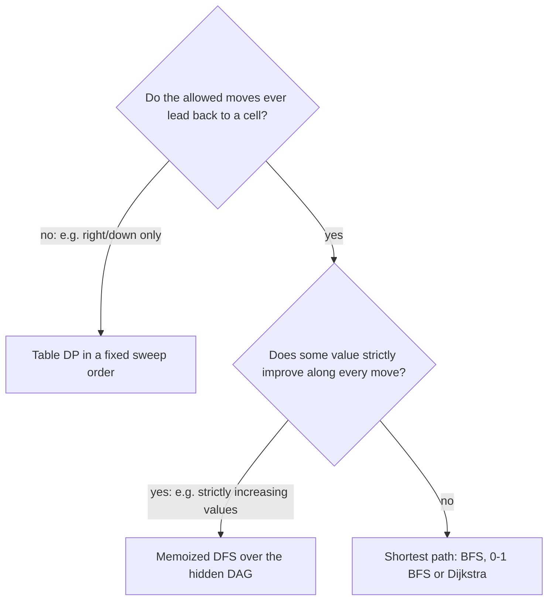

## Introduction

A robot stands in the top-left cell of a grid and must reach the bottom-right cell, moving only right or down. How many different routes are there? If every cell has a cost, which route is cheapest? If some cells are blocked, or some drain the robot's health, or two robots walk at once, what changes?

These questions make up **grid DP**: dynamic programming where each subproblem is identified by a cell of a matrix. They are some of the most common DP questions in interviews because the grid makes the abstract ideas visible. The "state" is a cell you can point at, the "recurrence" is the arrows into that cell, and the "order of computation" is a direction you can sweep with your finger.

Grid DP is not only about robots. Content-aware image resizing finds the cheapest top-to-bottom path of pixels through an energy grid. Comparing two sequences, as in [[a11-lcs]], is a grid DP in which the rows are one string and the columns are the other. Dynamic time warping, used to compare speech or sensor signals, is the same idea with time series on the two axes. Once you see a table where each cell depends on a few earlier cells, you are looking at a grid DP.

This lesson does not give you a template to paste. It shows how to derive the recurrence from the moves a problem allows, how to choose a fill direction that guarantees every dependency is ready, and how to recognise the two situations where a grid is *not* a straightforward DP.

## Before you start

You should be comfortable with:

- **Matrices in Java** — `int[][]`, rows and columns, bounds checks. See [[a2-matrix]].
- **Memoization and tabulation** — solving each subproblem once, top-down or bottom-up. See [[a11-memoization]] and [[a11-tabulation]].
- **Two-dimensional DP tables** — cells that depend on neighbours. See [[a11-2d-dp]].
- **Grid search** — moving through a grid with direction arrays, which this lesson uses near the end. See [[a9-grid-search]].
- **Breadth-first search** — needed only for the comparison with shortest paths. See [[a6-bfs]].

## The intuition: look at the last step

To count routes into a cell, do not think about the whole route. Think only about the *last step*. If moves are right and down, the robot entered cell `(r, c)` either from the cell above, `(r - 1, c)`, or from the cell to the left, `(r, c - 1)`. Every route into `(r, c)` falls into exactly one of those two groups, and each group is "all routes into the neighbour, plus one step". So the number of routes into `(r, c)` is the number into the cell above plus the number into the cell to the left.

That one observation is the whole technique. The allowed moves tell you which cells can come *immediately before* the current one, and the question (count, minimum, maximum) tells you how to combine them. Because the moves only go right and down, every cell's predecessors are above or to the left, so sweeping the grid top-to-bottom and left-to-right always finds them already computed.

## The naive approach

The direct method enumerates every route. In an `m × n` grid every right/down route has exactly `m - 1` down moves and `n - 1` right moves, in some order, so there are `C(m + n - 2, m - 1)` routes — choose which of the `m + n - 2` moves are the downs. For a 3 × 7 grid that is `C(8, 2) = 28`, which is fine. For a 20 × 20 grid it is `C(38, 19) ≈ 3.5 × 10¹⁰`, and for 100 × 100 it is about 2.3 × 10⁵⁸. Enumerating, or recursing without memory, takes time proportional to that count.

The waste is obvious once you draw the recursion. The routes `right, down, …` and `down, right, …` both arrive at `(1, 1)`, and from there the rest of the work is identical. There are only `m · n` cells, so there are only `m · n` different questions. Answer each once.

## Unique Paths: deriving the first recurrence

Follow the four steps that every DP answer needs.

**State.** `ways(r, c)` = the number of right/down routes from `(0, 0)` to `(r, c)`. The answer is `ways(m - 1, n - 1)`.

**Recurrence.** The last step into `(r, c)` came from above or from the left, and those two groups do not overlap (they differ in the last move), so

```text
ways(r, c) = ways(r - 1, c) + ways(r, c - 1)
```

where a neighbour outside the grid contributes 0.

**Base case.** `ways(0, 0) = 1`. There is exactly one route from the start to itself: the empty route. This is not a convention to memorise; with any other value every count in the grid would be wrong by that factor.

**Order.** Each cell needs the cell above and the cell to the left, so fill **row by row, left to right**.

**Obstacles** change one line. If `(r, c)` is blocked, no route can pass through it, so `ways(r, c) = 0`; the zero then flows forward and automatically removes every route that would have used it. If the start itself is blocked, the answer is 0 — this is a classic trap, because code that sets `ways(0, 0) = 1` before checking for an obstacle reports one route through a wall.

Without obstacles there is a closed form, `C(m + n - 2, m - 1)`. It is worth mentioning in an interview, but the DP is the version that generalises to obstacles, costs and everything else in this lesson.

## Minimum Path Sum: same states, different combine

Now each cell has a non-negative cost, and the cost of a route is the sum of all cells on it, including the start and the end. Find the cheapest route.

The state is the same cell, but the value changes: `best(r, c)` = the minimum cost of a route from `(0, 0)` to `(r, c)`. The last step still came from above or the left. The cheapest route through the cell above costs `best(r - 1, c)`, and adding the step costs `cost[r][c]`. So

```text
best(r, c) = cost[r][c] + min(best(r - 1, c), best(r, c - 1))
best(0, 0) = cost[0][0]
```

Why is it safe to keep only the *cheapest* route into each neighbour? Because the future does not care how you got there. Any route from `(r - 1, c)` onwards costs the same regardless of the route that reached `(r - 1, c)`, so replacing an expensive prefix with a cheaper one can only help. This property — the best answer to the whole contains the best answers to its parts — is called **optimal substructure**, and checking it is exactly what goes wrong in the Dungeon Game below.

A neighbour outside the grid must never be chosen. Use `Integer.MAX_VALUE` as "unreachable" for the `min`, and note that it is only ever *compared*, never added to: at every cell except the start, at least one neighbour is real, so `min` returns a real value before the addition.

## The basic programs in Java

```java title="GridDp.java"
import java.util.Arrays;

public class GridDp {

    // number of right/down paths from (0,0) to (m-1,n-1) avoiding cells marked 1
    static long uniquePaths(int[][] grid) {
        int m = grid.length, n = grid[0].length;
        long[][] ways = new long[m][n];
        for (int r = 0; r < m; r++) {
            for (int c = 0; c < n; c++) {
                if (grid[r][c] == 1) {
                    ways[r][c] = 0;                       // nobody can stand here
                } else if (r == 0 && c == 0) {
                    ways[r][c] = 1;                       // the empty path
                } else {
                    long fromTop = r > 0 ? ways[r - 1][c] : 0;
                    long fromLeft = c > 0 ? ways[r][c - 1] : 0;
                    ways[r][c] = fromTop + fromLeft;
                }
            }
        }
        return ways[m - 1][n - 1];
    }

    // cheapest right/down path; every cell's cost is paid, including start and end
    static int minPathSum(int[][] cost) {
        int m = cost.length, n = cost[0].length;
        int[][] best = new int[m][n];
        for (int r = 0; r < m; r++) {
            for (int c = 0; c < n; c++) {
                if (r == 0 && c == 0) {
                    best[r][c] = cost[0][0];
                } else {
                    int top = r > 0 ? best[r - 1][c] : Integer.MAX_VALUE;
                    int left = c > 0 ? best[r][c - 1] : Integer.MAX_VALUE;
                    best[r][c] = cost[r][c] + Math.min(top, left); // one of them is real
                }
            }
        }
        return best[m - 1][n - 1];
    }

    // the same recurrence keeping one row: row[c] holds best for (r-1, c) until overwritten
    static int minPathSumOneRow(int[][] cost) {
        int n = cost[0].length;
        int[] row = new int[n];
        Arrays.fill(row, Integer.MAX_VALUE);
        row[0] = 0;                                       // so that (0,0) costs exactly cost[0][0]
        for (int[] costRow : cost) {
            for (int c = 0; c < n; c++) {
                int top = row[c];                         // still last row's value
                int left = c > 0 ? row[c - 1] : Integer.MAX_VALUE; // already this row's value
                row[c] = costRow[c] + Math.min(top, left);
            }
        }
        return row[n - 1];
    }

    public static void main(String[] args) {
        int[][] open = new int[3][7];
        int[][] blocked = {{0, 0, 0}, {0, 1, 0}, {0, 0, 0}};
        int[][] startBlocked = {{1, 0}, {0, 0}};
        System.out.println(uniquePaths(open));
        System.out.println(uniquePaths(blocked));
        System.out.println(uniquePaths(startBlocked));

        int[][] cost = {{1, 3, 1}, {1, 5, 1}, {4, 2, 1}};
        System.out.println(minPathSum(cost));
        System.out.println(minPathSumOneRow(cost));
        System.out.println(minPathSum(new int[][]{{5}}));
    }
}
```

```output
28
2
0
7
7
5
```

The open 3 × 7 grid has 28 routes, matching `C(8, 2)`. Blocking the centre of a 3 × 3 grid leaves only the two routes around the edge. A blocked start gives 0 because the obstacle check comes *before* the base case. The 1 × 1 grid returns its only cell's cost, `5`.

`uniquePaths` returns `long` because counts grow fast: an open 18 × 18 grid already has `C(34, 17) ≈ 2.33 × 10⁹` routes, more than an `int` can hold. Problems that expect larger counts usually ask for the answer modulo 10⁹ + 7; apply the modulus after each addition.

### Dry run: Minimum Path Sum

Trace `minPathSum` on

```text
1 3 1
1 5 1
4 2 1
```

Each cell of the table below shows `best(r, c)` and how it was computed.

| | `c = 0` | `c = 1` | `c = 2` |
|---|---|---|---|
| `r = 0` | `1` (start) | `3 + 1 = 4` | `1 + 4 = 5` |
| `r = 1` | `1 + 1 = 2` | `5 + min(4, 2) = 7` | `1 + min(5, 7) = 6` |
| `r = 2` | `4 + 2 = 6` | `2 + min(7, 6) = 8` | `1 + min(6, 8) = 7` |

The first row and first column have only one possible predecessor, so they are running sums. The interesting cell is `(1, 1)`: it can be reached from `(0, 1)` at cost 4 or from `(1, 0)` at cost 2, and it keeps the cheaper. The answer, 7, corresponds to the route `1 → 3 → 1 → 1 → 1` along the top and right edges. To recover that route, start at the bottom-right and repeatedly step to whichever of top or left has the smaller `best` value, exactly as reconstruction works in [[a11-lcs]].

### Complexity and the one-row trick

**Time.** There are `m · n` states, each doing O(1) work, so **O(m · n)**. Compare that with `C(m + n - 2, m - 1)` routes for enumeration.

**Space.** The full table is O(m · n). But row `r` only reads row `r - 1` and itself, so one array of length `n` is enough. In `minPathSumOneRow`, when the loop reaches column `c`, `row[c]` still holds the *previous* row's value (that is "top"), and `row[c - 1]` has already been overwritten with the *current* row's value (that is "left"). Both are exactly what the recurrence needs, so the update can happen in place, giving **O(n)** extra space — or O(min(m, n)) if you transpose so the shorter side is the row. Some solutions go further and write the answers into the input array itself for O(1) extra space; that is fine only if the caller allows the input to be modified, and you should say so.

## Direction matters: Dungeon Game

Now a problem where the obvious forward DP is wrong.

A knight starts at the top-left with some initial health and moves right or down to the bottom-right. Each cell adds its value to his health (negative values hurt, positive heal), including the start and end cells. If his health ever drops to 0 or below, he dies. What is the **minimum initial health** that lets him survive?

### Why the forward DP fails

The natural attempt mirrors Minimum Path Sum: for each cell, keep the route that needs the least starting health to get there. But a route's future depends on *two* numbers — how much starting health it needed so far, and how much health it has *now* — and keeping only one loses information. Here is a grid where that matters:

```text
  0  -3   10
 -1  -1    0
-20 -20  -15
```

Two routes reach `(1, 2)`:

- Route A: `0 → -3 → 10 → 0`. It needs starting health 4 (to survive the `-3`) and then holds `4 - 3 + 10 = 11`.
- Route C: `0 → -1 → -1 → 0`. It needs starting health only 3, and holds `3 - 2 = 1`.

A forward DP that keeps "the least starting health so far" keeps C and discards A. Then the final cell costs 15. Route C needs `1 + 2 + 15 = 18` to survive it; route A needs only 9, because its earlier `+10` is still in the bank. The forward DP answers 18 and the true answer is 9. Optimal substructure fails for that choice of state: the best prefix by one measure is not the best prefix for the future.

### The backward state

Turn the question around. The *future* is what makes routes hard to compare, so define the state by the future:

> `need(r, c)` = the minimum health the knight must have **when he steps onto** `(r, c)` (before its value is applied) to reach the end alive.

Now the past is irrelevant — whatever route brought him here, what he needs from here on is fixed. That is precisely the property a DP state must have.

**Recurrence.** From `(r, c)` he moves to whichever of `(r + 1, c)` and `(r, c + 1)` needs less. After applying this cell's value `d[r][c]` he must have at least `next = min(need(r + 1, c), need(r, c + 1))`, so on arrival he needs `next - d[r][c]`. He must also be alive on this cell, so the need is never below 1:

```text
need(r, c) = max(1, min(need(r + 1, c), need(r, c + 1)) - d[r][c])
```

**Base case.** After the bottom-right cell he only needs to be alive, so pretend the cells immediately past the end — below it and to its right — need 1. Every other cell outside the grid needs infinity, so it is never chosen.

**Order.** Each cell depends on the cell below and the cell to the right, so fill **from the bottom-right corner, row by row upwards, right to left**. The answer is `need(0, 0)`.

The `max(1, …)` is the key line. A large healing cell can make `next - d[r][c]` zero or negative, which would mean "you can arrive dead and be revived". Clamping to 1 encodes the rule that health must be positive at every moment, and it is also why the backward DP works: surplus health beyond what the future needs has no value, so it is correct to forget it.

For the example from the original problem, `[[-2, -3, 3], [-5, -10, 1], [10, 30, -5]]`, the `need` table is:

| | `c = 0` | `c = 1` | `c = 2` |
|---|---|---|---|
| `r = 0` | 7 | 5 | 2 |
| `r = 1` | 6 | 11 | 5 |
| `r = 2` | 1 | 1 | 6 |

Read `(2, 2)` first: the last cell costs 5, so he must arrive with 6. `(2, 1)` heals 30, so `max(1, 6 - 30) = 1` — the clamp at work. The answer is `need(0, 0) = 7`, along `right, right, down, down`.

> [!TIP] When the forward direction is wrong, try the other end
> If the quality of a partial solution depends on something that has not happened yet, define the state by what remains to be done instead of what has been done. Backward DP is the same four steps, with the base case at the destination.

## "Ends at this cell" states: Maximal Square

Not every grid DP is about paths. Given a 0/1 matrix, find the area of the largest square containing only 1s.

A state of "the largest square anywhere in the top-left part of the grid" does not combine well — knowing the biggest square somewhere above tells you nothing about whether it can grow. The fix is the same move as in longest common substring and [[a2-kadane]]: anchor the state at the current cell.

> `side(r, c)` = the side length of the largest all-ones square whose **bottom-right corner** is `(r, c)`.

If the cell is 0, `side(r, c) = 0`. If it is 1, a square of side `k` ending here needs squares of side `k - 1` ending at the cell above, the cell to the left and the cell diagonally up-left; the smallest of the three limits how far the square can extend. So

```text
side(r, c) = 1 + min(side(r - 1, c), side(r, c - 1), side(r - 1, c - 1))   if the cell is 1
```

and the answer is the square of the largest `side` anywhere. Padding the table with an extra row and column of zeros removes the boundary checks. The same "ends here" idea counts all square submatrices (sum every `side`), and finds the longest run of 1s in rows, columns or diagonals.

## Two walkers at once: Cherry Pickup

Each cell holds a cherry (1), nothing (0) or a thorn (−1, impassable). You walk from the top-left to the bottom-right moving right/down, then return moving left/up, collecting every cherry you pass; a picked cell becomes empty. Maximise the cherries, or return 0 if no route exists.

### Why two greedy passes fail

Finding the best single route, removing its cherries and then finding the best route again looks reasonable, but the first route's choices can strand the remaining cherries. On

```text
1 1 1 0 0
0 0 1 0 1
1 0 1 0 0
0 0 1 0 0
0 0 1 1 1
```

one maximum first route collects 9, after which the best second route can collect only 1, for 10 in total. Two coordinated routes collect all 11. Greedy fails because the two trips interact, so the state must describe both at once.

### Building the state

First, a return trip moving left/up is a forward trip in reverse, so the problem is equivalent to **two walkers going from the top-left to the bottom-right at the same time**. The naive state `(r1, c1, r2, c2)` has n⁴ values. But if both walkers move one step per tick, after `t` steps each satisfies `r + c = t`. So `t`, `r1` and `r2` determine everything: `c1 = t - r1`, `c2 = t - r2`. The state shrinks to O(n³), and there is a bonus: two walkers can only stand on the same cell at the *same* `t`, so "do not count a cherry twice" becomes a simple check `r1 == r2`.

> `best(t, r1, r2)` = the most cherries the two walkers can hold after `t` steps, standing at `(r1, t - r1)` and `(r2, t - r2)`, or −∞ if that is impossible.

Each walker came from above or from the left, giving four combinations of predecessors at step `t - 1`. Take the best of the four and add the cherries at the two current cells (once if they coincide). Thorn cells are −∞. The base case is `best(0, 0, 0) = grid[0][0]`; the order is increasing `t`, and only the previous layer is needed.

The full implementation is in the variants program below; the important lesson is the reduction. When two quantities move in lockstep, a shared counter removes a dimension.

## When the moves allow cycles

Everything so far relied on one fact: the moves only go right and down, so a cell's predecessors are always "earlier" in a fixed sweep order. Allow all four directions and that disappears. Cell A can be reached from cell B and B from A, so there is no order in which both are finished first — the dependencies form cycles, and a plain table fill is not defined.

There are two ways out, and choosing between them is a frequent interview test.

**The cycles are only apparent.** In *Longest Increasing Path in a Matrix* you may move in four directions, but only to a strictly larger value. Values strictly increase along every path, so no path can return to where it started. The dependencies form a **directed acyclic graph (DAG)** even though the grid has no obvious sweep order. Memoized recursion handles this without you finding the order explicitly: `longestFrom(r, c)` = 1 + the best `longestFrom` among larger neighbours. The recursion visits states in an order consistent with the DAG automatically (a topological order), and each state is solved once — O(m · n) in total.

**The cycles are real.** For "cheapest route in four directions with non-negative cell costs", a route may wander back and forth, and a recursive definition would call itself in a loop. This is a **shortest-path problem**: use breadth-first search for unit costs, 0-1 BFS for costs of 0 and 1, and Dijkstra's algorithm ([[a8-dijkstra]]) for general non-negative costs. Calling them "DP" is not wrong in spirit, but table-filling will not work.



## The variants in Java

```java title="GridVariants.java"
import java.util.Arrays;

public class GridVariants {

    // Dungeon Game: minimum starting health to reach the bottom-right with health >= 1 throughout
    static int minInitialHealth(int[][] d) {
        int m = d.length, n = d[0].length;
        int[][] need = new int[m + 1][n + 1];
        for (int[] row : need) Arrays.fill(row, Integer.MAX_VALUE);
        need[m][n - 1] = 1;                               // past the last cell: only stay alive
        need[m - 1][n] = 1;
        for (int r = m - 1; r >= 0; r--) {
            for (int c = n - 1; c >= 0; c--) {
                int next = Math.min(need[r + 1][c], need[r][c + 1]); // cheaper way onward
                need[r][c] = Math.max(1, next - d[r][c]);            // never below 1
            }
        }
        return need[0][0];
    }

    // side of the largest all-ones square whose bottom-right corner is (r, c)
    static int maximalSquare(int[][] a) {
        int m = a.length, n = a[0].length, best = 0;
        int[][] side = new int[m + 1][n + 1];             // padded: row 0 / col 0 are "outside"
        for (int r = 1; r <= m; r++) {
            for (int c = 1; c <= n; c++) {
                if (a[r - 1][c - 1] == 1) {
                    side[r][c] = 1 + Math.min(side[r - 1][c - 1],
                                     Math.min(side[r - 1][c], side[r][c - 1]));
                    best = Math.max(best, side[r][c]);
                }
            }
        }
        return best * best;
    }

    // Cherry Pickup: two walkers move right/down together; t = r + c is shared
    static int cherryPickup(int[][] g) {
        int n = g.length;
        int NEG = Integer.MIN_VALUE / 4;                  // "unreachable", safe to add to
        int[][] dp = new int[n][n];                       // dp[r1][r2] for the current step t
        for (int[] row : dp) Arrays.fill(row, NEG);
        if (g[0][0] == -1) return 0;
        dp[0][0] = g[0][0];
        for (int t = 1; t <= 2 * (n - 1); t++) {
            int[][] next = new int[n][n];
            for (int[] row : next) Arrays.fill(row, NEG);
            for (int r1 = Math.max(0, t - (n - 1)); r1 <= Math.min(n - 1, t); r1++) {
                for (int r2 = Math.max(0, t - (n - 1)); r2 <= Math.min(n - 1, t); r2++) {
                    int c1 = t - r1, c2 = t - r2;
                    if (g[r1][c1] == -1 || g[r2][c2] == -1) continue;
                    int prev = NEG;                       // each walker came from top or left
                    for (int d1 = 0; d1 <= 1; d1++) {
                        for (int d2 = 0; d2 <= 1; d2++) {
                            int p1 = r1 - d1, p2 = r2 - d2;
                            if (p1 >= 0 && p2 >= 0) prev = Math.max(prev, dp[p1][p2]);
                        }
                    }
                    if (prev == NEG) continue;
                    int gain = g[r1][c1] + (r1 == r2 ? 0 : g[r2][c2]); // same cell counts once
                    next[r1][r2] = prev + gain;
                }
            }
            dp = next;
        }
        return Math.max(0, dp[n - 1][n - 1]);
    }

    // Longest Increasing Path in a Matrix: 4 directions, but strictly increasing => no cycles
    static int[][] memo;
    static final int[][] DIRS = {{1, 0}, {-1, 0}, {0, 1}, {0, -1}};

    static int longestIncreasingPath(int[][] a) {
        memo = new int[a.length][a[0].length];            // 0 = not computed yet
        int best = 0;
        for (int r = 0; r < a.length; r++) {
            for (int c = 0; c < a[0].length; c++) best = Math.max(best, longestFrom(a, r, c));
        }
        return best;
    }

    static int longestFrom(int[][] a, int r, int c) {
        if (memo[r][c] != 0) return memo[r][c];
        int best = 1;                                     // the path containing only (r, c)
        for (int[] d : DIRS) {
            int nr = r + d[0], nc = c + d[1];
            if (nr >= 0 && nr < a.length && nc >= 0 && nc < a[0].length && a[nr][nc] > a[r][c]) {
                best = Math.max(best, 1 + longestFrom(a, nr, nc));
            }
        }
        return memo[r][c] = best;
    }

    public static void main(String[] args) {
        System.out.println(minInitialHealth(new int[][]{{-2, -3, 3}, {-5, -10, 1}, {10, 30, -5}}));
        System.out.println(maximalSquare(new int[][]{
                {1, 0, 1, 0, 0}, {1, 0, 1, 1, 1}, {1, 1, 1, 1, 1}, {1, 0, 0, 1, 0}}));
        System.out.println(cherryPickup(new int[][]{{0, 1, -1}, {1, 0, -1}, {1, 1, 1}}));
        System.out.println(cherryPickup(new int[][]{{1, 1, -1}, {1, -1, 1}, {-1, 1, 1}}));
        System.out.println(longestIncreasingPath(new int[][]{{9, 9, 4}, {6, 6, 8}, {2, 1, 1}}));
    }
}
```

```output
7
4
5
0
4
```

A few points in this code deserve attention. In `minInitialHealth` the padded row and column hold `Integer.MAX_VALUE`. Every cell except the bottom-right has at least one real neighbour, so `min` never returns the sentinel there, and the bottom-right cell's two padded neighbours are set to 1, so nothing is ever subtracted from `MAX_VALUE`. In `cherryPickup`, "unreachable" is `Integer.MIN_VALUE / 4` rather than `MIN_VALUE`, so adding a few cherries to it cannot overflow into a large positive number; the `prev == NEG` check skips such states anyway. The loops over `r1` and `r2` only visit rows for which the column `t - r` is inside the grid. In the second cherry grid the thorns cut every route, so the answer is 0. The longest increasing path in the last example is `1 → 2 → 6 → 9`, length 4.

Every method in `GridDp` and `GridVariants` was stress-tested against brute force — enumerating every right/down route (and every *pair* of routes for Cherry Pickup), checking every square, and plain exhaustive recursion for the increasing path — on 3,000 random grids of up to 5 × 5, with no mismatches. That is how the counterexample to the forward Dungeon DP above was confirmed too.

```quiz
Q: In Unique Paths with obstacles, the start cell is blocked. What should the answer be, and what bug commonly produces the wrong one?
- [ ] 1, because the empty path always exists
- [x] 0; the bug is setting the start to 1 before checking whether it is an obstacle
- [ ] 0; the bug is forgetting to use long
- [ ] It depends on whether the end cell is blocked
> No route can begin on a blocked cell, so there are none. Code that writes `ways[0][0] = 1` unconditionally, then fills the rest, reports routes through a wall. Using `long` matters for large counts, not for this case.

Q: Why does Dungeon Game need a backward DP?
- [ ] Because the knight moves up and left
- [ ] Because negative numbers break forward DP in general
- [x] Because how good a partial route is depends on future cells; a state defined by "health needed from here on" does not depend on the past
- [ ] Because backward DP is always faster
> A forward state that keeps one number per cell discards routes that need more health early but bank more for later, as the counterexample showed (forward 18, true 9). Minimum Path Sum also has negative-free costs and works forwards, so negativity is not the issue; the issue is which direction gives a state the rest of the problem does not care about.

Q: Longest Increasing Path in a Matrix allows moves in four directions. Why can it still be solved by memoized recursion in O(m · n)?
- [ ] Because four-direction movement never creates cycles
- [x] Because values strictly increase along every allowed move, so no path can return to a cell and the dependencies form a DAG
- [ ] Because the recursion depth is bounded by 4
- [ ] Because it is the same as Minimum Path Sum
> Four-direction movement in general creates cycles, and then DP is not defined. Here, each move goes to a strictly larger value, so a path can never revisit a cell; each state is solved once and memoized. Recursion depth can be as large as m · n.
```

## Recognising grid DP

You are likely looking at a grid DP when:

- the input is a matrix, and the question is a **count**, **minimum**, **maximum** or **feasibility** over routes or shapes;
- the moves are **monotone** — right/down, or down to one of a few cells in the next row (as in *Triangle* and *Minimum Falling Path Sum*, where `dp[r][c]` reads from `r - 1` at `c - 1`, `c` and `c + 1`);
- or the question is about the largest shape of some kind, which suggests an "ends at this cell" state.

Then work through the four steps: state = the cell (plus anything else the future needs, such as a second walker); recurrence = how you could have arrived (or, for backward DP, where you can go next); base = the start (or the destination); order = a sweep in which every dependency comes first. If no such sweep exists, ask whether a strictly improving value makes the graph acyclic (memoized search) or whether this is really a shortest path.

## In real systems

**Seam carving.** Content-aware image resizing removes a "seam" — a connected path of one pixel per row from top to bottom — that passes through the least important pixels. Each pixel has an energy (for example, gradient magnitude), and the cheapest seam is found with exactly the recurrence of *Minimum Falling Path Sum*: `best(r, c) = energy(r, c) + min` of the three pixels above. Removing the seam and repeating shrinks the image while preserving its important content.

**Sequence alignment and dynamic time warping.** Aligning two DNA sequences, or matching a spoken word to a template where the speaker talks faster or slower, fills a grid whose rows index one sequence and columns the other. Each cell is reached from the left, above or diagonal — the same three predecessors as in [[a11-lcs]] — with costs chosen for the domain.

**Robot and game path planning.** On cost maps where units can only move "forward" (for example, a scrolling level), monotone grid DP gives optimal routes directly. When movement is free in all directions, planners use A* or Dijkstra instead, for exactly the reason given in the cycles section.

## Trade-offs and alternatives

| Approach | Time | Space | When to use |
|---|---|---|---|
| Enumerate routes | O(C(m + n - 2, m - 1)) | O(m + n) | Only as a brute-force checker |
| Closed form `C(m + n - 2, m - 1)` | O(min(m, n)) | O(1) | Counting routes with no obstacles |
| Table DP | O(m · n) | O(m · n) | Default; needed to reconstruct the route |
| One-row DP | O(m · n) | O(min(m, n)) | Only the value is needed |
| In-place on the input | O(m · n) | O(1) extra | Input may be modified |
| Memoized DFS | O(m · n) | O(m · n) plus stack | Dependencies form a DAG with no obvious sweep order |
| BFS / Dijkstra | O(m · n) / O(m · n · log(m · n)) | O(m · n) | Moves create genuine cycles |

The memoized versions risk deep recursion: Longest Increasing Path can recurse `m · n` levels deep on a "snake" of increasing values, which for a 1000 × 1000 grid overflows Java's default thread stack. A bottom-up alternative sorts cells by value and processes them from largest to smallest, which is an explicit topological order.

## Common mistakes

> [!MISTAKE] Initialising the start before checking it
> Set the start's value only if it is not blocked (or not a thorn). Otherwise one phantom route survives through every later cell.

**Using 0 as "unreachable" in a minimisation.** In Minimum Path Sum with blocked cells, a blocked cell with value 0 looks like the *cheapest* predecessor, and routes flow through walls. Use a large sentinel for minimisation and a very negative one for maximisation, and make sure it is never added to before being compared.

**Overflow from sentinels.** `Integer.MAX_VALUE + cost` wraps around to a negative number and becomes the minimum. Either never add to the sentinel (check first), or use `Integer.MAX_VALUE / 2` so a few additions stay positive.

**Double-counting the start cell.** If the base case is `best(0, 0) = cost[0][0]`, do not also add `cost[0][0]` in the first iteration. Write the base case once, then let every other cell add only its own cost.

**Assuming forward is always the right direction.** If the problem has a constraint that must hold at every moment (health, fuel, balance), test whether partial routes can be compared by one number. If not, try the backward state.

**Table-filling a grid with four-direction moves.** A row-major sweep reads neighbours below and to the right that have not been computed yet, giving silently wrong answers. Check for cycles first.

## Interview perspective

Grid DP questions often start easy (*Unique Paths*) and escalate in the same interview: obstacles, then costs, then memory, then a variant such as Dungeon Game or Cherry Pickup. The strong signal is that you re-derive the recurrence each time from "how could I have arrived here?" rather than patching a template.

> [!INTERVIEW] What a strong answer sounds like
> "Each cell is a state. I can only enter `(r, c)` from above or from the left, so the cheapest cost here is this cell's cost plus the cheaper of those two. The start is its own cost. Every dependency is up or left, so a row-major sweep works. That's O(m·n) time, and since I only read the previous row, I can keep one array of length n."

Questions to be ready for:

- **Unique Paths without DP?** `C(m + n - 2, m - 1)`, computed with a running product to avoid overflow; then explain why the DP is still useful once obstacles appear.
- **What changes with obstacles?** A blocked cell's value is 0 paths or "unreachable" cost, including the start and end.
- **Reduce space.** One row; explain why `row[c]` is "top" and `row[c - 1]` is "left" during the sweep.
- **Dungeon Game.** Give the counterexample idea, then the backward state and the `max(1, …)` clamp.
- **Cherry Pickup.** Explain why two greedy passes fail, then reduce `(r1, c1, r2, c2)` to `(t, r1, r2)`.
- **"What if I can move in all four directions?"** Then it is a shortest-path problem unless something strictly improves along each move.

## Practice

1. **Unique Paths** and **Unique Paths II** — derive, then reduce to one row.
2. **Minimum Path Sum** — print the route as well as its cost.
3. **Triangle** — solve it top-down, then bottom-up from the last row, and notice that bottom-up needs no boundary checks.
4. **Minimum Falling Path Sum** — three predecessors per cell.
5. **Maximal Square** and **Count Square Submatrices with All Ones**.
6. **Dungeon Game** — write the forward attempt first and find where it fails.
7. **Longest Increasing Path in a Matrix** — memoized DFS, then the sort-by-value bottom-up version.
8. **Cherry Pickup** — then *Cherry Pickup II*, where two robots start in the top corners and both move down one row per step.

For each, write a brute-force route enumerator for grids up to 4 × 4 and compare on random inputs. The DSA explorer lists the matching problems under this topic.

## Quick revision {#quick-revision}

- State = a cell (plus whatever else the future depends on). Recurrence = how you could have arrived.
- Unique Paths: `ways = top + left`; start = 1 (the empty route); blocked = 0, including a blocked start.
- Minimum Path Sum: `best = cost + min(top, left)`; start = its own cost; never add to the sentinel.
- Order: right/down moves → row-major sweep. One row of memory suffices: `row[c]` = top, `row[c - 1]` = left.
- Dungeon Game: backward state `need(r, c) = max(1, min(down, right) - d[r][c])`, base 1 past the end.
- Maximal Square: "ends here" state, `1 + min(top, left, diagonal)`.
- Cherry Pickup: two walkers in lockstep; `(t, r1, r2)` with `c = t - r`; count a shared cell once.
- Four-direction moves: memoized DFS if values strictly improve (DAG), otherwise BFS / Dijkstra.
- Time O(m · n); space O(m · n), or O(min(m, n)) for the value only.

## Key takeaways {#key-takeaways}

- Grid DP turns an exponential number of routes into `m · n` states by asking only how each cell could be entered.
- The allowed moves determine the recurrence and the fill order; right/down moves mean a top-left to bottom-right sweep.
- Base cases and sentinels decide correctness at the edges: the empty route counts once, blocked cells contribute nothing, and "unreachable" must never win a comparison.
- When a partial route cannot be judged without knowing the future, compute backwards from the destination, as in Dungeon Game.
- Anchor the state at a cell ("square ending here") for shape problems, and add dimensions only for what the future truly needs, using lockstep counters to remove redundant ones.
- If moves can return to a cell, it is not a table DP: use memoized search over a DAG or a shortest-path algorithm.
