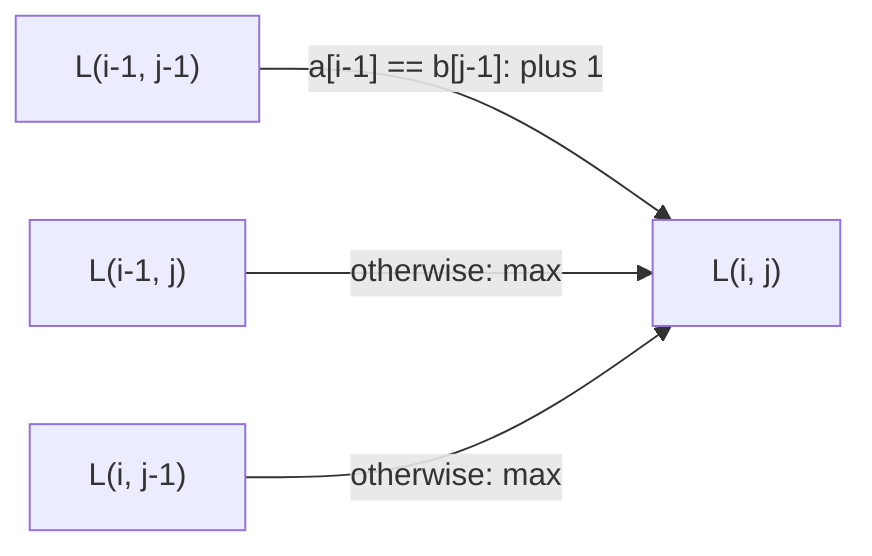

## Introduction

When you run `git diff`, the tool has to decide which lines of the old file survived into the new one and which were added or removed. It does not want to report every line as changed; it wants to keep as many lines as possible "in common" while respecting their order, and describe the rest as insertions and deletions. That question — *what is the largest set of items both sequences share, in the same order?* — is the **longest common subsequence** problem, usually shortened to **LCS**.

A **subsequence** of a string is what remains after deleting zero or more characters without reordering the rest. `"ace"` is a subsequence of `"abcde"` (delete `b` and `d`), but `"aec"` is not, because it changes the order. A **common subsequence** of two strings is a subsequence of both, and the LCS is a longest one. For `"abcde"` and `"ace"` it is `"ace"`, of length 3. For `"AGCAT"` and `"GAC"` the answer has length 2, and there are three different LCSs: `"GA"`, `"GC"` and `"AC"`. So the *length* of the LCS is unique, but the sequence often is not.

Do not confuse a subsequence with a **substring**, which must be contiguous. `"bcd"` is a substring of `"abcde"`; `"ace"` is only a subsequence. The two problems sound alike and have recurrences that differ by one line, which makes mixing them up one of the most common mistakes in this area.

LCS matters for three reasons. It is the textbook example of **dynamic programming on two sequences**, and once you can derive it, problems such as edit distance, shortest common supersequence and "delete operation for two strings" stop being separate puzzles. It shows up in real tools: diff utilities, merge tools, plagiarism checkers and DNA sequence comparison all measure similarity in this order-preserving way. And it is a frequent interview question, usually followed by "now print the sequence" or "now use less memory".

This lesson focuses on *how to arrive at* the solution — the state, the recurrence, the base cases and the order of computation — rather than on memorising the final loop. The same derivation is the template for every two-string problem you will meet.

## Before you start

You will need:

- **Recursion** — writing a method that solves a smaller copy of the same problem, with a base case. See [[a1-recursion]].
- **Memoization and tabulation** — caching the answers to repeated subproblems, and filling a table bottom-up instead. See [[a11-memoization]] and [[a11-tabulation]]; this lesson uses both without re-teaching them.
- **Two-dimensional DP** — tables indexed by two positions, and how a cell depends on its neighbours. See [[a11-2d-dp]].
- **Java strings** — `charAt`, `length` and `StringBuilder`. See [[a1-strings-stringbuilder]].

It also helps to have seen [[a11-subsequences]], which compares subsequence, substring and subarray problems in general.

## The intuition

Put one finger at the end of each string and look at the two characters under your fingers.

If they are **the same**, pair them up: they can serve as the last character of a common subsequence, and you continue with both fingers moved one step left. If they are **different**, they cannot both be the last character of the same common subsequence — a common subsequence ends with one character, and these two are not equal. So at least one of them is useless as the final character, and you do not know which. You try both: move the left finger back once and solve the rest, or move the right finger back once and solve the rest, and keep whichever gives the longer answer.

That is the whole algorithm. The rest of this lesson makes the informal reasoning precise, shows why it is correct, and turns the "try both" branching from exponential into polynomial by remembering answers.

## The naive approach and why it is slow

The most direct method is to list every subsequence of the first string and check which ones are also subsequences of the second. A string of length `m` has `2ᵐ` subsequences, because each character is either kept or deleted — the same reasoning as generating subsets in [[a9-subsets]]. Checking whether one candidate is a subsequence of a string of length `n` takes O(n) with two pointers. The total is **O(2ᵐ · n)**. For `m = 30` that is already about a billion candidates; for files with thousands of lines it is hopeless.

The finger-based reasoning suggests a recursive method instead. Written without memory it is still exponential: every mismatch makes two recursive calls, so for two strings with no characters in common the recursion tree branches at every level, to a depth of up to `m + n`. The rescue comes from noticing *what* those calls are actually asking.

## Deriving the dynamic programming solution

### Step 1: choose the state

Every recursive call in the finger picture is described by only two numbers: where the left finger is and where the right finger is. Everything to the right of the fingers has been dealt with; everything to the left is still open. So each subproblem is "the LCS of a **prefix** of `a` and a **prefix** of `b`".

Define the **state**:

> `L(i, j)` = the length of an LCS of the first `i` characters of `a` and the first `j` characters of `b`, that is, of `a[0..i-1]` and `b[0..j-1]`.

Using prefix *lengths* `i` and `j` rather than last indices is a deliberate choice: it lets `i = 0` mean "the empty prefix", which gives clean base cases. The price is an off-by-one you must remember from then on: the last character of the prefix of length `i` is `a.charAt(i - 1)`.

The answer to the original problem is `L(m, n)`, where `m` and `n` are the full lengths. The number of distinct states is `(m + 1) · (n + 1)` — one for every pair of prefix lengths. That count is what turns the exponential search into a polynomial one: however many recursive paths lead to a state, it needs to be solved only once.

### Step 2: find the recurrence from the last characters

Take any `i ≥ 1` and `j ≥ 1`, and let `x = a[i-1]` and `y = b[j-1]` be the last characters of the two prefixes. There are two cases.

**Case 1: `x == y`.** Then `L(i, j) = 1 + L(i-1, j-1)`. Both directions are short:

- *At least that much.* Take an LCS of the two shorter prefixes and append `x`. Since `x` is the last character of both longer prefixes, the result is a common subsequence of length `L(i-1, j-1) + 1`.
- *No more than that.* Take any common subsequence `S` of the two prefixes and remove its last character. That last character was matched to some position at or before `i-1` in `a` and at or before `j-1` in `b`, so everything before it lies inside `a[0..i-2]` and `b[0..j-2]`. Therefore `|S| - 1 ≤ L(i-1, j-1)`.

So pairing equal last characters is never a mistake.

**Case 2: `x != y`.** Any common subsequence ends with one character, and that character cannot be matched to both `x` and `y`, because they differ. So in every common subsequence at least one of `x` and `y` is unused:

- if `x` is unused, the subsequence lives in `a[0..i-2]` and `b[0..j-1]`, so its length is at most `L(i-1, j)`;
- if `y` is unused, its length is at most `L(i, j-1)`.

Both values are achievable (a common subsequence of shorter prefixes is still one of the longer prefixes), and every common subsequence falls into at least one of the two groups. Therefore:

```text
L(i, j) = 1 + L(i-1, j-1)                  if a[i-1] == b[j-1]
L(i, j) = max(L(i-1, j), L(i, j-1))        otherwise
```

Notice what the mismatch line does *not* include. It does not add `1`, and it does not consider `L(i-1, j-1)` separately: shrinking a prefix can only lose common characters, so `L(i-1, j-1)` is never larger than either option.

### Step 3: base cases

The recurrence shrinks `i`, `j`, or both, so eventually one of them reaches `0`. An empty prefix shares nothing with anything:

```text
L(0, j) = 0   for every j
L(i, 0) = 0   for every i
```

These are not special-case patches. They are the smallest states of the definition, and with them every state is defined.

### Step 4: order of computation

`L(i, j)` reads three cells: diagonally up-left `L(i-1, j-1)`, above `L(i-1, j)` and to the left `L(i, j-1)`. Any order that finishes those three before `(i, j)` is valid. The simplest is **row by row, left to right**: when you reach `(i, j)`, row `i - 1` is complete and the cells to its left in row `i` are complete. Column by column would also work.



Writing a solution as these four answers — state, recurrence, base cases, order — is the habit to build. They are exactly the four things every DP problem asks of you, and the rest of this module ([[a11-grid-dp]], [[a11-partition-dp]], [[a11-tree-dp]]) uses the same four steps.

## The algorithm in Java

Here is a complete program with both the top-down and the bottom-up form, a reconstruction method, and a version that keeps only two rows.

```java title="Lcs.java"
import java.util.Arrays;

public class Lcs {

    // ---------- top-down: the recurrence written directly ----------
    static int[][] memo;

    static int lcsMemo(String a, String b) {
        memo = new int[a.length() + 1][b.length() + 1];
        for (int[] row : memo) Arrays.fill(row, -1);
        return solve(a, b, a.length(), b.length());
    }

    // LCS length of the prefixes a[0..i-1] and b[0..j-1]
    static int solve(String a, String b, int i, int j) {
        if (i == 0 || j == 0) return 0;                 // an empty prefix has no common part
        if (memo[i][j] != -1) return memo[i][j];
        int best;
        if (a.charAt(i - 1) == b.charAt(j - 1)) {
            best = 1 + solve(a, b, i - 1, j - 1);       // use the matching last characters
        } else {
            best = Math.max(solve(a, b, i - 1, j),      // drop the last character of a
                            solve(a, b, i, j - 1));     // or drop the last character of b
        }
        return memo[i][j] = best;
    }

    // ---------- bottom-up: same states, filled in dependency order ----------
    static int[][] table(String a, String b) {
        int m = a.length(), n = b.length();
        int[][] dp = new int[m + 1][n + 1];             // row 0 and column 0 stay 0
        for (int i = 1; i <= m; i++) {
            for (int j = 1; j <= n; j++) {
                if (a.charAt(i - 1) == b.charAt(j - 1)) {
                    dp[i][j] = 1 + dp[i - 1][j - 1];
                } else {
                    dp[i][j] = Math.max(dp[i - 1][j], dp[i][j - 1]);
                }
            }
        }
        return dp;
    }

    // walk back from dp[m][n], undoing the choice that produced each cell
    static String reconstruct(String a, String b, int[][] dp) {
        StringBuilder sb = new StringBuilder();
        int i = a.length(), j = b.length();
        while (i > 0 && j > 0) {
            if (a.charAt(i - 1) == b.charAt(j - 1)) {
                sb.append(a.charAt(i - 1));             // this character is in the LCS
                i--;
                j--;
            } else if (dp[i - 1][j] >= dp[i][j - 1]) {
                i--;                                    // the value came from above
            } else {
                j--;                                    // the value came from the left
            }
        }
        return sb.reverse().toString();
    }

    // O(min(m, n)) memory: only the previous row is ever read
    static int lcsTwoRows(String a, String b) {
        if (b.length() > a.length()) { String t = a; a = b; b = t; } // columns = shorter
        int[] prev = new int[b.length() + 1];
        int[] cur = new int[b.length() + 1];
        for (int i = 1; i <= a.length(); i++) {
            for (int j = 1; j <= b.length(); j++) {
                cur[j] = a.charAt(i - 1) == b.charAt(j - 1)
                        ? 1 + prev[j - 1]
                        : Math.max(prev[j], cur[j - 1]);
            }
            int[] t = prev; prev = cur; cur = t;        // this row becomes "previous"
        }
        return prev[b.length()];
    }

    public static void main(String[] args) {
        String a = "AGCAT", b = "GAC";
        int[][] dp = table(a, b);
        for (int[] row : dp) System.out.println(Arrays.toString(row));
        System.out.println("memo      = " + lcsMemo(a, b));
        System.out.println("table     = " + dp[a.length()][b.length()]);
        System.out.println("two rows  = " + lcsTwoRows(a, b));
        System.out.println("one LCS   = " + reconstruct(a, b, dp));

        String x = "ABCBDAB", y = "BDCABA";
        System.out.println(x + " / " + y + " -> " + reconstruct(x, y, table(x, y)));
        System.out.println("empty     = " + lcsMemo("", "abc"));
        System.out.println("no common = " + lcsMemo("abc", "xyz"));
    }
}
```

```output
[0, 0, 0, 0]
[0, 0, 1, 1]
[0, 1, 1, 1]
[0, 1, 1, 2]
[0, 1, 2, 2]
[0, 1, 2, 2]
memo      = 2
table     = 2
two rows  = 2
one LCS   = AC
ABCBDAB / BDCABA -> BCBA
empty     = 0
no common = 0
```

The top-down `solve` is the recurrence translated line for line: base case, cache check, the two cases, store and return. It only visits states that are reachable from `(m, n)`. The bottom-up `table` computes every state in row-major order, which is exactly the dependency order derived in step 4. Both produce the same numbers because they compute the same function of `(i, j)`; the bottom-up version avoids recursion depth (up to `m + n` frames in the top-down one) and is usually a little faster in Java.

The empty-string and no-common-character cases need no special code. An empty `a` gives a table with only the base row, and strings with no shared characters only ever take the `max` branch over zeros.

## Dry run

Trace `table("AGCAT", "GAC")`. Rows are prefixes of `a` (row `i` ends with `a[i-1]`); columns are prefixes of `b`. Each cell shows its value; the comment after the table explains a few of them.

| `i` \ `j` | `""` (0) | `G` (1) | `A` (2) | `C` (3) |
|---|---|---|---|---|
| `""` (0) | 0 | 0 | 0 | 0 |
| `A` (1) | 0 | 0 | **1** | 1 |
| `G` (2) | 0 | **1** | 1 | 1 |
| `C` (3) | 0 | 1 | 1 | **2** |
| `A` (4) | 0 | 1 | **2** | 2 |
| `T` (5) | 0 | 1 | 2 | 2 |

Bold cells are where the characters matched and the diagonal rule fired.

- `(1, 2)`: `A == A`, so `1 + dp[0][1] = 1`. The prefix `"A"` and `"GA"` share `"A"`.
- `(2, 1)`: `G == G`, so `1 + dp[1][0] = 1`.
- `(3, 3)`: `C == C`, so `1 + dp[2][2] = 2`. `dp[2][2]` is the LCS of `"AG"` and `"GA"`, which is 1 (either `"A"` or `"G"`), so this cell represents `"AC"` or `"GC"`.
- `(4, 2)`: `A == A`, so `1 + dp[3][1] = 2`, representing `"GA"`.
- `(5, 3)`: `T != C`, so `max(dp[4][3], dp[5][2]) = max(2, 2) = 2`.

Reconstruction starts at `(5, 3)` and replays the decisions backwards:

| Position | Characters | Decision | Collected so far |
|---|---|---|---|
| `(5, 3)` | `T` vs `C` | mismatch, `dp[4][3] = 2 >= dp[5][2] = 2`, move up | |
| `(4, 3)` | `A` vs `C` | mismatch, `dp[3][3] = 2 >= dp[4][2] = 2`, move up | |
| `(3, 3)` | `C` vs `C` | match, take `C`, move diagonally | `C` |
| `(2, 2)` | `G` vs `A` | mismatch, `dp[1][2] = 1 >= dp[2][1] = 1`, move up | `C` |
| `(1, 2)` | `A` vs `A` | match, take `A`, move diagonally | `AC` (reversed) |
| `(0, 1)` | | `i == 0`, stop | |

The collected characters come out last-first, so the method reverses them and returns `"AC"`. The tie-break `>=` prefers moving up; choosing "left" on ties would have produced `"GA"` instead. Both are correct — every tie leads to *some* LCS, because a tie means both neighbours hold the optimal value.

## Complexity

**Time.** There are `(m + 1)(n + 1)` states. Each one is computed once and does O(1) work: one character comparison and at most one `max`. So both the top-down and bottom-up versions run in **O(m · n)** time. Reconstruction adds O(m + n), since every step decreases `i`, `j` or both. For two strings of 10,000 characters that is 10⁸ cheap cell updates — around a second or less in Java, but a 10⁸-cell `int` table needs about 400 MB, which is the real limit.

**Space.** The full table is O(m · n). For the length alone you can do better: row `i` reads only row `i - 1` and itself, so two arrays of length `n + 1` suffice. Making the shorter string the column dimension gives **O(min(m, n))** extra space, which is what `lcsTwoRows` does. A single array with one saved variable for the diagonal also works, at the cost of slightly trickier code.

Reconstruction is the catch: walking back needs the decisions made in every row, so the two-row trick cannot print the sequence. If you need both the sequence and linear memory, **Hirschberg's algorithm** splits the problem at the middle row using one forward and one backward two-row pass, recurses on the halves, and achieves O(m · n) time with O(min(m, n)) space. It is worth naming in an interview; it is rarely expected in code.

> [!NOTE] Is quadratic the best possible?
> For general strings, no algorithm is known that runs in O(n^(2-ε)) time for any ε > 0, and under a widely believed hardness assumption (the Strong Exponential Time Hypothesis) none exists. Faster methods exist only for special cases, such as few matching pairs (Hunt–Szymanski) or a small number of differences (Myers' diff). That is why practical diff tools use those specialised algorithms.

## Checking the solution against brute force

A recurrence can look right and still be wrong — a missing `+1`, a swapped index. The quickest way to gain confidence is a **stress test**: compare the DP with a brute force that is too simple to get wrong on thousands of small random inputs. Here the brute force tries every subsequence of `a`. The test also checks that the reconstructed string has the right length and really is a subsequence of both inputs.

```java title="LcsStressTest.java"
import java.util.Random;

public class LcsStressTest {

    // brute force: try every subsequence of a, keep the longest that is also in b
    static int bruteLcs(String a, String b) {
        int best = 0;
        for (int mask = 0; mask < (1 << a.length()); mask++) {
            StringBuilder sub = new StringBuilder();
            for (int i = 0; i < a.length(); i++) {
                if ((mask & (1 << i)) != 0) sub.append(a.charAt(i));
            }
            if (sub.length() > best && isSubsequence(sub.toString(), b)) best = sub.length();
        }
        return best;
    }

    static boolean isSubsequence(String s, String t) {
        int k = 0;
        for (int i = 0; i < t.length() && k < s.length(); i++) {
            if (t.charAt(i) == s.charAt(k)) k++;
        }
        return k == s.length();
    }

    static String randomString(Random rnd, int maxLen) {
        int len = rnd.nextInt(maxLen + 1);
        StringBuilder sb = new StringBuilder();
        for (int i = 0; i < len; i++) sb.append((char) ('a' + rnd.nextInt(3)));
        return sb.toString();
    }

    public static void main(String[] args) {
        Random rnd = new Random(42);
        for (int t = 0; t < 20_000; t++) {
            String a = randomString(rnd, 10), b = randomString(rnd, 10);
            int expected = bruteLcs(a, b);
            int[][] dp = Lcs.table(a, b);
            String seq = Lcs.reconstruct(a, b, dp);
            boolean ok = dp[a.length()][b.length()] == expected
                    && Lcs.lcsMemo(a, b) == expected
                    && Lcs.lcsTwoRows(a, b) == expected
                    && seq.length() == expected
                    && isSubsequence(seq, a) && isSubsequence(seq, b);
            if (!ok) {
                System.out.println("MISMATCH on a=" + a + " b=" + b);
                return;
            }
        }
        System.out.println("20000 random tests passed");
    }
}
```

```output
20000 random tests passed
```

Two details make this test effective. The alphabet is only three letters, so random strings share plenty of characters and both branches of the recurrence are exercised; with 26 letters most pairs would have an LCS of 0 or 1 and bugs could hide. And lengths include 0, so the base cases are tested too. Compile it alongside `Lcs.java` (`javac Lcs.java LcsStressTest.java`). Keep this habit for every DP in this module: brute force on tiny inputs is slow but trustworthy, and it catches most recurrence bugs within seconds.

```quiz
Q: In `L(i, j)`, the characters `a[i-1]` and `b[j-1]` are different. Why is `L(i, j) = max(L(i-1, j), L(i, j-1))` correct?
- [ ] Because the LCS never uses the last character of either string
- [x] Because no common subsequence can match both differing characters as its last element, so every common subsequence ignores at least one of them
- [ ] Because `L(i-1, j-1) + 1` is always smaller than both options
- [ ] Because the strings must be the same length
> A common subsequence ends with one character, matched once in each string; if `a[i-1]` and `b[j-1]` differ, at least one of them is unused, which leaves one of the two shorter subproblems. The first option is too strong — one of the two characters may well be used. The third is wrong because `+1` is not allowed at all on a mismatch.

Q: What does `dp[0][j] = 0` represent, and why is it needed?
- [ ] A sentinel for "not yet computed"
- [ ] The LCS length when `j` is 0 only
- [x] The LCS of an empty prefix of `a` with any prefix of `b`, which is 0; it is the base the recurrence eventually reaches
- [ ] An optimisation that can be removed without changing the result
> The state uses prefix lengths, so `i = 0` means the empty prefix of `a`. Every recursive path shrinks `i` or `j` until one becomes 0, so these cells are the foundation. Treating 0 as "not computed" is a different idea; the top-down code uses -1 for that.

Q: Which fill order is NOT valid for the LCS table?
- [ ] Row by row, left to right
- [ ] Column by column, top to bottom
- [x] Row by row, right to left
- [ ] Anti-diagonal by anti-diagonal (all cells with i + j = 2, then i + j = 3, and so on)
> Cell `(i, j)` needs its left neighbour `(i, j-1)`. Filling a row right to left reaches `(i, j)` before `(i, j-1)` has been computed. The other three orders all finish the up, left and up-left neighbours first.
```

## Variations: one derivation, many problems

The real payoff of deriving LCS carefully is that the same two-prefix state solves a family of problems. In each one, you ask what happens to the last characters, and only the cases change.

### Longest common substring

For a **contiguous** match, a common substring that ends at `a[i-1]` and `b[j-1]` must use both characters, and if they differ there is no common substring ending there at all. So the state changes to "the length of the longest common substring that *ends exactly* at `a[i-1]` and `b[j-1]`":

```text
S(i, j) = 1 + S(i-1, j-1)   if a[i-1] == b[j-1]
S(i, j) = 0                 otherwise
answer  = the maximum S(i, j) over all cells
```

The mismatch line is the difference: a substring run is broken, not carried over. This "ends exactly here" state is the same move that [[a2-kadane]] makes for maximum subarray sums.

### Minimum deletions to make two strings equal

Every character outside a common subsequence must be deleted, and keeping a longer common subsequence means deleting less, so the answer is `m + n - 2 · LCS`. For `"sea"` and `"eat"` the LCS is `"ea"`, and you delete one character from each: 2. The weighted version ("minimum ASCII delete sum") changes `+1` into "plus the character's code" and maximises the kept weight instead.

### Shortest common supersequence

A **supersequence** of `a` and `b` contains both as subsequences. Each character of the LCS can be shared, and every other character must appear once, so the shortest length is `m + n - LCS`. To build it, walk back through the LCS table exactly as in `reconstruct`, but write *every* character you step over: a matched character once, and an unmatched one when you move past it.

### Edit distance

**Edit distance** (Levenshtein distance) is the minimum number of single-character insertions, deletions and replacements that turn `a` into `b`. Derive it with the same four steps. State: `E(i, j)` = edits to turn `a[0..i-1]` into `b[0..j-1]`. Look at the last characters. If they are equal, they need no edit: `E(i-1, j-1)`. If not, the last operation fixing the end is one of three — replace `a[i-1]` by `b[j-1]` (`E(i-1, j-1) + 1`), delete `a[i-1]` (`E(i-1, j) + 1`), or insert `b[j-1]` at the end (`E(i, j-1) + 1`) — and you take the minimum. Base cases differ from LCS: turning a prefix of length `i` into the empty string takes `i` deletions, so `E(i, 0) = i` and `E(0, j) = j`. The general two-string table is covered in [[a11-2d-dp]]; what matters here is that you can now derive it rather than recall it.

### Longest palindromic subsequence

A palindrome reads the same backwards, so a palindromic subsequence of `s` is a common subsequence of `s` and its reverse. The longest palindromic subsequence (LPS) length is therefore `LCS(s, reverse(s))`, and the minimum number of insertions to make `s` a palindrome is `n - LPS`. (An interval DP over `s[l..r]` gives the same answer directly; it is the style of [[a11-partition-dp]].)

All five, in one runnable program:

```java title="LcsVariants.java"
public class LcsVariants {

    // contiguous version: a match extends only the run ending at (i-1, j-1); a mismatch breaks it
    static int longestCommonSubstring(String a, String b) {
        int[][] dp = new int[a.length() + 1][b.length() + 1];
        int best = 0;
        for (int i = 1; i <= a.length(); i++) {
            for (int j = 1; j <= b.length(); j++) {
                if (a.charAt(i - 1) == b.charAt(j - 1)) {
                    dp[i][j] = 1 + dp[i - 1][j - 1];
                    best = Math.max(best, dp[i][j]);
                }                                        // else dp[i][j] stays 0
            }
        }
        return best;
    }

    // minimum deletions from both strings to make them equal
    static int minDeletions(String a, String b) {
        int l = Lcs.table(a, b)[a.length()][b.length()];
        return a.length() + b.length() - 2 * l;
    }

    // shortest string containing both a and b as subsequences
    static String shortestCommonSupersequence(String a, String b) {
        int[][] dp = Lcs.table(a, b);
        StringBuilder sb = new StringBuilder();
        int i = a.length(), j = b.length();
        while (i > 0 && j > 0) {
            if (a.charAt(i - 1) == b.charAt(j - 1)) {
                sb.append(a.charAt(i - 1));              // shared character: write it once
                i--;
                j--;
            } else if (dp[i - 1][j] >= dp[i][j - 1]) {
                sb.append(a.charAt(--i));                // a's character is not shared
            } else {
                sb.append(b.charAt(--j));                // b's character is not shared
            }
        }
        while (i > 0) sb.append(a.charAt(--i));
        while (j > 0) sb.append(b.charAt(--j));
        return sb.reverse().toString();
    }

    // insert, delete or replace one character at a time
    static int editDistance(String a, String b) {
        int m = a.length(), n = b.length();
        int[][] dp = new int[m + 1][n + 1];
        for (int i = 0; i <= m; i++) dp[i][0] = i;       // delete all i characters
        for (int j = 0; j <= n; j++) dp[0][j] = j;       // insert all j characters
        for (int i = 1; i <= m; i++) {
            for (int j = 1; j <= n; j++) {
                if (a.charAt(i - 1) == b.charAt(j - 1)) {
                    dp[i][j] = dp[i - 1][j - 1];         // nothing to fix here
                } else {
                    dp[i][j] = 1 + Math.min(dp[i - 1][j - 1],       // replace
                                   Math.min(dp[i - 1][j],           // delete from a
                                            dp[i][j - 1]));         // insert into a
                }
            }
        }
        return dp[m][n];
    }

    static int longestPalindromicSubsequence(String s) {
        String r = new StringBuilder(s).reverse().toString();
        return Lcs.table(s, r)[s.length()][s.length()];
    }

    public static void main(String[] args) {
        System.out.println(longestCommonSubstring("ABABC", "BABCA"));
        System.out.println(minDeletions("sea", "eat"));
        System.out.println(shortestCommonSupersequence("abac", "cab"));
        System.out.println(editDistance("horse", "ros"));
        System.out.println(longestPalindromicSubsequence("bbbab"));
    }
}
```

```output
4
2
cabac
3
4
```

Line by line: `"ABABC"` and `"BABCA"` share the substring `"BABC"` (4); `"sea"` and `"eat"` need two deletions; `"cabac"` contains both `"abac"` and `"cab"`; `"horse"` becomes `"ros"` in three edits (replace `h` by `r`, delete `r`, delete `e`); and `"bbbb"` is the longest palindromic subsequence of `"bbbab"`. Each of these methods was also stress-tested against brute force — exhaustive substring search, enumerating candidate supersequences in order of length, a breadth-first search over single edits, and enumerating subsequences — on thousands of random strings over a two-letter alphabet, with no mismatches.

One more connection is worth knowing. The longest *increasing* subsequence of an array equals the LCS of the array and its sorted, de-duplicated copy, because a common subsequence of the two is exactly an increasing subsequence. That gives an O(n²) LIS — but [[a11-lis]] shows a direct O(n log n) method, so treat this as an insight rather than a technique.

## Recognising the pattern

You are looking at an LCS-family problem when:

- there are **two sequences** (strings, arrays, lists of lines), and
- the answer is about **matching them while keeping order** — keep the most, delete the fewest, edit the fewest, interleave, align — and
- gaps are allowed in at least one of them.

"Uncrossed Lines" (draw the most non-crossing lines between equal numbers in two arrays) is LCS in disguise: non-crossing means order-preserving. "Is `s` a subsequence of `t`?" is a degenerate case that needs only two pointers, because the answer is either `|s|` or less. When the problem *counts* the ways one string occurs inside another as a subsequence ("Distinct Subsequences"), the state is the same pair of prefixes but the combine step adds counts instead of taking a maximum; [[a11-subsequences]] covers that family. When the problem asks for contiguous blocks, switch to the "ends exactly here" state.

## In real systems

**Diff and merge.** The classic Unix `diff` was built on LCS-style ideas over lines rather than characters. Modern implementations, including Git's default diff, use **Myers' algorithm**, which finds a shortest edit script — equivalent to an LCS of lines — in O((m + n) · D) time, where `D` is the number of differences. Because two versions of a file usually differ in only a few lines, `D` is small and this is far faster than filling an `m · n` table. Git also offers a `patience` mode, which first anchors on lines that occur exactly once in each file, and a `histogram` mode that refines the same idea; both often produce more readable diffs of code.

**Bioinformatics.** Comparing DNA or protein sequences is alignment: line up two sequences, allowing gaps, to maximise similarity. The Needleman–Wunsch algorithm is the same two-prefix table with weighted scores for matches, mismatches and gaps instead of LCS's `+1`. Smith–Waterman adapts it to local alignment, using the same "reset to zero" idea as longest common substring.

**Similarity and plagiarism detection.** Code-similarity tools often tokenise programs and compare token sequences, because renaming variables or reformatting does not change the order of tokens. LCS length divided by the longer length gives a simple similarity score.

**Spell checking and fuzzy search.** Suggesting "did you mean…" corrections ranks dictionary words by edit distance from the typed word, usually with optimisations that stop computing a row once every value exceeds the best distance found.

## Trade-offs and alternatives

| Approach | Time | Space | Use when |
|---|---|---|---|
| Enumerate subsequences | O(2ᵐ · n) | O(m) | Only as a brute-force checker for tiny inputs |
| Memoized recursion | O(m · n) | O(m · n) plus O(m + n) stack | Deriving or explaining the recurrence; sparse reachable states |
| Bottom-up table | O(m · n) | O(m · n) | You need the actual sequence |
| Two rolling rows | O(m · n) | O(min(m, n)) | Only the length is needed |
| Hirschberg | O(m · n) | O(min(m, n)) | Sequence needed but the full table does not fit |
| Myers / Hunt–Szymanski | Depends on differences or matches | Varies | Long, similar sequences, as in diff tools |

The table version is the interview default: it is easy to explain, easy to verify, and supports reconstruction. Move to rolling rows when the question is only about length or when memory is mentioned. The specialised algorithms matter in production, where inputs are long and mostly similar.

## Common mistakes

> [!MISTAKE] Using the substring recurrence for a subsequence problem (or the reverse)
> If a mismatch sets the cell to 0, you have computed longest common *substring*. If a mismatch takes `max(up, left)`, you have computed *subsequence*. Decide which one the problem wants before writing the loop, and say it out loud.

**Off-by-one between table and string indices.** The table has `m + 1` rows because row 0 is the empty prefix. Cell `(i, j)` compares `a.charAt(i - 1)` with `b.charAt(j - 1)`. Writing `a.charAt(i)` reads the wrong character and throws `StringIndexOutOfBoundsException` on the last row.

**Adding 1 on a mismatch, or taking the diagonal on a mismatch.** `dp[i-1][j-1] + 1` is only legal when the characters are equal. A common bug writes `max(up, left, diag + 1)` unconditionally, which counts unmatched characters.

**Forgetting the base row and column.** In Java a new `int[][]` is zero-filled, so LCS gets its base cases for free. Edit distance does not: its base cases are `i` and `j`, and leaving them at 0 silently gives wrong answers.

**Reconstructing with only two rows.** The rolling-row version discards the information needed to walk back. If the sequence is required, keep the full table or use Hirschberg.

**Wrong tie-breaking expectations.** When `dp[i-1][j] == dp[i][j-1]`, either move is valid and leads to a different LCS. If a test expects one specific LCS, the problem must define which; otherwise any LCS of maximum length is correct.

## Interview perspective

Interviewers use LCS to see whether you can *derive* a two-sequence DP, not whether you remember it. Narrate the four steps.

> [!INTERVIEW] What a strong answer sounds like
> "Let `dp[i][j]` be the LCS of the first `i` characters of `a` and the first `j` of `b`. Look at the last characters. If they match, an optimal answer can pair them, so it's `1 + dp[i-1][j-1]`. If not, any common subsequence ignores at least one of them, so it's the max of dropping either. Empty prefixes give 0. Each cell needs up, left and diagonal, so I fill row by row. That's O(m·n) time; for the length alone I can keep two rows, O(min(m, n)) space."

Questions to be ready for:

- **Print the LCS, not only its length.** Walk back from `(m, n)`: diagonal on a match, otherwise towards the larger neighbour. Mention that ties give different valid answers.
- **Reduce the memory.** Two rows, columns over the shorter string. Explain why this loses reconstruction, and name Hirschberg for getting both.
- **Delete Operation for Two Strings / Minimum ASCII Delete Sum.** `m + n - 2 · LCS`, and the weighted variant changes `+1` to the character's value.
- **Shortest Common Supersequence.** Length `m + n - LCS`; build it by walking back and writing unmatched characters as you pass them.
- **Edit Distance.** Same state, three operations, base cases `i` and `j`. Being able to derive the three moves from "what was the last operation?" is a strong signal.
- **Why not greedy?** Matching the first equal characters you find can block a better match. With `a = "abcd"` and `b = "dabc"`, a greedy scan of `b` that pairs its leading `d` with the `d` at the end of `a` has nothing left to match afterwards and finds length 1, while the true LCS is `"abc"`, of length 3.

A follow-up you might get: *"What if the strings are a million characters each?"* The table is 10¹² cells, so plain DP is out. Ask whether they are similar (then a difference-bounded algorithm such as Myers' runs in O((m + n) · D)) or whether an approximate similarity is enough.

## Practice

Work through these in order; each one changes one part of the derivation.

1. **Longest Common Subsequence.** Write it from the four steps without looking, then print one LCS.
2. **Delete Operation for Two Strings.** Express the answer using LCS, then solve it directly with a DP whose cells count deletions.
3. **Minimum ASCII Delete Sum for Two Strings.** Change what each kept character is worth.
4. **Uncrossed Lines.** Recognise LCS on integer arrays.
5. **Shortest Common Supersequence.** Return the string, not only the length.
6. **Edit Distance.** Derive the three moves and the base cases before coding.
7. **Longest Palindromic Subsequence.** Solve it once via LCS with the reverse and once as an interval DP on `s[l..r]`.
8. **Stress test.** Take your solution to problem 6 and check it against a breadth-first search over single edits on random two-letter strings of length up to 5.

The DSA explorer lists the matching NeetCode and LeetCode problems under this topic.

## Quick revision {#quick-revision}

- Subsequence: delete characters, keep order, gaps allowed. Substring: contiguous.
- State: `dp[i][j]` = LCS length of `a[0..i-1]` and `b[0..j-1]` (prefix lengths, so 0 = empty).
- Recurrence: equal last characters → `1 + dp[i-1][j-1]`; otherwise `max(dp[i-1][j], dp[i][j-1])`.
- Base: `dp[0][*] = dp[*][0] = 0`. Order: row by row, left to right (needs up, left, up-left).
- Time O(m · n); space O(m · n), or O(min(m, n)) with two rows for the length only.
- Reconstruct by walking back from `(m, n)`; ties give different valid LCSs; needs the full table (or Hirschberg).
- Brute force O(2ᵐ · n) is the stress-test oracle for small inputs.

| Problem | Change from LCS |
|---|---|
| Longest common substring | Mismatch → 0; answer is the maximum cell |
| Min deletions to equalise | `m + n - 2 · LCS` |
| Shortest common supersequence | Length `m + n - LCS`; write unmatched characters during walk-back |
| Edit distance | Min over replace, delete, insert; base `dp[i][0] = i`, `dp[0][j] = j` |
| Longest palindromic subsequence | `LCS(s, reverse(s))`; min insertions = `n - LPS` |

## Key takeaways {#key-takeaways}

- LCS asks for the longest order-preserving match between two sequences, and the length is unique even when the sequence is not.
- The state is a pair of prefix lengths; the recurrence comes from asking what can happen to the two last characters.
- Equal last characters can always be paired; unequal ones mean at least one is unused, so take the better of dropping either.
- Every DP answer has four parts — state, recurrence, base cases, order — and writing them down is how you derive new problems instead of memorising them.
- O(m · n) time is standard; the length needs only O(min(m, n)) memory, while printing the sequence needs the table or Hirschberg.
- Edit distance, supersequences, deletions and palindromic subsequences are the same two-prefix reasoning with different cases.
- Verify a new recurrence against brute force on small random inputs; it finds most bugs in seconds.
