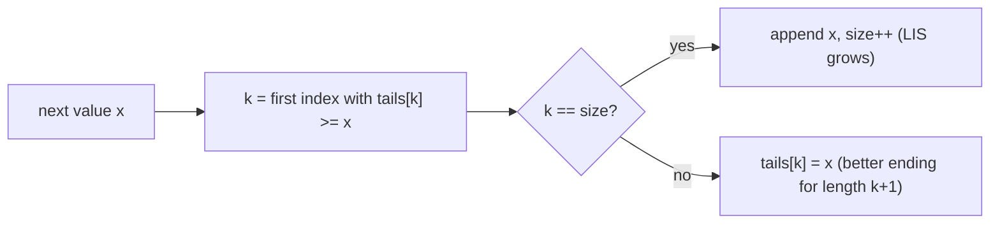

## Introduction

Here is a list of daily closing prices: `10, 9, 2, 5, 3, 7, 101, 18`. Pick some of the days, keeping them in calendar order, so that every picked price is strictly higher than the one before. How many days can you pick? You could pick `2, 5, 7, 101`, or `2, 3, 7, 18` — four days. No choice of five works.

That is the **longest increasing subsequence (LIS)** problem. A **subsequence** is what remains when you delete any elements of a sequence without reordering the rest; "increasing" means every kept element is strictly larger than the previous one (the variant that allows equal neighbours is called **non-decreasing**, and you will see how to switch between them). The answer is the *length* of the longest such subsequence, and sometimes the subsequence itself.

LIS is worth studying carefully for three reasons. It is the cleanest example of the **"ending at i"** style of dynamic programming state, which you will reuse for many chain-like problems. Its fast O(n log n) solution is one of the most common interview follow-ups, because it combines a DP insight with [[a3-binary-search]]. And a surprising number of problems — nesting envelopes, stacking boxes, minimum deletions to sort an array, chaining intervals — turn into LIS once you sort or transform the input correctly.

## Before you start

- **The five decisions of a DP** — [[a11-memoization]]. That lesson teaches how to turn a recursion into a DP by fixing (1) the state, (2) the recurrence, (3) the base cases, (4) the order of computation and (5) where the answer lives. This lesson applies those steps; it does not re-teach them.
- **Subsequences in general** — [[a11-subsequences]] explains what a subsequence is and the main state shapes for "keep order, skip allowed" problems. LIS is the flagship of the "ending at i" shape.
- **Lower and upper bound** — [[a3-lower-upper-bounds]]. The fast algorithm is one lower-bound search per element.
- **Recursion and Big-O** — [[a1-recursion]] and [[a1-big-o]].

## The intuition

Imagine walking along the array from left to right while building increasing chains. When you reach a value `x`, it can be appended to any chain whose last value is smaller than `x`. Which chain should it join? The longest one it is allowed to join, because that gives the longest chain ending at `x`.

That one observation is the whole O(n²) algorithm: the best chain ending at `x` is one longer than the best chain ending at any earlier, smaller value. The faster algorithm adds a second observation. If you have two chains of the same length, the one with the **smaller last value** is always at least as useful for the future, because anything that can extend the larger-ended chain can also extend the smaller-ended one. So for each length you only need to remember the smallest possible ending value. That shrinks what you track from "every chain" to "one number per length", and those numbers turn out to be sorted, which lets you binary search them.

## The naive approach: try every subsequence

An array of `n` elements has `2ⁿ` subsequences, because each element is either kept or dropped. Checking each one for being increasing takes O(n), so enumerating all of them is O(n · 2ⁿ). That is already about 20 million steps for `n = 20` and hopeless by `n = 40`.

A recursive brute force is more instructive, because it is the starting point for the DP. Walk through the array and, at each index, decide whether to skip or take the element. Taking is only allowed if the element is larger than the last one taken, so the recursion has to remember the index of that last taken element, `prev`:

```java title="LisRecursive.java"
public class LisRecursive {
    static long calls = 0;

    /** Longest strictly increasing subsequence of nums[i..] whose elements exceed nums[prev]. */
    static int best(int[] nums, int i, int prev) {
        calls++;
        if (i == nums.length) return 0;                    // nothing left to choose from
        int skip = best(nums, i + 1, prev);                // leave nums[i] out
        int take = 0;
        if (prev == -1 || nums[prev] < nums[i]) {          // nums[i] may follow nums[prev]
            take = 1 + best(nums, i + 1, i);
        }
        return Math.max(skip, take);
    }

    static Integer[][] memo;

    static int bestMemo(int[] nums, int i, int prev) {
        calls++;
        if (i == nums.length) return 0;
        // prev ranges over -1..n-1, so shift it by one to index the table
        if (memo[i][prev + 1] != null) return memo[i][prev + 1];
        int skip = bestMemo(nums, i + 1, prev);
        int take = 0;
        if (prev == -1 || nums[prev] < nums[i]) take = 1 + bestMemo(nums, i + 1, i);
        return memo[i][prev + 1] = Math.max(skip, take);
    }

    public static void main(String[] args) {
        int[] example = {10, 9, 2, 5, 3, 7, 101, 18};
        System.out.println("example answer = " + best(example, 0, -1));

        int[] sorted = new int[20];
        for (int k = 0; k < 20; k++) sorted[k] = k;        // every take is allowed: worst case
        calls = 0;
        System.out.println("brute: answer " + best(sorted, 0, -1) + ", calls " + calls);
        calls = 0;
        memo = new Integer[20][21];
        System.out.println("memo:  answer " + bestMemo(sorted, 0, -1) + ", calls " + calls);
    }
}
```

```output
example answer = 4
brute: answer 20, calls 2097151
memo:  answer 20, calls 421
```

On a sorted array of 20 elements every "take" is legal, so each call branches twice and the brute force makes `2²¹ − 1 = 2,097,151` calls. Yet the function only ever receives two changing arguments, `i` (0 to n) and `prev` (−1 to n − 1). There are at most about `n²` distinct pairs, so the same `(i, prev)` question is asked over and over. Caching the answer per pair — memoization — drops the work to 421 calls here and to O(n²) in general: about n² states, O(1) work each.

That memoized version is already a correct O(n²) solution, and in an interview it is a perfectly good first answer. But its state is awkward: a two-dimensional table indexed by `prev + 1`, and O(n²) memory. A better state exists, and finding it is the real skill.

## Deriving a better state: "ending at i"

Ask what the `prev` parameter is really doing. It records the last element of the chain built so far, because that is the only thing that limits what can come next. So make "the last element" part of the question itself:

> **State.** `dp[i]` = the length of the longest strictly increasing subsequence that **ends exactly at index `i`** (so `nums[i]` is its last element).

This is called an **"ending at i"** state. It differs from a **prefix** state ("the best answer among the first `i` elements") in a way that matters: a prefix state does not remember *which* value the best subsequence ends with, so it cannot tell whether `nums[i]` may be appended. Pinning the last element makes the extension rule checkable. You met the same move in [[a2-kadane]], where "best subarray ending at i" made the recurrence possible.

Now apply the remaining decisions.

**Recurrence.** Look at the element immediately before `nums[i]` in the best subsequence ending at `i`. Either there is none — the subsequence is `nums[i]` alone, length 1 — or it is some earlier index `j < i` with `nums[j] < nums[i]`. In the second case, the part ending at `j` should itself be as long as possible, which is `dp[j]`. So:

```text
dp[i] = 1 + max( dp[j] : j < i and nums[j] < nums[i] ),   or 1 if no such j exists
```

**Base case.** No separate base is needed: the "or 1" covers every index, including `i = 0`, which has no earlier `j`. That is why the code initialises `dp[i] = 1` before scanning.

**Order of computation.** `dp[i]` reads only `dp[j]` with `j < i`, so filling `i = 0, 1, 2, …` left to right guarantees every dependency is ready.

**Where the answer lives.** The longest subsequence must end *somewhere*, so the answer is `max(dp[i])` over all `i` — not `dp[n − 1]`. The last element of the array need not belong to any LIS (in `[1, 2, 0]`, it does not).

> [!IMPORTANT] "Ending at i" means the answer is a maximum
> Whenever the state pins the last element, the final answer is the best value over all possible last elements. Returning `dp[n - 1]` is the single most common LIS bug.

**Complexity.** There are `n` states, and computing state `i` scans `i` earlier indices, so the total work is `0 + 1 + … + (n − 1) = n(n − 1)/2`, which is **O(n²)** time. The table is **O(n)** space — better than the O(n²) memo of the `(i, prev)` version.

## The O(n²) algorithm with reconstruction

The program below computes `dp`, and also a `parent` array: `parent[i]` is the index `j` that gave `dp[i]` its value, or `-1` if `nums[i]` starts its subsequence. Following parents backwards from the best ending index recovers an actual LIS.

```java title="LisQuadratic.java"
import java.util.ArrayList;
import java.util.Arrays;
import java.util.Collections;
import java.util.List;

public class LisQuadratic {

    /** Returns one longest strictly increasing subsequence of nums. */
    static List<Integer> lis(int[] nums) {
        int n = nums.length;
        int[] dp = new int[n];       // dp[i] = length of the longest inc. subseq ending at i
        int[] parent = new int[n];   // index of the element before i in that subsequence
        int bestEnd = -1;
        for (int i = 0; i < n; i++) {
            dp[i] = 1;               // base: nums[i] on its own
            parent[i] = -1;
            for (int j = 0; j < i; j++) {
                if (nums[j] < nums[i] && dp[j] + 1 > dp[i]) {
                    dp[i] = dp[j] + 1;
                    parent[i] = j;
                }
            }
            if (bestEnd == -1 || dp[i] > dp[bestEnd]) bestEnd = i;
        }
        System.out.println("dp     = " + Arrays.toString(dp));
        System.out.println("parent = " + Arrays.toString(parent));

        List<Integer> seq = new ArrayList<>();
        for (int i = bestEnd; i != -1; i = parent[i]) seq.add(nums[i]);
        Collections.reverse(seq);    // we walked from the end back to the start
        return seq;
    }

    public static void main(String[] args) {
        int[] nums = {10, 9, 2, 5, 3, 7, 101, 18};
        List<Integer> seq = lis(nums);
        System.out.println("length = " + seq.size() + ", one LIS = " + seq);
        System.out.println(lis(new int[0]));
        System.out.println(lis(new int[] {7, 7, 7}));
    }
}
```

```output
dp     = [1, 1, 1, 2, 2, 3, 4, 4]
parent = [-1, -1, -1, 2, 2, 3, 5, 5]
length = 4, one LIS = [2, 5, 7, 101]
dp     = []
parent = []
[]
dp     = [1, 1, 1]
parent = [-1, -1, -1]
[7]
```

The edge cases behave correctly without special code. The empty array never enters the loop, `bestEnd` stays `-1`, and the reconstruction loop does not run. The array `[7, 7, 7]` gives length 1, because "strictly increasing" forbids equal neighbours.

### Dry run

Each row computes one `dp[i]`. The "candidates" column lists every earlier `j` with `nums[j] < nums[i]`, written as `value(dp[j])`.

| `i` | `nums[i]` | Candidates `j` | Best `dp[j]` | `dp[i]` | `parent[i]` |
|---|---|---|---|---|---|
| 0 | 10 | none | — | 1 | −1 |
| 1 | 9 | none (10 is not < 9) | — | 1 | −1 |
| 2 | 2 | none | — | 1 | −1 |
| 3 | 5 | 2(1) | 1 | 2 | 2 |
| 4 | 3 | 2(1) | 1 | 2 | 2 |
| 5 | 7 | 2(1), 5(2), 3(2) | 2 | 3 | 3 |
| 6 | 101 | 10(1), 9(1), 2(1), 5(2), 3(2), 7(3) | 3 | 4 | 5 |
| 7 | 18 | 10(1), 9(1), 2(1), 5(2), 3(2), 7(3) | 3 | 4 | 5 |

The maximum `dp` value is 4, first reached at `i = 6`. Following parents: 6 → 5 → 3 → 2 gives values `101, 7, 5, 2`, reversed to `[2, 5, 7, 101]`.

Two details in the code decide *which* LIS you get when there are several. At `i = 5`, both `j = 3` (value 5) and `j = 4` (value 3) give length 3; the strict `>` in `dp[j] + 1 > dp[i]` keeps the first one found, so the parent is 3. Likewise `bestEnd` keeps the first index with the maximum length. Any tie-breaking rule produces *a* correct LIS; if a problem asks for a specific one (for example, lexicographically smallest), the tie-breaking must be designed for it.

## The O(n log n) algorithm: keep only the best tail per length

The quadratic scan wastes effort. When `nums[i]` arrives, it compares itself with every earlier element, even though many of them are clearly useless. Consider two increasing subsequences of the same length, one ending in 5 and one ending in 3. Any future value that can extend the one ending in 5 (anything greater than 5) can also extend the one ending in 3. So, for the future, the subsequence ending in 3 **dominates**: we can forget the one ending in 5 without ever losing an answer.

That gives a much smaller summary of the past:

> **Invariant.** After processing a prefix of the array, `tails[k]` is the **smallest possible last value** of a strictly increasing subsequence of length `k + 1` within that prefix. The number of entries, `size`, is the length of the LIS of the prefix.

### Why tails is sorted

Claim: `tails[0] < tails[1] < … < tails[size − 1]`. Take an increasing subsequence of length `k + 2` that ends at `tails[k + 1]`. Drop its last element: what remains is an increasing subsequence of length `k + 1`, and its last value is strictly smaller than `tails[k + 1]`. Since `tails[k]` is the smallest last value over *all* subsequences of length `k + 1`, `tails[k]` is at most that value, so `tails[k] < tails[k + 1]`. Being sorted is what lets us binary search it.

### How one new value updates tails

A new value `x` can extend a subsequence of length `L` exactly when that subsequence can end in something smaller than `x` — that is, when `tails[L − 1] < x`. Because `tails` is sorted, the lengths that `x` can extend form a block at the front: all positions with `tails[k] < x`. Let `k` be the first position with `tails[k] >= x` — the **lower bound** of `x`.

- `x` extends the subsequence of length `k` (ending at `tails[k − 1] < x`), creating a subsequence of length `k + 1` that ends in `x`.
- If `k == size`, no subsequence of this length existed before, so `tails` grows by one.
- Otherwise `tails[k] >= x`, so `x` is a smaller (or equal) ending for length `k + 1`, and it replaces `tails[k]`.
- No other entry changes. For shorter lengths `j < k`, `tails[j] < x` already, so `x` is not an improvement. For longer lengths, `x` would need a predecessor of length `k + 1` ending below `x`, and `tails[k] >= x` says none exists.

So each element costs one binary search and one assignment. The proof above also shows why the replacement is safe even though it seems to "break" a subsequence: we are not editing a subsequence, we are recording that a *better-ending* subsequence of that length now exists.

```java title="LisFast.java"
import java.util.ArrayList;
import java.util.Arrays;
import java.util.Collections;
import java.util.List;

public class LisFast {

    /** First index k in tails[0..size) with tails[k] >= x (lower bound). */
    static int lowerBound(int[] tails, int size, int x) {
        int lo = 0, hi = size;                 // answer lies in [lo, hi]
        while (lo < hi) {
            int mid = lo + (hi - lo) / 2;
            if (tails[mid] < x) lo = mid + 1;  // tails[mid] can be extended by x
            else hi = mid;
        }
        return lo;
    }

    /** Length of the longest strictly increasing subsequence, O(n log n). */
    static int lengthOfLis(int[] nums, boolean trace) {
        int[] tails = new int[nums.length];
        int size = 0;
        for (int x : nums) {
            int k = lowerBound(tails, size, x);
            tails[k] = x;                      // extend (k == size) or improve a tail
            if (k == size) size++;
            if (trace) {
                System.out.printf("x=%-4d k=%d  tails=%s%n", x, k,
                        Arrays.toString(Arrays.copyOf(tails, size)));
            }
        }
        return size;
    }

    /** One actual LIS, still O(n log n): store indices of tails and a parent per element. */
    static List<Integer> reconstruct(int[] nums) {
        int n = nums.length;
        int[] tailIdx = new int[n];            // tailIdx[k] = index in nums of tails[k]
        int[] parent = new int[n];
        int size = 0;
        for (int i = 0; i < n; i++) {
            int lo = 0, hi = size;
            while (lo < hi) {
                int mid = lo + (hi - lo) / 2;
                if (nums[tailIdx[mid]] < nums[i]) lo = mid + 1;
                else hi = mid;
            }
            parent[i] = lo > 0 ? tailIdx[lo - 1] : -1;  // predecessor is the tail one shorter
            tailIdx[lo] = i;
            if (lo == size) size++;
        }
        List<Integer> seq = new ArrayList<>();
        for (int i = size == 0 ? -1 : tailIdx[size - 1]; i != -1; i = parent[i]) {
            seq.add(nums[i]);
        }
        Collections.reverse(seq);
        return seq;
    }

    public static void main(String[] args) {
        int[] nums = {10, 9, 2, 5, 3, 7, 101, 18};
        System.out.println("LIS length = " + lengthOfLis(nums, true));
        System.out.println("one LIS    = " + reconstruct(nums));

        int[] tricky = {3, 4, 5, 1};
        System.out.println("LIS length = " + lengthOfLis(tricky, true));
        System.out.println("one LIS    = " + reconstruct(tricky));
    }
}
```

```output
x=10   k=0  tails=[10]
x=9    k=0  tails=[9]
x=2    k=0  tails=[2]
x=5    k=1  tails=[2, 5]
x=3    k=1  tails=[2, 3]
x=7    k=2  tails=[2, 3, 7]
x=101  k=3  tails=[2, 3, 7, 101]
x=18   k=3  tails=[2, 3, 7, 18]
LIS length = 4
one LIS    = [2, 3, 7, 18]
x=3    k=0  tails=[3]
x=4    k=1  tails=[3, 4]
x=5    k=2  tails=[3, 4, 5]
x=1    k=0  tails=[1, 4, 5]
LIS length = 3
one LIS    = [3, 4, 5]
```

For the running example, read the trace as a dry run. `10`, `9` and `2` each have lower bound 0, so each in turn becomes a better length-1 ending. `5` extends length 1 to length 2. `3` has lower bound 1 (the first tail `>= 3` is 5), so it replaces 5 as the best length-2 ending — which is exactly why the later `7` can extend it. `101` creates length 4, and `18` replaces it as a better length-4 ending. Four entries, so the LIS length is 4.

The second input, `[3, 4, 5, 1]`, deserves a table, because its last step is where most people's intuition breaks:

| `x` | `k` (lower bound) | `tails` after | Meaning |
|---|---|---|---|
| 3 | 0 | `[3]` | best length-1 ending is 3 |
| 4 | 1 | `[3, 4]` | 4 extends length 1 |
| 5 | 2 | `[3, 4, 5]` | 5 extends length 2 |
| 1 | 0 | `[1, 4, 5]` | 1 is a better length-1 ending |

### tails is not an LIS

The final `tails` for `[3, 4, 5, 1]` is `[1, 4, 5]`. Its *length* is the LIS length, 3, but `1, 4, 5` is not a subsequence of the input at all: `1` comes after `4` and `5`. Each entry of `tails` belongs to a possibly different subsequence — `tails[0] = 1` is the best length-1 ending, `tails[2] = 5` is the best length-3 ending — and they are not one chain. If you need the sequence itself, you must record predecessors.

The `reconstruct` method does that by storing indices instead of values. When element `i` lands at position `lo`, the subsequence it ends is "the best subsequence of length `lo`, followed by `nums[i]`", so its predecessor is whatever index sits at `tailIdx[lo − 1]` *at that moment*. Later replacements in `tailIdx` do not affect `parent[i]`, which was fixed when `i` was processed. At the end, walking parents from `tailIdx[size − 1]` produces a valid LIS: `[2, 3, 7, 18]` for the example, a different but equally long answer than the quadratic version found.

### Complexity

Each of the `n` elements does one binary search over at most `n` entries, O(log n), plus O(1) work: **O(n log n)** time. `tails` (or `tailIdx` and `parent`) take **O(n)** space. For `n = 100,000`, that is roughly 1.7 million comparisons instead of about 5 billion for the quadratic scan.

### The patience sorting picture

The same algorithm has a well-known card-game description. Deal the values one at a time as cards. Each card goes on the **leftmost pile whose top card is greater than or equal to it**; if no pile qualifies, start a new pile on the right. The pile tops, read left to right, are exactly `tails`, and the number of piles is the LIS length. The game is called **patience sorting**, and it is a helpful way to remember the update rule: "place on the leftmost pile you can" is the lower-bound search, and "new pile" is `size++`.



## Strictly increasing versus non-decreasing

The binary search decides which variant you solve.

- **Strictly increasing** (`a < b < c`): use the **lower bound** — the first `tails[k] >= x`. An equal value replaces the existing tail instead of extending it, so duplicates never lengthen the subsequence.
- **Non-decreasing** (`a <= b <= c`): use the **upper bound** — the first `tails[k] > x`. An equal value is allowed to extend, so it lands *after* existing copies.

On `[2, 2, 2]`, lower bound gives 1 and upper bound gives 3. The only code change is `tails[mid] < x` becoming `tails[mid] <= x`. In the O(n²) version the corresponding change is `nums[j] < nums[i]` becoming `nums[j] <= nums[i]`.

> [!TIP] Using `Arrays.binarySearch` safely
> For the strict version you can use `Arrays.binarySearch(tails, 0, size, x)`. It returns the index of `x` if present, otherwise `-(insertionPoint) - 1`, so `k = idx >= 0 ? idx : -(idx + 1)`. This is correct only because a strictly increasing `tails` has no duplicates, so "an index of `x`" is the lower bound. For the non-decreasing version `tails` can contain repeats, `binarySearch` may return any of them, and you must write the upper-bound loop yourself.

## Counting the longest increasing subsequences

"How many LIS are there?" needs more than lengths. Extend the "ending at i" state with a second array:

- `len[i]` — the length of the longest increasing subsequence ending at `i` (the old `dp[i]`).
- `cnt[i]` — how many different subsequences ending at `i` have that length.

For each valid predecessor `j` (`nums[j] < nums[i]`), compare `len[j] + 1` with the best length so far. If it is longer, it is a new best and `cnt[i]` *resets* to `cnt[j]`. If it ties, it is another route to the same length and `cnt[i]` *adds* `cnt[j]`. The base is `len[i] = 1, cnt[i] = 1` (the element alone). The answer sums `cnt[i]` over all `i` whose `len[i]` equals the overall maximum.

```java title="NumberOfLis.java"
import java.util.Arrays;

public class NumberOfLis {

    /** How many strictly increasing subsequences have the maximum length. */
    static int findNumberOfLis(int[] nums) {
        int n = nums.length;
        int[] len = new int[n];   // len[i]: longest inc. subseq ending at i
        int[] cnt = new int[n];   // cnt[i]: how many subsequences ending at i have length len[i]
        for (int i = 0; i < n; i++) {
            len[i] = 1;
            cnt[i] = 1;
            for (int j = 0; j < i; j++) {
                if (nums[j] >= nums[i]) continue;
                if (len[j] + 1 > len[i]) {        // strictly better: replace the count
                    len[i] = len[j] + 1;
                    cnt[i] = cnt[j];
                } else if (len[j] + 1 == len[i]) { // another way to reach the same length
                    cnt[i] += cnt[j];
                }
            }
        }
        int best = Arrays.stream(len).max().orElse(0);
        int total = 0;
        for (int i = 0; i < n; i++) if (len[i] == best) total += cnt[i];
        return total;
    }

    public static void main(String[] args) {
        System.out.println(findNumberOfLis(new int[] {1, 3, 5, 4, 7}));
        System.out.println(findNumberOfLis(new int[] {2, 2, 2, 2, 2}));
        System.out.println(findNumberOfLis(new int[] {10, 9, 2, 5, 3, 7, 101, 18}));
    }
}
```

```output
2
5
4
```

For `[1, 3, 5, 4, 7]` the arrays end as `len = [1, 2, 3, 3, 4]` and `cnt = [1, 1, 1, 1, 2]`: the value 7 can follow either 5 or 4, both at length 3, so its count is 1 + 1. The two answers are `1, 3, 5, 7` and `1, 3, 4, 7`. For five equal values every single element is a longest strictly increasing subsequence, so the count is 5. For the running example the four answers are `2, 5, 7, 101`, `2, 5, 7, 18`, `2, 3, 7, 101` and `2, 3, 7, 18`.

The counts can grow exponentially with `n`, so on unrestricted input use `long` or a modulus such as 10⁹ + 7 (see [[a1-java-syntax-competitive]]); the classic interview version guarantees the answer fits in an `int`. Counting is O(n²). An O(n log n) count exists — process values in sorted order with a [[a12-fenwick]] or [[a12-segment-trees|segment tree]] indexed by position that stores (best length, count) pairs — but it is an advanced follow-up, not an expected first answer.

## Problems that are LIS in disguise

### Longest decreasing and bitonic subsequences

A **longest decreasing subsequence** is an LIS with the comparison reversed — or an LIS of the negated array (beware `Integer.MIN_VALUE`, whose negation overflows), or an LIS of the array read backwards.

A **bitonic** subsequence rises and then falls, like `1, 4, 6, 5, 2`. Compute `inc[i]`, the LIS ending at `i` (scanning left to right), and `dec[i]`, the longest decreasing subsequence *starting* at `i` (an LIS ending at `i` when scanning right to left). A bitonic subsequence peaking at `i` has length `inc[i] + dec[i] − 1`, because the peak is counted in both. Take the maximum over `i`.

### Minimum deletions to make an array sorted

Deleting the fewest elements so the rest is strictly increasing is the same as *keeping* the most elements in increasing order, so the answer is `n − LIS`. Be precise about "sorted": if equal neighbours are allowed (non-decreasing order), the answer is `n −` the longest **non-decreasing** subsequence. On `[1, 2, 2, 3]`, the strict LIS is 3 but nothing needs deleting for non-decreasing order.

### Russian Doll Envelopes

Each envelope has a width and a height, and one fits inside another only if *both* are strictly smaller. What is the longest nesting chain? This is LIS in two dimensions. Sort by width so that any chain must move left to right; then the chain is an increasing subsequence of heights. The catch is envelopes with **equal widths**, which cannot nest. If equal-width envelopes were sorted by height ascending, `(1,1), (1,2), (1,3)` would give heights `1, 2, 3` and a wrong answer of 3. Sorting equal widths by height **descending** turns them into `3, 2, 1`, a decreasing run that a strictly increasing subsequence can use at most once.

```java title="Envelopes.java"
import java.util.Arrays;

public class Envelopes {

    static int maxEnvelopes(int[][] env) {
        // Width ascending; for equal widths, height DESCENDING so that two envelopes of the
        // same width can never both appear in an increasing run of heights.
        Arrays.sort(env, (a, b) -> a[0] != b[0] ? Integer.compare(a[0], b[0])
                                                : Integer.compare(b[1], a[1]));
        int[] tails = new int[env.length];
        int size = 0;
        for (int[] e : env) {
            int h = e[1];
            int lo = 0, hi = size;
            while (lo < hi) {
                int mid = lo + (hi - lo) / 2;
                if (tails[mid] < h) lo = mid + 1; else hi = mid;
            }
            tails[lo] = h;
            if (lo == size) size++;
        }
        return size;
    }

    public static void main(String[] args) {
        System.out.println(maxEnvelopes(new int[][] {{5, 4}, {6, 4}, {6, 7}, {2, 3}}));
        System.out.println(maxEnvelopes(new int[][] {{1, 1}, {1, 2}, {1, 3}}));
    }
}
```

```output
3
1
```

For the first input, sorting gives `(2,3), (5,4), (6,7), (6,4)`, heights `3, 4, 7, 4`, and the LIS of heights is 3: `(2,3) → (5,4) → (6,7)`. The whole solution is O(n log n): one sort plus the tails algorithm.

### Maximum length of pair chain

Given pairs `[a, b]` with `a < b`, a pair `[c, d]` can follow `[a, b]` when `b < c`. The longest chain is an "ending at i" DP after sorting by start: `dp[i] = 1 + max(dp[j])` over `j` with `pairs[j][1] < pairs[i][0]`. That is O(n²).

This particular problem also has a greedy solution: sort by *end* and repeatedly take the pair that finishes earliest among those that fit. That is the interval-scheduling argument from [[a10-sorting-greedy]] — finishing earliest leaves the most room for the rest — and it runs in O(n log n). Both give the same answer:

```java title="PairChain.java"
import java.util.Arrays;

public class PairChain {

    /** DP view: sort by start, then LIS-style "ending at i" with condition a[j][1] < a[i][0]. */
    static int chainDp(int[][] pairs) {
        int[][] p = pairs.clone();
        Arrays.sort(p, (a, b) -> Integer.compare(a[0], b[0]));
        int n = p.length, best = 0;
        int[] dp = new int[n];
        for (int i = 0; i < n; i++) {
            dp[i] = 1;
            for (int j = 0; j < i; j++) {
                if (p[j][1] < p[i][0]) dp[i] = Math.max(dp[i], dp[j] + 1);
            }
            best = Math.max(best, dp[i]);
        }
        return best;
    }

    /** Greedy view: sort by end, always take the pair that finishes earliest. */
    static int chainGreedy(int[][] pairs) {
        int[][] p = pairs.clone();
        Arrays.sort(p, (a, b) -> Integer.compare(a[1], b[1]));
        int count = 0;
        long lastEnd = Long.MIN_VALUE;
        for (int[] q : p) {
            if (q[0] > lastEnd) {
                count++;
                lastEnd = q[1];
            }
        }
        return count;
    }

    public static void main(String[] args) {
        int[][] pairs = {{1, 2}, {7, 8}, {4, 5}, {2, 3}};
        System.out.println(chainDp(pairs) + " " + chainGreedy(pairs));
    }
}
```

```output
3 3
```

The lesson to take away is not "always use greedy": the greedy works here because every pair counts equally. Give the pairs weights and ask for the heaviest chain, and the greedy breaks while the DP needs only `max` replaced by a weighted sum. See [[a10-local-vs-global]] for how to tell the two situations apart.

### Not LIS: the longest increasing subarray

"Longest increasing **subarray**" (or "continuous increasing subsequence") requires the elements to be adjacent. That is a single O(n) pass: extend the current run while `nums[i] > nums[i − 1]`, otherwise restart at length 1. Applying the LIS algorithm here gives answers that are too large, because it allows gaps.

```quiz
Q: After processing a prefix, tails = [2, 5, 9]. The next value is 6. What is tails afterwards, for a strictly increasing LIS?
- [ ] [2, 5, 9, 6]
- [ ] [2, 5, 6, 9]
- [x] [2, 5, 6]
- [ ] [2, 6, 9]
> The lower bound of 6 is index 2 (the first tail >= 6 is 9). 6 extends the length-2 subsequence ending in 5, giving a length-3 subsequence ending in 6, which beats the old best length-3 ending of 9. Only that entry changes; tails stays sorted and the length stays 3. Appending would break the sorted order, and inserting would add a length that does not exist.

Q: For the array [3, 4, 5, 1], tails ends as [1, 4, 5]. What does this tell you?
- [ ] The LIS is 1, 4, 5
- [x] The LIS has length 3, but the entries of tails need not form a subsequence together
- [ ] The algorithm has a bug, because 1 appears after 5 in the input
- [ ] The LIS has length 1
> Each tails[k] is the best ending for its own length, possibly from a different subsequence. Their count is the LIS length, but 1 comes after 4 and 5 in the input, so 1, 4, 5 is not a subsequence. To recover a real LIS, store indices and parent pointers.

Q: Envelopes are sorted by width ascending. Why sort equal widths by height descending before running LIS on heights?
- [ ] It makes the binary search faster
- [x] It stops two envelopes of the same width from both being chosen, because their heights then form a decreasing run
- [ ] It is needed only when all widths are distinct
- [ ] Heights must always be sorted descending for LIS to work
> Envelopes with equal width cannot nest. With heights descending inside each width group, a strictly increasing subsequence can pick at most one envelope from the group. With ascending heights, (1,1), (1,2), (1,3) would wrongly produce a chain of 3.
```

## Checking against brute force

A fast algorithm with a clever invariant deserves a test that does not trust the invariant. The program below generates 2,000 random arrays (lengths 0 to 12, values 0 to 7 so that duplicates are common), computes the answers by enumerating all `2ⁿ` subsequences, and compares them with the fast length, the reconstructed sequence, the non-decreasing variant and the count of LIS. Compile it in the same directory as `LisFast.java` and `NumberOfLis.java`.

```java title="LisCrossCheck.java"
import java.util.Arrays;
import java.util.List;
import java.util.Random;

public class LisCrossCheck {

    // Brute force: try all 2^n subsets of indices, keep those that are increasing.
    // strict = true checks a[j] < a[k]; false checks a[j] <= a[k].
    static int[] brute(int[] a, boolean strict) {
        int n = a.length, best = 0, ways = 0;
        for (int mask = 1; mask < (1 << n); mask++) {
            int prev = -1, len = 0;
            boolean ok = true;
            for (int i = 0; i < n && ok; i++) {
                if ((mask >> i & 1) == 0) continue;
                if (prev != -1 && (strict ? a[prev] >= a[i] : a[prev] > a[i])) ok = false;
                prev = i;
                len++;
            }
            if (!ok) continue;
            if (len > best) { best = len; ways = 1; }
            else if (len == best) ways++;
        }
        return new int[] {best, ways};
    }

    // O(n log n) for non-decreasing: upper bound (first tail > x) instead of lower bound.
    static int nonDecreasing(int[] a) {
        int[] tails = new int[a.length];
        int size = 0;
        for (int x : a) {
            int lo = 0, hi = size;
            while (lo < hi) {
                int mid = lo + (hi - lo) / 2;
                if (tails[mid] <= x) lo = mid + 1; else hi = mid;
            }
            tails[lo] = x;
            if (lo == size) size++;
        }
        return size;
    }

    static boolean validLis(int[] a, List<Integer> seq) {
        int pos = 0;                       // seq must be a subsequence of a ...
        for (int i = 0; i < a.length && pos < seq.size(); i++) if (a[i] == seq.get(pos)) pos++;
        if (pos != seq.size()) return false;
        for (int i = 1; i < seq.size(); i++) if (seq.get(i - 1) >= seq.get(i)) return false;
        return true;                       // ... and strictly increasing
    }

    public static void main(String[] args) {
        Random rnd = new Random(42);
        int tests = 2000;
        for (int t = 0; t < tests; t++) {
            int n = rnd.nextInt(13);                 // includes the empty array
            int[] a = new int[n];
            for (int i = 0; i < n; i++) a[i] = rnd.nextInt(8);   // small range forces duplicates
            int[] strict = brute(a, true);
            int[] loose = brute(a, false);
            int fast = LisFast.lengthOfLis(a, false);
            List<Integer> seq1 = LisFast.reconstruct(a);
            int count = NumberOfLis.findNumberOfLis(a);
            if (fast != strict[0] || seq1.size() != strict[0] || !validLis(a, seq1)
                    || nonDecreasing(a) != loose[0]
                    || (n > 0 && count != strict[1])) {
                System.out.println("MISMATCH on " + Arrays.toString(a));
                return;
            }
        }
        System.out.println("random tests passed: " + tests);
    }
}
```

```output
random tests passed: 2000
```

The brute force counts subsequences by *index set*, so two subsequences with the same values at different positions count separately — the same convention `findNumberOfLis` uses. The fixed seed `42` makes any failure reproducible; when a mismatch appears, the printed array is small enough to trace by hand. The envelope sort and the pair-chain greedy were checked the same way against O(n²) DPs on 3,000 random inputs.

## In real systems

**Diff tools.** Git's `--patience` diff option is built on this algorithm. It finds lines that appear exactly once in both versions of a file, pairs them up, and keeps the longest set of pairs that appear in the same order in both files — an LIS over the line positions. Those anchors produce diffs that line up with function boundaries better than the default algorithm in some files.

**Sequence alignment.** In genome alignment, tools first find short exact matches ("anchors") between two sequences, then keep the largest set of anchors that are in increasing order in both sequences. That **chaining** step is a weighted LIS, usually solved with the same sorted-structure ideas.

**Ranking and data quality.** "What is the longest run of records whose timestamps are consistent with their sequence numbers?" is an LIS question, and `n − LIS` is the minimum number of records that must be considered out of order.

## Trade-offs and alternatives

| Approach | Time | Space | Gives the sequence? | Use when |
|---|---|---|---|---|
| Brute force over subsets | O(n · 2ⁿ) | O(n) | Yes | `n` ≤ about 20, or as a test oracle |
| Memoized `(i, prev)` | O(n²) | O(n²) | With extra work | Fastest to derive from the recursion |
| "Ending at i" DP | O(n²) | O(n) | Yes, with parents | `n` up to a few thousand; counting; custom comparisons |
| Tails + binary search | O(n log n) | O(n) | Yes, with indices and parents | Large `n`; envelope-style problems |
| Fenwick / segment tree over values | O(n log n) | O(n) | Yes | Counting LIS fast, or weighted LIS |

The O(n²) version is more flexible. Its inner loop can test any compatibility condition — "box `j` fits under box `i`", "pair `j` ends before pair `i` starts" — and can maximise any score, not only length. The tails algorithm relies on the condition being a single comparison on one sortable key, which is why two-dimensional problems need the sorting trick before they can use it.

## Common mistakes

> [!MISTAKE] Sorting the array first
> Sorting destroys the original order, and order is the whole constraint. The LIS of a sorted array is the number of distinct values, which has nothing to do with the original question. Sorting is legitimate only when one dimension *is* the order, as with envelope widths.

**Returning `dp[n − 1]`.** With an "ending at i" state, the answer is the maximum over all `dp[i]`.

**Wrong comparison for duplicates.** `<` versus `<=` in the O(n²) loop, and lower versus upper bound in the fast loop, decide strict versus non-decreasing. Check the problem statement and test with `[2, 2, 2]`.

**Treating `tails` as the answer sequence.** Its length is right; its contents generally are not one subsequence. Use indices and parents.

**Forgetting the tie case when counting.** In Number of LIS, a tie must *add* counts and a strictly longer path must *reset* them. Adding in both cases overcounts; resetting in both undercounts.

**Ascending heights in Russian Doll Envelopes.** Equal widths then chain together. Sort equal widths by height descending.

## Interview perspective

Interviewers usually want to see the progression: brute force, the O(n²) DP with a clearly stated state, then the O(n log n) improvement with a reason why it is correct.

> [!INTERVIEW] What a strong answer sounds like
> "Let `dp[i]` be the longest increasing subsequence that ends at index `i`. Its previous element is some `j < i` with a smaller value, so `dp[i]` is one plus the best such `dp[j]`, or 1 alone. The answer is the max over all `i`, O(n²). To speed it up, I notice that for each length only the smallest ending value matters, because it can be extended by anything the larger ones can. Those smallest endings are strictly increasing, so for each new value I binary search the first ending that is not smaller and replace it. That's O(n log n), and the number of endings is the answer."

Questions to prepare for:

- **Prove `tails` is sorted.** Drop the last element of the best subsequence of length `k + 2`; the remainder has length `k + 1` and a smaller ending.
- **Why is replacing safe?** It records a better ending for that length; it never claims the old subsequence changed.
- **Print the LIS in O(n log n).** Store tail indices and a parent for each element.
- **Non-decreasing version?** Upper bound instead of lower bound.
- **Russian Doll Envelopes.** Width ascending, height descending for ties, LIS on heights.
- **How many LIS?** Pair a count with each length; reset on longer, add on ties.

## Practice

1. **LIS length** in O(n²), then in O(n log n). Test both on `[0, 1, 0, 3, 2, 3]` (answer 4) and `[7, 7, 7, 7]` (answer 1).
2. **Print one LIS** with the O(n log n) method and check it is a real subsequence.
3. **Longest non-decreasing subsequence**: change one comparison and verify on `[1, 2, 2, 3]` (answer 4).
4. **Number of Longest Increasing Subsequence**, then explain why ties add and improvements reset.
5. **Russian Doll Envelopes**, and write down a three-envelope input where the ascending-height sort fails.
6. **Longest bitonic subsequence** using `inc[i] + dec[i] − 1`.
7. **Largest Divisible Subset**: the same "ending at i" DP after sorting, with `nums[i] % nums[j] == 0` as the compatibility test.

The DSA explorer lists the matching problems under this topic; start with *Longest Increasing Subsequence*, *Number of Longest Increasing Subsequence*, *Russian Doll Envelopes* and *Maximum Length of Pair Chain*.

## Quick revision {#quick-revision}

- LIS: longest strictly increasing subsequence (order kept, gaps allowed). Brute force O(n · 2ⁿ).
- State: `dp[i]` = longest increasing subsequence **ending at `i`**. Recurrence `dp[i] = 1 + max(dp[j])` for `j < i`, `nums[j] < nums[i]`; else 1. Order: left to right. Answer: `max(dp)`. O(n²) time, O(n) space.
- Reconstruct with `parent[i]` = the `j` that gave `dp[i]`; walk back from the best end and reverse.
- Fast version: `tails[k]` = smallest ending of an increasing subsequence of length `k + 1`; strictly increasing; `size` = LIS length.
- For each `x`: `k` = lower bound (first `tails[k] >= x`); `tails[k] = x`; if `k == size`, `size++`. O(n log n).
- Strict → lower bound (`<`); non-decreasing → upper bound (`<=`).
- `tails` is not an LIS (`[3, 4, 5, 1]` → `[1, 4, 5]`); reconstruct with tail indices + parents.
- Count LIS: `len[i]`, `cnt[i]`; longer → reset count, tie → add count; sum counts at max length.
- Disguises: decreasing (flip comparison), bitonic (`inc + dec − 1`), min deletions (`n − LIS`, or `n −` non-decreasing LIS), envelopes (width asc, height desc, LIS on heights), pair chain (DP or greedy by end).

## Key takeaways {#key-takeaways}

- The "ending at i" state makes the extension rule checkable because it pins the last element; its answer is the maximum over all `i`.
- The O(n log n) algorithm rests on dominance: for each length, only the smallest ending value can matter in the future.
- `tails` is sorted, which is what makes binary search possible, and its size is the LIS length — but its contents are not a subsequence.
- Lower bound gives strictly increasing; upper bound gives non-decreasing.
- Many chain, nesting and deletion problems become LIS after the right sort or transformation; the O(n²) version handles arbitrary compatibility tests that the fast version cannot.
- Test clever LIS code against an exhaustive search on small random arrays with many duplicates.
