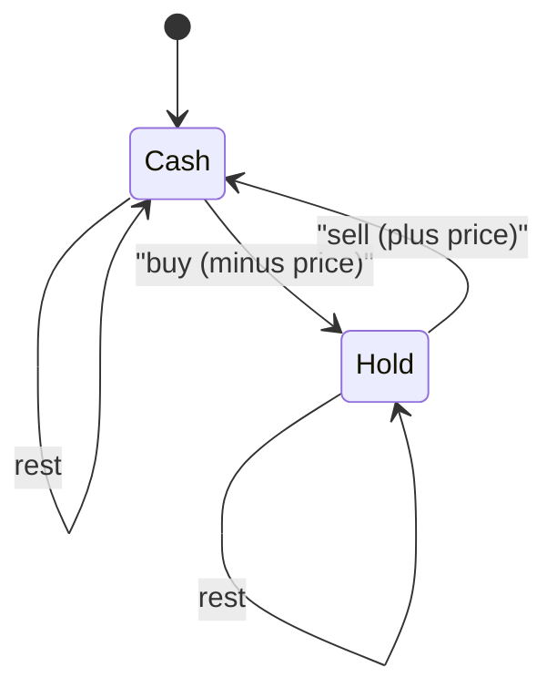
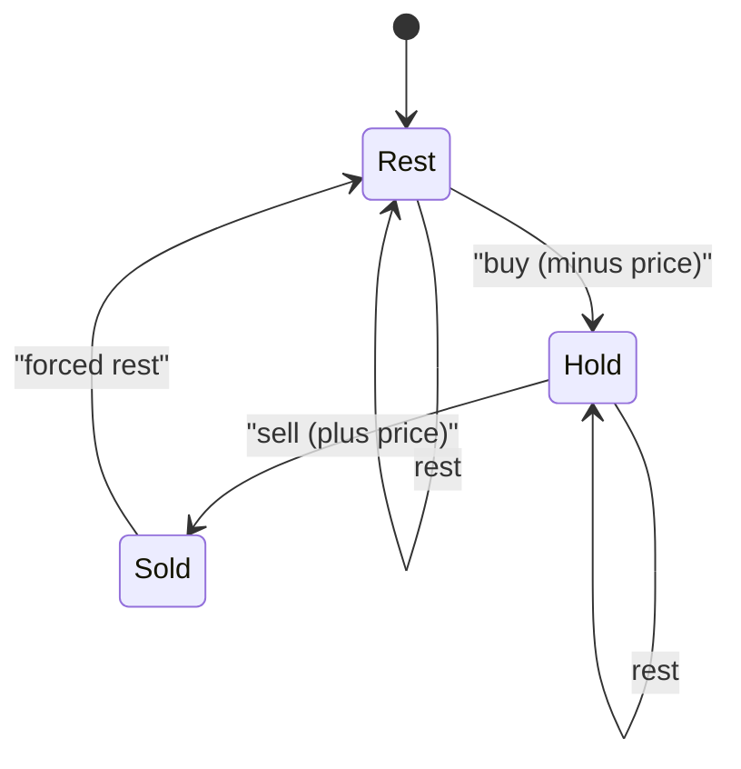

## Introduction

You are given a stock's price for each of `n` days. You may buy and sell, holding at most one share at a time. How much profit can you make? The answer depends on the rules. With one transaction it is a single scan. With unlimited transactions it is the sum of every price rise. But add "after selling you must wait a day", or "each trade costs a fee", or "at most two transactions", and the simple tricks stop working. Each rule seems to need a new idea.

It does not. All of these problems share one structure: on each day you are in one of a few **modes** — holding a share, not holding, cooling down, having used `t` transactions — and the rules say which modes you can move between and what each move earns. Draw those modes as a small **state machine**, keep the best profit for each mode after each day, and update every mode from the modes that can lead into it. That is **state-machine DP**.

The pattern reaches well beyond stocks. Any sequential process with a small amount of memory about the past fits: "no two adjacent houses robbed" is a two-mode machine (robbed the last house or not), "never three late days in a row" is a machine whose mode counts the current run of late days, and "swap pairs so both sequences increase" is a machine with modes "swapped here" and "not swapped here". Protocol parsers, regular-expression engines and game AI all use state machines; state-machine DP is what you get when you add an optimisation or a count on top of one.

## Before you start

You should already know:

- **1D DP** — a value per position computed from earlier positions, including House Robber. See [[a11-1d-dp]].
- **Memoization versus tabulation, and rolling variables** for saving memory. See [[a11-memoization]] and [[a11-tabulation]].
- **Kadane's algorithm**, whose "best ending here" idea solves the single-transaction stock problem. See [[a2-kadane]].
- **Modular arithmetic** for counting problems with large answers. See [[a1-java-syntax-competitive]].

## The intuition: what does tomorrow's decision depend on?

Imagine you are the trader on day `i`. To decide what you are *allowed* to do today, you do not need your entire trading history. You need to know only a few facts: do you currently hold a share (you cannot buy if you do, or sell if you do not)? Did you sell yesterday (if there is a cooldown)? How many transactions have you used (if there is a limit)? Everything else about the past — which days you traded, at what prices — matters only through the profit it produced.

So the past can be compressed into a pair: **(mode, best profit so far in that mode)**. Two histories that end in the same mode face exactly the same future options, so only the more profitable one is worth remembering. That is the optimal-substructure argument for state-machine DP, and it tells you how to choose the modes: **a mode must capture everything about the past that affects what you may do in the future**, and nothing more.

## The naive approach

Each day you can buy, sell or do nothing, so there are up to 3ⁿ action sequences. Simulating each one and discarding illegal ones costs O(3ⁿ · n). Thirty days already gives about 2 × 10¹⁴ sequences. Even a smarter recursion that tries "act or do nothing" at each day is exponential without memory, because the same situation — "day 17, not holding, one transaction left" — is reached by many different histories. There are only `n` days times a handful of modes, so there are only that many genuinely different situations.

## The method in four steps

1. **List the modes.** Ask what today's legal actions depend on.
2. **Draw the transitions.** For each mode, which modes can it move to in one day, and what does the move earn or cost?
3. **Write one recurrence per mode.** The value of mode `X` after day `i` is the best over all arrows *into* `X` of (value of the source mode after day `i - 1`) + (what the arrow earns).
4. **Set base values and read the answer.** Before day 0, the starting mode has value 0 and every mode you cannot be in has value −∞. The answer is the best among the modes you may end in.

This is the same state, recurrence, base, order checklist used throughout this module ([[a11-lcs]], [[a11-grid-dp]]); here the state is `(day, mode)`, and the order is day by day.

## Unlimited transactions: two modes

*Buy and sell as often as you like, holding at most one share. Maximise profit.*

**Modes.** Today's options depend only on whether you hold a share. So there are two modes: `cash` (not holding) and `hold` (holding one share). Their values are the best total profit so far, where buying subtracts the price and selling adds it — so `hold` is usually negative, meaning "money spent on the share I still own".

**Transitions.**



**Recurrences**, for a day with price `p`:

```text
hold' = max(hold, cash - p)     keep holding, or buy today
cash' = max(cash, hold + p)     keep waiting, or sell today
```

**Base.** Before day 0 you have no share and no profit: `cash = 0`. Holding is impossible, so `hold = −∞`. Do **not** start `hold` at 0 — that would mean "I own a share that cost nothing", and the DP would happily sell it for pure profit.

**Answer.** `cash` after the last day. Ending in `hold` is never better, since the share was paid for and never sold.

On `[7, 1, 5, 3, 6, 4]` this gives 7: buy at 1, sell at 5, buy at 3, sell at 6. For this particular variant a greedy shortcut exists — add up every positive day-to-day difference — and it gives the same answer, because any rising run can be split into one-day trades without loss. The value of the state machine is that it keeps working when the shortcut stops working.

## Cooldown: a third mode

*Same as above, but after selling you cannot buy on the next day.*

**Modes.** Now "not holding" splits into two situations with different futures: you sold *today* (tomorrow you may not buy), or you have been free for at least a day (tomorrow you may buy). So there are three modes: `hold`, `sold` (sold today) and `rest` (not holding, free to buy).

**Transitions.**



Notice what is missing: there is no arrow from `Sold` to `Hold`. The cooldown rule *is* that missing arrow, and the whole difficulty of the problem has become a feature of the drawing.

**Recurrences.**

```text
hold' = max(hold, rest - p)     you may buy only from rest
sold' = hold + p                selling today
rest' = max(rest, sold)         idle, or yesterday's sale finishes its cooldown
```

**Base.** `rest = 0`, `hold = −∞`, `sold = −∞`. **Answer.** `max(sold, rest)` after the last day.

### Dry run

Prices `[1, 2, 3, 0, 2]`. "−∞" stands for the large negative sentinel.

| Day | Price | `hold` | `sold` | `rest` | What the best states mean |
|---|---|---|---|---|---|
| start | | −∞ | −∞ | 0 | nothing done |
| 0 | 1 | max(−∞, 0 − 1) = −1 | −∞ | 0 | bought at 1 |
| 1 | 2 | max(−1, 0 − 2) = −1 | −1 + 2 = 1 | max(0, −∞) = 0 | could sell for +1 |
| 2 | 3 | max(−1, 0 − 3) = −1 | −1 + 3 = 2 | max(0, 1) = 1 | could sell for +2 |
| 3 | 0 | max(−1, 1 − 0) = 1 | −1 + 0 = −1 | max(1, 2) = 2 | bought at 0 after a rest |
| 4 | 2 | max(1, 2 − 2) = 1 | 1 + 2 = 3 | max(2, −1) = 2 | sold at 2 |

The answer is `max(3, 2) = 3`: buy at 1, sell at 2, rest on day 2, buy at 0, sell at 2. Look at day 3: `hold` becomes 1 by buying from `rest = 1` (the profit of the first trade *after* its cooldown). It could not buy from day 2's `sold = 2`, because that sale was the day before. Without the cooldown, selling at 3 and buying at 0 would give 4; the rule costs one unit here, and the machine accounts for it without any special-case logic.

## A transaction fee: same machine, different weights

*Unlimited trades, but each completed transaction costs `fee`.* The modes and arrows are exactly those of the unlimited problem; only the arrow weights change. Charge the fee once per transaction, on the sale:

```text
hold' = max(hold, cash - p)
cash' = max(cash, hold + p - fee)
```

Charging it on the buy instead (`cash - p - fee`) is equally correct, as long as you charge exactly once. On `[1, 3, 2, 8, 4, 9]` with fee 2 the answer is 8: buy at 1, sell at 8 (gain 7 − 2 = 5), buy at 4, sell at 9 (gain 5 − 2 = 3). The greedy "sum every rise" shortcut fails here — it would pay the fee on every small rise.

## At most k transactions: modes that count

*At most `k` complete transactions (Stock I is `k = 1`, Stock III is `k = 2`).*

**Modes.** Now today's options also depend on how many transactions you have started. Define, for `t = 1 … k`:

- `buy[t]` = best profit while **holding**, having made the `t`-th buy;
- `sell[t]` = best profit while **not holding**, having completed `t` transactions.

`sell[0] = 0` is the starting mode. The modes form a chain: `sell[0] → buy[1] → sell[1] → buy[2] → … → sell[k]`, each with a self-loop for resting.

**Recurrences.**

```text
buy[t]'  = max(buy[t],  sell[t-1] - p)    start transaction t from t-1 completed
sell[t]' = max(sell[t], buy[t] + p)       complete transaction t
```

**Base.** `sell[t] = 0` for all `t` (doing nothing is allowed and earns 0); `buy[t] = −∞` (you cannot hold before buying). **Answer.** The largest `sell[t]`; with these base values it is always `sell[k]`, but taking the maximum is clearer.

**The k ≥ n/2 shortcut.** Every complete transaction uses a buy day and a later sell day, and you can act at most once per day, so at most `⌊n / 2⌋` transactions fit into `n` days. If `k ≥ n / 2`, the limit can never bind, and the problem is the unlimited one. This matters in practice: tests often give `k = 10⁹`, and allocating arrays of size `k` would fail.

## The Java implementation

```java title="StockDp.java"
import java.util.Arrays;

public class StockDp {

    static final int NEG = Integer.MIN_VALUE / 2;         // "impossible", safe to add a price to

    // unlimited transactions, hold at most one share
    static int unlimited(int[] prices) {
        int cash = 0, hold = NEG;                         // before day 0 you cannot hold a share
        for (int p : prices) {
            int newHold = Math.max(hold, cash - p);       // keep holding, or buy today
            int newCash = Math.max(cash, hold + p);       // keep waiting, or sell today
            hold = newHold;
            cash = newCash;
        }
        return cash;                                      // ending with a share is never better
    }

    // unlimited transactions, but after selling you must rest one day
    static int withCooldown(int[] prices) {
        int hold = NEG, sold = NEG, rest = 0;
        for (int p : prices) {
            int newHold = Math.max(hold, rest - p);       // buy only from rest, not from sold
            int newSold = hold + p;                       // sold today
            int newRest = Math.max(rest, sold);           // yesterday's sale finishes its cooldown
            hold = newHold;
            sold = newSold;
            rest = newRest;
        }
        return Math.max(sold, rest);
    }

    // unlimited transactions, each completed transaction costs a fee
    static int withFee(int[] prices, int fee) {
        int cash = 0, hold = NEG;
        for (int p : prices) {
            int newHold = Math.max(hold, cash - p);
            int newCash = Math.max(cash, hold + p - fee); // charge the fee once, on the sale
            hold = newHold;
            cash = newCash;
        }
        return cash;
    }

    // at most k transactions (k = 1 is Stock I, k = 2 is Stock III)
    static int atMostK(int k, int[] prices) {
        int n = prices.length;
        if (k >= n / 2) return unlimited(prices);         // the limit can never bind
        int[] buy = new int[k + 1], sell = new int[k + 1];
        Arrays.fill(buy, NEG);                            // buy[t]: holding, t-th buy done
        // sell[t]: not holding, t transactions completed (0 profit is always possible)
        for (int p : prices) {
            for (int t = k; t >= 1; t--) {                // high t first: reads yesterday's sell[t-1]
                sell[t] = Math.max(sell[t], buy[t] + p);
                buy[t] = Math.max(buy[t], sell[t - 1] - p);
            }
        }
        int best = 0;
        for (int t = 0; t <= k; t++) best = Math.max(best, sell[t]);
        return best;
    }

    public static void main(String[] args) {
        int[] a = {7, 1, 5, 3, 6, 4};
        System.out.println(atMostK(1, a) + " " + unlimited(a));
        int[] b = {3, 3, 5, 0, 0, 3, 1, 4};
        System.out.println(atMostK(2, b) + " " + unlimited(b));
        System.out.println(withCooldown(new int[]{1, 2, 3, 0, 2}));
        System.out.println(withFee(new int[]{1, 3, 2, 8, 4, 9}, 2));
        System.out.println(atMostK(2, new int[]{3, 2, 6, 5, 0, 3}));
        System.out.println(unlimited(new int[]{5, 4, 3}) + " " + unlimited(new int[]{}));
    }
}
```

```output
5 7
6 8
3
8
7
0 0
```

The first line contrasts one transaction (buy at 1, sell at 6: 5) with unlimited (7) on the same prices. The second shows Stock III: two transactions earn 6 (buy 0 sell 3, buy 1 sell 4), while unlimited earns 8. Falling prices and an empty array both give 0, because `cash` starts at 0 and never has to trade.

### Why the update order matters

Each recurrence is defined from the *previous day's* values. In `withCooldown`, if you overwrote `sold` in place and then computed `rest = max(rest, sold)`, a sale made *today* would already count as resting today, and tomorrow's `hold` could buy from it — exactly the trade the cooldown forbids. On `[1, 2, 3, 0, 2]` that version returns 4 instead of 3, because it sells at 3 and buys at 0 the next day. The `newX` temporaries make every recurrence read yesterday's values, which is always correct. Whenever you are unsure, use temporaries.

Sometimes in-place updates are provably harmless, and you will see them in published solutions. In `unlimited`, computing `hold` first and then `cash = max(cash, hold + p)` with the *new* `hold` means "buy and sell on the same day", which earns exactly 0 and therefore never changes the maximum. In `atMostK`, the inner loop runs `t` from `k` down to 1 and updates `sell[t]` before `buy[t]`, so `sell[t]` reads yesterday's `buy[t]` and `buy[t]` reads yesterday's `sell[t - 1]` (it has not been touched yet today). That is the same trick as iterating capacity downwards in 0/1 knapsack ([[a11-knapsack]]). Relying on such arguments is fine, but you must be able to state them.

### Sentinels

`NEG = Integer.MIN_VALUE / 2` represents −∞. Using `Integer.MIN_VALUE` itself would break `hold + p`: adding a positive price to the most negative `int` is fine, but in other variants you may subtract, and `Integer.MIN_VALUE - 1` wraps around to `Integer.MAX_VALUE`, which then wins every `max`. Halving leaves room for many additions and subtractions of prices.

### Complexity

Each variant processes each day once with a constant number of modes: **O(n) time and O(1) space** for unlimited, cooldown and fee. The `k`-transaction version has `2k` modes per day: **O(n · k) time and O(k) space**, or O(n) when the shortcut applies. A full `dp[day][mode]` table would use O(n · modes) memory; keeping only the current day is possible because each day reads only the previous one.

All four methods were stress-tested against a brute force that tries all 3ⁿ buy/sell/rest sequences and simulates the rules, on 3,000 random price lists of up to 8 days with random `k` and fees. There were no mismatches.

```quiz
Q: Why must `hold` start at negative infinity rather than 0 in the stock state machines?
- [ ] Because prices can be negative
- [x] Because before day 0 you cannot own a share; starting at 0 means owning a free share, which the DP would sell for profit
- [ ] Because Java initialises int to 0
- [ ] It does not matter as long as the answer reads cash
> A mode you cannot be in must never win a max. With hold = 0, selling at any price p gives profit p without ever paying for the share. Negative infinity makes the only way into hold a real purchase.

Q: In the cooldown machine, which missing transition encodes the rule "no buying the day after a sale"?
- [ ] Rest to Hold
- [ ] Hold to Sold
- [x] Sold to Hold
- [ ] Rest to Rest
> From Sold the only arrow is the forced move to Rest, so a buy can only happen from Rest, at least one day after the sale. Adding a Sold-to-Hold arrow would turn it back into the unlimited problem.

Q: Why can `atMostK` switch to the unlimited algorithm when k >= n / 2?
- [ ] Because larger k makes the problem greedy
- [x] Because each transaction needs a buy day and a later sell day, so at most n / 2 transactions fit and the limit can never bind
- [ ] Because the arrays would be too large otherwise, even though the answer differs
- [ ] Because k is always at most n / 2 in valid input
> With one action per day, a transaction consumes two distinct days, so no strategy can complete more than floor(n / 2) of them. Any k at least that large imposes no constraint, so the unlimited answer is exactly right — and it avoids allocating arrays of size k.
```

## Beyond stocks

The method does not care that the problem is about money. Two examples show how to find the modes in unfamiliar settings.

### Minimum Swaps To Make Sequences Increasing

*Two arrays `a` and `b` of equal length. At any index you may swap `a[i]` with `b[i]`. Find the fewest swaps that make both arrays strictly increasing (a solution is guaranteed to exist).*

What does the decision at index `i` depend on? Only on whether index `i - 1` was swapped, because that determines the two values `i` must exceed. So there are two modes per index: `keep` (index `i` not swapped) and `swap` (swapped), each holding the fewest swaps so far.

Two conditions describe the legal transitions. If `a[i-1] < a[i]` and `b[i-1] < b[i]`, the order is fine when both indices make the **same** choice. If `a[i-1] < b[i]` and `b[i-1] < a[i]`, it is fine when they make **opposite** choices. Both conditions may hold, so both sets of arrows are added:

```text
same choice allowed:     keep' = keep,          swap' = swap + 1
opposite choice allowed: keep' = min(keep', swap), swap' = min(swap', keep + 1)
base: keep = 0, swap = 1 at index 0
```

### Student Attendance Record II

*Count the attendance strings of length `n` over `P` (present), `A` (absent) and `L` (late) that have fewer than two `A`s in total and never three `L`s in a row, modulo 10⁹ + 7.*

Here the DP *counts* instead of optimising, but the method is identical. Which facts about the prefix affect what may come next? The number of `A`s so far (0 or 1) and the length of the current run of `L`s at the end (0, 1 or 2). That gives 2 × 3 = 6 modes. Each character is a transition: `P` resets the run, `A` resets the run and increments the absences (allowed only from 0), `L` extends the run (allowed only below 2). Each mode's new count is the sum of the counts flowing into it. Six modes, O(1) work per day: **O(n)** time for `n` up to 10⁵ and beyond.

```java title="MoreStateMachines.java"
public class MoreStateMachines {

    // Minimum Swaps To Make Sequences Increasing: swap a[i] with b[i] at chosen positions
    static int minSwap(int[] a, int[] b) {
        int keep = 0, swap = 1;                           // position 0 left alone / swapped
        for (int i = 1; i < a.length; i++) {
            int newKeep = Integer.MAX_VALUE, newSwap = Integer.MAX_VALUE;
            if (a[i - 1] < a[i] && b[i - 1] < b[i]) {     // same choice as before keeps order
                newKeep = Math.min(newKeep, keep);
                newSwap = Math.min(newSwap, swap + 1);
            }
            if (a[i - 1] < b[i] && b[i - 1] < a[i]) {     // opposite choice keeps order
                newKeep = Math.min(newKeep, swap);
                newSwap = Math.min(newSwap, keep + 1);
            }
            keep = newKeep;
            swap = newSwap;
        }
        return Math.min(keep, swap);
    }

    // Student Attendance Record II: count length-n strings over {P, A, L} with
    // fewer than 2 'A' in total and never 3 'L' in a row, modulo 1_000_000_007
    static int checkRecord(int n) {
        final long MOD = 1_000_000_007L;
        long[][] ways = new long[2][3];                   // [absences so far][trailing L's]
        ways[0][0] = 1;                                   // the empty record
        for (int day = 0; day < n; day++) {
            long[][] next = new long[2][3];
            for (int a = 0; a < 2; a++) {
                for (int l = 0; l < 3; l++) {
                    long w = ways[a][l];
                    if (w == 0) continue;
                    next[a][0] = (next[a][0] + w) % MOD;               // P resets the L run
                    if (a == 0) next[1][0] = (next[1][0] + w) % MOD;   // A: only one allowed
                    if (l < 2) next[a][l + 1] = (next[a][l + 1] + w) % MOD; // L extends the run
                }
            }
            ways = next;
        }
        long total = 0;
        for (long[] row : ways) for (long w : row) total = (total + w) % MOD;
        return (int) total;
    }

    public static void main(String[] args) {
        System.out.println(minSwap(new int[]{1, 3, 5, 4}, new int[]{1, 2, 3, 7}));
        System.out.println(minSwap(new int[]{0, 3, 5, 8, 9}, new int[]{2, 1, 4, 6, 9}));
        System.out.println(checkRecord(1) + " " + checkRecord(2) + " " + checkRecord(10101));
    }
}
```

```output
1
1
3 8 183236316
```

In the first example, swapping index 3 gives `[1, 3, 5, 7]` and `[1, 2, 3, 4]`. For attendance records, all three one-day strings are valid, and of the nine two-day strings only `AA` is not, giving 8.

`minSwap` uses `Integer.MAX_VALUE` as "impossible" and then adds 1 to mode values. That is safe *only because* the problem guarantees a solution: if at some index neither condition held, both modes would become `MAX_VALUE`, and `swap + 1` at the next index would overflow to a negative number. In a version without that guarantee, use a smaller sentinel or check before adding. Both methods were verified against brute force — all 2ⁿ swap patterns for arrays up to length 8, and all 3ⁿ strings for `n ≤ 10`.

## Recognising state-machine DP

The signals are:

- a **sequence** processed left to right (days, positions, characters),
- a decision at each step whose **legality or value depends on a little memory of the past** — holding or not, used a resource or not, the length of a current run, what you chose at the previous position,
- and an objective that is an optimum or a count.

If the memory is "what happened at the previous one or two positions", House Robber-style 1D DP is a two-mode machine in disguise: `robbed` and `notRobbed`. If the memory is "which of the previous items I used" for many items, the modes explode — that is a subset, and [[a11-bitmask-dp]] handles it when there are at most about 20 items. If the memory is "the last value chosen" from a large range, it may be a [[a11-lis]] or [[a11-knapsack]] problem instead.

When designing modes, start by writing what you need to know to decide *tomorrow*, merge situations that have identical futures, and split situations whose futures differ (as `sold` and `rest` do). Then draw the diagram before writing code; a missing or extra arrow is much easier to spot in a picture than in a recurrence.

## In real systems

**Trading and resource scheduling.** Real trading strategies have many more constraints (position limits, settlement delays, fees that depend on volume), but backtesting engines that compute the best achievable outcome under constraints use the same idea: compress history into a small state and keep the best value per state.

**Hidden Markov models and the Viterbi algorithm.** Speech recognition, part-of-speech tagging and error-correcting decoders find the most likely sequence of hidden states by keeping, for each time step and each state, the best probability of any path ending there — a state-machine DP over time. The Viterbi algorithm decodes convolutional codes used in mobile and satellite communication.

**Text and protocol processing.** Counting or validating strings that avoid forbidden patterns (no three `L`s in a row, no forbidden substring) is DP over the states of a finite automaton, often built with the Aho–Corasick construction when there are many patterns.

**Power and device management.** Choosing when a device should sleep, idle or run, given wake-up costs and a forecast workload, is a state-machine DP where the modes are power states and the arrows have energy and latency costs.

## Trade-offs and alternatives

| Approach | Time | Space | When to use |
|---|---|---|---|
| Brute force over action sequences | O(3ⁿ · n) | O(n) | Stress-testing on tiny inputs |
| State-machine DP, constant modes | O(n · modes) | O(modes) | Cooldown, fee, any small rule set |
| State-machine DP with a counter | O(n · k) | O(k) | At most k transactions or uses |
| Greedy (sum of rises) | O(n) | O(1) | Unlimited trades with no fee or cooldown only |
| Single scan with running minimum | O(n) | O(1) | Exactly one transaction |

The greedy and scan solutions are faster to write but fragile: each covers exactly one rule set. The state machine costs a few more lines and survives every rule change an interviewer adds, which is why it is the recommended default once a follow-up appears. For very large `k` with small `n`, use the `k ≥ n / 2` shortcut; there are also O(n log n) methods for the k-transaction problem based on merging and splitting price runs, but they are rarely expected.

## Common mistakes

> [!MISTAKE] Updating one mode with another mode's value from the same day
> If a recurrence reads a value already overwritten today, you allow two actions in one day — for example selling and buying across a cooldown. Use temporaries, or update in an order you can prove is safe.

**Starting impossible modes at 0.** `hold = 0` means a free share; `sold = 0` on day 0 means you sold without buying. Impossible modes start at −∞ (for maximisation) or +∞ (for minimisation).

**Reading the answer from the wrong mode.** The answer comes from modes you may legally end in. Returning `hold` returns profit while still owning a share; returning only `sold` misses the case where no trade is best.

**Charging the fee twice.** Charge it on the buy *or* on the sell, not both.

**Allocating O(k) arrays for huge k.** Check `k ≥ n / 2` first.

**Too few modes.** Treating "sold today" and "free to buy" as one mode in the cooldown problem loses the information that tomorrow's options depend on. If two situations with the same mode can have different futures, split the mode.

## Interview perspective

The stock series is a favourite because it escalates naturally: one transaction, unlimited, then a fee, a cooldown or a limit of two. Candidates who memorised one trick per variant get stuck; candidates who draw the state machine handle every follow-up the same way.

> [!INTERVIEW] What a strong answer sounds like
> "Each day I'm in one of three modes: holding, sold today, or resting. From resting I can buy; from holding I can sell; sold today must rest. I keep the best profit for each mode: `hold = max(hold, rest - p)`, `sold = hold + p`, `rest = max(rest, sold)`, all from yesterday's values. Holding and sold start at minus infinity because they're impossible before day zero. The answer is the better of sold and rest. O(n) time, O(1) space."

Questions to be ready for:

- **Stock I** — running minimum, or the two-mode machine with one transaction; relate it to Kadane on daily differences.
- **Stock II** — the two-mode machine, and the greedy sum of rises with a one-sentence proof.
- **Stock III and IV** — `buy[t]`/`sell[t]`; the `k ≥ n / 2` shortcut; why `t` runs downwards when updating in place.
- **Cooldown and fee** — draw the diagram; point to the missing arrow or the changed weight.
- **"What if you can hold up to two shares?"** — add modes for 0, 1 and 2 shares; the method is unchanged.

## Practice

1. **Best Time to Buy and Sell Stock** — scan, then the two-mode machine with a transaction limit of 1.
2. **Best Time to Buy and Sell Stock II** — machine and greedy; prove they agree.
3. **Best Time to Buy and Sell Stock with Cooldown** — draw the diagram first.
4. **Best Time to Buy and Sell Stock with Transaction Fee**.
5. **Best Time to Buy and Sell Stock III** and **IV**.
6. **House Robber** and **House Robber II** — rewrite as two-mode machines; for the circular version, run the machine twice.
7. **Minimum Swaps To Make Sequences Increasing**.
8. **Student Attendance Record II** — then try a variant forbidding four late days and at most two absences.

For each, write a brute force over all action sequences for `n ≤ 8` and compare on random inputs. The DSA explorer lists the matching problems under this topic.

## Quick revision {#quick-revision}

- Mode = everything about the past that affects future options; one DP value per mode per step.
- Method: list modes → draw transitions → value(X)' = best over arrows into X → impossible modes start at −∞.
- Unlimited: `hold' = max(hold, cash - p)`, `cash' = max(cash, hold + p)`; start `cash = 0`, `hold = −∞`; answer `cash`.
- Cooldown: `hold' = max(hold, rest - p)`, `sold' = hold + p`, `rest' = max(rest, sold)`; answer `max(sold, rest)`.
- Fee: subtract it once, on sell (or on buy).
- At most k: `buy[t]' = max(buy[t], sell[t-1] - p)`, `sell[t]' = max(sell[t], buy[t] + p)`; if `k ≥ n / 2`, use unlimited.
- Read yesterday's values (temporaries); in-place is fine only with a proof (same-day buy-sell earns 0; iterate t downwards).
- Sentinel `Integer.MIN_VALUE / 2`, never `MIN_VALUE`.
- Time O(n · modes), space O(modes).

## Key takeaways {#key-takeaways}

- State-machine DP compresses the past into a small mode, because histories that end in the same mode have the same future options.
- Drawing the modes and arrows first turns each rule of the problem into a visible feature: a cooldown is a missing arrow, a fee is an arrow weight, a limit is a counter in the mode.
- Each step's values must come from the previous step's values; impossible modes start at minus infinity so they never win.
- The Best Time to Buy and Sell Stock family is one method with different diagrams, and the k ≥ n/2 observation reduces the limited case to the unlimited one.
- The same method optimises or counts any sequential process with a little memory, from House Robber to constrained string counting.
