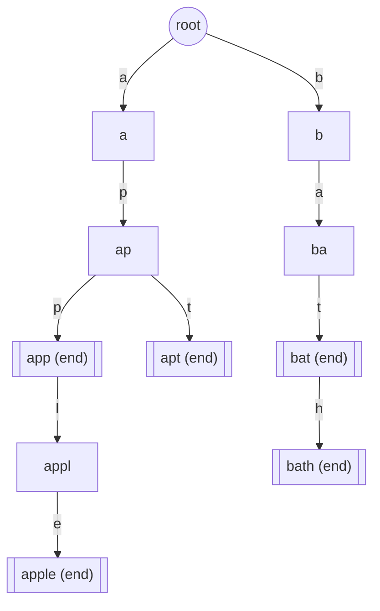

## Introduction

Suppose you are building the search box of an online shop. As the user types `ap`, the box should show products starting with `ap`; when they type `app`, the list should narrow. You have a dictionary of a few hundred thousand product names, and you get a new query on every keystroke.

The obvious tool for "is this word in my dictionary?" is a `HashSet<String>`. It answers exact questions very well: `set.contains("apple")` is O(L) on average, where `L` is the word's length, because it hashes the string once and checks one bucket. But a hash set cannot answer "which words *start with* `ap`?" Hashing destroys the relationship between `apple` and `apply`: their hash codes are unrelated numbers, so the words land in unrelated buckets. The only way to find all words with a given prefix is to look at every stored word, which is O(N · L) per keystroke for `N` words.

A **trie** (from re*trie*val, usually pronounced "try") solves this by storing words character by character in a tree. Words that share a beginning share a path from the root: `apple` and `apply` walk the same `a → p → p → l` edges and only split at the last letter. So "all words starting with `ap`" are exactly the words below one particular node, and you reach that node by following two edges. The cost of finding it depends only on the prefix length, not on how many words are stored.

That property — **every prefix is a node** — is why tries appear in autocomplete, spell-checkers, router tables, word games and a whole family of interview problems. This lesson builds the structure from scratch, extends it with counting, deletion and listing, and then shows the variations you will meet in practice. The next lesson, [[a12-prefix-matching]], uses tries (and a few other techniques) to match prefixes against text.

## Before you start

You need:

- **Trees with many children** — a node that holds an array or map of child references. See [[a6-nary-trees]].
- **Recursion and DFS on trees** — for listing words and wildcard search. See [[a1-recursion]] and [[a6-dfs]].
- **`HashMap` and `HashSet`** — to compare against. See [[a1-hashmap]] and [[a1-hashset]].
- **Strings and characters in Java** — `charAt`, the fact that `c - 'a'` turns a lowercase letter into an index from 0 to 25, and `StringBuilder`. See [[a1-strings-stringbuilder]].

## The intuition

Think of a printed dictionary with a thumb index. To find `apple`, you do not read the dictionary from the front. You open the `A` section, then flip to where `ap` begins, then `app`. Each letter narrows the search to a smaller section, and every word in that section starts with the letters you have used so far.

A trie makes that narrowing literal. The root represents the empty prefix. Each edge is labelled with one character. Following edges from the root spells a string, and **the node you arrive at represents that string as a prefix**. Store the words `app`, `apple`, `apt`, `bat` and `bath` and you get this tree (each node is labelled with the prefix it represents; double borders mark nodes where a stored word ends):



Two things in this picture matter for everything that follows.

First, **the characters live on the edges, not inside the nodes**. A node does not need to store "I am `app`"; it is `app` because of the path that reaches it. In code, a node is mostly an array of child pointers indexed by the next character.

Second, **reaching a node is not the same as finding a word**. The node `ap` exists because `app` and `apt` pass through it, but `ap` was never inserted. So each node carries a flag, usually called `isEnd`, that says "a stored word ends exactly here". `app` has it set; `ap` and `appl` do not. Forgetting this flag is the most common trie bug, and it is the only difference between "is this a word?" and "is this a prefix?".

Where the analogy stops: a printed dictionary stores every word in full, with repetition. A trie stores each shared prefix once. The five words above contain 18 characters, but the trie has only 10 nodes below the root.

## The node and the three core operations

A node needs two things: references to its children, and the end-of-word flag. For words over the lowercase letters `a`–`z`, the simplest representation is a fixed array of 26 references, where `children[0]` is the edge for `a`, `children[1]` for `b`, and so on. A missing edge is `null`.

```java
private static class Node {
    Node[] children = new Node[26];   // children[c - 'a'], null when absent
    boolean isEnd;                    // true if a stored word ends here
}
```

All three core operations walk from the root, one character at a time.

**Insert** walks the word's characters. For each one, if the child for that character does not exist, it creates it; then it moves into the child. After the last character it sets `isEnd = true` on the node it stopped at. Inserting `apple` into a trie that already holds `app` reuses three nodes and creates two.

**Search** (exact word) walks the word's characters. If some child is missing, the word cannot be stored — no stored word even starts with that prefix — so it returns `false`. If the walk succeeds, it returns the final node's `isEnd`.

**startsWith** (prefix) walks the same way but returns `true` as soon as the walk succeeds, ignoring `isEnd`. The prefix exists if and only if its path exists, because the trie only creates nodes while inserting words that pass through them.

Both queries share the same walk, so it is worth writing that walk once as a helper that returns the final node, or `null` if the path breaks. Then:

```java
boolean search(String word)       { Node n = walk(word);   return n != null && n.isEnd; }
boolean startsWith(String prefix) { return walk(prefix) != null; }
```

These two lines are the heart of the structure. Interviewers often ask "what is the difference between search and startsWith?" precisely to see whether you know it is the `isEnd` check and nothing else.

### Dry run: inserting into a shared prefix

Start with a trie that holds `app` and `apple`, and insert `apt`. Each row is one character.

| Step | Character | Index `c - 'a'` | Child exists? | Action | Now at node |
|---|---|---|---|---|---|
| 1 | `a` | 0 | yes | move | `a` |
| 2 | `p` | 15 | yes | move | `ap` |
| 3 | `t` | 19 | no | create, move | `apt` |
| end | | | | set `isEnd = true` | `apt` |

Only one node was created, because `a` and `ap` were already present. Now `search("ap")`: the walk reaches node `ap` successfully, but its `isEnd` is `false`, so the answer is `false`. `startsWith("ap")` reaches the same node and returns `true`. And `search("apx")` fails at step 3: there is no child at index 23, so the walk returns `null`.

## A complete trie with counts, delete and listing

Interview problems and real applications usually need more than the three basic operations. Three extensions come up again and again:

- **Counting** how many stored words start with a prefix ("12 products match `ap`").
- **Deleting** a word, which must not break other words that share its prefix.
- **Listing** the words under a prefix, which is what autocomplete displays.

Counting is cheap if every node remembers how many stored words pass through it. Call that field `passCount`. Inserting a word increments `passCount` on every node along its path (including the root); then the number of words with prefix `p` is the `passCount` of the node `walk(p)` reaches. Without this field you would have to traverse the whole subtree below the prefix node every time.

The same counter makes deletion clean. When a word is removed, decrement `passCount` along its path. If some child's count drops to zero, no remaining word uses that branch, so the whole tail can be detached in one assignment and the garbage collector reclaims it. That pruning matters: without it, `startsWith` would keep returning `true` for prefixes of deleted words, because their nodes would still exist.

Listing is a depth-first traversal of the subtree below the prefix node. Visiting children in index order `a`, `b`, `c`, … produces the words in alphabetical order for free — something a hash set cannot give you at all.

```java title="Trie.java"
import java.util.ArrayList;
import java.util.List;

public class Trie {

    private static class Node {
        Node[] children = new Node[26];   // children[c - 'a'], null when absent
        boolean isEnd;                    // true if a stored word ends here
        int passCount;                    // how many stored words pass through this node
    }

    private final Node root = new Node();

    /** Adds word; returns false if it was already present. */
    public boolean insert(String word) {
        if (search(word)) return false;   // keeps passCount honest for duplicates
        Node cur = root;
        cur.passCount++;
        for (int i = 0; i < word.length(); i++) {
            int c = word.charAt(i) - 'a';
            if (cur.children[c] == null) cur.children[c] = new Node();
            cur = cur.children[c];
            cur.passCount++;
        }
        cur.isEnd = true;
        return true;
    }

    public boolean search(String word) {
        Node node = walk(word);
        return node != null && node.isEnd;
    }

    public boolean startsWith(String prefix) {
        return walk(prefix) != null;
    }

    public int countWithPrefix(String prefix) {
        Node node = walk(prefix);
        return node == null ? 0 : node.passCount;
    }

    /** Follows prefix from the root; null if some character has no edge. */
    private Node walk(String s) {
        Node cur = root;
        for (int i = 0; i < s.length(); i++) {
            cur = cur.children[s.charAt(i) - 'a'];
            if (cur == null) return null;
        }
        return cur;
    }

    /** Removes word; returns false if it was not present. */
    public boolean delete(String word) {
        if (!search(word)) return false;
        Node cur = root;
        cur.passCount--;
        for (int i = 0; i < word.length(); i++) {
            int c = word.charAt(i) - 'a';
            Node child = cur.children[c];
            if (--child.passCount == 0) {  // no other word uses this branch
                cur.children[c] = null;    // detach the whole tail at once
                return true;
            }
            cur = child;
        }
        cur.isEnd = false;
        return true;
    }

    /** All stored words that start with prefix, in alphabetical order. */
    public List<String> wordsWithPrefix(String prefix) {
        List<String> out = new ArrayList<>();
        Node node = walk(prefix);
        if (node != null) collect(node, new StringBuilder(prefix), out);
        return out;
    }

    private void collect(Node node, StringBuilder path, List<String> out) {
        if (node.isEnd) out.add(path.toString());
        for (int c = 0; c < 26; c++) {
            if (node.children[c] == null) continue;
            path.append((char) ('a' + c));
            collect(node.children[c], path, out);
            path.deleteCharAt(path.length() - 1);
        }
    }

    public static void main(String[] args) {
        Trie t = new Trie();
        for (String w : new String[] {"app", "apple", "apt", "bat", "bath"}) t.insert(w);

        System.out.println(t.search("app"));            // stored word
        System.out.println(t.search("ap"));             // only a prefix
        System.out.println(t.startsWith("ap"));
        System.out.println(t.countWithPrefix("ap"));
        System.out.println(t.wordsWithPrefix("ba"));
        System.out.println(t.insert("apple"));          // duplicate
        System.out.println(t.delete("apple"));
        System.out.println(t.search("apple") + " " + t.search("app"));
        System.out.println(t.wordsWithPrefix(""));
    }
}
```

```output
true
false
true
3
[bat, bath]
false
true
false true
[app, apt, bat, bath]
```

Walk through what the program shows. `search("ap")` is `false` while `startsWith("ap")` is `true` — the `isEnd` distinction from the dry run. `countWithPrefix("ap")` is 3 because `app`, `apple` and `apt` all pass through node `ap`. Inserting `apple` a second time returns `false`; the early `search` check is there so that duplicates do not inflate `passCount`, which would otherwise make counts wrong and make deletion leave orphaned branches.

Deleting `apple` decrements counts along `a`, `ap`, `app`; at node `appl` the count drops from 1 to 0, so the edge `app → l` is set to `null` and `appl` and `apple` disappear together. `app` survives, because its own count (now 1) did not reach zero — the deletion stopped before it. If you deleted `app` instead, the loop would run to the end without detaching anything and clear `isEnd` on node `app`, leaving `apple` intact.

Two edge cases deserve a sentence each. The empty string is a legal word here: inserting `""` sets `isEnd` on the root. And `startsWith("")` always returns `true`, even on an empty trie, because the root always exists; if your problem needs "is there any word at all?", check `countWithPrefix("") > 0` instead.

This implementation was checked against a `TreeSet<String>` on 2,000 random sequences of 200 mixed inserts, deletes and queries over short words from a three-letter alphabet; every answer agreed.

## Complexity

**Time.** Insert, search, startsWith, countWithPrefix and delete each do one constant-time step per character: index into an array, maybe allocate a node, update a counter. So each costs **O(L)** for a word or prefix of length `L`. Crucially, `N` — the number of stored words — does not appear. A trie with ten words and a trie with ten million answer `startsWith("ap")` in the same two steps.

Listing is different, because its output can be large. `wordsWithPrefix(p)` costs O(|p|) to reach the prefix node plus time proportional to the size of the subtree below it; with 26-slot arrays, each visited node also scans its 26 slots, so the traversal is O(26 · subtree nodes + total output characters). That is why real autocomplete systems do not enumerate the whole subtree on every keystroke; they precompute the best few suggestions per node, as shown in [[a12-prefix-matching]].

**Space.** Each inserted character creates at most one node, so a trie over words with total length `T` has at most `T + 1` nodes, and fewer when prefixes are shared. With array children, every node reserves 26 slots whether or not they are used, so the memory is O(T · Σ), where Σ is the alphabet size. On a 64-bit HotSpot JVM with default settings (compressed references), one node of the class above measures roughly 140–150 bytes: about 120 for the 26-slot array and the rest for the node object itself. A million-node trie is therefore well over 100 MB — a real constraint, not a theoretical one.

### Array children or map children?

The alternative to a fixed array is a `HashMap<Character, Node>` per node, which stores only the edges that exist.

| Children as | Child lookup | Memory per node | Ordered listing | Good for |
|---|---|---|---|---|
| `Node[26]` array | One array index, very fast | Fixed, about 120 bytes for the array | Free: iterate 0..25 | Lowercase-only interview problems |
| `HashMap<Character, Node>` | Hashing, boxing of `Character` | Grows with the number of children | No; needs sorting or a `TreeMap` | Large or unknown alphabets (Unicode, URLs) |
| `TreeMap<Character, Node>` | O(log Σ) comparisons | Per-entry overhead | Yes | Large alphabets that need sorted output |

A map is not automatically smaller in Java. An empty `HashMap` plus its node already costs tens of bytes, and the first `put` allocates a 16-slot table; measured on the same JVM, a map-based node holding a single child takes around 180 bytes — more than the array version. Maps win when the alphabet is large (a 65,536-slot array per node would be absurd) or very sparse, not for `a`–`z`.

Competitive programmers often avoid node objects entirely and store the trie as a flat table: `int[][] next = new int[MAX_NODES][26]` plus `boolean[] end`, where node 0 is the root and `0` in a child slot means "no child". It allocates once, has no per-object headers and is faster to traverse, at the cost of fixing the maximum size up front.

```quiz
Q: A trie stores `car`, `card` and `care`. What do `search("ca")` and `startsWith("ca")` return?
- [ ] Both return true
- [x] `search` returns false and `startsWith` returns true
- [ ] Both return false
- [ ] `search` returns true and `startsWith` returns false
> The path c → a exists because three words pass through it, so `startsWith` is true. But no word ends at that node — `isEnd` is false there — so `search` is false. Returning true for both is the classic bug of forgetting the `isEnd` check.

Q: You store 1,000,000 words of average length 8 in a trie. Roughly how many steps does `startsWith("pre")` take?
- [x] 3
- [ ] About 20, because log2 of a million is about 20
- [ ] About 8,000,000
- [ ] 1,000,000
> The walk follows one edge per character of the prefix, so three steps, whatever the number of stored words. The log n answer describes a balanced tree or binary search, where each step compares whole keys; the trie never compares against other words.

Q: Why does the `delete` method above detach a child as soon as its `passCount` reaches zero?
- [ ] To make `search` faster for the deleted word
- [x] Because no remaining word uses that branch, and leaving it would make `startsWith` report prefixes of deleted words
- [ ] Because Java requires unused objects to be set to null
- [ ] To keep the alphabetical order of `wordsWithPrefix`
> A zero count means no stored word passes through that node any more. If the nodes stayed, `startsWith` — which only checks that the path exists — would say true for a prefix no word has. Detaching the edge removes the whole unused tail in one step.
```

## Variations you will meet

### Wildcard search

*Design Add and Search Words* asks for a dictionary where `search` accepts `.` as "any single letter": `search(".ad")` should match `bad`, `dad` or `mad`. A hash set would need to try all 26 replacements for every dot, which multiplies quickly. A trie handles it naturally: for a normal character, follow one edge; for a dot, try **every** existing child and succeed if any branch succeeds. That is a depth-first search over the trie, guided by the pattern.

```java title="WordDictionary.java"
public class WordDictionary {

    private static class Node {
        Node[] children = new Node[26];
        boolean isEnd;
    }

    private final Node root = new Node();

    public void addWord(String word) {
        Node cur = root;
        for (char ch : word.toCharArray()) {
            int c = ch - 'a';
            if (cur.children[c] == null) cur.children[c] = new Node();
            cur = cur.children[c];
        }
        cur.isEnd = true;
    }

    /** '.' matches any single letter. */
    public boolean search(String pattern) {
        return match(root, pattern, 0);
    }

    private boolean match(Node node, String p, int i) {
        if (i == p.length()) return node.isEnd;
        char ch = p.charAt(i);
        if (ch != '.') {
            Node next = node.children[ch - 'a'];
            return next != null && match(next, p, i + 1);
        }
        for (Node next : node.children) {          // try every existing branch
            if (next != null && match(next, p, i + 1)) return true;
        }
        return false;
    }

    public static void main(String[] args) {
        WordDictionary d = new WordDictionary();
        d.addWord("bad");
        d.addWord("dad");
        d.addWord("mad");
        System.out.println(d.search("pad"));
        System.out.println(d.search("bad"));
        System.out.println(d.search(".ad"));
        System.out.println(d.search("b.."));
        System.out.println(d.search("b."));
    }
}
```

```output
false
true
true
true
false
```

The last query shows why the base case returns `node.isEnd` rather than `true`: `b.` reaches node `ba`, which exists, but no two-letter word ends there. The cost of a search without dots is O(L). With dots, the worst case is bounded by the number of trie nodes at depths up to `L`, since the search can never visit a node twice for the same pattern position; in the common case, the trie's missing edges prune most branches immediately.

### Many words on a board: Word Search II

Given a grid of letters and a list of words, find which words can be traced through adjacent cells. Searching for each word separately repeats the same exploration for words that share prefixes. Instead, build a trie of all the words and run one backtracking DFS from each cell, moving down the trie in step with the path on the board. When the trie has no child for the next cell's letter, **no word** continues with the current path, so the branch is cut immediately. That pruning is the reason the trie is the expected solution. Store the full word at its end node, remove it after reporting it once, and optionally detach exhausted branches so later searches skip them. The complete solution and its analysis are in [[a9-grid-search]].

### Binary tries and maximum XOR

A trie does not have to hold letters. Treat each integer as a 31-character string of bits, most significant bit first, and insert it into a trie whose nodes have two children (`0` and `1`). Now consider *Maximum XOR of Two Numbers in an Array*: find the largest `x ^ y` over all pairs. The brute force tries all O(n²) pairs.

The trie gives a greedy answer. XOR produces a `1` exactly where the bits differ ([[a13-and-or-xor]]), and a higher bit is worth more than all lower bits combined. So, for a given `x`, walk the trie from the top bit down and at each level **prefer the child with the opposite bit**; if it exists, that bit of the result is `1`. Each walk is 31 steps, so the whole algorithm is O(31 · n).

```java title="MaxXor.java"
public class MaxXor {

    // A binary trie over the 31 value bits of non-negative ints (bit 30 down to bit 0).
    private static final int BITS = 31;

    private static class Node {
        Node[] child = new Node[2];
    }

    static int findMaximumXOR(int[] nums) {
        Node root = new Node();
        int best = 0;
        for (int x : nums) {
            insert(root, x);
            best = Math.max(best, bestPartner(root, x));
        }
        return best;
    }

    static void insert(Node root, int x) {
        Node cur = root;
        for (int b = BITS - 1; b >= 0; b--) {
            int bit = (x >> b) & 1;
            if (cur.child[bit] == null) cur.child[bit] = new Node();
            cur = cur.child[bit];
        }
    }

    /** Largest x ^ y over all y already in the trie (the trie is non-empty). */
    static int bestPartner(Node root, int x) {
        Node cur = root;
        int result = 0;
        for (int b = BITS - 1; b >= 0; b--) {
            int bit = (x >> b) & 1;
            int want = bit ^ 1;                  // the opposite bit makes this bit 1
            if (cur.child[want] != null) {
                result |= 1 << b;
                cur = cur.child[want];
            } else {
                cur = cur.child[bit];
            }
        }
        return result;
    }

    public static void main(String[] args) {
        System.out.println(findMaximumXOR(new int[] {3, 10, 5, 25, 2, 8}));
        System.out.println(findMaximumXOR(new int[] {7}));
    }
}
```

```output
28
0
```

The answer 28 comes from `5 ^ 25` (`00101 ^ 11001 = 11100`). Inserting `x` before querying means the trie is never empty, so the `else` branch always finds a child; a single-element array correctly gives `x ^ x = 0`. The greedy choice is safe because bit `b` contributes 2ᵇ, which is more than the sum of all lower bits (2ᵇ − 1), so no later choice can make up for giving up a higher `1`. This version was compared with the O(n²) brute force on 3,000 random arrays, including values up to `Integer.MAX_VALUE`. Questions about XOR of subarrays use the same trie over prefix XORs; see [[a13-xor-tricks]].

### Compressed tries (radix trees)

In a trie of long words with little sharing, most nodes have exactly one child: `international` and `internet` share `intern`, and then each continues as a long chain. A **radix tree** (also called a compressed trie or Patricia trie) merges each such chain into a single edge labelled with a whole substring. The number of nodes then becomes O(number of words) rather than O(total characters), because every remaining internal node is a real branching point. The price is more complex code: inserting a word may split an edge in two when the new word diverges halfway along a label. Radix trees are what production systems usually mean when they say "trie".

## In real systems

**Autocomplete and search suggestions.** Typeahead services keep a prefix index so that each keystroke is a walk to one node, often with the top few completions cached at each node so nothing below it has to be scanned. The system-design side — ranking, sharding hot prefixes, caching — is covered in [[d10-autocomplete]].

**IP routing.** A router's forwarding table maps address prefixes such as `10.1.0.0/16` to next hops, and each packet must use the **longest** matching prefix. Treating addresses as bit strings makes this a binary-trie walk that remembers the last stored prefix it passed; production routers use compressed and multi-bit variants of that trie, or specialised hardware. The algorithm is taught in [[a12-prefix-matching]].

**Web framework routers.** Several HTTP routers, such as Go's `httprouter`, match request paths like `/users/:id/orders` with a radix tree, so routing cost depends on the path length rather than on the number of registered routes.

**Databases and search engines.** Redis implements its streams on a radix tree, and search engines such as Lucene store their term dictionaries in compact automata (finite-state transducers) that, like tries, share prefixes — and, unlike tries, also share suffixes.

**Spell-checking and word games.** Checking whether a partial word can still become a valid word — the core of Boggle and Scrabble solvers — is exactly `startsWith`.

## Trade-offs and alternatives

| Structure | Exact lookup | Prefix query | Ordered output | Memory |
|---|---|---|---|---|
| `HashSet<String>` | O(L) average | O(N · L) scan | No | Low: one entry per word |
| Sorted array + binary search | O(L log N) | O(L log N) to find the range | Yes | Lowest; but insertion is O(N) |
| `TreeSet<String>` | O(L log N) | O(L log N) via `subSet` / `ceiling` | Yes | One tree node per word |
| Trie (array children) | O(L) | O(L) | Yes, by DFS | High: Σ slots per node |
| Radix tree | O(L) | O(L) | Yes | Moderate: nodes per word, not per character |

The sorted-array and `TreeSet` rows deserve attention, because they are often the right answer in practice. In sorted order, all words with prefix `ap` sit in one contiguous block, starting at the first word `>= "ap"`. A lower-bound search ([[a3-lower-upper-bounds]]) finds that block in O(L log N), and Java's `TreeSet.subSet` or `ceiling` give the same thing on a dynamic set. If you only need a handful of prefix queries over a fixed list, that is less code and far less memory than a trie.

Use a trie when prefix queries dominate and must not depend on `N`, when you walk the structure character by character as part of a larger search (Word Search II, wildcard matching, longest-prefix matching), or when the "alphabet" is bits. Avoid it when you only need exact lookups — a hash set is simpler and smaller — or when strings share few prefixes, where most nodes have one child and the array version wastes nearly all its slots.

## Common mistakes

> [!MISTAKE] Returning true from search when only a prefix exists
> `search` must check `isEnd` on the final node. Returning `walk(word) != null` makes `search("ap")` true after inserting only `apple`. The opposite mistake — checking `isEnd` in `startsWith` — makes `startsWith("ap")` false for the same trie.

**Indexing with `c - 'a'` for characters outside `a`–`z`.** An uppercase letter gives a negative index and a digit gives an out-of-range one, both throwing `ArrayIndexOutOfBoundsException`. Normalise input (for example with `toLowerCase`) or size the array for the real alphabet, such as 52 for both cases or 128 for ASCII, or switch to a map.

**Counting duplicates twice.** If `insert` increments counters without first checking whether the word is already present, inserting the same word twice doubles its contribution to every prefix count, and a later single `delete` leaves the counts inconsistent.

**Deleting without pruning.** Clearing `isEnd` alone is correct for `search` but leaves the path behind, so `startsWith` and prefix counts based on node existence keep seeing the deleted word.

**Rebuilding strings in the DFS.** Writing `collect(child, path + c)` creates a new string at every node, adding O(L) work per step. Append to one `StringBuilder`, recurse, then delete the last character — the standard backtracking pattern from [[a9-subsets]].

**Forgetting memory.** Interviewers sometimes ask what happens with 10⁶ words. With a 26-slot array per node that can approach a gigabyte; mention the array-versus-map trade-off and radix compression before being asked.

## Interview perspective

Tries appear in interviews in two ways: as a direct design task ("implement a trie", "design a word dictionary with wildcards") and as the hidden accelerator in a search problem ("find all dictionary words on this board"). The signal for the second kind is **many strings that are matched character by character, where shared prefixes would let you share work**.

> [!INTERVIEW] What a strong answer sounds like
> "I'll store the words in a trie, so every prefix is one node. The DFS on the board moves down the trie as it extends the path; if the trie has no child for the next letter, no word starts with this path and I can stop. That shares work between words with common prefixes, instead of searching for each word separately."

Questions to be ready for:

- **What is the time complexity of insert and search?** O(L) in the length of the word, independent of the number of words. Explain that each step is one array index.
- **How do search and startsWith differ?** Only in the final `isEnd` check.
- **How would you delete a word?** Clear `isEnd`, and remove nodes that no remaining word uses — with a pass count, or recursively by deleting children that have no children and are not word ends.
- **How would you support `.` wildcards?** Branch over all children at a dot; the trie prunes paths no word can follow.
- **How would you reduce memory?** Map children for sparse or large alphabets, a flat array pool, or a radix tree that merges single-child chains.
- **Why not a hash set of all prefixes?** It answers `startsWith` in O(L), but stores every prefix of every word as a separate string — O(Σ L²) characters — and still cannot list completions.

## Practice

1. **Implement Trie.** Write insert, search and startsWith from memory, then test with a word and its prefix.
2. **Longest Word in Dictionary.** Find the longest word that can be built one letter at a time from other words in the list (every prefix must also be a word). Hint: DFS or BFS through the trie, only descending into nodes with `isEnd` set.
3. **Design Add and Search Words.** Implement the wildcard dictionary and state its worst-case cost.
4. **Word Search II.** Combine a trie with board backtracking; then add pruning that removes a word once found.
5. **Maximum XOR of Two Numbers.** Implement the binary trie, then explain why the greedy choice from the top bit is optimal.
6. **Counting variant.** Add `countWordsEqualTo(word)` for a trie that allows duplicates (*Implement Trie II*): keep an end count instead of a boolean.

The DSA explorer lists matching problems under this topic; start with *Implement Trie (Prefix Tree)*, then *Design Add and Search Words Data Structure* and *Word Search II*.

## Quick revision {#quick-revision}

- A trie stores strings as root-to-node paths; characters are on edges, and **every prefix is one node**.
- Node: `children` (array of 26 or a map) plus `isEnd`; optionally `passCount` for prefix counts.
- Insert: walk, creating missing children; set `isEnd` at the end.
- `search` = walk succeeds **and** `isEnd`; `startsWith` = walk succeeds.
- Time O(L) per insert/search/prefix, independent of the number of words `N`.
- Space: at most total characters + 1 nodes; array children cost Σ slots each (about 140 bytes per node in Java).
- Delete: clear `isEnd` and prune branches no other word uses.
- List completions by DFS from the prefix node; array order gives alphabetical output.
- Wildcard `.`: branch over all children. Binary trie over bits: greedy opposite bit for maximum XOR.
- Radix tree merges single-child chains; sorted array or `TreeSet` is a lighter alternative for occasional prefix queries.

## Key takeaways {#key-takeaways}

- A hash set forgets the relationship between words that share a beginning; a trie is built around it, so a prefix query is a walk of length L.
- The only difference between "is this a word?" and "is this a prefix?" is the end-of-word flag — get it right and most trie bugs disappear.
- Adding a pass count per node gives prefix counts in O(L) and makes deletion with pruning straightforward.
- Tries trade memory for speed; know the array-versus-map choice and radix compression.
- The pattern generalises beyond words: board search shares work across a dictionary, and a trie over bits answers maximum-XOR queries greedily.
