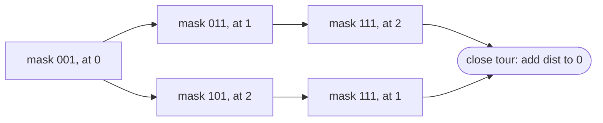

## Introduction

Many problems are about choosing a group of items out of a small collection: which of 15 cities have I visited, which of 10 workers are already assigned, which letters of the alphabet does this word use, which of 20 numbers go into this subset. A natural representation is a `Set<Integer>` or a `boolean[]`. But when the collection has at most 32 (or 64) items, there is a far more compact one: a single `int` (or `long`) in which **bit `i` is 1 exactly when item `i` is in the subset**. That integer is called a **bitmask**.

With a bitmask, adding an item is one OR, testing membership is one AND, the union of two sets is one OR, their intersection is one AND, and the size of the set is one `Integer.bitCount`. A whole subset fits in a register, can be stored in an array index, hashed for free, and compared with `==`. Most importantly, every subset of an `n`-item collection corresponds to exactly one integer from `0` to `2ⁿ − 1`, so you can **list all subsets by counting**, and you can use a subset as an **array index** — which is what makes bitmask dynamic programming possible.

This lesson teaches bitmasks as a data structure: the encoding, the set operations, the three enumeration patterns (all subsets, all submasks, all subsets of a fixed size), and how to recognise problems that want them. It ends with a first look at bitmask DP, which is developed fully in [[a11-bitmask-dp]].

## Before you start

- **Set, clear and check a bit** — `|`, `& ~`, `& ... != 0` with `1 << i`. See [[a13-set-bit]], [[a13-unset-bit]] and [[a13-check-bit]].
- **Lowest set bit tricks** — `n & -n` and `n & (n - 1)`. See [[a13-unset-bit]].
- **Subsets and backtracking** — generating subsets recursively. See [[a9-subsets]]; this lesson gives the iterative alternative.
- **Exponential growth** — why 2ⁿ grows quickly. See [[a1-time-complexity]].

## The intuition: a row of checkboxes

Give each item a number from 0 to `n − 1`. Write a row of `n` checkboxes, one per item, with item 0 on the right. A subset is a pattern of ticks. Read the ticks as a binary number and you have its bitmask.

```text
items:      5  4  3  2  1  0
subset A:   0  0  1  0  1  1     items {0, 1, 3}    mask 0b001011 = 11
subset B:   0  1  1  0  1  0     items {1, 3, 4}    mask 0b011010 = 26
```

Because every pattern of ticks is a different binary number, and every number from `0` to `2ⁿ − 1` is a pattern of `n` ticks, there is a **one-to-one correspondence** between subsets and those integers. `0` is the empty set; `(1 << n) − 1` (all ones) is the full set.

The checkbox picture breaks down in one place: the mask itself carries no record of `n`. `0b1011` might be a subset of 4 items or of 30; operations like complement need you to say which universe you mean.

## Set operations as bit operations

Each operation on sets corresponds to a bitwise operator applied to every position at once:

| Set operation | Bitmask expression | Why |
|---|---|---|
| Empty set, full set | `0`, `(1 << n) - 1` | No bits; the lowest `n` bits |
| Singleton `{i}` | `1 << i` | Only bit `i` |
| Membership `i ∈ A` | `(A & (1 << i)) != 0` | Check bit `i` |
| Add `i` | `A \| (1 << i)` | Set bit `i` |
| Remove `i` | `A & ~(1 << i)` | Clear bit `i` |
| Union `A ∪ B` | `A \| B` | In either |
| Intersection `A ∩ B` | `A & B` | In both |
| Difference `A \ B` | `A & ~B` | In A, not in B |
| Symmetric difference | `A ^ B` | In exactly one |
| Complement within `n` items | `full ^ A` or `full & ~A` | Flip only the `n` real positions |
| `B ⊆ A` | `(A & B) == B` | B adds nothing to A |
| Disjoint | `(A & B) == 0` | No shared item |
| Size `\|A\|` | `Integer.bitCount(A)` | Count the ones |
| Smallest item | `Integer.numberOfTrailingZeros(A)` | Position of the lowest 1 |

```java title="SetOps.java"
public class SetOps {

    // Lists the members of a set stored as a mask over the universe {0..n-1}.
    static String show(int mask, int n) {
        StringBuilder sb = new StringBuilder("{");
        for (int i = 0; i < n; i++) {
            if ((mask & (1 << i)) != 0) {
                if (sb.length() > 1) sb.append(", ");
                sb.append(i);
            }
        }
        return sb.append("}").toString();
    }

    public static void main(String[] args) {
        int n = 6;                          // universe {0, 1, 2, 3, 4, 5}
        int full = (1 << n) - 1;            // every element: 111111
        int a = 0b001011;                   // {0, 1, 3}
        int b = 0b011010;                   // {1, 3, 4}

        System.out.println("A          = " + show(a, n));
        System.out.println("B          = " + show(b, n));
        System.out.println("A union B  = " + show(a | b, n));
        System.out.println("A inter B  = " + show(a & b, n));
        System.out.println("A minus B  = " + show(a & ~b, n));
        System.out.println("A xor B    = " + show(a ^ b, n));
        System.out.println("not A      = " + show(full ^ a, n));
        System.out.println("|A|        = " + Integer.bitCount(a));
        System.out.println("A has 3?   = " + ((a & (1 << 3)) != 0));
        System.out.println("{1,3} in A = " + ((0b001010 & a) == 0b001010));
        System.out.println("A with 5   = " + show(a | (1 << 5), n));
        System.out.println("A sans 1   = " + show(a & ~(1 << 1), n));
    }
}
```

```output
A          = {0, 1, 3}
B          = {1, 3, 4}
A union B  = {0, 1, 3, 4}
A inter B  = {1, 3}
A minus B  = {0}
A xor B    = {0, 4}
not A      = {2, 4, 5}
|A|        = 3
A has 3?   = true
{1,3} in A = true
A with 5   = {0, 1, 3, 5}
A sans 1   = {0, 3}
```

Each line is one machine operation on the whole set, whatever its size. Compare that with a `HashSet<Integer>`, where a union means iterating over one set and inserting into a copy of the other.

Notice the complement: `full ^ a`, not `~a`. `~a` flips all 32 bits, so it would "contain" items 6 to 31 that do not exist. Restricting to the universe with `full` is essential whenever a complement feeds into a comparison or a count.

### Choosing the width

An `int` holds subsets of up to 31 items safely; at 32 items `1 << 31` is negative and `(1 << 32) - 1` is 0 (see [[a13-set-bit]]), so code that loops `mask < (1 << n)` breaks. A `long` holds up to 63 items with `1L << i`. In practice this rarely matters for enumeration, because enumerating 2³¹ subsets is far too slow anyway; it matters when a mask is used as a compact *set* of, say, 26 letters or 64 board squares. Beyond 64 items, use `java.util.BitSet`.

## Enumerating every subset by counting

**Problem.** Generate all subsets of `n` distinct items (LeetCode 78, *Subsets*).

**Recursive approach.** For each item, branch on "take it" or "skip it" — the backtracking solution in [[a9-subsets]]. It is natural, but it needs recursion and a mutable list.

**Bitmask approach.** Since subsets correspond one-to-one to the integers `0..2ⁿ − 1`, loop over those integers, and for each one take the items whose bits are set.

```java title="Subsets.java"
import java.util.ArrayList;
import java.util.List;

public class Subsets {

    // LeetCode 78: every subset of nums, generated by counting from 0 to 2^n - 1.
    static List<List<Integer>> subsets(int[] nums) {
        int n = nums.length;
        List<List<Integer>> result = new ArrayList<>();
        for (int mask = 0; mask < (1 << n); mask++) {        // 2^n masks
            List<Integer> subset = new ArrayList<>();
            for (int i = 0; i < n; i++) {
                if ((mask & (1 << i)) != 0) subset.add(nums[i]);   // bit i -> take nums[i]
            }
            result.add(subset);
        }
        return result;
    }

    public static void main(String[] args) {
        int[] nums = {10, 20, 30};
        List<List<Integer>> all = subsets(nums);
        for (int mask = 0; mask < all.size(); mask++) {
            String bits = String.format("%3s", Integer.toBinaryString(mask)).replace(' ', '0');
            System.out.println(bits + " -> " + all.get(mask));
        }
    }
}
```

```output
000 -> []
001 -> [10]
010 -> [20]
011 -> [10, 20]
100 -> [30]
101 -> [10, 30]
110 -> [20, 30]
111 -> [10, 20, 30]
```

The output is the whole idea in one picture: counting in binary visits every pattern of `n` bits exactly once. There are no duplicates (different integers are different patterns) and nothing is missed (every pattern is some integer below 2ⁿ).

**Complexity.** 2ⁿ masks, and building each subset checks `n` bits, so O(n · 2ⁿ) time. The output itself has n · 2ⁿ⁻¹ elements in total, so no method can do asymptotically better when the subsets must be materialised. Extra space beyond the output is O(1). If you only need to *evaluate* each subset (for example, test whether its sum equals a target), you can often avoid materialising lists entirely and just use the mask.

**How big can `n` be?** 2²⁰ is about a million, so `n ≤ 20` with O(n) work per subset is about 2·10⁷ operations — comfortable. 2²⁵ is about 33 million, and multiplied by `n` it becomes slow. 2³⁰ is a billion — too many to enumerate in a typical time limit. That is why problem constraints of **`n ≤ 15` to `n ≤ 20`** are a strong signal for bitmask enumeration or bitmask DP. For subset-sum style problems with `n` up to about 40, the standard technique is **meet in the middle**: enumerate the 2²⁰ subsets of each half separately and combine them with sorting or hashing.

## Enumerating the submasks of a mask

Sometimes you need every subset *of a given subset* — every way to split a group of chosen items, for instance. A **submask** of `mask` is any `sub` with `(sub & mask) == sub`. Checking all 2ⁿ integers and filtering is wasteful when `mask` has few bits. The standard loop visits exactly the submasks:

```java title="Submasks.java"
public class Submasks {
    public static void main(String[] args) {
        int mask = 0b1011;                                // {0, 1, 3}
        StringBuilder sb = new StringBuilder();
        // Visits every submask in decreasing order, then 0 last.
        for (int sub = mask; ; sub = (sub - 1) & mask) {
            sb.append(Integer.toBinaryString(sub)).append(' ');
            if (sub == 0) break;                          // 0 is a submask too
        }
        System.out.println(sb.toString().trim());

        // Total work of "for every mask, for every submask" over n = 10 elements.
        int n = 10;
        long total = 0;
        for (int m = 0; m < (1 << n); m++) {
            for (int sub = m; ; sub = (sub - 1) & m) {
                total++;
                if (sub == 0) break;
            }
        }
        long threeToTheN = (long) Math.pow(3, n);
        System.out.println("pairs for n = 10: " + total + " (3^10 = " + threeToTheN + ")");
    }
}
```

```output
1011 1010 1001 1000 11 10 1 0
pairs for n = 10: 59049 (3^10 = 59049)
```

**Why `(sub - 1) & mask` works.** Imagine squeezing out the positions where `mask` has 0, leaving only its `k` set positions. A submask is then just a `k`-bit number, and the submasks in decreasing order are that number counting down. Subtracting 1 from `sub` borrows from its lowest 1 and turns the bits below it into 1s — including positions outside `mask`. The `& mask` throws those away, leaving exactly the next smaller `k`-bit number in the squeezed view. Starting from `mask` itself (all `k` bits set) and counting down to 0 therefore visits all 2ᵏ submasks once each.

**Watch the termination.** The common form `for (sub = mask; sub > 0; sub = (sub - 1) & mask)` skips the empty submask 0. That is often intended (an empty group is useless), but if 0 matters, use the `break`-after-processing form above. A loop with `sub >= 0` never ends, because `(0 - 1) & mask` is `mask` again.

**Total cost: 3ⁿ, not 4ⁿ.** If you loop over every mask and, inside, over every submask, the naive bound is 2ⁿ · 2ⁿ = 4ⁿ. The real count is smaller: each of the `n` items independently is either outside the mask, inside the mask but not the submask, or inside both — three choices — so there are exactly 3ⁿ (mask, submask) pairs. The program confirms 3¹⁰ = 59,049 pairs for `n = 10`. For `n = 15`, 3¹⁵ ≈ 1.4·10⁷ is fine; for `n = 20`, 3²⁰ ≈ 3.5·10⁹ is too slow. This bound is what you quote when a DP transitions from a mask to its submasks, such as partitioning items into groups.

## Enumerating subsets of a fixed size

To visit only subsets with exactly `k` items in increasing numeric order, **Gosper's hack** computes the next larger integer with the same number of set bits:

```java title="Gosper.java"
public class Gosper {
    public static void main(String[] args) {
        int n = 5, k = 3;
        StringBuilder sb = new StringBuilder();
        int count = 0;
        // Gosper's hack: the next larger int with the same number of set bits.
        for (int s = (1 << k) - 1; s < (1 << n); ) {
            sb.append(Integer.toBinaryString(s)).append(' ');
            count++;
            int c = s & -s;                 // lowest set bit
            int r = s + c;                  // carry the lowest block of ones up by one
            s = (((r ^ s) >>> 2) / c) | r;  // put the remaining ones back at the bottom
        }
        System.out.println(sb.toString().trim());
        System.out.println(count + " subsets of size " + k + " from " + n);
    }
}
```

```output
111 1011 1101 1110 10011 10101 10110 11001 11010 11100
10 subsets of size 3 from 5
```

Adding the lowest set bit `c` makes the lowest block of consecutive ones carry: the block disappears and a single 1 appears just above it. That loses some ones, so the last line rebuilds them at the bottom of the number, which is the smallest possible place for them. The details are fiddly; what matters is that it produces the C(n, k) masks directly (10 = C(5, 3) here). It was compared with "filter all masks by `Integer.bitCount(s) == k`" for every `n ≤ 12` and every `k` with identical results. For interviews, the filter is an acceptable and much clearer alternative when 2ⁿ is small.

## Worked example: Maximum Product of Word Lengths

Masks are not only for enumerating subsets; they also make good **signatures**. LeetCode 318 asks: given a list of lowercase words, return the maximum value of `length(a) * length(b)` over pairs of words that share no letter (0 if no such pair exists).

**Naive approach.** For each pair, check for a common letter with nested loops over the characters, or a `Set<Character>`. With `w` words of length up to `L`, that is O(w² · L) time and creates many temporary objects.

**Better idea.** Whether two words share a letter depends only on *which* letters they contain, not on how many times or in what order. That is a subset of the 26 letters, which fits in an `int`. Precompute each word's letter mask once; then "share no letter" is a single AND.

```java title="WordProduct.java"
public class WordProduct {

    // LeetCode 318: max length(a) * length(b) over word pairs with no common letter.
    static int maxProduct(String[] words) {
        int n = words.length;
        int[] masks = new int[n];
        for (int i = 0; i < n; i++) {
            for (char ch : words[i].toCharArray()) {
                masks[i] |= 1 << (ch - 'a');       // letter 'a'..'z' -> bit 0..25
            }
        }
        int best = 0;
        for (int i = 0; i < n; i++) {
            for (int j = i + 1; j < n; j++) {
                if ((masks[i] & masks[j]) == 0) {  // no shared letter, in one AND
                    best = Math.max(best, words[i].length() * words[j].length());
                }
            }
        }
        return best;
    }

    public static void main(String[] args) {
        System.out.println(maxProduct(new String[]{"abcw", "baz", "foo", "bar", "xtfn", "abcdef"}));
        System.out.println(maxProduct(new String[]{"a", "ab", "abc", "d", "cd", "bcd", "abcd"}));
        System.out.println(maxProduct(new String[]{"a", "aa", "aaa", "aaaa"}));
    }
}
```

```output
16
4
0
```

Trace the first input. `"abcw"` sets bits 0, 1, 2 and 22. `"xtfn"` sets bits 23, 19, 5 and 13. Their AND is 0, so they are compatible, giving 4 × 4 = 16. `"abcw"` and `"baz"` share bits 0 and 1, so their AND is non-zero and the pair is skipped. In the third input every word uses only `a`, so every pair overlaps and the answer is 0.

**Complexity.** Building masks costs O(total letters). The pair loop is O(w²) with an O(1) check, so O(w² + total letters) time and O(w) extra space. Setting the same bit twice (repeated letters) is harmless because OR is idempotent. A further optimisation keeps, for each distinct mask, only the longest word with that mask, which helps when many words are anagrams of each other.

## Bitmask DP: a first look

The most important use of bitmasks in interviews is as **dynamic-programming state**. When the answer depends on *which* items have been used so far — not just how many — and there are at most about 20 items, the set of used items can be a mask, and the mask can be an array index. [[a11-bitmask-dp]] develops this in depth; here is the core idea through the classic example.

**Travelling Salesman Problem (TSP).** Given distances between `n` cities, find the shortest tour that starts at city 0, visits every city exactly once and returns. Trying every order costs O(n!) — 20! is about 2.4·10¹⁸. But the cost of finishing a tour depends only on the *set* of cities already visited and the *current* city, not on the order in which they were visited. So define:

> `dp[mask][v]` = the length of the shortest path that starts at city 0, visits exactly the cities in `mask`, and ends at city `v`.

From state `(mask, v)`, move to any unvisited city `w`, reaching `(mask | (1 << w), w)`. This is the Held–Karp algorithm.

```java title="Tsp.java"
import java.util.Arrays;

public class Tsp {

    // Shortest tour that starts at city 0, visits every city once and returns to 0.
    static int shortestTour(int[][] dist) {
        int n = dist.length;
        if (n == 1) return 0;
        int full = (1 << n) - 1;
        int INF = Integer.MAX_VALUE / 2;              // room to add an edge without overflow
        // dp[mask][v]: shortest path from 0 that visits exactly the cities in mask, ending at v
        int[][] dp = new int[1 << n][n];
        for (int[] row : dp) Arrays.fill(row, INF);
        dp[1][0] = 0;                                 // visited {0}, standing at 0
        for (int mask = 1; mask <= full; mask++) {    // supersets are numerically larger
            for (int v = 0; v < n; v++) {
                if ((mask & (1 << v)) == 0 || dp[mask][v] >= INF) continue;
                for (int w = 0; w < n; w++) {
                    if ((mask & (1 << w)) != 0) continue;          // already visited
                    int next = mask | (1 << w);
                    dp[next][w] = Math.min(dp[next][w], dp[mask][v] + dist[v][w]);
                }
            }
        }
        int best = INF;
        for (int v = 1; v < n; v++) best = Math.min(best, dp[full][v] + dist[v][0]);
        return best;
    }

    public static void main(String[] args) {
        int[][] dist = {
            {0, 10, 15, 20},
            {10, 0, 35, 25},
            {15, 35, 0, 30},
            {20, 25, 30, 0}
        };
        System.out.println(shortestTour(dist));
    }
}
```

```output
80
```

The best tour is 0 → 1 → 3 → 2 → 0, with length 10 + 25 + 30 + 15 = 80. Several details are worth noticing:

- **The start state is `dp[1][0]`, not `dp[0][0]`.** Mask `1` (`0001`) records that city 0 is already visited; starting from mask 0 would let the tour "visit" city 0 a second time.
- **Plain increasing order is a valid processing order.** Every transition adds a bit, and adding a bit makes the integer larger, so by the time the loop reaches a mask, every state that can lead into it has been finalised. There is no need to sort masks by size.
- **`INF = Integer.MAX_VALUE / 2`** leaves room to add one edge without overflow, and the `>= INF` check skips unreachable states.
- **The answer closes the tour** by adding `dist[v][0]` from each possible last city.

**Complexity.** There are 2ⁿ · n states and each tries n next cities: O(2ⁿ · n²) time and O(2ⁿ · n) space. For `n = 16` that is about 1.7·10⁷ steps; for `n = 20`, about 4·10⁸ steps and 2²⁰ · 20 ints (about 80 MB) — the practical ceiling. Still exponential, but enormously better than n!. The implementation matched a brute force over all permutations on three thousand random instances with 1 to 8 cities.



The same pattern — "state is (set of used items, a little extra information)" — solves assignment problems (assign `n` workers to `n` jobs: `dp[mask]` = best cost of assigning the first `bitCount(mask)` workers to the jobs in `mask`), "visit all nodes" shortest paths with BFS over `(node, mask)`, and partitioning problems that iterate over submasks.

```quiz
Q: For a universe of `n = 5` items, which expression gives the complement of set `A` without inventing items that do not exist?
- [ ] `~A`
- [x] `((1 << 5) - 1) ^ A`
- [ ] `-A`
- [ ] `A ^ 1`
> `(1 << 5) - 1` is `11111`, the full set of five items; XOR with it flips exactly those five positions. `~A` also flips bits 5 to 31, adding 27 items that are not in the universe. `-A` is arithmetic negation and `A ^ 1` only toggles item 0.

Q: How many (mask, submask) pairs does "for every mask of n bits, for every submask of it" visit?
- [ ] 2^n
- [ ] n * 2^n
- [x] 3^n
- [ ] 4^n
> Each item is independently in neither, in the mask only, or in both the mask and the submask, giving three choices per item and 3^n pairs in total. 4^n is the loose bound from multiplying 2^n masks by up to 2^n submasks each.

Q: In the TSP bitmask DP, why is it correct to process masks in plain increasing numeric order?
- [ ] Because masks with fewer bits are always smaller numbers
- [x] Because every transition sets a new bit, which always produces a larger number, so all predecessors of a mask are processed before it
- [ ] Because the distances are symmetric
- [ ] It is not correct; masks must be sorted by bit count
> Masks with fewer bits are not always smaller (`1000` has one bit and is larger than `0111` with three), so that is not the reason. What matters is that each transition goes from mask to `mask | (1 << w)` with w not in mask, which is strictly larger. Increasing order therefore respects every dependency.

Q: A problem says "n ≤ 18" and asks for the minimum cost to complete all n tasks, where the cost of a task depends on which tasks were done before it. What does the constraint suggest?
- [ ] A greedy algorithm, because n is small
- [x] Dynamic programming over 2^n subsets of completed tasks
- [ ] Trying all n! orders
- [ ] Binary search on the answer
> 18! is about 6.4 * 10^15, far too many orders, but 2^18 is about 262,000 subsets. Since the cost depends on the set of completed tasks, a mask of completed tasks is a natural DP state. Greedy choices are not safe when costs depend on history.
```

## In real systems

**Flags and capability sets.** Operating systems represent process capabilities, signal masks and CPU-affinity sets as bitmasks (`sigprocmask` and `sched_setaffinity` in Linux take mask arguments). Java's `EnumSet` stores up to 64 enum constants as one `long`, giving set semantics with bitmask speed.

**Bitmap indexes and filters.** Analytical databases keep one bitmap per distinct value of a low-cardinality column ("is this row in region EU?"), and answer `WHERE region = 'EU' AND status = 'active'` by ANDing bitmaps. Roaring bitmaps, used by Apache Lucene, Spark and Druid among others, compress such bitmaps. Bloom filters set and test bits chosen by several hash functions.

**Games and graphics.** Chess engines represent the board as several 64-bit **bitboards**, one per piece type, so "all squares attacked by white knights" is a few shifts and ORs. Renderers and physics engines use layer masks to decide which objects can collide or be seen by which camera.

**Networking.** An IPv4 subnet mask such as `255.255.255.0` is literally a bitmask: `address & mask` gives the network part, and two hosts are on the same subnet when those results are equal.

## Trade-offs and alternatives

| Representation | Max items | Set operation cost | Good for |
|---|---|---|---|
| `int` / `long` mask | 31 / 63 | O(1) | Small universes, DP state, enumeration |
| `java.util.BitSet` | Grows as needed | O(n / 64) | Large dense sets |
| `EnumSet` | Any (bit vector inside) | O(1) up to 64 constants | Readable flag sets in application code |
| `boolean[]` | Any | O(n) | Clarity, single-item updates |
| `HashSet<Integer>` | Any | O(size) | Sparse sets over a large universe |

Bitmasks win on speed and memory when the universe is small and dense, and they are the only practical way to index DP tables by subsets. They lose on readability (`mask & ~(1 << i)` means less to a reader than `used.remove(i)`), and they do not scale: anything that enumerates subsets is exponential in `n`. When `n` is large, the answer is not a bigger mask but a different algorithm — knapsack-style DP when items are interchangeable ([[a11-knapsack]]), greedy or graph algorithms when structure allows, or meet in the middle for `n` around 40.

## Common mistakes

> [!MISTAKE] Complementing with `~` instead of the full mask
> `~mask` sets every bit above `n` too, so `Integer.bitCount(~mask)` and comparisons such as `(~mask) == 0` give wrong answers. Use `full ^ mask` with `full = (1 << n) - 1`.

**Wrong full mask.** The full set is `(1 << n) - 1`, not `1 << n` (that is a single item, `n`, outside the universe) and not `(1 << n)` as an inclusive loop bound. Loop `mask < (1 << n)` or `mask <= full`.

**Overflow for `n ≥ 31`.** `1 << 31` is negative and `1 << 32` is 1, so `for (mask = 0; mask < (1 << n); ...)` breaks. Use `long` masks with `1L << i`, or reconsider: 2³¹ subsets is too many to enumerate anyway.

**Starting TSP-style DP from mask 0.** If the start city is fixed, its bit must be set in the initial mask.

**Using an item before checking it is in the mask.** In `dp[mask][v]`, states where `v` is not in `mask` are meaningless; skip them.

**Skipping or looping on the empty submask.** `sub > 0` skips 0; `sub >= 0` never terminates. Choose deliberately.

**Assuming `INF + cost` is safe.** `Integer.MAX_VALUE + 1` wraps negative and becomes the "best" answer. Use `Integer.MAX_VALUE / 2` or check reachability before adding.

## Interview perspective

Bitmask questions show up in two forms: "generate or test subsets" (Subsets, Maximum Product of Word Lengths, Partition to K Equal Sum Subsets) and "DP over subsets" (TSP, Shortest Path Visiting All Nodes, assignment problems). The strongest signal is a small constraint: **`n ≤ 20` (or `≤ 16`) almost always means 2ⁿ is intended**.

- **Represent a subset of `n ≤ 20` items.** An `int` with bit `i` meaning item `i`; list the set operations.
- **Generate all subsets iteratively.** Count from 0 to 2ⁿ − 1; O(n · 2ⁿ).
- **Iterate submasks.** `sub = (sub - 1) & mask`; total 3ⁿ over all masks; explain why.
- **TSP state.** `dp[mask][last]`; start `dp[1][0] = 0`; O(2ⁿ · n²) time, O(2ⁿ · n) space.
- **Why not `n = 30`?** 2³⁰ states is a billion before multiplying by `n`; suggest meet in the middle or a polynomial algorithm if the structure allows.

> [!INTERVIEW] Lead with the state count
> When you propose a bitmask solution, say the numbers: "There are 2^16 = 65,536 masks and 16 last-city choices, about a million states, and 16 transitions each, so about 16 million steps." It shows you checked feasibility before coding, which is exactly what the small constraint is testing.

## Practice

1. *Subsets:* generate all subsets of an array using masks, then modify it to return only subsets whose sum is even.
2. *Letter Case Permutation:* for a string with `k` letters, use a `k`-bit mask to choose upper or lower case for each.
3. *Maximum Product of Word Lengths:* add the "longest word per distinct mask" optimisation.
4. *Partition to K Equal Sum Subsets* (`n ≤ 16`): solve with `dp[mask]` = remaining capacity of the current bucket after placing the items in `mask`.
5. *Shortest Path Visiting All Nodes* (`n ≤ 12`): BFS over states `(node, mask)`.
6. Count the subsets of `n ≤ 20` numbers whose XOR is zero, first by enumerating masks, then explain how you would handle `n = 40`.

In the DSA explorer, start with *Subsets*, *Maximum Product of Word Lengths* and *Partition to K Equal Sum Subsets*, then continue to the problems listed under [[a11-bitmask-dp]].

## Quick revision {#quick-revision}

- Bit `i` of the mask ⇔ item `i` in the subset; subsets of `n` items ↔ integers `0..2ⁿ − 1`.
- Full set `(1 << n) - 1`; complement `full ^ A` (not `~A`); size `Integer.bitCount(A)`.
- Union `|`, intersection `&`, difference `& ~`, symmetric difference `^`; subset test `(A & B) == B`; disjoint `(A & B) == 0`.
- All subsets: `for (mask = 0; mask < (1 << n); mask++)`; O(n · 2ⁿ) to materialise.
- Submasks: `for (sub = mask; ; sub = (sub - 1) & mask) { ...; if (sub == 0) break; }`; 3ⁿ pairs over all masks.
- Fixed size `k`: Gosper's hack, or filter by `Integer.bitCount(mask) == k`.
- `n ≤ 20` signals 2ⁿ; `n ≈ 40` signals meet in the middle.
- Bitmask DP: `dp[mask][last]`, start with the start item's bit set, process masks in increasing order, O(2ⁿ · n²) for TSP.
- Use `long` and `1L << i` for up to 63 items; `BitSet` beyond.

## Key takeaways {#key-takeaways}

- A bitmask turns a subset of a small universe into one integer, making set operations single instructions and subsets usable as array indices.
- Counting from 0 to 2ⁿ − 1 enumerates every subset exactly once; `(sub - 1) & mask` enumerates the submasks of a mask, 3ⁿ pairs in total.
- Complement and full-set calculations must be restricted to the `n` real items.
- Masks also work as signatures: two words share no letter exactly when their letter masks AND to zero.
- When the answer depends on which items were used and `n` is about 20 or less, a mask is the natural DP state; quote the state count before you code.
