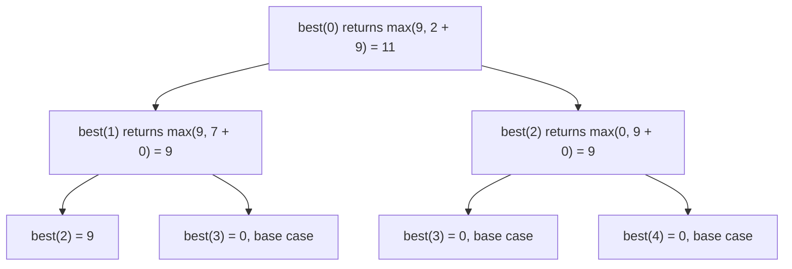

## Introduction

You have written your solution. It looks right. You are tempted to say "I think that's it". This is the most expensive moment to stop, because the code has never run. Experienced engineers do not trust code they have not executed, and in most coding interviews you cannot execute it — so you execute it yourself.

**Manual testing** means choosing a few concrete inputs, working out the correct answer for each, and then stepping through your code by hand, line by line, tracking the value of every important variable, to see whether it produces that answer. It is sometimes called a **dry run**. It catches the bugs that dominate interview code — off-by-one boundaries, wrong initial values, unhandled empty input, a comparison the wrong way round — and it does so in the few minutes before you hand the code over.

It matters for the interview score directly: "verification" or "testing" is a standard rubric category, and finding your own bug is one of the strongest signals a candidate can give. An interviewer who watches you trace a test, spot an off-by-one and fix it calmly learns more about how you would work on their team than one who watches flawless code appear. It matters on the job too: the same habit is what makes you write the failing unit test before you trust a fix.

## Before you start

- **Clean, traceable code** — tracing is only practical if the code is readable. See [[a14-clean-coding]].
- **The clarified spec** — your tests come from it. See [[a14-clarifying-requirements]].
- **Loops and recursion** — [[a2-array-string-traversal]] and [[a1-recursion]].
- The worked example uses a **fixed-size sliding window** ([[a2-sliding-window]]). The lesson explains what it does.

## The intuition

Be the computer. A processor does not understand what your code is *meant* to do; it executes each line exactly as written, with the current values of the variables. To test by hand, you must do the same: read the line that is there, not the line you intended, and update a written record of the variables.

The record is the key. Holding five changing variables in your head across eight loop iterations is unreliable for anyone. Writing them in a small table — one row per iteration — turns tracing from an act of memory into an act of bookkeeping, and bookkeeping is something you can do accurately under pressure.

The analogy has one limit: a computer is fast and never bored. You are slow, so you must be selective about *which* inputs you trace. Choosing them well is half of the skill.

## Choosing the inputs

You will usually have time to trace two to four inputs in an interview. Pick them to cover different kinds of risk:

| Kind of test | Examples | What it catches |
|---|---|---|
| **The given example** | The input from the problem statement | Basic misunderstanding; gross logic errors |
| **Minimal** | Empty array, single element, `k = 1`, a one-node tree | Missing guard clauses; loops that assume at least two elements |
| **Boundary** | Answer at the first or last position; `k = n`; target equal to the smallest value | Off-by-one errors in loop bounds and window edges |
| **Tricky values** | All negatives, zeros, duplicates, all elements equal, ties | Wrong initial values (`0` instead of `MIN_VALUE`); broken tie handling |
| **Clarified rules** | Touching intervals; "no answer exists"; input that must stay unmodified | Code that ignores what was agreed |
| **Large** (reason, do not trace) | `n = 10⁵`, values near 10⁹, deep recursion | Overflow, time limits, stack depth |

The given example is necessary but weak. It was written to illustrate the problem, not to break solutions, and it often passes for code with several bugs — as the worked example below shows. The minimal and boundary cases do most of the bug-finding. The large case is not traced line by line; instead you ask "what is the biggest value any variable can hold?" and "how deep can the recursion go?". [[a14-edge-cases]] goes deeper into building edge-case lists for specific problem types.

### Decide the expected answer first

Before tracing, work out what the correct output is **without looking at your code** — by reasoning directly about the problem, or by brute force on a tiny input. Then trace the code and compare.

The order matters because tracing your own code is persuasive. If you trace first and then ask "is that right?", you tend to accept whatever the code produced. Committing to the expected answer first turns the trace into a genuine check. This is the same reason a brute force makes a good oracle ([[a14-brute-force-first]]): its answer comes from a different, simpler line of reasoning.

## How to trace a loop

1. **List the variables that change** — loop index, accumulators, pointers, the result — as table columns.
2. **Write the initial values** as the first row, straight from the code's initialisation lines.
3. **Execute one iteration at a time**, reading each line as written. Write a new row after each iteration (or after each important line, if the iteration does several things).
4. **Check conditions explicitly.** For each `if`, write the comparison with the actual numbers: "`i >= k` → `2 >= 3` → false". Skipping this is how traces go wrong.
5. **At the end, compare** the returned value with the expected answer, and check any side effects (was the input modified? was the right object returned?).

For **nested loops**, use a small input and give the inner index its own column; the moments to watch are when the inner loop starts (what is its initial value — `0`, `i`, `i + 1`?) and when it stops or `break`s. For **pointer algorithms** such as two pointers, write both pointers in every row and confirm that at least one moves each iteration, or the loop never ends.

## Worked walkthrough: finding two bugs in a sliding window

The problem: *"Given an array of integers and an integer `k`, return the maximum sum of any contiguous subarray of length exactly `k`."* Clarified: `1 ≤ k ≤ nums.length`, values can be negative. Here is a first draft, written live in an interview:

```java
static int maxWindowSumDraft(int[] nums, int k) {
    int sum = 0, best = 0;
    for (int i = 0; i < nums.length; i++) {
        sum += nums[i];
        if (i >= k) sum -= nums[i - k];
        if (i >= k) best = Math.max(best, sum);
    }
    return best;
}
```

The idea is right: keep a running sum of the last `k` elements, adding the new element and subtracting the one that fell out of the window, and track the best. The details are not, but they look plausible. Now test.

### Test 1: the given example

`nums = [2, 1, 5, 1, 3, 2]`, `k = 3`. **Expected, by direct reasoning:** the windows are `[2,1,5] = 8`, `[1,5,1] = 7`, `[5,1,3] = 9`, `[1,3,2] = 6`, so the answer is **9**.

| `i` | `nums[i]` | `sum` after add | `i >= k`? | `sum` after subtract | `best` |
|---|---|---|---|---|---|
| start | | 0 | | | 0 |
| 0 | 2 | 2 | 0 ≥ 3 no | 2 | 0 |
| 1 | 1 | 3 | 1 ≥ 3 no | 3 | 0 |
| 2 | 5 | 8 | 2 ≥ 3 no | 8 | 0 |
| 3 | 1 | 9 | 3 ≥ 3 yes, − `nums[0]` = 2 | 7 | 7 |
| 4 | 3 | 10 | yes, − `nums[1]` = 1 | 9 | 9 |
| 5 | 2 | 11 | yes, − `nums[2]` = 5 | 6 | 9 |

The code returns 9. It matches. Many candidates stop here.

But look at row 2 again. At `i = 2`, `sum` is 8 — the first full window `[2, 1, 5]` — and `best` is not updated, because the condition is `i >= k`. The first window was never considered. It did not matter here because a later window was larger. That is a suspicion worth testing with a **boundary** case: one where the first window is the best.

### Test 2: answer in the first window

`nums = [9, 1, 1, 1]`, `k = 2`. **Expected:** windows `[9,1] = 10`, `[1,1] = 2`, `[1,1] = 2`, so **10**.

| `i` | `nums[i]` | `sum` after add | `i >= k`? | `sum` after subtract | `best` |
|---|---|---|---|---|---|
| start | | 0 | | | 0 |
| 0 | 9 | 9 | 0 ≥ 2 no | 9 | 0 |
| 1 | 1 | 10 | 1 ≥ 2 no | 10 | 0 |
| 2 | 1 | 11 | yes, − 9 | 2 | 2 |
| 3 | 1 | 3 | yes, − 1 | 2 | 2 |

The code returns 2. **Bug found.** The window first becomes full at `i = k − 1` (index 1 here, when it holds two elements), so the `best` update must run from `i >= k - 1`. The subtraction condition is correct as it is: the element at `i − k` leaves only once the window would otherwise hold `k + 1` elements, which first happens at `i = k`. Two conditions that looked like copies of each other are, in fact, different.

**Fix 1:** change the second condition to `if (i >= k - 1)`. Re-trace test 2 from the changed line: at `i = 1`, `1 >= 1` is true, `best = max(0, 10) = 10`; the later rows give 2 and 2, so the result is 10. Fixed.

### Test 3: all negative values

`nums = [-3, -1, -2]`, `k = 2`. **Expected:** `[-3,-1] = -4`, `[-1,-2] = -3`, so **−3**. Trace with fix 1 applied:

| `i` | `nums[i]` | `sum` after add | subtract? | `sum` | update `best`? | `best` |
|---|---|---|---|---|---|---|
| start | | 0 | | | | 0 |
| 0 | −3 | −3 | no | −3 | 0 ≥ 1 no | 0 |
| 1 | −1 | −4 | no | −4 | yes: max(0, −4) | 0 |
| 2 | −2 | −6 | yes, − (−3) | −3 | yes: max(0, −3) | 0 |

The code returns 0, a sum no window has. **Second bug.** `best` starts at 0, which acts as a phantom window that beats every negative sum. The initial value must be something every real window beats: `Integer.MIN_VALUE` (or the first window's sum). Re-trace: `best` becomes −4 at `i = 1` and −3 at `i = 2`. Fixed.

### Re-test what passed before

A fix can break a case that used to work, so re-run the earlier tests against the changed lines. Test 1: with `best` starting at `MIN_VALUE` and updating from `i = 2`, `best` takes 8, then 8 (`[1,5,1]` = 7 is smaller), then 9, then 9 — still 9. Test 2: still 10. Finally, the **minimal** case `[4]`, `k = 1`: at `i = 0` the subtraction is skipped (`0 >= 1` is false), the update runs (`0 >= 0`), and `best` is 4.

Here are both versions as a runnable program, with all four tests:

```java title="WindowSum.java"
public class WindowSum {

    // First draft, written live. It has two bugs; the given example does not reveal them.
    static int maxWindowSumDraft(int[] nums, int k) {
        int sum = 0, best = 0;
        for (int i = 0; i < nums.length; i++) {
            sum += nums[i];
            if (i >= k) sum -= nums[i - k];
            if (i >= k) best = Math.max(best, sum);
        }
        return best;
    }

    // Fixed after manual testing. Clarified: 1 <= k <= nums.length.
    static int maxWindowSum(int[] nums, int k) {
        int sum = 0, best = Integer.MIN_VALUE;
        for (int i = 0; i < nums.length; i++) {
            sum += nums[i];                          // window now ends at i
            if (i >= k) sum -= nums[i - k];          // drop the element that fell out
            if (i >= k - 1) best = Math.max(best, sum);   // window is full from i = k - 1
        }
        return best;
    }

    public static void main(String[] args) {
        int[][] inputs = {{2, 1, 5, 1, 3, 2}, {9, 1, 1, 1}, {-3, -1, -2}, {4}};
        int[] ks = {3, 2, 2, 1};
        for (int t = 0; t < inputs.length; t++) {
            System.out.println("draft " + maxWindowSumDraft(inputs[t], ks[t])
                    + ", fixed " + maxWindowSum(inputs[t], ks[t]));
        }
    }
}
```

```output
draft 9, fixed 9
draft 2, fixed 10
draft 0, fixed -3
draft 0, fixed 4
```

The output confirms the traces exactly. The draft passes only the given example. Each of the other three tests — a boundary case, a tricky-value case and a minimal case — exposes a bug the example hid. Notice too that the `Integer.MIN_VALUE` initialisation relies on the clarified rule `k ≤ nums.length`; if `k` could exceed the length, no window would exist and the method would return `MIN_VALUE`, so you would need to ask what to return instead.

> [!IMPORTANT] The given example is the weakest test
> It was written to explain the problem, not to break your code. Treat a pass on it as "no gross error", and spend your remaining test budget on minimal, boundary and tricky inputs.

## Tracing recursion

Loops are traced with tables; recursion is traced with a **call tree**. Each node is one call with its arguments; its children are the calls it makes; next to each node, write what it returns. Work bottom-up: base cases first, then each parent from its children's return values.

Take the brute-force House Robber recursion from [[a14-deriving-optimization]] — `best(i) = max(best(i + 1), money[i] + best(i + 2))`, with `best(i) = 0` once `i` passes the end — on `money = [2, 7, 9]`. The expected answer, by inspection, is 2 + 9 = 11.



The tree checks three things at once. The **base cases** return the right value (0 past the end) and are actually reached, so the recursion terminates. Each **combining step** uses its children's values correctly. And the **root** returns the expected 11. The tree also shows `best(2)` appearing twice — a free reminder that this recursion has overlapping subproblems and would benefit from memoisation.

For larger inputs, do not draw the whole tree; trace one path down to a base case and back, plus the combining step at the root. For backtracking ([[a9-subsets]]), trace the order in which choices are made and undone for a two- or three-element input, checking in particular that every "choose" is matched by an "unchoose".

## Checking side effects and the return value

The returned value is not the only output. Before declaring a test passed, check:

- **Was the input modified when it should not have been?** Sorting the caller's array, or editing shared inner arrays, as discussed in [[a14-clarifying-requirements]].
- **Was it modified when it *should* have been?** In-place problems ("remove duplicates in place and return the new length") are graded on the array contents as well as the return value. Trace the array.
- **Is the right thing returned?** Indices versus values, a copy versus a reference to an internal structure, the count versus the list.
- **Does every path return?** Including the path where a loop finishes without finding anything.

## Manual testing in the interview

Run your tests **without being asked**. Signpost the start ("Let me test this with the example and a couple of edge cases"), say each input and its expected answer before tracing, and trace aloud with a small table in the editor or on the board ([[a14-thinking-aloud]]). Budget roughly three to six minutes; a typical set is the given example plus two targeted edge cases.

When you find a bug, treat it as progress, not as failure. Say what the trace showed, explain the cause, make the smallest fix, and re-run the test that failed plus a quick check of those that passed. Interviewers consistently rate "found and fixed own bug" highly, because that is what everyday engineering looks like.

If time is short, prioritise: one minimal case and one boundary case usually find more bugs than a second pass over the happy path. And if you run out of time before testing, say which cases you would have traced and why — it shows the discipline even when the clock wins.

> [!TIP] Test the line you were least sure of
> While coding, you usually know which line felt uncertain — a loop bound, an initial value, a `<` versus `<=`. Design one test whose outcome depends on exactly that line.

## Common mistakes

> [!MISTAKE] Tracing what you meant instead of what you wrote
> Reading `i >= k` and mentally executing `i >= k - 1` because that is what the algorithm "should" do. Read each line literally and write each comparison with real numbers.

**Only testing the happy path.** The given example passed, so the code is declared done. The worked example shows how weak that evidence is.

**Not deciding the expected answer first.** Without an independent expected value, a trace only tells you what the code does, not whether that is right.

**Hand-waving loops.** "And so on, it continues like that" skips exactly the iterations where boundary bugs live. Trace every iteration of a small input rather than a few iterations of a large one.

**Ignoring mutated state.** Checking the return value but not the array that an in-place algorithm was supposed to rearrange, or not noticing that the caller's input was sorted.

**Fixing without re-testing.** A fix can introduce a new bug or break a case that passed. Re-run the failing test and the earlier ones against the changed lines.

**Not noticing an infinite loop.** If a pointer or index does not change in some branch, the trace will show the same row twice. Stop and check that every iteration makes progress.

## Interview perspective

Interviewers want to see verification as a habit: tests chosen deliberately, expected values stated, variables tracked accurately, and bugs fixed calmly. A candidate who finishes the code and immediately says "let me test it" — before being asked — is showing exactly the discipline the rubric asks about.

> [!INTERVIEW] What a strong test phase sounds like
> "Let me test. The example should give 9, and tracing it I get 9. But I notice the first full window isn't compared at i = 2, so let me try [9, 1, 1, 1] with k = 2, where the first window is best — I expect 10. Tracing… I get 2. The update condition should be i >= k - 1. Fixing that and re-checking: 10. Now all negatives, where I expect -3…"

Questions you might be asked:

- **"Walk me through your code with this input."** Trace with a table, stating each comparison with numbers.
- **"What if the input is empty?"** Find the line that handles it, or admit it is unhandled and add a guard clause.
- **"How would you turn these into unit tests?"** Each manual case becomes a test with its input and expected output; the bugs you found become regression tests.
- **"How do you test a recursive function by hand?"** Draw the call tree for a small input, verify the base cases and one combining step.

## Practice

1. Trace this lower-bound search on `[1, 3, 3, 5]` with target 3, then target 6, then an empty array. Decide the expected answers first. Does it work? ([[a3-lower-upper-bounds]])

   ```java
   static int lowerBound(int[] a, int target) {
       int lo = 0, hi = a.length;
       while (lo < hi) {
           int mid = lo + (hi - lo) / 2;
           if (a[mid] < target) lo = mid + 1; else hi = mid;
       }
       return lo;
   }
   ```

2. For **Remove Duplicates from Sorted Array** (in place, return the new length), write a solution, then trace `[1, 1, 2, 3, 3]`, `[7]` and `[]`, tracking both the return value and the array contents. ([[a2-two-pointers]])
3. Write a recursive `reverse(String s)` and draw its call tree for `"abc"`.
4. For the `merge` method in [[a14-clarifying-requirements]], design one test for each clarified rule, and say which line each test exercises.
5. Take a solution you wrote recently, find the line you were least sure about, and design an input whose result depends on it.

## Quick revision {#quick-revision}

- Manual testing = pick inputs, decide expected outputs independently, trace the code line by line with a variable table.
- Input kinds: given example (weak), minimal (empty, single), boundary (first/last, `k = n`), tricky (negatives, zeros, duplicates, ties), clarified rules; reason about large inputs instead of tracing them.
- Decide the expected answer before tracing, or the trace will only confirm the code.
- Loop trace: one column per changing variable, one row per iteration, write each comparison with real numbers.
- Recursion trace: call tree; verify base cases, one combining step, and the root.
- Check side effects: input mutation (wanted or not), returned type, every return path.
- After a fix, re-run the failing test and the earlier passing ones.
- Sliding-window lesson: window is full from `i = k − 1`; initialise a maximum to `Integer.MIN_VALUE` when values can be negative.
- In the interview: test unprompted, signpost, three to six minutes, example plus two targeted edges.

## Key takeaways {#key-takeaways}

- Without a debugger, you are the computer: execute exactly what is written and record every variable change.
- The given example often passes buggy code; minimal, boundary and tricky inputs find most bugs.
- Commit to the expected answer before tracing so the trace is a real check.
- Loops are traced with tables and recursion with call trees, always on small inputs.
- Finding and fixing your own bug, then re-testing, is one of the strongest signals you can give in an interview.

```quiz
Q: A sliding-window solution passes the problem's given example. Which next test is most likely to reveal an off-by-one in when the window is first compared?
- [ ] A second random input of the same size
- [ ] A very large input with 10⁵ elements
- [x] An input whose best window is the very first one, such as [9, 1, 1, 1] with k = 2
- [ ] The same example with the elements in the same order
> If the code starts comparing windows one iteration too late, it skips exactly the first window. A test where the first window is the answer makes that bug change the output. A large input cannot be traced by hand, and another typical input may hide the bug as the example did.

Q: Why should you work out the expected output before tracing your code?
- [ ] It is faster than tracing
- [x] Otherwise you tend to accept whatever the trace produces, so the trace stops being an independent check
- [ ] Interviewers require it as a formality
- [ ] The code cannot be traced without it
> Tracing your own code is persuasive: if you only judge the result afterwards, you are likely to rationalise it. An expected value derived from the problem itself, or from a brute force, gives you something independent to compare against.

Q: The draft `maxWindowSum` initialised `best = 0`. Which input exposes that bug?
- [ ] [2, 1, 5, 1, 3, 2] with k = 3
- [ ] [9, 1, 1, 1] with k = 2
- [x] [-3, -1, -2] with k = 2
- [ ] [4] with k = 1 after fixing the loop condition
> When every window sum is negative, the initial 0 is larger than all of them and is returned even though no window sums to 0. Starting from Integer.MIN_VALUE (or the first window's sum) fixes it. The positive examples never produce a window below 0, so they cannot reveal it.
```
