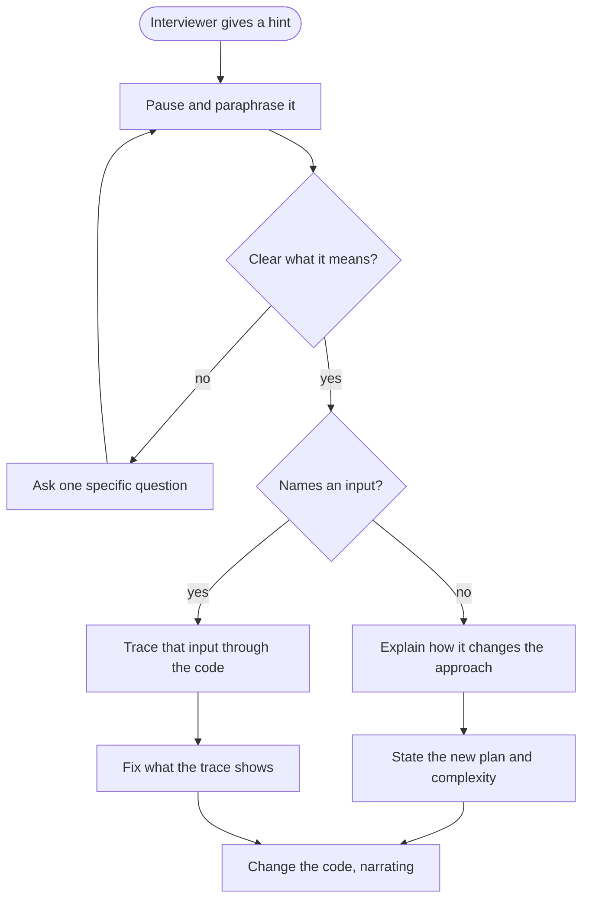

## Introduction

A coding interview is not a written exam with a silent proctor. The interviewer is watching your screen and listening, and when you head somewhere unproductive — a slow approach, a bug, a rabbit hole — they will usually say something. Sometimes it is obvious: "Have you considered a hash map?" More often it is subtle: "What's the complexity of that?", "What happens if the array has one element?", or only "Hmm, are you sure about line 12?"

Each of these is a **hint**: information the interviewer gives you to steer the session. Interviewers hint for practical reasons. They have a limited time to collect evidence about your problem solving, coding and communication, and a candidate stuck for fifteen minutes produces almost no evidence. A hint gets you moving again so they can see the rest of your skills. It also creates its own evidence: **how you take feedback**. Engineers spend their working lives receiving code-review comments and suggestions from colleagues, and an interview hint is a small, observable sample of that behaviour.

So responding to hints is a skill in its own right, separate from solving the problem. A candidate who hears "could a stack help here?", says "Right — the days still waiting for a warmer day could sit on a stack; let me think about what's on it," and adapts their plan out loud shows something valuable. A candidate who ignores the hint, argues, or silently rewrites everything shows something else. This lesson teaches you to recognise hints, respond to them well, ask for them when appropriate, and handle the cases where a hint seems wrong.

## Before you start

- **Thinking aloud** — you cannot integrate a hint visibly if you are working silently. See [[a14-thinking-aloud]].
- **Brute force and optimisation** — most hints arrive while you are moving from a brute force to something better. See [[a14-brute-force-first]] and [[a14-deriving-optimization]].
- **Complexity analysis** — after a hint changes your approach, you will re-state the complexity. See [[a14-complexity-in-interview]].
- The walkthroughs use [[a5-monotonic-stack]] and [[a3-binary-search-on-answer]]; you can follow them without having read those lessons.

## The intuition

Think of a hint as a rerouting message from a navigation app. The app has information you do not — it can see the traffic jam ahead. A good driver hears "turn left in 200 metres", checks that it makes sense, and turns. A poor driver either ignores it and drives into the jam, or swerves immediately without checking whether the turn is actually there.

The analogy has a limit, and it matters: the interviewer is not only routing you, they are also *watching how you drive*. That is why you should make your response visible — say what you understood and why it changes your plan — instead of silently changing course. A silent pivot looks the same as a lucky guess; a narrated pivot shows reasoning.

## The kinds of hint

Hints come in a few recognisable forms. Recognising the form tells you what the interviewer is probably trying to say.

| Kind | Example | What it usually means | Good first response |
|---|---|---|---|
| **Question about cost** | "What's the complexity of that?" | Your approach is slower than the target | State the complexity honestly, then ask yourself where the waste is |
| **Question about an input** | "What does this return for `[5]`?" / "for an empty tree?" | There is probably a bug on that input | Trace that exact input through your code, out loud |
| **Direction** | "Is there a way to avoid recomputing that?" / "What if the array were sorted?" | A property or technique is being pointed at, not named | Paraphrase, then connect it to your current approach |
| **Concrete suggestion** | "Could a heap help?" / "Try thinking about it from the right end." | A specific tool unlocks the problem | Say what the tool gives you in this problem, then adapt the plan |
| **Correction** | "Are you sure about this condition?" | Something on that line looks wrong to them | Re-read the line against your invariant; do not merely flip the operator |
| **Pacing** | "Let's start coding." / "We have about ten minutes." | Time is short or the discussion has gone on long enough | Wrap up the current thought in one sentence and switch |
| **Scope** | "Don't worry about input validation." / "Assume it fits in memory." | That detail is not what they want to evaluate | Acknowledge, drop it, move on |

Two cautions. First, a question is not always a hint. Interviewers sometimes ask "are you sure?" or "what's the complexity?" of a correct solution to see whether you can justify it. The right response is the same either way: check, with evidence, rather than guessing which kind of question it is. Second, hints often **escalate**. If a vague nudge does not land, the next one is more specific. An interviewer who asks "is there repeated work here?", then "what do you know about the days between i and j?", then "could a stack help?" is walking down a ladder. Responding well to the first rung costs you less than needing the third.

## How to respond: five steps

The response to almost any hint follows the same shape. It usually takes thirty seconds to a minute.

1. **Pause.** Stop typing. Finish your sentence if you were mid-thought, but do not keep going down the old path while half-listening.
2. **Paraphrase it.** Repeat the hint in your own words, applied to this problem. "So you're asking whether I can keep track of the days that haven't found a warmer day yet, instead of scanning forward from each one." This confirms you understood, and if you misunderstood, the interviewer can correct you immediately.
3. **Connect it to what you have.** Say *why* the hint helps, in terms of your current approach: "That would remove the inner scan, which is where the O(n²) comes from." This is the step that shows understanding rather than compliance.
4. **Update the plan and the complexity.** State the new approach in a sentence or two and its new cost ([[a14-complexity-in-interview]]). If you have already written code, say which parts survive.
5. **Act visibly.** Change the code or the plan while narrating ([[a14-thinking-aloud]]). Do not silently delete everything and start typing.



What to avoid is as useful as what to do:

- **"Yes, I was just about to do that."** Even when true, it sounds defensive and claims credit for the hint. "Good idea — that removes the inner loop" is better.
- **Silent compliance.** Typing the suggested data structure without explaining what it does in this problem. If the interviewer said "heap" and you add a `PriorityQueue` without saying what goes in it or why, they have learned nothing about your reasoning — and you may have misunderstood the hint.
- **Arguing to defend the old path.** If your approach is O(n²) and the interviewer is pointing towards O(n), defending the O(n²) wastes time you need for the better approach.
- **Ignoring it.** Carrying on as if nothing was said is the most damaging response, because it reads as either not listening or not being able to take input.

## Worked walkthrough 1: a hint ladder to a monotonic stack

The prompt: *"Given daily temperatures, return for each day how many days you must wait for a warmer temperature, or 0 if none."* The candidate has clarified that n can be up to 10⁵ and has written the brute force: for each day, scan forward for the first warmer day.

> **Candidate:** "For each day I scan forward until I find a warmer one. Worst case that's O(n²) — a strictly decreasing sequence scans to the end every time."
>
> **Interviewer:** "With n up to 10⁵, is that OK?"

That is a cost question — the first rung. The candidate does the arithmetic: about 5 × 10⁹ comparisons in the worst case, too slow. Now they need to find the waste.

> **Candidate:** "No, that's around 5 × 10⁹ steps. The waste is… when I scan forward from day i, I pass over days that I'll scan again later from their own position. I'm not sure yet how to reuse that."
>
> **Interviewer:** "Think about it the other way round. When you reach a warm day, which earlier days does it answer?"

A direction hint. Paraphrase and connect:

> **Candidate:** "So instead of each day looking forward for its answer, each new day looks backward and resolves the earlier days that were waiting for something warmer. Day 72 at index 5 would resolve 71 and 69 — they've been waiting, and 72 is the first thing warmer than them. And it wouldn't resolve 75, which is still waiting."

The candidate has now nearly derived it. If they still needed help, the next rung would be concrete — "Which data structure gives you the most recent waiting day first?" — but the paraphrase itself surfaces the key property:

> **Candidate:** "The waiting days, from most recent back, have non-decreasing temperatures — if a later day were warmer than an earlier waiting one, it would already have resolved it. So I always only need to compare with the most recent waiting day, and pop while it's colder. That's a stack. Each day is pushed once and popped at most once, so O(n) time, O(n) space for the stack."

```java title="DailyTemperatures.java"
import java.util.ArrayDeque;
import java.util.Arrays;
import java.util.Deque;

public class DailyTemperatures {

    // Before the hint: for each day, scan forward for a warmer one. O(n^2) worst case.
    static int[] scanForward(int[] t) {
        int[] wait = new int[t.length];
        for (int i = 0; i < t.length; i++) {
            for (int j = i + 1; j < t.length; j++) {
                if (t[j] > t[i]) {
                    wait[i] = j - i;
                    break;
                }
            }
        }
        return wait;
    }

    // After the hint: days still waiting for a warmer day sit on a stack.
    static int[] withStack(int[] t) {
        int[] wait = new int[t.length];
        Deque<Integer> waiting = new ArrayDeque<>();   // indices, temperatures non-increasing
        for (int i = 0; i < t.length; i++) {
            while (!waiting.isEmpty() && t[waiting.peek()] < t[i]) {
                int day = waiting.pop();               // day i is the first warmer day for it
                wait[day] = i - day;
            }
            waiting.push(i);
        }
        return wait;                                   // days left on the stack keep 0
    }

    public static void main(String[] args) {
        int[] t = {73, 74, 75, 71, 69, 72, 76, 73};
        System.out.println(Arrays.toString(scanForward(t)));
        System.out.println(Arrays.toString(withStack(t)));
    }
}
```

```output
[1, 1, 4, 2, 1, 1, 0, 0]
[1, 1, 4, 2, 1, 1, 0, 0]
```

Notice what the candidate did *not* do. They did not delete the brute force — it stays as a reference, and both produce the same answer on the example. They did not jump to "use a stack" before understanding why. And they re-stated the complexity after the change, with the push-once/pop-once reason. The interviewer's notes for this stretch would read something like "needed a directional hint to reverse the perspective, then derived the stack and its invariant independently" — which is a good outcome. The full technique is in [[a5-monotonic-stack]] and [[a5-next-greater-smaller]].

## Worked walkthrough 2: "what does it return for…?"

The prompt: *"Koko has piles of bananas and h hours. Each hour she eats up to k bananas from one pile. Return the minimum integer speed k that lets her finish in time."* The candidate recognises binary search on the answer ([[a3-binary-search-on-answer]]): the feasibility check "can she finish at speed k?" is monotonic in k. They write a draft searching speeds in `[0, max pile]` and trace the example `[3, 6, 7, 11]`, h = 8, getting 4. Then:

> **Interviewer:** "What does your code return for one pile of 1 banana and h = 1?"

This is an input question, and it almost always means there is a bug on that input. The wrong response is to answer from memory ("it should return 1"). The right one is to **trace it**:

> **Candidate:** "Let me trace it. `lo` is 0, `hi` is 1. `lo < hi`, so `mid = 0 + (1 − 0)/2 = 0`. Then `hoursAt(piles, 0)` divides by the speed — division by zero. Good catch. A speed of 0 is never valid, so the search range should start at 1. With `lo = 1` and `hi = 1`, the loop doesn't run and it returns 1."

```java title="KokoBananas.java"
public class KokoBananas {

    static long hoursAt(int[] piles, int speed) {
        long hours = 0;                                  // long: n * max(pile) can exceed int
        for (int p : piles) hours += (p + (long) speed - 1) / speed;   // ceiling division
        return hours;
    }

    // Draft: searches speeds in [0, max]. Correct on the example.
    static int minSpeedDraft(int[] piles, int h) {
        int lo = 0, hi = 0;
        for (int p : piles) hi = Math.max(hi, p);
        while (lo < hi) {
            int mid = lo + (hi - lo) / 2;
            if (hoursAt(piles, mid) <= h) hi = mid; else lo = mid + 1;
        }
        return lo;
    }

    // Fixed after the hint: the smallest meaningful speed is 1.
    static int minSpeed(int[] piles, int h) {
        int lo = 1, hi = 0;
        for (int p : piles) hi = Math.max(hi, p);
        while (lo < hi) {
            int mid = lo + (hi - lo) / 2;
            if (hoursAt(piles, mid) <= h) hi = mid; else lo = mid + 1;
        }
        return lo;
    }

    public static void main(String[] args) {
        int[][] piles = {{3, 6, 7, 11}, {30, 11, 23, 4, 20}, {1}};
        int[] hs = {8, 6, 1};
        for (int t = 0; t < piles.length; t++) {
            String draft;
            try {
                draft = String.valueOf(minSpeedDraft(piles[t], hs[t]));
            } catch (ArithmeticException e) {
                draft = "ArithmeticException: " + e.getMessage();
            }
            System.out.println("h=" + hs[t] + " draft=" + draft
                    + " fixed=" + minSpeed(piles[t], hs[t]));
        }
    }
}
```

```output
h=8 draft=4 fixed=4
h=6 draft=23 fixed=23
h=1 draft=ArithmeticException: / by zero fixed=1
```

The draft passes both standard examples, because on those inputs `mid` never reaches 0. The interviewer's input is exactly the one that drives `hi` down to 1 while `lo` is still 0. Tracing it found the bug in under a minute, and the fix came from reasoning about the search space ("a speed of 0 is never valid"), not from trial and error. A strong candidate then generalises without being asked: "Let me also check the other end — `hi` is the largest pile, which always works because each pile then takes one hour, and the problem guarantees h is at least the number of piles." That turns one hint into evidence of a testing habit ([[a14-edge-cases]], [[a14-manual-testing]]).

> [!TIP] Trace, don't defend
> When the interviewer names an input, assume they have a reason. Run that exact input through your code out loud, line by line. If it works, you have demonstrated a correct trace. If it fails, you have found the bug yourself — which reads far better than being told.

## Worked walkthrough 3: a hint you might misread

The prompt is Two Sum: *"Return the indices of the two numbers that add up to the target."* The candidate proposes the nested-loop brute force. The interviewer says:

> **Interviewer:** "What if the array were sorted?"

There are two reasonable readings. The interviewer might be suggesting that the candidate **sort the array** and use two pointers ([[a2-two-pointers]]). Or they might be asking a **what-if question** to see whether the candidate knows the two-pointer technique for sorted input, before steering towards a hash map. A careless candidate sorts the array and loses the original indices, which the problem asks for.

The right move is to paraphrase both the idea and its consequence:

> **Candidate:** "If it were sorted, I could put one pointer at each end and move them inwards based on whether the sum is too small or too big — O(n) after sorting. But I need the original indices, so if I sort I'd have to sort index–value pairs, making it O(n log n). Are you suggesting I sort, or thinking about a different property?"
>
> **Interviewer:** "Good point about the indices. Is there a way to get O(n) without sorting?"
>
> **Candidate:** "Then I'd store each value's index in a hash map as I go, and for each element look up `target − value`. O(n) time, O(n) space."

The clarifying question at the end is the important part. When a hint has two plausible meanings that lead to different code, **ask one short question** rather than guessing. Asking is not a weakness here; it shows that you noticed the trade-off (sorting loses indices) that the hint glossed over.

## Asking for a hint

Sometimes you are stuck and the interviewer has not said anything. Asking for help is acceptable, and handled well it is better than ten minutes of silent struggle. Two questions decide how to do it.

**When.** After you have genuinely tried: you have clarified, stated a brute force, and spent a few minutes — roughly three to five — on the optimisation without producing a new idea. Asking in the first minute, before attempting anything, removes the evidence the interviewer needs about your independent problem solving. Waiting fifteen minutes in silence wastes the time you would need to code the answer once you have it.

**How.** Show what you have tried and where exactly you are stuck, then ask a specific question. Compare:

- Weak: "I'm stuck. Can I have a hint?"
- Strong: "I have the O(n²) scan. I can see the waste is re-scanning the same days, but I can't find a way to reuse the scan results. I've considered sorting, but that loses the day order. Am I looking in the right direction?"

The strong version gives the interviewer a precise picture of your reasoning, invites a small nudge rather than the full answer, and itself demonstrates problem solving. Very often, saying it out that clearly lets you see the next step before the interviewer replies.

## When you think the hint does not apply

Interviewers are human. Occasionally a hint does not fit your approach — they might have expected a different solution, or misread your code. Disagreeing is fine; the way you disagree matters.

Use **evidence, not assertion**. Instead of "No, my code is right," say "Let me check — tracing `[2, 2]` with target 4: at index 1 the map already holds 2 → 0, so it returns `[0, 1]`. I think it handles duplicates; did you have a different case in mind?" Either the trace convinces both of you, or the interviewer names the case they were worried about and you learn something.

If the interviewer suggests a different approach while yours is correct and nearly finished, you can say so and offer a choice: "I think this version works in O(n log n) and it's almost done. Would you like me to finish it and then discuss the heap approach, or switch now?" Then do what they choose.

## Common mistakes

> [!MISTAKE] Treating a hint as a verdict
> Some candidates hear a hint, conclude "I've failed", and lose composure for the rest of the session. Hints are a normal part of most interviews. The hint itself usually matters far less than what you do in the next five minutes: integrate it, finish correct code, and test it.

**Not paraphrasing.** Without a paraphrase, neither you nor the interviewer knows whether you understood. Misread hints are a common cause of wasted time, and one sentence of paraphrase catches them.

**Adopting the suggested tool without understanding it.** Adding a heap because the interviewer said "heap", without knowing what to put in it or what order it needs, leads to code that is wrong in a new way. Ask yourself — out loud — what the tool gives you here.

**Restarting from scratch.** A hint rarely means "everything you have is wrong". Usually a part of your approach survives — the parsing, the outer loop, the base case. Say what you keep, and change only what the hint addresses.

**Forgetting to update the complexity.** After a pivot, the old complexity statement is stale. Re-state it, with the reason for the new bound.

**Asking for hints too early or too often.** Asking before attempting anything, or asking at every small obstacle, reduces the independent signal the interviewer can collect. Try first; ask with specifics.

## Interview perspective

Candidates often ask whether taking a hint lowers their score. The honest answer is that it depends on the hint and the company, but the pattern is consistent: **a small hint, well used, costs little; ignoring or fumbling a hint costs a lot**. Needing many concrete hints on an easy problem does weaken the problem-solving signal. Needing one directional nudge on a hard problem, then deriving the rest yourself, is a common profile among candidates who pass.

> [!INTERVIEW] What a strong response sounds like
> "So you're suggesting I think about which earlier days a new day resolves, rather than each day searching forward. That would mean keeping the unresolved days somewhere and checking the newest one first — a stack. Each day is pushed and popped once, so this goes from O(n²) to O(n). Let me keep the outer loop and replace the inner scan."

Questions you might be asked about this skill, especially in a behavioural or mock-interview debrief:

- **"How do you respond when the interviewer gives you a hint?"** Pause, paraphrase, connect it to your approach, update the plan and complexity, then change the code while explaining.
- **"When would you ask for a hint?"** After a genuine attempt of a few minutes with no new idea; and phrase it with what you tried and where you are stuck.
- **"What if you disagree with the interviewer?"** Show a trace or a counterexample, ask what case they had in mind, and defer to their choice about how to use the remaining time.
- **"Does needing a hint mean you'll fail?"** Not usually. What you do with it — and whether you finish with working, tested code — matters more.

```quiz
Q: The interviewer asks, "What does your function return for an array with one element?" What is the best immediate response?
- [ ] Say "It should work fine" and continue with the next part
- [x] Trace that exact input through your code out loud, line by line
- [ ] Add an if-statement that returns early for one element
- [ ] Rewrite the function using a different approach
> An input question usually means the interviewer suspects a bug on that input. Tracing it either demonstrates the code is correct or finds the bug yourself. Answering from memory skips the check, and adding a guard clause before understanding the failure may patch the symptom while leaving the real error in place.

Q: You have written an O(n²) solution and the interviewer asks, "Could a hash map help?" Which response best shows the skill being assessed?
- [ ] "Yes, I was going to do that next."
- [ ] Silently add a HashMap and start rewriting the loops
- [x] "If I store each value's index as I go, I can look up the complement in O(1) instead of scanning — that removes the inner loop and makes it O(n) time, O(n) space."
- [ ] "I think nested loops are clearer, so I'd rather keep them."
> The strong answer paraphrases the hint in the problem's terms, explains why it helps (it replaces the inner scan), and updates the complexity. Claiming you were about to do it sounds defensive; silent changes hide your reasoning; and defending a slower approach after a clear nudge wastes time.

Q: When is it most appropriate to ask the interviewer for a hint?
- [ ] Immediately after reading the problem, to save time
- [x] After clarifying, stating a brute force and trying to optimise for a few minutes without a new idea
- [ ] Never; asking for a hint always fails the interview
- [ ] Only in the last two minutes
> Asking before attempting anything removes the evidence of independent problem solving, while waiting until the end leaves no time to use the hint. After a genuine attempt, a specific request that shows what you tried is normal and often leads to a small nudge rather than the full answer.
```

## Practice

Practise responses out loud, ideally with a partner playing the interviewer ([[a14-mock-interviews]]). For each scenario, say the paraphrase, the connection to your approach and the updated complexity.

1. You have an O(n²) solution to "longest substring without repeating characters". Hint: "Do you need to restart from the next character every time?" ([[a2-sliding-window]])
2. You are sorting all n points to find the k closest to the origin. Hint: "Do you need them all sorted?" ([[a7-top-k]])
3. Your recursive Fibonacci-style solution is exponential. Hint: "Are you computing anything twice?" ([[a11-memoization]])
4. Your BFS on a grid marks cells visited when they are dequeued. Hint: "How many times can a cell end up in the queue?" ([[a8-bfs]])
5. Your Merge Intervals code fails silently on unsorted input. Hint: "What did you assume about the order?" ([[a2-intervals]])
6. Write the "ask for a hint" sentence for a problem you recently got stuck on: what you tried, where exactly you were blocked, and a specific question.

## Quick revision {#quick-revision}

- A hint is information the interviewer gives to steer you; your response is assessed as evidence of how you take feedback.
- Kinds: cost question, input question, direction, concrete suggestion, correction, pacing, scope. Hints escalate if early ones do not land.
- Respond in five steps: **pause → paraphrase → connect to your approach → update plan and complexity → act visibly**.
- Input question ("what does it return for…?") → trace that exact input out loud; it usually points at a bug.
- Ambiguous hint → ask one short question rather than guess.
- Avoid: "I was about to do that", silent rewrites, arguing for the slower approach, ignoring the hint, restarting from scratch.
- Ask for a hint after a genuine attempt of a few minutes; say what you tried and where you are stuck.
- Disagree with a trace or counterexample, not assertion; let the interviewer choose how to spend the time.

## Key takeaways {#key-takeaways}

- Hints are a normal, collaborative part of interviews; how you use one often matters more than the fact you needed it.
- Recognising the kind of hint — especially cost questions and input questions — tells you what the interviewer is seeing.
- Paraphrasing and connecting the hint to your current approach turns compliance into visible reasoning.
- After any pivot, keep what still works, change what the hint addresses, and re-state the complexity.
- Asking for a hint is fine after a real attempt, and a specific request often unlocks the next step on its own.
- When you disagree, show evidence politely and defer on how to use the remaining time.
