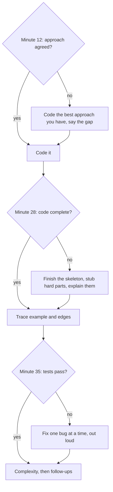

## Introduction

Solving a problem and solving it in an interview are different tasks. At home, you can spend ninety minutes on a medium problem, look things up and restart three times. In an interview you have a fixed slot — commonly 45 or 60 minutes — of which introductions and your own questions at the end take some minutes, leaving roughly **35 to 45 minutes of problem time**. Within that time you are expected to clarify, design, code, test and analyse a solution, while talking.

**Timed coding** is the skill of fitting all of that into the slot. It is mostly not about typing faster. Candidates rarely run out of time because they type slowly; they run out because they spend fifteen minutes clarifying, chase an optimal idea for twenty minutes without a fallback, or start testing with two minutes left and find a bug they cannot fix. Each of these is a **pacing decision** made badly, usually without noticing a decision was being made.

This lesson treats pacing as something you plan and practise. It gives you a time budget for a typical session, **checkpoints** that tell you when to change course, rules for what to cut, and a practice routine that builds timed stamina. The final section covers **mock interviews** — full rehearsals with another person playing the interviewer — which are how you test the whole skill set under realistic pressure.

## Before you start

This lesson ties together the rest of the module. Each phase of the budget below has its own lesson:

- Clarifying the problem: [[a14-clarifying-requirements]]
- Stating a brute force and deriving a better approach: [[a14-brute-force-first]], [[a14-deriving-optimization]]
- Talking while you work: [[a14-thinking-aloud]]
- Writing code without an IDE: [[a14-clean-coding]]
- Testing by hand and choosing edge cases: [[a14-manual-testing]], [[a14-edge-cases]]
- Stating complexity and using hints: [[a14-complexity-in-interview]], [[a14-responding-to-hints]]

The worked walkthrough uses binary search; [[a3-binary-search]] and [[a3-lower-upper-bounds]] teach it.

## The intuition

Think of a session as a short project with a fixed deadline. A sensible project lead does not polish the first feature until the deadline arrives; they plan milestones, check progress against them, and cut scope when a milestone slips. They also make sure there is *something* shippable early, then improve it.

An interview works the same way. The **shippable thing** is correct, tested code with a stated complexity — even if it is not the optimal algorithm. The **milestones** are "approach agreed", "code written" and "code tested". And the **scope you can cut** is optimisation, follow-ups and polish — never the shippable core. The analogy stops at one point: in an interview, the interviewer is a stakeholder who can see every decision as you make it. So pacing decisions should be said out loud: "We're at twenty minutes and I don't have the O(n) idea yet; I'm going to code the O(n log n) version so we have something working."

## A time budget for a 45-minute session

The table assumes about 40 minutes of problem time on one medium problem — the most common format. Treat the numbers as targets, not rules.

| Phase | Minutes | Ends with |
|---|---|---|
| Clarify: restate, ask questions, confirm example | 3–5 | Agreed spec and a one-line edge-case note |
| Approach: brute force, better idea, complexity | 5–8 | The interviewer agrees the approach is worth coding |
| Code | 12–18 | Complete code, read through once |
| Test: trace the example and one or two edges, fix bugs | 5–8 | Code you believe is correct |
| Complexity and follow-ups | 3–5 | Time and space stated; follow-up discussed |
| Buffer | 2–4 | Absorbs overruns elsewhere |

Two things in this table surprise people. First, **the approach phase is as long as the clarify phase or longer**, because a good approach discussion saves coding time: code written against an agreed plan rarely needs restarting. Second, **testing gets a real allocation**. Candidates who leave testing for "whatever time is left" usually have none, and untested code with an obvious bug is a weak ending.

### Adapting the budget

- **Easy problem (or a warm-up).** Aim for 15–20 minutes total. Clarify in one or two questions, state the approach in a sentence, code, test one edge. Interviewers often follow an easy problem with a harder one or a follow-up, so speed here buys time later.
- **Medium problem.** The table above: roughly 25–35 minutes to working, tested code, leaving time for a follow-up.
- **Hard problem.** You may not finish. Spend longer on the approach, because a correct plan with partial code is worth more than fast code for the wrong plan. Make sure the parts you do write are correct, and explain clearly what the remaining parts would do and cost.
- **Two problems in one session.** Some companies ask an easy and a medium, or two mediums, in 45–60 minutes. Halve every phase for the first problem, and keep an eye on the clock: an overrun on problem one is taken directly from problem two.
- **Online assessments (OAs).** Automated tests with no interviewer, typically a set number of problems in a fixed time. There is no one to talk to, so skip narration, read every problem first, and solve the easiest first. On platforms that score by passing test cases, a correct brute force often passes the small tests and earns partial credit when the optimal idea will not come.

## Checkpoints: when to change course

A budget is only useful if you check it. Glance at the clock at a few fixed points and apply a rule at each. These rules are what turn "I ran out of time" into decisions you made deliberately.



**Minute ~12: is the approach agreed?** If you still have no better idea than the brute force, stop searching and code the best approach you have, saying what you would improve: "I'll code the O(n²) version so we have a correct baseline; I suspect a hash map removes the inner loop, and I'll come back to it." A working baseline protects you. Many candidates who keep searching past this point end with nothing.

**Minute ~28: is the code complete?** If not, do not leave a half-written function. Write the overall structure, stub the hardest helper with a clear signature and a comment saying what it returns, and explain how you would implement it. A complete skeleton with one explained stub is easier to evaluate than half of a monolithic function.

**Minute ~35: does it pass your tests?** If a trace exposes a bug, fix the one bug and re-trace. Do not start restructuring the algorithm now. If several things are wrong, say what they are and fix the one most likely to affect typical inputs.

**The no-restart rule.** Switching to a completely new approach after roughly two-thirds of the time is almost always a mistake: you will finish neither. The exception is when the new approach is *smaller* than what is left to fix and you can state its invariant clearly — as in the rescue scenario below.

> [!IMPORTANT] Working beats optimal-but-incomplete
> A correct, tested O(n log n) solution with a clear explanation of how O(n) would work is a better outcome than an O(n) solution that does not run. Interview feedback is rarely binary; it records what you demonstrated. Make sure you demonstrate a working solution.

## Choosing an approach you can finish

Under time pressure, the best approach is not always the most elegant one. It is the one you can **implement correctly in the time you have**. When two approaches have the same complexity, prefer the one built from pieces you know well and whose correctness you can argue with an invariant.

This is not an excuse to choose a slower algorithm when the faster one is within reach. It is a reason to prefer, for example, two simple passes over one clever pass when both are O(log n) — because the clever pass has more boundary conditions, and boundary conditions are where timed code breaks. The walkthrough below shows this decision.

## Worked walkthrough: a timed medium, minute by minute

The prompt: *"An array of distinct integers, sorted ascending, has been rotated at an unknown index — for example `[4, 5, 6, 7, 0, 1, 2]`. Given a target, return its index or −1, in O(log n)."* The problem time is 40 minutes.

| Minute | What happens |
|---|---|
| 0–3 | **Clarify.** Distinct values: yes. Could it be rotated zero times, so fully sorted? Yes. Single element? Possible. Return index or −1. The candidate writes `// distinct, maybe not rotated, n >= 1, return index or -1`. |
| 3–8 | **Approach.** "Linear scan is O(n) — correct but the problem asks for O(log n). There are two binary-search approaches: a one-pass search that decides at each `mid` which half is sorted, or two phases — find the rotation point, then binary search the correct half. Both are O(log n). I'll do two phases: each phase is a standard binary search with an invariant I'm confident about, so it's less likely to have boundary bugs." The interviewer agrees. |
| 8–9 | **Edges noted.** `// edges: n = 1, not rotated, target in left run, target in right run, absent`. |
| 9–20 | **Code.** Three short methods, narrated. |
| 20–28 | **Test.** Trace the example with target 0, then `[1]` with target 0, then `[3, 1]` with target 1. |
| 28–32 | **Complexity and follow-up.** O(log n) time, O(1) space. Follow-up: "What if values can repeat?" |
| 32–40 | Buffer, used for the follow-up discussion and questions. |

The code written in minutes 9–20:

```java title="RotatedSearch.java"
public class RotatedSearch {

    // Phase 1: index of the minimum = first i with nums[i] <= nums[n - 1].
    static int pivot(int[] nums) {
        int lo = 0, hi = nums.length - 1;
        while (lo < hi) {
            int mid = lo + (hi - lo) / 2;
            if (nums[mid] <= nums[nums.length - 1]) hi = mid; else lo = mid + 1;
        }
        return lo;
    }

    // Phase 2: ordinary binary search on the closed range [lo, hi].
    static int find(int[] nums, int lo, int hi, int target) {
        while (lo <= hi) {
            int mid = lo + (hi - lo) / 2;
            if (nums[mid] == target) return mid;
            if (nums[mid] < target) lo = mid + 1; else hi = mid - 1;
        }
        return -1;
    }

    static int search(int[] nums, int target) {
        int n = nums.length;
        int p = pivot(nums);
        // Values <= nums[n-1] live in the right sorted run [p, n-1]; larger ones in [0, p-1].
        return target <= nums[n - 1] ? find(nums, p, n - 1, target) : find(nums, 0, p - 1, target);
    }

    public static void main(String[] args) {
        int[] a = {4, 5, 6, 7, 0, 1, 2};
        System.out.println(search(a, 0) + " " + search(a, 4) + " " + search(a, 3));
        System.out.println(search(new int[] {1}, 1) + " " + search(new int[] {1}, 0));
        System.out.println(search(new int[] {1, 2, 3, 4, 5}, 5) + " " + search(new int[] {3, 1}, 1)
                + " " + search(new int[] {5, 1, 3}, 5));
    }
}
```

```output
4 0 -1
0 -1
4 1 0
```

Why this design suits a timed setting:

- **`pivot` is a lower-bound search** for the first index where `nums[i] <= nums[n - 1]`. Every element of the right sorted run satisfies that condition and every element of the left run does not, so the condition is monotonic — false, false, …, true, true. That is exactly the pattern from [[a3-lower-upper-bounds]], with the half-open-style loop `lo < hi` and `hi = mid`. On a non-rotated array every element satisfies it, and `pivot` returns 0 with no special case.
- **`find` is the textbook search** from [[a3-binary-search]] on a closed range. Calling it with an empty range (`p - 1 < 0` when the array is not rotated) returns −1 immediately because the loop does not run.
- **`search` picks the half** with one comparison: any value at most `nums[n - 1]` can only be in the right run. Each phase is O(log n), so the total is O(log n), with O(1) extra space.

The output lines check, in order: target in the right run (index 4), target at the very start of the left run (index 0), an absent target, a single element present and absent, a non-rotated array with the target at the end, a two-element rotation, and a target that is alone in the left run. These came straight from the edge note written at minute 8 ([[a14-edge-cases]]).

**The follow-up.** With duplicates, `nums[mid] <= nums[n - 1]` is no longer monotonic — in `[1, 1, 1, 0, 1]`, the left run's 1s also satisfy it. The candidate says: "With duplicates, when `nums[mid]` equals the last element I can't tell which run `mid` is in, so I'd shrink `hi` by one. Worst case, all equal, that's O(n)." No code needed; the interviewer wanted to see the reasoning.

### The rescue scenario

Now replay the session with a different decision at minute 3. The candidate chooses the one-pass version — deciding at each `mid` which half is sorted and whether the target lies in it. They finish coding at minute 18, and the trace on `[5, 1, 3]` with target 5 returns −1. They adjust a comparison; now `[3, 1]` fails. At minute 26 they have changed `<` to `<=` twice and are no longer sure what the invariant is.

This is the moment the checkpoint rules exist for. Continuing to flip operators until the clock runs out is the most common failure. The candidate instead says:

> "I've been patching boundary conditions without a clear invariant, which isn't converging. I'm going to switch to two phases: find the minimum with a lower-bound search, then a normal binary search in the right half. Each part has an invariant I'm sure of, and it's about fifteen lines. That leaves me time to test."

This is a restart after the two-thirds mark, which the no-restart rule usually forbids — but it meets the exception: the replacement is *smaller* than the remaining debugging, and its correctness argument is clear. If the candidate were at minute 33 instead, the right call would be different: keep the one-pass code, say precisely which case fails and why, and state the fix they believe is needed. And if nothing were working at all, a linear scan — O(n), five lines, clearly correct — together with a clear explanation of the O(log n) plan is a better ending than broken code.

## What to cut, and what never to cut

When time is short, cut in this order:

1. **Follow-up extensions** — "what if there are duplicates" can be discussed rather than coded.
2. **Optimisation beyond the target** — constant factors and micro-optimisations.
3. **Polish** — perfect variable names, extracting a helper that is used once ([[a14-clean-coding]]).
4. **The number of test traces** — trace two inputs instead of four, but choose them well.

Never cut:

- **A working, correct core.** If the optimal version is not converging, code the simpler correct one.
- **At least one trace.** Untested code ends the interview on an unverified claim. One careful trace of the example plus one edge takes three minutes and often finds the bug ([[a14-manual-testing]]).
- **The complexity statement.** Thirty seconds, always expected ([[a14-complexity-in-interview]]).
- **Communication about pacing.** If you are behind, say so and say what you are doing about it. Interviewers also give pacing hints — "let's start coding" or "we have about five minutes" — and ignoring them is a common way to lose the session ([[a14-responding-to-hints]]).

## Building timed stamina

Timed skill is built in stages. Jumping straight to timed practice on unfamiliar patterns produces stress without learning; staying untimed forever produces candidates who know every pattern but cannot deliver one in forty minutes.

1. **Learn untimed.** The first time you meet a pattern — monotonic stack, topological sort, interval DP — study it without a clock until you can explain why it works. The DSA lessons in this track are the material for this stage.
2. **Solo timed, silent.** Pick problems of a known pattern and set a timer: 20 minutes for easy, 35–40 for medium. Stop when it rings, even if unfinished.
3. **Solo timed, aloud.** Same, but narrate as if an interviewer were listening ([[a14-thinking-aloud]]). This is slower at first; that slowdown is real and you need to train it out.
4. **Mixed timed sets.** Problems from *unknown* patterns, so recognising the pattern is part of the timed task. Curated lists such as NeetCode 150, LeetCode's study plans and the CSES problem set are commonly used sources.
5. **Mock interviews** with another person (next section).

### The practice log

After every timed session, record a few numbers and one sentence. Over a few weeks, the log shows where your time goes far more reliably than memory does.

```text
date        problem                       pattern          clarify  approach  code  test  total  done?
2026-10-02  Daily Temperatures            monotonic stack  2        9         8     4     23     yes
2026-10-03  Search Rotated Sorted Array   binary search    2        6         17    9     34     yes (2 bugs)
2026-10-05  Course Schedule II            topological      3        14        11    4     32     yes
note 10-05: approach slow - didn't see "dependencies" as a graph for 10 min
```

Read the log by phase. **Long approach times** mean pattern recognition needs work — revisit the "how to recognise" sections of the relevant DSA lessons and do mixed sets. **Long coding times** usually mean API recall or structure, not typing — see [[a14-clean-coding]]. **Long testing times or bugs found after "done"** mean the testing habit needs drilling ([[a14-manual-testing]]). Fix the slowest phase first.

> [!TIP] Re-solve rather than re-read
> When a timed attempt fails, study the solution untimed, then re-solve the same problem from scratch a few days later under the timer. Reading a solution feels like understanding; reproducing it under time pressure is the test of whether you do.

## Mock Interviews {#a14-mock-interviews}

A **mock interview** is a full rehearsal of a real interview: another person plays the interviewer, gives you a problem you have not seen, watches and listens while you solve it under the real time limit, and then gives feedback. It tests everything solo practice cannot — explaining while thinking, handling ambiguity in the prompt, taking hints, managing the clock with someone watching — and it gives you an outside view of habits you cannot see in yourself, such as long silences or skipped testing.

### Why solo practice is not enough

When you practise alone, the problem statement is complete, nobody interrupts, and nobody notices that you went silent for four minutes or never stated the complexity. In a real interview, the prompt is deliberately vague ([[a14-clarifying-requirements]]), the interviewer asks questions in the middle of your thought, and communication is assessed alongside correctness. Mocks are the only practice that reproduces those conditions. They also expose a common gap: candidates who solve problems reliably alone but lose the thread when they have to explain at the same time.

### Formats

- **Peer mocks.** Two people preparing take turns as candidate and interviewer. Free and flexible; quality depends on the partner. Swapping roles is valuable in itself — watching someone else solve a problem shows you what silence and unclear explanations look like from the other side.
- **Peer-matching platforms.** Sites that pair you with another candidate and supply problems and a feedback form. Convenient for frequent practice; partner quality varies.
- **Professional interviewers.** Paid services (interviewing.io is one well-known example) where experienced interviewers run a realistic session and give detailed feedback. Expensive, but the feedback is the most calibrated.
- **Self-mock.** Record yourself solving an unseen problem aloud under a timer, then watch it back with the rubric below. It lacks a live interviewer, but it is better than silent solo practice when no partner is available.

Mix in system design ([[d3-parking-lot]] is a design-flavoured example) and behavioural mocks if your target loop includes them; coding mocks alone do not prepare you for those rounds.

### Running a mock as the interviewer

A useful mock needs a prepared interviewer. If you play that role:

1. **Pick a problem you know well**, including its brute force, optimal solution, common bugs and a follow-up. You cannot judge a solution or give a good hint for a problem you have not solved.
2. **Give the prompt as a real interviewer would** — briefly, with one example, leaving out details the candidate should ask about.
3. **Stay mostly silent, and use a hint ladder.** If the candidate is stuck for several minutes, start with a question ("what's the complexity of that?"), then a direction, and only then a concrete suggestion. Note which rung was needed.
4. **Keep time** and give realistic pacing signals ("about ten minutes left").
5. **Take notes against a rubric**, not general impressions.

### A feedback rubric

Use the same four areas every time so that scores are comparable between sessions.

| Area | What to observe |
|---|---|
| **Problem solving** | Did they clarify the right things? Brute force first? Did they derive the better approach, and how many hints were needed? |
| **Coding** | Correct, readable code? Sensible names and structure? Java API used correctly without an IDE? |
| **Testing** | Did they trace the example? Choose meaningful edge cases? Find and fix their own bugs? |
| **Communication** | Did they think aloud? Respond well to hints? Manage and mention time? State complexity clearly? |

Score each area on a simple scale — for example 1 to 4 — and write one concrete observation per area: not "communication could improve" but "silent for about five minutes while choosing between a heap and sorting".

### Turning feedback into practice

A mock is only as useful as what changes afterwards. Keep a **feedback log** alongside your timed-practice log, and look for **themes that repeat** across mocks — "skips edge cases", "goes quiet when stuck", "runs over on approach". Then design a drill for the top theme: if you go quiet when stuck, practise the stuck script from [[a14-thinking-aloud]] on hard problems; if you skip testing, do five problems where you must trace two edges before you are allowed to run the code. Re-check the same theme in the next mock. A rising score in one rubric area across three or four mocks is the clearest evidence your preparation is working.

### Cadence and pitfalls

During the most active part of preparation — commonly the final four to eight weeks before interviews — one or two mocks a week is a sustainable rhythm alongside solo practice. Do not start mocks before you know the core patterns; a mock in which you cannot recognise anything mainly teaches anxiety. And keep mocks in proportion: they test and calibrate, but most learning still happens in untimed study and solo timed practice.

Common pitfalls are treating the mock as pass/fail rather than as data, practising only on very hard problems (which is discouraging and unrepresentative), re-using a problem you have already seen (which measures memory, not skill), and collecting feedback without ever reviewing it. Treat every mock as you would the real interview — same setup, same time limit, same seriousness — and then treat the feedback as the actual output of the session.

## Common mistakes

> [!MISTAKE] No working code when time runs out
> The most common timed failure is spending too long searching for the optimal idea with no fallback. At the first checkpoint, if the better idea has not arrived, code the best approach you have and keep thinking about the improvement while you code. A correct baseline cannot be taken away from you.

**Optimising a broken baseline.** Starting to optimise before the first version passes a trace means debugging two things at once. Make it correct, then make it fast.

**Testing in the last minute.** A trace that finds a bug with one minute left leaves you with known-broken code. Start testing by the checkpoint, not when the clock forces it.

**Restarting late.** Abandoning an approach at minute 30 for a new idea usually leaves both unfinished. Restart late only if the new approach is smaller than the remaining work and you are confident in its invariant.

**Never practising with a timer until the week before.** Pacing is a habit; it needs weeks of repetitions, not one weekend.

**Timing everything from day one.** Meeting a new pattern under a timer teaches you to panic, not the pattern. Learn untimed, then time it.

**Ignoring pacing hints.** "Let's move on to code" means the interviewer has seen enough of the discussion. Finish your sentence and start coding.

## Interview perspective

Interviewers notice time management even when they do not ask about it. A candidate who says "I'm at twenty minutes; I'll code the O(n log n) version and mention the O(n) idea at the end" demonstrates judgement. One who silently runs out of time demonstrates the opposite, regardless of how close they were.

> [!INTERVIEW] What strong pacing sounds like
> "I have a correct approach at O(n log n) and I'm not seeing O(n) yet. Since we're about twelve minutes in, I'll code this version now so we have something working, and if there's time after testing I'll come back to the linear idea — I think it involves avoiding the sort."

Questions about this skill, often asked in debriefs or by mentors:

- **"How would you split 45 minutes on a medium problem?"** Roughly 5 clarify, 5–8 approach, 15 code, 5–8 test, 3–5 complexity and follow-up, with a small buffer.
- **"You have ten minutes left and no working code. What do you do?"** Code the simplest correct approach, even a brute force; trace it once; state its complexity and the improvement you would make.
- **"How do you build timed stamina?"** Learn patterns untimed, then timed solo sets, then timed aloud, then mixed sets and mock interviews, with a log to find the slow phase.
- **"How many mocks should you do?"** About one or two per week during active preparation, after learning the core patterns, with feedback logged and drilled.

```quiz
Q: It is minute 12 of a 40-minute problem slot. You have a correct O(n²) approach but no better idea yet, and the constraints suggest O(n log n) is expected. What is the best move?
- [ ] Keep searching for the optimal idea; coding the slow version wastes time
- [x] Say you will code the O(n²) version as a correct baseline, mention what you suspect could improve it, and start coding
- [ ] Ask the interviewer for the full solution
- [ ] Start coding the optimal version and work out the details while typing
> At the first checkpoint, a working baseline protects you: if the better idea never arrives you still have correct, tested code. You can keep thinking about the improvement while coding. Continuing to search risks ending with nothing, and coding an idea whose details you have not worked out usually produces broken code.

Q: At minute 26 your one-pass solution keeps failing traces and you have patched boundary conditions twice. A two-phase approach with the same complexity is about fifteen lines and you are confident in its invariant. What should you do?
- [ ] Never restart after the halfway mark; keep patching
- [x] Say why the current version is not converging and switch to the smaller approach whose correctness you can argue
- [ ] Delete everything silently and start the new version
- [ ] Stop coding and only discuss complexity
> Late restarts are usually a mistake, but the exception applies when the replacement is smaller than the remaining debugging and has a clear invariant. Saying why you are switching shows judgement; switching silently hides it. Patching operators without an invariant rarely converges.

Q: What is the main benefit of a mock interview over solo timed practice?
- [ ] It lets you see more problems per hour
- [ ] It replaces the need to study patterns
- [x] It reproduces communication pressure, vague prompts and hints, and gives outside feedback on habits you cannot see yourself
- [ ] It guarantees you will see the same problems in the real interview
> Solo practice gives complete prompts and no listener, so it cannot test thinking aloud, clarifying or responding to hints. A mock adds those conditions and an observer who can point out silences or skipped testing. It does not replace learning patterns, and re-using known problems measures memory rather than skill.
```

## Practice

1. **Budget run.** Pick three medium problems from different patterns. Solve each with a 40-minute timer, writing the minute you reach each checkpoint. Compare against the budget table.
2. **Checkpoint drill.** Choose a hard problem. At minute 12, whatever state you are in, code the best approach you have. Note how much working code that decision produced.
3. **Rescue drill.** Take a problem with a tricky one-pass solution (for example the rotated search above, or [[a2-sliding-window]] variants). Deliberately stop at minute 25 and decide out loud: fix, simplify or fall back. Justify the choice.
4. **Two-problem set.** One easy and one medium in 45 minutes total, aloud.
5. **Practice log.** Keep the log for two weeks. Identify your slowest phase and pick the matching lesson to drill.
6. **Mock exchange.** Do one mock as candidate and one as interviewer with the same partner. As interviewer, use the rubric and the hint ladder; as candidate, write down the top theme from the feedback and design one drill for it.

## Quick revision {#quick-revision}

- Problem time is usually about 35–45 minutes after introductions and questions.
- Medium budget: clarify 3–5, approach 5–8, code 12–18, test 5–8, complexity/follow-up 3–5, buffer 2–4.
- Easy: 15–20 minutes total. Hard: longer approach; correct partial code plus a clear plan. Two problems: halve each phase for the first. OAs: no narration, easiest first, brute force for partial credit.
- Checkpoints: ~minute 12 approach agreed (else code your best and say the gap); ~minute 28 code complete (else skeleton with explained stubs); ~minute 35 tests pass (else fix one bug at a time).
- No late restarts, unless the replacement is smaller than the remaining work and its invariant is clear.
- Prefer the approach you can implement correctly in the time, when complexities are equal.
- Cut follow-ups, extra optimisation, polish and extra traces — never the correct core, one trace or the complexity statement.
- Build stamina: learn untimed → solo timed → timed aloud → mixed sets → mocks. Log time per phase; fix the slowest phase.
- Mock interviews: realistic rehearsal with feedback on problem solving, coding, testing and communication; one or two a week in active prep; log themes and drill them.

## Key takeaways {#key-takeaways}

- Timed coding is mostly about pacing decisions, not typing speed; plan them in advance with a budget and checkpoints.
- A correct, tested solution with an explained improvement beats an optimal solution that does not run.
- At each checkpoint, choose deliberately — keep going, simplify, or fall back — and say the choice out loud.
- When two approaches have the same complexity, the one built from pieces you can prove correct is the better choice under time pressure.
- Timed skill grows through staged practice and a log that shows which phase costs you time.
- Mock interviews are the only practice that tests the whole skill set under realistic conditions; their value comes from acting on recurring feedback.
