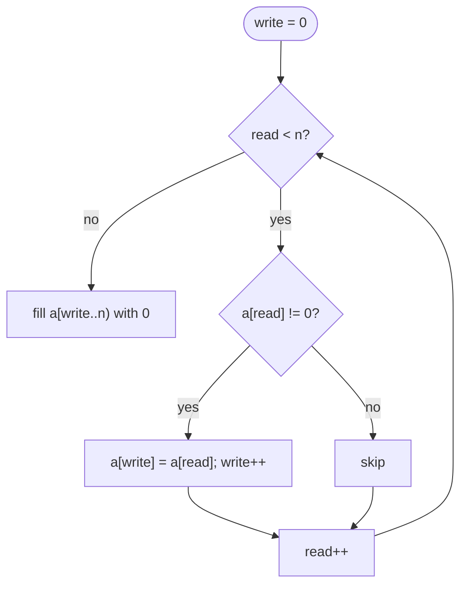

## Introduction

Give a beginner the array `[0, 1, 0, 3, 12]` and ask them to move all the zeros to the end while keeping the other numbers in order. A common first attempt is: for every zero you find, shift everything after it one place left and put the zero at the end. It works — but each shift touches up to `n` elements, and there can be up to `n` zeros, so the work grows like `n²`. On a million elements that is around a trillion operations.

The same problem can be solved by walking the array **once**, with one index that reads every element and a second index that marks where the next kept element should be written. Same input, same output, about a million operations. The difference is not a clever data structure. It is a better plan for *how to visit the elements*.

That is what this lesson is about. **Traversal** means visiting the elements of a sequence in a chosen order — left to right, right to left, or from both ends — while maintaining whatever state the problem needs: a running maximum, a carry digit, a write position, the start of the current word. Most array and string problems reduce to choosing the right traversal and the right state, and the patterns you learn here are the foundations of every later pattern in this module: [[a2-prefix-suffix]] stores the state of a traversal, [[a2-two-pointers]] runs two traversals at once, and [[a2-sliding-window]] maintains a moving range.

In real code these patterns appear wherever data is processed in sequence: parsing log lines and CSV records, normalising user input, compacting buffers, and implementing library methods like `ArrayList.removeIf` and `Collections.reverse`.

## Before you start

- **Java basics** — `for` and `while` loops, arrays, `char` arithmetic such as `c - '0'`. See [[a1-java-syntax-competitive]].
- **Strings and `StringBuilder`** — that Java `String` objects cannot be changed after creation. See [[a1-strings-stringbuilder]].
- **Big-O notation** — enough to compare O(n) with O(n²). See [[a1-time-complexity]].

## The intuition

Picture a corridor of numbered lockers. Some problems only ask you to *look*: walk down the corridor once and report the longest run of open lockers. You need one finger (your current position) and a little memory (the current run and the best run so far).

Other problems ask you to *rearrange*: move everything worth keeping to the front. Here you use two fingers. The **read finger** visits every locker. The **write finger** points at the next free spot at the front. When the read finger finds something to keep, you copy it to the write finger's locker and move the write finger forward. The read finger always runs ahead of (or level with) the write finger, so you never overwrite something you have not read yet.

The analogy stops working in one place: lockers in a corridor are easy to reverse-walk, and so are arrays — but Java strings cannot be rearranged at all. With strings, "rearranging in place" means copying into a `char[]` or building a new string with `StringBuilder`. Knowing why requires a look at how both are stored.

## How arrays and strings are stored

A Java array is a single **contiguous block of memory**: element `i` sits at a fixed offset from the start, so the address of `a[i]` is `start + i × elementSize`. That is why reading or writing `a[i]` costs O(1) no matter how large `i` is, and why scanning left to right is fast in practice — consecutive elements share CPU cache lines, so the processor fetches them in bulk. An array's length is fixed when it is created (`new int[n]`), and its elements start at default values (`0`, `false`, `null`).

A Java `String` is backed by an array too (since Java 9 it is a `byte[]`, using one byte per character when every character fits in Latin-1 and two otherwise), so `s.charAt(i)` is also O(1). The crucial difference is that a `String` is **immutable**: no method changes it. `s.toUpperCase()` returns a *new* string, and `s.toCharArray()` returns a *copy* of the characters.

Immutability has a cost that catches many people out:

```java
String result = "";
for (int i = 0; i < n; i++) {
    result += "x";          // creates a brand-new String every iteration
}
```

Each `+=` allocates a new string and copies all the existing characters into it. The copies have lengths 1, 2, 3, …, n, which add up to about n²/2 character copies — **O(n²)** for what looks like a linear loop. A `StringBuilder` keeps an internal resizable buffer; appending writes into spare capacity and only occasionally doubles the buffer, so `n` appends cost O(n) in total. Use `StringBuilder` whenever you build a string in a loop.

> [!NOTE] What a `char` is
> A Java `char` is a 16-bit UTF-16 code unit, not always a whole character. Letters outside the Basic Multilingual Plane — many emoji, for example — take two `char`s (a *surrogate pair*). Interview problems almost always restrict input to ASCII, but if an interviewer asks about Unicode, the answer is to iterate over code points with `s.codePoints()` instead of over `char`s.

## Pattern 1: one pass with running state

The simplest traversal visits each element once and updates a few variables. The art is deciding *which* variables. Ask: "if I stopped halfway through, what would I need to remember to continue correctly?"

Consider **Max Consecutive Ones**: given an array of 0s and 1s, return the length of the longest run of 1s. The naive approach starts a fresh count at every index and walks forward until it hits a 0 — O(n²) in the worst case (an array of all 1s). But notice that the run ending at index `i` is just the run ending at `i - 1` plus one, or zero if `a[i]` is 0. So the only state you need is the **current run length** and the **best run seen so far**.

```java title="MaxOnes.java"
public class MaxOnes {
    static int longestRun(int[] a) {
        int current = 0, best = 0;
        for (int x : a) {
            current = (x == 1) ? current + 1 : 0;   // extend the run or reset it
            best = Math.max(best, current);
        }
        return best;
    }

    public static void main(String[] args) {
        System.out.println(longestRun(new int[]{1, 1, 0, 1, 1, 1}));
        System.out.println(longestRun(new int[]{0, 0}));
        System.out.println(longestRun(new int[]{}));
    }
}
```

```output
3
0
0
```

The loop body does constant work, so the method is O(n) time and O(1) space. The empty array needs no special case: the loop does not run and `best` stays `0`. This "extend or reset" shape is worth recognising; with sums instead of counts it becomes [[a2-kadane]], the maximum-subarray algorithm.

## Pattern 2: choosing the direction

Left to right is the default, but some problems are naturally solved from the right because the information you need flows that way.

**Plus One** represents a number as an array of digits, most significant first — `[1, 2, 9]` means 129 — and asks for the digits of the number plus one. Addition starts at the least significant digit and carries leftwards, so the traversal must run **right to left**:

```java title="PlusOne.java"
import java.util.Arrays;

public class PlusOne {
    static int[] plusOne(int[] digits) {
        for (int i = digits.length - 1; i >= 0; i--) {
            if (digits[i] < 9) {
                digits[i]++;          // no carry needed: we are done
                return digits;
            }
            digits[i] = 0;            // 9 + 1 = 10: write 0 and carry left
        }
        // Only reached when every digit was 9, e.g. 999 -> 1000
        int[] result = new int[digits.length + 1];
        result[0] = 1;                // the rest are already 0
        return result;
    }

    public static void main(String[] args) {
        System.out.println(Arrays.toString(plusOne(new int[]{1, 2, 9})));
        System.out.println(Arrays.toString(plusOne(new int[]{9, 9})));
    }
}
```

```output
[1, 3, 0]
[1, 0, 0]
```

The early `return` matters: once a digit absorbs the carry, nothing to its left can change, so continuing would waste time. The all-nines case is the only one that needs a longer array, and Java's default value of `0` fills in the trailing digits for free.

Other right-to-left signals: "the last word in the string", "the next greater element to the right", or anything defined in terms of what comes *after* index `i`. Some problems need **both** directions — one pass to collect left-side information and another for the right side — which is exactly the idea developed in [[a2-prefix-suffix]].

## Pattern 3: in-place compaction with read and write pointers

Back to the opening problem. **Move Zeroes**: move all `0`s to the end of the array, in place, keeping the order of the non-zero elements.

### Deriving the idea

The naive version shifts the tail of the array left each time it removes a zero. The waste is that a non-zero element may be shifted many times — once for every zero before it. Instead, decide each element's final position *once*. The first non-zero element belongs at index 0, the second at index 1, and so on. So keep a counter, `write`, of how many non-zero elements have been placed; that counter is also the index where the next one goes.

Two indices now move through the array:

- `read` visits every index from left to right.
- `write` advances only when an element is kept.

The **invariant** — the statement that is true before every iteration — is:

> `a[0..write)` contains exactly the non-zero elements among `a[0..read)`, in their original order.

Because `write <= read` always holds, writing to `a[write]` can only overwrite an element that has already been read, so nothing is lost. When `read` reaches the end, the invariant says all non-zero elements are packed into `a[0..write)`, and the remaining positions only need to be filled with zeros.



```java title="MoveZeroes.java"
import java.util.Arrays;

public class MoveZeroes {
    static void moveZeroes(int[] a) {
        int write = 0;
        for (int read = 0; read < a.length; read++) {
            if (a[read] != 0) {
                a[write++] = a[read];   // place the next kept element
            }
        }
        while (write < a.length) {
            a[write++] = 0;             // everything after the kept prefix is a zero
        }
    }

    public static void main(String[] args) {
        int[] a = {0, 1, 0, 3, 12};
        moveZeroes(a);
        System.out.println(Arrays.toString(a));
    }
}
```

```output
[1, 3, 12, 0, 0]
```

### Dry run

| `read` | `a[read]` | Kept? | `write` after | Array after the step |
|---|---|---|---|---|
| 0 | 0 | no | 0 | `[0, 1, 0, 3, 12]` |
| 1 | 1 | yes | 1 | `[1, 1, 0, 3, 12]` |
| 2 | 0 | no | 1 | `[1, 1, 0, 3, 12]` |
| 3 | 3 | yes | 2 | `[1, 3, 0, 3, 12]` |
| 4 | 12 | yes | 3 | `[1, 3, 12, 3, 12]` |
| fill | | | 5 | `[1, 3, 12, 0, 0]` |

Midway through, the array contains stale copies (the second `1`, the second `3`). That is fine: they sit at or beyond `write`, in the region the invariant says nothing about, and they are overwritten later.

**Time:** `read` takes `n` steps, and the fill loop takes `n - write` steps, so the total is at most `2n` — O(n). **Space:** two integers — O(1). Compared with the shifting approach, every element is copied at most once.

### The same skeleton, different "keep" rules

The read/write pattern is a general **in-place filter**. Only the condition changes:

| Problem | Keep `a[read]` when… | Returns |
|---|---|---|
| Remove Element (`val`) | `a[read] != val` | new length `write` |
| Remove Duplicates from Sorted Array | `write == 0` or `a[read] != a[write - 1]` | new length `write` |
| Remove Duplicates, at most twice | `write < 2` or `a[read] != a[write - 2]` | new length `write` |
| Remove vowels (into a `char[]`) | `a[read]` is not a vowel | `new String(buf, 0, write)` |

Notice the duplicates rule compares against `a[write - 1]` — the last *kept* element — rather than `a[read - 1]`. For "at most once" both work, but for "at most twice" only the comparison with the kept prefix is correct, because the kept prefix is what the output will contain. Here is that version, since it shows the idea clearly:

```java title="RemoveDuplicates.java"
import java.util.Arrays;

public class RemoveDuplicates {
    // Keeps each value at most twice in a sorted array; returns the new length.
    static int removeDuplicates(int[] a) {
        int write = 0;
        for (int read = 0; read < a.length; read++) {
            if (write < 2 || a[read] != a[write - 2]) {
                a[write++] = a[read];
            }
        }
        return write;
    }

    public static void main(String[] args) {
        int[] a = {1, 1, 1, 2, 2, 3, 3, 3, 3};
        int len = removeDuplicates(a);
        System.out.println(len + " " + Arrays.toString(Arrays.copyOf(a, len)));
    }
}
```

```output
6 [1, 1, 2, 2, 3, 3]
```

Because the array is sorted, if `a[read]` equals the element two places back in the kept prefix, then the two kept elements between them are equal to it as well, so keeping it would make three.

> [!TIP] Stability comes for free
> Read/write compaction keeps elements in their original relative order (it is **stable**), because kept elements are copied in the order they are read. If the problem does not require order, a different trick — swapping unwanted elements with the last element and shrinking the array — can reduce the number of writes.

## Pattern 4: reversal

Reversing a range in place uses two indices that start at its ends and move inward, swapping as they go. When they meet or cross, every element has been swapped with its mirror partner.

```java
static void reverse(int[] a, int lo, int hi) {   // reverses a[lo..hi], inclusive
    while (lo < hi) {
        int t = a[lo];
        a[lo++] = a[hi];
        a[hi--] = t;
    }
}
```

The loop runs about `(hi - lo + 1) / 2` times. The condition is `lo < hi`, not `lo <= hi`: when they are equal, the middle element would be swapped with itself, which is harmless but pointless.

### Rotating an array by `k`

**Rotate Array** asks you to shift every element `k` places to the right, wrapping around: `[1, 2, 3, 4, 5, 6, 7]` with `k = 3` becomes `[5, 6, 7, 1, 2, 3, 4]`. Doing `k` single-step rotations is O(n·k). Copying into a second array at index `(i + k) % n` is O(n) time but O(n) space.

The reversal trick achieves O(n) time and O(1) space. Look at the target: the last `k` elements (`5 6 7`) move to the front, and the first `n - k` (`1 2 3 4`) move to the back, each block keeping its internal order. Reversing the whole array puts the blocks in the right places but leaves each block backwards; reversing each block again fixes that.

| Step | Array |
|---|---|
| Start | `[1, 2, 3, 4, 5, 6, 7]` |
| Reverse all | `[7, 6, 5, 4, 3, 2, 1]` |
| Reverse first `k = 3` | `[5, 6, 7, 4, 3, 2, 1]` |
| Reverse the remaining 4 | `[5, 6, 7, 1, 2, 3, 4]` |

```java
static void rotate(int[] a, int k) {
    int n = a.length;
    if (n == 0) return;
    k %= n;                    // rotating by n is the same as not rotating at all
    reverse(a, 0, n - 1);
    reverse(a, 0, k - 1);
    reverse(a, k, n - 1);
}
```

`k %= n` is essential. Without it, `k = 10` on a 7-element array would call `reverse(a, 0, 9)` and read past the end. With `k = 0` the middle call is `reverse(a, 0, -1)`, whose loop never runs — correct.

### Reversing the words of a string

**Reverse Words in a String**: `"  the sky   is blue "` becomes `"blue is sky the"`, with single spaces and no leading or trailing ones. Because Java strings are immutable, build the answer with a `StringBuilder`. Scanning **from the right** lets you emit words in their final order directly:

```java title="ReverseWords.java"
public class ReverseWords {
    static String reverseWords(String s) {
        StringBuilder out = new StringBuilder();
        int i = s.length() - 1;
        while (i >= 0) {
            while (i >= 0 && s.charAt(i) == ' ') i--;   // skip spaces
            if (i < 0) break;                            // only spaces were left
            int end = i;                                 // last character of a word
            while (i >= 0 && s.charAt(i) != ' ') i--;    // walk to the word's start
            if (out.length() > 0) out.append(' ');
            out.append(s, i + 1, end + 1);               // the word is s[i+1..end]
        }
        return out.toString();
    }

    public static void main(String[] args) {
        System.out.println("[" + reverseWords("  the sky   is blue ") + "]");
        System.out.println("[" + reverseWords("   ") + "]");
    }
}
```

```output
[blue is sky the]
[]
```

Each character is examined a constant number of times by the inner loops, because `i` only ever decreases — so despite the nested `while`s the method is O(n). Separating words with `if (out.length() > 0)` avoids a trailing space without needing to trim later. If the input arrived as a mutable `char[]`, the in-place version is the rotation trick again: reverse the whole buffer, then reverse each word.

## Pattern 5: comparing from both ends

A **palindrome** reads the same forwards and backwards. Checking one is a two-ended traversal: compare the first and last characters, then move both indices inward. In the **Valid Palindrome** variant, only letters and digits count and case is ignored, so `"A man, a plan, a canal: Panama"` is a palindrome. Rather than building a cleaned copy (O(n) extra space), skip unwanted characters as you go:

```java title="Palindrome.java"
public class Palindrome {
    static boolean isPalindrome(String s) {
        int lo = 0, hi = s.length() - 1;
        while (lo < hi) {
            char a = s.charAt(lo), b = s.charAt(hi);
            if (!Character.isLetterOrDigit(a)) { lo++; continue; }
            if (!Character.isLetterOrDigit(b)) { hi--; continue; }
            if (Character.toLowerCase(a) != Character.toLowerCase(b)) return false;
            lo++;
            hi--;
        }
        return true;
    }

    public static void main(String[] args) {
        System.out.println(isPalindrome("A man, a plan, a canal: Panama"));
        System.out.println(isPalindrome("race a car"));
        System.out.println(isPalindrome(".,"));
    }
}
```

```output
true
false
true
```

Every iteration moves at least one index inward, so there are at most `n` iterations: O(n) time, O(1) space. The string `".,"` contains no letters at all, so nothing is compared and the method correctly returns `true` — an empty sequence reads the same both ways. Moving indices from both ends according to a rule is the heart of [[a2-two-pointers]], which generalises this to sorted arrays.

## Pattern 6: parsing while scanning

Many string problems are tiny parsers: read characters left to right and move through phases — skip whitespace, read a sign, read digits, stop. **String to Integer (atoi)** is the classic. The rules: skip leading spaces, accept one optional `+` or `-`, read digits until a non-digit, and clamp the result to the `int` range `[-2³¹, 2³¹ − 1]` if it overflows.

The hard part is overflow. Java `int` arithmetic does not throw on overflow; it wraps silently, so `214748364 * 10 + 8` becomes a negative number. You must detect overflow **before** doing the multiplication. The new value `result * 10 + d` exceeds `Integer.MAX_VALUE` exactly when `result > (Integer.MAX_VALUE - d) / 10`, and that check uses only safe arithmetic.

```java title="Atoi.java"
public class Atoi {
    static int myAtoi(String s) {
        int i = 0, n = s.length();
        while (i < n && s.charAt(i) == ' ') i++;              // phase 1: whitespace

        int sign = 1;
        if (i < n && (s.charAt(i) == '+' || s.charAt(i) == '-')) {
            sign = (s.charAt(i) == '-') ? -1 : 1;             // phase 2: sign
            i++;
        }

        int result = 0;
        while (i < n && s.charAt(i) >= '0' && s.charAt(i) <= '9') {   // phase 3
            int d = s.charAt(i) - '0';
            if (result > (Integer.MAX_VALUE - d) / 10) {      // next step would overflow
                return sign == 1 ? Integer.MAX_VALUE : Integer.MIN_VALUE;
            }
            result = result * 10 + d;
            i++;
        }
        return sign * result;
    }

    public static void main(String[] args) {
        System.out.println(myAtoi("   -42abc"));
        System.out.println(myAtoi("91283472332"));
        System.out.println(myAtoi("-2147483648"));
        System.out.println(myAtoi("words 987"));
    }
}
```

```output
-42
2147483647
-2147483648
0
```

Trace `"-2147483648"`: after reading `214748364`, the next digit is `8`. `(2147483647 - 8) / 10` is `214748363`, and `214748364` is larger, so the method clamps to `Integer.MIN_VALUE` — which happens to be the exact answer, since the positive value `2147483648` cannot be stored as an `int` at all. The digit test is `c >= '0' && c <= '9'` rather than `Character.isDigit(c)`, because `isDigit` also accepts digits from other scripts (such as Arabic-Indic digits), for which `c - '0'` is not the digit's value.

## How the patterns fit together

| Signal in the problem | Traversal | State |
|---|---|---|
| Longest run, count, best-so-far | One pass, left to right | Current value and best value |
| Carry, "last word", answer depends on what comes after | Right to left | Carry or position |
| Remove, filter, compact, in place | Read and write pointers | `write` index |
| Rotate, reverse a range or words | Two ends inward (reversal) | `lo`, `hi` |
| Palindrome, symmetric comparison | Two ends inward | `lo`, `hi` |
| Parse numbers or tokens | Left to right in phases | Index, sign, accumulated value |

## Complexity, derived

All the patterns above share one argument: **each index only moves forward (or only backward), and each step does constant work**. If an index can take at most `n` steps and there are a constant number of indices, the total work is O(n), even when the code contains nested loops — the inner loops are spending steps from the same budget, not starting over. This is called an **amortised** argument, and you will use it again for sliding windows.

The O(n²) traps are the ones where work is *repeated*: shifting the tail of an array on every deletion, restarting a scan from every index, calling `String.substring` or `+=` in a loop (each creates a copy), or calling `list.remove(0)` on an `ArrayList` repeatedly (each shifts every remaining element).

Space is O(1) when you modify the input in place and O(n) when you build a new array or string. For strings in Java, O(n) extra space is usually unavoidable, because the input cannot be modified.

## Edge cases to check every time

- **Empty input** — does the loop simply not run, or does it read `a[0]`?
- **One element** — reversal and palindrome loops must not misbehave when `lo == hi`.
- **All elements kept / none kept** — for compaction, `write` ends at `n` or `0`.
- **`k` larger than `n`** — reduce with `k % n`, and guard `n == 0` before dividing.
- **Leading, trailing and repeated spaces** — in word problems.
- **Overflow** — accumulating digits or large sums in `int`.

```quiz
Q: Why does building a string with `result += c` inside a loop over n characters take O(n²) time in Java?
- [ ] Because `charAt` is O(n)
- [x] Because each `+=` creates a new String and copies every existing character into it
- [ ] Because the JVM must garbage-collect after every iteration
- [ ] It does not; the compiler turns it into O(n) code
> Strings are immutable, so each concatenation allocates a new string of the combined length and copies the old characters. The copies total 1 + 2 + … + n ≈ n²/2. charAt is O(1). The compiler optimises a single expression such as `a + b + c`, but it cannot remove the per-iteration copy in a loop — use StringBuilder.

Q: In read/write compaction, why is it safe to write `a[write] = a[read]` in the same array?
- [ ] Because Java copies the array before the loop starts
- [ ] Because `write` always equals `read`
- [x] Because `write <= read`, so the slot being overwritten has already been read
- [ ] It is not safe; a second array is required
> write advances only when an element is kept, while read advances every iteration, so write never overtakes read. Any element at index write has therefore already been examined, and overwriting it loses nothing.

Q: To rotate `[1, 2, 3, 4, 5]` right by `k = 7` using the three-reversal method, what must happen first?
- [ ] Reverse the first 7 elements
- [x] Reduce `k` to `k % 5 = 2`
- [ ] Return the array unchanged because k > n
- [ ] Reverse the array 7 times
> Rotating by n leaves the array unchanged, so only k % n matters. Without the reduction, reverse(a, 0, k - 1) would index past the end of the array.
```

## In real systems

**Library internals.** `ArrayList.removeIf` removes all matching elements in a single compaction pass rather than calling `remove(i)` once per match, which would shift the tail each time. `Collections.reverse` on a random-access list is the two-ends swap shown above.

**Parsing input.** Log processors, CSV readers and HTTP header parsers walk their input character by character in phases, exactly like `myAtoi`. Hand-written scanners are used in performance-sensitive code because `String.split` compiles a regular expression (except for some single-character patterns) and allocates a new string per field.

**Normalising user data.** Trimming, collapsing repeated spaces, stripping punctuation for search and building slugs from titles are all read/write filters over characters, usually written with a `StringBuilder`.

**Buffers.** Network and file code often compacts a byte buffer by moving unread bytes to the front before reading more — Java NIO's `ByteBuffer.compact()` does exactly this.

## Trade-offs and alternatives

In-place algorithms save memory but **destroy the original data**: after `moveZeroes`, the original order of zeros and non-zeros is gone. If the caller still needs the input, copy it first or return a new array; in an interview, ask whether modifying the input is allowed.

Building a new array or string is often clearer and is the only option for Java strings. It costs O(n) extra space, which rarely matters outside interviews or very large data.

Java's Stream API (`Arrays.stream(a).filter(x -> x != 0).toArray()`) expresses a filter in one line and is fine in production code, but interviewers usually want to see the loop, and streams allocate a new array. See [[a1-java-streams-interviews]] for when they help.

When a problem needs information from both sides of each index, a single traversal is not enough — store the results of a forward and a backward pass, as in [[a2-prefix-suffix]].

## Common mistakes

> [!MISTAKE] Modifying a collection while iterating over it
> Calling `list.remove(i)` inside a `for (int i = 0; i < list.size(); i++)` loop skips the element that slides into position `i`, and calling it inside a for-each loop typically throws `ConcurrentModificationException`. Use read/write compaction on arrays, or `removeIf` / an explicit `Iterator.remove()` on collections.

**Off-by-one with substring bounds.** `s.substring(a, b)` and `sb.append(s, a, b)` take an **exclusive** end. A word occupying indices `start..end` inclusive is `s.substring(start, end + 1)`.

**Forgetting that strings are immutable.** `s.toLowerCase();` on its own line does nothing useful; the result must be assigned. And `s.charAt(i) = 'x'` does not compile.

**Overflow when accumulating digits.** Check before multiplying, or accumulate into a `long` when the problem allows it.

**Treating `Character.isDigit` as "0–9".** It accepts many Unicode digits. For ASCII parsing, compare against `'0'` and `'9'`.

**Missing `k % n` in rotation**, and dividing by `n` when the array is empty.

## Interview perspective

Traversal problems are often the warm-up question, and interviewers use them to judge how carefully you handle boundaries. State up front whether you will modify the input, which direction you will scan, and what your state variables mean.

> [!INTERVIEW] Narrate the invariant
> "I'll keep `write` as the length of the kept prefix: everything before `write` is a non-zero element in its original order. `read` moves every step; `write` moves only when I keep something, so it never overtakes `read`."

Questions to be ready for:

- **Move Zeroes / Remove Element / Remove Duplicates** — read/write compaction; follow-up: minimise the number of writes.
- **Rotate Array in O(1) extra space** — three reversals, and explain why they work.
- **Reverse Words in a String** — scan from the right with a `StringBuilder`; follow-up: do it in place on a `char[]`.
- **Valid Palindrome** — skip non-alphanumerics from both ends; follow-up: allow deleting at most one character (try skipping either side once at the first mismatch).
- **String to Integer** — phases plus an overflow check before the multiplication.
- **"What about Unicode?"** — iterate code points rather than `char`s.

## Practice

1. **Remove Element.** Remove every occurrence of `val` in place and return the new length.
2. **Squares of a Sorted Array.** Given a sorted array that may contain negatives, return the sorted squares in O(n). Hint: the largest square is at one of the two ends.
3. **Length of Last Word.** Scan from the right; handle trailing spaces.
4. **Reverse Words in place.** Given a `char[]` with words separated by single spaces, reverse the word order without a second buffer.
5. **Compress a string.** Turn `['a','a','b','c','c','c']` into `['a','2','b','c','3']` in place and return the new length; counts of 10 or more use several characters.

The DSA explorer lists the matching problems under this topic; start with *Move Zeroes*, *Rotate Array* and *Valid Palindrome*.

## Quick revision {#quick-revision}

- Arrays: contiguous memory, O(1) `a[i]`, fixed length, default values.
- Java `String` is immutable: `+=` in a loop is O(n²); use `StringBuilder` (amortised O(1) append) or a `char[]`.
- One pass with running state: decide what you must remember to continue from any point.
- Right-to-left when the answer flows from the end (carry, last word, "to the right of i").
- In-place filter: `read` visits all, `write` advances only on keep; invariant `a[0..write)` is the kept prefix; stable.
- Duplicates "at most k times" in sorted input: compare with `a[write - k]`.
- Reverse a range: swap ends while `lo < hi`. Rotate right by k: `k %= n`, reverse all, reverse `[0, k)`, reverse `[k, n)`.
- Palindrome: two ends inward, skip ignored characters.
- Parsing: phases (spaces, sign, digits); overflow check `result > (MAX - d) / 10` before multiplying.
- Nested loops are still O(n) when every index only moves one way.

## Key takeaways {#key-takeaways}

- Most array and string problems are solved by choosing a traversal order and the minimum state needed to continue from any point.
- The read/write pointer pattern filters in place in O(n) time and O(1) space by deciding each element's final position once.
- Reversal is a building block: it rotates arrays and reorders words without extra memory.
- Java strings cannot be modified, so build output with `StringBuilder` and never concatenate in a loop.
- Integer overflow is silent in Java; detect it before the arithmetic that would cause it.
- Count work by how far each index can move, not by how many loops the code has.
