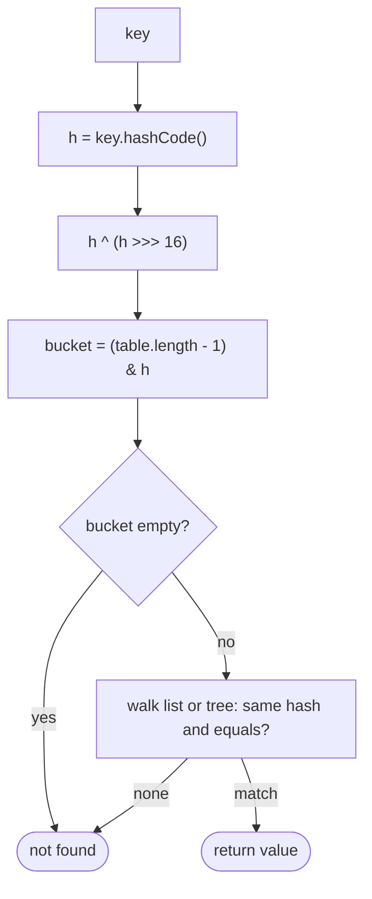

## Introduction

Here is a problem every interviewer knows: given an unsorted array of integers and a target, find two elements that add up to the target. The brute force tries every pair — O(n²). Sorting and using two pointers ([[a2-two-pointers]]) is O(n log n), but sorting scrambles the original indices, which the problem asks for.

Think about what the brute force is really doing. When it reaches the element `7` with a target of `9`, it is asking: "is there a `2` somewhere earlier?" — and it answers by scanning. If you could answer that question *instantly*, one pass over the array would be enough: for each element `x`, ask whether `target - x` has already been seen, then remember `x`.

A **hash table** is the data structure that answers "is this value here, and what is stored with it?" in **O(1) time on average**, regardless of how many values it holds. In Java you use it through `HashMap` (key → value) and `HashSet` (keys only). This lesson is about using it as a problem-solving tool: **hashing trades O(n) extra memory for the ability to look anything up in constant time**, and that trade turns a large family of O(n²) problems into O(n) ones.

You will meet the pattern constantly: deduplication, caches, counting ([[a2-frequency-counting]]), detecting repeats inside a [[a2-sliding-window]], and — with prefix sums — counting subarrays with a given sum, which windows cannot do when numbers are negative.

## Before you start

- **`HashMap` and `HashSet` APIs** — `put`, `get`, `containsKey`, `getOrDefault`, `merge`, `add`. See [[a1-hashmap]] and [[a1-hashset]].
- **Frequency counting** — tallying values in a map. See [[a2-frequency-counting]].
- **Prefix sums** — `P[i + 1] = P[i] + a[i]` and why `P[r + 1] - P[l]` is a range sum. See [[a2-prefix-suffix]].

## The intuition

Think of a cloakroom. When you hand over your coat, the attendant does not put it at the end of a long rail and later search the rail for it. They hang it on hook number 47 and give you a ticket saying 47. When you return, they go straight to hook 47. The ticket is computed once and leads directly to the right place.

A hash table works the same way. A **hash function** turns a key — a number, a string, an object — into an integer, and that integer, reduced to the table's size, picks a **bucket** (a hook). Storing and finding a key both mean "compute the bucket, go there". No scanning.

Where the analogy stops working: a cloakroom gives every coat its own hook, but a hash table has far fewer buckets than possible keys, so different keys sometimes land in the same bucket. That is called a **collision**, and handling it well is what separates a fast hash table from a slow one.

## How a hash table works

### From key to bucket

Java's `HashMap` keeps an array of buckets called the **table**. To find a key's bucket it does three things:

1. Call `key.hashCode()`, which returns an `int`.
2. Mix the high bits into the low bits: `h ^ (h >>> 16)`. This matters because the next step only uses the low bits, and some hash codes differ only in their high bits.
3. Take `(table.length - 1) & h`. The table length is always a power of two, so this keeps the low bits — the same as `h mod table.length` for non-negative numbers, but cheaper.

For example, with a table of 16 buckets, a key whose mixed hash is `994` goes to bucket `994 & 15 = 2`.

### Collisions

Two different keys can map to the same bucket — either because their hash codes are equal (in Java, `"Aa".hashCode()` and `"BB".hashCode()` are both `2112`) or because different hash codes share the same low bits. Java's `HashMap` uses **separate chaining**: each bucket holds a small linked list of entries. To look up a key, it goes to the bucket and walks the list, comparing first the stored hash and then, if those match, calling `equals`.

Since Java 8, a bucket whose list grows to 8 entries is converted into a small balanced tree (a red-black tree), provided the table has at least 64 buckets; otherwise the table is resized instead. For keys that implement `Comparable`, lookups in such a bucket take O(log n) rather than O(n). This protects against inputs crafted to collide.

The other main strategy, **open addressing**, stores entries directly in the array and, on a collision, probes other slots (the next one, for instance) until it finds a free one. Python's `dict` and Java's `IdentityHashMap` use open addressing.

### Load factor and resizing

If the table never grew, chains would get longer as keys were added and lookups would slow down. The **load factor** is the ratio of entries to buckets. `HashMap` starts with 16 buckets (allocated on the first `put`) and a maximum load factor of 0.75: once it holds more than 12 entries, it **doubles** the table to 32 and redistributes every entry. Resizing costs O(n), but because the table doubles each time, the total cost of all resizes while inserting `n` keys is O(n) — so each insertion is **O(1) amortised**. If you know roughly how many keys you will insert, `new HashMap<>(expectedSize * 4 / 3 + 1)` avoids the intermediate resizes (Java 19 added `HashMap.newHashMap(expectedSize)` to do that calculation for you).



### What "O(1) on average" really means

Operations are O(1) **on average**, assuming the hash function spreads keys evenly so that chains stay short. In the worst case — every key colliding — a lookup is O(n) with plain chaining, or O(log n) in a Java tree bucket with comparable keys. In practice, with Java's built-in types and a sensible `hashCode`, you can treat `get`, `put`, `containsKey` and `remove` as O(1) when analysing algorithms, and say "average" when you do.

Deeper detail on resizing and collision handling lives in [[c1-hashmap-internals]], [[c1-hash-collision]] and [[c1-hashmap-resize]].

## Keys: equals, hashCode and immutability

A hash table can only find a key again if two rules hold. They are called the **equals/hashCode contract**:

1. If `a.equals(b)`, then `a.hashCode() == b.hashCode()`. Equal keys must land in the same bucket.
2. A key's `hashCode` and `equals` results must not change while it is in the table.

Java's `String`, `Integer`, `Long`, `List` and records all follow the contract with **content-based** equality. Arrays do **not**: `int[]` uses identity, so two arrays with the same elements are different keys. A class you write yourself also uses identity unless you override both `equals` and `hashCode` — overriding only `equals` breaks rule 1, and equal objects end up in different buckets. See [[c8-equals-hashcode]] and [[c1-hashcode]] for how to write them.

### Composite keys

Problems often need a key made of several values — a grid cell `(row, col)`, a state `(position, remainingFuel)`. Three good options:

- **A record** (Java 16+): `record Cell(int row, int col) {}` generates correct `equals` and `hashCode` from its fields. This is the clearest choice.
- **A packed `long`**: `((long) row << 32) | (col & 0xffffffffL)` combines two `int`s into one unique `long`, avoiding object allocation per key.
- **A string**: `row + "," + col`. Easy and correct, but it allocates and hashes a string each time.

### Never mutate a key

Rule 2 is broken when you change an object after using it as a key. The entry was filed under the old hash, and lookups now compute the new one.

```java title="MutableKey.java"
import java.util.ArrayList;
import java.util.HashMap;
import java.util.List;
import java.util.Map;

public class MutableKey {
    public static void main(String[] args) {
        List<Integer> key = new ArrayList<>(List.of(1, 2));
        Map<List<Integer>, String> map = new HashMap<>();
        map.put(key, "found");

        key.add(3);                                   // mutates a key that is inside the map

        System.out.println(map.get(key));             // searches the bucket for [1, 2, 3]
        System.out.println(map.get(List.of(1, 2)));   // right bucket, but equals now fails
        System.out.println(map.size());
    }
}
```

```output
null
null
1
```

The entry is still in the map — `size()` is 1 — but nothing can find it. `get(key)` hashes `[1, 2, 3]` and looks in a different bucket; `get(List.of(1, 2))` finds the right bucket, but the stored key is now `[1, 2, 3]`, so `equals` fails. Use immutable keys (strings, records, `List.of(...)`), or copy a mutable list before using it as a key.

## Pattern 1: membership — "have I seen this?"

The simplest use is a `HashSet` of values seen so far. **Contains Duplicate** asks whether any value appears twice. Sorting and comparing neighbours is O(n log n); a set makes it O(n):

```java
static boolean containsDuplicate(int[] nums) {
    Set<Integer> seen = new HashSet<>();
    for (int x : nums) {
        if (!seen.add(x)) return true;   // add returns false if x was already present
    }
    return false;
}
```

`Set.add` returning a `boolean` lets one call both check and insert. The same idea detects cycles in sequences of states — "Happy Number" repeatedly replaces a number with the sum of the squares of its digits and stops when a value repeats.

## Pattern 2: complement lookup — Two Sum

Back to the opening problem. For each element `x` at index `i`, the partner it needs is `target - x`, the **complement**. Store each value with its index in a map; at every step, look up the complement before storing the current element.

```java title="TwoSum.java"
import java.util.Arrays;
import java.util.HashMap;
import java.util.Map;

public class TwoSum {
    static int[] twoSum(int[] nums, int target) {
        Map<Integer, Integer> indexOf = new HashMap<>();   // value -> index where seen
        for (int i = 0; i < nums.length; i++) {
            int need = target - nums[i];
            Integer j = indexOf.get(need);
            if (j != null) return new int[]{j, i};         // partner seen earlier
            indexOf.put(nums[i], i);                       // insert only after checking
        }
        return new int[]{-1, -1};
    }

    public static void main(String[] args) {
        System.out.println(Arrays.toString(twoSum(new int[]{2, 7, 11, 15}, 9)));
        System.out.println(Arrays.toString(twoSum(new int[]{3, 2, 4}, 6)));
        System.out.println(Arrays.toString(twoSum(new int[]{3, 3}, 6)));
    }
}
```

```output
[0, 1]
[1, 2]
[0, 1]
```

The order **check, then insert** is what makes the method correct. In `[3, 2, 4]` with target 6, if `3` were inserted before checking, the lookup for its complement `3` would find the element itself and return `[0, 0]`. Checking first means the map only ever holds *earlier* elements, so an element can never pair with itself. And because every pair is found when its *second* element is visited, the earlier element is guaranteed to be in the map by then — no pair is missed. The `[3, 3]` case shows duplicates work: the first `3` is stored at index 0, and the second finds it.

| `i` | `nums[i]` | `need` | Map before the check | Result |
|---|---|---|---|---|
| 0 | 3 | 3 | `{}` | not found; store `3 → 0` |
| 1 | 2 | 4 | `{3: 0}` | not found; store `2 → 1` |
| 2 | 4 | 2 | `{3: 0, 2: 1}` | found at 1; return `[1, 2]` |

**Time:** one pass with O(1) average map work per element — O(n). **Space:** up to `n` entries — O(n). Compared with sorting plus two pointers, this keeps the original indices and avoids the O(n log n) sort, at the cost of memory.

The complement idea generalises: "pairs with difference `k`" looks up `x - k` and `x + k`; "pairs whose sum is divisible by `k`" looks up the complementary *remainder*.

## Pattern 3: value → index — "where did I last see it?"

Storing an index instead of a count answers questions about distance. **Contains Duplicate II** asks whether two equal values occur at most `k` positions apart. Keep each value's most recent index; when a value reappears, compare the gap.

```java
static boolean containsNearbyDuplicate(int[] nums, int k) {
    Map<Integer, Integer> lastIndex = new HashMap<>();
    for (int i = 0; i < nums.length; i++) {
        Integer prev = lastIndex.put(nums[i], i);   // put returns the previous value, or null
        if (prev != null && i - prev <= k) return true;
    }
    return false;
}
// [1, 2, 3, 1], k = 3 -> true;   [1, 2, 3, 1, 2, 3], k = 2 -> false
```

Only the *most recent* index matters: if the latest occurrence is too far away, every older one is farther still. The same value-to-last-index map powers the "jump" version of Longest Substring Without Repeating Characters in [[a2-sliding-window]].

## Pattern 4: prefix sums plus a hash map

This is the most important pattern in the lesson. **Subarray Sum Equals K**: count the contiguous subarrays whose sum is exactly `k`. The numbers **can be negative**.

### Why the obvious tools fail

Checking every subarray is O(n²) even with prefix sums. A sliding window does not work, because with negative numbers, growing or shrinking a window can move the sum in either direction — there is no safe rule for when to shrink (see the monotonicity section of [[a2-sliding-window]]).

### Deriving the idea

Let `P[j]` be the sum of the first `j` elements, with `P[0] = 0`. The subarray from index `i` to `j - 1` sums to `P[j] - P[i]`. So:

```text
sum(i .. j-1) == k    ⟺    P[i] == P[j] - k
```

Read that as a complement lookup. Walking left to right, when the running prefix sum is `P[j]`, every *earlier* prefix sum equal to `P[j] - k` marks the start of a subarray ending here with sum `k`. So keep a map from **prefix-sum value to how many times it has occurred**, and at each step add `count[P[j] - k]` to the answer.

The map must start as `{0: 1}`. That entry is `P[0]`, the sum of the empty prefix, and it is what lets subarrays **starting at index 0** be counted: when the running sum itself equals `k`, the lookup for `sum - k = 0` must find it.

```java title="SubarraySumK.java"
import java.util.HashMap;
import java.util.Map;

public class SubarraySumK {
    static int subarraySum(int[] nums, int k) {
        Map<Long, Integer> prefixCount = new HashMap<>();
        prefixCount.put(0L, 1);                     // the empty prefix, P[0] = 0
        long sum = 0;                               // long: prefix sums can exceed int range
        int count = 0;
        for (int x : nums) {
            sum += x;
            count += prefixCount.getOrDefault(sum - k, 0);   // earlier starts that work
            prefixCount.merge(sum, 1, Integer::sum);         // record this prefix after use
        }
        return count;
    }

    public static void main(String[] args) {
        System.out.println(subarraySum(new int[]{1, 2, 3}, 3));
        System.out.println(subarraySum(new int[]{1, -1, 0}, 0));
        System.out.println(subarraySum(new int[]{3, 4, 7, 2, -3, 1, 4, 2}, 7));
    }
}
```

```output
2
3
4
```

Dry run on `[1, -1, 0]` with `k = 0`:

| Element | Running `sum` | Look up `sum - k` | Map before the lookup | Found | `count` |
|---|---|---|---|---|---|
| 1 | 1 | 1 | `{0: 1}` | 0 | 0 |
| −1 | 0 | 0 | `{0: 1, 1: 1}` | 1 (`[1, -1]`) | 1 |
| 0 | 0 | 0 | `{0: 2, 1: 1}` | 2 (`[0]` and `[1, -1, 0]`) | 3 |

At the last step the prefix sum 0 has occurred twice before — at the very start and after `[1, -1]` — so two subarrays ending at the `0` sum to zero. The update order matters just as in Two Sum: look up first, then record the current prefix, so that the empty subarray is never counted (with `k = 0` it would otherwise add one spurious match per element).

**Time:** O(n) average. **Space:** O(n) for the map. This beats sliding window because it does not rely on monotonicity, so negative numbers are fine.

Two close relatives use the same derivation:

- **Longest subarray with sum `k`**: store the *first* index at which each prefix sum occurs (do not overwrite it later, since earlier means longer), and the length is `j - firstIndex[P[j] - k]`.
- **Subarray sums divisible by `k`**: two prefix sums give a divisible subarray when they have the same remainder mod `k`, so count remainders. In Java, `%` can return a negative result for negative numbers; normalise with `((sum % k) + k) % k`.

## Pattern 5: canonical keys and grouping

When the question is "which items are equivalent?", compute a **canonical key** that all equivalent items share and group them in a `Map<Key, List<Item>>`. Group Anagrams, taught in [[a2-frequency-counting]], keys each word by its letter counts. Other examples: group shifted strings by the differences between consecutive letters; group points on the same line through the origin by their reduced slope `(dy / g, dx / g)` where `g` is the greatest common divisor. The skill is choosing a key that keeps exactly the information that defines equivalence and nothing else.

## Pattern 6: building sequences from a set — Longest Consecutive Sequence

**Longest Consecutive Sequence**: given an unsorted array, find the length of the longest run of consecutive integers (in value, not position). For `[100, 4, 200, 1, 3, 2]` the answer is 4: `1, 2, 3, 4`. The problem asks for O(n) time, which rules out sorting.

Put every value in a `HashSet`. A naive extension — from every value, count upwards while the next value exists — can be O(n²): in `[1, 2, …, n]`, the walk from 1 takes `n` steps, from 2 takes `n - 1`, and so on.

The fix is to **only start counting at the beginning of a run**: a value `x` starts a run exactly when `x - 1` is not in the set. Then each run is walked once, from its start.

```java title="LongestConsecutive.java"
import java.util.HashSet;
import java.util.Set;

public class LongestConsecutive {
    static int longestConsecutive(int[] nums) {
        Set<Integer> values = new HashSet<>();
        for (int x : nums) values.add(x);

        int best = 0;
        for (int x : values) {                    // iterate the set: duplicates collapse
            if (values.contains(x - 1)) continue; // x is not the start of a run
            int length = 1;
            while (values.contains(x + length)) length++;
            best = Math.max(best, length);
        }
        return best;
    }

    public static void main(String[] args) {
        System.out.println(longestConsecutive(new int[]{100, 4, 200, 1, 3, 2}));
        System.out.println(longestConsecutive(new int[]{0, 3, 7, 2, 5, 8, 4, 6, 0, 1}));
    }
}
```

```output
4
9
```

**Why it is O(n):** the `while` loop only runs from run starts, and each value belongs to exactly one run, so across the whole method the `while` body runs at most `n` times in total. Together with one O(1) `contains` check per value, that is O(n) average time — the same amortised argument as the sliding window. Iterating over the set rather than the array matters when there are many duplicates: iterating the array could start the same run once per duplicate of its first value.

## In real systems

**Caches.** An in-memory cache is a hash map from key to value; Redis is, at its core, a large hash table keyed by strings, and Java's `ConcurrentHashMap` backs many application-level caches. See [[d7-caching-strategies]].

**Database joins and indexes.** A **hash join** builds a hash table on the smaller table's join key, then streams the larger table and looks up each row — exactly the complement-lookup pattern, at scale ([[c7-nested-loop-hash-merge]]). PostgreSQL also offers hash indexes for equality lookups ([[c7-hash-indexes]]).

**Deduplication.** Idempotency keys for payment APIs, "have we processed this message already?" checks in message consumers, and duplicate-file detection all store seen keys in a hash set (or a hash-indexed table).

**Hash flooding.** If attackers can choose keys that collide, they can make each insertion O(n) and slow a server to a crawl. Python randomises string hashing per process (since Python 3.3) for this reason. Java's `String.hashCode` is deterministic, and Java relies instead on converting overloaded buckets into trees.

Hashing in data structures is different from **cryptographic hashing** (SHA-256) and **password hashing** (bcrypt, Argon2), which aim to make collisions and reversal infeasible rather than to be fast — see [[c9-password-hashing]]. **Consistent hashing**, which distributes keys across servers, is another distinct idea ([[d4-consistent-hashing]]).

## Trade-offs and alternatives

| Need | Hashing | Alternative |
|---|---|---|
| Pair sum, unsorted, need indices | O(n) time, O(n) space | Sort + two pointers: O(n log n), O(1) space, loses indices |
| Pair sum, already sorted | Works, but wastes memory | Two pointers: O(n), O(1) space |
| Keys are small integers `0..m` | Works | A plain array of size `m + 1`: faster, no hashing |
| Ordered queries (next larger key, range) | Not supported | `TreeMap`: O(log n), keeps keys sorted ([[a1-treemap]]) |
| Membership over huge data, false positives acceptable | Too much memory | Bloom filter |
| Subarray sum with negatives | Prefix sums + map: O(n) | Sliding window does not apply |

Hash tables use noticeably more memory than arrays: each `HashMap` entry is a separate object holding the key, value, hash and a next pointer, plus boxed keys and values for primitives. Iteration order of `HashMap` is unspecified and can change between Java versions; use `LinkedHashMap` for insertion order or `TreeMap` for sorted order when output order matters.

## Common mistakes

> [!MISTAKE] Inserting before checking
> In Two Sum and in prefix-sum counting, storing the current element before looking up its complement lets an element match itself. Look up first, then insert.

**Forgetting `{0: 1}`** in prefix-sum counting, which misses every subarray that starts at index 0.

**Overflowing prefix sums.** Use `long` for running sums of many `int`s, and make the map's key type `Long` to match — `map.get(sum - k)` with an `int` argument on a `Map<Long, …>` boxes to `Integer` and never finds a `Long` key.

**Using arrays or mutable objects as keys.** Arrays compare by identity; mutated keys become unreachable. Use strings, records or immutable lists.

**Overriding `equals` without `hashCode`.** Equal objects land in different buckets and lookups fail.

**Comparing boxed values with `==`.** `map.get(a) == map.get(b)` compares `Integer` references and is only reliably true for values in the cache range −128 to 127. Use `.equals` or unbox to `int`.

**Relying on `HashMap` iteration order** in output.

## Interview perspective

Hashing is the most common optimisation step in coding interviews. The expected narrative is: brute force, notice the repeated search, replace it with a hash lookup, then state the time–space trade-off.

> [!INTERVIEW] Name the question the map answers
> "For each element, the brute force searches backwards for `target - x`. I'll keep a map from value to index of everything I've seen, so that search becomes an O(1) average lookup. I check before inserting, so an element can't pair with itself. That's O(n) time and O(n) space."

Expect:

- **Two Sum** — check-then-insert; follow-up: the array is sorted (two pointers, O(1) space).
- **Subarray Sum Equals K** — derive `P[i] = P[j] - k`; explain `{0: 1}` and why sliding window fails with negatives.
- **Longest Consecutive Sequence** — start only where `x - 1` is absent; explain the O(n) bound.
- **Contains Duplicate II** — last-seen index.
- **Group Anagrams** — key design.
- **"Why is HashMap O(1)? When is it not?"** — hashing to buckets, load factor and resizing (amortised), collisions, Java 8 tree bins.
- **"Design a key for a grid cell."** — record, packed `long` or string, with trade-offs.

## Practice

1. **Happy Number.** Detect a repeating state with a `HashSet` (then try the O(1)-space fast/slow pointer version).
2. **Isomorphic Strings.** Two maps, one in each direction, to check a one-to-one character mapping.
3. **Continuous Subarray Sum.** Does a subarray of length at least 2 have a sum divisible by `k`? Store the first index of each remainder.
4. **Contiguous Array.** Longest subarray with equal numbers of 0s and 1s: map 0 to −1 and find the longest subarray summing to 0.
5. **4Sum II.** Count tuples from four arrays summing to 0 in O(n²) by hashing all pair sums of the first two arrays.

The DSA explorer lists the matching problems under this topic; start with *Two Sum*, *Subarray Sum Equals K* and *Longest Consecutive Sequence*.

```quiz
Q: In the hash-map Two Sum, why must the lookup of `target - nums[i]` happen before inserting `nums[i]`?
- [ ] Because HashMap.put is slower than get
- [x] So the map holds only earlier elements, and an element can never be paired with itself
- [ ] Because inserting first would overwrite the target
- [ ] The order does not matter
> If nums[i] were inserted first, an element equal to target / 2 would find itself, returning the same index twice. Checking first is also complete: every pair is found when its second element is visited, by which time the first is in the map.

Q: Subarray Sum Equals K initialises the map with {0: 1}. What would go wrong without it?
- [ ] Negative numbers would cause an exception
- [ ] The answer would double-count every subarray
- [x] Subarrays starting at index 0 would never be counted, because their start corresponds to the empty prefix with sum 0
- [ ] Nothing; it is only an optimisation
> A subarray from index 0 to j has sum P[j+1] - P[0], and P[0] = 0. The lookup for sum - k = 0 must find that empty prefix, which only exists in the map if it is added before the loop.

Q: A List<Integer> is used as a HashMap key and then modified with add(). What happens on a later get with the same list?
- [ ] The map automatically rehashes the key
- [x] It usually returns null, because the lookup uses the new hash code while the entry is filed under the old one
- [ ] It throws ConcurrentModificationException
- [ ] It returns the value, because the reference is the same
> HashMap stores each entry in a bucket chosen from the key's hash at insertion time. Changing the list changes its hashCode, so lookups go to a different bucket, and even in the right bucket equals no longer matches the original contents. Keys must be immutable.

Q: Why is Java's HashMap.put described as O(1) amortised rather than always O(1)?
- [ ] Because hashing a key takes O(log n)
- [x] Because occasionally the table doubles and every entry is redistributed, an O(n) step whose cost averages out to O(1) per insertion
- [ ] Because put must scan the whole table for duplicates
- [ ] Because HashMap is backed by a sorted tree
> Resizing happens when the size exceeds capacity × load factor (0.75). Because capacity doubles, the resize costs over n insertions add up to O(n) in total, so each insertion is O(1) on average across the sequence, ignoring collisions.
```

## Quick revision {#quick-revision}

- Hash table: `hashCode()` → mix (`h ^ (h >>> 16)`) → bucket `(length - 1) & h`; average O(1) get/put/contains/remove.
- Java `HashMap`: separate chaining; capacity 16, load factor 0.75, doubles on resize (O(1) amortised); since Java 8, bins of 8+ become trees when capacity is at least 64.
- Worst case O(n) per operation with collisions (O(log n) in a tree bin with comparable keys).
- Contract: equal keys → equal hash codes; never mutate a key. Arrays use identity — do not use them as keys. Composite keys: record, packed `long`, or string.
- Membership: `HashSet.add` returns `false` for a repeat.
- Complement (Two Sum): look up `target - x`, *then* insert `x`; O(n) time, O(n) space; keeps indices.
- Last-seen index: `Integer prev = map.put(x, i)`; only the latest index matters for "within k".
- Prefix sums + counts: start `{0: 1}`; add `count[sum - k]`, then record `sum`; works with negatives; use `long`/`Long`.
- Longest subarray with sum k: store the first index of each prefix sum. Divisible by k: count normalised remainders.
- Longest Consecutive Sequence: set; start only where `x - 1` is absent; O(n).
- Prefer arrays for small integer keys, two pointers for sorted pair sums, `TreeMap` for ordered queries.

## Key takeaways {#key-takeaways}

- Hashing replaces an O(n) search with an O(1) average lookup by computing where a key lives instead of looking for it.
- Average O(1) relies on a good hash function, a bounded load factor and amortised resizing; collisions make the worst case slower.
- Correct keys need consistent `equals` and `hashCode` and must never change while stored.
- The core patterns are membership, complement lookup, last-seen index, prefix sums with counts, canonical grouping and set-based sequence building.
- In complement and prefix-sum patterns, look up before inserting so an element never matches itself.
- Prefix sums with a hash map count subarrays with a given sum even when numbers are negative, where sliding windows fail.
- Hashing costs O(n) memory; choose sorting with two pointers, plain arrays or `TreeMap` when their trade-offs fit better.
