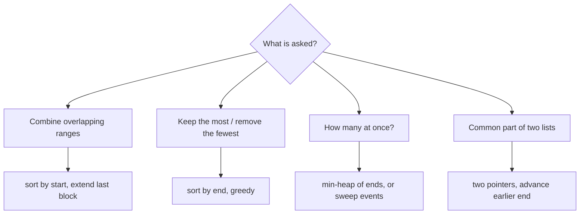

## Introduction

A calendar app has to answer questions like these all day: does this new meeting clash with anything? What does my day look like if I combine overlapping bookings? How many conference rooms does the office need so that no meeting is turned away? When are all five people on a team free at the same time?

Each question is about **intervals**: ranges on a line, written `[start, end]`. The line is usually time, but it can be anything ordered — memory addresses, IP address blocks, positions on a genome, seats in a row, versions of a document. The brute-force answer to most interval questions compares every interval with every other one, which is O(n²). The insight that makes interval problems tractable is the same one from [[a2-sorting-based]]: **once intervals are sorted, the ones that can interact sit next to each other**, so one linear pass replaces the pairwise comparisons.

This lesson builds the toolkit in order: what overlap means precisely, merging, inserting, intersecting two lists, choosing the most non-overlapping intervals, and counting how many overlap at once. Each technique is a few lines of code. The hard part — and what interviewers test — is choosing the sort key and the comparison (`<` or `<=`) for the reasons the problem requires.

## Before you start

- **Sorting with comparators** — sorting `int[][]` rows by a column with `Integer.compare`. See [[a2-sorting-based]] and [[a1-comparable-comparator]].
- **Two pointers** — walking two sorted lists at once. See [[a2-two-pointers]].
- **Priority queues** — a min-heap that returns the smallest element in O(log n). See [[a1-priorityqueue]]; it is needed for one section only.
- **Big-O** — O(n log n) for a sort plus O(n) for a scan. See [[a1-time-complexity]].

## The intuition

Draw each interval as a horizontal bar on a timeline. If you shuffle the bars randomly, deciding which overlap means looking at every pair. Now slide them so they are stacked in order of their left ends. Read them from top to bottom, keeping track of how far right the bars seen so far reach. A new bar either starts before that reach — it overlaps something already seen — or starts after it, leaving a visible gap. You never need to look back further than "how far right have we got", because every earlier bar started even further left.

That picture is the whole of interval merging. The other techniques are variations: keep the reach of *two* lists (intersection), keep only the bars that end earliest (greedy selection), or count how many bars cross a vertical line as you sweep it from left to right (maximum overlap).

## Representing intervals and testing overlap

An interval is usually stored as `int[] {start, end}`, and a list of them as `int[][]`. Before writing any code you must know which kind of interval the problem means, because it changes one character in every comparison.

A **closed interval** `[a, b]` includes both endpoints. Two closed intervals that touch, such as `[1, 4]` and `[4, 6]`, share the point 4 and therefore overlap. Balloons in "Minimum Number of Arrows" are closed: an arrow at x = 4 bursts both.

A **half-open interval** `[a, b)` includes `a` but not `b`. A meeting from 9:00 to 10:00 followed by one from 10:00 to 11:00 does not clash — the first ends at the instant the second starts. Meetings, bookings and most time ranges in software are half-open.

Now the **overlap test**. Two intervals `A` and `B` fail to overlap exactly when one ends before the other starts: `A.end < B.start` or `B.end < A.start` (for closed intervals). Negating that gives the overlap condition:

| Interval kind | `A` and `B` overlap when |
|---|---|
| Closed `[a, b]` | `A.start <= B.end && B.start <= A.end` |
| Half-open `[a, b)` | `A.start < B.end && B.start < A.end` |

An equivalent form says the intersection is non-empty: `max(A.start, B.start) <= min(A.end, B.end)` for closed intervals, with `<` for half-open. That form also tells you what the intersection *is*: `[max of starts, min of ends]`.

> [!IMPORTANT] Decide `<` or `<=` from the problem, not from memory
> Every interval bug of the form "passes most tests, fails on touching intervals" comes from using the wrong comparison. Before coding, ask: do `[1, 2]` and `[2, 3]` overlap in this problem? Then use that answer in every comparison you write.

## Merge Intervals

**Problem.** Given a list of intervals, merge all overlapping ones and return the result. Intervals that touch should be merged (the LeetCode version treats intervals as closed).

**Naive approach.** Repeatedly scan all pairs, merge any two that overlap, and start again until nothing changes. Each pass is O(n²) and there can be up to n passes.

**Derivation.** Sort by start. Now process intervals left to right, maintaining a list of merged blocks. Claim: the current interval can only overlap the **last** merged block, never an earlier one. Why? Every earlier block ended before the next block began — that is why they are separate blocks — and the current interval starts at or after the start of the last block, which is after all earlier blocks have ended. So there are only two cases. If the current interval starts after the last block's end, there is a gap: start a new block. Otherwise it overlaps: extend the last block's end to the larger of the two ends.

```java title="MergeIntervals.java"
import java.util.ArrayList;
import java.util.Arrays;
import java.util.List;

public class MergeIntervals {
    static int[][] merge(int[][] intervals) {
        int[][] sorted = intervals.clone();
        Arrays.sort(sorted, (a, b) -> Integer.compare(a[0], b[0]));   // by start
        List<int[]> merged = new ArrayList<>();
        for (int[] iv : sorted) {
            if (merged.isEmpty() || merged.get(merged.size() - 1)[1] < iv[0]) {
                merged.add(new int[]{iv[0], iv[1]});   // gap: start a new block (copy, don't alias)
            } else {
                int[] last = merged.get(merged.size() - 1);
                last[1] = Math.max(last[1], iv[1]);     // overlap: extend the block
            }
        }
        return merged.toArray(new int[0][]);
    }

    public static void main(String[] args) {
        System.out.println(Arrays.deepToString(merge(new int[][]{{8, 10}, {1, 3}, {15, 18}, {2, 6}})));
        System.out.println(Arrays.deepToString(merge(new int[][]{{1, 4}, {4, 5}})));
        System.out.println(Arrays.deepToString(merge(new int[][]{{1, 10}, {2, 3}, {4, 5}})));
    }
}
```

```output
[[1, 6], [8, 10], [15, 18]]
[[1, 5]]
[[1, 10]]
```

Dry run on the first input, which sorts to `[[1, 3], [2, 6], [8, 10], [15, 18]]`:

| Interval | Last block before | Test | Action | Blocks after |
|---|---|---|---|---|
| `[1, 3]` | none | list empty | add | `[1, 3]` |
| `[2, 6]` | `[1, 3]` | 3 < 2? no | extend end to max(3, 6) | `[1, 6]` |
| `[8, 10]` | `[1, 6]` | 6 < 8? yes | add | `[1, 6]`, `[8, 10]` |
| `[15, 18]` | `[8, 10]` | 10 < 15? yes | add | `[1, 6]`, `[8, 10]`, `[15, 18]` |

Three details are worth defending. The test `last[1] < iv[0]` means touching intervals (`[1, 4]` and `[4, 5]`) are merged; for half-open intervals where touching should *not* merge, it would be `<=`. The extension uses `Math.max`, not `iv[1]`: in the third test `[2, 3]` lies entirely inside `[1, 10]`, and blindly setting the end to 3 would shrink the block. And a new block is a copy, `new int[]{iv[0], iv[1]}`, because extending a block mutates it — if the block were the caller's array, merging would silently change the input.

**Complexity.** Sorting costs O(n log n). The loop does O(1) work per interval, so O(n). Total **O(n log n)** time; O(n) space for the output (plus the sort's own space).

## Insert Interval

**Problem.** You have a list of non-overlapping intervals already sorted by start, and one new interval. Insert it, merging where necessary.

You could append and call `merge`, which is O(n log n). But the input is already sorted, so you can do it in one O(n) pass. Every existing interval falls into exactly one of three groups relative to the new interval `[start, end]`: entirely **before** it (its end is less than `start`), **overlapping** it, or entirely **after** it (its start is greater than `end`). Because the list is sorted and non-overlapping, the groups appear in that order. Copy the first group, absorb the second into the new interval by widening it, add the widened interval, then copy the rest.

```java title="InsertInterval.java"
import java.util.ArrayList;
import java.util.Arrays;
import java.util.List;

public class InsertInterval {
    // intervals: sorted by start and non-overlapping
    static int[][] insert(int[][] intervals, int[] add) {
        List<int[]> out = new ArrayList<>();
        int i = 0, n = intervals.length;
        int start = add[0], end = add[1];

        while (i < n && intervals[i][1] < start) out.add(intervals[i++]);   // 1. entirely before

        while (i < n && intervals[i][0] <= end) {                           // 2. overlapping
            start = Math.min(start, intervals[i][0]);
            end = Math.max(end, intervals[i][1]);
            i++;
        }
        out.add(new int[]{start, end});

        while (i < n) out.add(intervals[i++]);                              // 3. entirely after
        return out.toArray(new int[0][]);
    }

    public static void main(String[] args) {
        int[][] cal = {{1, 2}, {3, 5}, {6, 7}, {8, 10}, {12, 16}};
        System.out.println(Arrays.deepToString(insert(cal, new int[]{4, 8})));
        System.out.println(Arrays.deepToString(insert(new int[][]{{1, 3}, {6, 9}}, new int[]{2, 5})));
        System.out.println(Arrays.deepToString(insert(new int[][]{}, new int[]{5, 7})));
    }
}
```

```output
[[1, 2], [3, 10], [12, 16]]
[[1, 5], [6, 9]]
[[5, 7]]
```

In the first test, `[1, 2]` ends before 4 and is copied. Then `[3, 5]`, `[6, 7]` and `[8, 10]` all start at or before the (growing) end, so the new interval widens to `[3, 10]`. `[12, 16]` starts after 10 and is copied. Note that the second loop compares against `end`, which grows as intervals are absorbed — that is what lets one new interval swallow a whole chain. The empty list works with no special case. Time **O(n)**, space O(n) for the output.

## Intersecting two interval lists

**Problem (Interval List Intersections).** Two lists of closed intervals, each sorted and internally non-overlapping — say, the free slots of two people. Return all intervals where both are free.

This is two pointers over two sorted sequences, the same shape as merging two sorted arrays. Compare `a[i]` and `b[j]`. Their intersection is `[max(starts), min(ends)]`, and it is non-empty when the low end is at most the high end. Then advance whichever interval **ends first**: it cannot intersect anything later in the other list, because those intervals start after the current one in the other list, which already extends past it.

```java title="IntervalIntersection.java"
import java.util.ArrayList;
import java.util.Arrays;
import java.util.List;

public class IntervalIntersection {
    // a and b: each sorted and internally non-overlapping; closed intervals
    static int[][] intersect(int[][] a, int[][] b) {
        List<int[]> out = new ArrayList<>();
        int i = 0, j = 0;
        while (i < a.length && j < b.length) {
            int lo = Math.max(a[i][0], b[j][0]);
            int hi = Math.min(a[i][1], b[j][1]);
            if (lo <= hi) out.add(new int[]{lo, hi});    // non-empty overlap
            if (a[i][1] < b[j][1]) i++;                  // the one that ends first is used up
            else j++;
        }
        return out.toArray(new int[0][]);
    }

    public static void main(String[] args) {
        int[][] a = {{0, 2}, {5, 10}, {13, 23}, {24, 25}};
        int[][] b = {{1, 5}, {8, 12}, {15, 24}, {25, 26}};
        System.out.println(Arrays.deepToString(intersect(a, b)));
    }
}
```

```output
[[1, 2], [5, 5], [8, 10], [15, 23], [24, 24], [25, 25]]
```

Look at `[5, 5]`: `a`'s `[5, 10]` and `b`'s `[1, 5]` share only the point 5, which counts because the intervals are closed. With half-open intervals the test would be `lo < hi`. Each iteration advances one pointer, so there are at most `len(a) + len(b)` iterations: **O(n + m)** time, with no sorting needed because the inputs are already sorted.

## Keeping the most intervals: sort by end

**Problem (Non-overlapping Intervals).** Remove the minimum number of intervals so that the rest do not overlap. Equivalently: keep as many mutually non-overlapping intervals as possible. Touching intervals (`[1, 2]` and `[2, 3]`) are allowed to stay together, so these behave as half-open intervals.

This is the classic **activity selection** problem, and the natural first guesses fail. Sorting by start and keeping whatever comes first fails on `[[1, 100], [2, 3], [4, 5]]`: keeping `[1, 100]` blocks two short intervals. Preferring the shortest interval fails on `[[1, 5], [4, 7], [6, 10]]`: the short `[4, 7]` overlaps both others, so keeping it allows one interval where two were possible.

The rule that works: **always keep the interval that ends earliest** among those compatible with what you have kept. Sort by end, scan, and keep an interval if it starts at or after the end of the last one kept.

Why is that safe? Use an **exchange argument**. Let `g` be the interval with the earliest end, and take any optimal selection. Its first interval, `f`, ends no earlier than `g` does (nothing ends earlier than `g`). Replace `f` with `g`. Every other interval in the selection started after `f` ended, so it also starts after `g` ends — the selection is still valid and has the same size. So some optimal answer keeps `g`. After choosing `g`, the remaining problem is the same problem on the intervals that start at or after `g` ends, and the same argument applies again. Ending early is what matters, because it leaves the most room for everything after.

The closely related **Minimum Number of Arrows to Burst Balloons** uses closed intervals: an arrow at x bursts every balloon `[a, b]` with `a <= x <= b`. Sort by end, shoot an arrow at the end of the first balloon (as far right as possible while still hitting it), and skip every balloon that arrow also hits. A new arrow is needed only when a balloon starts **strictly after** the last arrow.

```java title="NonOverlapping.java"
import java.util.Arrays;

public class NonOverlapping {
    // Half-open meetings: [1,2] and [2,3] do not overlap.
    static int eraseOverlapIntervals(int[][] intervals) {
        int[][] s = intervals.clone();
        Arrays.sort(s, (a, b) -> Integer.compare(a[1], b[1]));   // by END
        int kept = 0;
        long lastEnd = Long.MIN_VALUE;
        for (int[] iv : s) {
            if (iv[0] >= lastEnd) {          // compatible with everything kept so far
                kept++;
                lastEnd = iv[1];
            }
        }
        return s.length - kept;              // removed = total - kept
    }

    // Balloons are closed intervals: an arrow at x bursts [a, b] when a <= x <= b.
    static int findMinArrowShots(int[][] points) {
        int[][] s = points.clone();
        Arrays.sort(s, (a, b) -> Integer.compare(a[1], b[1]));   // never a[1] - b[1]: overflow
        int arrows = 0;
        long arrowAt = Long.MIN_VALUE;
        for (int[] p : s) {
            if (p[0] > arrowAt) {            // strictly after: the last arrow misses it
                arrows++;
                arrowAt = p[1];              // shoot at this balloon's end
            }
        }
        return arrows;
    }

    public static void main(String[] args) {
        System.out.println(eraseOverlapIntervals(new int[][]{{1, 2}, {2, 3}, {3, 4}, {1, 3}}));
        System.out.println(eraseOverlapIntervals(new int[][]{{1, 2}, {1, 2}, {1, 2}}));
        System.out.println(eraseOverlapIntervals(new int[][]{{1, 100}, {11, 22}, {1, 11}, {2, 12}}));
        System.out.println(findMinArrowShots(new int[][]{{10, 16}, {2, 8}, {1, 6}, {7, 12}}));
        System.out.println(findMinArrowShots(new int[][]{{1, 2}, {2, 3}, {3, 4}, {4, 5}}));
        System.out.println(findMinArrowShots(new int[][]{{-2147483646, -2147483645}, {2147483646, 2147483647}}));
    }
}
```

```output
1
2
2
2
2
2
```

Trace the third removal test. Sorted by end: `[1, 11]`, `[2, 12]`, `[11, 22]`, `[1, 100]`. Keep `[1, 11]` (last end 11). `[2, 12]` starts at 2 < 11: skip. `[11, 22]` starts at 11 ≥ 11: keep (last end 22). `[1, 100]` starts at 1: skip. Two kept, so two removed.

The two methods differ in exactly one character, and the difference comes from the interval kind: removal uses `>=` because touching meetings are compatible; arrows use `>` because a balloon touching the arrow's position is burst by it. The arrow test `[1, 2], [2, 3], [3, 4], [4, 5]` needs 2 arrows (at 2 and at 4), whereas with `>=` the code would wrongly report 4. The last test is the famous overflow trap: with `(a, b) -> a[1] - b[1]`, the difference between −2147483645 and 2147483647 overflows and the sort order breaks. `lastEnd` and `arrowAt` start at `Long.MIN_VALUE` so that even an interval starting at `Integer.MIN_VALUE` is accepted first.

Both run in **O(n log n)** time for the sort plus O(n) for the scan. The greedy family — including weighted versions where greedy is not enough and dynamic programming takes over — is developed in [[a10-interval-scheduling]].

```quiz
Q: In Merge Intervals (sorted by start), why is it enough to compare each interval with only the last merged block?
- [ ] Because the input has no duplicates
- [x] Because every earlier block ended before the last block began, and the current interval starts no earlier than the last block
- [ ] Because merged blocks are always the same length
- [ ] Because Java's sort is stable
> Blocks are separated by gaps, so each earlier block ends before the next one starts. The current interval starts at or after the last block's start, hence after every earlier block has ended. It can only overlap the last block, which makes one O(n) pass enough.

Q: To keep the maximum number of non-overlapping intervals, which greedy rule is optimal?
- [ ] Keep the interval that starts earliest
- [ ] Keep the shortest interval
- [x] Keep the interval that ends earliest
- [ ] Keep the interval with the fewest overlaps
> Earliest end leaves the most room for later intervals, and an exchange argument shows it can always replace the first interval of an optimal solution. Earliest start fails on [[1,100],[2,3],[4,5]]; shortest fails on [[1,5],[4,7],[6,10]].

Q: Balloons [1,2], [2,3], [3,4], [4,5] are closed intervals. How many arrows are needed?
- [ ] 1
- [x] 2
- [ ] 3
- [ ] 4
> An arrow at x = 2 bursts [1,2] and [2,3] because closed intervals include their endpoints; an arrow at 4 bursts [3,4] and [4,5]. Treating touching intervals as non-overlapping (using >= instead of >) would give the wrong answer, 4.
```

## Counting simultaneous intervals: Meeting Rooms

**Problem (Meeting Rooms).** Can one person attend all meetings? Sort by start and check that each meeting starts no earlier than the previous one ends — adjacent pairs only, by the same reasoning as merging.

**Problem (Meeting Rooms II).** Return the minimum number of rooms so that all meetings (half-open) can be held. The key reformulation: the number of rooms needed equals the **maximum number of meetings in progress at the same instant**. Fewer rooms cannot work, because at that instant every running meeting needs its own room. That many rooms is enough, because whenever a meeting starts, fewer than the maximum are running, so some room is free.

There are two standard ways to compute that maximum.

**Min-heap of end times.** Process meetings in order of start. Keep a min-heap holding the end times of meetings currently in progress, so its smallest element is the meeting that will free up a room soonest. Before adding a meeting, remove every meeting that has ended by its start time (`end <= start`, since a room freed at 10:00 can host a 10:00 meeting). The heap's size is the number of rooms in use; the answer is the largest size seen.

**Sorted starts and ends (a sweep).** Forget which start belongs to which end. Sort all start times, and separately all end times. Walk through the starts in time order with a pointer `j` at the earliest end not yet "used". If the next start is before `ends[j]`, every room is busy and a new one is opened. Otherwise the meeting ending at `ends[j]` has freed a room, which the new meeting takes; advance `j`. Pairing a start with an unrelated end looks wrong at first, but the algorithm only needs *how many* meetings have ended by a given time, not which ones.

```java title="MeetingRooms.java"
import java.util.Arrays;
import java.util.PriorityQueue;

public class MeetingRooms {
    // Can one person attend all meetings? (half-open: [5,10] then [10,15] is fine)
    static boolean canAttendAll(int[][] meetings) {
        int[][] s = meetings.clone();
        Arrays.sort(s, (a, b) -> Integer.compare(a[0], b[0]));
        for (int i = 1; i < s.length; i++) {
            if (s[i][0] < s[i - 1][1]) return false;   // starts before the previous one ends
        }
        return true;
    }

    // Minimum rooms: a min-heap holds the end times of meetings currently in progress.
    static int minRoomsHeap(int[][] meetings) {
        int[][] s = meetings.clone();
        Arrays.sort(s, (a, b) -> Integer.compare(a[0], b[0]));
        PriorityQueue<Integer> ends = new PriorityQueue<>();
        int rooms = 0;
        for (int[] m : s) {
            while (!ends.isEmpty() && ends.peek() <= m[0]) ends.poll();   // free finished rooms
            ends.add(m[1]);
            rooms = Math.max(rooms, ends.size());
        }
        return rooms;
    }

    // Minimum rooms: sort starts and ends separately and sweep through time.
    static int minRoomsSweep(int[][] meetings) {
        int n = meetings.length;
        int[] starts = new int[n], ends = new int[n];
        for (int i = 0; i < n; i++) {
            starts[i] = meetings[i][0];
            ends[i] = meetings[i][1];
        }
        Arrays.sort(starts);
        Arrays.sort(ends);
        int rooms = 0, j = 0;                // ends[j]: earliest end not yet reused
        for (int i = 0; i < n; i++) {
            if (starts[i] < ends[j]) {
                rooms++;                     // every room is still busy: open a new one
            } else {
                j++;                         // a meeting has ended: reuse its room
            }
        }
        return rooms;
    }

    public static void main(String[] args) {
        int[][] day = {{0, 30}, {5, 10}, {15, 20}};
        System.out.println(canAttendAll(day) + " " + canAttendAll(new int[][]{{7, 10}, {2, 4}}));
        System.out.println(minRoomsHeap(day) + " " + minRoomsSweep(day));
        int[][] busy = {{1, 10}, {2, 7}, {3, 19}, {8, 12}, {10, 20}, {11, 30}};
        System.out.println(minRoomsHeap(busy) + " " + minRoomsSweep(busy));
        int[][] backToBack = {{1, 5}, {5, 10}, {10, 15}};
        System.out.println(minRoomsHeap(backToBack) + " " + minRoomsSweep(backToBack));
    }
}
```

```output
false true
2 2
4 4
1 1
```

Trace the heap version on `busy`, already in start order:

| Meeting | Ends removed (`<=` start) | Heap after adding | Size | `rooms` |
|---|---|---|---|---|
| `[1, 10]` | none | {10} | 1 | 1 |
| `[2, 7]` | none | {7, 10} | 2 | 2 |
| `[3, 19]` | none | {7, 10, 19} | 3 | 3 |
| `[8, 12]` | 7 | {10, 12, 19} | 3 | 3 |
| `[10, 20]` | 10 | {12, 19, 20} | 3 | 3 |
| `[11, 30]` | none (12 > 11) | {12, 19, 20, 30} | 4 | 4 |

And the sweep on the same input: starts `[1, 2, 3, 8, 10, 11]`, ends `[7, 10, 12, 19, 20, 30]`. Starts 1, 2 and 3 are all before 7, so three rooms open. Start 8 is not before 7, so it reuses that room (`j` → 1). Start 10 is not before 10, so it reuses the room freed at 10 (`j` → 2). Start 11 is before 12, so a fourth room opens.

**Ties at equal times** decide correctness. `backToBack` needs one room, because each meeting ends exactly when the next starts. Both methods get this right because they let an end at time `t` free a room *before* a start at time `t` is placed: the heap removes `end <= start`, and the sweep opens a room only when `start < ends[j]`. If you implement this as a list of events (+1 at each start, −1 at each end) sorted by time, the same rule becomes a tie-break: at equal times, process ends before starts. For closed intervals, where touching does clash, reverse the tie-break.

**Complexity.** Both methods sort, O(n log n). The heap version does at most n insertions and n removals at O(log n) each; the sweep does O(n) after sorting. Space O(n) either way. The heap version has one advantage: it can tell you *which* room each meeting uses (store room ids with the end times), which the anonymous sweep cannot.

## Sweep lines in general

The sweep is a general technique worth naming. Turn each interval into two **events** — "something starts at `s`" and "something ends at `e`" — sort the events by position, and walk through them while maintaining a running count (or a running set). Any question about "at each point, how many intervals cover it" or "where is coverage highest" becomes a single sorted pass.

When positions are small integers, you do not even need to sort: put +1 at index `s` and −1 at index `e` of an array, then take prefix sums. That is exactly a **difference array**, the subject of [[a2-difference-arrays]]. When intervals arrive one at a time and each must be accepted or rejected immediately — "book this slot if it is free" — a sorted structure such as `TreeMap` keyed by start time lets you find the neighbouring bookings in O(log n): the new interval can only clash with the booking that starts just before it or just after it ([[a1-treemap]]).



## Recognising interval problems

Some interval problems announce themselves with `[start, end]` pairs. Others hide:

- **Employee Free Time** — merge everyone's busy intervals, then report the gaps between consecutive merged blocks.
- **Partition Labels** — for each letter, the span from its first to its last occurrence is an interval; the answer merges overlapping spans.
- **Video Stitching / Jump Game II** — choose the fewest intervals that cover a range; greedily extend the furthest reach.
- **Car Pooling** — passengers ride from one stop to another; capacity is exceeded where too many trips overlap (a sweep or difference array).
- **Is point x covered?** — merge once, then binary search the merged list for the last block starting at or before x ([[a3-lower-upper-bounds]]).

The tell-tale signs are pairs of positions describing a span, and questions about overlap, coverage, gaps or simultaneous use.

## In real systems

**Calendars.** Free/busy lookups merge each attendee's busy intervals and intersect the free gaps — the same merge and two-pointer intersection shown above. Time zones and recurring events complicate the input, but the core is this lesson.

**Databases.** PostgreSQL has range types such as `tstzrange` with an overlap operator `&&`, and an **exclusion constraint** (`EXCLUDE USING gist (room WITH =, during WITH &&)`) makes the database itself reject overlapping bookings for the same room. The range constructor functions default to half-open `[)` bounds for exactly the reason discussed here: adjacent bookings should not conflict.

**Networking.** Firewall rules and IP allocation work with address ranges; checking whether a new block collides with existing ones is an overlap query, and summarising a list of blocks is a merge.

**Memory allocators and file systems.** Free space is tracked as a list of address ranges; freeing a block merges it with adjacent free ranges (coalescing), which is Insert Interval.

## Trade-offs and alternatives

| Question | Technique | Time | Notes |
|---|---|---|---|
| Merge overlapping | Sort by start, extend last | O(n log n) | Copy blocks before mutating |
| Insert into sorted list | Three-phase scan | O(n) | No sort needed |
| Intersect two sorted lists | Two pointers | O(n + m) | Advance the one that ends first |
| Max non-overlapping / min removals | Sort by end, greedy | O(n log n) | `>=` vs `>` depends on interval kind |
| Max simultaneous | Min-heap or sweep | O(n log n) | Ends before starts at equal times (half-open) |
| Online booking | `TreeMap` neighbours | O(log n) per booking | Dynamic set, no full re-sort |
| Coverage over small integer range | Difference array | O(n + range) | No sort |

Sorting-based approaches assume all intervals are known up front. When intervals arrive and leave over time and queries interleave, use a balanced tree (`TreeMap`) or, for heavy range queries, an interval tree or segment tree ([[a12-segment-trees]]). When intervals carry weights and you want maximum total weight rather than maximum count, greedy is no longer optimal; that needs dynamic programming with binary search.

## Common mistakes

> [!MISTAKE] Wrong comparison at touching endpoints
> Whether `[1, 2]` and `[2, 3]` overlap depends on the problem. Merge Intervals and balloons treat them as overlapping; meetings and Non-overlapping Intervals do not. Decide once, then check every `<`, `<=`, `>` and `>=` in your code against that decision.

**Sorting by the wrong key.** Merging and room counting need order by start. Maximising the number of kept intervals needs order by end; sorting by start and greedily keeping the first fails on a long early interval.

**Setting the end instead of extending it.** When merging, `last[1] = Math.max(last[1], iv[1])`, not `last[1] = iv[1]` — an interval contained in the block would shrink it.

**Mutating the input.** Extending a block that is the caller's array changes the caller's data. Copy when adding a new block.

**Comparator overflow.** `(a, b) -> a[0] - b[0]` breaks for values near the `int` limits. Use `Integer.compare`.

**Pairing starts and ends in the sweep.** In the two-array sweep, the arrays are sorted independently and are not meant to stay paired; trying to keep pairs together reintroduces the per-meeting bookkeeping the method avoids. Conversely, do not use the independently sorted arrays when you need to know *which* meeting is in which room.

**Forgetting the empty input.** `intervals[0]` on an empty array throws; make sure the loop structure handles zero intervals naturally, as all the code above does.

## Interview perspective

Interval questions are popular because they are short to state, have several plausible wrong greedy rules, and punish sloppy endpoint handling.

> [!INTERVIEW] What a strong answer sounds like
> "First, do touching intervals count as overlapping here? ... OK, they don't. I'll sort by end time and keep an interval whenever it starts at or after the last kept end. Earliest end is safe by an exchange argument: it can replace the first interval of any optimal answer without breaking anything. Sorting is O(n log n), the scan is linear."

Questions to prepare:

- **Why sort by start for merging but by end for selection?** Merging needs "everything that can overlap is adjacent"; selection needs "the choice that leaves the most room".
- **Why does the sorted-starts/sorted-ends sweep work without keeping pairs?** It only needs how many meetings have ended before each start.
- **What if meetings arrive in a stream?** Use a min-heap of end times for rooms, or a `TreeMap` for accept/reject booking.
- **Merge k sorted interval lists?** Use a heap to always take the smallest start next ([[a7-k-way-merge]]), then merge as usual.
- **Return which room each meeting gets.** Heap of `(end, roomId)` pairs; reuse the room id you pop.

## Practice

1. **Meeting Rooms.** Return whether one person can attend all meetings. Explain why checking adjacent pairs after sorting is sufficient.
2. **Employee Free Time.** Given each employee's sorted busy intervals, return the common free intervals.
3. **Partition Labels.** Split a string into as many parts as possible so each letter appears in only one part.
4. **Remove Covered Intervals.** Count intervals not contained in another. Sort by start ascending and end descending, and explain the tie-break.
5. **My Calendar I.** Implement `book(start, end)` that returns false on a clash, using `TreeMap.floorKey` and `ceilingKey`.
6. **Car Pooling.** Decide whether a car of given capacity can serve all trips; solve with a sweep and with a difference array.

The DSA explorer lists the matching problems under this topic; start with *Merge Intervals*, *Insert Interval*, *Non-overlapping Intervals*, *Minimum Number of Arrows to Burst Balloons* and *Meeting Rooms II*.

## Quick revision {#quick-revision}

- Closed `[a, b]`: overlap iff `A.start <= B.end && B.start <= A.end`. Half-open `[a, b)`: use `<`.
- Intersection of two intervals: `[max(starts), min(ends)]`, non-empty if low ≤ high (`<` for half-open).
- Merge: sort by start; new block if `last.end < cur.start`, else `last.end = max(last.end, cur.end)`. O(n log n).
- Insert into sorted list: copy before, absorb overlapping (growing `end`), copy after. O(n).
- Intersect two sorted lists: two pointers, advance whichever ends first. O(n + m).
- Max non-overlapping / min removals / min arrows: sort by **end**, greedy keep earliest end; prove by exchange argument.
- Min rooms = max simultaneous: min-heap of ends (pop `end <= start`), or sorted starts vs sorted ends.
- Ties: half-open → ends free rooms before starts at the same time.
- Comparators: `Integer.compare`, never subtraction.
- Online bookings → `TreeMap`; small integer coordinates → difference array.

## Key takeaways {#key-takeaways}

- Sorting turns interval questions from all-pairs comparisons into one pass, because intervals that can interact become neighbours.
- The sort key follows from the argument: start for merging and counting overlaps, end for keeping the most intervals.
- Endpoint semantics — closed or half-open — decide every `<` versus `<=`; settle them before writing code.
- The minimum number of rooms equals the maximum number of intervals alive at once, computed with a heap or a sweep.
- Greedy interval algorithms need a proof; the exchange argument is the standard one.
- The sweep-line view connects intervals to difference arrays and to balanced trees for online problems.
