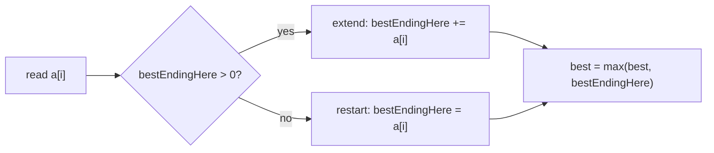

## Introduction

A trading desk records the daily profit or loss of a strategy: `+3, −1, +4, −8, +2, +5, −1, +3`. Management asks: over which unbroken stretch of days did the strategy earn the most, and how much? A genome researcher asks the same question about a sequence of per-position scores, looking for the most significant region. A monitoring system asks it about a stream of "how far above normal" readings, looking for the worst incident.

All three are the **maximum subarray problem**: given an array of integers that may be negative, find the largest possible sum of a **contiguous** subarray `a[i..j]`. Contiguous matters — you cannot skip the bad days in the middle of a stretch. If every number were positive the answer would be the whole array, and if you could pick any subset you would take every positive number. The problem is interesting precisely because good stretches are interrupted by bad values, and you must decide whether a dip is worth crossing to reach the gains beyond it.

The brute force checks every subarray. **Kadane's algorithm**, named after Jay Kadane, who designed the linear-time solution at Carnegie Mellon in the late 1970s, solves it in one pass with two variables. It is a favourite interview question because the code is four lines long while the reasoning behind it — a tiny dynamic programme — is exactly the kind of thinking interviewers want to see.

## Before you start

- **Array traversal with running state** — keeping a running best while scanning. See [[a2-array-string-traversal]], whose "extend or reset" streak counter is Kadane's simpler cousin.
- **Prefix sums** — `P[j + 1] − P[i]` is the sum of `a[i..j]`. See [[a2-prefix-suffix]]; it gives a second derivation below.
- **Big-O** — comparing O(n³), O(n²) and O(n). See [[a1-time-complexity]].
- **Dynamic programming (optional)** — Kadane is the simplest example of a one-dimensional DP. If you have met [[a11-1d-dp]], you will recognise the shape; if not, this lesson explains everything it uses.

## The intuition

Imagine walking along the array carrying a running total of the stretch you are currently in. Each step adds the next value. Now ask one question at each step: *is the stretch I am carrying helping or hurting?* If the running total is positive, it is an asset — whatever comes next, adding it to a positive total gives more than starting afresh. If the running total has gone negative, it is a debt — any future stretch would be better off without it, so drop it and start a new stretch at the current element.

While walking, remember the largest running total you have ever held. That is the answer.

That is all Kadane's algorithm does. The rest of this lesson makes sure the idea is right: why dropping a negative prefix never loses the optimum, what happens when every value is negative, and how to recover where the best stretch starts and ends.

## From brute force to linear time

### Brute force: O(n³), then O(n²)

The most direct solution enumerates every pair `(i, j)` with `i ≤ j` and sums `a[i..j]` with a third loop: O(n³). The third loop is wasteful, because the sum of `a[i..j]` is the sum of `a[i..j−1]` plus `a[j]`. Keeping a running sum as `j` moves right removes it:

```java title="MaxSubarrayBrute.java"
public class MaxSubarrayBrute {
    static int maxSubArrayQuadratic(int[] a) {
        int best = Integer.MIN_VALUE;
        for (int i = 0; i < a.length; i++) {
            int sum = 0;
            for (int j = i; j < a.length; j++) {
                sum += a[j];                 // sum of a[i..j], extended by one element
                best = Math.max(best, sum);
            }
        }
        return best;
    }

    public static void main(String[] args) {
        System.out.println(maxSubArrayQuadratic(new int[]{-2, 1, -3, 4, -1, 2, 1, -5, 4}));
    }
}
```

```output
6
```

That is O(n²) — about 5 × 10⁹ steps for n = 100,000, far too slow. To do better we must stop treating each starting point independently.

### The key reorganisation: group subarrays by where they end

Instead of grouping subarrays by their start `i`, group them by their **end** `j`. Define

> `E[j]` = the largest sum of a subarray that **ends exactly at index `j`**.

The overall answer is the maximum of `E[j]` over all `j`, since every subarray ends somewhere. The question is how to compute `E[j]` quickly.

A subarray ending at `j` is either the single element `a[j]`, or it is some subarray ending at `j − 1` with `a[j]` appended. In the second case, the best choice is obviously the *best* subarray ending at `j − 1`, whose sum is `E[j − 1]`. So:

```text
E[0] = a[0]
E[j] = max(a[j], E[j - 1] + a[j])      for j >= 1
```

This is the whole algorithm. Note that `max(a[j], E[j − 1] + a[j])` picks the second option exactly when `E[j − 1] > 0` — the "is my stretch an asset or a debt?" test from the intuition, written as arithmetic.

### Why the recurrence is correct

It is worth proving, because the proof is what you say in an interview. Take the best subarray ending at `j`, say `a[i..j]`.

- If `i = j`, its sum is `a[j]`, one of the two options.
- If `i < j`, it consists of `a[i..j−1]` followed by `a[j]`. The part `a[i..j−1]` is a subarray ending at `j − 1`, so its sum is at most `E[j − 1]`. If it were strictly less, swapping it for the best subarray ending at `j − 1` would give a larger subarray ending at `j`, contradicting optimality. So its sum equals `E[j − 1]`, and the total is `E[j − 1] + a[j]`.

Either way `E[j]` is one of the two options, and both options are achievable, so `E[j]` is their maximum. This is the **optimal substructure** property that makes dynamic programming work: the best answer for `j` is built from the best answer for `j − 1`.

### The second derivation: prefix sums

The same result falls out of prefix sums, which is a useful cross-check. With `P[0] = 0` and `P[k] = a[0] + … + a[k − 1]`, the sum of `a[i..j]` is `P[j + 1] − P[i]`. For a fixed end `j`, that is largest when `P[i]` is smallest among `i ≤ j`. So scan left to right, keep the minimum prefix seen so far, and at each step compare the current prefix minus that minimum with the best answer.

```java title="PrefixView.java"
public class PrefixView {
    static long maxSubArrayPrefix(int[] a) {
        long prefix = 0;             // P[j+1] = a[0] + ... + a[j]
        long minPrefix = 0;          // smallest P[i] for i <= j (P[0] = 0 is the empty prefix)
        long best = Long.MIN_VALUE;
        for (int x : a) {
            prefix += x;
            best = Math.max(best, prefix - minPrefix);   // best subarray ending here
            minPrefix = Math.min(minPrefix, prefix);     // update AFTER: keeps it non-empty
        }
        return best;
    }

    public static void main(String[] args) {
        System.out.println(maxSubArrayPrefix(new int[]{-2, 1, -3, 4, -1, 2, 1, -5, 4}));
        System.out.println(maxSubArrayPrefix(new int[]{-3, -1, -2}));
    }
}
```

```output
6
-1
```

Updating `minPrefix` *after* computing `best` matters: if it were updated first, `prefix − minPrefix` could be `prefix − prefix = 0`, the sum of an empty subarray, and an all-negative array would wrongly return 0. The two derivations are the same algorithm in different clothes: `E[j]` equals `P[j + 1]` minus the minimum earlier prefix. The prefix view is also the doorway to the "best time to buy and sell stock" variation below.

## The algorithm

Since `E[j]` depends only on `E[j − 1]`, there is no need to store the whole array of `E` values. One variable holds the best sum ending at the current index, and another holds the best seen anywhere.

```java title="Kadane.java"
public class Kadane {
    /** Maximum sum of a non-empty contiguous subarray. Requires a.length >= 1. */
    static int maxSubArray(int[] a) {
        int bestEndingHere = a[0];   // best sum of a subarray that ends exactly at index i
        int best = a[0];             // best sum seen anywhere so far
        for (int i = 1; i < a.length; i++) {
            bestEndingHere = Math.max(a[i], bestEndingHere + a[i]);   // restart or extend
            best = Math.max(best, bestEndingHere);
        }
        return best;
    }

    public static void main(String[] args) {
        System.out.println(maxSubArray(new int[]{-2, 1, -3, 4, -1, 2, 1, -5, 4}));
        System.out.println(maxSubArray(new int[]{5, 4, -1, 7, 8}));
        System.out.println(maxSubArray(new int[]{-3, -1, -2}));
        System.out.println(maxSubArray(new int[]{7}));
    }
}
```

```output
6
23
-1
7
```

The two variables carry the loop invariant: after processing index `i`, `bestEndingHere` equals `E[i]` and `best` equals `max(E[0], …, E[i])`. Initialising both to `a[0]` makes the invariant true for `i = 0`, and the two lines in the loop restore it for each new `i`. At the end, `best` is the maximum over all ends — the answer.

The second test shows that a dip can be worth crossing: `5 + 4 − 1 + 7 + 8 = 23` beats stopping at `9` because the running total stays positive through the `−1`. The third shows the all-negative case: the best non-empty subarray is the single largest element, `−1`.

### Dry run

Trace `[-2, 1, -3, 4, -1, 2, 1, -5, 4]`:

| `i` | `a[i]` | Previous `bestEndingHere` | Extend | Restart | Choice | `bestEndingHere` | `best` |
|---|---|---|---|---|---|---|---|
| 0 | −2 | — | — | — | init | −2 | −2 |
| 1 | 1 | −2 | −1 | 1 | restart | 1 | 1 |
| 2 | −3 | 1 | −2 | −3 | extend | −2 | 1 |
| 3 | 4 | −2 | 2 | 4 | restart | 4 | 4 |
| 4 | −1 | 4 | 3 | −1 | extend | 3 | 4 |
| 5 | 2 | 3 | 5 | 2 | extend | 5 | 5 |
| 6 | 1 | 5 | 6 | 1 | extend | 6 | 6 |
| 7 | −5 | 6 | 1 | −5 | extend | 1 | 6 |
| 8 | 4 | 1 | 5 | 4 | extend | 5 | 6 |

Restarts happen exactly where the previous value was negative (indices 1 and 3). The best run starts at the restart at index 3 and peaks at index 6: `[4, −1, 2, 1]`, sum 6. Notice row 7: after the `−5`, `bestEndingHere` drops to 1 but stays positive, so the run continues — and `best` remembers the earlier peak, which is why we need two variables.



### Complexity

One pass, constant work per element: **O(n) time**. Two variables: **O(1) extra space**. You cannot do better than O(n) in general, because any algorithm must read every element — an unread element could be a huge positive number that changes the answer.

## Empty subarrays and the all-negative trap

There are two versions of this problem, and you must ask which one you are solving.

**Non-empty subarray required** (LeetCode 53 and most interviews). The answer for an all-negative array is its largest element. The code above handles this because it never compares against 0.

**Empty subarray allowed** (sum 0). Then the answer is never negative. This is the version in Jon Bentley's 1984 *Programming Pearls* column that popularised Kadane's algorithm, and it is often written as:

```java title="KadaneEmptyAllowed.java"
static int maxSubArrayAllowEmpty(int[] a) {
    int cur = 0, best = 0;               // the empty subarray has sum 0
    for (int x : a) {
        cur = Math.max(0, cur + x);      // drop the run as soon as it goes negative
        best = Math.max(best, cur);
    }
    return best;
}
```

On `[-3, -1, -2]` it returns 0. The danger is using this version — which you may have seen online — when the problem requires a non-empty subarray: it returns 0 instead of −1. The two versions differ in one detail: whether the restart value is `a[i]` or `0`.

> [!WARNING] Initialise from the data, not from zero
> For the non-empty version, initialise `best` to `a[0]` (or `Integer.MIN_VALUE`), never 0. Initialising to 0 quietly converts the algorithm into the empty-allowed version, and it passes every test that contains a positive number.

**Overflow.** With up to 10⁵ elements of magnitude up to 10⁴ (typical constraints), sums stay within about 10⁹ and fit in `int`. With larger values or longer arrays, the running sum can exceed `Integer.MAX_VALUE` (about 2.1 × 10⁹) and silently wrap. Use `long` for `bestEndingHere` and `best` whenever `n × max|a[i]|` might exceed that.

## Recovering the subarray itself

Interviewers often follow up with "which subarray?". Track where the current run started; whenever `best` improves, record that start and the current index as the best bounds.

```java title="KadaneWithBounds.java"
import java.util.Arrays;

public class KadaneWithBounds {
    /** Returns {bestSum, startIndex, endIndex}; on ties keeps the first maximum found. */
    static int[] maxSubArrayBounds(int[] a) {
        int cur = a[0], curStart = 0;
        int best = a[0], bestL = 0, bestR = 0;
        for (int i = 1; i < a.length; i++) {
            if (cur < 0) {           // a negative running sum only drags a[i] down
                cur = a[i];
                curStart = i;        // the new subarray begins here
            } else {
                cur += a[i];
            }
            if (cur > best) {        // strictly greater: keep the first best found
                best = cur;
                bestL = curStart;
                bestR = i;
            }
        }
        return new int[]{best, bestL, bestR};
    }

    public static void main(String[] args) {
        int[] a = {-2, 1, -3, 4, -1, 2, 1, -5, 4};
        int[] r = maxSubArrayBounds(a);
        System.out.println(Arrays.toString(r));
        System.out.println(Arrays.toString(Arrays.copyOfRange(a, r[1], r[2] + 1)));
    }
}
```

```output
[6, 3, 6]
[4, -1, 2, 1]
```

The test `cur < 0` is the same decision as `max(a[i], cur + a[i])`: restarting wins exactly when the previous run is negative. Writing it as an explicit `if` lets you record `curStart` at the moment of the restart. When several subarrays share the maximum sum, which one you report depends on two tie choices: `cur > best` (strict) keeps the first maximum found, and `cur < 0` (rather than `cur <= 0`) extends through a run whose sum is exactly 0, producing a longer subarray. If the problem specifies a tie rule, adjust those two comparisons.

```quiz
Q: What does `bestEndingHere` represent after the loop has processed index i?
- [ ] The best subarray sum found anywhere in a[0..i]
- [x] The largest sum of a subarray that ends exactly at index i
- [ ] The sum of all elements from 0 to i
- [ ] The largest single element seen so far
> It is E[i], the best sum among subarrays whose last element is a[i]. The overall best is a separate variable, because the best subarray may have ended earlier — in the dry run, bestEndingHere drops to 1 at index 7 while best stays 6.

Q: For a = [-3, -1, -2], with the problem requiring a non-empty subarray, what should be returned, and which implementation gets it wrong?
- [ ] 0, and the version initialised from a[0] gets it wrong
- [x] -1, and the version that restarts at 0 (cur = max(0, cur + x), best starting at 0) gets it wrong
- [ ] -6, and both versions get it wrong
- [ ] -3, because the first element is always included
> The best non-empty subarray is the single element -1. The empty-allowed version clamps the running sum at 0 and starts best at 0, so it returns 0 — the sum of the empty subarray, which this problem does not allow.

Q: Why can't a sliding window with a "shrink when the sum is too small" rule solve maximum subarray?
- [ ] Sliding windows only work on strings
- [ ] It would be O(n log n)
- [x] With negative numbers, a window's sum is not monotonic in its size, so there is no safe rule for when to shrink
- [ ] Sliding windows cannot track sums
> A sliding window needs a condition that, once violated, stays violated as the window grows, so shrinking is always safe. Here a sum can fall and then rise again — crossing the -1 in [5, 4, -1, 7, 8] is worth it — so no such condition exists. Kadane instead decides per index whether the running prefix is worth keeping.
```

## Variations

The real value of understanding *why* Kadane works is that the same "best ending here" idea solves a family of problems.

### Minimum subarray sum

Replace `max` with `min` throughout. This is needed on its own and as a building block for the circular version.

### Maximum sum circular subarray

In a **circular** array the end wraps around to the start, so a subarray may be a suffix followed by a prefix. Two cases:

1. The best subarray does not wrap. Ordinary Kadane finds it.
2. It wraps. Then the elements *not* in it form one contiguous block in the middle. The wrapped sum is `total − (sum of that middle block)`, which is largest when the middle block's sum is smallest. So the answer is `total − minimum subarray sum`.

The answer is the larger of the two — with one trap. If every element is negative, the minimum subarray is the whole array, and `total − total = 0` corresponds to choosing *nothing*, which is not allowed. In that case return the ordinary maximum, which is the largest single element.

### Maximum product subarray

Products behave differently from sums: multiplying by a negative number turns the smallest (most negative) product into the largest. So track two values at each index — the largest and the smallest product ending here — and at each step the new largest is the maximum of `a[i]`, `hi × a[i]` and `lo × a[i]`. A zero resets both naturally, because `a[i] = 0` itself becomes the best candidate.

### Best time to buy and sell stock

Given daily prices, find the maximum profit from one buy followed by one sell. Selling on day `j` is best if you bought on the cheapest earlier day, so track the minimum price so far — exactly the prefix-sum view of Kadane, where prices play the role of prefix sums. (Equivalently, run Kadane on the array of day-to-day price changes, with the empty subarray allowed so that "never trade" gives profit 0.)

```java title="Variations.java"
public class Variations {
    // Maximum Sum Circular Subarray
    static int maxSubarraySumCircular(int[] a) {
        int total = 0;
        int curMax = 0, best = Integer.MIN_VALUE;
        int curMin = 0, worst = Integer.MAX_VALUE;
        for (int x : a) {
            total += x;
            curMax = Math.max(x, curMax + x);
            best = Math.max(best, curMax);
            curMin = Math.min(x, curMin + x);
            worst = Math.min(worst, curMin);
        }
        // If every element is negative, total - worst would be 0 (the empty subarray).
        if (best < 0) return best;
        return Math.max(best, total - worst);    // wrap-around = total minus a middle block
    }

    // Maximum Product Subarray
    static int maxProduct(int[] a) {
        int hi = a[0], lo = a[0], best = a[0];   // largest and smallest product ending here
        for (int i = 1; i < a.length; i++) {
            int x = a[i];
            int candHi = Math.max(x, Math.max(hi * x, lo * x));
            int candLo = Math.min(x, Math.min(hi * x, lo * x));
            hi = candHi;                         // compute both before assigning either
            lo = candLo;
            best = Math.max(best, hi);
        }
        return best;
    }

    // Best Time to Buy and Sell Stock (one transaction)
    static int maxProfit(int[] prices) {
        int minSoFar = Integer.MAX_VALUE, best = 0;
        for (int p : prices) {
            minSoFar = Math.min(minSoFar, p);
            best = Math.max(best, p - minSoFar); // selling today after the cheapest day so far
        }
        return best;
    }

    public static void main(String[] args) {
        System.out.println(maxSubarraySumCircular(new int[]{1, -2, 3, -2}) + " "
                + maxSubarraySumCircular(new int[]{5, -3, 5}) + " "
                + maxSubarraySumCircular(new int[]{-3, -2, -3}));
        System.out.println(maxProduct(new int[]{2, 3, -2, 4}) + " "
                + maxProduct(new int[]{-2, 0, -1}) + " "
                + maxProduct(new int[]{-2, 3, -4}));
        System.out.println(maxProfit(new int[]{7, 1, 5, 3, 6, 4}) + " "
                + maxProfit(new int[]{7, 6, 4, 3, 1}));
    }
}
```

```output
3 10 -2
6 0 24
5 0
```

Walk through the interesting cases. In `[5, -3, 5]` the non-wrapping best is 7 (the whole array), but the wrap `5 | … | 5` skipping the `−3` gives `total − min = 7 − (−3) = 10`. In `[-3, -2, -3]`, `best` is −2, so the guard returns it instead of `total − worst = 0`. In `[-2, 3, -4]` the product `−2 × 3 = −6` is the *smallest* product ending at index 1, and multiplying it by `−4` gives 24 — exactly why `lo` must be tracked. In the product method, `candHi` and `candLo` are computed before either variable is overwritten; updating `hi` first and then using the new `hi` to compute `lo` is a classic bug. Each variation is O(n) time and O(1) space.

### Maximum-sum rectangle in a matrix

For an `m × n` grid, fix a top row and a bottom row, and collapse the rows between them into one array of column sums. The best rectangle spanning exactly those rows is the best subarray of that array — Kadane. Trying all O(m²) row pairs, each with O(n) work (the column sums are updated incrementally as `bottom` grows), gives **O(m² · n)**.

```java title="MaxSumRectangle.java"
public class MaxSumRectangle {
    static int maxSumRectangle(int[][] g) {
        int m = g.length, n = g[0].length, best = Integer.MIN_VALUE;
        for (int top = 0; top < m; top++) {
            int[] colSum = new int[n];               // column sums of rows top..bottom
            for (int bottom = top; bottom < m; bottom++) {
                for (int c = 0; c < n; c++) colSum[c] += g[bottom][c];
                // Kadane on the compressed row = best rectangle spanning rows top..bottom
                int cur = colSum[0], bestHere = colSum[0];
                for (int c = 1; c < n; c++) {
                    cur = Math.max(colSum[c], cur + colSum[c]);
                    bestHere = Math.max(bestHere, cur);
                }
                best = Math.max(best, bestHere);
            }
        }
        return best;
    }

    public static void main(String[] args) {
        int[][] g = {
            {1, 2, -1, -4, -20},
            {-8, -3, 4, 2, 1},
            {3, 8, 10, 1, 3},
            {-4, -1, 1, 7, -6}
        };
        System.out.println(maxSumRectangle(g));
    }
}
```

```output
29
```

The best rectangle covers rows 1–3 and columns 1–3: column sums `−3 + 8 − 1 = 4`, `4 + 10 + 1 = 15`, `2 + 1 + 7 = 10`, total 29. If `m > n`, iterate over column pairs instead so the squared factor is the smaller dimension.

## How it works internally: Kadane as dynamic programming

Kadane's algorithm is a **dynamic programme** with one state per index (`E[j]`), a transition that looks back one step, and an answer that is the maximum over all states. Because the transition only reads the previous state, the DP table collapses to a single variable — the same space optimisation you will use in many 1D DPs ([[a11-1d-dp]]). Seeing it this way explains how to extend it: when a problem adds a constraint, add information to the state. "Maximum subarray sum with at most one element deleted" uses two states per index — best ending here with no deletion yet, and with one deletion used — and each has its own two-option transition.

Historically, the problem was posed by Ulf Grenander for pattern matching in digitised images (as the 2D rectangle version), and the sequence of improvements from O(n³) through O(n²) and an O(n log n) divide-and-conquer solution to Kadane's O(n) is told in Bentley's *Programming Pearls*. The divide-and-conquer version — the best subarray lies entirely in the left half, entirely in the right half, or crosses the middle, and the crossing case takes O(n) — is still worth knowing as a teaching example of divide and conquer, but it is never preferable in practice.

## Recognising the pattern

Kadane applies when:

- The answer is a **contiguous** segment (subarray, substring, consecutive days).
- You are maximising or minimising an **additive** score (or one, like a product, where a small amount of extra state handles the twist).
- Values can be **negative** — otherwise the answer is trivial.

It does *not* apply to **subsequences** (non-contiguous picks), which need different DPs such as [[a11-lis]], or to problems with a **length or sum constraint** on the window. "Maximum sum of a subarray of length exactly k" is a fixed sliding window ([[a2-sliding-window]]). "Maximum sum with length at most k" needs prefix sums plus a monotonic deque ([[a5-monotonic-queue]]). And "count subarrays with sum exactly k" is prefix sums plus a hash map ([[a2-hashing]]).

## In real systems

**Finance.** The maximum drawdown of a portfolio — the largest peak-to-trough fall — is the minimum-subarray-sum problem on daily price changes (or log returns), computed with the same running-extreme logic as the stock variation.

**Bioinformatics.** Finding high-scoring segments in a sequence (for example hydrophobic regions in proteins, or CpG islands in DNA) assigns each position a positive or negative score and looks for maximal-sum segments. The Karlin–Altschul statistics used by BLAST describe the significance of exactly such segment scores.

**Monitoring and anomaly detection.** Subtract the normal level from a metric so readings above normal are positive; the maximum subarray is the most severe sustained anomaly. The CUSUM change-detection method uses the same "reset when the running sum drops below zero" rule as the empty-allowed Kadane.

**Image analysis.** The 2D rectangle version finds the brightest rectangular region of an image after subtracting the mean brightness — Grenander's original motivation.

## Trade-offs and alternatives

| Approach | Time | Space | When it makes sense |
|---|---|---|---|
| Triple loop | O(n³) | O(1) | Never, except as a correctness check |
| Running sum per start | O(n²) | O(1) | Small n, or you need every subarray sum anyway |
| Divide and conquer | O(n log n) | O(log n) | Teaching, or segment-tree versions that support updates |
| Prefix sums + running minimum | O(n) | O(1) | Equivalent to Kadane; natural for stock-style problems |
| Kadane | O(n) | O(1) | The default for contiguous max/min sum |

One limit worth knowing: Kadane answers one query on a fixed array. If the array changes and you need "maximum subarray sum within `a[l..r]`" repeatedly, a segment tree that stores, for each node, the total, best prefix, best suffix and best subarray answers each query in O(log n) ([[a12-segment-trees]]) — the divide-and-conquer version made dynamic.

## Common mistakes

> [!MISTAKE] Clamping at zero when the subarray must be non-empty
> `cur = Math.max(0, cur + x)` with `best = 0` returns 0 for an all-negative array. Use `cur = Math.max(x, cur + x)` and initialise from `a[0]`, unless the problem explicitly allows the empty subarray.

**Updating `best` before `bestEndingHere`, or forgetting it.** `best` must be compared with the *new* value for index `i`; updating it first misses the last element's contribution.

**Using one variable for both roles.** The best run ending here can fall after the global best was reached; a single variable forgets the peak.

**Confusing subarray with subsequence.** "Maximum sum subsequence" (any elements, in order) is just the sum of positives, or the largest element if none are positive. Kadane is for contiguous segments.

**Overwriting `hi` before computing `lo`** in maximum product. Compute both candidates from the old values first.

**Missing the all-negative guard in the circular version.** `total − minSubarray` is 0 when the minimum subarray is everything; return the ordinary maximum in that case.

**Ignoring overflow.** Long arrays of large values overflow `int`; use `long`.

**Calling `a[0]` on an empty array.** Clarify whether empty input is possible and what to return.

## Interview perspective

Maximum Subarray is a screening classic. The interviewer usually cares less about the four lines of code than about whether you can explain why they are correct and handle the edge cases without prompting.

> [!INTERVIEW] What a strong answer sounds like
> "Brute force is O(n²) over all start and end pairs. Better: let E[j] be the best sum of a subarray ending exactly at j. That subarray is either a[j] alone or the best one ending at j − 1 plus a[j], so E[j] = max(a[j], E[j − 1] + a[j]). The answer is the max over all E[j]. I only need the previous E, so it's O(n) time and O(1) space. Since the subarray must be non-empty, I initialise from a[0] so all-negative arrays return the largest element."

Questions to prepare:

- **Why does dropping a negative running sum never lose the optimum?** Any subarray that starts with a negative-sum prefix can drop that prefix and get bigger.
- **Return the indices.** Track the run's start at each restart; record bounds when `best` improves.
- **Circular array?** `max(kadane, total − minSubarray)` with the all-negative guard.
- **Maximum product?** Track max and min products ending here; negatives swap them.
- **What if there's a length limit?** Exact length: sliding window. At most k: prefix sums with a monotonic deque.
- **2D version?** Fix row pairs, collapse to column sums, Kadane: O(m² · n).

## Practice

1. **Maximum Subarray.** Implement Kadane, then the divide-and-conquer O(n log n) version, and compare.
2. **Maximum Sum Circular Subarray.** Implement it and test the all-negative case.
3. **Maximum Product Subarray.** Include arrays with zeros and an odd number of negatives.
4. **Best Time to Buy and Sell Stock.** Solve with the running minimum, then explain the connection to Kadane on price differences.
5. **Maximum Subarray Sum with One Deletion.** Use two states per index.
6. **Maximum Absolute Sum of Any Subarray.** Return `max(maxSubarray, −minSubarray)` in one pass.
7. **Max Sum of Rectangle No Larger Than K.** Collapse row pairs as above, then replace Kadane with prefix sums and a `TreeSet` ([[a1-treeset]]).

The DSA explorer lists the matching problems under this topic; start with *Maximum Subarray*, *Maximum Product Subarray* and *Maximum Sum Circular Subarray*.

## Quick revision {#quick-revision}

- Problem: maximum sum of a contiguous, usually non-empty, subarray; values may be negative.
- State: `E[j]` = best sum of a subarray ending exactly at `j`. Recurrence: `E[j] = max(a[j], E[j−1] + a[j])`. Answer: `max E[j]`.
- Code: `cur = max(a[i], cur + a[i]); best = max(best, cur);` initialised to `a[0]`. O(n) time, O(1) space.
- Restart happens exactly when the previous run is negative.
- Prefix view: answer = max over j of `P[j+1] − min(P[0..j])`.
- Empty subarray allowed → `cur = max(0, cur + x)`, `best` starts at 0; otherwise never clamp at 0.
- Indices: record `curStart` on restart; save bounds when `best` improves.
- Circular: `max(maxSub, total − minSub)`, but return `maxSub` if it is negative.
- Product: track both `hi` and `lo`; compute both from old values.
- Stock: running minimum price; profit = price − min so far.
- 2D: fix top/bottom rows, column sums, Kadane: O(m² · n).
- Use `long` when sums can exceed about 2.1 × 10⁹.

## Key takeaways {#key-takeaways}

- Kadane's algorithm reorganises the search by where a subarray ends, which turns O(n²) pairs into one decision per index: extend or restart.
- The recurrence is correct because the best subarray ending at `j` must contain the best subarray ending at `j − 1` whenever it extends past `a[j]`.
- Two variables are needed — the best run ending here and the best anywhere — because a run can fall after its peak.
- Whether the empty subarray is allowed changes the initialisation and the restart value; ask before coding.
- The "best ending here" idea generalises: add state for products (min and max), deletions, or wrap-around, and collapse dimensions for 2D grids.
- Kadane is for contiguous segments with additive scores; subsequences and length-constrained windows need other techniques.
