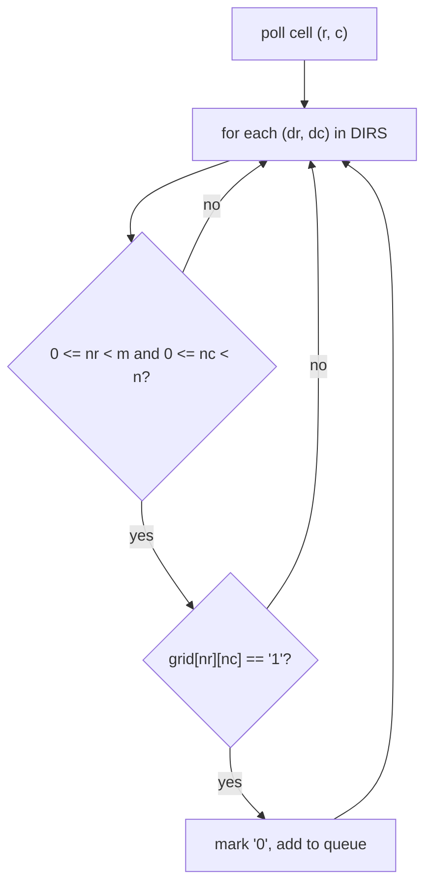

## Introduction

A photograph is a grid of pixels. A chessboard is an 8 × 8 grid of squares. A spreadsheet, a game level, a seating chart and the table a dynamic-programming solution fills in are all grids. In code, a grid is a **matrix**: a two-dimensional array with `m` rows and `n` columns, where each **cell** is addressed by a pair `(r, c)` — row first, then column.

Matrix problems look varied — print the grid in a spiral, rotate an image, find a value, count islands of land in a map — but they are built from a small set of skills. You need to know how the grid is stored, how to visit cells in a chosen order without stepping off the edge, how to find a cell's neighbours, how to change the grid in place without destroying information you still need, and how to use any sorted structure the grid has. This lesson teaches each skill on a classic problem and explains why the code is shaped the way it is.

Most matrix algorithms touch every cell once, so **O(m · n)** is the usual time — linear in the size of the grid. The interesting questions are how to do it in one pass, with little extra memory, and without the boundary bugs that make grid code notorious.

## Before you start

- **Array traversal** — loops over a 1D array, reversing in place, swapping. See [[a2-array-string-traversal]].
- **Binary search** — used to search a sorted matrix in O(log(m · n)). See [[a3-binary-search]].
- **Recursion and queues** — flood fill uses either recursive DFS or a queue-based BFS. See [[a1-recursion]] and [[a1-deque]]; tree versions of both traversals are in [[a6-dfs]] and [[a6-bfs]].
- **2D prefix sums** — rectangle-sum queries on a grid are taught in [[a2-prefix-suffix]]; this lesson does not repeat them.

## The intuition

Think of a cinema seating chart. Seats are named by row and seat number — row 3, seat 7. To check every seat you walk row by row, left to right. To find who sits next to someone you look one step up, down, left and right, and you must remember that a seat on the end of a row has no neighbour on one side. To "rotate" the chart for a different projector layout you need a rule that tells you where each seat moves.

Everything in this lesson is one of those three ideas made precise: an **order** to walk the grid, a **neighbourhood** with edges you must respect, and an **index mapping** that says where each cell goes.

## How Java stores a matrix

In Java, `int[][] grid` is not one block of `m · n` integers. It is an **array of arrays**: an outer array of length `m` whose elements are references to `m` separate `int[]` rows. This has three practical consequences.

First, `grid.length` is the number of rows and `grid[0].length` the number of columns. Reading `grid[0]` throws `ArrayIndexOutOfBoundsException` if there are no rows, so guard the empty case before computing `n`.

Second, rows can have different lengths. `new int[3][]` creates three null rows that you may fill with arrays of any size; such a **jagged array** is legal. Interview grids are rectangular, but code that loops to `grid[r].length` is safe for both.

Third, each row is contiguous in memory, but different rows may not be adjacent. Visiting cells **row by row** reads each row's memory sequentially, which is friendly to the CPU cache. Visiting **column by column** jumps between row arrays on every step. Both are O(m · n), but on large grids row-major loops are measurably faster.

```java title="GridBasics.java"
public class GridBasics {
    public static void main(String[] args) {
        int[][] grid = {
            {1, 2, 3, 4},
            {5, 6, 7, 8},
            {9, 10, 11, 12}
        };
        int m = grid.length;        // rows
        int n = grid[0].length;     // columns (safe only because m > 0)
        System.out.println("rows=" + m + " cols=" + n);

        // Row-major: finish a row before moving down
        StringBuilder rowMajor = new StringBuilder();
        for (int r = 0; r < m; r++)
            for (int c = 0; c < n; c++)
                rowMajor.append(grid[r][c]).append(' ');
        System.out.println("row-major:    " + rowMajor.toString().trim());

        // Column-major: finish a column before moving right
        StringBuilder colMajor = new StringBuilder();
        for (int c = 0; c < n; c++)
            for (int r = 0; r < m; r++)
                colMajor.append(grid[r][c]).append(' ');
        System.out.println("column-major: " + colMajor.toString().trim());

        // Flattening: cell (r, c) <-> id = r * n + c
        int id = 1 * n + 2;
        System.out.println("(1,2) -> id " + id + " -> (" + id / n + "," + id % n + ")");
    }
}
```

```output
rows=3 cols=4
row-major:    1 2 3 4 5 6 7 8 9 10 11 12
column-major: 1 5 9 2 6 10 3 7 11 4 8 12
(1,2) -> id 6 -> (1,2)
```

The last line shows **flattening**: numbering cells 0 to `m · n − 1` in row-major order with `id = r * n + c`, and recovering the cell with `r = id / n`, `c = id % n`. Note the multiplier is `n`, the number of *columns* — each row contributes `n` ids. Flattening lets you store a cell in one `int` (useful for visited sets, union-find and queues) and lets you treat a row-sorted matrix as a single sorted array, as you will see in the search section.

## Diagonals

Diagonals have a simple algebraic description that saves a lot of index juggling. Along a **main-direction diagonal** (top-left to bottom-right), each step adds 1 to both `r` and `c`, so `r − c` stays constant. Along an **anti-diagonal** (top-right to bottom-left), `r` goes up as `c` goes down, so `r + c` stays constant. In an `m × n` grid there are `m + n − 1` diagonals of each kind: `r − c` ranges from `−(n − 1)` to `m − 1`, and `r + c` from `0` to `m + n − 2`.

This gives two techniques. You can **group cells by `r − c` or `r + c`** (for example as keys in a map) to process each diagonal together — the N-Queens problem uses exactly this to check whether two queens share a diagonal ([[a9-n-queens]]). Or you can compare each cell with its diagonal predecessor `(r − 1, c − 1)`. A **Toeplitz matrix** is one where every main diagonal holds a single value:

```java title="Toeplitz.java"
public class Toeplitz {
    // Every top-left to bottom-right diagonal holds one value.
    // Cells on such a diagonal share r - c, so compare each cell with (r-1, c-1).
    static boolean isToeplitz(int[][] g) {
        for (int r = 1; r < g.length; r++)
            for (int c = 1; c < g[0].length; c++)
                if (g[r][c] != g[r - 1][c - 1]) return false;
        return true;
    }

    public static void main(String[] args) {
        System.out.println(isToeplitz(new int[][]{{1, 2, 3, 4}, {5, 1, 2, 3}, {9, 5, 1, 2}}));
        System.out.println(isToeplitz(new int[][]{{1, 2}, {2, 2}}));
    }
}
```

```output
true
false
```

Both loops start at 1 because cells in the first row or first column have no upper-left neighbour. Starting the loops there is a cleaner way to stay in bounds than checking `r > 0 && c > 0` inside the loop.

## Spiral traversal: shrinking boundaries

**Problem (Spiral Matrix).** Return the cells in clockwise spiral order, starting at the top-left.

The naive approach simulates a walker that turns right whenever it hits the edge or a visited cell. It works but needs an `m × n` visited array. A cleaner idea is to **peel the matrix like an onion**: keep four boundaries — `top`, `bottom`, `left`, `right` — describing the rectangle not yet visited. Each round walks its four sides and then moves each boundary inward by one.

```java title="SpiralOrder.java"
import java.util.ArrayList;
import java.util.List;

public class SpiralOrder {
    static List<Integer> spiralOrder(int[][] g) {
        List<Integer> out = new ArrayList<>();
        if (g.length == 0 || g[0].length == 0) return out;
        int top = 0, bottom = g.length - 1, left = 0, right = g[0].length - 1;

        while (top <= bottom && left <= right) {
            for (int c = left; c <= right; c++) out.add(g[top][c]);       // top row, →
            top++;
            for (int r = top; r <= bottom; r++) out.add(g[r][right]);     // right column, ↓
            right--;
            if (top <= bottom) {                                          // a row is left
                for (int c = right; c >= left; c--) out.add(g[bottom][c]); // bottom row, ←
                bottom--;
            }
            if (left <= right) {                                          // a column is left
                for (int r = bottom; r >= top; r--) out.add(g[r][left]);  // left column, ↑
                left++;
            }
        }
        return out;
    }

    public static void main(String[] args) {
        System.out.println(spiralOrder(new int[][]{{1, 2, 3, 4}, {5, 6, 7, 8}, {9, 10, 11, 12}}));
        System.out.println(spiralOrder(new int[][]{{1}, {2}, {3}}));
        System.out.println(spiralOrder(new int[][]{{1, 2, 3}}));
    }
}
```

```output
[1, 2, 3, 4, 8, 12, 11, 10, 9, 5, 6, 7]
[1, 2, 3]
[1, 2, 3]
```

The invariant is: *the unvisited cells are exactly the rectangle `top..bottom` × `left..right`.* Each side-walk visits one edge of that rectangle and then shrinks it, so the invariant is restored. Trace the 3 × 4 example:

| Round | Boundaries before (`top, bottom, left, right`) | Cells added | Boundaries after |
|---|---|---|---|
| 1 | 0, 2, 0, 3 | top 1 2 3 4; right 8 12; bottom 11 10 9; left 5 | 1, 1, 1, 2 |
| 2 | 1, 1, 1, 2 | top 6 7; right none; bottom skipped; left none | 2, 1, 2, 1 |

The two `if` checks are the subtle part. After walking the top row and the right column, the rectangle may have collapsed to nothing. In round 2, once row 1 has been walked as the "top", there is no separate bottom row; without the `top <= bottom` check the loop would walk what remains of row 1 again, backwards, and output 6 a second time. The single-column test `[[1], [2], [3]]` exercises the other guard. Every cell is added exactly once, so time is O(m · n), and apart from the output the extra space is O(1).

## Rotating a square matrix in place

**Problem (Rotate Image).** Rotate an `n × n` matrix 90 degrees clockwise, in place.

Start with the **index mapping**. In a clockwise rotation, the first row becomes the last column: the cell at `(r, c)` moves to `(c, n − 1 − r)`. You could copy into a new matrix with `rotated[c][n - 1 - r] = g[r][c]`, which is O(n²) time and O(n²) extra space. To do it in place, split the mapping into two simpler steps that are each easy to do with swaps:

1. **Transpose**: `(r, c) → (c, r)`. Rows become columns.
2. **Reverse each row**: `(r, c) → (r, n − 1 − c)`.

Composing them sends `(r, c)` to `(c, r)` and then to `(c, n − 1 − r)` — exactly the rotation.

```java title="RotateImage.java"
import java.util.Arrays;

public class RotateImage {
    static void rotate(int[][] g) {
        int n = g.length;
        // 1. Transpose: swap across the main diagonal. j starts at i + 1 so each
        //    pair is swapped once (swapping twice would undo it).
        for (int i = 0; i < n; i++) {
            for (int j = i + 1; j < n; j++) {
                int t = g[i][j];
                g[i][j] = g[j][i];
                g[j][i] = t;
            }
        }
        // 2. Reverse every row.
        for (int[] row : g) {
            for (int l = 0, r = n - 1; l < r; l++, r--) {
                int t = row[l];
                row[l] = row[r];
                row[r] = t;
            }
        }
    }

    public static void main(String[] args) {
        int[][] g = {{1, 2, 3}, {4, 5, 6}, {7, 8, 9}};
        rotate(g);
        System.out.println(Arrays.deepToString(g));
    }
}
```

```output
[[7, 4, 1], [8, 5, 2], [9, 6, 3]]
```

After the transpose the matrix is `[[1, 4, 7], [2, 5, 8], [3, 6, 9]]`; reversing each row gives the answer. The most common bug is the inner loop starting at `j = 0`: then every pair `(i, j)` is swapped once when visiting `(i, j)` and again when visiting `(j, i)`, and the matrix ends up unchanged. Time is O(n²) — each cell is touched a constant number of times — and extra space is O(1).

Other rotations follow from the same reasoning. Counter-clockwise is transpose then reverse each **column** (or reverse each row first, then transpose). A 180-degree rotation reverses the order of the rows and then each row. A non-square `m × n` matrix cannot be rotated in place, because the result is `n × m`; allocate a new array. An alternative in-place method rotates four cells at a time, layer by layer; it does the same work but its index arithmetic is harder to get right under pressure.

## Clearing rows and columns: Set Matrix Zeroes

**Problem.** If a cell is 0, set its entire row and column to 0, in place.

The trap is doing it in one pass: if you zero row 1 as soon as you see `g[1][1] == 0`, later cells in that row now look like original zeros and wipe out their columns too. Any in-place solution needs **two phases**: first record which rows and columns must be cleared, then clear them.

The straightforward recording uses two boolean arrays, `zeroRow[m]` and `zeroCol[n]`: O(m + n) space. To reach O(1), store those flags *inside the matrix*: use the first cell of each row, `g[r][0]`, as that row's flag, and the first cell of each column, `g[0][c]`, as that column's flag. The only complication is that the first row and first column are themselves data. Before overwriting them, save whether *they* originally contained a zero in two booleans, and clear them last.

```java title="SetMatrixZeroes.java"
import java.util.Arrays;

public class SetMatrixZeroes {
    static void setZeroes(int[][] g) {
        int m = g.length, n = g[0].length;
        boolean firstRowZero = false, firstColZero = false;
        for (int c = 0; c < n; c++) if (g[0][c] == 0) firstRowZero = true;
        for (int r = 0; r < m; r++) if (g[r][0] == 0) firstColZero = true;

        // Phase 1: record zeros in the first row/column (the "marker" cells).
        for (int r = 1; r < m; r++)
            for (int c = 1; c < n; c++)
                if (g[r][c] == 0) {
                    g[r][0] = 0;     // row r must be cleared
                    g[0][c] = 0;     // column c must be cleared
                }

        // Phase 2: clear the inner cells using the markers.
        for (int r = 1; r < m; r++)
            for (int c = 1; c < n; c++)
                if (g[r][0] == 0 || g[0][c] == 0) g[r][c] = 0;

        // Phase 3: clear the marker row and column last, from the saved flags.
        if (firstRowZero) for (int c = 0; c < n; c++) g[0][c] = 0;
        if (firstColZero) for (int r = 0; r < m; r++) g[r][0] = 0;
    }

    public static void main(String[] args) {
        int[][] a = {{1, 1, 1}, {1, 0, 1}, {1, 1, 1}};
        setZeroes(a);
        System.out.println(Arrays.deepToString(a));
        int[][] b = {{0, 1, 2, 0}, {3, 4, 5, 2}, {1, 3, 1, 5}};
        setZeroes(b);
        System.out.println(Arrays.deepToString(b));
    }
}
```

```output
[[1, 0, 1], [0, 0, 0], [1, 0, 1]]
[[0, 0, 0, 0], [0, 4, 5, 0], [0, 3, 1, 0]]
```

Walk through the second example. The first row contains zeros, so `firstRowZero = true`; the first column contains `g[0][0] = 0`, so `firstColZero = true`. Phase 1 finds no zeros in the inner 2 × 3 block, so no new markers are written — but `g[0][0]` and `g[0][3]` are already 0, and they act as markers for columns 0 and 3. Phase 2 clears inner cells in column 3 (`g[1][3]`, `g[2][3]`). Phase 3 clears the whole first row and first column. Why must phase 3 come last? If you cleared the first row early, every `g[0][c]` would be 0 and phase 2 would wipe every column.

Each phase is a constant number of passes over the grid, so time is O(m · n) and extra space is O(1). The idea generalises: when a problem asks for an in-place update that depends on the *old* values, either work in phases or **encode both the old and new state in each cell**. Conway's Game of Life is the standard example of the second approach — store "was alive, now dead" as a distinct value (say 2) so neighbours still read the old state, then normalise in a final pass.

```quiz
Q: In the in-place rotation, why must the transpose loop start at `j = i + 1`?
- [ ] To skip the last row
- [x] Starting at 0 would swap each pair twice, putting every element back where it started
- [ ] Because the diagonal elements must be swapped with each other
- [ ] To avoid an ArrayIndexOutOfBoundsException
> The transpose swaps (i, j) with (j, i). If both i < j and i > j are visited, each pair is swapped and then swapped back. Diagonal cells (i == j) map to themselves and need no swap, so the upper triangle j > i is exactly the set of pairs to swap once.

Q: In Set Matrix Zeroes with O(1) space, why are the first row and first column cleared last?
- [ ] They are the largest
- [ ] Java requires it
- [x] They hold the markers for every other row and column; clearing them early would corrupt those markers
- [ ] So the method runs in O(m + n) time
> After phase 1, g[r][0] and g[0][c] record which rows and columns to clear. If row 0 were zeroed first, every column marker would read 0 and the whole matrix would be cleared. Their own original zero status is saved in two booleans before any markers are written.
```

## Searching a sorted matrix

Grids often come with order, and order means you can beat O(m · n). There are two different "sorted matrix" problems, and confusing them is a classic interview trap.

**Fully sorted (row-major sorted).** Each row is sorted, and each row's first value is greater than the previous row's last value. Then reading the grid row by row gives one sorted list of `m · n` values. Binary search over the flattened index range `0..m·n − 1`, converting each `mid` back to `(mid / n, mid % n)`. Time **O(log(m · n))**.

**Rows and columns sorted.** Each row increases left to right and each column increases top to bottom, but a row's values can overlap the next row's. Flattening no longer gives a sorted list (`[[1, 4], [2, 5]]` flattens to `1, 4, 2, 5`). Instead, start at the **top-right corner**. That cell is the largest in its row and the smallest in its column. If it is greater than the target, the target cannot be anywhere below it in that column (those are even larger), so discard the column: `c--`. If it is smaller, the target cannot be anywhere to its left in that row, so discard the row: `r++`. Each step removes a whole row or column, so there are at most `m + n` steps: **O(m + n)**. This is the **staircase search**. The bottom-left corner works symmetrically; the top-left and bottom-right do not, because from there both moves go in the same direction of value.

```java title="SearchSortedMatrix.java"
public class SearchSortedMatrix {
    // Each row sorted, and each row's first value > previous row's last value:
    // the matrix is one sorted list of m * n values, read row by row.
    static boolean searchFullySorted(int[][] g, int target) {
        int m = g.length, n = g[0].length;
        int low = 0, high = m * n - 1;
        while (low <= high) {
            int mid = low + (high - low) / 2;
            int value = g[mid / n][mid % n];         // unflatten the index
            if (value == target) return true;
            if (value < target) low = mid + 1;
            else high = mid - 1;
        }
        return false;
    }

    // Rows sorted left to right, columns sorted top to bottom (weaker condition).
    static boolean searchStaircase(int[][] g, int target) {
        int r = 0, c = g[0].length - 1;              // start at the top-right corner
        while (r < g.length && c >= 0) {
            if (g[r][c] == target) return true;
            if (g[r][c] > target) c--;               // everything below in column c is bigger
            else r++;                                // everything left in row r is smaller
        }
        return false;
    }

    public static void main(String[] args) {
        int[][] full = {{1, 3, 5, 7}, {10, 11, 16, 20}, {23, 30, 34, 60}};
        System.out.println(searchFullySorted(full, 16) + " " + searchFullySorted(full, 13));

        int[][] stair = {
            {1, 4, 7, 11, 15},
            {2, 5, 8, 12, 19},
            {3, 6, 9, 16, 22},
            {10, 13, 14, 17, 24},
            {18, 21, 23, 26, 30}
        };
        System.out.println(searchStaircase(stair, 5) + " " + searchStaircase(stair, 20));
    }
}
```

```output
true false
true false
```

Trace the staircase search for 5: start at `(0, 4)` = 15 > 5, move left to 11, then 7, then 4; 4 < 5, move down to `(1, 1)` = 5, found. Three columns and one row eliminated, five cells read. Searching for 20 walks 15 → down 19 → down 22 → left 16 → down 17 → down 26 → left 23 → left 21 → left 18 → down, off the grid: not present.

A middle option — binary search each row separately — works for both kinds of matrix in O(m log n). It is correct but slower than the staircase when `m` and `n` are similar, and slower than the flattened search on fully sorted grids. Mention it as a stepping stone, not as the final answer.

## The grid as a graph: neighbours and flood fill

Many grid problems are really graph problems in disguise: each cell is a node, and an edge joins two cells that are **adjacent**. "Adjacent" usually means the four cells sharing a side (**4-directional**: up, down, left, right); some problems also count the four diagonal cells (**8-directional**).

Writing four nearly identical `if` blocks to visit neighbours invites copy-paste bugs. The standard technique is a **direction array**: a list of `(dr, dc)` offsets you loop over.

```java title="Directions.java"
int[][] dirs4 = {{-1, 0}, {1, 0}, {0, -1}, {0, 1}};
int[][] dirs8 = {{-1, -1}, {-1, 0}, {-1, 1}, {0, -1}, {0, 1}, {1, -1}, {1, 0}, {1, 1}};
```

For each offset you compute `nr = r + dr`, `nc = c + dc` and check bounds — `0 <= nr < m` and `0 <= nc < n` — *before* reading `grid[nr][nc]`.

**Problem (Number of Islands).** A grid of `'1'` (land) and `'0'` (water). An island is a group of land cells connected 4-directionally. Count the islands.

The idea is **flood fill**. Scan the grid in row-major order. Each time you meet land that has not been visited, you have found a new island: count it, then visit every land cell reachable from it and mark them visited so they are never counted again. Marking can reuse the grid itself (turn `'1'` into `'0'`) when you are allowed to modify the input; otherwise keep a `boolean[m][n]`.

The reachable cells can be visited with depth-first search (DFS) or breadth-first search (BFS). The version below uses BFS with an explicit queue:

```java title="NumberOfIslands.java"
import java.util.ArrayDeque;

public class NumberOfIslands {
    static final int[][] DIRS = {{-1, 0}, {1, 0}, {0, -1}, {0, 1}};   // up, down, left, right

    static int numIslands(char[][] grid) {
        int m = grid.length, n = grid[0].length, islands = 0;
        for (int r = 0; r < m; r++) {
            for (int c = 0; c < n; c++) {
                if (grid[r][c] != '1') continue;
                islands++;                     // unvisited land: a new island
                grid[r][c] = '0';              // mark when ADDED to the queue, not when removed
                ArrayDeque<int[]> queue = new ArrayDeque<>();
                queue.add(new int[]{r, c});
                while (!queue.isEmpty()) {
                    int[] cell = queue.poll();
                    for (int[] d : DIRS) {
                        int nr = cell[0] + d[0], nc = cell[1] + d[1];
                        if (nr < 0 || nr >= m || nc < 0 || nc >= n) continue;   // off the grid
                        if (grid[nr][nc] != '1') continue;                      // water or seen
                        grid[nr][nc] = '0';
                        queue.add(new int[]{nr, nc});
                    }
                }
            }
        }
        return islands;
    }

    public static void main(String[] args) {
        char[][] grid = {
            "11000".toCharArray(),
            "11000".toCharArray(),
            "00100".toCharArray(),
            "00011".toCharArray()
        };
        System.out.println(numIslands(grid));
    }
}
```

```output
3
```

The scan meets land first at `(0, 0)`: count 1, and the BFS sinks the 2 × 2 block in the top-left. The next unvisited land is `(2, 2)`: count 2, and it has no land neighbours. The last is `(3, 3)`: count 3, and the BFS also sinks `(3, 4)`.



**Why mark on enqueue?** If you marked a cell only when it is polled, a cell could be added to the queue several times — once by each neighbour that sees it before it is processed. The answer would still be right, but the queue could grow well beyond `m · n` entries. Marking at the moment of adding guarantees each cell enters the queue at most once.

**Complexity.** Every cell is visited by the outer scan once and enters a queue at most once; each queue entry checks four neighbours. Time is **O(m · n)**. Extra space is the queue, which can hold O(m · n) cells in the worst case (plus a `visited` array of the same size if you may not modify the grid).

**DFS versus BFS.** A recursive DFS is shorter to write:

```java title="IslandDfs.java"
static void sink(char[][] g, int r, int c) {
    if (r < 0 || r >= g.length || c < 0 || c >= g[0].length || g[r][c] != '1') return;
    g[r][c] = '0';
    sink(g, r + 1, c);
    sink(g, r - 1, c);
    sink(g, r, c + 1);
    sink(g, r, c - 1);
}
```

But its recursion depth equals the length of the path it follows, which can be `m · n` on a snake-shaped island. A 1,000 × 1,000 all-land grid can need a million nested calls, far beyond the default Java thread stack, and the method throws `StackOverflowError`. For large grids use BFS or an iterative DFS with an explicit `ArrayDeque` stack. BFS has a second advantage: on an unweighted grid it visits cells in order of distance from the start, so it also finds **shortest paths** — "minimum steps to reach the exit" or "minutes until all oranges rot" (multi-source BFS, where every rotten orange starts in the queue at time 0).

Grid search with backtracking — finding a word by walking letters, where cells must be un-marked when the path retreats — is a different pattern; see [[a9-grid-search]]. Grids filled by recurrence, such as counting paths from corner to corner, are covered in [[a11-grid-dp]].

```quiz
Q: A matrix has sorted rows and sorted columns, but rows may overlap in value. Which search is correct and fastest in general?
- [ ] Binary search over the flattened index, O(log(m·n))
- [x] Staircase search from the top-right corner, O(m + n)
- [ ] Staircase search from the top-left corner, O(m + n)
- [ ] There is no faster method than checking every cell
> Flattening only gives a sorted list when each row starts above the previous row's end, which this matrix does not guarantee. From the top-right cell, "too big" eliminates the rest of the column and "too small" eliminates the rest of the row, so each step discards a line. From the top-left both moves increase the value, so a comparison does not tell you which way to go.

Q: Why does the BFS for Number of Islands mark a cell as visited when it is added to the queue rather than when it is removed?
- [ ] Marking on removal gives the wrong island count
- [x] Marking on removal lets the same cell be enqueued several times by different neighbours, wasting time and memory
- [ ] Java's ArrayDeque requires it
- [ ] It makes the algorithm depth-first instead of breadth-first
> Until it is polled, an unmarked cell looks unvisited to every neighbour that inspects it, so it can be added repeatedly. The count would still be correct, but the queue can grow far larger than m·n. Marking on enqueue guarantees each cell is queued at most once.
```

## In real systems

**Image processing.** An image is a matrix of pixels. Rotating a photo is the index mapping from this lesson; the "paint bucket" tool is flood fill; blurring and edge detection apply a small kernel to each pixel's neighbourhood. Libraries usually store images as a single flat array with `index = row * width + col` — flattening — precisely because one contiguous block is faster than an array of arrays.

**Games and maps.** Tile-based games keep the level as a grid, use direction arrays for movement, and run BFS (or A*, a BFS guided by a distance estimate) for pathfinding. Minesweeper's "reveal empty region" is a flood fill.

**Scientific and numeric code.** Libraries such as NumPy store matrices in one contiguous buffer and record whether it is row-major or column-major, because choosing the traversal order that matches memory layout can make loops several times faster.

**Spreadsheets and tables.** A spreadsheet is a sparse grid; range formulas are rectangle queries, which is where 2D prefix sums from [[a2-prefix-suffix]] come in.

## Trade-offs and alternatives

| Task | Technique | Time | Extra space | Watch out for |
|---|---|---|---|---|
| Visit every cell | Row-major loops | O(m·n) | O(1) | Use `grid[0].length` only if `m > 0` |
| Spiral order | Shrinking boundaries | O(m·n) | O(1) | Guards after the first two sides |
| Rotate 90° (square) | Transpose + reverse rows | O(n²) | O(1) | Inner loop from `i + 1` |
| Clear rows/columns | First row/column as markers | O(m·n) | O(1) | Save and clear markers last |
| Search fully sorted | Flattened binary search | O(log(m·n)) | O(1) | `mid / n`, `mid % n` |
| Search rows+cols sorted | Staircase | O(m + n) | O(1) | Start top-right or bottom-left |
| Count regions | BFS / iterative DFS flood fill | O(m·n) | O(m·n) | Mark on enqueue; recursion depth |

In-place techniques save memory but destroy the input; in an interview, ask whether modifying the grid is allowed, and use a separate `visited` array if not. When the grid is huge but mostly empty (a sparse map), storing only the occupied cells in a `HashMap` keyed by flattened id can use far less memory than an `m × n` array. When regions must be merged dynamically as cells are added — "number of islands after each land addition" — union-find on flattened ids beats re-running flood fill.

## Common mistakes

> [!MISTAKE] Mixing up rows and columns
> `grid[r][c]` is row first. The number of rows is `grid.length` and the number of columns is `grid[0].length`. In a non-square grid, using `m` where you meant `n` passes every square test case and fails the first rectangular one. Test with a 2 × 3 grid, not 3 × 3.

**Reading before checking bounds.** `grid[nr][nc]` must come after the bounds check, and with `||` short-circuiting the check must be on the left: `nr < 0 || nr >= m || ... || grid[nr][nc] != '1'`.

**Off-by-one on bounds.** The last row is `m - 1`. Conditions must be `r < m`, never `r <= m`.

**Forgetting to mark visited.** Without marking, DFS on a grid revisits cells forever — two adjacent land cells call each other endlessly.

**Updating in one pass when the update depends on old values.** Set Matrix Zeroes and Game of Life both break if new values overwrite information still needed. Work in phases or encode both states.

**Assuming the flattened search works on any sorted matrix.** It needs each row to start above the previous row's end.

**Recursive DFS on big grids.** Depth can reach `m · n`; use BFS or an explicit stack.

## Interview perspective

Grid questions test care more than cleverness. Interviewers watch for a clean bounds helper, correct `m` and `n`, and whether you state O(m · n) up front.

> [!INTERVIEW] What a strong answer sounds like
> "I'll treat each land cell as a node with up to four neighbours. I scan row by row; each unvisited land cell starts a new island, and a BFS marks everything reachable. Each cell is enqueued at most once because I mark it when I add it, so it's O(m·n) time. I'm using BFS rather than recursive DFS because a long island could overflow the stack."

Questions to prepare:

- **Rotate counter-clockwise, or by 180 degrees?** Derive the mapping and decompose it into transposes and reversals.
- **Set Matrix Zeroes in O(1) space?** First row and column as markers, two saved flags, markers cleared last.
- **What if diagonal moves are allowed?** Switch to the eight-entry direction array; nothing else changes.
- **Why start the staircase at the top-right?** It is the only kind of corner (with bottom-left) where the two moves change the value in opposite directions.
- **Shortest path in a grid?** BFS, because it explores in distance order; DFS does not find shortest paths.
- **The grid is too large for memory?** Process it in row bands, or store only occupied cells sparsely.

## Practice

1. **Transpose Matrix.** Return the transpose of an `m × n` matrix (a new `n × m` array). Why can this not be done in place for non-square input?
2. **Diagonal Traverse.** Return cells in zig-zag diagonal order. Group by `r + c` and reverse alternate groups.
3. **Game of Life.** Compute the next state in place using an encoding for "was alive, now dead" and "was dead, now alive".
4. **Spiral Matrix II.** Fill an `n × n` matrix with 1 to n² in spiral order using the same four boundaries.
5. **Max Area of Island.** Return the size of the largest island; count cells during each flood fill.
6. **Rotting Oranges.** Multi-source BFS: put every rotten orange in the queue first and count BFS levels.
7. **Search a 2D Matrix II.** Implement the staircase search starting from the bottom-left instead, and argue why it is correct.

The DSA explorer lists the matching problems under this topic; start with *Spiral Matrix*, *Rotate Image*, *Set Matrix Zeroes*, *Search a 2D Matrix* and *Number of Islands*.

## Quick revision {#quick-revision}

- `int[][]` is an array of row arrays: `m = grid.length`, `n = grid[0].length` (guard `m == 0`); rows may be jagged.
- Row-major loops are cache-friendly; flatten with `id = r * n + c`, `r = id / n`, `c = id % n`.
- Diagonals: `r − c` constant (main direction), `r + c` constant (anti-diagonal).
- Spiral: four boundaries; after top row and right column, check `top <= bottom` and `left <= right`.
- Rotate clockwise = transpose (inner loop `j = i + 1`) + reverse each row; counter-clockwise = transpose + reverse each column.
- Set Matrix Zeroes O(1): first row/column as markers, save their own status in two booleans, clear them last.
- Fully sorted matrix → binary search on flattened index, O(log(m·n)); rows+columns sorted → staircase from top-right, O(m + n).
- Neighbours via a direction array; bounds check before access.
- Flood fill counts regions in O(m·n); mark on enqueue; prefer BFS or an explicit stack over deep recursion; BFS gives shortest paths on unweighted grids.

## Key takeaways {#key-takeaways}

- Most matrix problems are O(m · n); the skill is doing that one pass correctly, with little memory and no boundary bugs.
- Write down the invariant — the unvisited rectangle in a spiral, the meaning of a marker cell — and the loop bounds follow from it.
- Complex in-place transformations become simple when decomposed into steps you can do with swaps, like transpose plus reverse.
- In-place updates that depend on old values need phases or a state encoding.
- Sorted structure lets you beat a full scan; check which kind of sortedness you have before choosing the search.
- A grid is a graph: direction arrays give the edges, and BFS or DFS flood fill explores regions.
