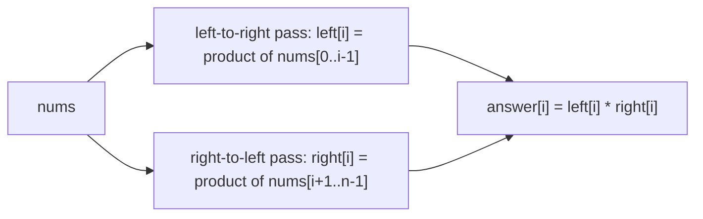

## Introduction

Imagine an analytics dashboard that stores daily sign-ups for the last ten years — about 3,650 numbers — and lets users ask "how many people signed up between day `l` and day `r`?". The obvious answer loops from `l` to `r` and adds. One query costs up to 3,650 additions, which is nothing. But a busy dashboard may serve a hundred thousand such queries, and now the total is hundreds of millions of additions, all of them re-adding the same days over and over.

The fix is to do the adding **once**. Walk the array a single time and record, for each day, the total of all days up to and including it. Then the sign-ups between day `l` and day `r` are "total up to `r`" minus "total up to just before `l`" — one subtraction, no matter how wide the range. That stored running total is a **prefix sum**, and it is the simplest example of a powerful idea: **precompute information about every prefix (or suffix) so that later questions about ranges or neighbourhoods become O(1)**.

The same idea answers a whole family of questions that would otherwise need an inner loop per index:

- "What is the sum of `a[l..r]`?" — prefix sums.
- "What is the product of every element except `a[i]`?" — prefix products from the left times suffix products from the right.
- "What is the tallest wall to the left and to the right of position `i`?" — prefix and suffix maxima, the key to Trapping Rain Water.
- "Is there an index where the left half sums to the same as the right half?" — a prefix total compared with the remaining suffix.

These patterns turn O(n²) brute force into O(n), and they combine with other techniques: prefix sums plus a hash map count subarrays with a given sum ([[a2-hashing]]), and prefix sums of *differences* apply range updates ([[a2-difference-arrays]]).

## Before you start

- **Array traversal** — single passes, scanning right to left, running state. See [[a2-array-string-traversal]].
- **Big-O** — comparing O(n·q) with O(n + q). See [[a1-time-complexity]].
- **Integer overflow in Java** — that `int` silently wraps past about 2.1 billion. The traversal lesson shows an example.

## The intuition

Think of a bank statement. Each line shows a transaction and the **running balance** after it. If you want to know how much you spent between the 10th and the 20th of the month, you do not add up those transactions one by one — you subtract the balance on the 9th from the balance on the 20th. The running balance is a prefix sum, and the subtraction works because everything before the 10th appears in *both* balances and cancels out.

A **suffix** is the same idea read from the other end: "how much is still to come from here to the end of the month". And many problems need both — to answer something about position `i` you want a summary of everything on its left (prefix) and everything on its right (suffix), with `a[i]` itself excluded. Two passes give you both summaries for every position at once.

## Prefix sums

### Definition and construction

For an array `a` of length `n`, define a **prefix-sum array** `P` of length `n + 1`:

- `P[0] = 0` — the sum of the empty prefix.
- `P[i + 1] = P[i] + a[i]` — so `P[k]` is the sum of the first `k` elements, `a[0] + … + a[k - 1]`.

For `a = [3, 1, 4, 1, 5, 9, 2, 6]`:

| `k` | 0 | 1 | 2 | 3 | 4 | 5 | 6 | 7 | 8 |
|---|---|---|---|---|---|---|---|---|---|
| `P[k]` | 0 | 3 | 4 | 8 | 9 | 14 | 23 | 25 | 31 |

`P[3] = 8` is `3 + 1 + 4`; `P[8] = 31` is the sum of the whole array.

### The range query

The sum of `a[l..r]` (inclusive) is the first `r + 1` elements minus the first `l` elements:

```text
sum(l, r) = P[r + 1] - P[l]
```

For `sum(2, 5) = 4 + 1 + 5 + 9 = 19`: `P[6] - P[2] = 23 - 4 = 19`. The elements `a[0]` and `a[1]` are included in both `P[6]` and `P[2]`, so they cancel — the bank-statement subtraction.

### Why the array has `n + 1` entries

You will also see the "inclusive" convention, where `pre[i] = a[0] + … + a[i]` has length `n`. Then `sum(l, r) = pre[r] - pre[l - 1]`, which breaks when `l = 0` because `pre[-1]` does not exist, so every query needs `l > 0 ? pre[l - 1] : 0`. The extra leading zero in the `n + 1` version *is* that missing `pre[-1]`: the sum of nothing. With it, one formula covers every range, including ranges that start at index 0 and the empty range (`sum` over `l..l-1` is `P[l] - P[l] = 0`). Fewer special cases means fewer bugs.

### Complete implementation

```java title="RangeSum.java"
public class RangeSum {
    private final long[] prefix;   // long: the sum of many ints can exceed int range

    RangeSum(int[] a) {
        prefix = new long[a.length + 1];
        for (int i = 0; i < a.length; i++) {
            prefix[i + 1] = prefix[i] + a[i];
        }
    }

    /** Sum of a[l..r], inclusive. */
    long sum(int l, int r) {
        return prefix[r + 1] - prefix[l];
    }

    public static void main(String[] args) {
        RangeSum rs = new RangeSum(new int[]{3, 1, 4, 1, 5, 9, 2, 6});
        System.out.println(rs.sum(2, 5));   // 4 + 1 + 5 + 9
        System.out.println(rs.sum(0, 7));   // whole array
        System.out.println(rs.sum(3, 3));   // single element

        int big = 2_000_000_000;
        RangeSum overflow = new RangeSum(new int[]{big, big});
        System.out.println(overflow.sum(0, 1));
    }
}
```

```output
19
31
1
4000000000
```

The last query shows why the table is `long[]`. Each element fits in an `int`, but their sum does not; an `int[]` table would have silently wrapped to a negative number. Note that `prefix[i] + a[i]` is computed in `long` because `prefix[i]` is a `long`, so the `int` operand is widened before the addition.

### Complexity

Building the table is one loop of `n` constant-time steps: **O(n) time** and **O(n) space**. Each query is two array reads and a subtraction: **O(1)**. For `q` queries, the total is O(n + q) instead of O(n·q) for the brute force. With `n = 3,650` and `q = 100,000`, that is about 104,000 operations instead of up to 365 million.

> [!IMPORTANT] Static data only
> A prefix-sum table is a snapshot. If `a[i]` changes, every `P[k]` with `k > i` is now wrong, and rebuilding costs O(n). When the array is updated between queries, use a Fenwick tree ([[a12-fenwick]]) or a segment tree ([[a12-segment-trees]]), which support both updates and range sums in O(log n).

## Which operations work: invertible versus not

Range queries by subtraction work because addition has an **inverse**: you can "remove" the contribution of `a[0..l-1]` by subtracting it. That is not true of every aggregate. Here is the classification you need:

| Aggregate | Identity (value for an empty range) | Range query from prefixes? | Why |
|---|---|---|---|
| Sum | `0` | Yes: `P[r+1] - P[l]` | Subtraction undoes addition |
| XOR | `0` | Yes: `X[r+1] ^ X[l]` | `x ^ x = 0`, so XOR undoes itself |
| Count of matching elements | `0` | Yes, by subtraction | It is a sum of 0/1 values |
| Product | `1` | Only without zeros, by division | Division undoes multiplication, but not by zero |
| Max / min | `-∞` / `+∞` (use `Integer.MIN_VALUE` / `MAX_VALUE`) | No | Knowing max of `a[0..r]` and max of `a[0..l-1]` does not tell you max of `a[l..r]` |

The **identity** is the value that leaves the aggregate unchanged — adding 0, multiplying by 1, taking the max with −∞. It is what `P[0]` must hold, and what you use for "nothing to the left" or "nothing to the right" at the ends of the array. Using the wrong identity (starting a product at 0, or a max at 0 when values can be negative) is one of the most common bugs in this topic.

For max and min you can still precompute prefixes and suffixes — "the largest value in `a[0..i]`" — which is exactly what many problems need. You just cannot answer an arbitrary middle range from them. For that, see sparse tables ([[a12-sparse-tables]]).

**Prefix XOR** deserves one example because it shows up in bit-manipulation problems. For `a = [1, 3, 4, 8]`, the table is `X = [0, 1, 2, 6, 14]`, and the XOR of `a[1..2]` is `X[3] ^ X[1] = 6 ^ 1 = 7`, which matches `3 ^ 4 = 7`. The shared prefix `a[0]` appears twice and cancels, because anything XORed with itself is 0.

## Prefix and suffix aggregates for "best so far" questions

A prefix does not have to be a sum. **Best Time to Buy and Sell Stock** gives daily prices and asks for the largest profit from buying on one day and selling on a later day. For each selling day `i`, the best buying day is the cheapest day *before* it — a prefix minimum. Rather than storing a whole table, keep the minimum as a running variable:

```java title="StockProfit.java"
public class StockProfit {
    static int maxProfit(int[] prices) {
        int minSoFar = Integer.MAX_VALUE;   // identity for min: nothing seen yet
        int best = 0;                        // not trading at all earns 0
        for (int p : prices) {
            best = Math.max(best, p - minSoFar);   // sell today, bought at the prefix min
            minSoFar = Math.min(minSoFar, p);
        }
        return best;
    }

    public static void main(String[] args) {
        System.out.println(maxProfit(new int[]{7, 1, 5, 3, 6, 4}));
        System.out.println(maxProfit(new int[]{7, 6, 4, 3, 1}));
    }
}
```

```output
5
0
```

On the first day `p - minSoFar` is `7 - Integer.MAX_VALUE`, a large negative number, so `best` stays 0 — that is the identity doing its job. The update order matters: the profit is computed *before* today's price joins the minimum, so you never "buy and sell on the same day". (Here that would only add a profit of 0, but in variants with fees the order changes the answer.)

The mirror image is a **suffix** aggregate. **Replace Elements with Greatest Element on Right Side** asks to replace every element with the maximum of the elements after it, and the last element with `-1`. Scanning from the right with a running maximum does it in one pass:

```java
static int[] replaceWithGreatestOnRight(int[] a) {
    int maxRight = -1;                      // the problem's value for "nothing to the right"
    for (int i = a.length - 1; i >= 0; i--) {
        int current = a[i];
        a[i] = maxRight;                    // everything strictly to the right of i
        maxRight = Math.max(maxRight, current);
    }
    return a;
}
// [17, 18, 5, 4, 6, 1] -> [18, 6, 6, 6, 1, -1]
```

The temporary `current` is needed because `a[i]` is overwritten before it is folded into the running maximum.

## Combining both sides: Product of Array Except Self

This is the signature problem of the topic. Given `nums`, return an array where `answer[i]` is the product of all elements except `nums[i]`. The constraints forbid division and ask for O(n) time.

### From brute force to two passes

The brute force multiplies the other `n - 1` elements for each `i`: O(n²). The division trick — multiply everything once and divide by `nums[i]` — is O(n), but it breaks when the array contains a zero (division by zero) and is forbidden anyway.

Now look at what `answer[i]` really is. Everything except `nums[i]` splits into two parts: everything to the **left** of `i` and everything to the **right**.

```text
answer[i] = (nums[0] × … × nums[i-1]) × (nums[i+1] × … × nums[n-1])
           =      left[i]              ×        right[i]
```

`left[i]` is an exclusive prefix product and `right[i]` an exclusive suffix product. Each can be built for all `i` in one pass, because `left[i] = left[i-1] × nums[i-1]` and `right[i] = right[i+1] × nums[i+1]`. At the ends, "nothing to the left" and "nothing to the right" use the product identity, `1`.



### Dry run on `[1, 2, 3, 4]`

| `i` | `nums[i]` | `left[i]` | `right[i]` | `answer[i]` |
|---|---|---|---|---|
| 0 | 1 | 1 (nothing to the left) | 2 × 3 × 4 = 24 | 24 |
| 1 | 2 | 1 | 3 × 4 = 12 | 12 |
| 2 | 3 | 1 × 2 = 2 | 4 | 8 |
| 3 | 4 | 1 × 2 × 3 = 6 | 1 (nothing to the right) | 6 |

### Reducing space to O(1)

Storing `left` and `right` costs two extra arrays. The output array can hold `left` directly, and `right` never needs to be stored at all: during the right-to-left pass, a single variable `suffix` holds `right[i]` at the moment it is needed.

```java title="ProductExceptSelf.java"
import java.util.Arrays;

public class ProductExceptSelf {
    static int[] productExceptSelf(int[] nums) {
        int n = nums.length;
        int[] answer = new int[n];

        answer[0] = 1;                            // nothing to the left of index 0
        for (int i = 1; i < n; i++) {
            answer[i] = answer[i - 1] * nums[i - 1];   // answer[i] = left[i]
        }

        int suffix = 1;                           // nothing to the right of index n-1
        for (int i = n - 1; i >= 0; i--) {
            answer[i] *= suffix;                  // left[i] * right[i]
            suffix *= nums[i];                    // now covers nums[i..n-1] for i - 1
        }
        return answer;
    }

    public static void main(String[] args) {
        System.out.println(Arrays.toString(productExceptSelf(new int[]{1, 2, 3, 4})));
        System.out.println(Arrays.toString(productExceptSelf(new int[]{-1, 1, 0, -3, 3})));
    }
}
```

```output
[24, 12, 8, 6]
[0, 0, 9, 0, 0]
```

The order of the two statements in the second loop is the whole trick. `answer[i] *= suffix` uses the product of elements strictly to the right of `i`; only *then* is `nums[i]` folded in, ready for index `i - 1`. Swap them and every answer would wrongly include `nums[i]`.

The zero case needs no special handling. Only index 2 excludes the zero, so only `answer[2]` (which is `-1 × 1 × -3 × 3 = 9`) is non-zero. The method uses O(1) extra space beyond the output array, which by convention is not counted. LeetCode guarantees the products fit in an `int`; in general code you would use `long` or check for overflow.

## Trapping Rain Water

Given bar heights, compute how much rainwater is trapped between them. For heights `[0, 1, 0, 2, 1, 0, 1, 3, 2, 1, 2, 1]` the answer is 6.

### Deriving the formula

Focus on a single position `i`. Water above it is held in by walls on both sides: the **tallest bar to its left** and the **tallest bar to its right**. The water surface cannot rise above the shorter of those two walls, or it would spill over that side. So:

```text
water[i] = min(maxLeft[i], maxRight[i]) - height[i]
```

If we define `maxLeft[i]` as the maximum of `height[0..i]` *including* `i`, the formula can never go negative — when `i` is itself the tallest, `min(...)` equals `height[i]` and the water is 0. That inclusive definition saves a `Math.max(0, …)`.

The brute force computes both maxima by scanning left and right from every `i`: O(n²). But `maxLeft` is a prefix maximum and `maxRight` is a suffix maximum, so two passes build them for every index:

| `i` | 0 | 1 | 2 | 3 | 4 | 5 | 6 | 7 | 8 | 9 | 10 | 11 |
|---|---|---|---|---|---|---|---|---|---|---|---|---|
| `height` | 0 | 1 | 0 | 2 | 1 | 0 | 1 | 3 | 2 | 1 | 2 | 1 |
| `maxLeft` | 0 | 1 | 1 | 2 | 2 | 2 | 2 | 3 | 3 | 3 | 3 | 3 |
| `maxRight` | 3 | 3 | 3 | 3 | 3 | 3 | 3 | 3 | 2 | 2 | 2 | 1 |
| water | 0 | 0 | 1 | 0 | 1 | 2 | 1 | 0 | 0 | 1 | 0 | 0 |

The water row sums to 6.

```java title="TrappingRainWater.java"
public class TrappingRainWater {
    static int trap(int[] h) {
        int n = h.length;
        if (n == 0) return 0;
        int[] maxLeft = new int[n], maxRight = new int[n];

        maxLeft[0] = h[0];
        for (int i = 1; i < n; i++) maxLeft[i] = Math.max(maxLeft[i - 1], h[i]);

        maxRight[n - 1] = h[n - 1];
        for (int i = n - 2; i >= 0; i--) maxRight[i] = Math.max(maxRight[i + 1], h[i]);

        int water = 0;
        for (int i = 0; i < n; i++) {
            water += Math.min(maxLeft[i], maxRight[i]) - h[i];
        }
        return water;
    }

    public static void main(String[] args) {
        System.out.println(trap(new int[]{0, 1, 0, 2, 1, 0, 1, 3, 2, 1, 2, 1}));
        System.out.println(trap(new int[]{4, 2, 0, 3, 2, 5}));
        System.out.println(trap(new int[]{}));
    }
}
```

```output
6
9
0
```

Three passes of `n` steps: O(n) time, O(n) space. The two-pointer version in [[a2-two-pointers]] reaches O(1) space by noticing that you only need the *smaller* of the two maxima, and a pointer from each end always knows which side is smaller.

## Prefix totals against suffix totals: the pivot index

**Find Pivot Index** asks for the leftmost index where the sum of elements to its left equals the sum to its right. You could build a prefix-sum table, but there is a neater observation: the right side is the total minus the left side minus the pivot itself. So one pass for the total and one pass with a running left sum are enough.

```java title="PivotIndex.java"
public class PivotIndex {
    static int pivotIndex(int[] nums) {
        int total = 0;
        for (int x : nums) total += x;

        int left = 0;                              // sum of nums[0..i-1]
        for (int i = 0; i < nums.length; i++) {
            int right = total - left - nums[i];    // sum of nums[i+1..n-1]
            if (left == right) return i;
            left += nums[i];
        }
        return -1;
    }

    public static void main(String[] args) {
        System.out.println(pivotIndex(new int[]{1, 7, 3, 6, 5, 6}));
        System.out.println(pivotIndex(new int[]{1, 2, 3}));
        System.out.println(pivotIndex(new int[]{2, 1, -1}));
    }
}
```

```output
3
-1
0
```

For the first array the total is 28; at index 3 the left sum is `1 + 7 + 3 = 11` and the right is `28 - 11 - 6 = 11`. The third example shows the boundary rule: at index 0 the left side is empty (sum 0, the identity) and the right side is `1 + (-1) = 0`, so index 0 is a pivot. This "total minus prefix gives suffix" trick works for any invertible aggregate and removes the need for a suffix array.

## Two-dimensional prefix sums

The idea extends to a grid. For a matrix `m` with `R` rows and `C` columns, let `P[r][c]` be the sum of the rectangle from the top-left corner `(0, 0)` to `(r - 1, c - 1)`, with an extra row and column of zeros, just as in one dimension.

To build `P[r+1][c+1]`, add the cell itself to the rectangle above and the rectangle to the left. Their overlap (the rectangle above-left) has been counted twice, so subtract it once:

```text
P[r+1][c+1] = m[r][c] + P[r][c+1] + P[r+1][c] - P[r][c]
```

To query the sum of the sub-rectangle with corners `(r1, c1)` and `(r2, c2)`, start from the big rectangle ending at the bottom-right corner, remove the strip above and the strip to the left, and add back the corner region that was removed twice. This add-and-subtract-overlaps reasoning is called **inclusion–exclusion**.

```text
sum = P[r2+1][c2+1] - P[r1][c2+1] - P[r2+1][c1] + P[r1][c1]
```

```java title="MatrixSum.java"
public class MatrixSum {
    private final int[][] p;

    MatrixSum(int[][] m) {
        int rows = m.length, cols = m[0].length;
        p = new int[rows + 1][cols + 1];
        for (int r = 0; r < rows; r++) {
            for (int c = 0; c < cols; c++) {
                p[r + 1][c + 1] = m[r][c] + p[r][c + 1] + p[r + 1][c] - p[r][c];
            }
        }
    }

    int sum(int r1, int c1, int r2, int c2) {
        return p[r2 + 1][c2 + 1] - p[r1][c2 + 1] - p[r2 + 1][c1] + p[r1][c1];
    }

    public static void main(String[] args) {
        int[][] m = {
            {3, 0, 1, 4},
            {5, 6, 3, 2},
            {1, 2, 0, 1},
            {4, 1, 0, 1},
        };
        MatrixSum ms = new MatrixSum(m);
        System.out.println(ms.sum(1, 1, 2, 2));   // 6 + 3 + 2 + 0
        System.out.println(ms.sum(0, 0, 3, 3));   // whole matrix
        System.out.println(ms.sum(2, 0, 3, 1));   // 1 + 2 + 4 + 1
    }
}
```

```output
11
34
8
```

Building costs O(R·C); each query is O(1). The same table powers "count the 1s in a sub-grid" and "largest square with sum at most k" problems, which you will meet in [[a2-matrix]].

## In real systems

**Image processing.** A 2D prefix-sum table is called a **summed-area table** or **integral image**. It lets a program compute the average brightness of any rectangle in constant time, which is what made the Viola–Jones face detector fast enough for real-time use: it evaluates thousands of rectangle features per window.

**Databases and analytics.** SQL window functions such as `SUM(amount) OVER (ORDER BY day)` compute running totals, and a dashboard that stores cumulative counters can answer "between these two times" by subtracting two readings. Prometheus-style monitoring stores many metrics as ever-increasing counters for exactly this reason: the rate over any interval is the difference of two samples divided by the time between them.

**Games and simulations.** Cumulative probability arrays are prefix sums of weights; picking a random item with weighted probability means drawing a number up to the total and binary searching the prefix array ([[a3-binary-search]]).

## Trade-offs and alternatives

| Technique | Build | Query | Update | Use when |
|---|---|---|---|---|
| Brute-force loop | — | O(n) | O(1) | Very few queries |
| Prefix sums | O(n) | O(1) | O(n) rebuild | Static data, many range queries |
| Fenwick tree | O(n) | O(log n) | O(log n) | Range sums with point updates |
| Segment tree | O(n) | O(log n) | O(log n) | Updates, or non-invertible aggregates like max |
| Sparse table | O(n log n) | O(1) | Rebuild | Static data, range min/max |

Prefix tables cost O(n) extra memory. When only one direction is needed at a time — as in the stock problem or the second pass of Product Except Self — a **running variable** replaces the table and space drops to O(1). When the data changes, prefix sums stop being the right tool.

## Common mistakes

> [!MISTAKE] Mixing up inclusive and exclusive indices
> With the `n + 1` table, `sum(l, r) = P[r + 1] - P[l]`. With an inclusive `n`-length table it is `pre[r] - pre[l - 1]`. Writing `P[r] - P[l]` with the `n + 1` table silently drops `a[r]`. Choose one convention, write its definition as a comment above the array, and derive the formula from it.

**Using the wrong identity at the boundaries.** "Nothing to the left" is 0 for sums, 1 for products, and `Integer.MIN_VALUE` for maxima. Starting a product at 0 makes every answer 0.

**Overflowing the table.** A prefix sum of 10⁵ values up to 10⁹ reaches 10¹⁴; store it in `long`. Prefix products overflow even faster.

**Using division for "except self".** It fails on zeros. Two passes avoid division altogether.

**Folding in the current element too early.** In single-pass versions, compute the answer for `i` before adding `a[i]` to the running prefix or suffix, unless the problem's definition includes `a[i]`.

**Expecting max or min to support range queries by subtraction.** They do not; only invertible operations do.

## Interview perspective

Interviewers like these problems because the brute force is obvious, and the improvement tests whether you can see "this inner loop recomputes something I already knew". Narrate that observation.

> [!INTERVIEW] The sentence that unlocks it
> "For each `i` the brute force rescans everything to the left and right. But the left side of `i + 1` is the left side of `i` plus one element — so I can build all left results in one pass, all right results in another, and combine them."

Be ready for:

- **Range Sum Query – Immutable** — `n + 1` prefix array; mention `long` for overflow.
- **Product of Array Except Self** — two passes, then the O(1)-extra-space version; explain the zero case.
- **Trapping Rain Water** — prefix and suffix maxima; follow-up: O(1) space with two pointers.
- **Find Pivot Index** — total minus left minus current.
- **Range Sum Query 2D** — inclusion–exclusion on four corners.
- **Follow-up: "What if the array is updated?"** — Fenwick or segment tree.
- **Follow-up: "Count subarrays with sum k, values may be negative."** — prefix sums plus a hash map, covered in [[a2-hashing]].

## Practice

1. **Running Sum of 1D Array.** Return the inclusive prefix sums. Then rewrite it to reuse the input array.
2. **Left and Right Sum Differences.** For each `i`, return `|leftSum[i] - rightSum[i]|` in O(1) extra space.
3. **XOR Queries of a Subarray.** Answer many `[l, r]` XOR queries with a prefix-XOR table.
4. **Number of 1s in sub-grids.** Build a 2D prefix table over a 0/1 matrix and answer rectangle counts in O(1).
5. **Minimum Value to Get Positive Step-by-Step Sum.** Find the smallest starting value so the running total never drops below 1. State which prefix aggregate you need.

The DSA explorer lists the matching problems under this topic; start with *Range Sum Query – Immutable*, *Product of Array Except Self* and *Trapping Rain Water*.

```quiz
Q: With the prefix array defined by P[0] = 0 and P[i + 1] = P[i] + a[i], which expression is the sum of a[2..5] inclusive?
- [ ] P[5] - P[2]
- [x] P[6] - P[2]
- [ ] P[5] - P[1]
- [ ] P[6] - P[1]
> P[k] is the sum of the first k elements. a[2..5] is the first 6 elements minus the first 2, so P[6] - P[2]. P[5] - P[2] drops a[5]; P[6] - P[1] wrongly includes a[1].

Q: Why can't a prefix-maximum array answer "what is the maximum of a[l..r]?" for an arbitrary middle range?
- [ ] Because maximum is too slow to compute
- [x] Because max has no inverse: knowing max(a[0..r]) and max(a[0..l-1]) does not determine max(a[l..r])
- [ ] Because the prefix array would overflow
- [ ] It can, using P[r + 1] - P[l]
> Subtraction undoes addition, so sums support range queries. There is no operation that "removes" a[0..l-1] from a maximum: if the overall maximum lies before l, the prefix tells you nothing about the range. Range max needs a sparse table or segment tree.

Q: In the O(1)-extra-space Product of Array Except Self, why must `answer[i] *= suffix` come before `suffix *= nums[i]` in the right-to-left loop?
- [ ] To avoid integer overflow
- [ ] Because Java evaluates statements right to left
- [x] So that `suffix` holds the product of elements strictly to the right of i when it is used
- [ ] The order does not matter
> At the start of iteration i, suffix is the product of nums[i+1..n-1]. Multiplying it into answer[i] first gives left × right with nums[i] excluded. Updating suffix first would include nums[i] in its own answer.

Q: Trapping Rain Water uses water[i] = min(maxLeft[i], maxRight[i]) - height[i]. Why the minimum of the two?
- [ ] Because the left wall is always shorter
- [x] Because water above i spills over whichever enclosing wall is shorter
- [ ] To keep the result from overflowing
- [ ] Because maxRight is always zero at the end
> The water level at i is limited by the lower of the tallest walls on each side; any higher and it would flow out over that side. Using inclusive maxima also keeps the result non-negative.
```

## Quick revision {#quick-revision}

- Prefix sum, size `n + 1`: `P[0] = 0`, `P[i+1] = P[i] + a[i]`; `sum(l, r) = P[r+1] - P[l]`. The leading 0 removes the `l = 0` special case.
- Build O(n), query O(1); total O(n + q) instead of O(n·q). Store in `long`.
- Range queries need an invertible operation: sum, XOR, counts. Max/min only give prefixes and suffixes.
- Identities: sum 0, product 1, XOR 0, max `MIN_VALUE`, min `MAX_VALUE`.
- "Everything except i" = exclusive prefix × exclusive suffix (Product Except Self); no division, zeros handled.
- Replace a stored table with a running variable when only one direction is needed: O(1) extra space.
- Rain water: `min(prefixMax, suffixMax) - h[i]` with inclusive maxima.
- Pivot index: `right = total - left - a[i]`.
- 2D: `P[r+1][c+1] = m[r][c] + P[r][c+1] + P[r+1][c] - P[r][c]`; query by inclusion–exclusion on four corners.
- Data changes between queries → Fenwick or segment tree.

## Key takeaways {#key-takeaways}

- Precomputing a summary of every prefix and suffix turns per-index rescans into O(1) lookups after O(n) work.
- Prefix sums answer any range sum by one subtraction; the `n + 1` layout with a leading zero eliminates boundary cases.
- Only invertible operations support arbitrary range queries; maxima and minima support prefix and suffix questions only.
- Problems about "everything except i" or "the best on each side of i" are solved by combining a left-to-right pass with a right-to-left pass.
- A running variable can often replace a stored table, cutting extra space to O(1).
- Prefix tables are for static data; updates call for Fenwick or segment trees.
