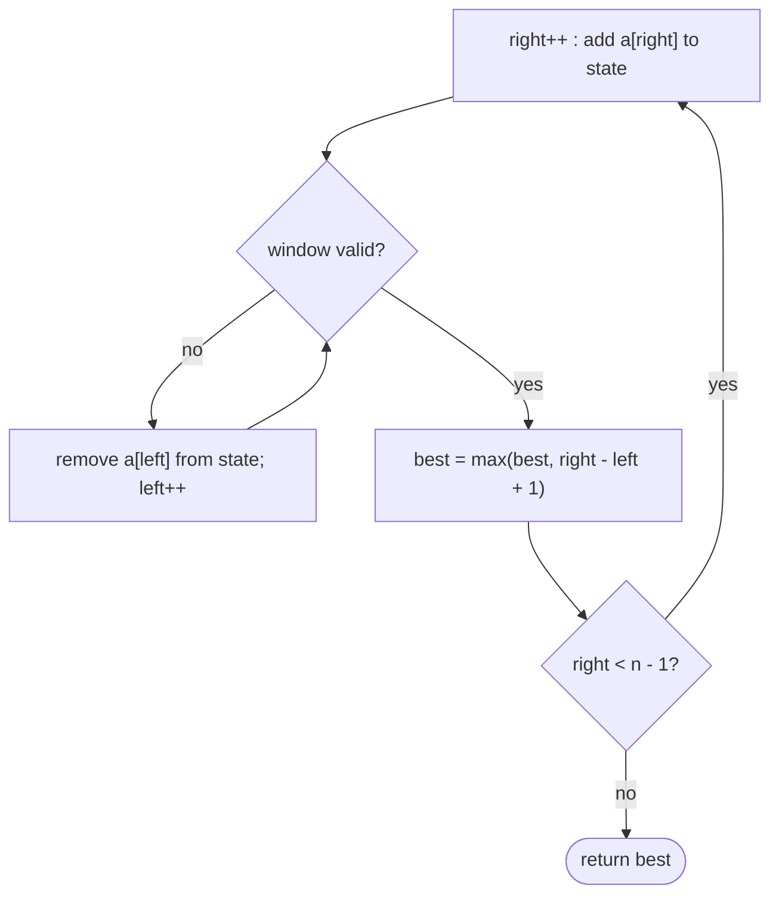

## Introduction

A monitoring system records the number of requests your API receives each second. An engineer asks: "What was the busiest stretch of 60 consecutive seconds today?" There are 86,400 seconds in a day. The brute force considers every starting second and adds up the next 60 values — about five million additions. That is fine once, but now the question changes to "the busiest 10-minute stretch" and "the shortest stretch that saw at least a million requests", and the brute force for the second question checks every start *and* every end: billions of operations.

Look at what the brute force wastes. The stretch from second 100 to 159 and the stretch from 101 to 160 share 59 of their 60 seconds. Adding all 60 again throws away almost everything you just computed. Instead, **slide**: subtract the second that leaves (100) and add the one that enters (160). Each step is two operations, and the whole day is scanned in one pass.

That is the **sliding window** technique. A **window** is a contiguous range `[left, right]` of an array or string. You keep a small summary of what is inside it — a sum, character counts, the number of distinct values — and as the window moves you update the summary incrementally instead of recomputing it. Because each element enters the window once and leaves at most once, the work is O(n).

Sliding windows solve a large family of interview problems ("longest substring without repeating characters", "minimum window containing all characters of `t`", "maximum sum of `k` consecutive elements") and real engineering tasks: rate limiters that count requests in the last minute, moving averages on dashboards, and stream-processing windows in systems such as Kafka Streams and Flink.

## Before you start

- **Two pointers** — two indices moving in one direction, and the argument that this makes a loop O(n). See [[a2-two-pointers]].
- **Big-O analysis**, including the idea of amortised cost. See [[a1-big-o]].
- **Counting with arrays and maps** — `int[128]` indexed by character, and `HashMap.merge`. See [[a1-hashmap]]; the counting idioms are developed fully in [[a2-frequency-counting]].

## The intuition

Imagine reading a long line of text through a cardboard frame with an adjustable opening. You can move the right edge forward to reveal another character, or move the left edge forward to hide the oldest one. You never move either edge backwards. Your job is to find the widest opening that shows no repeated letter.

The strategy is natural: keep pushing the right edge forward. Whenever a repeat appears, push the left edge forward until the repeat is gone. Measure the opening at each step and remember the widest. Neither edge ever goes back, so you pass over the text at most twice — once with each edge.

Two things make this work, and they are the two ideas the whole lesson builds on:

1. **The answer is contiguous.** The frame shows a single unbroken stretch. If the problem were about scattered characters (a *subsequence*), a frame would be the wrong tool.
2. **Shrinking never needs to be undone.** Once a repeat forces the left edge past some position, no wider frame that starts at an earlier position can be valid with the current or any later right edge. This property — formally, **monotonicity** — is what lets the left edge move only forward.

## Fixed-size windows

The simplest windows have a fixed length `k`. **Maximum Sum Subarray of Size K**: given an array and `k`, return the largest sum of any `k` consecutive elements.

### Naive approach and why it is slow

For each of the `n - k + 1` starting positions, add `k` elements: **O(n·k)**. When `k` is about `n / 2`, that is O(n²).

### Deriving the window

Adjacent windows overlap in `k - 1` elements. Moving from the window starting at `i - 1` to the one starting at `i` removes `a[i - 1]` and adds `a[i + k - 1]`. So after computing the first window's sum directly, each further window costs O(1).

```java title="MaxSumK.java"
public class MaxSumK {
    static int maxSumOfK(int[] a, int k) {
        int sum = 0;
        for (int i = 0; i < k; i++) sum += a[i];      // the first window, built directly
        int best = sum;
        for (int right = k; right < a.length; right++) {
            sum += a[right] - a[right - k];           // one element enters, one leaves
            best = Math.max(best, sum);
        }
        return best;
    }

    public static void main(String[] args) {
        System.out.println(maxSumOfK(new int[]{2, 1, 5, 1, 3, 2}, 3));
    }
}
```

```output
9
```

| Window | Elements | Update | Sum | Best |
|---|---|---|---|---|
| `[0, 2]` | 2, 1, 5 | built directly | 8 | 8 |
| `[1, 3]` | 1, 5, 1 | +1 −2 | 7 | 8 |
| `[2, 4]` | 5, 1, 3 | +3 −1 | 9 | 9 |
| `[3, 5]` | 1, 3, 2 | +2 −5 | 6 | 9 |

**Time:** `k` steps for the first window and one O(1) step for each of the remaining `n - k` positions — O(n). **Space:** O(1). (The method assumes `1 <= k <= a.length`; validate that in real code.)

### A fixed window with richer state: Find All Anagrams

**Find All Anagrams in a String** asks for every starting index in `s` where a substring of length `|p|` is an anagram (a rearrangement) of `p`. For `s = "cbaebabacd"` and `p = "abc"` the answer is `[0, 6]`: `"cba"` and `"bac"`.

Two strings are anagrams exactly when they contain the same letters with the same counts. So the window state is a **count array** of the 26 letters in the current window, compared with the count array of `p`. Sliding the window adds one letter and removes one.

```java title="FindAnagrams.java"
import java.util.ArrayList;
import java.util.Arrays;
import java.util.List;

public class FindAnagrams {
    static List<Integer> findAnagrams(String s, String p) {
        List<Integer> result = new ArrayList<>();
        int k = p.length();
        if (k > s.length()) return result;

        int[] need = new int[26], window = new int[26];
        for (char c : p.toCharArray()) need[c - 'a']++;

        for (int right = 0; right < s.length(); right++) {
            window[s.charAt(right) - 'a']++;                         // entering letter
            if (right >= k) window[s.charAt(right - k) - 'a']--;     // leaving letter
            if (right >= k - 1 && Arrays.equals(window, need)) {
                result.add(right - k + 1);                           // window start
            }
        }
        return result;
    }

    public static void main(String[] args) {
        System.out.println(findAnagrams("cbaebabacd", "abc"));
        System.out.println(findAnagrams("abab", "ab"));
    }
}
```

```output
[0, 6]
[0, 1, 2]
```

Comparing two 26-element arrays costs 26 steps, so the total is O(26·n), which is O(n) because 26 is a constant. You can remove even that factor by tracking how many of the 26 letters currently have matching counts, but the array comparison is clearer and fast enough.

## Variable-size windows

Most window problems do not fix the length. They ask for the **longest** or **shortest** contiguous range that satisfies a condition. The window grows by moving `right` and shrinks by moving `left`, and the condition decides when to shrink. There are two shapes, and mixing them up is the most common source of bugs.

| Kind | Goal | Shrink while… | Record the answer… |
|---|---|---|---|
| **Longest valid** | Maximise length | the window is **invalid** | after shrinking, when the window is valid |
| **Shortest valid** | Minimise length | the window is **valid** | inside the loop, before each shrink |

### Longest valid: Longest Substring Without Repeating Characters

Given a string, find the length of the longest substring with no repeated character. For `"abcabcbb"` the answer is 3 (`"abc"`).

**Brute force.** Check every substring for repeats: O(n²) substrings, each checked in O(n) — O(n³). Extending each start until the first repeat brings it to O(n²).

**Deriving the window.** Suppose the window `[left, right]` has no repeats and we extend it to `right + 1`. If the new character is already in the window, the window is invalid, and *no window starting at `left` or anywhere before the earlier copy can be valid while it contains `right + 1`*. So moving `left` forward past the earlier copy loses nothing. That is the monotonicity property in concrete form: if `[left, right]` contains a repeat, so does every window `[left', right']` with `left' <= left` and `right' >= right`.

The **window state** is a count of each character currently inside; the window is invalid exactly when the count of the newly added character exceeds 1.

```java title="LongestUniqueSubstring.java"
public class LongestUniqueSubstring {
    static int lengthOfLongestSubstring(String s) {
        int[] count = new int[128];                  // assumes ASCII input
        int left = 0, best = 0;
        for (int right = 0; right < s.length(); right++) {
            char c = s.charAt(right);
            count[c]++;                              // expand: c enters the window
            while (count[c] > 1) {                   // invalid: c appears twice
                count[s.charAt(left)]--;             // shrink: the leftmost char leaves
                left++;
            }
            best = Math.max(best, right - left + 1); // window is valid here
        }
        return best;
    }

    public static void main(String[] args) {
        System.out.println(lengthOfLongestSubstring("abcabcbb"));
        System.out.println(lengthOfLongestSubstring("bbbbb"));
        System.out.println(lengthOfLongestSubstring("pwwkew"));
        System.out.println(lengthOfLongestSubstring(""));
    }
}
```

```output
3
1
3
0
```

Dry run on `"abcabcbb"`:

| `right` | Char | Removed while shrinking | `left` | Window | Best |
|---|---|---|---|---|---|
| 0 | a | — | 0 | `a` | 1 |
| 1 | b | — | 0 | `ab` | 2 |
| 2 | c | — | 0 | `abc` | 3 |
| 3 | a | `a` | 1 | `bca` | 3 |
| 4 | b | `b` | 2 | `cab` | 3 |
| 5 | c | `c` | 3 | `abc` | 3 |
| 6 | b | `a`, `b` | 5 | `cb` | 3 |
| 7 | b | `c`, `b` | 7 | `b` | 3 |

At `right = 6`, the new `b` duplicates the `b` at index 4, so the left edge must pass index 4: it removes `a` (index 3) and `b` (index 4). The answer is recorded after the `while` loop, because only then is the window guaranteed valid.

> [!TIP] Jumping instead of stepping
> Instead of counts, store the last index where each character appeared. When `c` repeats inside the window, jump straight there: `left = Math.max(left, last[c] + 1)`. The `Math.max` matters — the earlier occurrence might already be to the left of the window, and `left` must never move backwards. Both versions are O(n); the jump version does fewer steps.

### Shortest valid: Minimum Size Subarray Sum

Given an array of **positive** integers and a target, find the length of the shortest contiguous subarray whose sum is at least the target (0 if none). For `[2, 3, 1, 2, 4, 3]` with target 7 the answer is 2 (`[4, 3]`).

Now the logic flips. A valid window (sum at least the target) is a *candidate*, and we want to shrink it as much as possible while it stays valid. So the `while` loop runs while the window is **valid**, recording the length before each shrink.

```java title="MinSubarrayLen.java"
public class MinSubarrayLen {
    static int minSubArrayLen(int target, int[] nums) {
        int left = 0, sum = 0, best = Integer.MAX_VALUE;
        for (int right = 0; right < nums.length; right++) {
            sum += nums[right];                          // expand
            while (sum >= target) {                      // valid: record, then try smaller
                best = Math.min(best, right - left + 1);
                sum -= nums[left++];                     // shrink
            }
        }
        return best == Integer.MAX_VALUE ? 0 : best;
    }

    public static void main(String[] args) {
        System.out.println(minSubArrayLen(7, new int[]{2, 3, 1, 2, 4, 3}));
        System.out.println(minSubArrayLen(100, new int[]{1, 2, 3}));
    }
}
```

```output
2
0
```

| `right` | Added | Sum after adding | Windows recorded while valid | `left` after | Sum after shrinking | Best |
|---|---|---|---|---|---|---|
| 0 | 2 | 2 | — | 0 | 2 | — |
| 1 | 3 | 5 | — | 0 | 5 | — |
| 2 | 1 | 6 | — | 0 | 6 | — |
| 3 | 2 | 8 | `[0, 3]` length 4 | 1 | 6 | 4 |
| 4 | 4 | 10 | `[1, 4]` length 4, `[2, 4]` length 3 | 3 | 6 | 3 |
| 5 | 3 | 9 | `[3, 5]` length 3, `[4, 5]` length 2 | 5 | 3 | 2 |

### The template, and what changes between problems

Both shapes fit one skeleton. Only three things change: what the window **state** is, how to test **validity**, and where to **record** the answer.

```java
int left = 0;
for (int right = 0; right < n; right++) {
    // 1. add a[right] to the window state
    while (/* longest: window invalid  |  shortest: window valid */) {
        // shortest: record right - left + 1 here
        // 2. remove a[left] from the window state
        left++;
    }
    // longest: record right - left + 1 here
}
```

Do not memorise the template as a replacement for thinking. Before coding, write down in one sentence what "valid" means, and check the monotonicity condition in the next section.

## When shrinking is safe: the monotonicity condition

The sliding window only works if moving `left` forward never has to be undone. Stated precisely:

- For **longest valid** problems: if `[l, r]` is valid, every window inside it, such as `[l + 1, r]`, is also valid. (Equivalently, once a window is invalid, extending it keeps it invalid.)
- For **shortest valid** problems: if `[l, r]` is valid, every window containing it, such as `[l, r + 1]`, is also valid.

"No repeated characters" satisfies the first: removing characters cannot create a repeat. "Sum at least the target" satisfies the second — **but only if every number is positive** (or non-negative). Adding a positive number can only increase the sum.

With negative numbers the condition fails, and the algorithm silently returns wrong answers. Take `[1, -1, 5]` with target 5. The correct answer is 1 (`[5]`). The window code adds 1, then −1 (sum 0), then 5 (sum 5): valid, record length 3, and remove the 1 — the sum drops to 4, so the loop stops. It never tries removing the −1 as well, which would have made the window valid again. It returns 3.

When monotonicity fails, use a different tool: prefix sums with a hash map for "sum equals k" ([[a2-hashing]]), or prefix sums with a monotonic deque for "shortest subarray with sum at least k" when negatives are allowed ([[a5-monotonic-queue]]).

> [!IMPORTANT] Check before you slide
> Ask: "If I shrink a valid window, is it still valid?" (longest problems) or "If I grow a valid window, is it still valid?" (shortest problems). If the honest answer is "it depends on the values", a plain sliding window is the wrong tool.

## How it works internally: why it is O(n)

The loop has a `while` inside a `for`, which looks like O(n²). It is not, and the argument is worth being able to give in an interview.

Count **total pointer moves** instead of loop iterations. `right` moves from 0 to `n - 1`: exactly `n` moves. `left` also only moves forward and never passes `right + 1`, so across the *entire run* it moves at most `n` times. Every execution of the `while` body moves `left` once, so the `while` body runs at most `n` times in total — not `n` times per `right`. Each move does O(1) work on the state (an array update or a map operation). Total: at most `2n` moves, **O(n) time**.

This style of reasoning — bounding the total cost over the whole run rather than the worst cost of one step — is called **amortised analysis**. An individual `right` step can trigger many `left` steps, but those steps are "paid for" by the fact that each element can only leave once.

**Space** depends on the state: O(1) for a sum, O(Σ) for a count array over an alphabet of size Σ (26 or 128 — constant), and O(k) for a map holding at most `k` distinct keys.



## Minimum Window Substring

This is the hardest common window problem and a favourite in interviews. Given strings `s` and `t`, find the shortest substring of `s` that contains every character of `t`, including duplicates. For `s = "ADOBECODEBANC"` and `t = "ABC"` the answer is `"BANC"`.

It is a **shortest valid** problem: "contains all of `t`" stays true when the window grows, so shrinking a valid window is the right move. The challenge is testing validity in O(1). Comparing count arrays each step works but costs O(Σ). A neater state uses two pieces:

- `need[c]`: how many more copies of `c` the window needs. It starts as the count of `c` in `t`. Adding `c` to the window decrements it; removing `c` increments it. A **negative** value means the window has surplus copies, and characters not in `t` simply go negative and never matter.
- `missing`: the total number of required characters still not covered. The window is valid exactly when `missing == 0`.

When a character enters and `need[c]` was positive, it was genuinely needed, so `missing` decreases. When a character leaves and `need[c]` becomes positive, the window has just lost a needed copy, so `missing` increases.

```java title="MinimumWindow.java"
public class MinimumWindow {
    static String minWindow(String s, String t) {
        int[] need = new int[128];
        for (char c : t.toCharArray()) need[c]++;
        int missing = t.length();
        int left = 0, bestStart = 0, bestLen = Integer.MAX_VALUE;

        for (int right = 0; right < s.length(); right++) {
            char c = s.charAt(right);
            if (need[c] > 0) missing--;          // this copy was still required
            need[c]--;                           // may go negative: a surplus copy

            while (missing == 0) {               // valid: record and try to shrink
                if (right - left + 1 < bestLen) {
                    bestLen = right - left + 1;
                    bestStart = left;
                }
                char d = s.charAt(left++);
                need[d]++;
                if (need[d] > 0) missing++;      // we just gave up a required copy
            }
        }
        return bestLen == Integer.MAX_VALUE ? "" : s.substring(bestStart, bestStart + bestLen);
    }

    public static void main(String[] args) {
        System.out.println(minWindow("ADOBECODEBANC", "ABC"));
        System.out.println("[" + minWindow("a", "aa") + "]");
    }
}
```

```output
BANC
[]
```

On the first input, the window first becomes valid at `"ADOBEC"` (length 6). Shrinking past `A` makes it invalid, so `right` advances until another `A` arrives; the window then shrinks to `"CODEBA"`, which is also length 6 and therefore not recorded, then further to `"EBANC"` (length 5) and finally `"BANC"` (length 4). In the second call, `t` needs two `a`s and `s` has one, so `missing` never reaches 0 and the method returns the empty string. Each character enters and leaves the window at most once, so the method is O(|s| + |t|).

## Counting subarrays, and "exactly k"

Some problems ask *how many* subarrays satisfy a condition rather than for the best one. For "at most" conditions, a window gives the count directly: when the window `[left, right]` is the longest valid window ending at `right`, every window `[i, right]` with `left <= i <= right` is also valid (by monotonicity), and there are `right - left + 1` of them. Adding that number at each `right` counts all valid subarrays.

"Exactly k" conditions are **not** monotonic — shrinking a window with exactly 2 distinct values might leave 1 — so a single window cannot handle them. The standard trick is subtraction:

```text
exactly(k) = atMost(k) - atMost(k - 1)
```

Every subarray with exactly `k` distinct values is counted by `atMost(k)` but not by `atMost(k - 1)`, and every subarray with fewer is counted by both and cancels.

```java title="SubarraysWithKDistinct.java"
import java.util.HashMap;
import java.util.Map;

public class SubarraysWithKDistinct {
    static int subarraysWithKDistinct(int[] nums, int k) {
        return atMost(nums, k) - atMost(nums, k - 1);
    }

    /** Number of subarrays with at most k distinct values. */
    static int atMost(int[] nums, int k) {
        Map<Integer, Integer> count = new HashMap<>();
        int left = 0, total = 0;
        for (int right = 0; right < nums.length; right++) {
            count.merge(nums[right], 1, Integer::sum);
            while (count.size() > k) {                  // too many distinct values
                int x = nums[left++];
                if (count.merge(x, -1, Integer::sum) == 0) {
                    count.remove(x);                    // keep size() == distinct count
                }
            }
            total += right - left + 1;                  // all valid windows ending at right
        }
        return total;
    }

    public static void main(String[] args) {
        System.out.println(subarraysWithKDistinct(new int[]{1, 2, 1, 2, 3}, 2));
        System.out.println(subarraysWithKDistinct(new int[]{1, 2, 1, 3, 4}, 3));
    }
}
```

```output
7
3
```

For the first array, `atMost(2) = 12` and `atMost(1) = 5`, giving 7. The `count.remove(x)` line is essential: the map's `size()` is used as the number of distinct values, and a key left behind with count 0 would still be counted. (`merge` with `-1` returns the new value, so the check reads naturally.)

## Sliding window maximum: when the state needs a deque

**Sliding Window Maximum** asks for the maximum of every window of size `k`. A sum can be updated by subtraction, but a maximum cannot: when the current maximum leaves, you need the next largest, and a single variable does not know it. Rescanning each window is O(n·k).

The fix is a **monotonic deque** of indices whose values are decreasing from front to back. When a new element arrives, every smaller element at the back can never be a maximum again (the new one is larger and will stay in the window longer), so pop them. The front is always the current maximum; pop it when it falls out of the window.

```java
static int[] maxSlidingWindow(int[] a, int k) {
    Deque<Integer> dq = new ArrayDeque<>();   // indices; values decrease front to back
    int[] result = new int[a.length - k + 1];
    for (int i = 0; i < a.length; i++) {
        if (!dq.isEmpty() && dq.peekFirst() <= i - k) dq.pollFirst();   // left the window
        while (!dq.isEmpty() && a[dq.peekLast()] <= a[i]) dq.pollLast(); // can never win
        dq.offerLast(i);
        if (i >= k - 1) result[i - k + 1] = a[dq.peekFirst()];
    }
    return result;
}
// maxSlidingWindow([1, 3, -1, -3, 5, 3, 6, 7], 3) -> [3, 3, 5, 5, 6, 7]
```

Each index is pushed and popped at most once, so this is O(n). The full explanation lives in [[a5-monotonic-queue]].

## Choosing the window state

| Constraint | State | Validity check | Cost per update |
|---|---|---|---|
| Sum / average | `long sum` | compare with target | O(1) |
| No repeats, at most k of a letter | `int[128]` or `int[26]` counts | count of the added char | O(1) |
| At most k distinct values | `HashMap` value → count, removing zero counts | `map.size() <= k` | O(1) average |
| Covers all of `t` | `need[]` plus `missing` counter | `missing == 0` | O(1) |
| At most k replacements (Longest Repeating Character Replacement) | counts plus the highest count | `length - maxCount <= k` | O(1) |
| Window max / min | Monotonic deque | front of deque | O(1) amortised |
| Window median | Two heaps, or a `TreeMap` multiset | — | O(log k) |

## In real systems

**Rate limiting.** "At most 100 requests per user per minute" is a window over time. A *sliding window log* stores request timestamps and evicts those older than 60 seconds — literally moving the left edge — while a *sliding window counter* approximates it with two fixed buckets. See [[d10-rate-limit-algorithms]] and the Redis implementation in [[c10-sliding-window-redis]].

**Networking.** TCP's flow control uses a "sliding window" of bytes the sender may have in flight before receiving an acknowledgement; as acknowledgements arrive, the window's left edge advances. The goal is different (throttling a sender rather than searching), but the mechanics — a contiguous range advancing at both ends — are the same. See [[c4-tcp-flow-control]].

**Analytics and streaming.** Moving averages on dashboards, SQL window frames such as `ROWS BETWEEN 6 PRECEDING AND CURRENT ROW` ([[c7-window-functions]]), and sliding windows in stream processors all maintain an aggregate as data enters and leaves rather than recomputing it.

## Trade-offs and alternatives

The sliding window gives O(n) time with small state, but its preconditions are strict: the answer must be **contiguous**, and validity must be **monotonic** as the window grows or shrinks.

- For non-contiguous selections (subsequences), use dynamic programming or greedy techniques.
- For "sum equals k" or any condition that breaks with negative numbers, use prefix sums with a hash map ([[a2-hashing]]).
- For the maximum-sum subarray with no length limit, use Kadane's algorithm ([[a2-kadane]]) — a window has no rule for when to shrink because sums can rise again after falling.
- For many arbitrary range queries on fixed data, precompute with prefix sums ([[a2-prefix-suffix]]).

## Common mistakes

> [!MISTAKE] Recording the answer at the wrong moment
> For longest-valid problems, record *after* the shrinking loop, when the window is valid. For shortest-valid problems, record *inside* the loop, before each shrink. Recording a longest-valid answer before shrinking counts invalid windows.

**Forgetting to undo state when shrinking.** Every change made when an element enters must be reversed when it leaves. With maps, also remove keys whose count drops to 0 if you use `size()` as the distinct count.

**Using a window when monotonicity fails.** Negative numbers in sum problems are the classic case; the code runs and returns wrong answers.

**Off-by-one in the length.** The inclusive window `[left, right]` has length `right - left + 1`.

**Moving `left` backwards.** In the last-index jump version, `left = last[c] + 1` without `Math.max` can move the window's start left when `c` last appeared before the current window.

**Rebuilding the state from scratch** for each window — for example, recounting characters — which brings back the O(n·k) cost the window was meant to remove.

## Interview perspective

Interviewers expect you to name the brute force, explain why consecutive ranges share work, state what "valid" means, and justify O(n) despite the nested loop.

> [!INTERVIEW] The three sentences to say
> "The answer is a contiguous substring, and if a window has a repeat, any larger window containing it also has one — so I can grow on the right and shrink on the left without ever going back. My state is a count of characters in the window. Each index enters and leaves once, so it's O(n) even with the inner loop."

Common questions and follow-ups:

- **Longest Substring Without Repeating Characters** — counts or last-index jump.
- **Minimum Window Substring** — the `need`/`missing` state; follow-up: what if `t` has duplicates (already handled by counts).
- **Longest Repeating Character Replacement** — valid when `length - maxCount <= k`.
- **Permutation in String / Find All Anagrams** — fixed window with counts.
- **Subarrays with K Different Integers** — `atMost(k) - atMost(k - 1)`.
- **Sliding Window Maximum** — monotonic deque.
- **"What if the numbers can be negative?"** — explain why the window breaks and switch to prefix sums.
- **"What if the input is a stream?"** — a window only needs the elements currently inside it, so memory is bounded by the window size, which is why rate limiters and stream processors use it.

## Practice

1. **Maximum Average Subarray I.** Fixed window of size `k`.
2. **Permutation in String.** Does `s2` contain a permutation of `s1`?
3. **Longest Repeating Character Replacement.** Variable window; derive the validity condition yourself first.
4. **Fruit Into Baskets.** The longest subarray with at most two distinct values.
5. **Count Number of Nice Subarrays.** Subarrays with exactly `k` odd numbers — use the at-most subtraction.
6. **Minimum Window Substring.** Implement it from the description above without looking.

The DSA explorer lists the matching problems under this topic; start with *Longest Substring Without Repeating Characters*, *Minimum Size Subarray Sum* and *Minimum Window Substring*.

```quiz
Q: Why is the variable sliding window O(n) even though it has a while loop inside a for loop?
- [ ] Because the while loop runs at most once per iteration
- [x] Because left only moves forward and can move at most n times over the whole run, so the while body executes at most n times in total
- [ ] Because the window size is bounded by a constant
- [ ] It is actually O(n²) in the worst case
> Count pointer moves, not iterations. right makes n moves and left makes at most n moves across the entire run, each with O(1) work, for at most 2n steps. A single right step can trigger many left steps, but each element leaves only once.

Q: For Minimum Size Subarray Sum, the array is [1, -1, 5] and the target is 5. What does the standard window code return, and why?
- [ ] 1, because [5] is found
- [x] 3, because after removing 1 the sum drops below 5 and the loop stops, never trying to also remove -1
- [ ] 0, because no window reaches the target
- [ ] An exception, because negative numbers are not allowed in arrays
> With negatives, shrinking a window can make it invalid and shrinking further can make it valid again, so validity is not monotonic. The code records length 3, removes 1 (sum 4), stops, and never considers [5]. Use prefix sums for inputs with negatives.

Q: In a longest-valid window problem, where should the answer be updated?
- [ ] Before adding a[right] to the state
- [ ] Inside the shrinking loop, before each shrink
- [x] After the shrinking loop, when the window is guaranteed valid
- [ ] Only once, after the for loop ends
> The shrinking loop runs while the window is invalid, so only after it finishes is [left, right] valid. Recording inside the loop is the pattern for shortest-valid problems, where the loop runs while the window is valid.

Q: Why does counting subarrays with exactly k distinct values use atMost(k) - atMost(k - 1) instead of one window?
- [ ] Because a HashMap cannot count distinct values
- [x] Because "exactly k" is not monotonic: shrinking a window with k distinct values can leave fewer, so there is no safe shrink rule
- [ ] Because it is faster than one pass
- [ ] Because k might be zero
> "At most k" is monotonic — removing elements never adds distinct values — so a window counts it directly. Subarrays with fewer than k distinct values are counted by both atMost calls and cancel, leaving exactly the subarrays with k.
```

## Quick revision {#quick-revision}

- Window = contiguous `[left, right]` plus a state updated incrementally as elements enter and leave.
- Fixed size `k`: build the first window, then `sum += a[right] - a[right - k]`; O(n).
- Longest valid: expand, `while (invalid)` shrink, then record. Shortest valid: expand, `while (valid)` record then shrink.
- Monotonicity: longest — sub-windows of valid windows are valid; shortest — super-windows of valid windows are valid. Negatives break sum windows.
- O(n) amortised: `right` moves `n` times, `left` at most `n` times in total.
- Length is `right - left + 1`. Undo every state change on removal; remove zero-count map keys when using `size()`.
- Minimum Window Substring: `need[]` (negative = surplus) plus `missing`; valid when `missing == 0`.
- Count valid "at most" windows by adding `right - left + 1`; exactly k = atMost(k) − atMost(k − 1).
- Window max/min: monotonic deque of indices. Median: two heaps.
- Not for subsequences, negative-number sums (use prefix sums plus hashing) or unbounded max subarray (use Kadane).

## Key takeaways {#key-takeaways}

- A sliding window reuses work between overlapping ranges, turning O(n²) range checks into O(n).
- It applies only when the answer is contiguous and validity is monotonic as the window grows or shrinks; check this before coding.
- Longest-valid and shortest-valid problems shrink under opposite conditions and record the answer in different places.
- The nested loop is still O(n) because each boundary moves only forward, at most n times in total.
- The choice of window state — sum, counts, map, deque — determines whether each update is O(1).
- When monotonicity fails, switch to prefix sums with a hash map or a monotonic deque rather than forcing a window.
