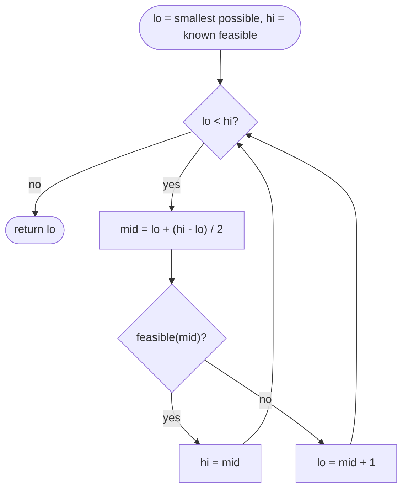

## Introduction

Here is a problem that does not look like searching. A conveyor belt carries packages with weights `[1, 2, 3, 4, 5, 6, 7, 8, 9, 10]`. Each day a ship takes packages from the front of the belt, in order, as long as the total stays within the ship's capacity. All packages must be shipped within 5 days. What is the **smallest capacity** that makes this possible?

There is no formula for the answer. But a different question is easy: *given* a capacity — say 15 — can the packages be shipped in 5 days? You load the ship until the next package would not fit, start a new day, and count the days. That takes one pass over the belt.

So we have a hard question ("what is the minimum?") and an easy one ("does this particular value work?"). **Binary search on the answer** connects them. It guesses a capacity, uses the easy check to see whether it works, and uses the result to throw away half of the remaining guesses — exactly as [[a3-binary-search]] throws away half of an array. Instead of searching an array for a value, it searches the range of possible answers for the boundary between "too small" and "big enough".

This technique matters because a surprising number of optimisation problems have this shape: the minimum speed to finish on time, the minimum number of machines to meet a deadline, the largest distance at which objects can be spread out, the smallest maximum load when work is split between workers. In interviews it is one of the most reliable "aha" patterns; in engineering it is how capacity limits, thresholds and tuning parameters are found when the system can only be tested, not solved.

## Before you start

- [[a3-binary-search]] — the halving idea and the safe midpoint `lo + (hi - lo) / 2`.
- [[a3-lower-upper-bounds]] — the "find the first yes" template with `while (lo < hi)`, `hi = mid` and `lo = mid + 1`. This lesson uses it directly, so read that lesson first if the template is new to you.
- [[a1-big-o]] — enough to compare O(n · R) with O(n log R).
- Some familiarity with greedy reasoning helps for the feasibility checks; [[a10-local-vs-global]] covers when a greedy choice is safe.

## The intuition

Think of the capacity as a dial running from small to large. At each setting you can run a test that answers "good enough" or "not good enough". For the shipping problem, the answers look like this:

```text
capacity:     10   11   12   13   14   15   16   17   ...   55
days needed:   7    6    6    6    6    5    5    4   ...    1
within 5?     no   no   no   no   no   yes  yes  yes  ...  yes
```

Once the dial is high enough, turning it higher never makes things worse — a bigger ship can always carry what a smaller one carried. So the answers form a block of "no" followed by a block of "yes", and the question "what is the minimum capacity?" becomes "where does the first yes appear?"

That is the whole idea. The sequence of answers is **monotonic** (it changes from no to yes at most once), so we can binary search it. We never need to know a formula for the answer; we only need a test, and a reason to believe the test is monotonic.

## Why the obvious approach is slow

The direct approach tries every capacity from the smallest plausible one upwards and returns the first that works. The smallest plausible capacity is the heaviest package (anything less cannot carry it at all). The largest needed is the total weight (that ships everything in one day). If there are `n` packages with total weight `S`, this tries up to `S` capacities, each with an O(n) check: **O(n · S)** in the worst case.

With the typical interview limits of 50,000 packages weighing up to 500 each, `S` can reach 25 million, so the loop could do over 10¹² operations. Far too slow.

The binary search version does the same O(n) check, but only about `log₂ S ≈ 25` times. That is roughly 1.25 million operations — a difference of six orders of magnitude, bought entirely by noticing that the answers are monotonic.

## The recipe

Every binary-search-on-answer solution follows the same five steps. Doing them explicitly, in this order, prevents most bugs.

1. **Name the answer variable.** What number is the problem asking for? Capacity, speed, number of days, a distance, a maximum sum.
2. **Write `feasible(x)`.** Fix the answer at `x` and ask a yes/no question: "can the constraints be satisfied with this value?" This is usually a single greedy pass.
3. **Prove monotonicity.** Show that if `x` is feasible, every value on the "easier" side of `x` is feasible too. For a minimisation, larger is easier; for a maximisation, smaller is easier.
4. **Choose bounds.** Pick `lo` so that the answer cannot be smaller, and `hi` so that the answer cannot be larger. Ideally `hi` is known to be feasible for a minimisation (or `lo` for a maximisation), so the search always has an answer to return.
5. **Search for the boundary.** For a minimisation, find the **first** feasible value. For a maximisation, find the **last** feasible value.

The most common mistake is to skip step 3. If the condition is not monotonic, binary search does not fail loudly — it returns a plausible-looking wrong answer.

## Worked example: minimum ship capacity

### Step 1 and 2: the answer and the check

The answer is the capacity `c`. The check is: with capacity `c`, how many days does it take if each day we load packages in order until the next one would overflow?

```java
static boolean canShip(int[] weights, int days, int capacity) {
    int daysUsed = 1, load = 0;
    for (int w : weights) {
        if (load + w > capacity) {   // this package does not fit today
            daysUsed++;              // so it starts tomorrow's load
            load = 0;
        }
        load += w;
    }
    return daysUsed <= days;
}
```

This check assumes every single package fits on the ship (`capacity >= w` for every `w`). If one did not, the code would happily put it on a new day with `load > capacity`. The bounds in step 4 guarantee this assumption, which is a good example of the check and the bounds depending on each other.

**Why is the greedy check correct?** It loads each day as fully as possible. Could a cleverer schedule — leaving room on day one, say — use fewer days? No. Compare the greedy schedule with any valid schedule. After day one, greedy has shipped at least as many packages, because it took packages until one did not fit, and the other schedule cannot have fitted more. If greedy is ahead (or level) after day `d`, it is still ahead after day `d + 1`: the other schedule's day `d + 1` starts no earlier on the belt and must stay within the same capacity. This "greedy stays ahead" argument shows that if any schedule fits in `D` days, greedy does too. So the check never says "no" when the answer is really "yes".

### Step 3: monotonicity

If capacity `c` ships everything in `D` days, then capacity `c + 1` can use exactly the same day-by-day assignment, since every day's load is at most `c`, which is less than `c + 1`. So feasible at `c` implies feasible at every larger capacity. The answers are `no ... no yes ... yes` as capacity increases. The question is a minimisation, and we want the first "yes".

### Step 4: bounds

The ship must carry the heaviest package, so `lo = max(weights)`. With capacity equal to the total weight, everything goes in one day, which is within any `D >= 1`, so `hi = sum(weights)` is feasible. The answer is in `[lo, hi]`.

### Step 5: search

This is the first-true search from [[a3-lower-upper-bounds]], with `canShip` playing the role of the yes/no test:

```java title="ShipWithinDays.java"
public class ShipWithinDays {

    /** Can every package be shipped, in order, within `days` days at this capacity? */
    static boolean canShip(int[] weights, int days, int capacity) {
        int daysUsed = 1, load = 0;
        for (int w : weights) {
            if (load + w > capacity) {   // this package does not fit today
                daysUsed++;              // so it starts tomorrow's load
                load = 0;
            }
            load += w;
        }
        return daysUsed <= days;
    }

    static int shipWithinDays(int[] weights, int days) {
        int lo = 0, hi = 0;
        for (int w : weights) {
            lo = Math.max(lo, w);        // must fit the heaviest package
            hi += w;                     // everything in one day always works
        }
        while (lo < hi) {                // answer is in [lo, hi]; hi is feasible
            int mid = lo + (hi - lo) / 2;
            if (canShip(weights, days, mid)) {
                hi = mid;                // mid works; maybe something smaller does too
            } else {
                lo = mid + 1;            // mid fails, and so does everything below it
            }
        }
        return lo;
    }

    public static void main(String[] args) {
        int[] w = {1, 2, 3, 4, 5, 6, 7, 8, 9, 10};
        System.out.println(shipWithinDays(w, 5));
        System.out.println(shipWithinDays(new int[] {3, 2, 2, 4, 1, 4}, 3));
        System.out.println(shipWithinDays(new int[] {1, 2, 3, 1, 1}, 4));
        System.out.println(shipWithinDays(new int[] {7}, 1));
    }
}
```

```output
15
6
3
7
```

Notice that the code never records a "best so far" answer. The invariant does the work: `hi` is always feasible, everything below `lo` is infeasible, and when they meet, `lo` is the smallest feasible capacity. The search loop and the check are separate methods. Keeping them separate is good practice: you can test `canShip` on its own, and the search loop is the same for every problem.

### Dry run

Here is the search for `weights = [1, 2, ..., 10]` and `days = 5`, starting from `lo = 10` and `hi = 55`:

| Step | `lo` | `hi` | `mid` | Days needed at `mid` | Feasible? | Action |
|---|---|---|---|---|---|---|
| 1 | 10 | 55 | 32 | 2 | yes | `hi = 32` |
| 2 | 10 | 32 | 21 | 3 | yes | `hi = 21` |
| 3 | 10 | 21 | 15 | 5 | yes | `hi = 15` |
| 4 | 10 | 15 | 12 | 6 | no | `lo = 13` |
| 5 | 13 | 15 | 14 | 6 | no | `lo = 15` |
| — | 15 | 15 | | | | return `15` |

Five checks cover 46 candidate capacities. At capacity 15 greedy produces `[1..5]`, `[6, 7]`, `[8]`, `[9]`, `[10]` — exactly five days. At capacity 14 it produces `[1..4]`, `[5, 6]`, `[7]`, `[8]`, `[9]`, `[10]` — six days, one too many.



## Worked example: minimum eating speed

Koko has piles of bananas `[3, 6, 7, 11]` and 8 hours. Each hour she picks one pile and eats up to `k` bananas from it; if the pile has fewer than `k`, she finishes it and waits for the next hour. What is the smallest `k` that lets her finish in time?

Following the recipe: the answer is the speed `k`. The check computes the hours needed, where a pile of `p` bananas takes `⌈p / k⌉` hours. Monotonicity holds because `⌈p / k⌉` never increases as `k` increases, so the total never increases either. The bounds are `lo = 1` (she must eat something) and `hi = max(pile)`, because at that speed every pile takes exactly one hour, and there must be at least as many hours as piles for the problem to have an answer.

```java title="Koko.java"
public class Koko {

    /** Hours needed to finish every pile at k bananas per hour. */
    static long hoursNeeded(int[] piles, int k) {
        long hours = 0;                      // can exceed int: many piles of ~10^9
        for (int p : piles) {
            hours += (p + (long) k - 1) / k; // ceil(p / k) without floating point
        }
        return hours;
    }

    static int minEatingSpeed(int[] piles, int h) {
        int lo = 1, hi = 0;
        for (int p : piles) hi = Math.max(hi, p);  // at max-pile speed, 1 hour per pile
        while (lo < hi) {
            int mid = lo + (hi - lo) / 2;
            if (hoursNeeded(piles, mid) <= h) hi = mid;
            else lo = mid + 1;
        }
        return lo;
    }

    public static void main(String[] args) {
        int[] piles = {3, 6, 7, 11};
        for (int k = 1; k <= 7; k++) {
            System.out.println("k=" + k + " hours=" + hoursNeeded(piles, k));
        }
        System.out.println("answer: " + minEatingSpeed(piles, 8));
        System.out.println("answer: " + minEatingSpeed(new int[] {30, 11, 23, 4, 20}, 6));
        System.out.println("answer: " + minEatingSpeed(new int[] {1_000_000_000}, 2));
    }
}
```

```output
k=1 hours=27
k=2 hours=15
k=3 hours=10
k=4 hours=8
k=5 hours=8
k=6 hours=6
k=7 hours=5
answer: 4
answer: 23
answer: 500000000
```

The printed table makes the monotonic shape visible: hours never go up as `k` goes up, and `k = 4` is the first speed with at most 8 hours. Two details in the check are worth copying into every solution:

- **Integer ceiling division.** `(p + k - 1) / k` equals `⌈p / k⌉` for positive integers. It avoids `Math.ceil((double) p / k)`, which converts to floating point and can round wrongly for very large values.
- **`long` accumulators.** With up to 10⁴ piles of up to 10⁹ bananas at speed 1, the total hours reach 10¹³, far beyond `int`. The cast `(long) k` also stops `p + k - 1` from overflowing when both are near 10⁹.

## Maximising: largest minimum distance

The examples so far minimised. The mirror image asks for the **largest** value that still works. A classic version: there are baskets at positions `[1, 2, 3, 4, 7]`, and you must place 3 balls in different baskets so that the **smallest** distance between any two balls is as **large** as possible. (The same problem appears as "aggressive cows".)

- **Answer variable:** the minimum gap `d`.
- **Check:** can 3 balls be placed so every adjacent pair is at least `d` apart? Sort the positions, put the first ball in the leftmost basket, and put each next ball in the first basket at least `d` beyond the previous one. Count how many balls fit.
- **Monotonicity:** if a placement achieves gap `d`, the same placement achieves every smaller gap. So the answers are `yes ... yes no ... no` as `d` increases — the opposite shape — and we want the **last** "yes".
- **Bounds:** gap 1 is always achievable with distinct positions, so `lo = 1` is feasible. No gap can exceed `max - min`, so `hi = max - min`.

The greedy check is correct for the same "stays ahead" reason as before: placing each ball as far left as allowed leaves the most room for the remaining balls. Any valid placement's `i`-th ball is at or to the right of greedy's `i`-th ball.

Because we now want the last "yes", the update for a feasible `mid` is `lo = mid`, and — as [[a3-lower-upper-bounds]] explains — the midpoint must then **round up**, or a two-element range would never shrink:

```java title="MagneticForce.java"
import java.util.Arrays;

public class MagneticForce {

    /** Can we place `balls` balls so that every adjacent pair is at least `gap` apart? */
    static boolean canPlace(int[] pos, int balls, int gap) {
        int placed = 1, last = pos[0];       // greedily put the first ball at the far left
        for (int i = 1; i < pos.length && placed < balls; i++) {
            if (pos[i] - last >= gap) {      // earliest position that keeps the gap
                placed++;
                last = pos[i];
            }
        }
        return placed >= balls;
    }

    static int maxDistance(int[] position, int balls) {
        int[] pos = position.clone();
        Arrays.sort(pos);
        int lo = 1, hi = pos[pos.length - 1] - pos[0];   // gap 1 always works (distinct)
        while (lo < hi) {                                // answer in [lo, hi]; lo is feasible
            int mid = lo + (hi - lo + 1) / 2;            // round up: we set lo = mid below
            if (canPlace(pos, balls, mid)) {
                lo = mid;                                // mid works; try a larger gap
            } else {
                hi = mid - 1;                            // mid fails, and so does anything larger
            }
        }
        return lo;
    }

    public static void main(String[] args) {
        System.out.println(maxDistance(new int[] {1, 2, 3, 4, 7}, 3));
        System.out.println(maxDistance(new int[] {5, 4, 3, 2, 1, 1_000_000_000}, 2));
        System.out.println(maxDistance(new int[] {1, 2, 8, 4, 9}, 3));
    }
}
```

```output
3
999999999
3
```

For `[1, 2, 3, 4, 7]` the best placement is `1, 4, 7`, with both gaps equal to 3. A gap of 4 fails: after `1`, the next basket at least 4 away is `7`, and then there is no room for a third ball.

| | Minimise ("smallest value that works") | Maximise ("largest value that works") |
|---|---|---|
| Shape as `x` grows | `no ... no yes ... yes` | `yes ... yes no ... no` |
| Looking for | first yes | last yes |
| Midpoint | `lo + (hi - lo) / 2` | `lo + (hi - lo + 1) / 2` |
| Feasible `mid` | `hi = mid` | `lo = mid` |
| Infeasible `mid` | `lo = mid + 1` | `hi = mid - 1` |
| Bound known feasible | `hi` | `lo` |

> [!TIP] The answer-variable style works too
> Many people prefer a closed range with a recorded answer: `while (lo <= hi)`, and on a feasible `mid` set `ans = mid` and move past it (`hi = mid - 1` to minimise, `lo = mid + 1` to maximise). It avoids thinking about rounding at the cost of one more variable. Either style is fine; mixing them in one function is not.

## Why it takes O(n log R) time

Let `R = hi - lo + 1` be the number of candidate answers. The search halves the candidate range each iteration (the argument is the same as for lower bound), so it runs at most about `⌈log₂ R⌉` iterations. Each iteration runs the feasibility check once. If the check is a single pass over `n` items, the total is **O(n log R)**.

Plug in the shipping limits: `n = 50,000` and `R ≤ 25,000,000`, so `log₂ R ≈ 25` and the work is about 1.25 million steps. For Koko with piles up to 10⁹, `log₂ 10⁹ ≈ 30`. Even a range of 10¹⁸ needs only about 60 iterations. This is why the answer range can be enormous without hurting performance — the cost grows with the *number of digits* in the range, not its size.

Some problems need to sort before the check (the ball problem sorts once, adding O(n log n) outside the loop) or have a check that is itself O(n log n). The general formula is **O(log R × cost of check)**, plus any one-time preprocessing.

**Space** is O(1) for the search itself; the check may need its own memory (the ball problem's sorted copy is O(n)).

## Real-valued answers

Sometimes the answer is a real number: a minimum speed in kilometres per hour, a radius, a time. The same idea works, but the loop can no longer stop when `lo == hi`, because two doubles may never become equal. There are two safe ways to stop:

- **Fixed iteration count.** Each iteration halves the interval, so 100 iterations shrink any starting interval by a factor of 2¹⁰⁰ — far below the precision of a `double`. This always terminates and is the safer default.
- **Tolerance.** Stop when `hi - lo < eps`. Be careful: if the answer is large and `eps` is smaller than the gap between adjacent `double` values at that size, `hi - lo` can never get below `eps` and the loop runs forever.

```java title="SqrtBisection.java"
public class SqrtBisection {

    /** Square root of x >= 0 by bisection on real numbers. */
    static double sqrt(double x) {
        double lo = 0, hi = Math.max(1, x);  // sqrt(x) <= max(1, x)
        for (int iter = 0; iter < 100; iter++) {
            double mid = (lo + hi) / 2;
            if (mid * mid >= x) hi = mid;    // mid is at or above the root
            else lo = mid;
        }
        return hi;
    }

    public static void main(String[] args) {
        System.out.printf("%.12f%n", sqrt(2));
        System.out.printf("%.12f%n", Math.sqrt(2));
        System.out.printf("%.12f%n", sqrt(0.25));
    }
}
```

```output
1.414213562373
1.414213562373
0.500000000000
```

With real numbers both updates are `lo = mid` and `hi = mid` — there is no "next value" to step to, and no infinite loop to worry about because the iteration count is fixed. Note the upper bound `max(1, x)`: for `x = 0.25` the root `0.5` is *larger* than `x`, so `hi = x` would be wrong. Choosing bounds still requires thought. This method — bisection — is also how numerical libraries find roots of continuous functions when nothing better is known.

## Recognising the pattern

The strongest signals, roughly in order of reliability:

- The problem asks for the **minimum** or **maximum** of a single number, and fixing that number turns the problem into a much easier yes/no question.
- The phrasing **"minimise the maximum"** (split work so the largest share is as small as possible) or **"maximise the minimum"** (spread things out so the closest pair is as far apart as possible). Both are almost always binary search on the answer.
- The constraints allow huge answers (values up to 10⁹ or 10¹⁸) but the input size suggests an O(n log something) solution.
- The check is naturally greedy once the answer is fixed: "load until full", "start a new group when the limit is exceeded", "place as early as possible".

Problems that share the shipping structure exactly include *Split Array Largest Sum* (split into `k` contiguous parts minimising the largest sum — the parts are days and the sum is the capacity) and *Minimum Number of Days to Make m Bouquets* (the answer is a day; the check counts runs of bloomed flowers).

The pattern does **not** apply when the condition is not monotonic. "Find the speed that minimises fuel consumption" has a cost that falls and then rises again; a yes/no test like "is consumption below 5 litres?" is true in the middle and false at both ends. That shape needs ternary search or calculus, not this technique. Nor does it apply when the problem asks for the optimal *structure* (the actual split, every optimal arrangement) rather than the optimal *value* — although once you know the value, one more run of the greedy check usually reconstructs a structure that achieves it.

```quiz
Q: In the shipping problem, why is `lo = max(weights)` rather than `lo = 1`?
- [ ] It makes the search faster but `lo = 1` would give the same answer
- [x] The check assumes every package fits on the ship; below the heaviest weight that assumption breaks and the check can report a wrong answer
- [ ] Because binary search cannot start at 1
- [ ] Because the answer is always exactly the heaviest weight
> No capacity below the heaviest package can work, so starting there loses nothing. More importantly, canShip puts an oversized package on a new day without noticing it overflows, so with lo = 1 it could call an impossible capacity feasible. The bounds and the check depend on each other.

Q: A problem asks for the largest `x` such that `feasible(x)` is true, and feasibility is `yes ... yes no ... no`. With `while (lo < hi)` and `lo = mid` on success, which midpoint must you use?
- [ ] `lo + (hi - lo) / 2`
- [x] `lo + (hi - lo + 1) / 2`
- [ ] `(lo + hi) / 2`
- [ ] Any of them
> When hi = lo + 1, the rounded-down midpoint equals lo. If that mid is feasible, lo = mid leaves the range unchanged and the loop never ends. Rounding up makes mid equal hi in that case, so either branch shrinks the range. (lo + hi) / 2 also rounds down and can overflow.

Q: The check is O(n) and the answer lies between 1 and 10^18. Roughly how many checks does the search run?
- [ ] About 10^9
- [ ] About 10^18
- [x] About 60
- [ ] About 18
> Each check halves the candidate range, and 2^60 is about 1.15 × 10^18, so about 60 checks suffice. The cost depends on the number of bits in the range, not its size. Answering 18 confuses decimal digits with halvings.

Q: Which problem is NOT a good fit for binary search on the answer?
- [ ] Minimum speed to finish all tasks within a deadline
- [ ] Largest minimum distance when placing k routers along a street
- [x] The engine speed that minimises fuel consumption, where consumption first falls and then rises
- [ ] Smallest maximum workload when splitting jobs among k workers in order
> Fuel consumption is U-shaped, so "is consumption below some level?" is true in the middle and false at both ends — not monotonic. The other three have feasibility conditions that switch exactly once as the answer grows.
```

## In real systems

**Finding capacity limits by load testing.** "What is the highest request rate this service can sustain with p99 latency under 200 ms?" has no formula, but each candidate rate can be tested. Engineers often binary search the rate: run at 2,000 requests per second, check the latency, then try 1,000 or 3,000. The method assumes the condition is monotonic — that a service which copes with a higher rate also copes with a lower one — which is usually true but worth stating, because warm-up effects and autoscaling can break it.

**Bisecting history.** `git bisect` finds the first commit where a test fails. The "answer" is a commit, the check is "build and run the test", and monotonicity is the assumption that once the bug appeared it stayed. When a bug comes and goes, bisect reports a misleading commit — the same failure mode as a non-monotonic check in an interview problem.

**Tuning thresholds.** Choosing the smallest cache size that reaches a 95% hit rate on a recorded trace, the lowest video bitrate that keeps a quality score above a target, or the largest batch size that fits in GPU memory are all searches over a monotonic yes/no test. Each check may take minutes, which makes the logarithmic number of checks even more valuable.

**Numerical methods.** Bisection is a standard root-finding method: if a continuous function is negative at `lo` and positive at `hi`, some root lies between them, and halving the interval homes in on it. Library root finders often combine it with faster methods, falling back to bisection because it is guaranteed to converge.

## Trade-offs and alternatives

| Approach | Typical cost | When it is the right choice |
|---|---|---|
| Try every candidate | O(R × check) | The range is tiny |
| Binary search on the answer | O(log R × check) | Feasibility is monotonic and cheap to test |
| Direct formula or single greedy pass | O(n) or less | A known closed-form or greedy solution exists |
| Dynamic programming | Often O(k · n²) or more | The check is not greedy, or the full optimal structure is needed |

Binary search on the answer is attractive because it splits a hard problem into two easy parts — a generic search loop and a problem-specific check — and each part can be tested separately. Its costs are the need for a monotonicity argument and a correct check. A check that is too strict (says "no" when a clever arrangement exists) makes the answer too large; one that is too lenient makes it too small. *Split Array Largest Sum* can also be solved with dynamic programming in O(k · n²), which is a useful comparison: the binary-search solution is both simpler and faster.

## Common mistakes

> [!MISTAKE] Searching without proving monotonicity
> If `feasible` is not monotonic, binary search still returns a number — just not the right one. Before writing the loop, say in one sentence why a feasible `x` makes every easier value feasible. If you cannot, the technique may not apply.

**Wrong direction.** Minimising but coding the maximise updates (or the reverse) returns one end of the range. Write down the shape (`no...yes` or `yes...no`) and which end you want before writing the loop.

**Bounds that exclude the answer.** `lo` must be no larger than the true answer and `hi` no smaller. Starting the shipping search at `lo = 1` breaks the check's assumption that every package fits, and starting Koko's at `lo = 0` causes a division by zero in the check.

**Overflow in the check.** Sums of many large values exceed `int`; use `long` for accumulators and for products such as `mid * mid`. When the answer range itself exceeds `int` (answers up to 10¹⁸), make `lo`, `hi` and `mid` `long` as well.

**A check that is not optimal.** The check must answer "is there *any* valid arrangement?" A greedy check that is not actually optimal produces false "no" answers. Justify the greedy choice, or test the check against brute force on small inputs.

**Floating-point loops that never end.** Use a fixed iteration count for real-valued answers, or make sure the tolerance is larger than the precision available at the answer's magnitude.

## Interview perspective

Interviewers like this pattern because it tests whether you can see past the surface of a problem. A strong answer names the technique early, then works through the recipe out loud.

> [!INTERVIEW] What a strong answer sounds like
> "If I fix the capacity, checking whether it works is a greedy pass: fill each day until the next package doesn't fit. A bigger capacity can reuse the same schedule, so feasibility is monotonic, and I can binary search for the smallest feasible capacity between the heaviest package and the total weight. That's O(n log S)."

Questions and follow-ups to prepare:

- **Koko Eating Bananas, Capacity To Ship Packages Within D Days, Split Array Largest Sum, Minimum Number of Days to Make m Bouquets, Magnetic Force Between Two Balls.** The core set — each one is the recipe with a different check.
- **Why is the greedy check correct?** Give the "greedy stays ahead" argument: after each day (or each placed item), greedy has done at least as much as any valid solution.
- **What are your bounds, and why?** `lo` is a value the answer cannot be below; `hi` is a value known to work. Say why each is safe.
- **What is the complexity?** O(n log R) for an O(n) check, with `R` the size of the answer range. Mention that `log R` is small even for huge ranges.
- **Can the check be faster?** Sometimes prefix sums or a sorted structure make each check O(log n) or O(k) instead of O(n).
- **What if the answer is a real number?** Bisection with a fixed number of iterations.
- **Advanced follow-up:** many independent queries can be answered together with **parallel binary search**, which advances every query's search one step at a time so that one shared sweep over the data serves all of them. You only need to know that it exists.

## Practice

1. **Split Array Largest Sum.** Split an array into `k` non-empty contiguous parts minimising the largest part's sum. Write the check, then explain why it is the shipping problem in disguise.
2. **Bouquets.** Flowers bloom on given days; a bouquet needs `k` adjacent bloomed flowers. Find the earliest day on which `m` bouquets can be made, or `-1` if impossible. Decide what `hi` should be, and detect the impossible case before searching.
3. **Integer square root.** Return `⌊√n⌋` for `0 ≤ n ≤ 2³¹ − 1` as a last-true search. Use `long` for `mid * mid`.
4. **Real-valued speed.** Trains must cover distances `d[i]` in order, each departing on a whole hour. Find the minimum integer speed to arrive within `hour` hours (a real number), or `-1`. Note the special handling of the last train.
5. **Prove or refute.** For each check you wrote above, state the monotonicity argument in one sentence. Then invent a problem where the obvious check is *not* monotonic.

The DSA explorer lists the matching problems under this topic; start with *Koko Eating Bananas* and *Capacity To Ship Packages Within D Days*.

## Quick revision {#quick-revision}

- Use it when: asked for a min/max value, fixing the value makes a yes/no check easy, and the check is monotonic.
- Recipe: name the answer → write `feasible(x)` → prove monotonicity → choose `lo`/`hi` → find the first yes (minimise) or last yes (maximise).
- Minimise: `mid = lo + (hi - lo) / 2`; feasible → `hi = mid`; else `lo = mid + 1`.
- Maximise: `mid = lo + (hi - lo + 1) / 2`; feasible → `lo = mid`; else `hi = mid - 1`.
- Bounds: shipping `[max(w), sum(w)]`; Koko `[1, max(pile)]`; max-min gap `[1, max - min]`.
- Checks are usually greedy; justify them with "greedy stays ahead".
- Time O(log R × check), typically O(n log R); a range of 10¹⁸ needs about 60 checks.
- Use `long` in checks; ceiling division `(p + k - 1) / k`.
- Real answers: bisection with a fixed iteration count (about 100).
- Signals: "minimise the maximum", "maximise the minimum", "minimum capacity/speed/days".

## Key takeaways {#key-takeaways}

- Binary search on the answer replaces "find the optimum" with "is this value good enough?", which is usually far easier.
- It only works when feasibility is monotonic; always state the one-sentence reason before writing the search.
- The search loop is the same lower-bound template every time; the problem-specific work lives in a separate, testable check.
- Minimising looks for the first feasible value, maximising for the last; the rounding of the midpoint must match the update that sets a boundary to `mid`.
- The cost is O(log R) checks, so even astronomically large answer ranges are cheap.
- Bounds and the check depend on each other — choose bounds that keep the check's assumptions true.
