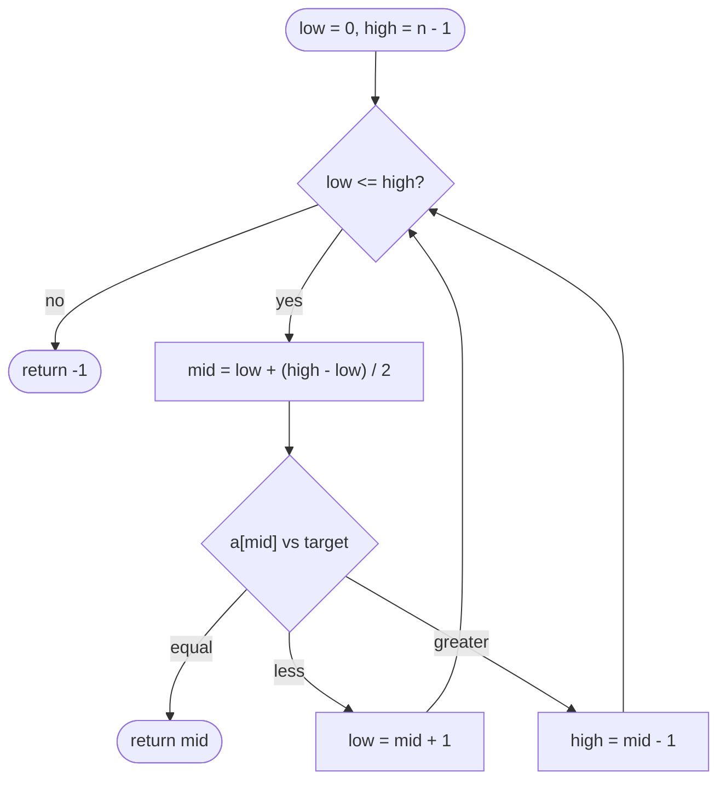

## Introduction

Suppose you are given a list of one million user IDs and asked whether the ID `734_219` is in it. The obvious approach is to look at the IDs one by one until you either find it or reach the end. That is **linear search**, and in the worst case it performs one million comparisons.

Now suppose the list is **sorted**. Look at the element in the middle. If it is smaller than `734_219`, then every element to its left is smaller too — so the target cannot be anywhere in the left half, and you can throw that half away without looking at it. One comparison has eliminated half a million candidates. Repeat the same trick on the half that remains and you are down to a quarter of a million, then 125,000, and so on. After about twenty comparisons, only one candidate is left.

That procedure is **binary search**: repeatedly compare against the middle of the remaining range and discard the half that cannot contain the answer. It turns a million-step search into a twenty-step one, and the gap widens as data grows — a billion elements need only about thirty comparisons.

Binary search matters to a software engineer for three reasons. First, it is everywhere in real systems: database indexes, `Arrays.binarySearch` in Java, `bisect` in Python, version-control tools such as `git bisect`, and the lookup step inside many sorted data structures all use the same idea. Second, it is one of the most common building blocks in coding interviews. Third — and this is the part most people miss — the technique is not really about arrays. It works on *any* question of the form "where does this condition switch from false to true?", which lets you solve optimisation problems that look nothing like search. That generalisation is covered in [[a3-lower-upper-bounds]] and [[a3-binary-search-on-answer]]; this lesson builds the foundation they rely on.

## Before you start

You need three things:

- **Arrays and indexing** — reading `a[i]`, and the fact that indices run from `0` to `n - 1`. See [[a2-array-string-traversal]].
- **Big-O notation** — what it means for an algorithm to take O(n) or O(log n) time. See [[a1-time-complexity]] and [[a1-big-o]].
- **Basic Java syntax** — `while` loops, integer division, and methods. See [[a1-java-syntax-competitive]].

You do not need to know logarithms in depth; the lesson explains the one fact about them that matters here.

## The intuition

Think of guessing a number between 1 and 100 when the other person answers only "higher" or "lower". A poor strategy guesses 1, 2, 3 and so on. A good strategy guesses 50 first. Whatever the answer, half the possibilities disappear. Then you guess the middle of what is left — 25 or 75 — and keep halving. You will never need more than seven guesses, because 2⁷ = 128 is more than 100.

The reason this works is worth stating precisely, because it is the whole idea of binary search: **each answer tells you something about many candidates at once**. "Higher" does not only rule out 50; it rules out every number below 50 too. That is only true because the numbers are in order. If the possible answers were shuffled, learning that 50 was wrong would tell you nothing about 49.

So the requirement is not "the data is an array". The requirement is that the data has an **order that lets one comparison eliminate a whole side**. Sorted arrays have that property. So do many other things, as you will see near the end of this lesson.

## Why sorted order makes halving safe

Let `a` be an array sorted in non-decreasing order, so `a[0] ≤ a[1] ≤ … ≤ a[n-1]`, and let `target` be the value we want. Pick any index `mid` and compare `a[mid]` with `target`. There are exactly three outcomes:

| Comparison | What we can conclude | What we keep |
|---|---|---|
| `a[mid] == target` | Found it | Return `mid` |
| `a[mid] < target` | Everything at or left of `mid` is `≤ a[mid] < target`, so none of it can be the target | Indices right of `mid` |
| `a[mid] > target` | Everything at or right of `mid` is `≥ a[mid] > target` | Indices left of `mid` |

The middle row is the key step. Sortedness is what allows us to go from a fact about **one** element (`a[mid] < target`) to a fact about **all** elements on that side. Without the order, the conclusion does not follow and we would discard parts of the array that might contain the answer.

Choosing `mid` in the *middle* is what makes the method fast. Any index would be correct, but if we always chose the first index we would only discard one element per step — that is just linear search. Choosing the middle guarantees we discard at least half of what remains, whichever way the comparison goes.

## The loop invariant: how to think about boundaries

Most binary search bugs come from boundaries: should the loop be `low < high` or `low <= high`? Should we set `high = mid` or `high = mid - 1`? Memorising a template does not protect you from these bugs, because small variations of the problem need small variations of the code. What protects you is an **invariant** — a statement that is true before every iteration of the loop and that you deliberately keep true.

For the classic "is the target present?" search, use this invariant:

> If `target` is anywhere in the array, it is at an index in the closed range `[low, high]`.

Everything else follows from it.

- **Initialisation.** Before the loop, nothing has been ruled out, so `low = 0` and `high = n - 1`. The invariant holds trivially: the whole array is in range.
- **Loop condition.** The range `[low, high]` contains at least one index exactly when `low <= high`. When `low > high` the range is empty — the invariant then says "if the target exists, it is in an empty range", which means it does not exist. So the loop runs `while (low <= high)`.
- **Shrinking when `a[mid] < target`.** We proved that `mid` and everything to its left cannot hold the target. The smallest index that can is `mid + 1`, so `low = mid + 1`. Setting `low = mid` would keep an index we already know is wrong — harmless for correctness here, but it can stop the range from shrinking and cause an infinite loop.
- **Shrinking when `a[mid] > target`.** By the same reasoning, `high = mid - 1`.

Notice that every boundary decision was *derived* from the invariant, not remembered. When you meet a variant problem, you choose a new invariant and derive the boundaries again.

> [!IMPORTANT] The one question to ask
> Before writing any binary search, write down in words what is guaranteed about the range `[low, high]` (or `[low, high)`). Then check that each update keeps that statement true and that the range strictly shrinks every iteration.

## Computing the midpoint safely

The natural way to compute the middle index is `(low + high) / 2`. In Java this has a subtle bug. `low` and `high` are `int`s, and the largest `int` is `Integer.MAX_VALUE`, which is 2,147,483,647. If an array has more than about a billion elements and the search is in its upper half, `low + high` can exceed that limit. Java does not raise an error on integer overflow — the value silently wraps around to a large negative number, and `a[mid]` then throws `ArrayIndexOutOfBoundsException`.

The fix is to compute the midpoint as an offset from `low`:

```java
int mid = low + (high - low) / 2;
```

`high - low` is at most the array length, so it never overflows, and adding half of it to `low` can never go past `high`. Mathematically the two expressions give the same result whenever the first one does not overflow. This exact bug existed in the JDK's own `Arrays.binarySearch` for about nine years before it was fixed in 2006, which is why interviewers like to ask about it.

An equivalent form you will see is `(low + high) >>> 1`. The unsigned right shift treats the overflowed sum as an unsigned number, which happens to give the correct midpoint. It works, but `low + (high - low) / 2` says what it means and is easier to explain.

Both forms round *down* when the range has an even number of elements. With `low = 2` and `high = 3`, `mid` is `2`. Remember this: rounding direction matters in the variants that set `low = mid`, as you will see in [[a3-lower-upper-bounds]].

## The complete algorithm

Here is a full, runnable program. It contains the search method and a small `main` that exercises the normal case and the edge cases.

```java title="BinarySearch.java"
public class BinarySearch {

    /**
     * Returns an index i with a[i] == target, or -1 if target is absent.
     * Precondition: a is sorted in non-decreasing order.
     */
    static int search(int[] a, int target) {
        int low = 0;
        int high = a.length - 1;           // invariant: target, if present, is in a[low..high]

        while (low <= high) {              // the range is non-empty
            int mid = low + (high - low) / 2;
            if (a[mid] == target) {
                return mid;
            } else if (a[mid] < target) {
                low = mid + 1;             // a[low..mid] are all < target
            } else {
                high = mid - 1;            // a[mid..high] are all > target
            }
        }
        return -1;                         // range is empty: target is not present
    }

    public static void main(String[] args) {
        int[] a = {3, 8, 15, 21, 27, 34, 42, 56, 61, 77};
        System.out.println(search(a, 42));          // present, upper half
        System.out.println(search(a, 3));           // first element
        System.out.println(search(a, 77));          // last element
        System.out.println(search(a, 30));          // absent, falls between elements
        System.out.println(search(new int[0], 5));  // empty array
    }
}
```

```output
6
0
9
-1
-1
```

Read the method from top to bottom. The two variables `low` and `high` describe the range that might still contain the target. Each iteration looks at the middle of that range and either finds the target or moves one boundary past `mid`, so the range shrinks by at least one element every time — which is why the loop always terminates. When the loop ends without returning, `low` has passed `high`, the range is empty, and by the invariant the target cannot be in the array.

The empty-array case needs no special code: `high` starts at `-1`, the condition `0 <= -1` is false, and the method returns `-1` immediately. Getting edge cases right for free like this is a sign that the invariant is well chosen.

## Dry run: watching the range shrink

Let us trace `search(a, 42)` on `a = [3, 8, 15, 21, 27, 34, 42, 56, 61, 77]`. Each row is one iteration of the loop.

| Step | `low` | `high` | `mid` | `a[mid]` | Comparison | Action |
|---|---|---|---|---|---|---|
| 1 | 0 | 9 | 4 | 27 | 27 < 42 | `low = 5` |
| 2 | 5 | 9 | 7 | 56 | 56 > 42 | `high = 6` |
| 3 | 5 | 6 | 5 | 34 | 34 < 42 | `low = 6` |
| 4 | 6 | 6 | 6 | 42 | equal | return `6` |

Four comparisons for ten elements. Now trace an absent value, `search(a, 30)`:

| Step | `low` | `high` | `mid` | `a[mid]` | Action |
|---|---|---|---|---|---|
| 1 | 0 | 9 | 4 | 27 | 27 < 30, `low = 5` |
| 2 | 5 | 9 | 7 | 56 | 56 > 30, `high = 6` |
| 3 | 5 | 6 | 5 | 34 | 34 > 30, `high = 4` |
| — | 5 | 4 | | | `low > high`, return `-1` |

Look at where the loop stopped: `low = 5` and `high = 4`. Index 5 holds `34`, the first element larger than `30`. That is not a coincidence — when a classic binary search fails, `low` ends at the position where the target *would be inserted* to keep the array sorted. Java's `Arrays.binarySearch` exploits this by returning `-(low) - 1` for a missing key, so the caller can recover the insertion point. The lower-bound lesson turns this observation into a tool.



## Why it takes O(log n) time

Each iteration does a constant amount of work: one midpoint calculation and at most two comparisons. So the running time is proportional to the number of iterations. How many can there be?

Call the size of the range `k`. At the start, `k = n`. After one iteration, the range that remains is at most `⌊k / 2⌋` — the comparison removes `mid` itself plus everything on one side. So after `i` iterations the range has at most `n / 2ⁱ` elements. The loop must stop once the range is empty, which happens no later than when `n / 2ⁱ < 1`, that is, when `2ⁱ > n`. The smallest such `i` is about `log₂ n`. Therefore the loop runs at most `⌊log₂ n⌋ + 1` times, and the time complexity is **O(log n)**.

To feel what that means:

| `n` | Linear search worst case | Binary search worst case |
|---|---|---|
| 1,000 | 1,000 comparisons | 10 |
| 1,000,000 | 1,000,000 | 20 |
| 1,000,000,000 | 1,000,000,000 | 30 |

Doubling the data adds one step. That is what makes logarithmic algorithms so valuable at scale.

**Space complexity** is O(1) for the iterative version: three integer variables regardless of `n`. A recursive version — calling `search(a, target, mid + 1, high)` instead of updating `low` — is equally correct but uses O(log n) stack space, one frame per level. In Java, which does not eliminate tail calls, the iterative version is preferred.

> [!NOTE] The cost of sorting
> Binary search is O(log n) *given* sorted data. Sorting costs O(n log n). If you search an unsorted array only once, sorting first is slower than one linear scan. Sorting pays off when the data is searched many times, or when it is already kept sorted — as in an index.

## Duplicates and what "found" means

The method above returns *some* index where `a[mid] == target`. With duplicates, which one is not specified:

```java
int[] a = {1, 2, 2, 2, 2, 3};
System.out.println(BinarySearch.search(a, 2));
```

```output
2
```

It returned index 2, but the first `2` is at index 1 and the last is at index 4. Many real questions care about exactly those positions: "how many times does 2 occur?" is `last - first + 1`, and "where should I insert 2 so equal elements stay in insertion order?" needs the position after the last one. The fix is not to search for the target and then walk left or right — that walk can be O(n) when there are many duplicates. Instead, you change the invariant to "the answer is the first index where `a[i] >= target`" and keep halving. That is the subject of [[a3-lower-upper-bounds]], and it is the most important variant to master.

## Beyond arrays: the general pattern

Look again at what binary search needs. It never uses the fact that `a` stores numbers. It needs only a way to ask, for any index `i`, a yes/no question whose answers look like this as `i` increases:

```text
index:     0     1     2     3     4     5     6     7
answer:    no    no    no    no    yes   yes   yes   yes
                               ↑ first "yes"
```

A question with this shape is called **monotonic**: once the answer becomes "yes", it stays "yes". Binary search finds the boundary in O(log n) questions. "Is `a[i] >= target`?" is one such question on a sorted array. But many others exist where there is no array at all:

- "Can all packages be shipped within `d` days if the ship holds capacity `c`?" — larger capacity never makes it harder, so the answer is monotonic in `c`. Binary search finds the smallest capacity that works.
- "Is version `v` of the code broken?" — if a bug was introduced at one commit and never fixed, every later version is broken. `git bisect` binary searches the commit history to find the first bad commit.
- "Is `x * x > n`?" — monotonic in `x`, which gives an integer square root without floating point.

This is called **binary search on the answer**, and recognising it is a high-value interview skill. The signal is: *the problem asks for a minimum or maximum value, and you can easily check whether a given value is good enough, and "good enough" is monotonic.* The full technique is taught in [[a3-binary-search-on-answer]].

```quiz
Q: A sorted array has 2,000,000 elements. What is the maximum number of loop iterations the classic binary search needs?
- [ ] About 1,000,000
- [ ] About 2,000
- [x] About 21
- [ ] Exactly 2
> Each iteration at least halves the range, so after i iterations at most 2,000,000 / 2^i elements remain. 2^21 is about 2.1 million, so 21 iterations suffice. Linear search would need up to two million comparisons.

Q: In the version that uses `while (low <= high)`, why must the update be `low = mid + 1` rather than `low = mid`?
- [ ] Because `mid + 1` is faster to compute
- [x] Because `a[mid]` is already known not to be the target, and keeping it can stop the range from shrinking
- [ ] Because Java arrays start at index 1
- [ ] It makes no difference in any case
> The invariant is that the target, if present, lies in [low, high]. We just learned a[mid] < target, so mid cannot be the answer. With low = mid, a range of two elements where mid == low would never shrink, giving an infinite loop.

Q: Which of these questions can be answered with binary search?
- [ ] Find the maximum element of an unsorted array
- [x] Find the smallest integer x such that x * x > 1,000,000
- [ ] Find whether any two elements of an unsorted array sum to 10
- [ ] Find the most frequent element of an array
> The condition "x * x > 1,000,000" is false for small x and true for all larger x, so it is monotonic and binary search finds the boundary. The other questions have no ordering that lets one check rule out a whole side.
```

## In real systems

**Database indexes.** A B-tree index — the default index type in PostgreSQL and MySQL — stores keys in sorted order inside each page. Finding a key means descending the tree and, inside each page, binary searching the sorted keys to choose which child to follow. The tree structure handles disk pages; binary search handles the work within a page.

**Standard libraries.** Java provides `Arrays.binarySearch` and `Collections.binarySearch`; `TreeMap` uses the same halving idea through a balanced tree. Python has the `bisect` module; C++ has `std::lower_bound`. In production code you should use these rather than writing your own — they are tested, and they document the duplicate behaviour precisely.

**Debugging.** `git bisect` asks you to mark one known-good and one known-bad commit and then checks out the midpoint repeatedly. Finding the commit that introduced a bug among 1,000 commits takes about ten builds instead of a thousand.

**Time-series and logs.** Log files and metrics are naturally sorted by timestamp. Jumping to "the first event after 14:05" is a lower-bound search, which is why tools can open the relevant part of a multi-gigabyte log almost instantly.

## Trade-offs and alternatives

| Approach | Lookup time | Requirements | Best when |
|---|---|---|---|
| Linear search | O(n) | None | Small or unsorted data searched once |
| Binary search | O(log n) | Sorted data, random access by index | Data is sorted and searched many times |
| Hash table (`HashMap`) | O(1) average | Good hash function; extra memory | Exact-match lookups only |
| Balanced BST (`TreeMap`) | O(log n) | Extra memory per node | Data changes often and order queries are needed |

Binary search has two practical limits. It needs **random access**: jumping to the middle of a linked list costs O(n), which destroys the benefit. And it needs the data to **stay sorted**: inserting into a sorted array means shifting elements, which is O(n) per insertion. If data changes frequently, a balanced tree such as `TreeMap` keeps O(log n) for both lookups and updates.

Compared with a hash table, binary search answers *more kinds* of questions. A `HashMap` can only tell you whether `42` is present. A sorted array with binary search can also tell you the smallest element greater than `42`, how many elements lie between `10` and `50`, or what the closest value to `42` is. Choose by the questions you need to answer, not only by raw speed.

## Common mistakes

> [!MISTAKE] Searching unsorted data
> Binary search on unsorted input does not throw an error — it silently returns wrong answers. Make sure the data is sorted by the same ordering you compare with. Sorting strings with one comparator and searching with another is a common version of this bug.

**Mixing boundary conventions.** Writing `high = a.length` (an exclusive upper bound) but then looping `while (low <= high)` reads one element past the end. Pick a convention — closed `[low, high]` with `<=`, or half-open `[low, high)` with `<` — and derive every line from it.

**Infinite loops.** These happen when an update fails to shrink the range. The typical case is `low = mid` with a midpoint that rounds down: when `high = low + 1`, `mid` equals `low` and nothing changes. If a variant genuinely needs `low = mid`, round the midpoint up with `low + (high - low + 1) / 2`.

**Overflow in the midpoint.** `(low + high) / 2` is wrong for very large arrays and for binary search on large numeric answers (searching values up to 10¹⁸, for example). Use `low + (high - low) / 2`, and use `long` when the search space itself exceeds the `int` range.

**Assuming which duplicate is returned.** The classic search returns an arbitrary matching index. If the problem asks for the first or last occurrence, use a lower- or upper-bound search.

## Interview perspective

Interviewers rarely ask you to write plain binary search on its own; they ask problems where binary search is the key step, and they watch whether you get the boundaries right under pressure. Explaining your invariant out loud is one of the strongest signals you can give.

> [!INTERVIEW] What a strong answer sounds like
> "I'll keep the invariant that the answer, if it exists, is in `[low, high]`. Since `a[mid]` is less than the target, `mid` and everything left of it is ruled out, so `low` becomes `mid + 1`. The range shrinks every iteration, so it terminates, and when it's empty the target isn't present."

Questions you should be able to answer:

- **Why is binary search O(log n)?** Each step at least halves the remaining range, and you can halve `n` only about `log₂ n` times before reaching one element.
- **Why `low + (high - low) / 2`?** To avoid `int` overflow when `low + high` exceeds `Integer.MAX_VALUE`; give the 2006 JDK bug as context if you know it.
- **What does `low` hold when the search fails?** The insertion point — the index of the first element greater than the target.
- **Find the first and last occurrence of a value.** Two bound searches, O(log n) total; do not scan from a found index.
- **Search in a rotated sorted array.** At any `mid`, at least one half is sorted; check whether the target lies within that sorted half's range to decide which half to keep.
- **Find a peak element.** Compare `a[mid]` with `a[mid + 1]`; move towards the larger neighbour, because a peak must exist on that side.

A useful follow-up to anticipate: *"What if the array is too large to fit in memory?"* Binary search still works if you can read the element at a given position — for example by seeking within a sorted file — and it needs only O(log n) reads, which is exactly why sorted on-disk structures are searchable.

## Practice

Work through these in order. Each one changes the problem slightly so that you have to re-derive the boundaries rather than copy them.

1. **Insertion position.** Return the index where `target` should be inserted into a sorted array to keep it sorted. Use the observation about where `low` ends.
2. **Integer square root.** Return `⌊√n⌋` for `0 ≤ n ≤ 2³¹ − 1` without `Math.sqrt`. State the monotonic condition first, and watch out for overflow in `mid * mid`.
3. **Count occurrences.** Given a sorted array with duplicates, return how many times `target` appears in O(log n).
4. **Rotated array.** Search for a value in a sorted array that has been rotated at an unknown pivot, such as `[15, 21, 27, 3, 8]`.
5. **Recursive version.** Rewrite `search` recursively, then explain its space complexity.

The DSA explorer lists the matching NeetCode and CSES problems under this topic; start with *Binary Search*, *Search Insert Position* and *Search in Rotated Sorted Array*.

## Quick revision {#quick-revision}

- Requires sorted data (or any monotonic yes/no condition) and random access.
- Invariant for the classic search: the target, if present, is in `[low, high]`; loop `while (low <= high)`.
- `a[mid] < target` → `low = mid + 1`; `a[mid] > target` → `high = mid - 1`; equal → return.
- Midpoint: `low + (high - low) / 2` avoids `int` overflow; it rounds down.
- On failure, `low` is the insertion point (first element greater than the target).
- Time O(log n): the range at least halves each step. Space O(1) iterative, O(log n) recursive.
- Duplicates: the classic version returns any match; use lower/upper bound for first/last.
- Recognise "binary search on the answer": minimise/maximise a value whose feasibility check is monotonic.

| Variant | Loop | Update when going right | Update when going left | Returns |
|---|---|---|---|---|
| Exact match, closed range | `low <= high` | `low = mid + 1` | `high = mid - 1` | index or `-1` |
| Lower bound, half-open range | `low < high` | `low = mid + 1` | `high = mid` | first index with `a[i] >= x` |

## Key takeaways {#key-takeaways}

- Binary search is fast because sorted order lets one comparison rule out a whole half of the remaining candidates.
- Correct boundaries come from a written invariant, not from a memorised template; derive each update from what the invariant guarantees.
- Every iteration must shrink the range, or the loop can run forever.
- Compute the midpoint as `low + (high - low) / 2` to avoid overflow.
- O(log n) means doubling the data adds one step — a billion elements need about thirty comparisons.
- The deeper pattern is finding where a monotonic condition flips from false to true, which extends binary search far beyond arrays.
