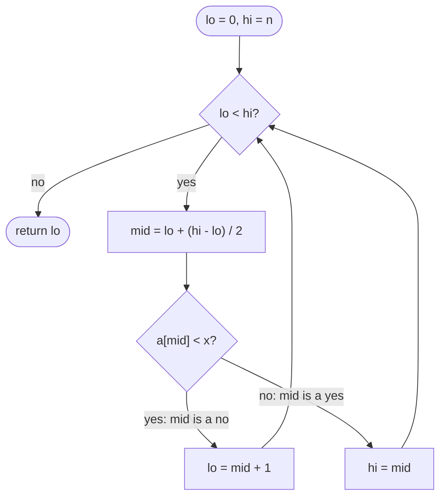

## Introduction

The classic [[a3-binary-search]] answers one question: "is `x` in this sorted array, and if so, where?" When the array contains duplicates, "where" is vague — the search returns *some* index holding `x`, and which one depends on the order in which midpoints happen to be visited.

Many real questions need something sharper than "some index":

- Where does the run of `3`s *start*, and where does it *end*?
- How many times does `3` occur?
- `x` is missing — where should it be inserted so the array stays sorted?
- What is the smallest value that is at least `6`? The largest that is at most `6`?
- How many values fall between `2` and `8`?

Every one of these is answered by two small functions. The **lower bound** of `x` is the first index whose element is **greater than or equal to** `x`. The **upper bound** of `x` is the first index whose element is **strictly greater than** `x`. Both are binary searches, both run in O(log n), and both always return a meaningful position — even when `x` does not appear at all.

These two functions are the most useful binary-search variants you can learn. They are what C++ calls `std::lower_bound` and `std::upper_bound`, what Python calls `bisect_left` and `bisect_right`, and what a database does when it seeks to the start of a range in an index. They are also the bridge to [[a3-binary-search-on-answer]], where the "array" is a range of possible answers and the condition is a feasibility check.

## Before you start

- [[a3-binary-search]] — you need the halving idea, the safe midpoint `low + (high - low) / 2`, and the habit of deriving boundaries from a loop invariant. This lesson uses all three without re-explaining them.
- [[a1-big-o]] — what O(log n) means.
- [[a2-array-string-traversal]] — zero-based indices and the meaning of `a.length`.

## The intuition

Picture a library shelf with books sorted by title. You want every book titled "Dune". You do not want *a* copy of "Dune" — you want to know where the copies start and where they stop.

Put your finger at the first book whose title is "Dune" or later in the alphabet. That is the lower bound. Put another finger at the first book whose title comes strictly *after* "Dune". That is the upper bound. Every copy of "Dune" sits between your two fingers: from the first finger up to, but not including, the second. If there are no copies, both fingers land on the same spot — exactly where a copy would be shelved.

Now turn the shelf into a row of yes/no answers. For the lower bound of `3` in `a = [1, 3, 3, 3, 5, 8, 8, 10]`, ask at every index "is `a[i] >= 3`?":

```text
index:       0     1     2     3     4     5     6     7
a[i]:        1     3     3     3     5     8     8    10
a[i] >= 3:   no    yes   yes   yes   yes   yes   yes   yes     lower bound = 1
a[i] > 3:    no    no    no    no    yes   yes   yes   yes     upper bound = 4
```

Because the array is sorted, each row is a block of "no" followed by a block of "yes". A row with that shape is **monotonic**, and finding where it switches is exactly what binary search is good at. Both bounds are the same algorithm — "find the first yes" — applied to two different questions.

## Defining the two bounds precisely

For a sorted array `a` of length `n` and a value `x`:

| Function | Returns | If no element qualifies |
|---|---|---|
| `lowerBound(a, x)` | the smallest `i` with `a[i] >= x` | `n` |
| `upperBound(a, x)` | the smallest `i` with `a[i] > x` | `n` |

Returning `n` rather than `-1` is deliberate. Index `n` is one past the end — the position where you would append `x` to keep the array sorted. It means the result is always a valid **insertion point**, and the arithmetic in the next sections works without special cases.

Two facts follow directly from the definitions:

1. `lowerBound(a, x) <= upperBound(a, x)` always, because any element `> x` is also `>= x`.
2. The elements equal to `x` occupy exactly the **half-open range** `[lowerBound, upperBound)` — they start at the lower bound and stop just before the upper bound. So the number of copies is `upperBound - lowerBound`, which is `0` when `x` is absent.

Here is the table for `a = [1, 3, 3, 3, 5, 8, 8, 10]`:

| `x` | lower bound | upper bound | count | Why |
|---|---|---|---|---|
| 3 | 1 | 4 | 3 | the 3s fill indices 1 to 3 |
| 8 | 5 | 7 | 2 | the 8s fill indices 5 and 6 |
| 4 | 4 | 4 | 0 | absent; it would go before the 5 at index 4 |
| 0 | 0 | 0 | 0 | smaller than everything |
| 12 | 8 | 8 | 0 | larger than everything, so `n` |

## Why the obvious approaches are slow

**Linear scan.** Walk from the left until `a[i] >= x`. Correct, simple and O(n). For a single query on a small array that is fine, but a sorted array exists precisely so that you do not have to look at every element.

**Find any match, then walk.** Run the classic binary search, and from the index it returns, step left until the element changes. This looks like O(log n), but the walk is not. In an array of one million identical values, the search lands in the middle and then walks half a million steps. The worst case is O(n), and duplicate-heavy data — timestamps at one-second resolution, status codes, ratings from 1 to 5 — is common in practice.

The fix is to stop treating equality as a reason to stop. Instead of asking "is `a[mid]` the target?", ask the yes/no question from the intuition section and keep halving until only the boundary is left.

## Deriving lower bound from an invariant

Use a **half-open range** `[lo, hi)`: `lo` is included, `hi` is not. Keep this invariant true before every iteration:

> Every index **before** `lo` is a "no" (`a[i] < x`). Every index **at or after** `hi` is a "yes" (`a[i] >= x`). The first "yes" is therefore somewhere in `[lo, hi]`.

Notice the closed bracket at the end: the answer can be `hi` itself, which is how the function returns `n` when every element is smaller than `x`. Each decision below is derived from that statement.

- **Initialisation.** Nothing has been examined, so there are no known "no"s and no known "yes"s inside the array. `lo = 0` makes "every index before `lo`" an empty claim. `hi = n` makes "every index at or after `hi`" an empty claim too. The invariant holds trivially.
- **Loop condition.** While `lo < hi` there is at least one unexamined index. When `lo == hi`, the "no" block ends exactly where the "yes" block begins, so `lo` *is* the first "yes". The loop is `while (lo < hi)`.
- **The midpoint is always safe.** With `lo < hi`, `mid = lo + (hi - lo) / 2` satisfies `lo <= mid < hi`, so `a[mid]` never reads past the end — even though `hi` may equal `n`.
- **When `a[mid] < x`.** Index `mid` is a "no", and because the array is sorted so is everything before it. Extend the "no" block: `lo = mid + 1`.
- **When `a[mid] >= x`.** Index `mid` is a "yes", and so is everything after it. But `mid` *might be the first* "yes", so it must not be thrown away. Extend the "yes" block to start at `mid`: `hi = mid`.
- **Termination.** In the first case `lo` grows by at least one. In the second, `hi` becomes `mid`, which is strictly less than the old `hi`. The range shrinks every iteration, so the loop ends.

That is the whole derivation. The asymmetry between `lo = mid + 1` and `hi = mid` is not a convention to memorise — it comes from the fact that a "no" can never be the answer, while a "yes" can.

> [!IMPORTANT] Upper bound is one character away
> The upper bound asks "is `a[i] > x`?" instead of "is `a[i] >= x`?". The "no" branch becomes `a[mid] <= x`. Everything else — the range, the loop condition, the updates — is identical.

## The complete implementation

```java title="Bounds.java"
import java.util.Arrays;

public class Bounds {

    /** First index i with a[i] >= x, or a.length if every element is smaller. */
    static int lowerBound(int[] a, int x) {
        int lo = 0, hi = a.length;           // answer is somewhere in [lo, hi]
        while (lo < hi) {                    // more than one candidate left
            int mid = lo + (hi - lo) / 2;    // lo <= mid < hi, so a[mid] is safe
            if (a[mid] < x) {
                lo = mid + 1;                // mid is a "no"; the answer is to its right
            } else {
                hi = mid;                    // mid is a "yes"; it may be the first one
            }
        }
        return lo;                           // lo == hi: the first "yes"
    }

    /** First index i with a[i] > x, or a.length if no element is larger. */
    static int upperBound(int[] a, int x) {
        int lo = 0, hi = a.length;
        while (lo < hi) {
            int mid = lo + (hi - lo) / 2;
            if (a[mid] <= x) {               // the only change: <= instead of <
                lo = mid + 1;
            } else {
                hi = mid;
            }
        }
        return lo;
    }

    public static void main(String[] args) {
        int[] a = {1, 3, 3, 3, 5, 8, 8, 10};
        System.out.println("a = " + Arrays.toString(a));

        for (int x : new int[] {3, 8, 4, 0, 12}) {
            int lb = lowerBound(a, x);
            int ub = upperBound(a, x);
            System.out.printf("x=%-2d lower=%d upper=%d count=%d%n", x, lb, ub, ub - lb);
        }

        // first and last occurrence of 3
        int first = lowerBound(a, 3);
        int last = upperBound(a, 3) - 1;
        System.out.println("first 3 at " + first + ", last 3 at " + last);

        // ceiling (smallest >= 6) and floor (largest <= 6)
        int c = lowerBound(a, 6);
        int f = upperBound(a, 6) - 1;
        System.out.println("ceiling(6) = " + (c < a.length ? a[c] : "none"));
        System.out.println("floor(6)   = " + (f >= 0 ? a[f] : "none"));

        // how many values lie in the closed range [2, 8]?
        System.out.println("count in [2, 8] = " + (upperBound(a, 8) - lowerBound(a, 2)));
    }
}
```

```output
a = [1, 3, 3, 3, 5, 8, 8, 10]
x=3  lower=1 upper=4 count=3
x=8  lower=5 upper=7 count=2
x=4  lower=4 upper=4 count=0
x=0  lower=0 upper=0 count=0
x=12 lower=8 upper=8 count=0
first 3 at 1, last 3 at 3
ceiling(6) = 8
floor(6)   = 5
count in [2, 8] = 6
```

Neither function ever compares for equality, and neither returns early. That is the point: an early return on `a[mid] == x` would stop at an arbitrary copy. By always continuing until `lo == hi`, the search is forced all the way to the boundary.

The `main` method shows that a handful of useful queries are one-line combinations of the two bounds:

| Query | Expression | Check before using the result |
|---|---|---|
| Insertion point for `x` (before equal elements) | `lowerBound(x)` | none — always valid, may be `n` |
| First occurrence of `x` | `lowerBound(x)` | index `< n` and `a[index] == x` |
| Last occurrence of `x` | `upperBound(x) - 1` | index `>= 0` and `a[index] == x` |
| Number of copies of `x` | `upperBound(x) - lowerBound(x)` | none |
| Ceiling: smallest element `>= x` | `a[lowerBound(x)]` | index `< n` |
| Floor: largest element `<= x` | `a[upperBound(x) - 1]` | index `>= 0` |
| Count of values in `[L, R]` | `upperBound(R) - lowerBound(L)` | none (`0` if `L > R` in sorted data) |

The right-hand column matters. A lower bound of `4` for `x = 4` in the example does *not* mean `4` is present — it means `4` would be inserted at index 4. Always check the element at the returned index before reporting it as a match.

## Dry run: watching the boundary close in

Trace `lowerBound(a, 3)` on `a = [1, 3, 3, 3, 5, 8, 8, 10]`. The array has three copies of `3`, and the search must find the leftmost one.

| Step | `lo` | `hi` | `mid` | `a[mid]` | `a[mid] < 3`? | Action |
|---|---|---|---|---|---|---|
| 1 | 0 | 8 | 4 | 5 | no | `hi = 4` |
| 2 | 0 | 4 | 2 | 3 | no | `hi = 2` |
| 3 | 0 | 2 | 1 | 3 | no | `hi = 1` |
| 4 | 0 | 1 | 0 | 1 | yes | `lo = 1` |
| — | 1 | 1 | | | | return `1` |

At step 2 the search sees a `3` and keeps going. At step 3 it sees another `3` and keeps going. It stops only when `lo` and `hi` meet, which is where the "no" block (`[1]`) meets the "yes" block.

Now `upperBound(a, 3)`, which must land just after the last `3`:

| Step | `lo` | `hi` | `mid` | `a[mid]` | `a[mid] <= 3`? | Action |
|---|---|---|---|---|---|---|
| 1 | 0 | 8 | 4 | 5 | no | `hi = 4` |
| 2 | 0 | 4 | 2 | 3 | yes | `lo = 3` |
| 3 | 3 | 4 | 3 | 3 | yes | `lo = 4` |
| — | 4 | 4 | | | | return `4` |

Same array, same midpoint rule, but a `3` now counts as a "no", so the search is pushed past all of them.



## Why it takes O(log n) time

Each iteration does constant work. The number of candidates is `hi - lo`, which starts at `n`. If `a[mid] < x`, the new count is `hi - (mid + 1)`; otherwise it is `mid - lo`. Since `mid` is the midpoint rounded down, both are at most `⌊(hi - lo) / 2⌋`. The count at least halves every iteration, so after `i` iterations it is at most `n / 2ⁱ`, and the loop ends after at most `⌊log₂ n⌋ + 1` iterations. Time is **O(log n)**.

Unlike the classic search, a bound search never gets lucky — it always runs until the range is empty, so best, average and worst cases are all Θ(log n). That is still about twenty comparisons for a million elements.

Finding both ends of a range needs two searches, which is O(2 log n) = O(log n). **Space** is O(1): three integers.

## One template, any condition

Look at the two functions again. The only thing that differs is the test that classifies `mid` as "no" or "yes". Pull that test out and you get a general routine:

```java title="FirstTrue.java"
import java.util.function.IntPredicate;

public class FirstTrue {

    /**
     * Smallest i in [lo, hi) with ok(i) true, or hi if there is none.
     * Precondition: ok is monotonic on [lo, hi) — false...false true...true.
     */
    static int firstTrue(int lo, int hi, IntPredicate ok) {
        while (lo < hi) {
            int mid = lo + (hi - lo) / 2;
            if (ok.test(mid)) hi = mid;
            else lo = mid + 1;
        }
        return lo;
    }

    public static void main(String[] args) {
        int[] a = {1, 3, 3, 3, 5, 8, 8, 10};
        System.out.println(firstTrue(0, a.length, i -> a[i] >= 3));  // lower bound of 3
        System.out.println(firstTrue(0, a.length, i -> a[i] > 3));   // upper bound of 3
        System.out.println(firstTrue(0, 46_341, x -> x * x > 2025)); // smallest x, x*x > 2025
    }
}
```

```output
1
4
46
```

The last line has no array at all. It searches the integers `0` to `46,340` for the smallest `x` whose square exceeds `2025`. Since `45² = 2025` exactly, the answer is `46`. (The range stops at 46,340 because that is the largest `int` whose square still fits in an `int`; any larger `x` would make `x * x` overflow.) This is the step that turns lower bound into [[a3-binary-search-on-answer]]: whenever a problem's candidates can be ordered so that a yes/no test is monotonic, `firstTrue` finds the boundary.

### A worked example: minimum of a rotated array

A sorted array of distinct values has been rotated at an unknown point, for example `[15, 21, 27, 3, 8, 11]`. Find the minimum in O(log n).

The array is not sorted, so neither bound applies directly. But compare each element with the **last** element, `11`. Everything in the left block (`15, 21, 27`) is larger than `11`; everything in the right block (`3, 8, 11`) is at most `11`:

```text
a[i]:        15    21    27     3     8    11
a[i] <= 11:  no    no    no    yes   yes   yes
```

That row is monotonic, and its first "yes" is the minimum. The same template finds it:

```java title="RotatedMin.java"
public class RotatedMin {

    /** Minimum of a sorted array (distinct values) rotated at an unknown point. */
    static int findMin(int[] a) {
        int last = a[a.length - 1];
        int lo = 0, hi = a.length - 1;       // the last index is always a "yes"
        while (lo < hi) {
            int mid = lo + (hi - lo) / 2;
            if (a[mid] > last) {
                lo = mid + 1;                // mid is in the left, larger block: "no"
            } else {
                hi = mid;                    // mid is in the right, smaller block: "yes"
            }
        }
        return a[lo];
    }

    public static void main(String[] args) {
        System.out.println(findMin(new int[] {15, 21, 27, 3, 8, 11}));
        System.out.println(findMin(new int[] {3, 8, 11, 15, 21, 27}));   // not rotated
        System.out.println(findMin(new int[] {8, 3}));
        System.out.println(findMin(new int[] {42}));
    }
}
```

```output
3
3
3
42
```

Here `hi` starts at `n - 1` rather than `n`, because index `n - 1` is known to be a "yes" (`a[n-1] <= last` is always true) and so the answer cannot be past it. The invariant tells you where to start the range. With duplicates allowed, `a[mid] == last` no longer tells you which block `mid` is in, and the worst case degrades to O(n) — a good follow-up question to expect.

## The other style: last true, and closed ranges

Sometimes the natural question is shaped the other way round — "yes" first, then "no" — and you want the **last** "yes". The floor query is an example: "largest index with `a[i] <= x`". You can always get it as `firstTrue(...) - 1` on the opposite condition, which is what `upperBound(x) - 1` does. You can also search for it directly, but the midpoint must then **round up**:

```java title="LastTrue.java"
public class LastTrue {

    /** Largest index i with a[i] <= x, or -1 if every element is larger. */
    static int lastAtMost(int[] a, int x) {
        int lo = -1, hi = a.length - 1;          // answer is in [lo, hi]
        while (lo < hi) {
            int mid = lo + (hi - lo + 1) / 2;    // round UP so that lo = mid makes progress
            if (a[mid] <= x) {
                lo = mid;                        // mid is a "yes"; it may be the last one
            } else {
                hi = mid - 1;                    // mid is a "no"; the answer is to its left
            }
        }
        return lo;
    }

    public static void main(String[] args) {
        int[] a = {1, 3, 3, 3, 5, 8, 8, 10};
        System.out.println(lastAtMost(a, 3));
        System.out.println(lastAtMost(a, 6));
        System.out.println(lastAtMost(a, 0));
        System.out.println(lastAtMost(a, 99));
    }
}
```

```output
3
4
-1
7
```

Why round up? Suppose `lo = 4` and `hi = 5`. A rounded-down midpoint is `4`. If `a[4]` is a "yes", the update `lo = mid` sets `lo` to `4` again — nothing changes, and the loop runs forever. Rounding up gives `mid = 5`, so `lo = mid` always moves. The rule to remember is not "round up for last true" but the reason behind it: **whichever boundary is set to `mid` must be the one `mid` can never equal**. With round-down, `mid` can equal `lo` but never `hi`, so `hi = mid` is safe. With round-up, `mid` can equal `hi` but never `lo`, so `lo = mid` is safe.

A third style you will meet often uses a closed range and a separate answer variable:

```java
int lo = 0, hi = a.length - 1, ans = a.length;
while (lo <= hi) {
    int mid = lo + (hi - lo) / 2;
    if (a[mid] >= x) { ans = mid; hi = mid - 1; }   // record the candidate, look left
    else lo = mid + 1;
}
return ans;                                          // same result as lowerBound
```

It is equally correct and avoids thinking about rounding, because both updates skip past `mid`. The price is an extra variable whose meaning ("best answer seen so far") you have to keep straight. Pick one style, learn to derive it, and use it consistently; mixing them inside one function is where bugs come from.

## Bounds in standard libraries

Production code should use library functions where they exist. They are tested, and their documentation states exactly how duplicates are handled — which is the hard part.

```java title="LibraryBounds.java"
import java.util.Arrays;
import java.util.TreeSet;

public class LibraryBounds {
    public static void main(String[] args) {
        int[] a = {1, 3, 3, 3, 5, 8, 8, 10};

        System.out.println(Arrays.binarySearch(a, 3));   // found: some index holding 3
        int r = Arrays.binarySearch(a, 6);               // missing
        System.out.println(r + " -> insertion point " + (-r - 1));

        TreeSet<Integer> set = new TreeSet<>(Arrays.asList(1, 3, 5, 8, 10));
        System.out.println(set.ceiling(6) + " " + set.floor(6));   // >= 6, <= 6
        System.out.println(set.higher(8) + " " + set.lower(8));    // > 8, < 8
        System.out.println(set.ceiling(11));                       // nothing >= 11
    }
}
```

```output
3
-6 -> insertion point 5
8 5
10 5
null
```

**`Arrays.binarySearch`** returned `3` for the value `3` — the *last* copy here, not the first. Its documentation says plainly that with duplicates "there is no guarantee which one will be found". When the key is missing it returns `-(insertionPoint) - 1`, which is always negative (so it cannot be confused with a found index, even for insertion point `0`). Decode it with `-r - 1`. Java has no built-in lower or upper bound on arrays, which is why you need to be able to write them.

**`TreeSet` and `TreeMap`** offer the four bound-style queries on a balanced tree: `ceiling` (`>=`), `floor` (`<=`), `higher` (`>`) and `lower` (`<`), each O(log n). They return `null` when nothing qualifies — note the `null` printed for `ceiling(11)`, and remember that unboxing it into an `int` throws `NullPointerException`. See [[a1-treeset]] and [[a1-treemap]].

**Other languages.** Python's `bisect_left` and `bisect_right` are lower and upper bound. C++'s `std::lower_bound`, `std::upper_bound` and `std::equal_range` return iterators with the same meaning, which is where the names come from.

## In real systems

**Range scans in databases.** A query such as `WHERE created_at >= '2026-10-01' AND created_at < '2026-11-01'` on an indexed column does not scan the table. The database descends its B-tree index to the first key `>= '2026-10-01'` — a lower-bound search inside each page — and then reads keys in order until it reaches one that is not `< '2026-11-01'`. The half-open time range in that query is the same `[lo, hi)` shape used throughout this lesson, and it is the recommended way to filter by time precisely because adjacent ranges never overlap or leave gaps.

**Logs and time series.** Metrics and log lines are stored in timestamp order. "Show events from 14:05 to 14:10" is `upperBound(14:10) - lowerBound(14:05)` events starting at `lowerBound(14:05)`. Message brokers use the same idea: Apache Kafka keeps a sparse, sorted index from message offsets to file positions, and finding where to start reading means binary searching for the largest indexed offset not greater than the requested one — a floor query.

**Rate limiting and leaderboards.** A sliding-window rate limiter that keeps sorted request timestamps counts requests in the last minute as `n - lowerBound(now - 60s)`. A leaderboard stored as a sorted score array answers "what rank is a score of 870?" with a single bound search.

**Ordered maps in application code.** Whenever code uses `TreeMap.floorEntry` — to find which price tier a quantity falls into, which shift covers a given time, or which IP range contains an address — it is running a bound query.

## Trade-offs and alternatives

| Approach | Query time | Update time | Answers |
|---|---|---|---|
| Linear scan | O(n) | O(1) append | anything, slowly |
| Sorted array + bounds | O(log n) | O(n) insert (shifting) | first/last, count, floor/ceiling, range count |
| `TreeMap` / `TreeSet` | O(log n) | O(log n) | floor/ceiling/higher/lower; counts need extra work |
| `HashMap` of counts | O(1) average | O(1) average | exact-value counts only — no ranges, no floor/ceiling |

A sorted array with bounds is the best choice when the data is built once and queried many times: it is compact, cache-friendly and needs no extra memory. When values arrive and leave continually, inserting into a sorted array costs O(n) per insert, and a balanced tree is the better structure. A hash map is faster for "how many 3s?" but cannot answer "how many values between 2 and 8?" at all.

## Common mistakes

> [!MISTAKE] Returning early on equality
> Adding `if (a[mid] == x) return mid;` to a lower-bound search turns it back into the classic search, which returns an arbitrary copy. Bound searches never return early; equality is handled by whichever branch the definition puts it in (`>=` for lower, `>` for upper).

**Using the result without checking it.** `lowerBound(a, x)` returns an insertion point, not a match. Reading `a[lb]` when `lb == n` throws `ArrayIndexOutOfBoundsException`, and reporting `lb` as "the index of `x`" is wrong when `a[lb] != x`. Check both conditions.

**Mixing range conventions.** `hi = a.length` with `while (lo <= hi)` reads `a[n]` when the midpoint reaches the end. `hi = a.length - 1` with `while (lo < hi)` and `hi = mid` can never return `n`, so "insert at the end" is silently reported as `n - 1`. Each style is consistent on its own; the bugs come from taking the initialisation from one and the loop from another.

**Infinite loops with `lo = mid`.** If an update sets `lo = mid` while the midpoint rounds down, a two-element range never shrinks. Either restructure so the "yes" branch sets `hi = mid`, or round the midpoint up.

**Last occurrence as `lowerBound(x + 1) - 1`.** For integers this works — it is the same as `upperBound(x) - 1` — until `x` is `Integer.MAX_VALUE`, where `x + 1` overflows to the minimum value. Write the upper bound properly instead of shifting the key.

**Assuming `Arrays.binarySearch` finds the first copy.** It does not promise that, and the example above shows it returning the last.

## Interview perspective

Bound searches appear constantly in interviews, sometimes in plain sight ("find first and last position") and often hidden inside a larger problem. Interviewers watch for two things: that you never scan from a found index, and that you can explain why `hi = mid` is correct rather than reciting it.

> [!INTERVIEW] Explaining the invariant
> "I'll keep everything before `lo` strictly less than the target and everything from `hi` on at least the target. If `a[mid]` is smaller, `mid` can't be the answer, so `lo = mid + 1`. Otherwise `mid` might be the first one, so I keep it with `hi = mid`. The range shrinks every time, and when `lo` meets `hi` that's the boundary."

Questions you should be ready for:

- **Find First and Last Position of Element in Sorted Array.** `lowerBound(x)`; if out of range or not equal to `x`, return `[-1, -1]`; otherwise `[lowerBound(x), upperBound(x) - 1]`. Two O(log n) searches.
- **Search Insert Position.** Exactly `lowerBound(x)`.
- **Count occurrences in O(log n).** `upperBound(x) - lowerBound(x)`.
- **Why `hi = mid` and not `hi = mid - 1`?** Because `mid` satisfies the condition and might be the first index that does; discarding it could skip the answer.
- **Find Minimum in Rotated Sorted Array.** First index with `a[i] <= a[n-1]`. Follow-up: with duplicates, `a[mid] == a[hi]` gives no information, so shrink `hi` by one — worst case O(n).
- **Find K Closest Elements.** Lower bound locates where `x` would sit; expand outwards with two pointers, or binary search on the left edge of the window.
- **What does your function return when the target is larger than every element?** `n` — and you should say so before being asked.

## Practice

1. **Range count.** Given a sorted array and many queries `[L, R]`, return how many elements fall in each range. State the total complexity for `q` queries.
2. **Floor and ceiling.** Return the floor and ceiling of `x` in a sorted array, or `null` when they do not exist, using only `lowerBound` and `upperBound`.
3. **First bad version.** Versions `1..n` are good up to some point and bad after it; `isBad(v)` is provided. Find the first bad version with as few calls as possible, being careful with overflow when `n` is near `Integer.MAX_VALUE`.
4. **Rotated with duplicates.** Extend `findMin` to allow duplicates and explain why the worst case becomes O(n).
5. **Last true directly.** Rewrite `upperBound(x) - 1` as a single last-true search with a rounded-up midpoint, and dry-run it on a two-element array to confirm it terminates.

The DSA explorer lists the matching problems under this topic; start with *Search Insert Position*, *Find First and Last Position of Element in Sorted Array* and *Find Minimum in Rotated Sorted Array*.

```quiz
Q: For `a = [2, 4, 4, 4, 7, 9]`, what are `lowerBound(a, 4)` and `upperBound(a, 4)`?
- [ ] 1 and 3
- [x] 1 and 4
- [ ] 2 and 4
- [ ] 1 and 5
> The first element >= 4 is at index 1; the first element > 4 is the 7 at index 4. The upper bound is one past the last 4, which is why the count is 4 - 1 = 3. Answering 3 for the upper bound confuses "last occurrence" with "upper bound" — the last occurrence is upperBound - 1.

Q: `lowerBound(a, x)` returns 5 for an array of length 8. What can you conclude?
- [ ] `x` is at index 5
- [x] Every element before index 5 is less than `x`, and `a[5] >= x`; `x` is present only if `a[5] == x`
- [ ] `x` occurs 5 times
- [ ] `x` is not in the array
> A lower bound is an insertion point, not a match. It guarantees the elements before it are smaller and the element at it is at least x. Whether x is actually present has to be checked by comparing a[5] with x.

Q: In the half-open lower-bound search, why is the update `hi = mid` rather than `hi = mid - 1` when `a[mid] >= x`?
- [ ] Because `hi` is exclusive, so `mid - 1` would read past the end
- [ ] To make the loop run faster
- [x] Because `mid` satisfies the condition and may be the first index that does, so it must stay a candidate
- [ ] Because the midpoint rounds up
> The search is for the first "yes". a[mid] >= x makes mid a "yes", and nothing yet shows that an earlier index is also a "yes". Setting hi = mid - 1 could discard the answer itself. The midpoint rounds down, which is what makes hi = mid safe: mid is always strictly less than hi.

Q: A search uses `lo = mid` in one branch and `mid = lo + (hi - lo) / 2`. What goes wrong?
- [ ] Nothing; the range still halves
- [x] When `hi = lo + 1`, `mid` equals `lo`, so `lo = mid` changes nothing and the loop never ends
- [ ] The midpoint overflows
- [ ] It returns the upper bound instead of the lower bound
> Rounding down means mid can equal lo. If the branch taken sets lo = mid, the range stays the same size forever. Round the midpoint up (lo + (hi - lo + 1) / 2) whenever an update sets lo = mid.
```

## Quick revision {#quick-revision}

- **Lower bound**: first index with `a[i] >= x`. **Upper bound**: first index with `a[i] > x`. Both return `n` if nothing qualifies.
- Equal elements occupy `[lowerBound, upperBound)`; count = `upperBound - lowerBound`.
- First occurrence = `lowerBound` (check `< n` and `== x`); last occurrence = `upperBound - 1` (check `>= 0` and `== x`).
- Ceiling = `a[lowerBound(x)]`; floor = `a[upperBound(x) - 1]`; range count `[L, R]` = `upperBound(R) - lowerBound(L)`.
- Template: `lo = 0, hi = n; while (lo < hi) { mid = lo + (hi - lo) / 2; if (yes(mid)) hi = mid; else lo = mid + 1; } return lo;`
- Invariant: before `lo` all "no", from `hi` all "yes"; the answer is in `[lo, hi]`.
- Never return early on equality. Round down with `hi = mid`; round up with `lo = mid`.
- Always Θ(log n) time, O(1) space; two searches for a full range.
- `Arrays.binarySearch`: any copy on duplicates; `-(insertionPoint) - 1` when missing. `TreeSet`: `ceiling`, `floor`, `higher`, `lower` (return `null` when none).
- Any monotonic yes/no test over ordered candidates is a lower-bound search — the basis of binary search on the answer.

## Key takeaways {#key-takeaways}

- Lower and upper bound find boundaries, not matches, so they give precise answers on data with duplicates and useful answers when the value is missing.
- Both are the same algorithm — find the first "yes" in a no...no yes...yes sequence — with different yes/no tests.
- `hi = mid` keeps a candidate that might be the answer; `lo = mid + 1` discards one that cannot be. Derive this from the invariant rather than memorising it.
- Returning `n` for "past the end" makes every result a valid insertion point and keeps the arithmetic for counts and ranges free of special cases.
- Check the element at a returned index before treating it as a match.
- Once you can phrase a problem as a monotonic condition over ordered candidates, the same few lines solve it.
