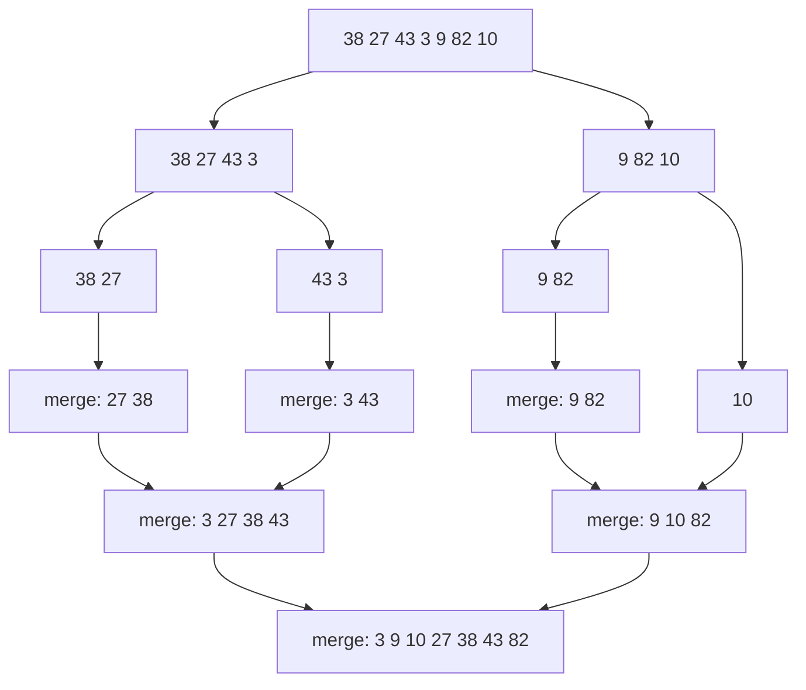

## Introduction

Sorting is one of the most common things programs do. Search results are ordered by relevance, transactions by time, leaderboards by score. Many algorithms also start by sorting, because sorted data makes later steps easy — binary search, two pointers, merging intervals and removing duplicates all depend on it.

The simple sorting methods most people invent first — repeatedly pick the smallest remaining element (selection sort), or insert each element into its place among the ones already sorted (insertion sort) — take O(n²) time. For 1,000 elements that is about a million steps, which is fine. For 1,000,000 elements it is about a trillion, which is not.

**Merge sort** gets to O(n log n) with one observation: *combining two lists that are already sorted is easy*. If you have two sorted piles of cards face up, you can produce one sorted pile by repeatedly taking the smaller of the two top cards. That takes one pass. So merge sort splits the input in half, sorts each half (by the same method), and merges the results. A million elements then take about twenty million steps instead of a trillion.

Merge sort has three properties that make it more than a textbook example. Its running time is **O(n log n) in every case** — no input makes it slow. It is **stable**: equal elements keep their original order, which matters when sorting records by one field after another. And its merge step works on data that is read sequentially, which is why it is the basis of sorting data too large for memory and of the default object sort in Java and Python.

## Before you start

- [[a1-recursion]] — merge sort calls itself on each half; you need to be comfortable with base cases and with trusting a recursive call to do its job.
- [[a1-big-o]] and [[a1-space-complexity]] — to follow the time and memory analysis.
- [[a2-two-pointers]] — the merge step walks two sorted sequences with one pointer each.

## The intuition

Imagine sorting a stack of 1,000 exam papers by student number with a friend. You split the stack in half, give one half to your friend, and each of you sorts your half. When you are both done, you put the two sorted stacks side by side and repeatedly take whichever top paper has the smaller number. In one pass you have a single sorted stack.

How do you sort your 500? The same way: split them, sort each half, merge. Eventually someone is holding a stack of one paper, which is already sorted — nothing to do. Then the merging begins, and stacks of 1 become stacks of 2, then 4, then 8, all the way back up to 1,000.

This strategy — split the problem into smaller copies of itself, solve those, and combine the answers — is called **divide and conquer**. In merge sort, the dividing is trivial (cut in the middle) and all the real work happens in the combining step. Its partner [[a3-quick-sort]] does the opposite: the real work is in dividing, and combining is trivial.

## The merge step

Everything in merge sort depends on one operation: given two sorted sequences, produce one sorted sequence containing all their elements.

Keep one pointer at the front of each sequence. Compare the two elements under the pointers, copy the smaller one to the output, and advance that pointer. When one sequence runs out, copy the rest of the other — it is already sorted and every element in it is at least as large as everything output so far.

Here is the merge of `L = [3, 27, 38, 43]` and `R = [9, 10, 82]`:

| Step | `L[i]` | `R[j]` | Take | Output so far |
|---|---|---|---|---|
| 1 | 3 | 9 | 3 from L | `[3]` |
| 2 | 27 | 9 | 9 from R | `[3, 9]` |
| 3 | 27 | 10 | 10 from R | `[3, 9, 10]` |
| 4 | 27 | 82 | 27 from L | `[3, 9, 10, 27]` |
| 5 | 38 | 82 | 38 from L | `[3, 9, 10, 27, 38]` |
| 6 | 43 | 82 | 43 from L | `[3, 9, 10, 27, 38, 43]` |
| 7 | — | 82 | rest of R | `[3, 9, 10, 27, 38, 43, 82]` |

Why is this correct? At every step, the element taken is the smallest element not yet output. The smallest remaining element of `L` is `L[i]` (because `L` is sorted), the smallest remaining in `R` is `R[j]`, and the overall smallest is the smaller of those two. So the output is produced in sorted order.

Why is it fast? Every comparison outputs one element, and every element is output exactly once. Merging sequences of total length `n` therefore takes O(n) time — at most `n - 1` comparisons.

### Ties and stability

When `L[i]` and `R[j]` are equal, which one should go first? Take the one from **`L`**. Elements in `L` came from earlier in the original array, so taking them first keeps equal elements in their original relative order. A sort with that property is called **stable**.

In code, this is the difference between `a[i] <= a[j]` (take left on ties: stable) and `a[i] < a[j]` (take right on ties: unstable). One character decides whether the sort is stable.

Stability does not matter for plain integers — two `5`s are indistinguishable. It matters a great deal for records. Suppose a list of students is already in alphabetical order and you sort it by grade. A stable sort leaves students with the same grade in alphabetical order, so the result is "by grade, then by name" for free:

```java title="StableMerge.java"
import java.util.ArrayList;
import java.util.Comparator;
import java.util.List;

public class StableMerge {

    record Student(String name, int grade) {}

    static <T> List<T> mergeSort(List<T> xs, Comparator<? super T> cmp) {
        if (xs.size() <= 1) return xs;
        int mid = xs.size() / 2;
        List<T> left = mergeSort(xs.subList(0, mid), cmp);
        List<T> right = mergeSort(xs.subList(mid, xs.size()), cmp);
        List<T> out = new ArrayList<>(xs.size());
        int i = 0, j = 0;
        while (i < left.size() && j < right.size()) {
            // take from the right only if it is strictly smaller
            if (cmp.compare(left.get(i), right.get(j)) <= 0) out.add(left.get(i++));
            else out.add(right.get(j++));
        }
        while (i < left.size()) out.add(left.get(i++));
        while (j < right.size()) out.add(right.get(j++));
        return out;
    }

    public static void main(String[] args) {
        // already in alphabetical order by name
        List<Student> students = List.of(
            new Student("Ana", 90), new Student("Ben", 85), new Student("Cy", 90),
            new Student("Dee", 85), new Student("Eli", 70));
        for (Student s : mergeSort(students, Comparator.comparingInt(Student::grade))) {
            System.out.println(s.grade() + " " + s.name());
        }
    }
}
```

```output
70 Eli
85 Ben
85 Dee
90 Ana
90 Cy
```

Ben stays ahead of Dee and Ana stays ahead of Cy, exactly as in the input. This generic version builds new lists at every level, which is easy to read but allocates a lot; the array version below is how you would write it for performance. Comparators and multi-key ordering are covered in [[a3-comparator-sorting]].

## From merging to sorting

With merge in hand, the sort is three lines of logic:

1. If the range has zero or one element, it is already sorted — return.
2. Otherwise, split it at the middle and sort each half recursively.
3. Merge the two sorted halves.



The top half of the diagram is the splitting, which does no comparisons at all. The bottom half is the merging, where all the sorting happens. Notice that the final merge is exactly the one traced in the table above.

## The complete implementation

```java title="MergeSort.java"
import java.util.Arrays;

public class MergeSort {

    static void sort(int[] a) {
        int[] tmp = new int[a.length];   // one buffer, reused by every merge
        sort(a, 0, a.length - 1, tmp);
    }

    /** Sorts a[lo..hi] inclusive. */
    private static void sort(int[] a, int lo, int hi, int[] tmp) {
        if (lo >= hi) return;            // zero or one element: already sorted
        int mid = lo + (hi - lo) / 2;
        sort(a, lo, mid, tmp);           // left half  a[lo..mid]
        sort(a, mid + 1, hi, tmp);       // right half a[mid+1..hi]
        merge(a, lo, mid, hi, tmp);
    }

    /** Merges sorted a[lo..mid] and sorted a[mid+1..hi] into sorted a[lo..hi]. */
    private static void merge(int[] a, int lo, int mid, int hi, int[] tmp) {
        int i = lo, j = mid + 1, k = lo;
        while (i <= mid && j <= hi) {
            if (a[i] <= a[j]) tmp[k++] = a[i++];   // <= takes the left one on ties: stable
            else              tmp[k++] = a[j++];
        }
        while (i <= mid) tmp[k++] = a[i++];        // copy whatever is left over;
        while (j <= hi)  tmp[k++] = a[j++];        // only one of these loops runs
        System.arraycopy(tmp, lo, a, lo, hi - lo + 1);
    }

    public static void main(String[] args) {
        int[] a = {38, 27, 43, 3, 9, 82, 10};
        sort(a);
        System.out.println(Arrays.toString(a));

        int[] dup = {5, 1, 5, 1, 5};
        sort(dup);
        System.out.println(Arrays.toString(dup));

        int[] empty = {};
        sort(empty);
        System.out.println(Arrays.toString(empty));
    }
}
```

```output
[3, 9, 10, 27, 38, 43, 82]
[1, 1, 5, 5, 5]
[]
```

Walk through the design choices:

- **Inclusive bounds.** `sort(a, lo, hi)` sorts `a[lo..hi]` including both ends. The left half is `lo..mid` and the right half is `mid + 1..hi`. Because `mid` rounds down, the left half gets the extra element when the length is odd, and both halves are always non-empty when `lo < hi` — so the recursion always makes progress.
- **One temporary buffer.** Merging cannot be done in place easily: writing the smaller element into `a[k]` would overwrite an element not yet merged. So merge writes into `tmp` and copies the result back. Allocating `tmp` once in the public method, rather than inside every merge, avoids creating O(n log n) worth of short-lived arrays.
- **Copying back.** `System.arraycopy` returns the merged range to `a`. Forgetting this step is the most common merge sort bug: each call then merges stale data, and the output is not sorted.
- **Edge cases.** An empty array calls `sort(a, 0, -1)`, which returns immediately. Duplicates are handled by the `<=` comparison and come out stable.

## Why it takes O(n log n) time

Let `T(n)` be the time to sort `n` elements. Sorting means sorting two halves and then merging `n` elements, so:

`T(n) = 2 T(n/2) + c·n`, with `T(1) = c`.

This is a **recurrence**. The clearest way to solve it is to draw the recursion as a tree and add up the work level by level:

| Level | Subproblems | Size of each | Merge work at this level |
|---|---|---|---|
| 0 | 1 | `n` | `c·n` |
| 1 | 2 | `n/2` | `2 · c·n/2 = c·n` |
| 2 | 4 | `n/4` | `4 · c·n/4 = c·n` |
| … | … | … | `c·n` |
| `log₂ n` | `n` | 1 | `c·n` (base cases) |

Every level does `c·n` work in total: there are twice as many subproblems as on the level above, each half the size. The sizes halve from `n` down to 1, which takes `log₂ n` steps, so there are `log₂ n + 1` levels. Total work: `c·n·(log₂ n + 1)`, which is **O(n log n)**.

Crucially, this does not depend on the input. The split is always in the middle, regardless of the values, so the tree always has the same shape. Sorted input, reversed input and random input all take Θ(n log n) time. The number of comparisons varies a little — merging two runs where one is entirely smaller than the other takes only as many comparisons as the shorter run has elements — but never by more than a constant factor.

That is as good as any comparison-based sort can do: there is a proof that every sort which only compares elements needs about `n log₂ n` comparisons in the worst case (it is outlined in [[a3-counting-sort]], which also shows how to beat it when the values are small integers).

**Space.** The array version needs the O(n) temporary buffer plus the recursion stack. The stack is only as deep as the tree — about `log₂ n` frames, roughly 30 for a billion elements — so total extra space is **O(n)**, dominated by the buffer. Merge sort on arrays is **not in-place**. In-place merging algorithms exist, but they are complicated and slower in practice, so real implementations use a buffer.

## Bottom-up merge sort

The recursion only exists to reach the base cases. You can skip it and start from them: treat the array as `n` runs of length 1, merge neighbouring pairs into runs of length 2, then runs of 4, and so on until one run covers the array.

```java title="BottomUpMergeSort.java"
import java.util.Arrays;

public class BottomUpMergeSort {

    static void sort(int[] a) {
        int n = a.length;
        int[] tmp = new int[n];
        for (int width = 1; width < n; width *= 2) {          // runs of 1, 2, 4, 8, ...
            for (int lo = 0; lo < n - width; lo += 2 * width) {
                int mid = lo + width - 1;
                int hi = Math.min(lo + 2 * width - 1, n - 1);  // last run may be short
                merge(a, lo, mid, hi, tmp);
            }
            System.out.println("width " + width + ": " + Arrays.toString(a));
        }
    }

    static void merge(int[] a, int lo, int mid, int hi, int[] tmp) {
        int i = lo, j = mid + 1, k = lo;
        while (i <= mid && j <= hi) tmp[k++] = a[i] <= a[j] ? a[i++] : a[j++];
        while (i <= mid) tmp[k++] = a[i++];
        while (j <= hi) tmp[k++] = a[j++];
        System.arraycopy(tmp, lo, a, lo, hi - lo + 1);
    }

    public static void main(String[] args) {
        sort(new int[] {38, 27, 43, 3, 9, 82, 10});
    }
}
```

```output
width 1: [27, 38, 3, 43, 9, 82, 10]
width 2: [3, 27, 38, 43, 9, 10, 82]
width 4: [3, 9, 10, 27, 38, 43, 82]
```

The printed passes show the runs growing: pairs after the first pass, sorted groups of four after the second, the whole array after the third. The inner loop condition `lo < n - width` skips a final run that has no partner — here the lone `10` in the first pass — because there is nothing to merge it with yet. `Math.min` trims the right run when the array length is not a power of two.

Bottom-up does the same merges with the same O(n log n) time and O(n) buffer, but with no recursion. It is also the natural shape for sorting data that streams from disk, since each pass reads and writes the data sequentially.

## Merge sort on a linked list

Linked lists are where merge sort shines. Quicksort and heap sort depend on jumping to arbitrary positions, which costs O(n) on a list. Merge sort needs only two things: splitting the list in half and merging two lists, and both are natural on linked lists.

```java title="ListMergeSort.java"
public class ListMergeSort {

    static final class Node {
        int val;
        Node next;
        Node(int val, Node next) { this.val = val; this.next = next; }
    }

    static Node sort(Node head) {
        if (head == null || head.next == null) return head;
        // find the end of the first half with slow/fast pointers
        Node slow = head, fast = head.next;
        while (fast != null && fast.next != null) {
            slow = slow.next;
            fast = fast.next.next;
        }
        Node second = slow.next;
        slow.next = null;                       // cut the list in two
        return merge(sort(head), sort(second));
    }

    static Node merge(Node a, Node b) {
        Node dummy = new Node(0, null), tail = dummy;
        while (a != null && b != null) {
            if (a.val <= b.val) { tail.next = a; a = a.next; }
            else                { tail.next = b; b = b.next; }
            tail = tail.next;
        }
        tail.next = (a != null) ? a : b;        // relink the rest; nothing is copied
        return dummy.next;
    }

    public static void main(String[] args) {
        Node head = null;
        int[] values = {4, 2, 1, 3, 5};
        for (int i = values.length - 1; i >= 0; i--) head = new Node(values[i], head);

        StringBuilder sb = new StringBuilder();
        for (Node n = sort(head); n != null; n = n.next) sb.append(n.val).append(' ');
        System.out.println(sb.toString().trim());
    }
}
```

```output
1 2 3 4 5
```

The split uses [[a4-fast-slow-pointers]]: `fast` moves two nodes for every one that `slow` moves, so when `fast` reaches the end, `slow` is at the middle. Starting `fast` at `head.next` makes `slow` stop at the *end of the first half*, so a two-node list splits into one and one rather than looping forever. The merge is the standard list merge from [[a4-merge-lists]], with a dummy node to avoid special-casing the head.

The important difference from the array version is that merging **relinks nodes instead of copying values**, so no buffer is needed. The only extra memory is the O(log n) recursion stack, and a bottom-up version on lists removes even that, giving O(1) extra space. Time is still O(n log n): finding the middle is O(n) per level, which does not change the per-level cost.

## Counting inversions with the merge step

An **inversion** in an array is a pair of positions `i < j` where `a[i] > a[j]` — two elements in the wrong order. A sorted array has zero inversions; a reversed array of `n` elements has the maximum, `n(n - 1) / 2`. The count measures how far an array is from sorted, and it shows up in ranking comparisons (how similar are two people's orderings of the same films?) as well as interviews.

Checking every pair takes O(n²). Merge sort counts them in O(n log n), because every inversion is "fixed" at exactly one merge. Look at the moment during a merge when an element is taken from the right half because it is smaller than `L[i]`. The left half is sorted, so that right element is also smaller than every remaining left element, `L[i]` through `L[mid]`. Each of those forms an inversion with it, and they can all be counted at once:

```java title="Inversions.java"
public class Inversions {

    /** Number of pairs i < j with a[i] > a[j]. Sorts a as a side effect. */
    static long countInversions(int[] a) {
        return sortCount(a, 0, a.length - 1, new int[a.length]);
    }

    private static long sortCount(int[] a, int lo, int hi, int[] tmp) {
        if (lo >= hi) return 0;
        int mid = lo + (hi - lo) / 2;
        long count = sortCount(a, lo, mid, tmp) + sortCount(a, mid + 1, hi, tmp);
        int i = lo, j = mid + 1, k = lo;
        while (i <= mid && j <= hi) {
            if (a[i] <= a[j]) {
                tmp[k++] = a[i++];
            } else {
                count += mid - i + 1;   // a[j] is smaller than a[i..mid], all of them
                tmp[k++] = a[j++];
            }
        }
        while (i <= mid) tmp[k++] = a[i++];
        while (j <= hi) tmp[k++] = a[j++];
        System.arraycopy(tmp, lo, a, lo, hi - lo + 1);
        return count;
    }

    public static void main(String[] args) {
        System.out.println(countInversions(new int[] {2, 4, 1, 3, 5}));
        System.out.println(countInversions(new int[] {5, 4, 3, 2, 1}));
        System.out.println(countInversions(new int[] {1, 2, 3, 4, 5}));
        System.out.println(countInversions(new int[] {3, 3, 1}));
    }
}
```

```output
3
10
0
2
```

For `[2, 4, 1, 3, 5]` the inversions are `(2, 1)`, `(4, 1)` and `(4, 3)`. The reversed five-element array has `5 · 4 / 2 = 10`. Two details matter. The count is a `long`, because `n(n - 1) / 2` overflows `int` once `n` passes about 65,000. And the comparison is `<=`, so equal elements are taken from the left and *not* counted: in `[3, 3, 1]` the pair of `3`s is not an inversion, and the answer is `2`. Writing `<` would count equal pairs as inversions — a classic off-by-one in this problem.

Every pair is counted exactly once: two elements are compared across a merge only at the one level where they first end up in different halves, and before that they are in the same half and counted inside a recursive call. Variants such as *Reverse Pairs* (count `i < j` with `a[i] > 2·a[j]`) use the same structure, with a separate counting pass before each merge.

## Practical improvements

Library implementations add a few refinements to the basic algorithm:

- **Insertion sort for small ranges.** Below roughly 10 to 40 elements, the overhead of recursion outweighs its benefit, and insertion sort is faster despite being O(n²). Hybrid implementations switch over at a cutoff.
- **Skip merges that are not needed.** If `a[mid] <= a[mid + 1]`, the two halves are already in order and the merge can be skipped. On already-sorted input this makes the whole sort O(n).
- **Find existing runs.** Real data often contains stretches that are already sorted. **Timsort** — the algorithm behind Java's object sort and Python's sort — scans for these natural runs, extends short ones with insertion sort, and merges runs using rules that keep the merges balanced. On partly sorted data it can be much faster than O(n log n); on random data it is still O(n log n) in the worst case.

## In real systems

**Standard library sorts.** In Java, `Arrays.sort(Object[])`, `Collections.sort` and `List.sort` use Timsort (since Java 7), and their documentation guarantees a stable sort — which is why you can chain sorts or rely on ties keeping their order. Python's built-in `sorted` and `list.sort` are also stable, Timsort-style merge sorts. Java's `Arrays.sort(int[])` for primitives uses a quicksort variant instead, because stability is meaningless for indistinguishable primitive values.

**Sorting data larger than memory.** When a database must sort more data than fits in its working memory, it uses an **external merge sort**: it reads as much as fits, sorts it, writes that sorted run to disk, and repeats; then it merges the runs, reading each sequentially. In PostgreSQL, `EXPLAIN ANALYZE` reports this as `Sort Method: external merge` with the amount of disk used, which is a signal to raise `work_mem` or add an index that provides the order. Merging many runs at once uses a heap to pick the smallest head, as in [[a7-k-way-merge]].

**Storage engines.** Log-structured merge trees, used by RocksDB, Cassandra and many other databases, keep data in sorted files and periodically **compact** them — a merge of several sorted files into one, done with exactly the merge step from this lesson.

**Distributed processing.** In MapReduce-style systems, each mapper sorts its output locally and the reducers merge the sorted streams they receive, so the merge step is how a sort spreads across machines.

## Trade-offs and alternatives

| Algorithm | Worst-case time | Extra space | Stable | Notes |
|---|---|---|---|---|
| Merge sort | O(n log n) | O(n) for arrays; O(1)–O(log n) for lists | Yes | Predictable; sequential access |
| Quicksort | O(n²); O(n log n) expected | O(log n) | No | Usually fastest in memory |
| Heap sort | O(n log n) | O(1) | No | In-place guarantee, poor cache use |
| Insertion sort | O(n²) | O(1) | Yes | Best for tiny or nearly sorted input |
| Timsort | O(n log n) | O(n) | Yes | Merge sort hybrid; fast on partly sorted data |

Choose merge sort when you need **stability**, a **worst-case guarantee**, a **linked list** sorted, or data that is **read sequentially** (files, streams, external memory). Prefer [[a3-quick-sort]] for in-memory arrays of primitives when average speed matters most and stability does not — it does less data movement and uses the cache better. Prefer heap sort when memory is extremely tight and a worst-case bound is required. In everyday application code, use the library sort; the reason to know merge sort is to understand what that sort guarantees and to reuse the merge step in problems.

## Common mistakes

> [!MISTAKE] Forgetting to copy the merged result back
> The merge writes into a temporary buffer. If it is not copied back into `a[lo..hi]`, the next level merges unsorted data. Every array merge ends with a copy (or with swapping the roles of the two arrays at each level).

**Unstable tie-break.** Using `a[i] < a[j]` takes the right element on ties, which breaks stability. With integers you will not notice; with records sorted by one field, ties come out in the wrong order.

**Wrong split boundaries.** Recursing on `lo..mid - 1` and `mid..hi`, or using `mid = (lo + hi + 1) / 2` with these bounds, can produce an empty half and a half equal to the whole range, which recurses forever. With inclusive bounds and a rounded-down `mid`, use `lo..mid` and `mid + 1..hi`.

**Allocating inside merge.** Creating a new array in every merge call is correct but allocates far more memory than needed and slows the sort noticeably. Allocate one buffer up front.

**Claiming O(1) space for arrays.** Array merge sort needs O(n) extra space. Only the linked-list version avoids the buffer.

**Recursive merge on long lists.** A merge written recursively (`a.next = merge(a.next, b)`) recurses once per node, so merging two lists of 100,000 nodes can throw `StackOverflowError`. The split recursion is only O(log n) deep, but the merge should be iterative, as above.

## Interview perspective

Merge sort comes up in three ways: "implement a sort" (where it is the safest choice to code correctly), questions that reuse the merge step, and conceptual comparisons with quicksort.

> [!INTERVIEW] The analysis interviewers want to hear
> "The recurrence is `T(n) = 2T(n/2) + O(n)`. The recursion tree has `log n` levels and each level merges `n` elements in total, so it's O(n log n) in every case. It needs O(n) extra space for the merge buffer on arrays, and it's stable because the merge takes from the left half on ties."

Questions to prepare:

- **Implement merge sort**, then state time, space and stability without being asked.
- **Sort a linked list in O(n log n).** Merge sort with fast/slow split and iterative merge. Follow-up: O(1) extra space — bottom-up merging of runs of size 1, 2, 4, …
- **Count inversions / Reverse Pairs / Count of Smaller Numbers After Self.** Merge sort with a counting step; explain why each pair is counted exactly once.
- **Merge k sorted lists.** Pairwise merging in rounds (O(N log k)) or a min-heap of list heads.
- **Why is quicksort often faster even though merge sort has the better worst case?** Quicksort partitions in place with sequential scans and no buffer copying, so it moves less data and uses the cache better; random pivots make its worst case very unlikely.
- **How would you sort 100 GB of data with 4 GB of memory?** External merge sort: sort 4 GB chunks into runs on disk, then k-way merge the runs with a heap, reading and writing sequentially.

## Practice

1. **Merge two sorted arrays** into a new array, then do it in place when the first array has enough empty space at its end (fill from the back).
2. **Sort a linked list** with the bottom-up method and O(1) extra space.
3. **Count inversions** for an array of up to 10⁵ elements; then solve *Reverse Pairs*.
4. **Skip the merge.** Add the `a[mid] <= a[mid + 1]` check and count comparisons on sorted, reversed and random arrays of 1,000 elements.
5. **Merge k sorted lists**, first by merging pairs in rounds, then with a heap. Compare the complexities.

The DSA explorer lists the matching problems under this topic; start with *Sort an Array*, *Sort List* and *Merge Sorted Array*.

```quiz
Q: Why is merge sort O(n log n) even on input that is already sorted or reversed?
- [ ] Because it checks whether the input is sorted first
- [x] Because it always splits at the middle, so the recursion tree always has about log n levels with O(n) merge work per level
- [ ] Because it picks a random pivot
- [ ] It is not; sorted input makes it O(n²)
> The split ignores the values entirely, so every input produces the same balanced tree. Each level merges n elements in total, and there are about log₂ n levels. Random pivots belong to quicksort, whose running time does depend on the input.

Q: In the merge step, what happens if you compare with `a[i] < a[j]` instead of `a[i] <= a[j]`?
- [ ] The output is no longer sorted
- [ ] The sort becomes O(n²)
- [x] The output is still sorted, but equal elements from the right half go first, so the sort is no longer stable
- [ ] Nothing changes in any case
> On ties, < is false, so the right element is taken. Both choices produce sorted output, but taking the right element first can move a later-equal element ahead of an earlier one, which breaks stability. With plain integers the difference is invisible; with records it is not.

Q: How much extra memory does top-down merge sort on an array of n elements need?
- [ ] O(1)
- [ ] O(log n)
- [x] O(n)
- [ ] O(n log n)
> The merge needs a buffer as large as the range being merged, which is n at the top level; reusing one buffer keeps the total at O(n). The recursion stack adds only O(log n). O(n log n) would be the total allocated if a new buffer were created for every merge and never freed.

Q: While counting inversions, the merge takes `R[j]` because it is smaller than `L[i]`, and the left half has elements `L[i]` through `L[mid]` remaining. How many inversions does `R[j]` account for here?
- [ ] 1
- [x] `mid - i + 1`
- [ ] `j - mid`
- [ ] 0, because inversions are only counted when taking from the left
> The left half is sorted, so if R[j] < L[i], it is also smaller than every later left element. Each of those mid - i + 1 elements comes before R[j] in the original array and is larger, so each forms one inversion.
```

## Quick revision {#quick-revision}

- Divide and conquer: split in the middle, sort both halves recursively, merge.
- Merge: two pointers, take the smaller head, copy the leftovers; O(n) for `n` elements, at most `n - 1` comparisons.
- Take the left element on ties (`<=`) → **stable**.
- Recurrence `T(n) = 2T(n/2) + O(n)` → log₂ n levels × O(n) per level = **O(n log n) in all cases**.
- Space: O(n) buffer for arrays (not in-place) + O(log n) stack; linked lists need no buffer.
- Bottom-up: merge runs of width 1, 2, 4, …; no recursion.
- Linked list: fast/slow split, iterative relinking merge.
- Inversions: when taking `R[j]` over `L[i]`, add `mid - i + 1`; use `long`; `<=` so equal elements are not counted.
- Improvements: insertion sort for small ranges, skip merge if `a[mid] <= a[mid + 1]`, natural runs (Timsort).
- Java's object sorts and Python's sort are stable Timsort-style merge sorts; databases use external merge sort.

## Key takeaways {#key-takeaways}

- Merge sort is fast because merging two sorted sequences takes a single linear pass, and halving produces only about log n levels of merging.
- Its O(n log n) bound holds for every input, which makes its performance predictable.
- Stability comes from one decision — take from the left half on ties — and it is what lets sorts on different keys be combined.
- The price on arrays is O(n) extra memory; on linked lists that price disappears, which makes merge sort the standard way to sort lists.
- The merge step is a reusable tool: it counts inversions, merges k sorted streams and sorts data that does not fit in memory.
