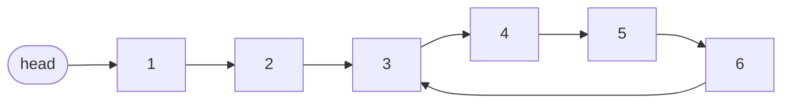
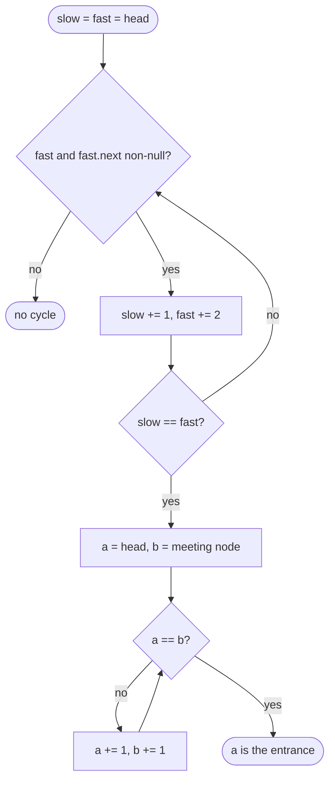

## Introduction

A normal singly linked list ends: the last node's `next` is `null`. But nothing in the `ListNode` class enforces that. If a bug — or a deliberate design — makes the last node point back at some earlier node, the list has a **cycle**. Every node is still reachable from the head, but a traversal that waits for `null` runs forever, and code that "counts the nodes" never returns.



In this list the first two nodes form a **tail** (sometimes called the stem) leading into the cycle, node `3` is the **entrance** — the first node of the cycle — and the cycle itself is `3 → 4 → 5 → 6 → 3`, of length 4.

**Cycle detection** answers three questions, in increasing difficulty: *Is there a cycle?* *Where does it start?* *How long is it?* The standard solution, **Floyd's cycle-finding algorithm** (the tortoise and hare), answers all three in O(n) time with only two pointers. It is one of the few algorithms that interviewers expect you not only to code but to *prove*, and its idea reaches far beyond linked lists: any process that repeatedly applies a function to its own output — a pseudo-random generator, an iterated digit sum, an array whose values are used as indices — is a linked list in disguise and can be checked for repetition the same way.

## Before you start

- **Singly linked lists** — node references and traversal. See [[a4-singly-linked-lists]].
- **Fast/slow pointers** — the two-speed loop and its guard `fast != null && fast.next != null`; that lesson also shows why the pointers cannot leapfrog. See [[a4-fast-slow-pointers]].
- **Hash sets** — O(1) average membership tests. See [[a1-hashset]].

## The intuition

Two runners start at the gate of a park whose path leads, after a while, into a loop that never exits. The slow runner walks; the fast runner jogs at twice the speed. If the path had an exit, the fast runner would reach it first and the question would be settled. In this park there is no exit, so both runners end up circling the loop — and since the fast one gains one step on the slow one every second, it eventually catches up from behind. *Meeting* proves there is a loop; *reaching the exit* proves there is not.

Finding the entrance is the surprising part. After they meet, send one runner back to the gate and have both walk at the same speed. They meet again exactly at the loop's entrance. The reason is a piece of arithmetic about distances, which we will derive properly rather than take on trust.

## The simple approach: remember what you have seen

The most direct method walks the list and records every node it visits in a `HashSet`. If it ever arrives at a node that is already in the set, the list loops, and that node is the entrance — the first node reached twice. If it reaches `null`, there is no cycle.

```java
static boolean hasCycleWithSet(ListNode head) {
    Set<ListNode> seen = new HashSet<>();      // identity: ListNode doesn't override equals
    for (ListNode cur = head; cur != null; cur = cur.next) {
        if (!seen.add(cur)) return true;        // add returns false if already present
    }
    return false;
}
```

This is correct, O(n) time on average, and easy to explain. Two details matter.

First, the set must hold **node references**, not values. A list like `1 → 2 → 1 → null` has a repeated *value* but no cycle. Storing `cur.val` would report a false cycle. Storing `cur` works here because `ListNode` does not override `equals` and `hashCode`, so `HashSet` falls back to object identity. If a node class *did* define value-based equality, you would need an identity-based set, such as `Collections.newSetFromMap(new IdentityHashMap<>())`.

Second, it costs **O(n) extra space** — one set entry per node, and a `HashSet` entry (an internal `HashMap` node plus a table slot) takes more memory than the `ListNode` it records. For interviews, the follow-up is always: "can you do it in O(1) space?"

## Floyd's algorithm, phase 1: is there a cycle?

### The procedure

```java
static ListNode meetingPoint(ListNode head) {
    ListNode slow = head, fast = head;
    while (fast != null && fast.next != null) {
        slow = slow.next;
        fast = fast.next.next;
        if (slow == fast) return slow;   // compare references
    }
    return null;                         // fast reached the end: no cycle
}
```

Both pointers start at the head. Each iteration moves `slow` one node and `fast` two. Returning the meeting node (rather than a boolean) lets phase 2 continue from it.

### Why it is correct

There are two cases.

**No cycle.** `fast` moves ahead of `slow` and stays ahead, so they never meet, and `fast` reaches `null` (or the last node) after about `n / 2` iterations. The method returns `null`. It cannot report a false cycle, because the comparison is on references, and in an acyclic list `fast` is always strictly ahead of `slow`.

**A cycle exists.** Let the tail have length **L** (the number of nodes before the entrance) and the cycle have length **C**. After `L` iterations, `slow` arrives at the entrance. `fast` arrived earlier and is somewhere in the cycle. Measure the distance `d` from `fast` *forward* to `slow` along the cycle, where `0 ≤ d < C`. Each iteration, `slow` moves one step further away and `fast` moves two steps closer, so `d` decreases by exactly one. After `d` more iterations it is zero: the pointers are on the same node. (If `d` is already zero when `slow` arrives, they meet on that very iteration; the one exception is `L = 0`, where both start on the head unchecked and meet after `C` iterations.) Because the gap shrinks by one, not two, `fast` cannot jump over `slow` — this is why the speeds are 1 and 2.

That argument also bounds the running time. Phase 1 takes `L` iterations to get `slow` into the cycle and at most `C` more to meet, so at most `L + C` iterations, which is at most `n`. In particular, **`slow` is caught within its first lap of the cycle**.

> [!WARNING] Start both pointers at the head
> Some code starts `fast` at `head.next` and checks `slow == fast` *before* moving. That variant still detects cycles correctly, but it shifts the meeting point by one, and phase 2 then stops one node away from the entrance. Start both at `head` and compare after moving.

## Floyd's algorithm, phase 2: where does the cycle start?

### The procedure

After phase 1 returns the meeting node, put one pointer back at the head, leave the other at the meeting point, and advance **both one step at a time**. The node where they meet is the entrance.

```java
static ListNode cycleStart(ListNode head) {
    ListNode meet = meetingPoint(head);
    if (meet == null) return null;
    ListNode a = head, b = meet;
    while (a != b) {          // both move at speed 1; they meet at the entrance
        a = a.next;
        b = b.next;
    }
    return a;
}
```

### The proof

Let the meeting point be **x** steps past the entrance, measured forwards around the cycle (`0 ≤ x < C`).

1. Say `slow` has taken `s` steps when they meet. `fast` has taken `2s`.
2. Both are on the same node, so the extra distance `fast` covered, `2s − s = s`, is a whole number of laps: `s` is a multiple of `C`.
3. `slow` stands `x` steps past the entrance, so `s = L + x + mC`, where `m` counts any full laps `slow` completed (at most one, and only in the `L = 0` case).
4. Combining the two: **`L + x` is a multiple of `C`**, say `L + x = kC` with `k ≥ 0`. Rearranged: **`L = kC − x`**.

Now read that equation as a statement about walking. A pointer at the meeting point is `x` steps past the entrance; walking `kC − x` steps undoes those `x` steps modulo whole laps, so it stands on the entrance (when `x > 0`, that is `C − x` steps to the entrance, then `k − 1` full laps). So **walking `L` steps from the meeting point lands on the entrance**. Walking `L` steps from the head also lands on the entrance, by the definition of `L`. Both pointers move at speed 1, so after exactly `L` steps both are at the entrance.

Could they meet *earlier*, before reaching the entrance? No: during the first `L` steps, the pointer from the head is still on the tail, outside the cycle, while the other pointer never leaves the cycle. Their first common node is therefore the entrance. If `L = 0` — the cycle includes the head — then `x` must be `0` too (`x` is a multiple of `C` and smaller than `C`), so the meeting point is the head itself, phase 2's loop body never runs, and the head is returned. Correct again.

### Checking it on the example

For `1 → 2 → 3 → 4 → 5 → 6 → (back to 3)`, `L = 2` and `C = 4`.

| Iteration | `slow` | `fast` | Note |
|---|---|---|---|
| start | 1 | 1 | |
| 1 | 2 | 3 | `fast` has entered the cycle |
| 2 | 3 | 5 | `slow` reaches the entrance; `fast` is 2 steps behind it around the cycle |
| 3 | 4 | 3 | gap now 1 |
| 4 | 5 | 5 | meet |

The meeting point `5` is `x = 2` steps past the entrance `3`. Check the equation: `L + x = 4 = 1 × C`, so `k = 1` and `L = C − x = 2`. Phase 2:

| Step | from head | from meeting point |
|---|---|---|
| start | 1 | 5 |
| 1 | 2 | 6 |
| 2 | 3 | 3 |

Both arrive at `3` after `L = 2` steps — the entrance.



## Cycle length and removing a cycle

Once you hold any node inside the cycle — the meeting point will do — the **cycle length** is the number of steps to walk around and return to it. That is one extra loop of at most `C` steps.

To **remove** the cycle, find the entrance with phase 2, then walk around the cycle from the entrance until you reach the node whose `next` is the entrance. That node closes the loop; set its `next` to `null`. Both operations are O(n) and O(1) space, and both are common follow-ups.

## Worked example

```java title="CycleDetection.java"
import java.util.HashSet;
import java.util.Set;

public class CycleDetection {

    static class ListNode {
        int val;
        ListNode next;
        ListNode(int val) { this.val = val; }
    }

    /** Builds a list from values; the last node links back to index pos (-1 = no cycle). */
    static ListNode build(int[] values, int pos) {
        ListNode[] nodes = new ListNode[values.length];
        for (int i = 0; i < values.length; i++) nodes[i] = new ListNode(values[i]);
        for (int i = 0; i + 1 < values.length; i++) nodes[i].next = nodes[i + 1];
        if (pos >= 0) nodes[values.length - 1].next = nodes[pos];
        return values.length == 0 ? null : nodes[0];
    }

    static boolean hasCycleWithSet(ListNode head) {
        Set<ListNode> seen = new HashSet<>();      // identity: ListNode doesn't override equals
        for (ListNode cur = head; cur != null; cur = cur.next) {
            if (!seen.add(cur)) return true;        // add returns false if already present
        }
        return false;
    }

    /** Phase 1 of Floyd: returns the meeting node, or null if the list ends. */
    static ListNode meetingPoint(ListNode head) {
        ListNode slow = head, fast = head;
        while (fast != null && fast.next != null) {
            slow = slow.next;
            fast = fast.next.next;
            if (slow == fast) return slow;
        }
        return null;
    }

    /** Phase 2: returns the first node of the cycle, or null if there is none. */
    static ListNode cycleStart(ListNode head) {
        ListNode meet = meetingPoint(head);
        if (meet == null) return null;
        ListNode a = head, b = meet;
        while (a != b) {          // both move at speed 1; they meet at the entrance
            a = a.next;
            b = b.next;
        }
        return a;
    }

    static int cycleLength(ListNode head) {
        ListNode meet = meetingPoint(head);
        if (meet == null) return 0;
        int length = 1;
        for (ListNode cur = meet.next; cur != meet; cur = cur.next) length++;
        return length;
    }

    /** Breaks the cycle so the list ends in null. */
    static void removeCycle(ListNode head) {
        ListNode start = cycleStart(head);
        if (start == null) return;
        ListNode last = start;
        while (last.next != start) last = last.next;   // the node that closes the loop
        last.next = null;
    }

    static String show(ListNode head) {
        StringBuilder sb = new StringBuilder();
        for (ListNode cur = head; cur != null; cur = cur.next) sb.append(cur.val).append(" -> ");
        return sb.append("null").toString();
    }

    public static void main(String[] args) {
        ListNode list = build(new int[]{1, 2, 3, 4, 5, 6}, 2);   // 6 links back to 3
        System.out.println("set says cycle: " + hasCycleWithSet(list));
        System.out.println("meeting point: " + meetingPoint(list).val);
        System.out.println("cycle start:   " + cycleStart(list).val);
        System.out.println("cycle length:  " + cycleLength(list));
        removeCycle(list);
        System.out.println("after removal: " + show(list));

        ListNode self = build(new int[]{9}, 0);                 // one node pointing at itself
        System.out.println("self-loop start: " + cycleStart(self).val
            + ", length " + cycleLength(self));
        ListNode whole = build(new int[]{1, 2, 3}, 0);          // tail links to head
        System.out.println("whole-list cycle start: " + cycleStart(whole).val);
        System.out.println("no cycle: " + cycleStart(build(new int[]{1, 2, 3}, -1))
            + ", empty: " + cycleStart(null));
    }
}
```

```output
set says cycle: true
meeting point: 5
cycle start:   3
cycle length:  4
after removal: 1 -> 2 -> 3 -> 4 -> 5 -> 6 -> null
self-loop start: 9, length 1
whole-list cycle start: 1
no cycle: null, empty: null
```

The edge cases at the end of `main` are the ones that break careless implementations. A **single node pointing at itself** is a cycle of length 1: `fast.next` is the node itself, so the guard passes and the pointers meet after one iteration. A single node whose `next` is `null` fails the guard immediately — no cycle. When the **whole list is the cycle** (`L = 0`), phase 2 starts with both pointers on the head and returns it without moving. An **empty list** fails the guard at once. Note that `show` is only called after `removeCycle` — printing a cyclic list with a `null`-terminated loop would never finish.

### Complexity

- **Time.** Phase 1 runs at most `L + C ≤ n` iterations; phase 2 runs exactly `L` iterations; the length and removal walks are at most `C` steps each. Every part is O(n), so the total is **O(n)**.
- **Space.** A handful of references: **O(1)**, compared with O(n) for the hash set.

## Implicit cycles: linked lists in disguise

Floyd's algorithm never uses anything about `ListNode` except "given a position, compute the next position". Anything with that shape works: a function `f`, a starting value `x₀`, and the sequence `x₀, f(x₀), f(f(x₀)), …`. If the values come from a finite set, the sequence *must* eventually repeat — there are only so many values — and once a value repeats, everything after it repeats too. So the sequence is always shaped like the list above: a tail, then a cycle. That shape is often drawn as the Greek letter rho (ρ).

### Happy Number

Replace a positive integer by the sum of the squares of its digits, and repeat. If the process reaches `1`, the number is **happy**; otherwise it loops forever without reaching `1`.

```text
19 -> 82 -> 68 -> 100 -> 1                                     happy
2 -> 4 -> 16 -> 37 -> 58 -> 89 -> 145 -> 42 -> 20 -> 4 -> 16   loops
```

Why must it either reach 1 or loop? For a number with `d` digits the next value is at most `81d`. For any number with four or more digits that is smaller than the number itself, so the sequence soon drops below 1,000 and stays in a finite range, where it must repeat. (`1` is itself a cycle of length 1, since `1² = 1`.) So "is it happy?" is "does the cycle this sequence falls into consist of `1`?" — a cycle-detection question, answerable in O(1) space with fast and slow values instead of pointers:

```java
static boolean isHappy(int n) {
    int slow = n, fast = digitSquareSum(n);
    while (fast != 1 && slow != fast) {
        slow = digitSquareSum(slow);
        fast = digitSquareSum(digitSquareSum(fast));
    }
    return fast == 1;
}
```

Here `fast` starts one step ahead so the loop condition is not true immediately. That is fine because we only need *whether* the sequence reaches 1, not where the cycle begins — the warning about starting positions applies only when you need phase 2. A `HashSet<Integer>` of seen values is an equally valid answer — the sequence visits only a small number of distinct values before repeating — and Floyd is the O(1)-space follow-up.

### Find the Duplicate Number

An array `nums` of length `n + 1` holds values from `1` to `n`, so by the pigeonhole principle some value repeats. Find it without modifying the array and with O(1) extra space. Sorting modifies the array; a hash set uses O(n) space; a nested loop is O(n²).

The trick is to read the array as a linked list: **index `i` points to index `nums[i]`**. Every value is a valid index (1 to `n`), so following the pointers never leaves the array, and since the array is finite, the walk from index 0 must end in a cycle. Two observations finish the argument:

- No value is `0`, so nothing points to index 0. Index 0 is therefore on the tail, never inside the cycle — a proper starting "head".
- The entrance of the cycle is a node with **two** incoming pointers: one from the tail and one from inside the cycle. Two indices pointing to the same index means two positions holding the same value — the duplicate.

So the duplicate is the cycle's entrance, and Floyd's two phases find it:

```java
static int findDuplicate(int[] nums) {
    int slow = nums[0], fast = nums[nums[0]];     // index i "points to" index nums[i]
    while (slow != fast) {
        slow = nums[slow];
        fast = nums[nums[fast]];
    }
    int a = 0, b = slow;                          // phase 2 from the start (index 0)
    while (a != b) {
        a = nums[a];
        b = nums[b];
    }
    return a;
}
```

Phase 1 here begins with both pointers already advanced once from index 0 (`slow` one step, `fast` two), which is the same as starting both at 0 and moving before the first comparison. Phase 2 therefore restarts from index 0, the head. On `[1, 3, 4, 2, 2]` the walk is `0 → 1 → 3 → 2 → 4 → 2 → …`: the tail is `0, 1, 3`, the cycle is `2 → 4 → 2`, and the entrance is `2`, the duplicate.

### A complete run

```java title="Implicit.java"
public class Implicit {

    static int digitSquareSum(int n) {
        int sum = 0;
        while (n > 0) {
            int d = n % 10;
            sum += d * d;
            n /= 10;
        }
        return sum;
    }

    /** A number is happy if repeatedly replacing it by its digit-square sum reaches 1. */
    static boolean isHappy(int n) {
        int slow = n, fast = digitSquareSum(n);
        while (fast != 1 && slow != fast) {
            slow = digitSquareSum(slow);
            fast = digitSquareSum(digitSquareSum(fast));
        }
        return fast == 1;
    }

    /** nums has n + 1 values, each in [1, n]; exactly one value repeats (possibly many times). */
    static int findDuplicate(int[] nums) {
        int slow = nums[0], fast = nums[nums[0]];     // index i "points to" index nums[i]
        while (slow != fast) {
            slow = nums[slow];
            fast = nums[nums[fast]];
        }
        int a = 0, b = slow;                          // phase 2 from the start (index 0)
        while (a != b) {
            a = nums[a];
            b = nums[b];
        }
        return a;
    }

    public static void main(String[] args) {
        System.out.println("19 happy? " + isHappy(19));
        System.out.println("2 happy?  " + isHappy(2));
        System.out.println("duplicate in [1,3,4,2,2]: " + findDuplicate(new int[]{1, 3, 4, 2, 2}));
        System.out.println("duplicate in [3,1,3,4,2]: " + findDuplicate(new int[]{3, 1, 3, 4, 2}));
        System.out.println("duplicate in [2,2,2,2,2]: " + findDuplicate(new int[]{2, 2, 2, 2, 2}));
    }
}
```

```output
19 happy? true
2 happy?  false
duplicate in [1,3,4,2,2]: 2
duplicate in [3,1,3,4,2]: 3
duplicate in [2,2,2,2,2]: 2
```

The last case, where one value fills the whole array, is worth tracing by hand: index 0 points to 2, and index 2 points to itself — a tail of length 1 and a self-loop at the duplicate.

## In real systems

**Pseudo-random number generators.** A generator with finite internal state must eventually repeat, and the cycle length is its **period**. Floyd's and Brent's algorithms measure periods without storing the sequence, which is impractical when it is billions of values long.

**Integer factorisation and cryptanalysis.** Pollard's rho algorithm factors integers by iterating a polynomial modulo `n` and using cycle detection to find a collision; the "rho" is the shape of the sequence. Similar collision-finding is used to attack hash functions and discrete logarithms.

**Defensive traversal.** Code that follows references it did not create — symbolic links, HTTP redirects, `parent` pointers in a tree read from untrusted data, foreign-key chains in a database — must not loop forever on a cycle. In practice this is usually done with a visited set or a hop limit (Linux gives up resolving symbolic links after a fixed number of hops), because those also report *where* the problem is; Floyd's O(1)-space approach matters when the structure is huge or memory is tight.

**Deadlock and dependency checks** look for cycles too, but in *graphs* where a node can have several outgoing edges. Floyd's algorithm does not apply there; a depth-first search that tracks nodes on the current path does. Keep the distinction clear: Floyd works when every node has exactly one successor.

## Trade-offs and alternatives

| Method | Time | Extra space | Finds entrance? | Notes |
|---|---|---|---|---|
| Hash set of visited nodes | O(n) average | O(n) | Yes — first repeat | Simplest; works for any "next" function |
| Floyd (tortoise and hare) | O(n) | O(1) | Yes, with phase 2 | Interview standard; needs the proof |
| Brent's algorithm | O(n) | O(1) | Yes, with a second pass | Fewer steps in practice; gives cycle length directly |
| Mark visited nodes (change a field) | O(n) | O(1) | Yes | Mutates the input — usually not allowed |
| Count steps and give up after a limit | O(limit) | O(1) | No | Practical safety net, not a proof |

**Brent's algorithm** is worth knowing by name. Instead of moving both pointers, it keeps the slow pointer still and moves the fast pointer one step at a time, "teleporting" the slow pointer to the fast pointer's position whenever the number of steps reaches the next power of two. It still uses O(1) space, computes the cycle length as a by-product, and typically evaluates the next-function fewer times than Floyd, which matters when that function is expensive.

In everyday code, choose the hash set unless memory is a concern; in interviews, offer the hash set first, then improve to Floyd and explain the proof.

## Common mistakes

> [!MISTAKE] Assuming the meeting point is the entrance
> The pointers meet *somewhere* inside the cycle — node `5` in the example, not the entrance `3`. Finding the entrance always needs phase 2.

**Comparing values instead of references.** `slow.val == fast.val` reports a cycle whenever two different nodes share a value. Compare nodes with `==`. The same goes for the hash set: store nodes, not values.

**Skipping the null checks.** `fast.next.next` on a list that ends throws `NullPointerException` unless both `fast` and `fast.next` were checked first.

**Running phase 2 without a cycle.** If phase 1 ended because `fast` reached the end, there is no meeting node. Return `null` before starting phase 2.

**Changing the start positions.** Starting `fast` one step ahead is fine for a yes/no answer but breaks the entrance arithmetic. If you need the entrance, start both at the head (or, as in the array version, advance both once before the first comparison).

**Printing or measuring a cyclic list.** Any `while (cur != null)` loop on a cyclic list never ends. Detect first, then traverse with the cycle in mind.

## Interview perspective

*Linked List Cycle* and *Linked List Cycle II* are among the most common linked-list questions, and the second is a favourite precisely because it tests understanding: the code is ten lines, but "why does resetting one pointer work?" separates memorisation from reasoning.

> [!INTERVIEW] Explaining phase 2 in thirty seconds
> "Say the tail has length L, the cycle has length C, and they meet x steps into the cycle. Slow has walked L + x, fast 2(L + x), and the difference is whole laps, so L + x is a multiple of C. That means walking L more steps from the meeting point brings you back to the entrance. A pointer from the head also reaches the entrance after L steps, so moving both at speed one, they meet exactly there."

Questions to be ready for:

- **Detect a cycle.** Hash set first, then Floyd in O(1) space; state O(n) time.
- **Return the entrance.** Phase 2, with the proof above.
- **Why speeds 1 and 2?** The gap closes by one per step, so the pointers must land on the same node, and slow is caught within its first lap.
- **Cycle length.** Walk from the meeting point until you return to it.
- **Find the duplicate number in O(1) space without modifying the array.** Index-as-pointer, the entrance is the duplicate.
- **Happy number.** Iterate the digit-square sum; detect the cycle with a set or with Floyd.

## Practice

1. **Linked list cycle.** Return whether a cycle exists, once with a set and once with Floyd.
2. **Linked list cycle II.** Return the entrance node; test a self-loop and a cycle that includes the head.
3. **Cycle length and removal.** Extend your solution to return the cycle's length and then break the cycle.
4. **Happy number.** Solve with a `HashSet<Integer>`, then with Floyd.
5. **Find the duplicate number.** O(1) extra space, array unchanged. Explain why index 0 is outside the cycle.
6. **Circular array loop.** An array of jumps where each index points to `(i + nums[i]) mod n`; detect a cycle that moves in one direction only. This combines index-as-pointer with extra validity rules.

The DSA explorer lists the matching problems under this topic; start with *Linked List Cycle* and *Linked List Cycle II*.

```quiz
Q: In the list 1 → 2 → 3 → 4 → 5 → 6 → (back to 3), Floyd's pointers meet at node 5. What does phase 2 return, and why?
- [ ] 5, because the meeting point is the entrance
- [x] 3, because walking L = 2 steps from the head and from node 5 both arrive at the entrance
- [ ] 1, because phase 2 restarts at the head
- [ ] 6, because it is the node that closes the loop
> The meeting point is x = 2 steps past the entrance and L + x = 4 = C, so L = C − x = 2. From node 5, two steps reach 3; from the head, two steps also reach 3. Node 6 is the node you would rewire to remove the cycle, not the entrance.

Q: Why must a hash-set cycle detector store node references rather than node values?
- [ ] Because values cannot be stored in a HashSet
- [ ] Because references use less memory
- [x] Because different nodes can share a value, so a repeated value does not mean the walk revisited a node
- [ ] Because Floyd's algorithm requires it
> The list 1 → 2 → 1 → null has no cycle but repeats the value 1. A cycle means returning to the same node object, which only reference identity can detect.

Q: In Find the Duplicate Number, why is the duplicate value the entrance of the cycle?
- [ ] Because the duplicate is always at index 0
- [ ] Because the array is sorted
- [x] Because the entrance is the only node with two incoming pointers, and two indices pointing to the same index means two equal values
- [ ] Because fast and slow first meet at the duplicate
> With index i pointing to index nums[i], the entrance is reached both from the tail and from the end of the cycle. Two different indices i and j with nums[i] == nums[j] is exactly the repeated value. The first meeting point is generally somewhere else in the cycle, which is why phase 2 is needed.
```

## Quick revision {#quick-revision}

- Cycle: following `next` never reaches `null`. Shape: tail of length L, then a cycle of length C; the entrance is the cycle's first node.
- Hash set: add each node; first node already present is the entrance. O(n) time, O(n) space. Store references, not values.
- Floyd phase 1: both start at head; slow +1, fast +2; guard `fast != null && fast.next != null`; meet (`==`) ⇒ cycle, end ⇒ none.
- Inside the cycle the gap shrinks by 1 per step ⇒ no leapfrogging; slow is caught within its first lap; phase 1 ≤ L + C steps.
- Phase 2: one pointer at head, one at meeting point, both +1; they meet at the entrance.
- Proof: `L + x = kC` ⇒ `L = (k − 1)C + (C − x)`.
- Length: walk from the meeting point back to itself. Removal: find entrance, walk to the node whose `next` is the entrance, set it to `null`.
- Implicit cycles: any `x → f(x)` over a finite set (Happy Number; Find the Duplicate with `i → nums[i]`, entrance = duplicate).
- Floyd needs exactly one successor per node; general graphs need depth-first search.

## Key takeaways {#key-takeaways}

- A linked list with a cycle never reaches `null`, so cycle detection is about learning the list's shape without an infinite traversal.
- A hash set of visited nodes is the simplest correct answer; Floyd's tortoise and hare gives the same result in O(1) space.
- The pointers must meet because inside the cycle the gap between them shrinks by exactly one each step.
- Phase 2 works because the tail length L equals the distance from the meeting point forward to the entrance, plus whole laps.
- The meeting point is not the entrance; always run phase 2 when the problem asks where the cycle begins.
- Any repeated function application over a finite set forms the same tail-plus-cycle shape, which is why the algorithm solves problems like Happy Number and Find the Duplicate Number.
