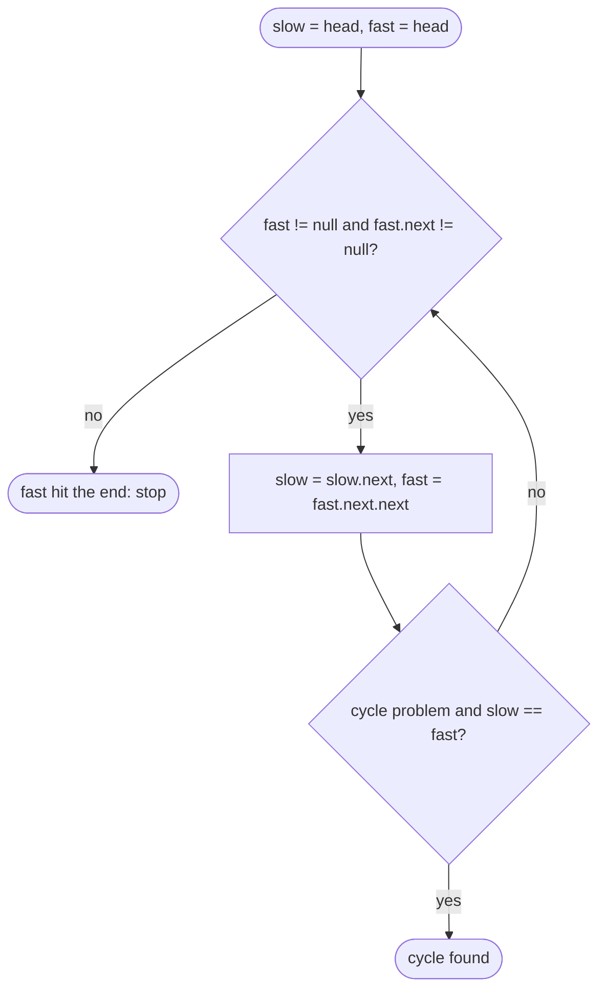

## Introduction

A singly linked list has no length field and no index. If you are asked for its middle node, the obvious method takes two passes: walk the whole list to count `n` nodes, then walk again `n / 2` steps. That is O(n) time, which is fine, but it reads every node twice and it needs the length before it can start.

**Fast/slow pointers** answer the same question in a single pass. Two references start at the head. Each round, the **slow** pointer moves one node and the **fast** pointer moves two. When the fast pointer reaches the end, it has travelled twice as far as the slow one — so the slow pointer is standing at the halfway point. The relationship between the two pointers measures the list for you while you walk it.

The same idea, two pointers with a deliberately chosen relationship, solves a family of problems:

- **Different speeds** (slow +1, fast +2): find the middle, split a list in half, and detect whether the list loops back on itself.
- **Fixed gap** (both +1, but one starts `n` nodes ahead): find or remove the nth node from the end.

The technique is also called the **tortoise and hare**, after the cycle-detection algorithm credited to Robert Floyd. It matters because linked-list problems usually demand O(1) extra space — copying nodes into an array would make most of them trivial — and fast/slow pointers are the main tool for learning about a list's shape without extra memory.

## Before you start

- **Singly linked lists** — the `ListNode` class, traversal and the dummy-node habit. See [[a4-singly-linked-lists]].
- **Two pointers on arrays** — moving two indices through a sequence according to a rule. See [[a2-two-pointers]]; the linked-list version is the same idea without random access.
- **Big-O notation** — see [[a1-time-complexity]].

## The intuition

Two runners start together at one end of a straight track. One runs at exactly twice the speed of the other. At the moment the fast runner crosses the far end, where is the slow runner? Exactly halfway. Nobody needed to know the track's length in advance; the ratio of their speeds did the measuring.

Now bend the track into a loop. The fast runner never crosses an end, because there is none. Instead, after both have entered the loop, the fast runner gains ground every second and eventually comes up behind the slow runner and draws level. So the same two runners answer a second question: *does this track end, or does it loop?* If the fast runner ever reaches an end, it does not loop. If the two ever meet, it does.

The analogy is accurate in one important way and misleading in another. It is accurate that the meeting depends only on the *relative* speed. It is misleading in that real pointers move in whole nodes, not continuously, so you might worry that the fast pointer could jump *over* the slow one without landing on it. With speeds 1 and 2 that cannot happen, for a reason explained below.

## Finding the middle

### The algorithm and its invariant

```java
ListNode slow = head, fast = head;
while (fast != null && fast.next != null) {
    slow = slow.next;
    fast = fast.next.next;
}
return slow;
```

The reasoning is a simple invariant: **after `k` iterations, `slow` is at position `k` and `fast` is at position `2k`** (counting the head as position 0). The loop stops when the fast pointer cannot take another double step — when `fast` is `null` (it fell off the end) or `fast.next` is `null` (it is on the last node). At that moment `2k` is about `n`, so `k` is about `n / 2`.

### Why the guard has two halves

The guard `fast != null && fast.next != null` is not decoration; each half prevents a different `NullPointerException`.

- The statement `fast = fast.next.next` reads `fast.next`, so `fast` must not be `null`.
- It then reads `.next` of `fast.next`, so `fast.next` must not be `null` either.

Java's `&&` evaluates left to right and stops at the first `false`, so `fast.next` is only read after `fast != null` has been confirmed. Swapping the order to `fast.next != null && fast != null` crashes on an even-length list, where `fast` becomes `null` exactly.

Which half ends the loop tells you the list's parity: on an odd-length list the loop ends with `fast` on the last node (`fast.next == null`); on an even-length list it ends with `fast == null`.

### Dry run on odd and even lengths

On `1 → 2 → 3 → 4 → 5`:

| Iteration | `slow` | `fast` | Can `fast` move twice? |
|---|---|---|---|
| start | 1 | 1 | yes |
| 1 | 2 | 3 | yes |
| 2 | 3 | 5 | no — `fast.next` is `null` |

Result: `3`, the unique middle.

On `1 → 2 → 3 → 4 → 5 → 6`:

| Iteration | `slow` | `fast` | Can `fast` move twice? |
|---|---|---|---|
| start | 1 | 1 | yes |
| 1 | 2 | 3 | yes |
| 2 | 3 | 5 | yes — `5.next` is `6` |
| 3 | 4 | `null` | no — `fast` is `null` |

Result: `4`. An even-length list has two middles, `3` and `4`, and this version returns the **second middle**.

### Choosing the first middle instead

Some problems need the *first* middle — usually because you are about to split the list and want `slow` to be the last node of the first half, so you can cut with `slow.next = null`. Change the guard so the fast pointer stops one double step earlier:

```java
ListNode slow = head, fast = head;
while (fast.next != null && fast.next.next != null) {   // head must not be null
    slow = slow.next;
    fast = fast.next.next;
}
return slow;   // last node of the first half
```

On `1 … 6` this stops at `3`; on `1 … 5` it still returns `3`. With an odd length, the middle node belongs to the first half, so the second half is never longer than the first — a property the palindrome check below relies on.

| Variant | Guard | Even length (1…6) | Odd length (1…5) | Typical use |
|---|---|---|---|---|
| Second middle | `fast != null && fast.next != null` | 4 | 3 | "Return the middle node" |
| First middle / end of first half | `fast.next != null && fast.next.next != null` | 3 | 3 | Splitting for merge sort, palindrome, reorder |

Rather than memorising the table, trace both guards on a list of length 2 and length 3 whenever you are unsure. Four nodes of tracing settles the question.

### Complexity

The fast pointer visits at most `n` nodes and the loop runs about `n / 2` times, so time is **O(n)**. Two references are the only extra storage, so space is **O(1)**. Be honest about what the single pass buys. It does not save work: the two-pass method follows about `n + n/2` references, and so do the two pointers together (`n` for fast, `n/2` for slow). What it buys is structure — the answer emerges while walking, with no length needed in advance — and that structure extends to problems where counting first is impossible, such as a list that might never end.

## Fixed gap: the nth node from the end

### Deriving the idea

To remove the 2nd node from the end of `1 → 2 → 3 → 4 → 5` (the node `4`), you need to stand on its predecessor, `3`. Counting first works: length 5, so the predecessor is at position `5 − 2 − 1 = 2`. But there is a one-pass method that comes from asking: *what relationship between two pointers would leave one on the predecessor exactly when the other reaches the end?*

If the **lead** pointer is `n + 1` links ahead of the **trail** pointer and both move one step at a time, the gap never changes. When `lead` falls off the end (becomes `null`), `trail` is `n + 1` links behind `null` — which is precisely the node before the nth from the end.

Starting both pointers at a dummy node in front of the head makes this work even when the node to remove *is* the head: then `trail` stays on the dummy, and the dummy's `next` is rewired.

```java
static ListNode removeNthFromEnd(ListNode head, int n) {   // 1 <= n <= length
    ListNode dummy = new ListNode(0, head);
    ListNode lead = dummy, trail = dummy;
    for (int i = 0; i <= n; i++) lead = lead.next;   // gap of n + 1 links
    while (lead != null) {
        lead = lead.next;
        trail = trail.next;
    }
    trail.next = trail.next.next;                    // trail is just before the target
    return dummy.next;
}
```

### Dry run

Remove the 2nd from the end of `1 → 2 → 3 → 4 → 5` (`D` is the dummy). The `for` loop moves `lead` three times, from `D` to `3`.

| Step | `trail` | `lead` | Gap in links |
|---|---|---|---|
| after setup | D | 3 | 3 |
| 1 | 1 | 4 | 3 |
| 2 | 2 | 5 | 3 |
| 3 | 3 | `null` | 3 |

`trail` is on `3`, and `trail.next = trail.next.next` removes `4`. Result: `1 → 2 → 3 → 5`.

The off-by-one is where people slip. The loop runs `n + 1` times (`i = 0` through `i = n`), not `n`, because we want `trail` to stop *before* the target. With only `n` steps of head start, `trail` lands *on* the target, and in a singly linked list you cannot delete the node you stand on.

## Palindrome check: middle plus reversal

A list is a **palindrome** if it reads the same forwards and backwards, like `1 → 2 → 3 → 2 → 1`. With an array you would compare `a[i]` with `a[n − 1 − i]`, but a singly linked list cannot walk backwards. Copying the values into an array works in O(n) extra space. The O(1)-space method combines three steps:

1. Find the end of the first half with the first-middle variant.
2. Reverse the second half in place (taught in [[a4-reversal]]).
3. Walk both halves together, comparing values. Then reverse the second half back so the caller's list is unchanged.

Step 3's loop runs while the *second-half* pointer is not `null`. Because the first-middle variant puts an odd-length list's centre node in the first half, the second half is never longer, and the centre node is correctly never compared with anything.

## Worked example

```java title="FastSlow.java"
public class FastSlow {

    static class ListNode {
        int val;
        ListNode next;
        ListNode(int val) { this.val = val; }
        ListNode(int val, ListNode next) { this.val = val; this.next = next; }
    }

    static ListNode fromArray(int... values) {
        ListNode dummy = new ListNode(0), tail = dummy;
        for (int v : values) { tail.next = new ListNode(v); tail = tail.next; }
        return dummy.next;
    }

    static String show(ListNode head) {
        StringBuilder sb = new StringBuilder();
        for (ListNode cur = head; cur != null; cur = cur.next) sb.append(cur.val).append(" -> ");
        return sb.append("null").toString();
    }

    /** Middle node; for even length returns the second of the two middles. */
    static ListNode middle(ListNode head) {
        ListNode slow = head, fast = head;
        while (fast != null && fast.next != null) {
            slow = slow.next;
            fast = fast.next.next;
        }
        return slow;
    }

    /** End of the first half; for even length returns the first of the two middles. */
    static ListNode endOfFirstHalf(ListNode head) {
        ListNode slow = head, fast = head;
        while (fast.next != null && fast.next.next != null) {
            slow = slow.next;
            fast = fast.next.next;
        }
        return slow;
    }

    /** Removes the nth node from the end (1 = last). Assumes 1 <= n <= length. */
    static ListNode removeNthFromEnd(ListNode head, int n) {
        ListNode dummy = new ListNode(0, head);
        ListNode lead = dummy, trail = dummy;
        for (int i = 0; i <= n; i++) lead = lead.next;   // gap of n + 1 links
        while (lead != null) {
            lead = lead.next;
            trail = trail.next;
        }
        trail.next = trail.next.next;                    // trail is just before the target
        return dummy.next;
    }

    static ListNode reverse(ListNode head) {
        ListNode prev = null, cur = head;
        while (cur != null) {
            ListNode next = cur.next;
            cur.next = prev;
            prev = cur;
            cur = next;
        }
        return prev;
    }

    static boolean isPalindrome(ListNode head) {
        if (head == null || head.next == null) return true;
        ListNode firstEnd = endOfFirstHalf(head);
        ListNode secondStart = reverse(firstEnd.next);

        boolean result = true;
        ListNode p = head, q = secondStart;
        while (q != null) {                 // second half is never longer than the first
            if (p.val != q.val) { result = false; break; }
            p = p.next;
            q = q.next;
        }
        firstEnd.next = reverse(secondStart);  // restore the caller's list
        return result;
    }

    public static void main(String[] args) {
        System.out.println(middle(fromArray(1, 2, 3, 4, 5)).val);
        System.out.println(middle(fromArray(1, 2, 3, 4, 5, 6)).val);
        System.out.println(endOfFirstHalf(fromArray(1, 2, 3, 4, 5, 6)).val);
        System.out.println(middle(fromArray(7)).val);

        System.out.println(show(removeNthFromEnd(fromArray(1, 2, 3, 4, 5), 2)));
        System.out.println(show(removeNthFromEnd(fromArray(1, 2, 3), 3)));
        System.out.println(show(removeNthFromEnd(fromArray(1), 1)));

        ListNode p = fromArray(1, 2, 3, 2, 1);
        System.out.println(isPalindrome(p) + "  " + show(p));
        ListNode q = fromArray(1, 2, 2, 1);
        System.out.println(isPalindrome(q) + "  " + show(q));
        ListNode r = fromArray(1, 2, 3, 1);
        System.out.println(isPalindrome(r) + "  " + show(r));
    }
}
```

```output
3
4
3
7
1 -> 2 -> 3 -> 5 -> null
2 -> 3 -> null
null
true  1 -> 2 -> 3 -> 2 -> 1 -> null
true  1 -> 2 -> 2 -> 1 -> null
false  1 -> 2 -> 3 -> 1 -> null
```

The edge cases in `main` are the ones interviewers probe. A single-node list's middle is that node. Removing the 3rd from the end of a 3-node list removes the head, which works only because `trail` started on the dummy. Removing the only node returns an empty list. The palindrome calls print each list after the check, showing that the restore step left them exactly as they were — mutating an input you were only asked to inspect is a correctness problem in real code, and a point interviewers notice.

Trace `isPalindrome(1 → 2 → 2 → 1)`: `endOfFirstHalf` returns the first `2`; reversing `2 → 1` gives `1 → 2`; the comparison walks `1 = 1`, `2 = 2`, then `q` becomes `null` and the result is `true`. Time is O(n) — one half-pass to find the middle, two reversals of n/2 nodes and one comparison pass — and extra space is O(1).

## Cycles: the same pointers, a different question

If a list's last node points back to an earlier node instead of `null`, the list has a **cycle**, and an ordinary traversal never ends. Run the middle-finding loop on such a list and the guard never becomes false, because `fast` never reaches `null`. Add one check inside the loop and the pointers become a cycle detector:

```java
static boolean hasCycle(ListNode head) {
    ListNode slow = head, fast = head;
    while (fast != null && fast.next != null) {
        slow = slow.next;
        fast = fast.next.next;
        if (slow == fast) return true;   // same node object, not equal values
    }
    return false;                        // fast reached the end: no cycle
}
```

Why must they meet, and why can the fast pointer not skip over the slow one? Once both are inside the cycle, measure the distance from `fast` forward to `slow`. Each iteration, `slow` moves away by one and `fast` closes in by two, so the distance shrinks by exactly **one** per iteration. A distance that decreases one at a time must pass through zero, so the pointers land on the same node — they cannot jump past each other. With speeds 1 and 3 the gap would shrink by two per step, and whether it hits zero would depend on parity; that is why 1 and 2 is the standard choice.

The comparison is `slow == fast` — reference equality. Two different nodes holding equal values do not mean a cycle. The full treatment, including how to find the node where the cycle begins and why the second phase of Floyd's algorithm works, is in [[a4-cycle-detection]].



## Recognising the pattern

Reach for fast/slow pointers when a linked-list problem asks about a position defined *relative to the length* or *relative to the end*, and you are expected to use O(1) extra space:

- "Return the middle node", "split the list into two halves" — speeds 1 and 2.
- "The kth node from the end", "remove the nth node from the end", "rotate the list by k" — fixed gap.
- "Is the list a palindrome?", "reorder `L0 → Ln → L1 → Ln−1 …`" — find the middle, reverse the second half, then compare or interleave.
- "Does the list loop?", "where does the loop start?" — speeds 1 and 2 with a meeting check.
- Sequences produced by a function, such as repeatedly summing the squares of a number's digits (*Happy Number*), or an array whose values can be read as "next index" (*Find the Duplicate Number*) — these are linked lists in disguise and are covered in [[a4-cycle-detection]].

Fast/slow pointers do not help on arrays when you can index directly — `a[n / 2]` is already O(1) — unless the array is being used as an implicit linked list.

## In real systems

The middle-finding split is the first step of **merge sort on a linked list**, which is the standard way to sort linked data in O(n log n) time: split at the middle, sort each half recursively, then merge (see [[a4-merge-lists]] and [[a3-merge-sort]]). Merge sort suits linked lists because merging needs no random access.

Cycle detection with two speeds appears in tools that follow references they did not create: detecting loops in chains of symbolic links or redirects, sanity-checking linked structures read from corrupted data, and finding the period of pseudo-random number generators, where Pollard's rho factorisation algorithm uses Floyd's method to find repeats in a sequence without storing it.

The fixed-gap idea shows up wherever you need "the last k items" from a stream that you can traverse only once, though production code more often uses a ring buffer of size k for that.

## Trade-offs and alternatives

| Approach | Time | Extra space | Notes |
|---|---|---|---|
| Count, then walk to the target | O(n), two passes | O(1) | Simple and correct; fails on lists that may be cyclic |
| Copy nodes into an `ArrayList` | O(n) | O(n) | Makes middle, nth-from-end and palindrome trivial; interviewers usually forbid it |
| Fast/slow or fixed gap | O(n), one pass | O(1) | Standard answer; needs careful guards |
| Recursion (e.g. palindrome via call stack) | O(n) | O(n) stack | Elegant but not O(1) space, and deep recursion risks `StackOverflowError` |

The two-pass count is a perfectly good answer in production code. The one-pass versions matter in interviews and in situations where the list might not end, where counting would never finish.

## Common mistakes

> [!MISTAKE] Guarding only `fast.next`
> `while (fast.next != null)` crashes on an empty list, and `while (fast.next != null && fast != null)` crashes when `fast` becomes `null` on an even-length list. Check `fast != null` first, then `fast.next != null`.

**Returning the wrong middle.** The second-middle and first-middle variants differ only on even lengths, which is why a test on `1 → 2 → 3` passes while the split for merge sort silently fails. Trace both a length-2 and a length-3 list.

**Gap off by one.** For removal you need the node *before* the nth from the end, so the lead pointer needs `n + 1` links of head start from a dummy. Check against `n` equal to the length (removing the head).

**Forgetting the dummy.** Starting `trail` at `head` makes it impossible to remove the head itself, because there is no node before it to rewire.

**Comparing values in cycle detection.** `slow.val == fast.val` reports false cycles whenever two nodes share a value. Compare references.

**Leaving the input mutated.** The palindrome check reverses half the list. If the problem only asks a yes/no question, restore the list before returning.

## Interview perspective

Interviewers use these problems to see whether you can reason about pointer positions instead of guessing. Say the invariant out loud: "after k steps slow is at k and fast is at 2k", or "the gap stays n + 1 links, so when lead is null, trail is immediately before the target".

> [!INTERVIEW] Explain the guard and the parity
> "I loop while `fast` and `fast.next` are both non-null, since the double step reads both. On an odd length it stops with fast on the last node and slow on the true middle; on an even length fast becomes null and slow is on the second middle. If I need the first middle for a split, I check `fast.next` and `fast.next.next` instead."

Common questions and the reasoning behind good answers:

- **Middle of the linked list.** Speeds 1 and 2; be ready to state which middle you return and how to get the other.
- **Remove the nth node from the end in one pass.** Dummy, lead `n + 1` ahead, move together, unlink `trail.next`.
- **Palindrome linked list in O(1) space.** Find the end of the first half, reverse the second half, compare, restore.
- **Reorder list.** Same split and reversal, then interleave the halves — a combination of this lesson, [[a4-reversal]] and [[a4-merge-lists]].
- **Follow-up: why speeds 1 and 2?** The gap inside a cycle shrinks by exactly one per step, so the pointers must coincide rather than leapfrog.

## Practice

1. **Middle of the linked list.** Return the second middle; then modify it to return the first.
2. **Remove nth node from end.** Do it in one pass; test `n = 1` and `n = length`.
3. **Palindrome linked list.** O(n) time and O(1) extra space, leaving the list unchanged.
4. **Reorder list.** Turn `1 → 2 → 3 → 4 → 5` into `1 → 5 → 2 → 4 → 3` in place.
5. **Rotate list.** Rotate right by `k`, where `k` may exceed the length. Hint: you need the length anyway for `k % n`, so think about which pointer trick still helps.
6. **Linked list cycle.** Detect a cycle; then continue with [[a4-cycle-detection]] to find its start.

The DSA explorer lists the matching problems under this topic; start with *Middle of the Linked List* and *Remove Nth Node From End of List*.

```quiz
Q: On the list `1 → 2 → 3 → 4`, the loop `while (fast != null && fast.next != null)` with slow +1 and fast +2 ends with `slow` on which node?
- [ ] 2
- [x] 3
- [ ] 4
- [ ] It throws `NullPointerException`
> Iteration 1 puts slow on 2 and fast on 3; fast.next is 4, so iteration 2 runs and puts slow on 3 and fast on null. That guard returns the second middle on even lengths. The first-middle guard (`fast.next != null && fast.next.next != null`) would stop at 2.

Q: To remove the nth node from the end in one pass, starting both pointers at a dummy node, how many steps of head start does the lead pointer need?
- [ ] n − 1
- [ ] n
- [x] n + 1
- [ ] 2n
> When lead becomes null, trail is as many links behind null as the head start. The nth node from the end is n links behind null, and we must stop one node earlier, on its predecessor, so the head start is n + 1. The dummy makes this work even when the target is the head.

Q: Why can the fast pointer (speed 2) never jump over the slow pointer (speed 1) inside a cycle?
- [ ] Because the cycle always has an even length
- [ ] Because fast checks `fast.next == slow` before moving
- [x] Because the distance from fast to slow shrinks by exactly one per iteration, so it must reach zero
- [ ] Because both pointers start inside the cycle
> Each iteration slow moves 1 away and fast moves 2 closer, a net change of one. A whole number decreasing by one each step cannot skip zero, so the pointers land on the same node. With speeds 1 and 3 the gap shrinks by two and could skip zero on the first lap.
```

## Quick revision {#quick-revision}

- Two references with a fixed speed ratio (1 and 2) or a fixed gap measure the list in one pass with O(1) space.
- Middle: `while (fast != null && fast.next != null) { slow = slow.next; fast = fast.next.next; }` returns the second middle on even lengths.
- First middle / end of first half: `while (fast.next != null && fast.next.next != null)`; requires a non-null head.
- Guard order matters: check `fast != null` before `fast.next`.
- Nth from end: dummy, lead `n + 1` ahead, move both until lead is `null`, then `trail.next = trail.next.next`.
- Palindrome: end of first half → reverse second half → compare while second pointer non-null → restore.
- Cycle: meet (`slow == fast`, references) ⇒ cycle; fast reaches `null` ⇒ none. Gap shrinks by 1 per step, so no leapfrogging.
- All variants: O(n) time, O(1) extra space.

## Key takeaways {#key-takeaways}

- A fixed relationship between two pointers — a speed ratio or a gap — reveals positions relative to the length or the end without measuring the list first.
- The guard `fast != null && fast.next != null` exists because the double step reads both references; the order of the checks matters.
- On even lengths there are two middles, and the guard you choose decides which one you get; pick deliberately based on what comes next.
- For "nth from the end", a head start of `n + 1` from a dummy leaves the trailing pointer on the predecessor, which is the node you need to rewire.
- Middle-finding plus in-place reversal solves palindrome and reorder problems in O(1) extra space; restore inputs you were only meant to inspect.
- The same two speeds detect cycles, because inside a loop the gap shrinks by exactly one each step.
