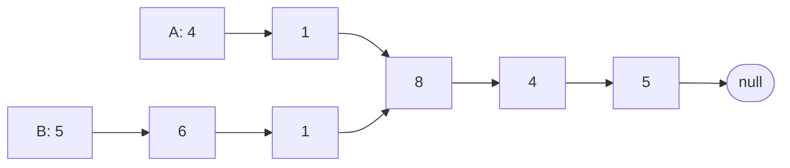

## Introduction

Two linked lists usually have nothing to do with each other. But it is possible for two different heads to lead, after some steps, into the *same* chain of nodes:



List A is `4 → 1 → 8 → 4 → 5` and list B is `5 → 6 → 1 → 8 → 4 → 5`, but the last three nodes are not copies — they are the same three objects in memory, reachable from both heads. The two lists **intersect**, and the **intersection node** is the first shared node, `8`. The problem is to find that node, or return `null` if the lists share nothing, without modifying either list.

This looks like a narrow puzzle, but the structure is common. Immutable data structures share tails on purpose: prepending to an immutable list creates a new head that points at the old list, so many lists can share one tail. Version histories, where every commit points to its parent, form the same shape when two branches fork from a common commit. And in a tree where each node points to its parent, the **lowest common ancestor** of two nodes is exactly the intersection of the two paths up to the root. The techniques in this lesson solve all of these.

## Before you start

- **Singly linked lists** — node references, traversal, and the difference between a node and its value. See [[a4-singly-linked-lists]].
- **Hash sets** — O(1) average membership tests. See [[a1-hashset]].
- **Two pointers** — moving two cursors according to a rule. See [[a2-two-pointers]].

## The intuition

Two hiking trails start at different car parks and eventually merge into one trail that leads to the summit. Two hikers start at the same moment, one from each car park, walking at the same speed. If both trails are the same length before the merge, the hikers reach the merge point together. If one approach is three kilometres longer, the hiker on it arrives three kilometres late.

There are two ways to make them arrive together. One: let the hiker on the shorter trail wait, or equivalently drive the other hiker three kilometres forward before starting — **align the starting distances**. Two: when each hiker reaches the summit, teleport them to the *other* car park and let them walk again. Each then walks "my approach + shared trail + your approach", the same total for both, so on the second pass they reach the merge point at the same moment. Both ideas become algorithms below.

## Why the shape is always a Y

A node in a singly linked list has exactly one `next` reference. Suppose node `X` belongs to both lists. Then `X.next` is the same node whichever list you came from, and so is `X.next.next`, and so on to the end. **Once two lists share a node, they share every node after it.** They cannot meet and then separate again, because that would require one node to have two different successors.

So intersecting lists always look like a Y — two separate prefixes, then one shared tail ending in `null` — and never like an X. This fact is the foundation of every efficient solution: it means the shared part is always at the *end*, so the intersection node is the same distance from the end in both lists. It also gives a quick test for whether lists intersect at all: they intersect if and only if their **last nodes are the same object**.

## Identity, not value

In the example, both lists contain a node with value `1` — A's second node and B's third node — but they are *different* nodes. The intersection is `8`, the first node that is literally the same object in both lists. In Java that is a reference comparison, `a == b`, not a value comparison, `a.val == b.val`.

Two lists with identical values and no shared nodes, such as `1 → 2 → 3` built twice, do not intersect at all. Any solution that compares values will report a false intersection on inputs like these, and on the example it would wrongly answer `1`. This is the most important detail in the problem, and interviewers listen for it.

## Approach 1: compare every pair

For each node of A, walk all of B looking for the same node. It is correct and uses O(1) extra space, but with lengths `m` and `n` it takes **O(m · n)** time — for two lists of 100,000 nodes, ten billion comparisons. Its only value is as a starting point that shows you understand the question.

## Approach 2: hash set of one list's nodes

Walk A and add every node to a `HashSet`. Then walk B; the first node already in the set is the intersection, because B's nodes are visited in order and the shared part is a contiguous tail.

```java
static ListNode withHashSet(ListNode headA, ListNode headB) {
    Set<ListNode> inA = new HashSet<>();
    for (ListNode n = headA; n != null; n = n.next) inA.add(n);
    for (ListNode n = headB; n != null; n = n.next) {
        if (inA.contains(n)) return n;                     // first B node that is also in A
    }
    return null;
}
```

The set holds node references; since `ListNode` does not override `equals`, `HashSet` compares by identity, which is exactly what we need. Time is **O(m + n)** on average and extra space is **O(m)**. It is the fastest solution to write correctly under pressure, and a reasonable first answer, but the follow-up will be "now in O(1) space".

## Approach 3: align the lengths

### Deriving it

Because the shared tail is at the end and has some length `c`, the intersection node is exactly `c` nodes from the end of *both* lists. If A has unique prefix length `p` and B has `q`, then A's length is `p + c` and B's length is `q + c`, so the difference in lengths, `|m − n|`, equals the difference in prefix lengths, `|p − q|`. Skip that many nodes at the start of the longer list, and both pointers are now the same distance from the end — and therefore the same distance from the intersection. Walk them together; the first time they are equal, they are on the intersection node.

```java
static ListNode byLengthAlignment(ListNode headA, ListNode headB) {
    int lenA = length(headA), lenB = length(headB);
    ListNode a = headA, b = headB;
    for (; lenA > lenB; lenA--) a = a.next;                // skip the longer list's extra prefix
    for (; lenB > lenA; lenB--) b = b.next;
    while (a != b) {                                       // same distance to the end now
        a = a.next;
        b = b.next;
    }
    return a;                                              // the shared node, or null
}
```

### Dry run

A has length 5 and B has length 6, so B's pointer skips one node, from `5` to `6`.

| Step | `a` | `b` | `a == b`? |
|---|---|---|---|
| aligned | A: 4 | B: 6 | no |
| 1 | A: 1 | B: 1 | no — equal values, different nodes |
| 2 | 8 (shared) | 8 (shared) | yes — return it |

Step 1 is the identity trap made concrete: both pointers sit on a node with value `1`, and a value comparison would stop there with the wrong answer.

### The disjoint case and complexity

If the lists share nothing, the aligned pointers walk side by side and both become `null` at the same moment, because they started the same distance from the end. Then `a == b` is true (`null == null`) and the method returns `null`. No special case is needed, and the same reasoning covers one or both lists being empty.

Time is **O(m + n)**: one pass to measure each list, then at most `min(m, n)` paired steps. Extra space is **O(1)**. This is the solution most people can explain most clearly.

## Approach 4: switch heads at the end

### The idea

The alignment approach needs the lengths up front. The switching approach achieves the same alignment without measuring. Start `a` at A's head and `b` at B's head and advance both one step at a time. When `a` falls off the end of A, send it to the head of B; when `b` falls off the end of B, send it to the head of A. Stop when `a == b`.

```java
static ListNode bySwitching(ListNode headA, ListNode headB) {
    ListNode a = headA, b = headB;
    while (a != b) {
        a = (a == null) ? headB : a.next;                  // finished A? walk B next
        b = (b == null) ? headA : b.next;                  // finished B? walk A next
    }
    return a;
}
```

### Why it works

Use the prefix lengths `p` (A's unique part), `q` (B's unique part) and the shared length `c`.

**If the lists intersect** (`c > 0`): pointer `a` walks A's prefix, the shared part, then switches and walks B's prefix, arriving at the intersection after `p + c + q` node steps (plus one step spent on `null` at the switch). Pointer `b` walks B's prefix, the shared part, then A's prefix, arriving after `q + c + p` steps (plus the same one step on `null`). Those totals are equal, so the two pointers reach the intersection node **at the same step** — the second hiker trick from the intuition. If `p = q`, they meet on the first pass, before either switches.

**If the lists are disjoint** (`c = 0`): pointer `a` visits A's `m` nodes, then `null`, then B's `n` nodes, then `null` again. Pointer `b` visits B's `n` nodes, `null`, A's `m` nodes, `null`. Both reach that second `null` at step `m + n + 1`, at which point `a == b` holds (both `null`), the loop ends, and the method returns `null`. If `m = n`, they reach `null` together at the end of the first pass. Either way the loop always terminates within `m + n + 1` steps.

Notice the design choice that makes the disjoint case work: the pointer spends a step *on* `null` before switching, rather than switching directly from the last node to the other head. That makes `null` act as a shared final "node" of both paths. Implementations that write `a = (a.next == null) ? headB : a.next` skip the `null`, and on disjoint lists the pointers then chase each other forever.

### Dry run

Label A's unique nodes `a1(4), a2(1)`, B's unique nodes `b1(5), b2(6), b3(1)`, and the shared nodes `S1(8), S2(4), S3(5)`. Here `p = 2`, `q = 3`, `c = 3`.

| Step | `a` | `b` |
|---|---|---|
| start | a1 | b1 |
| 1 | a2 | b2 |
| 2 | S1 | b3 |
| 3 | S2 | S1 |
| 4 | S3 | S2 |
| 5 | `null` | S3 |
| 6 | b1 (switched) | `null` |
| 7 | b2 | a1 (switched) |
| 8 | b3 | a2 |
| 9 | **S1** | **S1** |

Both arrive at `S1` on step 9, which is `p + c + q + 1 = 2 + 3 + 3 + 1`. Time is **O(m + n)** and extra space **O(1)** — the same as alignment, in less code and a single loop. Its weakness is that it is harder to explain convincingly; practise the `p + c + q` argument until you can say it in two sentences.

## Worked example

```java title="Intersection.java"
import java.util.HashSet;
import java.util.Set;

public class Intersection {

    static class ListNode {
        int val;
        ListNode next;
        ListNode(int val) { this.val = val; }
        ListNode(int val, ListNode next) { this.val = val; this.next = next; }
    }

    static ListNode chain(ListNode tail, int... values) {     // prepend values onto tail
        ListNode head = tail;
        for (int i = values.length - 1; i >= 0; i--) head = new ListNode(values[i], head);
        return head;
    }

    static ListNode withHashSet(ListNode headA, ListNode headB) {
        Set<ListNode> inA = new HashSet<>();
        for (ListNode n = headA; n != null; n = n.next) inA.add(n);
        for (ListNode n = headB; n != null; n = n.next) {
            if (inA.contains(n)) return n;                     // first B node that is also in A
        }
        return null;
    }

    static int length(ListNode n) {
        int count = 0;
        for (; n != null; n = n.next) count++;
        return count;
    }

    static ListNode byLengthAlignment(ListNode headA, ListNode headB) {
        int lenA = length(headA), lenB = length(headB);
        ListNode a = headA, b = headB;
        for (; lenA > lenB; lenA--) a = a.next;                // skip the longer list's extra prefix
        for (; lenB > lenA; lenB--) b = b.next;
        while (a != b) {                                       // same distance to the end now
            a = a.next;
            b = b.next;
        }
        return a;                                              // the shared node, or null
    }

    static ListNode bySwitching(ListNode headA, ListNode headB) {
        ListNode a = headA, b = headB;
        while (a != b) {
            a = (a == null) ? headB : a.next;                  // finished A? walk B next
            b = (b == null) ? headA : b.next;                  // finished B? walk A next
        }
        return a;
    }

    public static void main(String[] args) {
        ListNode shared = chain(null, 8, 4, 5);
        ListNode headA = chain(shared, 4, 1);                  // 4 -> 1 -> 8 -> 4 -> 5
        ListNode headB = chain(shared, 5, 6, 1);               // 5 -> 6 -> 1 -> 8 -> 4 -> 5

        System.out.println("hash set:  " + withHashSet(headA, headB).val);
        System.out.println("alignment: " + byLengthAlignment(headA, headB).val);
        System.out.println("switching: " + bySwitching(headA, headB).val);
        System.out.println("is the shared node: " + (bySwitching(headA, headB) == shared));

        ListNode x = chain(null, 1, 2, 3), y = chain(null, 1, 2, 3);  // equal values, no sharing
        System.out.println("disjoint:  " + byLengthAlignment(x, y) + " / " + bySwitching(x, y));
        System.out.println("one empty: " + bySwitching(null, x));
        System.out.println("same list: " + bySwitching(x, x).val);
    }
}
```

```output
hash set:  8
alignment: 8
switching: 8
is the shared node: true
disjoint:  null / null
one empty: null
same list: 1
```

The helper `chain` builds the Y shape the way it arises in practice: it prepends new nodes onto an existing tail, so both heads genuinely lead to the same three node objects. The fourth line confirms the result is that exact object, not merely a node with value 8. The disjoint test uses two lists with identical values to show that none of the methods is fooled by equal values. With one empty list, the switching loop ends at step `m + n + 1` with both pointers `null`. And when both heads are the same list, the "intersection" is the head itself — the pointers are equal before the loop starts.

## Variations

**Do the lists intersect at all?** Walk each list to its last node and compare those two nodes. By the Y-shape argument, the lists intersect exactly when their last nodes are the same object. O(m + n) time, O(1) space.

**Lists that may contain cycles.** Everything above assumes both lists end in `null`; with a cycle, the length computation and the switching walk never finish. The extended problem first runs cycle detection on each list ([[a4-cycle-detection]]). If exactly one list has a cycle, they cannot intersect (the shared part would have to contain that cycle). If neither does, use the methods above. If both do, they intersect only if they share the cycle, which you can check by walking around one cycle looking for a node of the other.

**Intersection of two arrays.** "Find the values common to two arrays" is a different problem despite the name: it is about values, and is solved with a hash set or by sorting and walking two pointers. Do not confuse it with node intersection.

**Lowest common ancestor with parent pointers.** In a tree where every node stores its parent, the path from any node up to the root is a linked list through `parent` references, ending at the root. The paths from two nodes `u` and `v` merge at their **lowest common ancestor** and share everything above it — a Y shape. So the alignment or switching methods find the LCA in O(depth) time and O(1) space. The general LCA problem, without parent pointers, is covered in [[a6-lca]].

## In real systems

**Structural sharing in immutable collections.** Functional languages and persistent-collection libraries share tails between versions of a list instead of copying them, so finding where two versions diverge is literally a list-intersection question.

**Version control.** In Git, every commit points to its parent (or parents, for merges). Finding where two branches diverged — what `git merge-base` computes — is the intersection of two parent chains. Because merge commits have two parents, real history is a directed acyclic graph rather than a pair of lists, so Git uses a graph search, but for linear histories the problem reduces exactly to this lesson's.

**File systems and trees.** Finding the deepest common directory of two paths, or the common ancestor of two UI components when each knows its parent, is the parent-pointer LCA form of the same problem.

## Trade-offs and alternatives

| Method | Time | Extra space | Notes |
|---|---|---|---|
| Compare every pair | O(m · n) | O(1) | Baseline only |
| Hash set of A's nodes | O(m + n) average | O(m) | Easiest to get right; store nodes, not values |
| Length alignment | O(m + n) | O(1) | Two passes; easiest O(1) solution to explain |
| Switching heads | O(m + n) | O(1) | One loop; needs the `p + c + q` argument |
| Mark nodes or reverse a list | O(m + n) | O(1) | Modifies the input — not allowed in the standard problem |

All the linear methods leave both lists unchanged, which is a stated requirement in the usual version of the problem. Choose by what you can explain: alignment is the safest O(1) answer, switching is the most elegant.

## Common mistakes

> [!MISTAKE] Comparing values
> `a.val == b.val` finds the first position where the values happen to match, which in the example is the wrong node (`1` instead of `8`), and reports intersections between lists that share nothing. Compare references with `==`.

**Skipping on the wrong list.** In length alignment, the *longer* list's pointer moves forward by the difference. Moving the shorter one makes the pointers misaligned, and they may walk past the intersection without ever being equal.

**Switching without visiting `null`.** Writing `a = (a.next == null) ? headB : a.next` skips the `null` step. On disjoint lists the two pointers never become equal and the loop runs forever.

**Assuming an intersection exists.** Code that dereferences the result (`result.val`) without checking for `null` crashes on disjoint lists. Return `null` and let the caller decide.

**Modifying the lists.** Reversing a list or marking visited nodes to find the intersection changes the caller's data. The problem typically forbids it, and in real code other parts of the program may be using the shared nodes.

## Interview perspective

*Intersection of Two Linked Lists* is popular because it has a clean progression of answers: brute force, hash set, alignment, switching. Walking through that progression — with costs — is itself a strong signal.

> [!INTERVIEW] The thirty-second proof of switching
> "Say A has a unique prefix of length p, B has q, and they share c nodes. Pointer a walks p + c, then switches and walks q to reach the intersection; pointer b walks q + c, then p. Both total p + q + c, so they arrive together. If there's no intersection, both walk m + n and hit null at the same step, so the loop ends and returns null."

Questions to expect:

- **Why compare nodes, not values?** Intersection means the same node object; distinct nodes can hold equal values.
- **Why can't the lists separate after meeting?** Each node has one `next`, so sharing one node means sharing everything after it.
- **O(1) space solutions?** Length alignment or switching; explain both and their termination in the disjoint case.
- **How do you know whether they intersect at all?** Compare the last nodes.
- **What if the lists could contain cycles?** Detect cycles first; the usual methods assume both lists end in `null`.
- **Where else does this appear?** Lowest common ancestor with parent pointers.

## Practice

1. **Intersection of two linked lists.** Implement the hash-set, alignment and switching versions; test disjoint lists with equal values.
2. **Do they intersect?** Return a boolean in O(1) space by comparing last nodes.
3. **LCA with parent pointers.** Given two nodes of a binary tree whose nodes store `parent`, return their lowest common ancestor in O(1) space.
4. **Intersection with cycles.** Extend your solution to lists that may contain cycles, using cycle detection.
5. **Length of the shared tail.** Return how many nodes the two lists share, once you have the intersection node.

The DSA explorer lists the matching problems under this topic; start with *Intersection of Two Linked Lists*.

```quiz
Q: Why can two singly linked lists that share a node never split apart again later?
- [ ] Because Java forbids two references to the same object
- [x] Because each node has exactly one `next`, so every node after a shared node is also shared
- [ ] Because the lists are sorted
- [ ] Because the shared node is always the head of one list
> If node X is in both lists, X.next is the same node from either direction, and the argument repeats down to the end. That is why intersecting lists form a Y and the shared part is always the tail.

Q: List A is `4 → 1 → 8 → 4 → 5` and list B is `5 → 6 → 1 → 8 → 4 → 5`, sharing the nodes from `8` onwards. A solution compares `a.val == b.val` after aligning lengths. What does it return?
- [ ] The node holding 8
- [x] A node holding 1, which is not shared
- [ ] null
- [ ] The node holding 5 at the head of B
> After aligning, the pointers stand on A's 4 and B's 6, then both move to nodes holding 1. Those are different objects that happen to share a value, so the value comparison stops one step early. Comparing references continues to the shared 8.

Q: In the switching solution on two disjoint lists of lengths m and n, why does the loop terminate?
- [ ] It does not; switching only works when the lists intersect
- [ ] Because one pointer stops at the end of its list
- [x] Because both pointers walk m + n nodes and reach null at the same step, and null == null ends the loop
- [ ] Because the pointers meet at the last node of the longer list
> Each pointer walks its own list, then the other, spending one step on null at the switch. After m + n + 1 steps both are null simultaneously, so `a != b` becomes false and the method returns null.
```

## Quick revision {#quick-revision}

- Intersection = first node that is the *same object* in both lists; compare with `==`, never `.val`.
- One `next` per node ⇒ once shared, shared to the end ⇒ Y shape; lists intersect iff their last nodes are the same.
- Brute force O(m·n); hash set of A's nodes O(m + n) time, O(m) space.
- Alignment: measure both, advance the longer by the difference, walk together until `a == b`; returns `null` if disjoint.
- Switching: `a = (a == null) ? headB : a.next` and vice versa; loop while `a != b`.
- Switching proof: `p + c + q = q + c + p`; disjoint ⇒ both `null` after `m + n + 1` steps.
- Do not modify the lists; methods assume no cycles (run cycle detection first if they might exist).
- Parent-pointer LCA is the same problem.

## Key takeaways {#key-takeaways}

- Intersecting singly linked lists form a Y: one node has only one successor, so the shared part always runs to the end.
- Intersection is about node identity; equal values on different nodes are a trap the problem is designed to set.
- A hash set gives a quick O(m + n) answer at the cost of O(m) memory.
- Aligning the lengths puts both pointers the same distance from the end, so they reach the intersection together in O(1) space.
- Switching heads makes both pointers walk the same total distance without measuring, and treating `null` as a shared final step guarantees termination when there is no intersection.
- The same reasoning finds the lowest common ancestor of two tree nodes that store parent pointers.
