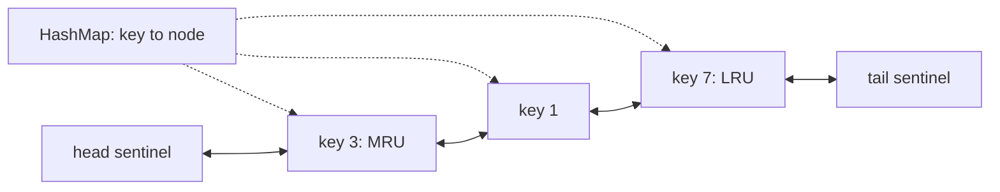

## Introduction

A **cache** keeps copies of data that is expensive to fetch — a database row, a rendered page, a decoded image — somewhere fast, usually memory. Memory is limited, so a cache has a **capacity**, and when it is full and a new item arrives, something must go. The rule that picks the victim is the **eviction policy**.

**Least Recently Used (LRU)** evicts the entry that has gone longest without being read or written. The bet behind it is **temporal locality**: data used recently is likely to be used again soon, and data untouched for a long time probably is not. It is a good bet for many workloads — user sessions, hot product pages, recently opened files — which is why LRU and its approximations are everywhere, from CPU caches to Redis.

As a data-structure problem, the requirement is precise: support `get(key)` and `put(key, value)` with a fixed capacity, where both operations count as a "use", and every operation — including the eviction — runs in **O(1)** time. Meeting that requirement takes two structures working together: a hash map for finding entries and a doubly linked list for keeping them in recency order. The list manipulation it needs — unlink a node from wherever it is and move it to the front — is the "LRU-style" pattern this lesson is named after, and it appears in other designs too.

This is one of the most frequently asked interview questions that combines data structures with design, and it is the low-level heart of the cache case study in [[d3-cache]].

## Before you start

- **Doubly linked lists with sentinels** — the O(1) unlink and insert-after operations. See [[a4-doubly-linked-lists]]; this lesson uses them directly.
- **Hash maps** — O(1) average lookup by key. See [[a1-hashmap]].
- **Big-O and amortised cost** — see [[a1-time-complexity]].

## The intuition

Think of a narrow shelf that holds five books, with the most recently read book always on the left. When you read a book already on the shelf, you pull it out and put it back on the far left; everything that was to its left shifts one place right. When you buy a sixth book, the book on the far right — the one you have not touched for the longest — goes to the charity box, and the new book goes on the left. The shelf's order *is* the recency order, so the victim is always at one known end.

Two things make that fast on a real shelf: you can see where each book is at a glance, and sliding a book out of the middle does not require moving every other book by hand. In a program, "see where each book is" becomes a hash map from key to node, and "slide out of the middle cheaply" becomes a doubly linked list. Where the analogy breaks: on a shelf, the books to the left really do shift. In a linked list, nothing shifts — only a handful of references change — which is precisely why the operation is O(1).

## Why one structure is not enough

It is worth seeing each simpler design fail, because the failure tells you exactly what each half of the real design is for.

| Design | `get` | Promote on use | Evict LRU | Problem |
|---|---|---|---|---|
| `HashMap` alone | O(1) | — | O(n) | No order: finding the least recent entry means scanning every timestamp |
| `HashMap` + timestamps + scan | O(1) | O(1) | O(n) | Eviction scans all entries |
| `ArrayList` in recency order | O(n) search | O(n) shift | O(1) | Moving an entry to the front shifts everything |
| Singly linked list in recency order | O(n) search | O(n) find predecessor | O(n) | Removing a node needs its predecessor |
| `HashMap` + `PriorityQueue` by timestamp | O(1) | O(n) to update a key's priority | O(log n) | Java's `PriorityQueue` cannot efficiently re-prioritise an element |
| `HashMap` → nodes of a **doubly linked list** | O(1) | O(1) | O(1) | — |

The hash map gives O(1) *finding*. The doubly linked list gives O(1) *reordering*, but only if you can reach the node without searching — which the map provides. And the list must be doubly linked: promotion and eviction both remove a node from the middle or the end, which needs the node's predecessor, and only `prev` provides that in O(1).

## The design



- A `HashMap<Integer, Node>` maps each key to its node in the list.
- A doubly linked list holds every entry in recency order, between two **sentinel** nodes. `head.next` is the **most recently used (MRU)** entry; `tail.prev` is the **least recently used (LRU)** entry, the next victim.
- Each node stores its **key** as well as its value. This is easy to forget and essential: when the LRU node is evicted, you must also remove its map entry, and the node is the only place that knows which key that is.

The sentinels mean every real node always has a non-null `prev` and `next`, so the two list operations need no special cases:

```java
private void unlink(Node node) {
    node.prev.next = node.next;
    node.next.prev = node.prev;
}

private void addToFront(Node node) {
    node.prev = head;
    node.next = head.next;
    head.next.prev = node;
    head.next = node;
}
```

### `get(key)`

Look the key up in the map. If it is absent, return `-1` (the conventional "miss" value in the interview version). If it is present, the read counts as a use, so **promote** the node: unlink it from wherever it is and add it to the front. Then return its value.

Promotion on read is what distinguishes LRU from a simple insertion-ordered (FIFO) cache. Forgetting it makes `get` correct in its return value but wrong in its effect on eviction — a bug that ordinary tests often miss.

### `put(key, value)`

There are two cases.

- **The key exists.** Update the node's value and promote it. The size does not change, so nothing is evicted.
- **The key is new.** If the cache is at capacity, first evict: take `tail.prev`, unlink it, and remove `lru.key` from the map. Then create a node, put it in the map, and add it to the front.

Evicting *before* inserting means the cache never exceeds its capacity, even momentarily. The alternative — insert, then evict if `size > capacity` — is equally correct and is what `LinkedHashMap` does; be consistent about which comparison you use, because `>=` versus `>` is a common off-by-one.

## Worked example

```java title="LRUCache.java"
import java.util.HashMap;
import java.util.Map;
import java.util.StringJoiner;

public class LRUCache {

    private static final class Node {
        final int key;          // stored so eviction can remove the map entry
        int value;
        Node prev, next;
        Node(int key, int value) { this.key = key; this.value = value; }
    }

    private final int capacity;
    private final Map<Integer, Node> map = new HashMap<>();
    private final Node head = new Node(0, 0);   // head.next = most recently used
    private final Node tail = new Node(0, 0);   // tail.prev = least recently used

    public LRUCache(int capacity) {
        if (capacity <= 0) throw new IllegalArgumentException("capacity must be positive");
        this.capacity = capacity;
        head.next = tail;
        tail.prev = head;
    }

    private void unlink(Node node) {
        node.prev.next = node.next;
        node.next.prev = node.prev;
    }

    private void addToFront(Node node) {
        node.prev = head;
        node.next = head.next;
        head.next.prev = node;
        head.next = node;
    }

    public int get(int key) {
        Node node = map.get(key);
        if (node == null) return -1;
        unlink(node);                 // reading counts as a use: promote to the front
        addToFront(node);
        return node.value;
    }

    public void put(int key, int value) {
        Node node = map.get(key);
        if (node != null) {           // existing key: update and promote, size unchanged
            node.value = value;
            unlink(node);
            addToFront(node);
            return;
        }
        if (map.size() == capacity) { // full: evict the least recently used first
            Node lru = tail.prev;
            unlink(lru);
            map.remove(lru.key);
        }
        Node fresh = new Node(key, value);
        map.put(key, fresh);
        addToFront(fresh);
    }

    /** Keys from most to least recently used. */
    String order() {
        StringJoiner sj = new StringJoiner(", ", "[", "]");
        for (Node cur = head.next; cur != tail; cur = cur.next) sj.add(String.valueOf(cur.key));
        return sj.toString();
    }

    public static void main(String[] args) {
        LRUCache cache = new LRUCache(2);
        cache.put(1, 100);
        cache.put(2, 200);
        System.out.println("after put 1, put 2:  " + cache.order());
        System.out.println("get(1) = " + cache.get(1) + "        " + cache.order());
        cache.put(3, 300);                                  // evicts 2, the LRU key
        System.out.println("after put 3:         " + cache.order());
        System.out.println("get(2) = " + cache.get(2));
        cache.put(1, 111);                                  // update existing key, no eviction
        System.out.println("after put 1 again:   " + cache.order());
        cache.put(4, 400);                                  // evicts 3
        System.out.println("after put 4:         " + cache.order());
        System.out.println("get(1) = " + cache.get(1) + ", get(3) = " + cache.get(3)
            + ", get(4) = " + cache.get(4));
    }
}
```

```output
after put 1, put 2:  [2, 1]
get(1) = 100        [1, 2]
after put 3:         [3, 1]
get(2) = -1
after put 1 again:   [1, 3]
after put 4:         [4, 1]
get(1) = 111, get(3) = -1, get(4) = 400
```

### Dry run

The table follows the same sequence with capacity 2. "Order" lists keys from MRU to LRU — the list between the sentinels.

| Operation | Hit or miss | Eviction | Order (MRU → LRU) | Map keys |
|---|---|---|---|---|
| `put(1, 100)` | new | — | 1 | {1} |
| `put(2, 200)` | new | — | 2, 1 | {1, 2} |
| `get(1)` | hit → 100 | — | 1, 2 | {1, 2} |
| `put(3, 300)` | new, full | evict 2 (`tail.prev`) | 3, 1 | {1, 3} |
| `get(2)` | miss → −1 | — | 3, 1 | {1, 3} |
| `put(1, 111)` | existing | — | 1, 3 | {1, 3} |
| `put(4, 400)` | new, full | evict 3 | 4, 1 | {1, 4} |

Row 3 is the one that shows the policy at work. Without promotion on `get(1)`, key 1 would still be the least recent entry and `put(3)` would have evicted it instead of 2. Row 6 shows that updating an existing key is also a use — it promotes key 1 — and does not trigger an eviction, because the size is unchanged.

The final line of output reads keys 1, 3 and 4 *in that order*, and each `get` promotes as it goes, so the cache's internal order after that line is 4, 1 — key 3 was a miss and changed nothing.

### Complexity

- **`get`**: one hash lookup (O(1) average) plus an unlink and an insert (a fixed number of reference updates), so **O(1)** average.
- **`put`**: one lookup, possibly one eviction (unlink plus a map removal), one map insertion and one list insertion — **O(1)** average.
- **Space**: **O(capacity)** — one node and one map entry per cached key, plus two sentinels.

The "average" qualifier comes from the hash map. Java's `HashMap` is O(1) on average; since Java 8, a bucket with many colliding keys is converted to a balanced tree, so even the worst case for a single lookup is O(log n) rather than O(n). The linked-list operations are O(1) in the strict worst case.

## The built-in version: LinkedHashMap

Java ships this exact design. `LinkedHashMap` is a `HashMap` whose entries are also threaded onto a doubly linked list. By default the list records **insertion order**; the constructor `LinkedHashMap(initialCapacity, loadFactor, accessOrder)` with `accessOrder = true` makes it record **access order** instead, moving an entry to the end of the list whenever it is read with `get` or written with `put`. After each insertion it calls the protected method `removeEldestEntry`, and if that returns `true` it removes the entry at the front of the list — the least recently used one.

```java title="LinkedHashMapLru.java"
import java.util.LinkedHashMap;
import java.util.Map;

public class LinkedHashMapLru {

    static class LruMap<K, V> extends LinkedHashMap<K, V> {
        private final int capacity;

        LruMap(int capacity) {
            super(16, 0.75f, true);      // true = access order: get() moves an entry to the end
            this.capacity = capacity;
        }

        @Override
        protected boolean removeEldestEntry(Map.Entry<K, V> eldest) {
            return size() > capacity;    // called after each insertion
        }
    }

    public static void main(String[] args) {
        LruMap<Integer, String> cache = new LruMap<>(2);
        cache.put(1, "one");
        cache.put(2, "two");
        cache.get(1);
        cache.put(3, "three");
        System.out.println(cache);       // iteration order: least to most recently used
        System.out.println(cache.get(2));
    }
}
```

```output
{1=one, 3=three}
null
```

Note that `LinkedHashMap` keeps the *least* recent entry at the front and the most recent at the end — the mirror image of our hand-written version. Either orientation works as long as eviction takes from the least-recent end. In production Java, prefer this (or a caching library) over hand-written code; in interviews, expect to be asked to build the structure yourself, and mention `LinkedHashMap` as the production answer — it shows you know the design is standard.

## Thread safety

Neither the hand-written cache nor `LinkedHashMap` is safe to use from several threads at once. The subtle part is that, in an access-ordered cache, **reads are writes**: every `get` rewires list references. Two threads calling `get` concurrently can interleave their four-reference updates and leave the list corrupted — a node pointing to a node that no longer points back, or a cycle that makes later traversals spin forever.

The simplest correct fix is to guard every operation with one lock (`synchronized` methods, or `Collections.synchronizedMap` around a `LinkedHashMap`), including `get`. A read-write lock does *not* help here, because `get` mutates. Using `ConcurrentHashMap` alone is not enough either: it makes the map safe but keeps no recency order. High-throughput caches avoid a single global lock by approximating LRU — the next section — or by recording accesses in buffers and applying the reordering in batches, which is what the Caffeine library does.

## In real systems

**Exact LRU is rarer than you might think.** Maintaining a perfectly ordered list costs a few pointer writes on every access, and under heavy concurrency the list becomes a contention point. So many systems approximate it.

- **Redis**, when configured with `maxmemory-policy allkeys-lru`, does not keep a global list. On eviction it samples a small number of keys (the `maxmemory-samples` setting, 5 by default) and evicts the least recently used among the sample, using a per-key last-access clock. The result is close to true LRU at far lower cost.
- **Operating-system page caches** use approximations such as the CLOCK algorithm, which sweeps a circular list of pages and gives each recently referenced page a "second chance" instead of moving it, and Linux keeps separate active and inactive lists so that one large sequential scan does not flush every frequently used page.
- **Caffeine**, the standard high-performance Java cache, uses *Window TinyLFU*, which combines a small LRU window with frequency estimates, because pure LRU handles some access patterns poorly.

**Where LRU struggles.** A single scan over a large data set — a nightly report reading every row once — pushes every hot entry out of an LRU cache, even though the scanned data will never be read again. Policies that consider *frequency* as well as recency resist this.

**Distributed caches.** A cache spread over many machines (Memcached, a Redis cluster) shards keys across nodes, and each node runs its own local eviction. There is no global LRU list; the linked-list design in this lesson lives inside each node.

## Related designs: the same move-to-front manipulation

### LFU: Least Frequently Used

An **LFU** cache evicts the entry with the fewest accesses, breaking ties by recency. The O(1) design extends the LRU one:

- A map from key to node, where each node also stores its access count.
- A map from each count to a doubly linked list of the nodes with that count, kept in recency order — effectively one LRU list per frequency.
- A variable `minFreq` holding the smallest count currently present.

On a hit, unlink the node from its count's list, increment its count and add it to the front of the next count's list; if its old list is now empty and its old count was `minFreq`, increment `minFreq`. On insertion of a new key, evict from the tail of the `minFreq` list if full, then add the new node to the count-1 list and set `minFreq = 1`. Every step is a constant number of map operations and list splices, so all operations remain O(1). The point to take away is that LFU is not a different technique — it is several LRU lists plus bookkeeping.

### Other move-to-front structures

The same "map points at list nodes; splice nodes to reorder" idea solves several design problems. An **all-O(1) data structure** that reports a key with the maximum or minimum count keeps buckets of keys per count in a doubly linked list of buckets. **Time-based expiry** keeps entries in a list ordered by expiry time so the oldest can be dropped from one end. A **browser history** with back and forward keeps the current page as a node in a doubly linked list and moves the cursor along `prev` and `next`, discarding the forward part when a new page is visited.

## Trade-offs and alternatives

| Approach | Operations | Pros | Cons |
|---|---|---|---|
| Hand-written `HashMap` + doubly linked list | O(1) | Full control; what interviews expect | More code and pointer bugs; not thread-safe |
| `LinkedHashMap` with `accessOrder = true` | O(1) | Standard library, a few lines | Not thread-safe; reads mutate |
| Synchronized wrapper | O(1) plus locking | Simple and correct | Single lock limits throughput |
| Approximate LRU (sampling, CLOCK) | O(1) | Cheap under concurrency | Not exact |
| LFU / TinyLFU | O(1) | Resists scans, favours popular keys | More state; slower to adapt when popularity shifts |
| FIFO (insertion order, no promotion) | O(1) | Simplest | Evicts hot entries that happened to arrive early |

Choose exact LRU when the workload has strong recency and the cache is not under heavy concurrent access; choose a library such as Caffeine for production Java services; consider LFU-style policies when scans or a stable set of popular keys dominate.

## Common mistakes

> [!MISTAKE] Evicting from the wrong end
> With most recent entries added after `head`, the victim is `tail.prev`. Evicting `head.next` throws away the entry that was most recently used. Decide the orientation once, write it in a comment, and follow it in every method.

**Not storing the key in the node.** Without `node.key`, eviction can unlink the node but cannot remove its map entry. The map then holds a "ghost" key pointing at a detached node, `get` returns stale data, and the size check stops working.

**Forgetting to remove the map entry on eviction.** Same symptom as above: unlinking from the list alone is half an eviction.

**Not promoting on `get`, or on `put` of an existing key.** Both are uses. Missing either turns the cache into something closer to FIFO, and simple tests may not notice.

**Treating an update as an insertion.** Putting an existing key through the "new key" path creates a second node for the same key and may evict something unnecessarily. Check the map first.

**Updating only one direction of the list.** An unlink that fixes `prev.next` but not `next.prev` corrupts backward links, and the next eviction (which reads `tail.prev`) removes the wrong node. The doubly linked invariant — `n.next.prev == n` — must hold after every operation.

**Assuming reads are thread-safe.** In an access-ordered cache, `get` changes the list. Lock reads as well as writes.

## Interview perspective

*LRU Cache* is a staple at every level because it tests three things at once: choosing structures from requirements, implementing pointer manipulation correctly, and discussing real-world trade-offs. Start from the requirements and derive the design rather than announcing it.

> [!INTERVIEW] Derive the design out loud
> "I need O(1) lookup by key, so a hash map. I also need to know the least recently used entry and to move any entry to the front when it's used, both in O(1). A doubly linked list can unlink any node in O(1) if I already hold it, and the map can hold the nodes. I'll use head and tail sentinels so there are no null checks, keep the most recent after head and evict tail.prev, and store the key in each node so eviction can clean up the map."

Follow-ups and what a good answer covers:

- **Why doubly linked?** Removing a node needs its predecessor; `prev` gives it in O(1).
- **Why store the key in the node?** To remove the evicted entry from the map.
- **Java's built-in?** `LinkedHashMap` with `accessOrder = true` and `removeEldestEntry`.
- **Make it thread-safe.** A single lock around both `get` and `put`, because `get` mutates; mention approximations or batching for high concurrency.
- **LFU instead?** Key-to-node map, frequency-to-list map, and `minFreq`; still O(1).
- **Distributed?** Shard keys across nodes, each with a local LRU; there is no global order. See [[d3-cache]] for the full design discussion.

## Practice

1. **LRU cache.** Implement `get` and `put` in O(1) with your own doubly linked list and sentinels; test capacity 1.
2. **LinkedHashMap version.** Implement the same cache by extending `LinkedHashMap`, and explain the order of its iteration.
3. **Thread-safe LRU.** Wrap your cache so concurrent `get` and `put` calls are safe, and explain why a read-write lock is not enough.
4. **LFU cache.** Implement the O(1) design with per-frequency lists and `minFreq`.
5. **Design browser history.** Support `visit`, `back(steps)` and `forward(steps)` with a doubly linked list.
6. **All O(1) data structure.** Support `inc(key)`, `dec(key)`, `getMaxKey()` and `getMinKey()` in O(1) with a list of count buckets.

The DSA explorer lists the matching problems under this topic; start with *LRU Cache*, then *LFU Cache*.

```quiz
Q: In the HashMap plus doubly linked list design, why must each node store its key?
- [ ] So that `get` can compare keys while walking the list
- [ ] Because Java's HashMap requires values to contain their keys
- [x] So that when the LRU node is evicted from the list, its entry can also be removed from the map
- [ ] So that the list can be kept sorted by key
> Eviction starts from the list (`tail.prev`) and must also delete the corresponding map entry. The node is the only place that records which key it belongs to; without it the map would keep a stale entry.

Q: A capacity-2 cache receives put(1), put(2), get(1), put(3). Which key is evicted?
- [ ] 1, because it was inserted first
- [x] 2, because get(1) made 1 the most recently used
- [ ] 3, because it is the newest
- [ ] None; the cache grows to 3
> After put(1), put(2) the order is 2, 1 (most recent first). get(1) promotes 1, giving 1, 2. When put(3) needs space, the least recently used entry is 2. A FIFO cache would have evicted 1, which is the difference promotion makes.

Q: Why is a read-write lock (shared lock for get, exclusive for put) not sufficient to make an access-ordered LRU cache thread-safe?
- [ ] Because read-write locks do not exist in Java
- [x] Because `get` also modifies the linked list when it promotes the entry
- [ ] Because `put` never modifies the map
- [ ] Because HashMap lookups are not atomic
> In an LRU cache every successful get unlinks a node and reinserts it at the front. Two threads holding a shared read lock could rewire the same references at the same time and corrupt the list, so get needs exclusive access too.
```

## Quick revision {#quick-revision}

- LRU evicts the entry unused for longest; both `get` and `put` count as uses. Goal: O(1) for every operation.
- `HashMap<K, Node>` for lookup + doubly linked list for recency order; sentinels `head` and `tail`.
- MRU at `head.next`, LRU at `tail.prev` (or the mirror image — be consistent).
- Node stores key, value, `prev`, `next`; the key is needed to clean up the map on eviction.
- `get`: miss → −1; hit → unlink, add to front, return value.
- `put`: existing → update value, promote; new → if full evict `tail.prev` (unlink + `map.remove(lru.key)`), then insert node in map and at front.
- `unlink`: `n.prev.next = n.next; n.next.prev = n.prev`. `addToFront`: four assignments, `head.next = n` last.
- O(1) average time per operation, O(capacity) space.
- Java: `new LinkedHashMap<>(16, 0.75f, true)` + `removeEldestEntry(size() > capacity)`; front = least recent.
- Not thread-safe; `get` mutates, so lock reads too. Production systems often approximate LRU (Redis sampling, CLOCK, TinyLFU).
- LFU = key → node, frequency → LRU list, `minFreq`; still O(1).

## Key takeaways {#key-takeaways}

- An LRU cache needs O(1) lookup and O(1) reordering; a hash map supplies the first and a doubly linked list supplies the second.
- The map stores references to list nodes, so any entry can be found and spliced out of the recency order without searching.
- The list must be doubly linked because removing a node needs its predecessor, and sentinels remove every null check.
- Store the key in each node; eviction begins at the list and must also clean up the map.
- In Java, `LinkedHashMap` in access order is this exact design; in an interview, build it yourself and mention the built-in.
- Access-ordered caches mutate on reads, so concurrency needs care, and large systems often trade exact LRU for cheaper approximations.
