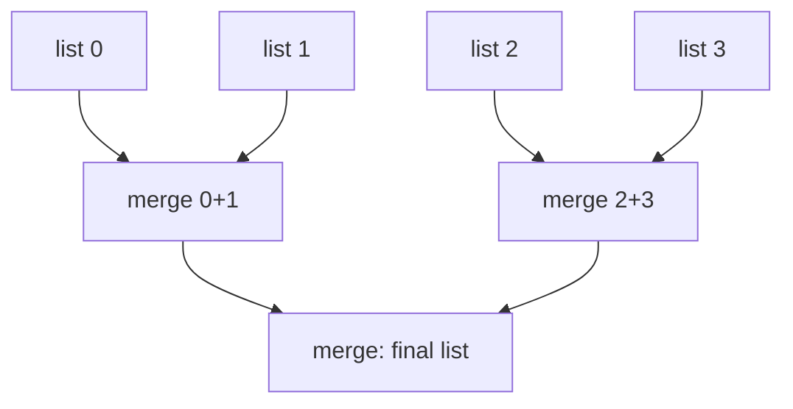

## Introduction

You have two lists that are each already sorted — `1 → 3 → 5` and `2 → 4 → 6 → 8 → 10` — and you want one sorted list containing every node. The brute-force approach collects all the values, sorts them, and builds a new list: O((n + m) log(n + m)) time and O(n + m) extra space. It throws away the most useful fact you were given, which is that each input is *already in order*.

Because each list is sorted, the smallest remaining value overall is always at the front of one of the two lists. So you never need to search: compare the two front nodes, take the smaller, and repeat. Each comparison places one node permanently. That is **merging**, and it produces the result in a single pass, O(n + m) time. On linked lists it also needs no extra memory, because "taking" a node means re-pointing a reference, not copying a value.

Merging matters well beyond this one problem. It is the combine step of **merge sort**, the standard way to sort linked lists and the basis of external sorting for data too large for memory. Merging *k* sorted streams is how databases combine sorted runs, how search engines combine posting lists, and how log aggregators interleave time-ordered logs from many servers. And as an interview pattern, the dummy-plus-tail technique you learn here is the cleanest way to build *any* output list node by node.

## Before you start

- **Singly linked lists** — traversal, rewiring and the dummy-node habit. See [[a4-singly-linked-lists]].
- **Merge sort** — the divide-and-conquer sort that uses merging as its combine step. See [[a3-merge-sort]]; this lesson teaches the merge itself in depth.
- **Heaps / priority queues** — for the k-list version. See [[a1-priorityqueue]].

## The intuition

Two queues of people, each already ordered by height, need to become one ordered queue. You stand where the two queues meet. Each time, you look at the two people at the front, wave the shorter one through into the new queue, and look again. You never look past the front of either queue, because everyone behind the front person is at least as tall. When one queue runs out, everyone remaining in the other queue walks through in their existing order — they are already sorted, and there is nobody left to interleave them with.

Two parts of that picture become two parts of the code: "compare the fronts, send the smaller" is the loop, and "when one runs out, the rest walk through" is a single assignment after the loop. Where the analogy stops working: in a linked list, "walking through" costs nothing — you attach the remaining list with one reference, without visiting its nodes.

## Merging two sorted lists

### Building the output: a dummy and a tail

The output list grows at its end, so we need a reference to its **last** node, called `tail`, to attach each new node in O(1). The first attachment is a problem, though: before anything is attached there is no last node, and the head of the result is not yet known. A **dummy node** solves both. The result begins as the dummy alone; `tail` starts on it; every attachment is `tail.next = node; tail = node;` with no special case for the first one; and at the end the real result is `dummy.next`.

```java
static ListNode mergeTwo(ListNode a, ListNode b) {
    ListNode dummy = new ListNode(0);
    ListNode tail = dummy;                 // last node of the merged result so far
    while (a != null && b != null) {
        if (a.val <= b.val) {              // <= keeps equal values in input order
            tail.next = a;
            a = a.next;
        } else {
            tail.next = b;
            b = b.next;
        }
        tail = tail.next;
    }
    tail.next = (a != null) ? a : b;       // one list is exhausted; attach the other
    return dummy.next;
}
```

### The invariant

Before each iteration: **the nodes from `dummy.next` to `tail` are the smallest nodes taken so far, in sorted order, and `a` and `b` are the heads of what remains of each input.** The loop takes the smaller of the two heads. That node is no larger than anything left in its own list (its list is sorted) and no larger than the other head (we just compared), and therefore no larger than anything left in the other list either. So it is the smallest remaining node overall, and appending it keeps the result sorted.

When one input runs out, the other's remaining nodes are all at least as large as everything already merged, and already sorted among themselves, so attaching the whole remainder in one step is correct. This line is the one beginners most often forget, and forgetting it silently drops the tail of one list.

### Dry run

Merge `a = 1 → 3 → 5` with `b = 2 → 4 → 6 → 8 → 10`:

| Step | `a` head | `b` head | Take | Result so far |
|---|---|---|---|---|
| 1 | 1 | 2 | 1 (from `a`) | `1` |
| 2 | 3 | 2 | 2 (from `b`) | `1 → 2` |
| 3 | 3 | 4 | 3 | `1 → 2 → 3` |
| 4 | 5 | 4 | 4 | `1 → 2 → 3 → 4` |
| 5 | 5 | 6 | 5 | `1 → 2 → 3 → 4 → 5` |
| — | `null` | 6 | attach `6 → 8 → 10` | `1 → 2 → 3 → 4 → 5 → 6 → 8 → 10` |

Five comparisons placed five nodes; the last three nodes were attached in one assignment without being visited.

### Complexity

Each loop iteration does O(1) work and permanently places one node, and the loop stops as soon as either list runs out. So it runs at most `n + m − 1` times — fewer when one list is exhausted early — and time is **O(n + m)**. No nodes are created except the dummy, and only two references and a tail are kept, so extra space is **O(1)**. The result *reuses* the input nodes: after the call, the original lists no longer exist as separate lists. If the caller needs them intact, merge into new nodes instead.

### Stability and the `<=`

A sort or merge is **stable** if elements that compare as equal keep their original relative order. With plain integers this is invisible, but merging real records — say orders sorted by price, where the first list holds earlier orders — it matters: among equal prices, earlier orders should stay first.

The condition `a.val <= b.val` takes from `a` on ties, so equal elements from the first list come before equal elements from the second. Writing `<` instead takes from `b` on ties and breaks that guarantee. Merge sort is stable precisely because its merge uses `<=` with the left half as `a`. For interview problems with plain integers either works, but `<=` is the version to write by habit.

### The recursive version

```java
static ListNode mergeTwoRecursive(ListNode a, ListNode b) {
    if (a == null) return b;
    if (b == null) return a;
    if (a.val <= b.val) {
        a.next = mergeTwoRecursive(a.next, b);
        return a;
    }
    b.next = mergeTwoRecursive(a, b.next);
    return b;
}
```

It reads like the definition: the merged list starts with the smaller head, followed by the merge of everything else. The base cases replace the "attach the remainder" step. It is short and correct, but it uses one stack frame per node placed — O(n + m) stack — and in Java that risks `StackOverflowError` on lists with tens of thousands of nodes or more. Offer it as an alternative; write the iterative one by default.

## Merging k sorted lists

Now there are `k` sorted lists with `N` nodes in total. Three approaches are worth comparing, because the comparison itself is a classic interview discussion.

### Approach 1: merge one at a time

Merge list 1 with list 2, then the result with list 3, and so on. It is correct, but consider the cost when each list has `N / k` nodes. The first merge handles `2N/k` nodes, the second `3N/k`, …, the last `N`. The total is about `(N/k)(2 + 3 + … + k)`, which is roughly `(N/k) · k²/2` = **O(kN)**. The early nodes are re-walked in every subsequent merge — that repetition is the waste.

### Approach 2: a min-heap of front nodes

Generalise the two-list idea: the smallest remaining node is at the front of *some* list, so keep all `k` fronts in a **min-heap** (Java's `PriorityQueue`), which returns the smallest in O(log k). Repeatedly poll the smallest node, attach it to the result, and offer its successor (if any) to the heap — that successor is the new front of its list.

```java
PriorityQueue<ListNode> heap = new PriorityQueue<>((x, y) -> Integer.compare(x.val, y.val));
for (ListNode head : lists) if (head != null) heap.offer(head);
ListNode dummy = new ListNode(0), tail = dummy;
while (!heap.isEmpty()) {
    ListNode smallest = heap.poll();
    tail.next = smallest;
    tail = smallest;
    if (smallest.next != null) heap.offer(smallest.next);  // its successor competes next
}
return dummy.next;
```

The heap never holds more than `k` nodes — at most one front per list. Each of the `N` nodes is offered once and polled once, each costing O(log k), so time is **O(N log k)** and extra space is **O(k)** for the heap. Two details: `null` lists must be skipped when filling the heap, and the comparator uses `Integer.compare` rather than `x.val - y.val`, because subtraction overflows for values far apart (for example `Integer.MIN_VALUE - 1` wraps to a large positive number and the heap orders those two values backwards). The heap approach is the standard k-way merge, taught generally in [[a7-k-way-merge]].

### Approach 3: divide and conquer

Pair the lists up and merge each pair, halving the number of lists; repeat until one list remains — exactly the combine phase of merge sort, with whole lists as the elements.

```java
static ListNode mergeKDivide(ListNode[] lists) {
    if (lists.length == 0) return null;
    for (int step = 1; step < lists.length; step *= 2) {        // pair lists step apart
        for (int i = 0; i + step < lists.length; i += 2 * step) {
            lists[i] = mergeTwo(lists[i], lists[i + step]);
        }
    }
    return lists[0];
}
```

With `step = 1` it merges lists 0+1, 2+3, 4+5…; with `step = 2` it merges 0+2, 4+6…; and so on, accumulating the result in `lists[0]`. There are about `log₂ k` rounds, and in each round every node takes part in exactly one two-list merge, so each round costs O(N). Total time is **O(N log k)** — the same as the heap — with **O(1)** extra space beyond the array of heads (the iterative loop needs no recursion stack). It overwrites entries of the input array, which is acceptable here but worth saying aloud.



| Approach | Time | Extra space | Notes |
|---|---|---|---|
| Collect values, sort, rebuild | O(N log N) | O(N) | Ignores sortedness; allocates new nodes |
| Merge one list at a time | O(kN) | O(1) | Re-walks early nodes repeatedly |
| Min-heap of fronts | O(N log k) | O(k) | Works on streams; standard k-way merge |
| Divide and conquer | O(N log k) | O(1) iterative | Needs all lists up front |

The heap version has one practical advantage: it works on **streams** where lists arrive incrementally or are too long to hold, because it only ever needs the current front of each. Divide and conquer needs all lists present before it starts.

## Merging two sorted arrays in place

A closely related problem gives you `nums1` with length `m + n`, whose first `m` slots hold a sorted array and whose last `n` slots are empty, plus a sorted `nums2` of length `n`. Merge `nums2` into `nums1` without another array.

Merging from the front fails: writing the smallest value into `nums1[0]` overwrites a value of `nums1` that has not been read yet. The fix is to **merge from the back**, placing the *largest* remaining value into the last empty slot. The write position starts at `m + n − 1`, which is always at or beyond the next unread `nums1` value, so nothing unread is ever overwritten.

```java
static void mergeArrays(int[] nums1, int m, int[] nums2, int n) {
    int i = m - 1, j = n - 1, write = m + n - 1;
    while (j >= 0) {                                          // once nums2 is used up, done
        if (i >= 0 && nums1[i] > nums2[j]) nums1[write--] = nums1[i--];
        else nums1[write--] = nums2[j--];
    }
}
```

The loop runs only while `nums2` has values left. Once `nums2` is exhausted, any remaining `nums1` values are already in their final positions at the front — the array version of "attach the remainder", and it costs nothing. If instead `nums1` runs out first (`i < 0`), the `else` branch copies the rest of `nums2`. Time O(m + n), extra space O(1). The difference from the linked-list merge is instructive: arrays must move values into slots, so the direction of writing matters; linked lists only rewire references, so there is no overwriting problem at all.

## Merge sort on a linked list

Merging is the engine of the standard algorithm for sorting a linked list in O(n log n) time:

1. If the list has zero or one node, it is sorted.
2. Find the end of the first half with fast/slow pointers (the first-middle variant, see [[a4-fast-slow-pointers]]) and cut the list there with `slow.next = null`.
3. Sort each half recursively.
4. Merge the two sorted halves.

```java
static ListNode sortList(ListNode head) {
    if (head == null || head.next == null) return head;
    ListNode slow = head, fast = head;                        // find end of first half
    while (fast.next != null && fast.next.next != null) {
        slow = slow.next;
        fast = fast.next.next;
    }
    ListNode second = slow.next;
    slow.next = null;                                         // cut into two lists
    return mergeTwo(sortList(head), sortList(second));
}
```

The first-middle variant matters here. With the second-middle variant, a two-node list would "split" into two nodes and zero nodes, and the recursion would never shrink the problem — a `StackOverflowError`. The recursion is `log₂ n` levels deep and each level merges O(n) nodes in total, giving **O(n log n)** time. Space is O(log n) for the recursion stack; a bottom-up version that merges runs of size 1, 2, 4, … iteratively achieves O(1). Merge sort suits linked lists better than quicksort because it never needs random access and the merge needs no extra buffer — on arrays, merge sort needs an O(n) buffer; on linked lists it does not.

## Worked example

```java title="MergeLists.java"
import java.util.Arrays;
import java.util.PriorityQueue;

public class MergeLists {

    static class ListNode {
        int val;
        ListNode next;
        ListNode(int val) { this.val = val; }
        ListNode(int val, ListNode next) { this.val = val; this.next = next; }
    }

    static ListNode fromArray(int... values) {
        ListNode dummy = new ListNode(0), tail = dummy;
        for (int v : values) { tail.next = new ListNode(v); tail = tail.next; }
        return dummy.next;
    }

    static String show(ListNode head) {
        StringBuilder sb = new StringBuilder();
        for (ListNode cur = head; cur != null; cur = cur.next) sb.append(cur.val).append(" -> ");
        return sb.append("null").toString();
    }

    static ListNode mergeTwo(ListNode a, ListNode b) {
        ListNode dummy = new ListNode(0);
        ListNode tail = dummy;                 // last node of the merged result so far
        while (a != null && b != null) {
            if (a.val <= b.val) {              // <= keeps equal values in input order
                tail.next = a;
                a = a.next;
            } else {
                tail.next = b;
                b = b.next;
            }
            tail = tail.next;
        }
        tail.next = (a != null) ? a : b;       // one list is exhausted; attach the other
        return dummy.next;
    }

    static ListNode mergeTwoRecursive(ListNode a, ListNode b) {
        if (a == null) return b;
        if (b == null) return a;
        if (a.val <= b.val) {
            a.next = mergeTwoRecursive(a.next, b);
            return a;
        }
        b.next = mergeTwoRecursive(a, b.next);
        return b;
    }

    static ListNode mergeKWithHeap(ListNode[] lists) {
        PriorityQueue<ListNode> heap = new PriorityQueue<>((x, y) -> Integer.compare(x.val, y.val));
        for (ListNode head : lists) {
            if (head != null) heap.offer(head);
        }
        ListNode dummy = new ListNode(0), tail = dummy;
        while (!heap.isEmpty()) {
            ListNode smallest = heap.poll();
            tail.next = smallest;
            tail = smallest;
            if (smallest.next != null) heap.offer(smallest.next);  // its successor competes next
        }
        return dummy.next;
    }

    static ListNode mergeKDivide(ListNode[] lists) {
        if (lists.length == 0) return null;
        for (int step = 1; step < lists.length; step *= 2) {        // pair lists step apart
            for (int i = 0; i + step < lists.length; i += 2 * step) {
                lists[i] = mergeTwo(lists[i], lists[i + step]);
            }
        }
        return lists[0];
    }

    static ListNode sortList(ListNode head) {
        if (head == null || head.next == null) return head;
        ListNode slow = head, fast = head;                        // find end of first half
        while (fast.next != null && fast.next.next != null) {
            slow = slow.next;
            fast = fast.next.next;
        }
        ListNode second = slow.next;
        slow.next = null;                                         // cut into two lists
        return mergeTwo(sortList(head), sortList(second));
    }

    /** nums1 has length m + n; its first m values and nums2 are sorted. */
    static void mergeArrays(int[] nums1, int m, int[] nums2, int n) {
        int i = m - 1, j = n - 1, write = m + n - 1;
        while (j >= 0) {                                          // once nums2 is used up, done
            if (i >= 0 && nums1[i] > nums2[j]) nums1[write--] = nums1[i--];
            else nums1[write--] = nums2[j--];
        }
    }

    public static void main(String[] args) {
        System.out.println(show(mergeTwo(fromArray(1, 3, 5), fromArray(2, 4, 6, 8, 10))));
        System.out.println(show(mergeTwo(null, fromArray(4, 7))));
        System.out.println(show(mergeTwoRecursive(fromArray(1, 2, 4), fromArray(1, 3, 4))));

        ListNode[] k1 = { fromArray(1, 4, 5), fromArray(1, 3, 4), fromArray(2, 6), null };
        System.out.println(show(mergeKWithHeap(k1)));
        ListNode[] k2 = { fromArray(1, 4, 5), fromArray(1, 3, 4), fromArray(2, 6), null };
        System.out.println(show(mergeKDivide(k2)));

        System.out.println(show(sortList(fromArray(4, 2, 1, 3, 5, 0))));

        int[] nums1 = {1, 2, 3, 0, 0, 0};
        mergeArrays(nums1, 3, new int[]{2, 5, 6}, 3);
        System.out.println(Arrays.toString(nums1));
    }
}
```

```output
1 -> 2 -> 3 -> 4 -> 5 -> 6 -> 8 -> 10 -> null
4 -> 7 -> null
1 -> 1 -> 2 -> 3 -> 4 -> 4 -> null
1 -> 1 -> 2 -> 3 -> 4 -> 4 -> 5 -> 6 -> null
1 -> 1 -> 2 -> 3 -> 4 -> 4 -> 5 -> 6 -> null
0 -> 1 -> 2 -> 3 -> 4 -> 5 -> null
[1, 2, 2, 3, 5, 6]
```

Each line tests something specific. Merging with an empty list returns the other list unchanged: the loop never runs and the remainder is attached. Both k-list methods include a `null` list, which the heap version skips explicitly and the divide-and-conquer version handles because `mergeTwo` accepts `null`. The k-list inputs are built twice because merging consumes the nodes — after the first call, those nodes belong to the merged list. The array merge places `2` from `nums2` after the `2` from `nums1`, as the `>` comparison (take from `nums1` only when strictly larger) dictates when walking from the back.

## In real systems

**External sorting.** When a database sorts more data than fits in memory — PostgreSQL does this for large `ORDER BY` queries and index builds once a sort exceeds `work_mem` — it sorts chunks that fit in memory, writes each chunk to disk as a sorted **run**, then merges the runs with a heap, reading each run sequentially. The heap-of-fronts algorithm above is exactly that merge step, and it is why the approach scales: each run only needs its current front in memory.

**Log-structured storage.** Databases built on log-structured merge trees (LSM trees), such as RocksDB and Cassandra, write sorted files and periodically **compact** them by k-way merging into larger sorted files, discarding overwritten and deleted entries during the merge.

**Search and aggregation.** Search engines keep, for each word, a sorted list of document IDs (a posting list). Answering a multi-word query merges or intersects these lists with the same front-comparing logic. Log aggregation tools that combine time-sorted logs from many servers into one timeline perform a k-way merge by timestamp.

**Language libraries.** Java's `Collections.sort` and `List.sort` use TimSort, a merge-based stable sort that finds already-sorted runs in the data and merges them; Python's `heapq.merge` is a lazy k-way merge over iterables.

## Common mistakes

> [!MISTAKE] Forgetting the leftover list
> When the loop ends, one input still has nodes. Without `tail.next = (a != null) ? a : b`, those nodes are silently dropped. The remainder is already sorted and needs no loop — one assignment attaches all of it.

**Not advancing `tail`.** Attaching a node without `tail = tail.next` means the next attachment overwrites the previous one, losing nodes.

**Allocating new nodes for no reason.** `tail.next = new ListNode(a.val)` works but turns an O(1)-space merge into O(n + m) space. Interviewers expect the existing nodes to be reused unless the inputs must survive.

**Subtraction comparators.** `(x, y) -> x.val - y.val` overflows when values are far apart and silently misorders the heap. Use `Integer.compare(x.val, y.val)` or `Comparator.comparingInt(n -> n.val)`.

**Forgetting to push the successor.** In the heap version, after polling a node you must offer `node.next`; otherwise each list contributes only its first node.

**Merging arrays from the front.** In the `nums1` problem, writing from the front overwrites values not yet read. Write from the back.

**Splitting with the wrong middle in merge sort.** The second-middle split never shrinks a two-node list, causing infinite recursion. Split at the end of the first half.

## Interview perspective

*Merge Two Sorted Lists* is a warm-up; *Merge k Sorted Lists* is a frequent hard question because it invites a discussion of trade-offs. Interviewers look for the dummy-plus-tail discipline, a correct complexity derivation, and an unprompted comparison of the k-list approaches.

> [!INTERVIEW] Derive the k-list cost, don't just state it
> "Merging one list at a time re-walks early nodes: with k lists of N/k nodes, the work is about N/k times (2 + 3 + … + k), which is O(kN). A min-heap of the k fronts gives the smallest in O(log k), and each of the N nodes goes in and out once, so O(N log k) time and O(k) space. Pairwise divide and conquer has log k rounds of O(N) each — also O(N log k), with O(1) extra space."

Questions to be ready for:

- **Merge two sorted lists — time and space?** O(n + m) time, O(1) extra space, reusing nodes.
- **Why `<=`?** Stability: ties take from the first list, preserving input order.
- **Merge k sorted lists.** Heap or divide and conquer, both O(N log k); know when each is preferable.
- **Merge sorted array.** Write from the back; explain why the front fails.
- **Sort a linked list in O(n log n).** Merge sort with a fast/slow split; mention that bottom-up achieves O(1) space.
- **Follow-up: lists too large for memory?** External merge with a heap over sequential readers of each run.

## Practice

1. **Merge two sorted lists.** Iterative with dummy and tail; then recursive.
2. **Merge sorted array.** In place, from the back; test `m = 0` and `n = 0`.
3. **Merge k sorted lists.** Implement both the heap and divide-and-conquer versions and time them on 1,000 lists of 100 nodes.
4. **Sort list.** Merge sort in O(n log n); then try the bottom-up O(1)-space version.
5. **Interleave two lists.** Turn `1 → 2 → 3` and `a → b → c` into `1 → a → 2 → b → 3 → c` — a merge without comparisons, used in *Reorder List*.
6. **Partition list.** Rearrange a list so nodes less than `x` come first, preserving order — build two lists with two dummies and tails, then join them.

The DSA explorer lists the matching problems under this topic; start with *Merge Two Sorted Lists* and *Merge k Sorted Lists*.

```quiz
Q: After the loop `while (a != null && b != null)` in the two-list merge ends, what is the correct next step?
- [ ] Loop over the remaining list, attaching one node at a time
- [x] Attach whichever list is non-null with a single assignment, `tail.next = (a != null) ? a : b`
- [ ] Return `dummy.next`, since all nodes have been placed
- [ ] Sort the remaining nodes before attaching them
> The remaining list is already sorted and every node in it is at least as large as everything merged so far, so one reference attaches all of it in O(1). Returning immediately would drop those nodes.

Q: You merge k sorted lists of N/k nodes each by merging them one at a time into an accumulating result. What is the total time?
- [ ] O(N)
- [ ] O(N log k)
- [x] O(kN)
- [ ] O(N log N)
> The i-th merge walks about i·N/k nodes because the accumulated result keeps growing. Summing over i up to k gives roughly (N/k)·k²/2 = O(kN). A heap or pairwise merging avoids re-walking early nodes and achieves O(N log k).

Q: Why does the in-place `nums1` merge write from the back?
- [ ] Because the largest values must be compared first for stability
- [x] Because writing from the front would overwrite `nums1` values that have not been read yet
- [ ] Because it makes the algorithm O(log n)
- [ ] Because `nums2` is sorted in descending order
> The empty slots are at the end of `nums1`. Filling them with the largest remaining values keeps the write index at or beyond the next unread `nums1` value, so nothing unread is destroyed.
```

## Quick revision {#quick-revision}

- Smallest remaining node is always a front node, so compare fronts and take the smaller.
- Dummy + `tail`: `tail.next = node; tail = tail.next;` return `dummy.next`.
- After the loop: `tail.next = (a != null) ? a : b` — attach the leftover in O(1).
- Two lists: O(n + m) time, O(1) extra space; reuses nodes, so inputs are consumed.
- `<=` takes ties from the first list ⇒ stable.
- Recursive merge: elegant, O(n + m) stack.
- k lists: sequential O(kN); min-heap of fronts O(N log k) time, O(k) space; divide and conquer O(N log k), O(1) extra.
- Heap comparator: `Integer.compare`, never subtraction; offer `node.next` after each poll; skip `null` lists.
- Sorted arrays in place: write from the back, loop while `nums2` remains.
- Linked-list merge sort: split at the end of the first half, sort halves, merge; O(n log n).

## Key takeaways {#key-takeaways}

- Merging exploits existing order: comparing only the front nodes is enough, so two sorted lists combine in linear time.
- A dummy node and a tail pointer make building any output list uniform, with no special case for the first node.
- When one input runs out, the rest of the other is attached in one step — forgetting this is the classic merge bug.
- For k lists, avoid re-walking merged nodes: a heap of fronts or pairwise merging both achieve O(N log k).
- Arrays must be merged from the back when merging in place; linked lists avoid the problem because they rewire rather than copy.
- Merging is the engine behind linked-list merge sort, external sorting and LSM-tree compaction.
