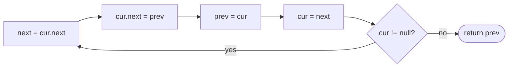

## Introduction

Given `1 → 2 → 3 → 4`, produce `4 → 3 → 2 → 1`. With an array, reversal means swapping `a[0]` with `a[n−1]`, `a[1]` with `a[n−2]` and so on, meeting in the middle. A singly linked list cannot do that: there is no way to jump to the last node, and no way to step backwards from it.

What a linked list *can* do cheaply is change where a node points. The order of a linked list is not stored anywhere except in the `next` references, so if every arrow is turned around — `2` points to `1`, `3` points to `2`, `4` points to `3`, and `1` points to `null` — the list *is* reversed, and `4` is its new head. No values move and no nodes are allocated. **Linked-list reversal** is that rewiring, done in a single pass.

It is the most frequently asked linked-list operation, for two reasons. On its own it is the standard test of whether someone can rewire references without losing the list. More importantly, it is a subroutine inside many harder problems: checking whether a list is a palindrome, reordering `L0 → Ln → L1 → Ln−1 …`, reversing nodes in groups of k, and adding numbers stored as digit lists. If you can reverse a whole list, a segment of a list, and a group at a time, those problems become assembly work.

## Before you start

- **Singly linked lists** — `ListNode`, traversal, and the dummy-node habit. See [[a4-singly-linked-lists]].
- **Recursion** — base cases and how the call stack unwinds, for the recursive version. See [[a1-recursion]].
- **Fast/slow pointers** — used together with reversal in the palindrome and reorder problems. See [[a4-fast-slow-pointers]].

## The intuition

Imagine a line of people, each with a hand on the shoulder of the person in front. You want everyone facing the other way, each hand on the shoulder of the person who used to be behind them. You walk down the line from the front. At each person you say "let go of the person in front of you, and put your hand on the person behind you instead".

There is a catch. The moment someone lets go of the person in front, nobody is holding on to the rest of the line — so before you ask them to let go, you must note who was in front of them, or you will not know where to walk next. And you need to remember who was behind them, because that is where their hand goes. So while walking you keep track of three people: the one behind (`prev`), the one you are turning (`cur`), and the one ahead (`next`).

That is the whole algorithm. The analogy is faithful; the only thing it hides is that the first person's hand goes on nobody — the old head becomes the tail and its `next` becomes `null`.

## Iterative reversal

### Deriving the steps

Think of the list as two parts while the algorithm runs. On the left is a **reversed part** that has already been turned around; on the right is the **remaining part** that still points forwards. Initially the reversed part is empty and the remaining part is the whole list. At each step, take the first node of the remaining part and move it to the front of the reversed part. When the remaining part is empty, the reversed part is the answer.

Name the references:

- `prev` — the head of the reversed part (initially `null`, the empty list).
- `cur` — the head of the remaining part (initially `head`).

Moving `cur` to the front of the reversed part is the single assignment `cur.next = prev`. But that assignment overwrites `cur.next`, which was the only reference to the rest of the remaining part. So we save it first in a third reference, `next`. That gives four lines, in an order that is forced:

```java
static ListNode reverse(ListNode head) {
    ListNode prev = null;      // head of the reversed part (empty so far)
    ListNode cur = head;       // first node not yet reversed
    while (cur != null) {
        ListNode next = cur.next;  // 1. save the rest of the list
        cur.next = prev;           // 2. flip this node's arrow
        prev = cur;                // 3. reversed part now starts at cur
        cur = next;                // 4. move on to the saved rest
    }
    return prev;
}
```

### The invariant

Before every iteration, this statement is true:

> `prev` is the head of the already-reversed nodes (ending in `null`), `cur` is the head of the untouched nodes, and together they contain every node exactly once.

Initially it holds trivially: nothing is reversed (`prev = null`) and everything is untouched (`cur = head`). Each iteration moves exactly one node from the untouched part to the front of the reversed part, so it stays true. The loop ends when `cur == null` — the untouched part is empty — so by the invariant `prev` is the head of the fully reversed list. That is why the method returns `prev`, not `cur`: when the loop ends, `cur` is always `null`.

The invariant also explains the edge cases with no extra code. An empty list never enters the loop and returns `prev = null`. A single node runs once, sets its `next` to `null` (it already was), and returns itself.

### Dry run

Reverse `1 → 2 → 3 → 4`. Each row shows the state *after* the iteration.

| Iteration | `next` (saved) | Flip | `prev` | `cur` | Reversed part | Remaining part |
|---|---|---|---|---|---|---|
| start | | | `null` | 1 | (empty) | `1 → 2 → 3 → 4` |
| 1 | 2 | `1.next = null` | 1 | 2 | `1 → null` | `2 → 3 → 4` |
| 2 | 3 | `2.next = 1` | 2 | 3 | `2 → 1 → null` | `3 → 4` |
| 3 | 4 | `3.next = 2` | 3 | 4 | `3 → 2 → 1 → null` | `4` |
| 4 | `null` | `4.next = 3` | 4 | `null` | `4 → 3 → 2 → 1 → null` | (empty) |

Return `prev`, which is `4`. Notice that at every row the two parts are two separate, well-formed lists — that is the invariant made visible, and it is a good thing to draw in an interview.



### Complexity

Each node is visited once and each iteration does four assignments, so time is **O(n)**. Three references are used regardless of length, so extra space is **O(1)**. The reversal is **in place**: it reuses the existing nodes, which means the caller's list is changed. If the caller still needs the original order, either reverse it back afterwards or build a reversed copy with new nodes (O(n) space).

## Recursive reversal

The recursive version comes from a different way of describing the problem: *to reverse a list, reverse everything after the head, then put the head at the end*.

```java
static ListNode reverseRecursive(ListNode head) {
    if (head == null || head.next == null) return head;  // 0 or 1 node: already reversed
    ListNode newHead = reverseRecursive(head.next);       // reverse everything after head
    head.next.next = head;     // the old second node is now the tail; hang head after it
    head.next = null;          // head is the new tail
    return newHead;
}
```

The line that confuses people is `head.next.next = head`. Take `1 → 2 → 3 → 4`. The recursive call reverses `2 → 3 → 4` into `4 → 3 → 2`. Crucially, the call does not touch node `1`, so `1.next` still points at `2` — and `2` is now the *tail* of the reversed part. So `head.next` is the reversed part's tail, and `head.next.next = head` hangs `1` after it. Then `head.next = null` makes `1` the new tail, which also removes the old forward link from `1` to `2` (without it, `1` and `2` would point at each other — a two-node cycle). The new head, `4`, is found at the bottom of the recursion and passed back up unchanged through every level.

The unwinding, after the recursion bottoms out at `4`:

| Returning into call for | Before the two assignments | After |
|---|---|---|
| `3` | reversed: `4`; `3.next = 4` | `4 → 3 → null` |
| `2` | reversed: `4 → 3`; `2.next = 3` | `4 → 3 → 2 → null` |
| `1` | reversed: `4 → 3 → 2`; `1.next = 2` | `4 → 3 → 2 → 1 → null` |

Time is O(n), but space is **O(n)**: one stack frame per node, because each call waits for the deeper call before it can do its work. In Java this is a real limitation, not a theoretical one. The JVM does not eliminate tail calls (and this is not a tail call anyway, since work happens after the recursive call returns), and the default thread stack holds roughly tens of thousands of such frames, depending on platform and the `-Xss` setting. In the worked example below, the recursive version throws `StackOverflowError` on a one-million-node list while the iterative version handles it instantly. Know the recursive version — interviewers ask for it as a follow-up — but write the iterative one by default.

## Reversing part of a list

Many problems reverse only a segment: "reverse the nodes from position `left` to position `right`" (1-based, inclusive). Turning `1 → 2 → 3 → 4 → 5` with `left = 2`, `right = 4` into `1 → 4 → 3 → 2 → 5`.

### What has to reconnect

A segment reversal has four nodes that matter: the node **before** the segment (`1`), the segment's **first** node (`2`), its **last** node (`4`), and the node **after** it (`5`). After reversal, `before` must point at the old last node, and the old first node must point at `after`. Most bugs in segment reversal are a missing one of those two reconnections, and the cleanest way to avoid them is a technique that keeps the list connected at every step.

### The head-insertion method

Stand on `before` and keep a reference to `first`, the segment's first node. Note that `first` will end up as the segment's *last* node, and it stays connected to the rest of the list throughout. Then, `right − left` times, take the node immediately after `first` and move it to the front of the segment, directly after `before`:

```java
static ListNode reverseBetween(ListNode head, int left, int right) {
    ListNode dummy = new ListNode(0, head);
    ListNode before = dummy;
    for (int i = 1; i < left; i++) before = before.next;   // node just before the segment
    ListNode first = before.next;                           // will end up last in the segment
    for (int i = 0; i < right - left; i++) {
        ListNode moving = first.next;     // next node to pull to the front
        first.next = moving.next;         // unlink it
        moving.next = before.next;        // insert it at the front of the segment
        before.next = moving;
    }
    return dummy.next;
}
```

Dry run on `1 → 2 → 3 → 4 → 5`, `left = 2`, `right = 4` (`before` is `1`, `first` is `2`, two moves):

| Move | `moving` | `first.next` becomes | List after the move |
|---|---|---|---|
| start | | | `1 → 2 → 3 → 4 → 5` |
| 1 | 3 | 4 | `1 → 3 → 2 → 4 → 5` |
| 2 | 4 | 5 | `1 → 4 → 3 → 2 → 5` |

After every move the list is complete and correctly connected at both ends of the segment, which is why there is no reconnection step to forget. The dummy node handles `left = 1`, where the segment starts at the head and `before` must be a node in front of it. Time is O(right), since we walk to the segment and then do `right − left` constant-time moves; extra space is O(1).

The alternative — detach the segment, reverse it with the full-list method, and splice it back — is equally valid. It needs the four references above and two explicit reconnections. Both appear in interviews; head insertion is shorter to get right.

## Reversing in groups of k

**Reverse nodes in k-group** reverses every consecutive block of `k` nodes and leaves a final block of fewer than `k` nodes as it is. With `k = 3`, `1 → 2 → 3 → 4 → 5 → 6 → 7 → 8` becomes `3 → 2 → 1 → 6 → 5 → 4 → 7 → 8`.

The structure is a loop over groups. For each group:

1. From `groupPrev` (the node before the group, initially a dummy), walk `k` steps to find the group's last node, `kth`. If the list runs out first, stop — the remaining short group stays unchanged.
2. Remember `groupNext = kth.next`, the first node after the group.
3. Reverse the group with the three-pointer loop, but start `prev` at `groupNext` instead of `null`. Then the group's old first node, which becomes its last, automatically points at the next group.
4. Connect `groupPrev.next` to `kth` (the group's new first node), and move `groupPrev` to the group's old first node, which is now the node before the next group.

Initialising `prev` to `groupNext` is the key trick: the general reversal starts `prev` at `null` because the reversed list must end in `null`; here the reversed group must end in "the rest of the list", so that is where `prev` starts. Time is O(n) — each node is counted once and reversed once — and extra space is O(1).

## Worked example

```java title="Reversal.java"
public class Reversal {

    static class ListNode {
        int val;
        ListNode next;
        ListNode(int val) { this.val = val; }
        ListNode(int val, ListNode next) { this.val = val; this.next = next; }
    }

    static ListNode fromArray(int... values) {
        ListNode dummy = new ListNode(0), tail = dummy;
        for (int v : values) { tail.next = new ListNode(v); tail = tail.next; }
        return dummy.next;
    }

    static String show(ListNode head) {
        StringBuilder sb = new StringBuilder();
        for (ListNode cur = head; cur != null; cur = cur.next) sb.append(cur.val).append(" -> ");
        return sb.append("null").toString();
    }

    static ListNode reverse(ListNode head) {
        ListNode prev = null, cur = head;
        while (cur != null) {
            ListNode next = cur.next;
            cur.next = prev;
            prev = cur;
            cur = next;
        }
        return prev;
    }

    static ListNode reverseRecursive(ListNode head) {
        if (head == null || head.next == null) return head;
        ListNode newHead = reverseRecursive(head.next);
        head.next.next = head;
        head.next = null;
        return newHead;
    }

    static ListNode reverseBetween(ListNode head, int left, int right) {
        ListNode dummy = new ListNode(0, head);
        ListNode before = dummy;
        for (int i = 1; i < left; i++) before = before.next;
        ListNode first = before.next;
        for (int i = 0; i < right - left; i++) {
            ListNode moving = first.next;
            first.next = moving.next;
            moving.next = before.next;
            before.next = moving;
        }
        return dummy.next;
    }

    static ListNode reverseKGroup(ListNode head, int k) {
        ListNode dummy = new ListNode(0, head);
        ListNode groupPrev = dummy;            // node before the current group
        while (true) {
            ListNode kth = groupPrev;
            for (int i = 0; i < k && kth != null; i++) kth = kth.next;
            if (kth == null) break;            // fewer than k nodes left: leave them as is
            ListNode groupNext = kth.next;     // first node after the group

            // reverse the group; prev starts at groupNext so the tail reconnects itself
            ListNode prev = groupNext, cur = groupPrev.next;
            while (cur != groupNext) {
                ListNode next = cur.next;
                cur.next = prev;
                prev = cur;
                cur = next;
            }
            ListNode oldFirst = groupPrev.next;  // now the last node of the group
            groupPrev.next = kth;                // kth is now the first node of the group
            groupPrev = oldFirst;
        }
        return dummy.next;
    }

    public static void main(String[] args) {
        System.out.println(show(reverse(fromArray(1, 2, 3, 4))));
        System.out.println(show(reverse(fromArray(7))));
        System.out.println(show(reverse(null)));
        System.out.println(show(reverseRecursive(fromArray(1, 2, 3, 4))));
        System.out.println(show(reverseBetween(fromArray(1, 2, 3, 4, 5), 2, 4)));
        System.out.println(show(reverseBetween(fromArray(1, 2, 3), 1, 3)));
        System.out.println(show(reverseKGroup(fromArray(1, 2, 3, 4, 5, 6, 7, 8), 3)));
        System.out.println(show(reverseKGroup(fromArray(1, 2, 3, 4), 2)));

        ListNode big = null;
        for (int i = 0; i < 1_000_000; i++) big = new ListNode(i, big);
        ListNode reversed = reverse(big);    // big now names the TAIL; use the returned head
        System.out.println("iterative, 1,000,000 nodes: new head = " + reversed.val);
        try {
            reverseRecursive(reversed);      // the full 1,000,000-node list
            System.out.println("recursive finished");
        } catch (StackOverflowError e) {
            System.out.println("recursive, 1,000,000 nodes: StackOverflowError");
        }
    }
}
```

```output
4 -> 3 -> 2 -> 1 -> null
7 -> null
null
4 -> 3 -> 2 -> 1 -> null
1 -> 4 -> 3 -> 2 -> 5 -> null
3 -> 2 -> 1 -> null
3 -> 2 -> 1 -> 6 -> 5 -> 4 -> 7 -> 8 -> null
2 -> 1 -> 4 -> 3 -> null
iterative, 1,000,000 nodes: new head = 0
recursive, 1,000,000 nodes: StackOverflowError
```

A few observations. `reverseBetween(…, 1, 3)` reverses the entire list, which only works because the dummy gives position 1 a predecessor. In the k-group call on eight nodes, the final group `7 → 8` has fewer than three nodes and is left alone. The last two lines show why the iterative version is the default in Java: identical logic, but the recursive one needs a stack frame per node. The exact depth at which the recursive version fails depends on the JVM's thread stack size, but with default settings a million frames is far beyond it.

Notice the variable `reversed` in `main`. After `reverse(big)`, the variable `big` still references the node it always did — the one holding 999,999 — but that node is now the *tail*, and its `next` is `null`. Passing `big` to `reverseRecursive` would hand it a one-node list, which returns immediately and would make the stack-overflow demonstration silently print "recursive finished". This is the same mistake as returning `head` instead of `prev`: after an in-place reversal, every old reference still points at the same node, but that node sits at the other end of the list. Always continue from the head the reversal returns.

## Reversal as a building block

Several well-known problems are reversal plus one other technique:

- **Palindrome linked list.** Find the end of the first half with fast/slow pointers, reverse the second half, compare the halves, then reverse the second half back. See [[a4-fast-slow-pointers]] for the full code.
- **Reorder list** (`L0 → Ln → L1 → Ln−1 → …`). Split at the middle, reverse the second half, then interleave the two halves one node at a time — the interleaving is a merge without comparisons, as in [[a4-merge-lists]].
- **Add two numbers stored most-significant digit first.** Reverse both lists so the least significant digits come first, add with a carry while building the result at the head, and the result comes out in the right order. (When the digits are already stored least-significant first, no reversal is needed.)
- **Swap nodes in pairs.** This is k-group reversal with `k = 2`.

Recognising these is the real skill. The signal is any problem that needs to process a singly linked list from the back, or compare its front with its back, in O(1) extra space.

## In real systems

In-place reversal itself is rare in production code — `Collections.reverse` on an `ArrayList` swaps elements by index, and `Deque` lets you read from either end — but the idea of building a sequence by **prepending** and reversing once at the end is common. Functional languages build immutable lists by prepending in O(1) and reverse once when done, because appending to an immutable singly linked list costs O(n) each time. Some lock-free stack and queue designs similarly push items onto a singly linked list and reverse the batch when they need first-in-first-out order. Reversal also appears in garbage collectors' pointer-reversal marking (the Deutsch–Schorr–Waite algorithm), which temporarily reverses pointers to traverse an object graph without a separate stack and restores them on the way back.

## Trade-offs and alternatives

| Approach | Time | Extra space | Notes |
|---|---|---|---|
| Iterative three-pointer | O(n) | O(1) | The default; mutates the input |
| Recursive | O(n) | O(n) stack | Concise; `StackOverflowError` on long lists in Java |
| Push values onto a stack, rewrite or rebuild | O(n) | O(n) | Easy to reason about; usually not accepted in interviews |
| Build a reversed copy by prepending new nodes | O(n) | O(n) | Leaves the original intact |

Choose the iterative method unless the original list must remain unchanged, in which case copy by prepending — that is still a single pass.

## Common mistakes

> [!MISTAKE] Flipping before saving
> Writing `cur.next = prev` before `next = cur.next` loses the rest of the list after the first node. The save must be the first line of the loop body.

**Returning `cur` or `head`.** When the loop ends, `cur` is `null`, and `head` is the new *tail*. The new head is `prev`.

**Using an old reference after reversing.** Any variable that pointed at the old head now points at the tail of a one-node "list" from its own perspective. Use the returned head — the worked example shows how easily this slips in.

**Forgetting `head.next = null` in the recursive version.** Without it, the old head and the old second node point at each other, creating a cycle that makes any later traversal loop forever.

**Losing a segment boundary.** When reversing a sublist by detaching it, both reconnections are needed: `before.next = newSegmentHead` and `oldSegmentHead.next = after`. Head insertion avoids the problem because the list stays connected throughout.

**Reversing a short final group in k-group.** Count `k` nodes before reversing anything; if fewer remain, stop.

## Interview perspective

Reversal is often the first linked-list question in an interview, and the interviewer is less interested in the answer than in how you get there. Draw the two parts — reversed and remaining — and state the invariant.

> [!INTERVIEW] A strong explanation
> "I keep `prev` as the head of the reversed part and `cur` as the head of the rest. Each step I save `cur.next`, point `cur` back at `prev`, then advance both. When `cur` is null everything is reversed and `prev` is the new head. O(n) time and O(1) space; empty and single-node lists need no special case."

Follow-ups to expect:

- **Write it recursively.** Explain `head.next.next = head` and `head.next = null`, and state the O(n) stack cost.
- **Reverse between positions `left` and `right` in one pass.** Dummy, walk to `before`, then head-insert `right − left` times.
- **Reverse in k-groups.** Count first; reverse with `prev` starting at the next group; reconnect and advance.
- **Can you do it without modifying the list?** Only by using O(n) space: a copy, a stack, or recursion that prints on the way back.
- **Is the reversal stable / does it allocate?** It allocates nothing; it reuses every node and changes only `next` references.

## Practice

1. **Reverse linked list.** Iteratively, then recursively; explain both complexities.
2. **Reverse linked list II.** Reverse positions `left` to `right` in one pass; test `left = 1` and `left = right`.
3. **Swap nodes in pairs.** Solve it directly, then as k-group with `k = 2`.
4. **Reverse nodes in k-group.** O(1) extra space; leave a short final group alone.
5. **Palindrome linked list.** Combine with the fast/slow split and restore the list.
6. **Reorder list.** Split, reverse, interleave.
7. **Add two numbers II.** Digits are stored most significant first; solve once with reversal and once with two stacks, and compare the space used.

The DSA explorer lists the matching problems under this topic; start with *Reverse Linked List* and *Reverse Linked List II*.

```quiz
Q: In the iterative reversal, why must `ListNode next = cur.next;` come before `cur.next = prev;`?
- [ ] Because Java requires variables to be declared before use
- [x] Because `cur.next = prev` overwrites the only reference to the rest of the list
- [ ] Because `prev` is null on the first iteration
- [ ] It does not matter; the two lines can be swapped
> Once `cur.next` points backwards, nothing in the program still refers to the node that followed `cur`. Saving it first is what lets the loop continue to the remaining nodes.

Q: After `ListNode r = reverse(head);` on the list `1 → 2 → 3`, what does `head` refer to?
- [ ] The node holding 3, which is the new head
- [x] The node holding 1, which is now the tail and points to null
- [ ] null
- [ ] A copy of the original list
> In-place reversal moves no nodes; it only changes their `next` references. `head` still names the same node object, which used to be first and is now last. The new head is the returned `r`.

Q: In the recursive version, what goes wrong if you omit `head.next = null`?
- [ ] The method returns the wrong head
- [ ] Nothing; the line is only for clarity
- [x] The old head and the old second node point at each other, forming a cycle
- [ ] It throws `NullPointerException`
> `head.next.next = head` makes the old second node point back at head, but head still points forward at the old second node. Clearing `head.next` removes that forward link and makes head the tail.
```

## Quick revision {#quick-revision}

- Iterative: `prev = null, cur = head`; loop: save `next`, `cur.next = prev`, `prev = cur`, `cur = next`; return `prev`.
- Invariant: `prev` heads the reversed part, `cur` heads the untouched part; together they hold every node once.
- O(n) time, O(1) space, in place; empty and single-node lists work without special cases.
- Recursive: reverse `head.next`, then `head.next.next = head; head.next = null;` return the deep result. O(n) stack — overflows on long lists in Java.
- After reversal, old references point at the same nodes in new positions; use the returned head.
- Sublist `[left, right]`: dummy, walk to `before`, keep `first`; repeat `right − left` times: pull `first.next` to directly after `before`.
- k-group: count k from `groupPrev`; stop if short; reverse with `prev = groupNext`; `groupPrev.next = kth`; `groupPrev = oldFirst`.
- Building block for palindrome, reorder list, add two numbers II, swap pairs.

## Key takeaways {#key-takeaways}

- A linked list's order lives only in its `next` references, so turning every reference around reverses the list without moving any values.
- Save `cur.next` before flipping it; the three references `prev`, `cur` and `next` exist precisely to avoid losing the list.
- The invariant "reversed part plus remaining part" explains the loop, the return value and every edge case.
- The recursive version is elegant but uses a stack frame per node; prefer the iterative version in Java.
- Partial reversals hinge on reconnecting the segment's boundaries; head insertion keeps the list connected at every step.
- Many harder problems — palindrome, reorder, k-group — are reversal combined with one other technique.
