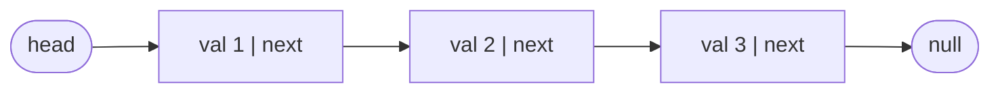
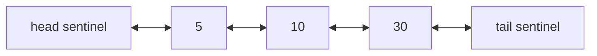

## Introduction

An array stores its elements side by side in one block of memory. That layout is what makes `a[i]` instant — the address of element `i` is the start address plus `i` times the element size — but it also makes some operations expensive. To insert a value at the front of an array of one million elements, every existing element must shift one place to the right. To grow an array past its capacity, a bigger block must be allocated and everything copied across.

A **linked list** takes the opposite approach. Each element lives in its own small object, called a **node**, which stores the value and a **reference** (a pointer) to the next node. The nodes can be anywhere in memory; the references are what hold the sequence together. To insert at the front you create one node and point it at the old first node. Nothing shifts, nothing is copied, and the cost is the same whether the list holds ten elements or ten million.

The price is that you lose instant indexing. There is no arithmetic that tells you where the 500th node lives — you have to start at the first node and follow 499 references. Every design choice around linked lists comes from this trade: **cheap rewiring at a position you already hold, expensive arrival at a position you do not**.

Linked lists matter to an engineer for two reasons. In production code they appear inside other structures — the buckets of Java's `HashMap`, the recency order in a Least Recently Used (LRU) cache, the run queues in operating-system schedulers, the free lists of memory allocators. In interviews they are the standard test of careful reference manipulation: almost every linked-list question is easy to describe and easy to get subtly wrong. This lesson builds the foundation — the node, the core operations, the dummy-node habit, and the doubly linked variant — that the rest of the module ([[a4-fast-slow-pointers]], [[a4-reversal]], [[a4-merge-lists]] and [[a4-lru-style]]) relies on.

## Before you start

- **Classes and references in Java** — creating objects with `new`, and the fact that a variable of class type holds a reference to an object rather than the object itself. See [[a1-custom-classes]].
- **Big-O notation** — reading O(1) and O(n). See [[a1-time-complexity]].
- **Dynamic arrays** — how `ArrayList` stores elements, so you can compare the two. See [[a1-arraylist]].

## The intuition

Picture a scavenger hunt. You are handed the first clue. It tells you something useful (the value) and where the next clue is hidden (the reference). You cannot jump to clue number seven; you have to visit clues one to six first. But if the organiser wants to add a new clue between clue three and clue four, they only need to rewrite clue three to point at the new hiding place and write the new clue to point at where clue four is. No other clue changes.

That is exactly how a linked list behaves, and the analogy holds well. Where it stops working: in a program, losing the only clue that points at the rest of the hunt means the remaining nodes are unreachable forever — Java's garbage collector will reclaim them. There is no "searching the park" to recover them. That is why the most important habit in linked-list code is to **save a reference before you overwrite the one that leads to it**.

## The node and the list

A singly linked list needs only one class:

```java title="ListNode.java"
class ListNode {
    int val;
    ListNode next;          // null when this is the last node

    ListNode(int val) { this.val = val; }
    ListNode(int val, ListNode next) { this.val = val; this.next = next; }
}
```

The list itself is represented by a single reference to its first node, conventionally called **`head`**. The last node is the **tail**; its `next` is `null`, which is how code knows the list has ended. An empty list is `head == null`. This is the representation coding interviews use (LeetCode's `ListNode` is identical), so it is the one we use throughout the module.

The list `1 → 2 → 3` is three objects on the heap and one local variable pointing at the first:



### What it costs in memory

Each node is a full Java object. On a typical 64-bit HotSpot JVM with compressed references, an object header takes 12 bytes, the `int` takes 4 and the `next` reference takes 4, and objects are padded to a multiple of 8 — so each `ListNode` occupies about **24 bytes** to store 4 bytes of data. An `int[]` stores the same value in 4 bytes. The nodes are also scattered across the heap rather than adjacent, so walking a list jumps around memory and makes poor use of the CPU cache, which loads memory in contiguous 64-byte lines. Arrays benefit from that; linked lists mostly do not. This is the main reason linked lists are slower in practice than their Big-O suggests, and why `ArrayList` is the default choice in Java.

## Core operations on a singly linked list

### Traversal

Every operation that needs to look at the elements walks the list with a cursor that starts at `head` and follows `next` until it falls off the end:

```java
for (ListNode cur = head; cur != null; cur = cur.next) {
    // use cur.val
}
```

The loop condition is `cur != null`, not `cur.next != null`. With `cur.next != null` the loop stops *on* the last node without processing it, and it crashes with `NullPointerException` when the list is empty, because `cur` is `null` before the first check. Some algorithms do want to stop on the last node — appending at the tail, for instance — and those use `cur.next != null` deliberately, after checking that `head` is not `null`.

Counting the length and finding the node at an index are both traversals, and both are O(n): there is no faster way to learn where node `i` lives than to walk there.

### Inserting

**At the head** is O(1): create a node whose `next` is the current head, and make it the new head.

```java
head = new ListNode(val, head);
```

**After a node you hold** is also O(1). Suppose `node` holds `2` in `1 → 2 → 3` and we want `1 → 2 → 5 → 3`. Two references must change, and the **order matters**:

```java
ListNode fresh = new ListNode(5);
fresh.next = node.next;   // 1. the new node points at 3
node.next = fresh;        // 2. then 2 points at the new node
```

If you swap the two lines, `node.next = fresh` runs first and the only reference to `3` is overwritten. The next line then sets `fresh.next = node.next`, which is `fresh` itself — the new node points at itself, and the rest of the list is gone. This is the save-before-you-rewire rule in its simplest form: **link the new node to the rest of the list before you link the list to the new node**.

**At the tail** is O(n) if you only have `head`, because you must walk to the last node first. If the list keeps a separate `tail` reference (as `java.util.LinkedList` does), appending becomes O(1). Building a list from left to right therefore keeps a `tail` cursor, as you will see in the worked example.

**Before a node you hold** is the awkward one. In a singly linked list a node does not know its predecessor, so you must walk from `head` to find it — O(n). This single weakness is what the doubly linked list exists to fix.

### Deleting

You delete a node by making its predecessor skip over it: `prev.next = prev.next.next`. Nothing needs to be freed explicitly; once no reference reaches the removed node, the garbage collector reclaims it. Like insertion, deletion is O(1) **once you hold the predecessor**, and O(n) if you must search for it.

Deleting the **head** is different: it has no predecessor, so instead you move the head forward with `head = head.next`. Code that deletes by value therefore usually ends up with two branches — one for "the node to delete is the head" and one for "it is somewhere later" — and the head case often has to repeat, because after deleting the head the new head might also match. The dummy node removes this split entirely.

## The dummy head

A **dummy node** (also called a **sentinel**) is an extra node placed in front of the real head. It holds no meaningful value; its only job is to guarantee that *every real node has a predecessor*. With that guarantee, "delete the head" becomes the same operation as "delete any other node", and "insert before the head" is the same as "insert after a node".

```java
ListNode dummy = new ListNode(0, head);   // dummy.next is the real head
ListNode prev = dummy;
while (prev.next != null) {
    if (prev.next.val == target) {
        prev.next = prev.next.next;       // skip it; prev stays where it is
    } else {
        prev = prev.next;
    }
}
return dummy.next;                        // the head may have changed
```

Two details in this loop are easy to miss. First, the cursor is `prev`, and the code inspects `prev.next` — you always stand on the node *before* the one you might remove, because that is the node whose reference has to change. Second, after a deletion `prev` does not advance. The node that slid into `prev.next` has not been examined yet, and it might also need deleting. Advancing anyway is a classic bug that leaves the second of two adjacent matches in the list.

Finally, the method returns `dummy.next`, not `head`. If the original head was deleted, the local variable `head` still points at the removed node; `dummy.next` always points at whatever the list now starts with — possibly `null`.

> [!TIP] When to reach for a dummy node
> Use one whenever the head might be removed, replaced or inserted before — deleting by value, merging lists, partitioning, removing the nth node from the end. It costs one allocation and saves a whole category of special cases.

## Worked example

Here is a complete program with the operations above. `fromArray` builds a list using a dummy node and a `tail` cursor so that each append is O(1).

```java title="LinkedListBasics.java"
public class LinkedListBasics {

    static class ListNode {
        int val;
        ListNode next;
        ListNode(int val) { this.val = val; }
        ListNode(int val, ListNode next) { this.val = val; this.next = next; }
    }

    static ListNode fromArray(int... values) {
        ListNode dummy = new ListNode(0);
        ListNode tail = dummy;
        for (int v : values) {
            tail.next = new ListNode(v);
            tail = tail.next;
        }
        return dummy.next;
    }

    static String show(ListNode head) {
        StringBuilder sb = new StringBuilder();
        for (ListNode cur = head; cur != null; cur = cur.next) {
            sb.append(cur.val).append(" -> ");
        }
        return sb.append("null").toString();
    }

    static int length(ListNode head) {
        int count = 0;
        for (ListNode cur = head; cur != null; cur = cur.next) count++;
        return count;
    }

    /** Returns the node at position index (0-based), or null if the list is shorter. */
    static ListNode get(ListNode head, int index) {
        ListNode cur = head;
        for (int i = 0; i < index && cur != null; i++) cur = cur.next;
        return cur;
    }

    static ListNode insertAtHead(ListNode head, int val) {
        return new ListNode(val, head);          // the new node becomes the head
    }

    static void insertAfter(ListNode node, int val) {
        node.next = new ListNode(val, node.next); // link to the rest first, then splice in
    }

    /** Removes every node whose value equals target and returns the (possibly new) head. */
    static ListNode removeAll(ListNode head, int target) {
        ListNode dummy = new ListNode(0, head);
        ListNode prev = dummy;
        while (prev.next != null) {
            if (prev.next.val == target) {
                prev.next = prev.next.next;      // skip it; prev stays put
            } else {
                prev = prev.next;
            }
        }
        return dummy.next;
    }

    public static void main(String[] args) {
        ListNode head = fromArray(1, 2, 3);
        System.out.println(show(head) + "   length " + length(head));

        head = insertAtHead(head, 0);
        System.out.println(show(head));

        insertAfter(get(head, 2), 5);            // after the node holding 2
        System.out.println(show(head));

        System.out.println("node at index 4: " + get(head, 4).val);
        System.out.println("node at index 9: " + get(head, 9));

        head = fromArray(7, 7, 1, 7, 2, 7);
        System.out.println(show(removeAll(head, 7)));
        System.out.println(show(removeAll(fromArray(7, 7), 7)));
    }
}
```

```output
1 -> 2 -> 3 -> null   length 3
0 -> 1 -> 2 -> 3 -> null
0 -> 1 -> 2 -> 5 -> 3 -> null
node at index 4: 3
node at index 9: null
1 -> 2 -> null
null
```

`insertAfter` is written as one line, `node.next = new ListNode(val, node.next)`. It is safe because Java evaluates the right-hand side completely — including reading the old `node.next` — before it assigns to `node.next`. The new node is created already pointing at the rest of the list, so the rewiring order is correct automatically.

### Dry run: removing every 7

Trace `removeAll` on `7 → 7 → 1 → 7 → 2 → 7`. The column `prev` shows which node the cursor stands on (`D` is the dummy); `prev.next` is the node being inspected.

| Step | `prev` | `prev.next` | Match? | Action | List after the step |
|---|---|---|---|---|---|
| 1 | D | 7 (1st) | yes | skip it | `D → 7 → 1 → 7 → 2 → 7` |
| 2 | D | 7 (2nd) | yes | skip it | `D → 1 → 7 → 2 → 7` |
| 3 | D | 1 | no | `prev = 1` | unchanged |
| 4 | 1 | 7 | yes | skip it | `D → 1 → 2 → 7` |
| 5 | 1 | 2 | no | `prev = 2` | unchanged |
| 6 | 2 | 7 | yes | skip it | `D → 1 → 2` |
| — | 2 | `null` | | loop ends | return `dummy.next` = `1` |

Steps 1 and 2 are the case that breaks code without a dummy: the head is deleted twice in a row, and `prev` correctly stays on the dummy both times. In the last call of `main`, every node matches, the dummy ends up pointing at `null`, and the method correctly returns an empty list.

## Two tricks worth knowing

### Deleting a node when you are not given the head

A well-known interview question gives you only a reference to a node in the middle of a list — not the head — and asks you to delete it. You cannot reach the predecessor, so you cannot make it skip the node. The trick is to make the node *become* its successor and delete the successor instead:

```java
static void deleteNode(ListNode node) {   // node must not be the tail
    node.val = node.next.val;              // copy the next node's value...
    node.next = node.next.next;            // ...then unlink the next node
}
```

Given `4 → 5 → 1 → 9` and the node holding `5`, the list becomes `4 → 1 → 9`. Be clear about what really happened: the *object* that held `5` is still in the list, now holding `1`; the object that held `1` is the one removed. That distinction matters in real code, where other parts of the program might hold references to those objects, and it is why the trick cannot delete the tail — there is no successor to copy from. Mention both limitations if you use it in an interview.

### Copying a list with extra pointers

A harder variant gives each node a second reference, `random`, that may point to any node in the list or to `null`, and asks for a **deep copy**: new nodes only, with every `next` and `random` pointing into the new list. The difficulty is that when you copy node A, the node its `random` points to may not have been copied yet. A `HashMap` from original node to copy solves it in two passes: the first pass creates every copy, the second wires the references by looking up `copyOf.get(original.next)` and `copyOf.get(original.random)`. Since `HashMap.get(null)` returns `null` when no `null` key was stored, the tail and empty `random` references need no special case. The cost is O(n) time and O(n) extra space; an O(1)-space version interleaves copies between originals (`A → A' → B → B'`), wires `random`, then separates the two lists.

## Complexity summary

| Operation | Singly linked (head only) | Singly linked (head + tail) | Array / `ArrayList` |
|---|---|---|---|
| Access index `i` | O(n) | O(n) | O(1) |
| Search by value | O(n) | O(n) | O(n), or O(log n) if sorted |
| Insert / delete at head | O(1) | O(1) | O(n) — shift everything |
| Insert at tail | O(n) | O(1) | O(1) amortised |
| Delete at tail | O(n) | O(n) — need the predecessor | O(1) |
| Insert / delete after a held node | O(1) | O(1) | O(n) |
| Extra memory per element | one reference + object header | same | none beyond spare capacity |

Notice the "delete at tail" row: even with a `tail` reference, a singly linked list cannot remove its last node quickly, because the new tail is the old tail's predecessor and only a walk from the head can find it.

Space for the algorithms in this module is usually quoted as *extra* space. Rewiring existing nodes needs O(1) extra space. Recursion over a list uses one stack frame per node — O(n) — and in Java a recursive walk over a list of a few hundred thousand nodes can throw `StackOverflowError`, because the JVM does not eliminate tail calls. Prefer loops for long lists.

```quiz
Q: You hold a reference `node` in a singly linked list and run `node.next = fresh; fresh.next = node.next;`. What is the result?
- [ ] `fresh` is inserted correctly after `node`
- [x] `fresh` points at itself and the nodes that followed `node` are lost
- [ ] A `NullPointerException` is thrown
- [ ] `fresh` is inserted before `node`
> The first line overwrites the only reference to the rest of the list. The second line then reads `node.next`, which is now `fresh`, so `fresh.next = fresh`. Always link the new node to the rest of the list first, then link the list to the new node.

Q: Why does `removeAll` return `dummy.next` instead of `head`?
- [ ] Because `head` is always `null` after the loop
- [ ] Because the dummy node holds the first value
- [x] Because the original head may have been removed, and only `dummy.next` tracks the current first node
- [ ] Because returning `head` would create a cycle
> The local variable `head` still references the original first node even if it was unlinked. `dummy.next` is updated by every deletion at the front, so it always names the real first node, or `null` if every node was removed.

Q: Which operation is O(n) in a singly linked list even when you also keep a `tail` reference?
- [ ] Inserting at the head
- [ ] Appending at the tail
- [x] Deleting the last node
- [ ] Inserting after a node you already hold
> Deleting the tail requires setting the predecessor's `next` to `null`, and in a singly linked list the only way to find the predecessor is to walk from the head. A doubly linked list fixes this with a `prev` reference.
```

## Doubly Linked Lists {#a4-doubly-linked-lists}

A **doubly linked list** is a linked list in which every node stores two references: `next`, to the node after it, and `prev`, to the node before it. That one extra field removes the main weakness of the singly linked list — not knowing your predecessor — and with it, deleting a node you hold, inserting before it, and walking backwards all become O(1) per step.

### Why the extra pointer matters

In a singly linked list, deleting node `x` means changing the `next` of the node before `x`. If all you hold is `x`, finding that node takes a walk from the head: O(n). In a doubly linked list the predecessor is `x.prev`, available immediately, so deletion is a constant number of reference updates whatever the list's length.

This is not a minor convenience. Several important structures need to *find* a node by some other route — usually a hash map from key to node — and then remove it from the middle of an ordering. The LRU cache is the standard example: a `HashMap` finds the entry for a key in O(1), and the doubly linked list lets you pull that entry out of the recency order and move it to the front in O(1). With a singly linked list the move would cost O(n), and the whole design would collapse. That design is taught in full in [[a4-lru-style]].

### Unlinking and inserting

Removing node `x` from `A ⇄ x ⇄ B` means making `A` and `B` point at each other. Two references change, one in each neighbour:

```java
x.prev.next = x.next;   // A now skips forward over x to B
x.next.prev = x.prev;   // B now skips backward over x to A
```

Forgetting the second line is the most common doubly-linked bug. Forward traversal still looks correct, but `B.prev` still points at the removed node, so the next backward walk — or the next removal of `B` — silently corrupts the list. The rule to hold in your head is the **doubly linked invariant**: for every node `n` with neighbours, `n.next.prev == n` and `n.prev.next == n`. Every operation must leave it true.

Inserting `node` after `anchor` touches four references. Set the new node's own two fields first, while `anchor.next` still names the old successor, then repair the two neighbours:

```java
node.prev = anchor;
node.next = anchor.next;
anchor.next.prev = node;   // old successor now points back at node
anchor.next = node;        // must come last: it overwrites the reference used above
```

The order of the last two lines matters for the same reason as in the singly linked case: `anchor.next = node` destroys the only direct reference to the old successor, so it goes last.

### Sentinels at both ends

The code above assumed that `x.prev`, `x.next` and `anchor.next` are never `null`. In a plain doubly linked list that is false at the ends — the first node's `prev` and the last node's `next` are `null` — and every operation sprouts `if` checks, plus updates to separate `head` and `tail` fields when the first or last node changes.

The clean fix is two **sentinel nodes**, one permanently at each end. They hold no data and are never removed. An empty list is `head ⇄ tail`. Every real node sits strictly between them, so it always has a real `prev` and `next`, and the four-line insert and two-line unlink work everywhere with no branches. "Add first" is `insertAfter(head, node)`; "add last" is `insertAfter(tail.prev, node)`; "remove last" is `remove(tail.prev)` after checking the list is not empty.



### A complete implementation

```java title="DoublyLinkedList.java"
import java.util.StringJoiner;

public class DoublyLinkedList {

    static class Node {
        int val;
        Node prev, next;
        Node(int val) { this.val = val; }
    }

    // Sentinels: never hold data, never removed. Real nodes live strictly between them.
    private final Node head = new Node(0);
    private final Node tail = new Node(0);
    private int size;

    DoublyLinkedList() {
        head.next = tail;
        tail.prev = head;
    }

    /** Links node directly after anchor. Every real node has non-null prev and next. */
    private void insertAfter(Node anchor, Node node) {
        node.prev = anchor;
        node.next = anchor.next;
        anchor.next.prev = node;
        anchor.next = node;
        size++;
    }

    /** Unlinks a node that is currently in this list, in O(1). */
    void remove(Node node) {
        node.prev.next = node.next;
        node.next.prev = node.prev;
        node.prev = node.next = null;   // optional: helps catch use-after-remove bugs
        size--;
    }

    Node addFirst(int val) { Node n = new Node(val); insertAfter(head, n); return n; }
    Node addLast(int val)  { Node n = new Node(val); insertAfter(tail.prev, n); return n; }

    Node removeLast() {
        if (size == 0) return null;
        Node last = tail.prev;
        remove(last);
        return last;
    }

    void moveToFront(Node node) {
        remove(node);
        insertAfter(head, node);
    }

    String forward() {
        StringJoiner sj = new StringJoiner(" <-> ", "[", "]");
        for (Node cur = head.next; cur != tail; cur = cur.next) sj.add(String.valueOf(cur.val));
        return sj.toString();
    }

    String backward() {
        StringJoiner sj = new StringJoiner(" <-> ", "[", "]");
        for (Node cur = tail.prev; cur != head; cur = cur.prev) sj.add(String.valueOf(cur.val));
        return sj.toString();
    }

    public static void main(String[] args) {
        DoublyLinkedList list = new DoublyLinkedList();
        list.addLast(10);
        Node twenty = list.addLast(20);
        list.addLast(30);
        list.addFirst(5);
        System.out.println(list.forward() + "  size " + list.size);
        System.out.println(list.backward());

        list.remove(twenty);                 // O(1): we hold the node
        System.out.println(list.forward());

        Node thirty = list.tail.prev;
        list.moveToFront(thirty);
        System.out.println(list.forward());

        System.out.println("removed " + list.removeLast().val + " -> " + list.forward());
        list.removeLast();
        list.removeLast();
        System.out.println(list.forward() + "  size " + list.size + ", removeLast = "
            + list.removeLast());
    }
}
```

```output
[5 <-> 10 <-> 20 <-> 30]  size 4
[30 <-> 20 <-> 10 <-> 5]
[5 <-> 10 <-> 30]
[30 <-> 5 <-> 10]
removed 10 -> [30 <-> 5]
[]  size 0, removeLast = null
```

Walk through what the output proves. The backward print uses only `prev` references and produces the exact reverse of the forward print, which confirms that every insertion kept the invariant. `remove(twenty)` runs in constant time because the caller kept the node returned by `addLast` — this "keep a handle to the node" pattern is precisely how a hash map plus doubly linked list works. `moveToFront` is an unlink followed by an insert after the head sentinel, and it is the core operation of an LRU cache. The traversals stop at the sentinels (`cur != tail`), never at `null`, and `removeLast` on an empty list is handled by the size check rather than by special cases inside `remove`.

### Variations and real uses

A **circular doubly linked list** joins the last node back to the first, so there is no `null` anywhere. A single sentinel can then play the role of both ends: `sentinel.next` is the first node and `sentinel.prev` is the last. The Linux kernel's `list_head` is exactly this — a circular doubly linked list with one sentinel, embedded directly inside the structures it links (an *intrusive* list), and used for process lists, timers and many driver queues.

In Java, `java.util.LinkedList` is a doubly linked list with `first` and `last` fields instead of sentinels, which is why it can implement `Deque` with O(1) operations at both ends. `LinkedHashMap` threads a doubly linked list through its hash entries to remember insertion or access order, which makes it a ready-made LRU cache. Browser back/forward history, text-editor buffers and undo stacks are also commonly described as doubly linked structures, because they move in both directions from a current position. A related interview problem flattens a *multilevel* doubly linked list, where some nodes also have a `child` list that must be spliced in between a node and its `next` — a direct exercise in the four-reference insert.

### Costs

Every node carries one more reference, so a doubly linked node is larger (about 24 bytes for the node in `LinkedList` before counting the boxed `Integer` it points to), and every insert or delete writes twice as many references, which means twice as many chances to forget one. Use a doubly linked list when you genuinely need O(1) removal of a node found by some other route, or bidirectional traversal; when you only ever walk forwards and change the front, a singly linked list does the job with less memory and less code.

> [!MISTAKE] Updating only one direction
> Unlinking with `x.prev.next = x.next` alone leaves `x.next.prev` pointing at the removed node. Forward iteration hides the bug, so test every doubly linked structure by printing it backwards too, as the example does.

## In real systems

**Hash table buckets.** Java's `HashMap` resolves collisions by chaining: each bucket holds a singly linked list of entries whose keys hash to it. Since Java 8, a bucket whose chain reaches eight entries is converted to a red-black tree once the table has at least 64 buckets, because a long chain turns an O(1) lookup into O(n).

**Queues and schedulers.** `ConcurrentLinkedQueue` and `LinkedBlockingQueue` are built from linked nodes, because adding at the tail and removing at the head never has to shift or copy elements. Operating-system schedulers keep ready-to-run threads on linked run queues for the same reason.

**Memory allocators.** A **free list** links the unused blocks of memory through the blocks themselves: each free block stores a pointer to the next free block. Allocation pops the head; freeing pushes a block back. No separate bookkeeping array is needed.

**Ordering alongside lookup.** Whenever a system needs both "find by key" and "maintain an order that changes" — LRU caches, `LinkedHashMap`, the order of entries in a connection pool — the pattern is a hash map whose values are nodes in a doubly linked list.

## Trade-offs and alternatives

| Structure | Strengths | Weaknesses | Choose it when |
|---|---|---|---|
| Array / `ArrayList` | O(1) index access, compact, cache-friendly | O(n) insert/delete except at the end | The default for sequences in Java |
| `ArrayDeque` | O(1) amortised at both ends, compact | No O(1) removal from the middle | You need a stack or queue |
| Singly linked list | O(1) insert/delete at the front or after a held node | O(n) access, extra memory, poor locality | Interview problems; lock-free queues; free lists |
| Doubly linked list | O(1) removal of any held node, both directions | Most memory per element, more pointer updates | A map points at nodes whose order changes (LRU) |

In everyday Java, prefer `ArrayList` for lists and `ArrayDeque` for stacks and queues. Even `java.util.LinkedList`, despite O(1) insertion at both ends, is usually slower than `ArrayDeque` in practice because of allocation and cache misses. Linked lists win when you hold references to nodes and need to splice them in and out without searching — and that is exactly the situation most linked-list interview problems create.

Binary search is a clear case where a linked list loses. Even if the values are sorted, reaching the middle node costs O(n), so the O(log n) benefit of [[a3-binary-search]] disappears.

## Common mistakes

**Losing the rest of the list.** Overwriting `node.next` before saving the old value leaves the remaining nodes unreachable. Before any assignment to a `next` field, ask: "is this the only reference to something I still need?" If yes, save it in a local variable first.

**Dereferencing `null`.** `cur.next.val` crashes on the last node, and `head.next` crashes on an empty list. Before writing `x.next`, be able to say why `x` cannot be `null` at that point — usually because of the loop condition.

**Special-casing the head by hand.** Separate branches for "deleting the head" are where bugs hide, especially when several leading nodes must be deleted. A dummy node makes the head an ordinary node.

**Advancing after a deletion.** In a delete-while-walking loop, the node that moves into `prev.next` has not been checked yet. Advance `prev` only when you did *not* delete.

**Accidental cycles.** Rewiring nodes in the wrong order can make the last node point back into the list. Any later traversal then never reaches `null` and loops forever. When debugging, print a bounded number of nodes, and see [[a4-cycle-detection]] for how to detect cycles deliberately.

**Comparing values instead of nodes.** "The same node" means the same object (`a == b`), not equal values (`a.val == b.val`). Problems such as [[a4-intersection]] depend on this distinction.

## Interview perspective

Linked-list questions test whether you can manipulate references precisely under pressure. Interviewers watch for three habits: drawing the boxes and arrows before writing code, saving references before rewiring, and reaching for a dummy node when the head can change.

> [!INTERVIEW] Narrate the pointers
> "I'll put a dummy node in front of the head so deleting the first node is no different from deleting any other. I'll stand on the node *before* the candidate, because that's the reference I need to change, and I'll only advance when I don't delete. At the end I return `dummy.next`, since the head may have been removed. It's O(n) time and O(1) extra space."

Questions you should be able to answer:

- **Why is access by index O(n)?** Nodes are not contiguous, so the only route to node `i` is following `i` references from the head.
- **Why use a dummy node?** It gives every real node a predecessor, so operations at the head need no special case; return `dummy.next`.
- **Delete a node given only that node.** Copy the successor's value and unlink the successor; it cannot delete the tail, and the deleted *object* is the successor.
- **Singly or doubly linked — what changes?** Doubly linked allows O(1) deletion of a held node and backward traversal, at the cost of an extra reference per node and more updates per operation.
- **`LinkedList` or `ArrayList`?** Almost always `ArrayList`, because of O(1) indexing and cache locality; `LinkedList` only helps when you insert or remove through an iterator positioned in the middle.
- **Can you binary search a linked list?** Not efficiently: finding the middle is O(n), so the whole search is O(n).

## Practice

1. **Design a linked list.** Implement `get(index)`, `addAtHead`, `addAtTail`, `addAtIndex` and `deleteAtIndex` on a singly linked list with a dummy head. Then repeat with the doubly linked sentinel design.
2. **Remove linked-list elements.** Remove every node with a given value. Write it once without a dummy node and once with, and compare the number of branches.
3. **Delete node in a linked list.** Given only the node to delete, remove it. State the precondition.
4. **Remove duplicates from a sorted list.** Keep one copy of each value in a sorted list. Then try the harder version that removes *every* node whose value is duplicated — it needs a dummy.
5. **Copy list with random pointer.** Implement the `HashMap` version, then the O(1)-extra-space interleaving version.
6. **Flatten a multilevel doubly linked list.** Splice each child list between its parent and the parent's old `next`, keeping all `prev` references correct.

The DSA explorer lists the matching problems under this topic; start with *Design Linked List* and *Remove Linked List Elements*.

## Quick revision {#quick-revision}

- Node = value + `next` (+ `prev` if doubly linked). The list is a reference to the head; the tail's `next` is `null`.
- Access by index and search: O(n). Insert/delete at the head or after a held node: O(1).
- Singly linked: deleting a node needs its predecessor; deleting the tail is O(n) even with a tail pointer.
- Traverse with `for (cur = head; cur != null; cur = cur.next)`.
- Insert after `node`: `fresh.next = node.next; node.next = fresh;` — in that order.
- Delete after `prev`: `prev.next = prev.next.next;` — do not advance `prev` after deleting.
- Dummy head: `dummy = new ListNode(0, head)`, work from `dummy`, return `dummy.next`.
- Delete with only the node: copy next's value, unlink next; fails for the tail.
- Doubly linked unlink: `x.prev.next = x.next; x.next.prev = x.prev;`. Invariant: `n.next.prev == n`.
- Sentinels at both ends remove every `null` check from insert and unlink.
- Memory: about 24 bytes per node on 64-bit HotSpot vs 4 bytes per `int` in an array; poor cache locality.
- Recursion over a list uses O(n) stack; prefer loops for long lists in Java.

## Key takeaways {#key-takeaways}

- A linked list trades instant indexing for cheap splicing: any change at a node you already hold is O(1), but reaching a node is O(n).
- Save a reference before you overwrite the only path to it — almost every linked-list bug is a violation of this rule.
- A dummy node gives the head a predecessor, removing the most error-prone special case in linked-list code.
- A doubly linked list adds `prev` so a node found by other means (typically through a hash map) can be removed in O(1); this is the basis of LRU caches.
- Sentinels at both ends of a doubly linked list keep every real node's neighbours non-null, so insert and unlink need no branches.
- In production Java, `ArrayList` and `ArrayDeque` usually beat linked lists; linked structures earn their place inside other data structures.
