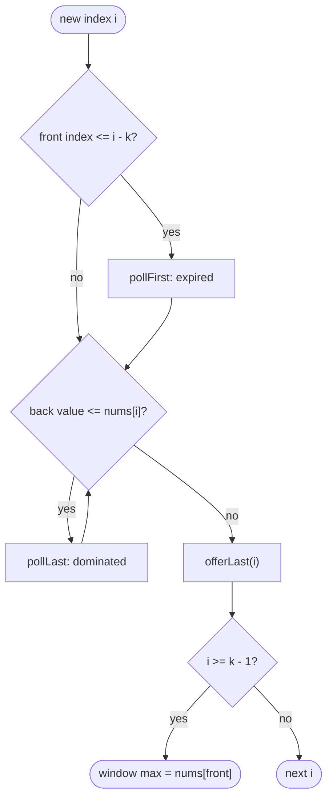

## Introduction

A monitoring dashboard shows, for every second, the highest CPU load seen in the last 60 seconds. Each second one reading arrives and one reading from a minute ago drops out. How do you keep the maximum up to date?

Recomputing it by scanning the last 60 readings works, but it is 60 comparisons per second; for a window of `k` readings over `n` seconds, that is O(n·k). With `n = 10⁵` and `k = 5 × 10⁴` that is billions of steps. A single running "max so far" variable does not work either: when the maximum reading leaves the window, you have no idea what the next-largest one is.

The **monotonic queue** solves this in O(n) total — O(1) amortised per step. It is a [[a5-deque]] of indices whose values are kept in decreasing order from front to back. The front is always the window's maximum. New elements remove every smaller element from the back, because those can never be the maximum again. Elements that slide out of the window are removed from the front.

If you have studied the [[a5-monotonic-stack]], this is the same "pop what is dominated" discipline with one addition: **expiry**. A monotonic stack processes a static array; a monotonic queue handles a window whose left edge moves, so old elements must also leave from the other end. That is why it needs a deque rather than a stack.

## Before you start

- **Monotonic stack** — the invariant, the idea of a dominated element, and the push-once, pop-once argument. See [[a5-monotonic-stack]].
- **Deque** — O(1) insertion and removal at both ends with `ArrayDeque`. See [[a5-deque]].
- **Sliding window** — fixed-size and variable-size windows, and the `left`/`right` pointer pattern. See [[a2-sliding-window]].
- **Prefix sums** — `pre[j] - pre[i]` is the sum of a range; needed for the prefix-sum application. See [[a2-prefix-suffix]].

## The intuition

Think of the window as a group of candidates competing to be "the tallest person currently in the room". People enter on the right and leave on the left, in arrival order.

When a new person enters, look at everyone in the room who is *shorter* than them and arrived *earlier*. Those people can never again be the tallest in the room: the newcomer is taller, and the newcomer will still be in the room after every one of them has left (because people leave in arrival order). So you can forget them immediately.

After forgetting all such people, the candidates you still remember are sorted: each is taller than everyone who arrived after them. The tallest — the earliest remaining candidate — is at the front. When that person leaves the room, the next candidate in line becomes the tallest, with no searching needed.

The single fact that makes this safe is the one in italics: **a newer, larger element outlives every older, smaller one in the window.** That is what turns "smaller and older" into "useless forever".

## Sliding Window Maximum

**Problem.** Given an array and a window size `k`, return the maximum of each window of `k` consecutive elements. For `[1, 3, -1, -3, 5, 3, 6, 7]` and `k = 3`, the answer is `[3, 3, 5, 5, 6, 7]`.

**Naive approach.** For each of the `n - k + 1` windows, scan `k` elements: O(n·k) time.

**Deriving the better idea.** Most of the work in the naive version is repeated: neighbouring windows share `k - 1` elements. We want a structure that, as the window slides, can add an element on the right, remove one on the left, and report the maximum — each cheaply. The intuition above says we only need to keep **candidates**: elements that might still become the maximum of some future window. Those are exactly the elements with no larger element to their right inside the window, and they form a decreasing sequence.

The procedure, for each new index `i`:

1. **Expire.** If the front index is no longer in the window `[i - k + 1, i]`, remove it from the front.
2. **Discard dominated.** While the value at the back is less than or equal to `nums[i]`, remove it from the back.
3. **Add.** Append `i` at the back.
4. **Answer.** Once `i >= k - 1`, the first full window exists and `nums[front]` is its maximum.

```java title="SlidingMax.java"
import java.util.ArrayDeque;
import java.util.Arrays;
import java.util.Deque;

public class SlidingMax {
    static int[] maxSlidingWindow(int[] nums, int k) {
        int n = nums.length;
        int[] ans = new int[n - k + 1];
        Deque<Integer> dq = new ArrayDeque<>();   // indices; values decrease front to back
        for (int i = 0; i < n; i++) {
            // 1. the front index has left the window [i - k + 1, i]
            if (!dq.isEmpty() && dq.peekFirst() <= i - k) dq.pollFirst();
            // 2. smaller-or-equal values at the back can never be a maximum again
            while (!dq.isEmpty() && nums[dq.peekLast()] <= nums[i]) dq.pollLast();
            // 3. the new index joins at the back
            dq.offerLast(i);
            // 4. once the first window is complete, the front holds its maximum
            if (i >= k - 1) ans[i - k + 1] = nums[dq.peekFirst()];
        }
        return ans;
    }

    public static void main(String[] args) {
        System.out.println(Arrays.toString(maxSlidingWindow(new int[] {1, 3, -1, -3, 5, 3, 6, 7}, 3)));
        System.out.println(Arrays.toString(maxSlidingWindow(new int[] {9, 8, 7, 6}, 2)));
        System.out.println(Arrays.toString(maxSlidingWindow(new int[] {4}, 1)));
    }
}
```

```output
[3, 3, 5, 5, 6, 7]
[9, 8, 7]
[4]
```

### Dry run

On `[1, 3, -1, -3, 5, 3, 6, 7]` with `k = 3`. The deque column lists `index(value)` from front to back.

| `i` | `nums[i]` | Expired | Dropped from back | Deque after | Window max |
|---|---|---|---|---|---|
| 0 | 1 | — | — | `0(1)` | — |
| 1 | 3 | — | 0 | `1(3)` | — |
| 2 | -1 | — | — | `1(3), 2(-1)` | 3 |
| 3 | -3 | — | — | `1(3), 2(-1), 3(-3)` | 3 |
| 4 | 5 | 1 | 3, 2 | `4(5)` | 5 |
| 5 | 3 | — | — | `4(5), 5(3)` | 5 |
| 6 | 6 | — | 5, 4 | `6(6)` | 6 |
| 7 | 7 | — | 6 | `7(7)` | 7 |

Look at `i = 3`: the deque holds three candidates, `3, -1, -3`. The smaller ones are kept because each could become the maximum once the larger ones ahead of it leave. At `i = 4`, index 1 (value 3) has left the window `[2, 4]` and is expired from the front, and the new value 5 makes `-1` and `-3` useless, so the deque collapses to a single candidate.

### Details that matter

**Why indices, not values.** Expiry asks "is this element still inside the window?", which is a question about position. Storing indices lets you compare `dq.peekFirst()` with `i - k`. A variant that stores values must remove the front only when it equals the outgoing value, and then it must keep duplicates (pop only on strictly smaller), or a duplicate maximum would be removed too early. Indices avoid that trap entirely.

**`<=` versus `<` when discarding.** With indices, popping equal values (`<=`) is correct and keeps the deque smaller: the newer of two equal values outlives the older one, so the older one is redundant. Popping only on `<` is also correct with indices — it just keeps the duplicates.

**`if` versus `while` for expiry.** Exactly one index leaves the window per step, and indices in the deque increase from front to back, so at most one expired index can sit at the front. An `if` is enough; a `while` is harmless and some people prefer it for safety.

**The off-by-one in expiry.** The window ending at `i` covers `[i - k + 1, i]`. An index `j` is outside it when `j <= i - k`, equivalently `j < i - k + 1`. Writing `j < i - k` keeps one stale index and produces a wrong maximum.

**Minimum instead of maximum.** Flip the discard comparison to `nums[dq.peekLast()] >= nums[i]`. The deque then increases from front to back and the front holds the minimum.

### Why it is O(n)

Each index is added to the deque exactly once. After that it can leave at most once — either from the back (dominated) or from the front (expired), never both. So across the whole run there are at most `n` additions and `n` removals, and the inner `while` loop's body runs at most `n` times in total. With O(1) work per addition and removal, the total is **O(n) time**, regardless of `k`.

The deque holds only indices inside the current window, so it never exceeds `k` entries: **O(k) extra space**, plus O(n − k + 1) for the output.



## Monotonic queue versus monotonic stack

| | Monotonic stack | Monotonic queue |
|---|---|---|
| Structure | Stack (one end) | Deque (both ends) |
| Removals | Dominated elements, from the top | Dominated from the back, expired from the front |
| Typical question | Nearest greater/smaller element for every index | Max/min of every window, or best value within a reach of `k` |
| Answer lives at | The moment of popping, or the top | The front |

Both rely on the same observation — a dominated element can never be an answer again — and both are O(n) by the same counting argument. The queue's extra front removal exists only because its window has a left edge that moves.

## Beyond fixed windows: three applications

The plain sliding-window maximum is the textbook case. Interviews usually disguise it. The signal is: **you need the best (max or min) value among a range of recent positions, and that range moves forward.**

### Dynamic programming over a window: Jump Game VI

**Problem.** Start at index 0 of `nums`. From index `i` you may jump to any of `i + 1 … i + k`. Your score is the sum of the values you land on, including the first and last. Maximise the score of reaching the last index.

**The recurrence.** Let `best[i]` be the maximum score of a path ending at `i`. To arrive at `i`, the previous position was one of the `k` indices before it, so `best[i] = nums[i] + max(best[i - k], …, best[i - 1])`. Computed directly, that `max` costs O(k) per index, O(n·k) overall.

**The speed-up.** The `max` is a sliding-window maximum over the `best` array, and the window moves forward by one each step. Keep a monotonic deque of indices ordered by decreasing `best` value.

```java title="JumpGame6.java"
import java.util.ArrayDeque;
import java.util.Deque;

public class JumpGame6 {
    /** Start at index 0, jump 1..k steps forward each time, maximise the sum of visited values. */
    static int maxResult(int[] nums, int k) {
        int n = nums.length;
        int[] best = new int[n];                       // best[i] = max score ending at i
        best[0] = nums[0];
        Deque<Integer> dq = new ArrayDeque<>();        // indices; best values decrease front to back
        dq.offerLast(0);
        for (int i = 1; i < n; i++) {
            if (dq.peekFirst() < i - k) dq.pollFirst();          // too far back to jump from
            best[i] = nums[i] + best[dq.peekFirst()];            // jump from the best reachable
            while (!dq.isEmpty() && best[dq.peekLast()] <= best[i]) dq.pollLast();
            dq.offerLast(i);
        }
        return best[n - 1];
    }

    public static void main(String[] args) {
        System.out.println(maxResult(new int[] {1, -1, -2, 4, -7, 3}, 2));
        System.out.println(maxResult(new int[] {10, -5, -2, 4, 0, 3}, 3));
        System.out.println(maxResult(new int[] {1, -5, -20, 4, -1, 3, -6, -3}, 2));
    }
}
```

```output
7
17
0
```

The order of operations is the key difference from the plain version: the window for `i` is `[i - k, i - 1]`, so `best[i]` is computed from the front *before* `i` is added. In the first example the path `1 → -1 → 4 → 3` scores 7. Time drops from O(n·k) to O(n). The same structure solves *Constrained Subsequence Sum*, where the recurrence is `best[i] = nums[i] + max(0, max of the previous k best values)`.

### Prefix sums with negatives: Shortest Subarray with Sum at Least K

**Problem.** Return the length of the shortest non-empty subarray whose sum is at least `k`, or `-1`. Values may be **negative**.

**Why the ordinary sliding window fails.** The usual variable-size window grows the right edge and shrinks the left while the sum is still large enough. That relies on shrinking always lowering the sum, which is false when negative numbers exist — removing a negative element *raises* the sum. (See the monotonicity discussion in [[a2-sliding-window]].)

**Reformulating with prefix sums.** Let `pre[j]` be the sum of the first `j` elements. The subarray from `i` to `j - 1` has sum `pre[j] - pre[i]`. For each end `j`, we want the largest start `i < j` with `pre[i] <= pre[j] - k`. Two observations prune the candidate starts:

- **Dominated starts (back).** If `i1 < i2` and `pre[i1] >= pre[i2]`, start `i2` is better in every future case: it gives a sum at least as large *and* a shorter subarray. So `i1` can be discarded. Keeping only undominated starts leaves prefix values *increasing* from front to back.
- **Used-up starts (front).** If the front start `i` already works for end `j` (`pre[j] - pre[i] >= k`), record the length `j - i` and remove `i`: any later end would only give a longer subarray from the same start.

```java title="ShortestSubarrayK.java"
import java.util.ArrayDeque;
import java.util.Deque;

public class ShortestSubarrayK {
    static int shortestSubarray(int[] nums, int k) {
        int n = nums.length;
        long[] pre = new long[n + 1];                  // pre[i] = sum of nums[0..i-1]
        for (int i = 0; i < n; i++) pre[i + 1] = pre[i] + nums[i];

        int best = n + 1;
        Deque<Integer> dq = new ArrayDeque<>();        // prefix indices; pre values increase front to back
        for (int j = 0; j <= n; j++) {
            // front start works for j: record it, and drop it — a later j could only be longer
            while (!dq.isEmpty() && pre[j] - pre[dq.peekFirst()] >= k) {
                best = Math.min(best, j - dq.pollFirst());
            }
            // a back start with prefix >= pre[j] is worse than j in every future case
            while (!dq.isEmpty() && pre[dq.peekLast()] >= pre[j]) dq.pollLast();
            dq.offerLast(j);
        }
        return best <= n ? best : -1;
    }

    public static void main(String[] args) {
        System.out.println(shortestSubarray(new int[] {2, -1, 2}, 3));
        System.out.println(shortestSubarray(new int[] {1, 2}, 4));
        System.out.println(shortestSubarray(new int[] {84, -37, 32, 40, 95}, 167));
    }
}
```

```output
3
-1
3
```

This was cross-checked against a brute-force O(n²) search on thousands of random arrays containing negatives. Notice that here the *front* removal is not "expiry by position" but "this candidate has given its best answer" — the deque discipline is the same, the reason for removing differs. Prefix sums use `long` because sums of many large values overflow `int`. Time is O(n), space O(n).

### Two deques and a variable window: max − min within a limit

**Problem.** Find the longest subarray in which the difference between the maximum and the minimum is at most `limit`.

Here the window size is not fixed: grow `right` one step at a time, and while the window is invalid, advance `left`. To check validity you need the window's maximum *and* minimum, so keep two monotonic deques — one decreasing (for the max) and one increasing (for the min). When `left` advances past a deque's front index, that front expires.

```java title="LongestLimit.java"
import java.util.ArrayDeque;
import java.util.Deque;

public class LongestLimit {
    /** Longest subarray whose max - min <= limit. */
    static int longestSubarray(int[] nums, int limit) {
        Deque<Integer> maxQ = new ArrayDeque<>();   // indices; values decrease front to back
        Deque<Integer> minQ = new ArrayDeque<>();   // indices; values increase front to back
        int left = 0, best = 0;
        for (int right = 0; right < nums.length; right++) {
            while (!maxQ.isEmpty() && nums[maxQ.peekLast()] <= nums[right]) maxQ.pollLast();
            maxQ.offerLast(right);
            while (!minQ.isEmpty() && nums[minQ.peekLast()] >= nums[right]) minQ.pollLast();
            minQ.offerLast(right);

            // shrink from the left until the window is valid again
            while (nums[maxQ.peekFirst()] - nums[minQ.peekFirst()] > limit) {
                left++;
                if (maxQ.peekFirst() < left) maxQ.pollFirst();
                if (minQ.peekFirst() < left) minQ.pollFirst();
            }
            best = Math.max(best, right - left + 1);
        }
        return best;
    }

    public static void main(String[] args) {
        System.out.println(longestSubarray(new int[] {8, 2, 4, 7}, 4));
        System.out.println(longestSubarray(new int[] {10, 1, 2, 4, 7, 2}, 5));
        System.out.println(longestSubarray(new int[] {4, 2, 2, 2, 4, 4, 2, 2}, 0));
    }
}
```

```output
2
4
3
```

In the second example the answer is `[2, 4, 7, 2]`, where max − min is 5. The shrinking loop always terminates, because once `left` reaches `right` both deques' fronts are `right` and the difference is 0. Each index enters and leaves each deque at most once, and `left` only moves forward, so the whole algorithm is O(n).

```quiz
Q: In Sliding Window Maximum, why can an element be removed from the back as soon as a larger element arrives?
- [ ] Because the deque has a fixed capacity
- [x] The newer, larger element stays in the window at least as long, so the older, smaller one can never be the maximum again
- [ ] Because smaller elements are never part of any window
- [ ] To keep the deque increasing from front to back
> Windows drop elements in arrival order, so the newcomer outlives every older element. While both are in the window, the newcomer is larger. Therefore the older one can never be a window maximum, and discarding it loses nothing.

Q: The window ending at index i has size k. Which condition means the front index j has expired?
- [ ] j < i - k
- [x] j <= i - k
- [ ] j <= i - k + 1
- [ ] j > i
> The window covers [i - k + 1, i]. Index j is outside it exactly when j < i - k + 1, which for integers is j <= i - k. Using j < i - k keeps one stale index and can report a maximum that is no longer in the window.

Q: Why does Shortest Subarray with Sum at Least K need a monotonic deque over prefix sums instead of the usual shrinking sliding window?
- [ ] The usual window is O(n^2)
- [x] With negative numbers, shrinking the window can increase its sum, so the shrinking rule is not valid
- [ ] Prefix sums cannot be used with a sliding window
- [ ] The deque sorts the array
> The two-pointer window assumes removing an element from the left never increases the sum. Negative values break that, so the window may discard a start that would have worked. The deque instead keeps only starts with increasing prefix sums, which are the only ones that can ever give a shorter valid subarray.
```

## In real systems

**Streaming metrics.** Monitoring systems compute rolling maximums and minimums — peak latency or lowest free memory over the last minute — on high-rate streams. A monotonic deque gives O(1) amortised updates per sample with memory bounded by the window size, which matters when thousands of series are tracked at once.

**Trading and signal processing.** Indicators such as the highest high or lowest low over the last N periods (used, for example, in channel-breakout signals), and the max/min filters used in image processing to dilate or erode an image row by row, are sliding-window extremes.

**Dynamic programming optimisation.** Many DP recurrences take the best value over the last `k` states — scheduling with a cooldown, or jumping with a maximum range. Replacing the inner O(k) loop with a monotonic deque is a standard optimisation in competitive programming and in production schedulers.

## Trade-offs and alternatives

| Approach | Time for all windows | Extra space | Notes |
|---|---|---|---|
| Rescan each window | O(n·k) | O(1) | Fine for tiny `k` |
| Max-heap with lazy deletion | O(n log n) | O(n) | Pop the top while its index has expired; simple but slower |
| `TreeMap` as a multiset | O(n log k) | O(k) | Value → count map; `firstKey`/`lastKey` give min and max, and arbitrary values can be removed |
| Sparse table | O(n log n) build, O(1) per query | O(n log n) | Static array, arbitrary ranges chosen later — see [[a12-sparse-tables]] |
| **Monotonic deque** | **O(n)** | **O(k)** | Windows move forward only; best for this problem |

The monotonic deque is optimal for windows that only move forward and queries that only ask for the max or min. It cannot answer "the second largest", a median or a count — use a `TreeMap` or two heaps for those (see [[a7-running-median]]). It also cannot handle windows that jump around arbitrarily; that needs a range-query structure.

## Common mistakes

> [!MISTAKE] Reading the answer before the first window is complete
> For `i < k - 1` the window is not full. Writing `ans[i - k + 1]` then indexes a negative position. Only record answers once `i >= k - 1`.

**Storing values instead of indices.** Without indices you cannot tell whether the front has left the window. If you must store values, remove the front only when it equals the outgoing element, and keep duplicates.

**Expiry off by one.** Use `dq.peekFirst() <= i - k` (or `< i - k + 1`).

**Wrong direction.** Maximum needs values *decreasing* from front to back (discard smaller at the back); minimum needs *increasing* (discard larger at the back).

**Forgetting the front removal entirely.** Then the deque behaves like a monotonic stack over the whole prefix and reports the maximum of everything seen so far.

**Using a two-pointer window when values can be negative.** For "sum at least k" with negatives, switch to prefix sums with a monotonic deque.

**Confusing this with 0-1 BFS.** 0-1 BFS also uses a deque, but its contents are ordered by distance through insertion choice, not by popping dominated elements. Same structure, different idea.

## Interview perspective

*Sliding Window Maximum* is the canonical question, and interviewers expect the O(n) solution with a clear justification. Harder rounds hide the pattern inside DP or prefix sums.

> [!INTERVIEW] What to say
> "I'll keep indices in a deque with decreasing values. A new element removes smaller ones from the back because it outlives them and is larger, so they can never be a maximum. The front leaves when its index falls out of the window. Each index is added once and removed at most once, so it's O(n) total and O(k) space."

Questions to prepare:

- **Sliding Window Maximum** — the template above. Follow-up: why not a heap? A heap is O(n log n) and needs lazy deletion of expired indices; the deque is O(n).
- **Jump Game VI** and **Constrained Subsequence Sum** — DP where the transition is a window maximum.
- **Shortest Subarray with Sum at Least K** — prefix sums plus an increasing deque; explain why two pointers fail with negatives.
- **Longest Continuous Subarray With Absolute Diff ≤ Limit** — two deques plus a variable window.
- **Max Value of Equation** — maximise `yi + yj + |xi - xj|` for points within distance `k`; rewrite as `(yi - xi) + (yj + xj)` and keep a deque of the best `yi - xi` in range.
- **Follow-up: what does the deque contain at any moment?** The indices in the current window that have no larger element after them inside the window — the only possible future maximums.

## Practice

1. **Sliding Window Minimum.** Adapt the template and verify it against a brute force on random arrays.
2. **Jump Game VI.** Implement it, then explain why `best[i]` must be computed before `i` is added to the deque.
3. **Constrained Subsequence Sum.** Same structure, with `max(0, …)` in the recurrence.
4. **Longest Continuous Subarray With Absolute Diff ≤ Limit.** Two deques with a moving left edge.
5. **Shortest Subarray with Sum at Least K.** Then explain why a `HashMap` of prefix sums (which works for "sum equals k") does not solve "at least k".
6. **Max Value of Equation.** Rewrite the expression so a single deque applies.

The DSA explorer lists the matching problems under this topic; start with *Sliding Window Maximum* and *Jump Game VI*.

## Quick revision {#quick-revision}

- Monotonic queue = deque of indices kept sorted; front = window max (decreasing) or min (increasing).
- Per step: expire front if `front <= i - k`; pop back while dominated (`<=` for max, `>=` for min); add `i`; answer once `i >= k - 1`.
- Why discarding is safe: a newer larger element outlives older smaller ones in the window.
- O(n) time: each index added once, removed at most once (front or back). O(k) space.
- Store indices so expiry can be checked by position.
- Monotonic stack + front expiry = monotonic queue.
- DP over a window (`best[i] = nums[i] + max of previous k`): compute from the front before adding `i`.
- Sum ≥ k with negatives: prefix sums, deque with increasing `pre`; pop front when it satisfies `k`, pop back when `pre[back] >= pre[j]`.
- Max − min ≤ limit: two deques and a variable window.
- Alternatives: heap with lazy deletion O(n log n), `TreeMap` O(n log k), sparse table for static arbitrary ranges.

## Key takeaways {#key-takeaways}

- A monotonic queue keeps only the elements that could still become a window's maximum or minimum, which makes the answer always sit at the front.
- Discarding from the back is safe because newer, better elements outlive older, worse ones; removing from the front handles elements that leave the window or have given their best answer.
- The O(n) bound comes from counting: every index enters once and leaves once.
- The pattern hides inside dynamic programming transitions and prefix-sum problems whenever you need the best value over a forward-moving range.
- It answers only max or min over windows that move forward; for other statistics or arbitrary ranges, use heaps, trees or range-query structures.
