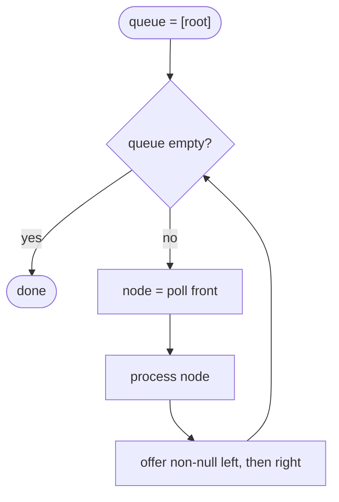

## Introduction

Depth-first search ([[a6-dfs]]) dives to the bottom of one branch before looking at the next. That is perfect for questions about paths and subtrees, but awkward for questions about **levels**: "what are the values on each row of the tree?", "what is the shallowest leaf?", "which node would you see at the right edge of each row?". DFS visits the left side of the tree deeply before it reaches anything on the right, so information about a single level arrives scattered across the whole traversal.

**Breadth-first search (BFS)** visits the tree in a different order: the root, then every node at depth 1, then every node at depth 2, and so on, each level from left to right. This order is called **level order**. BFS produces it with one simple tool — a **queue**, where nodes wait their turn in the order they were discovered.

You need BFS whenever a problem talks about rows, levels, layers, or the *nearest* or *shallowest* something. On trees, that means level-order traversal and its variants, minimum depth, side views, and connecting nodes on the same level. The same algorithm on graphs finds shortest paths in unweighted networks ([[a8-bfs]]), which is why it underlies social-network "degrees of separation", network broadcast and puzzle solvers.

## Before you start

- **Binary trees** — `TreeNode`, depth and levels. See [[a6-binary-trees]].
- **Queues** — first in, first out (FIFO): `offer` adds at the back, `poll` removes from the front. See [[a5-queue]].
- **ArrayDeque in Java** — the class used as the queue here. See [[a1-deque]].
- **Tree DFS** — useful for contrast; BFS is easiest to appreciate next to it. See [[a6-dfs]].

## The intuition

Drop a stone into a pond. The ripple reaches everything one metre away before it reaches anything two metres away. BFS spreads through a tree the same way, starting at the root: everything one edge away, then everything two edges away.

A queue is what makes the ripple orderly. Think of a ticket counter. When a node is served (removed from the front of the queue), it hands its children a ticket and sends them to the **back** of the line. Everyone already in line — the rest of the current level and any of the next level already discovered — is served first. So children are never served before the remaining nodes of their parent's level.

Compare a stack, where the newest arrival is served first. Using a stack instead of a queue in the exact same loop gives a depth-first traversal: a node's children jump to the front and are explored immediately. **The only difference between this BFS and iterative DFS is the container**: a queue spreads out, a stack dives down.

## From the naive approach to a queue

Suppose you need the nodes grouped by level. With only DFS in your toolbox, one approach is: compute the height `h`, then for each depth `d` from `0` to `h`, run a DFS that collects the nodes at depth `d`.

```java
static void collectAtDepth(TreeNode node, int depth, int target, List<Integer> out) {
    if (node == null || depth > target) return;
    if (depth == target) { out.add(node.val); return; }
    collectAtDepth(node.left, depth + 1, target, out);
    collectAtDepth(node.right, depth + 1, target, out);
}
```

This works, and on a balanced tree it is not terrible, because the DFS for depth `d` visits only the top `d` levels. On a skewed tree of `n` nodes, though, there are `n` levels and the DFS for level `d` walks `d + 1` nodes, for a total of about `n² / 2` visits — O(n²). The waste is that each pass rediscovers the same top of the tree.

The better idea comes from asking: *when I am looking at the nodes of level `d`, where are the nodes of level `d + 1`?* They are exactly the children of the level-`d` nodes, in the same left-to-right order. So if you process level `d` from left to right and, as you go, set aside each node's children in order, you have built level `d + 1` without searching for it. A queue does the setting aside: children join the back, and the front still holds the rest of level `d`.

### Why the queue order is level order

Here is the invariant that makes BFS correct:

> At every moment, the queue holds nodes in non-decreasing order of depth, and the depths in it differ by at most one.

At the start the queue holds only the root (depth 0), so the invariant holds. Suppose it holds and we remove the front node, at depth `d`. Every node still in the queue has depth `d` or `d + 1`. We add its children, at depth `d + 1`, to the back, so the order stays non-decreasing and only depths `d` and `d + 1` are present. Because nodes leave the queue in the order they entered, they are removed in non-decreasing depth order — which is exactly level order. Within a level, the left-to-right order is preserved because each node adds its left child before its right child, and parents themselves are processed left to right.

### No visited set on trees

Graph BFS keeps a **visited set** so it never processes a node twice: in a graph, a node can be reached from several neighbours, and cycles would otherwise loop forever. A tree needs none of that. Every node except the root has exactly one parent, so it is discovered exactly once — when its parent is processed — and enters the queue exactly once. Adding a `HashSet` of visited nodes to tree BFS is harmless but wastes O(n) memory and time. If the structure might *not* be a valid tree (say, a buggy input where two parents share a child), then it is really a graph, and the graph version with a visited set is the right tool.

## The basic algorithm

```java title="TreeBfs.java"
import java.util.ArrayDeque;
import java.util.ArrayList;
import java.util.List;
import java.util.Queue;

public class TreeBfs {
    static class TreeNode {
        int val;
        TreeNode left, right;
        TreeNode(int val) { this.val = val; }
        TreeNode(int val, TreeNode left, TreeNode right) {
            this.val = val; this.left = left; this.right = right;
        }
    }

    static List<Integer> bfs(TreeNode root) {
        List<Integer> order = new ArrayList<>();
        if (root == null) return order;           // empty tree: nothing to visit
        Queue<TreeNode> queue = new ArrayDeque<>();
        queue.offer(root);
        while (!queue.isEmpty()) {
            TreeNode node = queue.poll();          // serve the front of the line
            order.add(node.val);
            if (node.left != null) queue.offer(node.left);   // children go to the back
            if (node.right != null) queue.offer(node.right);
        }
        return order;
    }

    public static void main(String[] args) {
        //          1
        //        /   \
        //       2     3
        //      / \     \
        //     4   5     6
        //        /
        //       7
        TreeNode root = new TreeNode(1,
                new TreeNode(2, new TreeNode(4), new TreeNode(5, new TreeNode(7), null)),
                new TreeNode(3, null, new TreeNode(6)));
        System.out.println(bfs(root));
        System.out.println(bfs(null));
    }
}
```

```output
[1, 2, 3, 4, 5, 6, 7]
[]
```

Two details matter. The `null` checks before `offer` keep empty subtrees out of the queue; `ArrayDeque` throws `NullPointerException` if you try to add `null`, which is a useful guard rather than an inconvenience. And the empty tree is handled before the queue is created, so the loop never polls a `null` root.

### Dry run

Each row is one iteration: one node leaves the front, its children join the back.

| Step | Polled | Children offered | Queue after the step (front first) | Output so far |
|---|---|---|---|---|
| start | | | [1] | [] |
| 1 | 1 | 2, 3 | [2, 3] | [1] |
| 2 | 2 | 4, 5 | [3, 4, 5] | [1, 2] |
| 3 | 3 | 6 | [4, 5, 6] | [1, 2, 3] |
| 4 | 4 | none | [5, 6] | [1, 2, 3, 4] |
| 5 | 5 | 7 | [6, 7] | [1, 2, 3, 4, 5] |
| 6 | 6 | none | [7] | [1, 2, 3, 4, 5, 6] |
| 7 | 7 | none | [] | [1, 2, 3, 4, 5, 6, 7] |

Watch the invariant at work. After step 2 the queue is `[3, 4, 5]`: one node of depth 1 followed by two of depth 2. Node `7` (depth 3) is offered in step 5, behind `6` (depth 2), so it cannot be served before the depth-2 level is finished.



## Processing one level at a time

The basic loop visits nodes in level order, but it does not tell you *where one level ends and the next begins*. Many problems need exactly that boundary: to return each level as its own list, to find the last node of each level, or to count levels.

The standard technique is the **level-size snapshot**. At the start of each outer iteration, the queue contains exactly one complete level and nothing else. (It starts as `[root]`, a complete level; and processing a complete level removes all of it while adding exactly the next level.) So record `int size = queue.size()` and poll exactly `size` nodes. Those are the current level. Their children, added during the inner loop, form the next level and wait for the next outer iteration.

```java
while (!queue.isEmpty()) {
    int size = queue.size();               // snapshot: this many nodes form the level
    for (int i = 0; i < size; i++) {
        TreeNode node = queue.poll();
        // process node; i == 0 is the leftmost, i == size - 1 the rightmost
        if (node.left != null) queue.offer(node.left);
        if (node.right != null) queue.offer(node.right);
    }
    // the level is complete here
}
```

The snapshot must be taken **before** the inner loop. Writing `for (int i = 0; i < queue.size(); i++)` re-reads the size on each iteration while children are being added, so the loop runs past the end of the level and mixes levels together.

Two alternatives exist. You can store each node's depth with it in the queue (for example, a `record Item(TreeNode node, int depth)`) and notice when the depth changes. Or you can add a `null` marker to the queue after each level; but `ArrayDeque` does not accept `null`, and the marker logic is easy to get wrong. The snapshot is the cleanest and the one interviewers expect.

## Worked examples: minimum depth and right side view

**Minimum depth** is the number of nodes on the shortest path from the root to a **leaf**. BFS meets nodes in order of depth, so the first leaf it polls is a shallowest leaf, and it can stop right there. DFS has no such shortcut: it might explore a deep left subtree completely before discovering a leaf one step down on the right.

**Right side view** asks which values you see when looking at the tree from the right: the last node of each level. With the level-size snapshot, that is the node polled when `i == size - 1`.

```java title="LevelProblems.java"
import java.util.ArrayDeque;
import java.util.ArrayList;
import java.util.List;
import java.util.Queue;

public class LevelProblems {
    static class TreeNode {
        int val;
        TreeNode left, right;
        TreeNode(int val) { this.val = val; }
        TreeNode(int val, TreeNode left, TreeNode right) {
            this.val = val; this.left = left; this.right = right;
        }
    }

    static int minDepth(TreeNode root) {
        if (root == null) return 0;
        Queue<TreeNode> queue = new ArrayDeque<>();
        queue.offer(root);
        int depth = 1;                                    // counting nodes, root = 1
        while (!queue.isEmpty()) {
            int size = queue.size();
            for (int i = 0; i < size; i++) {
                TreeNode node = queue.poll();
                if (node.left == null && node.right == null) return depth; // first leaf
                if (node.left != null) queue.offer(node.left);
                if (node.right != null) queue.offer(node.right);
            }
            depth++;
        }
        throw new AssertionError("unreachable: a non-empty tree has a leaf");
    }

    static List<Integer> rightSideView(TreeNode root) {
        List<Integer> view = new ArrayList<>();
        if (root == null) return view;
        Queue<TreeNode> queue = new ArrayDeque<>();
        queue.offer(root);
        while (!queue.isEmpty()) {
            int size = queue.size();
            for (int i = 0; i < size; i++) {
                TreeNode node = queue.poll();
                if (i == size - 1) view.add(node.val);    // rightmost of this level
                if (node.left != null) queue.offer(node.left);
                if (node.right != null) queue.offer(node.right);
            }
        }
        return view;
    }

    public static void main(String[] args) {
        TreeNode root = new TreeNode(1,
                new TreeNode(2, new TreeNode(4), new TreeNode(5, new TreeNode(7), null)),
                new TreeNode(3, null, new TreeNode(6)));
        System.out.println("min depth:  " + minDepth(root));
        System.out.println("right view: " + rightSideView(root));

        // A chain 1 -> 2 -> 3 going right: node 1 has one child, so it is not a leaf.
        TreeNode chain = new TreeNode(1, null, new TreeNode(2, null, new TreeNode(3)));
        System.out.println("chain min depth:  " + minDepth(chain));
        System.out.println("chain right view: " + rightSideView(chain));
    }
}
```

```output
min depth:  3
right view: [1, 3, 6, 7]
chain min depth:  3
chain right view: [1, 2, 3]
```

In the first tree, the leaves are `4`, `6` and `7`. Levels 1 and 2 contain no leaf (`2` and `3` both have children), so BFS finishes them and returns at level 3 when it polls `4`. It never looks at `7`. In the chain, the root has a right child, so it is not a leaf even though its left child is missing; the only leaf is `3`, at depth 3. A common wrong answer here is 1, from a solution that treats "has a missing child" as "is a leaf".

The right view of the first tree includes `7` even though `7` is a *left* child. Looking from the right, you see the last node of each level, whichever side of its parent it hangs on. A solution that just follows right pointers down the tree would report `[1, 3, 6]` and miss it.

## Level-order traversal {#a6-level-order}

**Level-order traversal** lists a binary tree's values row by row from the top, each row from left to right. It is breadth-first search on a tree with one extra requirement: the output must keep the rows separate, usually as a list of lists. For the tree `[3,9,20,null,null,15,7]` — root `3`, children `9` and `20`, and `20` with children `15` and `7` — the answer is `[[3], [9, 20], [15, 7]]`. Interview problems on this topic are almost never about the queue mechanics, which stay the same; they are about **shaping the output**: reversing alternate rows, listing rows bottom-up, or reducing each row to one number.

All the variants rest on two facts. First, a queue visits nodes in order of depth, because children always join the back behind the rest of their parent's level. Second, if you record the queue's size at the start of each round, exactly that many nodes form the current level. Poll that many, and their children form the next level.

### The standard version

```java
List<List<Integer>> levels = new ArrayList<>();
if (root == null) return levels;                 // empty tree: [] (not null)
Queue<TreeNode> queue = new ArrayDeque<>();
queue.offer(root);
while (!queue.isEmpty()) {
    int size = queue.size();
    List<Integer> row = new ArrayList<>(size);
    for (int i = 0; i < size; i++) {
        TreeNode node = queue.poll();
        row.add(node.val);
        if (node.left != null) queue.offer(node.left);
        if (node.right != null) queue.offer(node.right);
    }
    levels.add(row);
}
return levels;
```

### Variants by output shape

Every variant below keeps the loop above and changes only what happens to `row`:

| Problem | Change | Result for `[3,9,20,null,null,15,7]` |
|---|---|---|
| Level order | add each `row` to the end | `[[3], [9, 20], [15, 7]]` |
| Zigzag level order | build alternate rows from the front | `[[3], [20, 9], [15, 7]]` |
| Bottom-up level order | reverse the list of rows at the end | `[[15, 7], [9, 20], [3]]` |
| Average of levels | sum the row in a `long`, divide by `size` | `[3.0, 14.5, 11.0]` |
| Largest value in each row | keep a running maximum | `[3, 20, 15]` |

**Zigzag** alternates direction: left to right, then right to left, and so on. The queue order must *not* change — children are still added left then right, or the next level would come out scrambled. Only the row is built differently: on reversed levels, insert each value at the front. A `LinkedList` or `ArrayDeque` supports front insertion in O(1); calling `add(0, x)` on an `ArrayList` shifts every element and costs O(k) per insert. Reversing finished rows with `Collections.reverse` is also fine — it is O(k) per row, so O(n) overall.

**Bottom-up** order should not be produced by inserting each new row at index 0 of an `ArrayList`, which shifts all previous rows each time. Append rows normally and reverse the outer list once at the end, or use `LinkedList.addFirst`.

**Averages** need care with overflow: a level of a million nodes with values near `Integer.MAX_VALUE` overflows an `int` sum. Sum into a `long` and divide as `double`.

```java title="LevelOrderVariants.java"
import java.util.ArrayDeque;
import java.util.ArrayList;
import java.util.Collections;
import java.util.Deque;
import java.util.List;
import java.util.Queue;

public class LevelOrderVariants {
    static class TreeNode {
        int val;
        TreeNode left, right;
        TreeNode(int val) { this.val = val; }
        TreeNode(int val, TreeNode left, TreeNode right) {
            this.val = val; this.left = left; this.right = right;
        }
    }

    static List<List<Integer>> levelOrder(TreeNode root) {
        List<List<Integer>> levels = new ArrayList<>();
        if (root == null) return levels;
        Queue<TreeNode> queue = new ArrayDeque<>();
        queue.offer(root);
        while (!queue.isEmpty()) {
            int size = queue.size();
            List<Integer> row = new ArrayList<>(size);
            for (int i = 0; i < size; i++) {
                TreeNode node = queue.poll();
                row.add(node.val);
                if (node.left != null) queue.offer(node.left);
                if (node.right != null) queue.offer(node.right);
            }
            levels.add(row);
        }
        return levels;
    }

    static List<List<Integer>> zigzag(TreeNode root) {
        List<List<Integer>> levels = new ArrayList<>();
        if (root == null) return levels;
        Queue<TreeNode> queue = new ArrayDeque<>();
        queue.offer(root);
        boolean leftToRight = true;
        while (!queue.isEmpty()) {
            int size = queue.size();
            Deque<Integer> row = new ArrayDeque<>(size);
            for (int i = 0; i < size; i++) {
                TreeNode node = queue.poll();
                if (leftToRight) row.addLast(node.val);
                else row.addFirst(node.val);        // build this row backwards
                if (node.left != null) queue.offer(node.left);   // queue order unchanged
                if (node.right != null) queue.offer(node.right);
            }
            levels.add(new ArrayList<>(row));
            leftToRight = !leftToRight;
        }
        return levels;
    }

    static List<List<Integer>> bottomUp(TreeNode root) {
        List<List<Integer>> levels = levelOrder(root);
        Collections.reverse(levels);                  // one O(levels) reversal
        return levels;
    }

    static List<Double> averages(TreeNode root) {
        List<Double> result = new ArrayList<>();
        for (List<Integer> row : levelOrder(root)) {
            long sum = 0;                             // long: avoid int overflow
            for (int v : row) sum += v;
            result.add((double) sum / row.size());
        }
        return result;
    }

    static List<Integer> largestPerRow(TreeNode root) {
        List<Integer> result = new ArrayList<>();
        for (List<Integer> row : levelOrder(root)) result.add(Collections.max(row));
        return result;
    }

    public static void main(String[] args) {
        //       3
        //      / \
        //     9   20
        //        /  \
        //       15   7
        TreeNode root = new TreeNode(3,
                new TreeNode(9),
                new TreeNode(20, new TreeNode(15), new TreeNode(7)));
        System.out.println("level order: " + levelOrder(root));
        System.out.println("zigzag:      " + zigzag(root));
        System.out.println("bottom-up:   " + bottomUp(root));
        System.out.println("averages:    " + averages(root));
        System.out.println("largest:     " + largestPerRow(root));
        System.out.println("empty tree:  " + levelOrder(null));
    }
}
```

```output
level order: [[3], [9, 20], [15, 7]]
zigzag:      [[3], [20, 9], [15, 7]]
bottom-up:   [[15, 7], [9, 20], [3]]
averages:    [3.0, 14.5, 11.0]
largest:     [3, 20, 15]
empty tree:  []
```

For brevity, `averages` and `largestPerRow` reuse `levelOrder`; in an interview you would fold the sum or maximum into the inner loop so no row lists are built at all, which drops the extra O(n) memory for the output rows. Notice too that the empty tree returns an empty list, not `null` — callers can loop over the result without a null check.

### Same-level relationships

Because the inner loop sees one level at a time, BFS is also the natural tool for questions that relate nodes on the same level. *Cousins in Binary Tree* asks whether two nodes are at the same depth but have different parents: as you enqueue each child, note its parent, and at the end of each level check whether both targets appeared and whether their parents differ. *Populating Next Right Pointers* links each node to the next node on its level: within the inner loop, point the previous node's `next` at the current one.

### A DFS alternative

Level order can also be produced by DFS: pass the depth down and append each value to `levels.get(depth)`, creating that row the first time a depth is reached. Visiting left before right keeps each row in left-to-right order, because within one depth DFS reaches the nodes from left to right. This uses O(h) stack space instead of an O(w) queue, which can matter for very wide trees, but the BFS version states the intent more directly. The same template extends to trees with any number of children: replace the two `offer` lines with a loop over `node.children` ([[a6-nary-trees]]).

**Complexity of level-order traversal.** Each node is offered once and polled once, and each operation is O(1), so time is O(n). Memory is O(w) for the queue, where `w` is the largest number of nodes on one level, plus O(n) for the returned rows.

## How it works internally

**Why `ArrayDeque`.** `ArrayDeque` stores its elements in a circular array with a head and tail index. `poll` reads at the head and advances it; `offer` writes at the tail and advances it, wrapping around the end of the array. When the array fills, it is copied into a larger one, so `offer` is amortised O(1). Nothing is shifted and no per-element node objects are allocated. `LinkedList` also works as a queue, but allocates a node object for every element, which is slower and uses more memory. Using an `ArrayList` and calling `remove(0)` to dequeue is a real performance bug: every removal shifts all remaining elements, making BFS O(n²) on wide trees.

**How wide the queue gets.** The queue holds at most one full level plus part of the next one, so its peak size is about the tree's maximum width `w`. For a perfect tree of `n` nodes, the bottom level has `(n + 1) / 2` nodes, so the queue reaches about `n / 2` entries — O(n). For a chain, the queue never holds more than one node — O(1). DFS has the opposite profile: O(h), which is about `log₂ n` for the perfect tree and `n` for the chain.

| Tree shape (n = 1,000,000) | BFS queue peak (about w) | DFS stack peak (about h) |
|---|---|---|
| Perfect / balanced | about 500,000 | about 20 |
| Chain (degenerate) | 1 | about 1,000,000 |

**Time complexity, derived.** Each node is offered exactly once (by its parent, or at the start for the root) and polled exactly once. Each `offer` and `poll` is amortised O(1), and the rest of the loop body is O(1). So the total is O(n), and the level-size snapshot adds only O(1) per level.

## In real systems

**Shortest paths in unweighted networks.** On a graph, BFS from a source finds the fewest-hops path to every reachable node, because it reaches all nodes at distance `k` before any at distance `k + 1` — the same invariant as on trees. Social networks use it for "people you may know within two connections", and routing protocols flood information outward hop by hop ([[a8-bfs-shortest-unweighted]]).

**Crawling with limited depth.** A web crawler or a site-link checker that should look no more than three clicks from the home page explores breadth-first and stops at depth three. Depth-first exploration could wander thousands of pages down one link chain first.

**Level-order storage.** Binary heaps store a complete tree in an array in level order, which is why the children of index `i` sit at `2i + 1` and `2i + 2` ([[a7-min-heap]]). LeetCode's tree notation is level order for the same reason: it is compact for trees that are close to complete.

**Hierarchical UIs.** Organisation charts and file browsers that load "one level at a time" — show the top folders, then fetch the children of whatever the user expands — are performing a lazy BFS, keeping memory proportional to what is visible.

## Trade-offs and alternatives

| | BFS (queue) | DFS (recursion or stack) |
|---|---|---|
| Visit order | Level by level | Branch by branch |
| Extra memory | O(w), widest level | O(h), height |
| Natural for | Levels, rows, side views, shallowest leaf, same-level links | Paths, subtree properties, sorted BST order |
| Stops early when | The first match is wanted at minimum depth | The first match anywhere is enough |
| Code size | A loop with a queue | Usually a three-line recursion |

Choose BFS when the question mentions levels or nearest-to-the-root, and DFS when it mentions paths or subtrees. When both would work, consider memory: BFS on a bushy tree holds half the nodes at once; DFS on a deep chain holds all of them. For a fuller comparison on graphs, see [[a8-bfs-vs-dfs]].

## Common mistakes

> [!MISTAKE] Reading `queue.size()` inside the loop condition
> `for (int i = 0; i < queue.size(); i++)` re-evaluates the size while children are being added, so the inner loop runs into the next level. Store `int size = queue.size()` before the inner loop.

**Treating a node with one child as a leaf.** For minimum depth, a node is a leaf only if *both* children are `null`. The chain `1 → 2 → 3` has minimum depth 3, not 1.

**Offering `null` children.** `ArrayDeque.offer(null)` throws `NullPointerException`; `LinkedList` accepts it and the next `poll` returns `null`, causing a crash one step later. Check `node.left != null` before offering.

**Reversing the queue for zigzag.** Changing the order children are added breaks the next level. Keep the queue order fixed and reverse only how the row is built.

**Returning `null` for an empty tree.** Problems that return a list expect `[]`. Handle `root == null` first and return an empty list.

**Using a visited set on a tree.** It is unnecessary, because each node has one parent. Explaining why is a good interview signal; adding one anyway suggests the graph template was copied without understanding.

## Interview perspective

Interviewers expect the level-size snapshot, an `ArrayDeque` as the queue, and a clear statement of complexity: O(n) time, O(w) space where `w` is the maximum width, which is O(n) in the worst case.

> [!INTERVIEW] Why BFS for minimum depth?
> "BFS polls nodes in order of depth, so the first leaf I reach is a shallowest one, and I can return immediately. A DFS would have to explore every branch to be sure, or at least compare all leaves, and it can waste time going deep on the left when a leaf is one step down on the right."

Questions to be ready for:

- **How is tree BFS different from graph BFS?** No visited set: each tree node has one parent, so it is enqueued exactly once. Graph BFS marks nodes visited when they are enqueued.
- **How do you know where a level ends?** Snapshot `queue.size()` at the start of the level and poll exactly that many nodes.
- **Do zigzag without reversing the whole result.** Keep the queue order; build alternate rows with `addFirst` on a deque.
- **What is the space complexity of BFS on a perfect tree?** About `n / 2` nodes in the queue at the last level, so O(n).
- **Right side view with DFS?** Visit right before left, passing the depth; the first node seen at each new depth is the rightmost.
- **Connect next-right pointers with O(1) extra space?** For a perfect tree, walk each level through the `next` pointers already set and link the level below: `node.left.next = node.right`, and `node.right.next = node.next.left` when `node.next` exists.

```quiz
Q: Why does BFS on a tree never need a visited set?
- [ ] Because trees are always balanced
- [x] Because every non-root node has exactly one parent, so it is discovered and enqueued exactly once
- [ ] Because the queue removes duplicates automatically
- [ ] Because BFS only visits leaves
> A node is enqueued only when its unique parent is processed, so no node can be reached twice and there are no cycles to loop around. Queues do not remove duplicates; in a graph, where a node may have many neighbours, the visited set is what prevents repeats.

Q: In the level-by-level loop, what goes wrong if you write for (int i = 0; i < queue.size(); i++) instead of snapshotting the size first?
- [ ] Nothing; it is equivalent
- [ ] The loop skips the last node of each level
- [x] The bound grows as children are added, so one "level" absorbs nodes from the following levels
- [ ] It throws ConcurrentModificationException
> queue.size() is re-read after each iteration, and each polled node may add up to two children, so the bound keeps moving. Levels are no longer separated. ArrayDeque does not throw here; it simply returns the larger size.

Q: For the tree with root 1, children 2 and 3, where 2 has a single left child 4, what does right side view return?
- [ ] [1, 3]
- [x] [1, 3, 4]
- [ ] [1, 2, 4]
- [ ] [3, 4]
> The levels are [1], [2, 3] and [4]; the last node of each is 1, 3 and 4. Node 4 is a left child, but it is the only node on its level, so it is visible from the right. Following only right pointers would miss it.

Q: Which data structure change turns this BFS loop into an iterative depth-first traversal?
- [ ] Using a HashSet instead of the queue
- [x] Using a stack (push/pop) instead of a queue (offer/poll)
- [ ] Adding the right child before the left child
- [ ] Removing the null checks
> With a stack, the most recently discovered children are processed first, so the traversal dives down one branch before returning — depth-first. Changing the order of children only mirrors the traversal; it does not change breadth-first into depth-first.
```

## Practice

1. **Binary Tree Level Order Traversal.** Return the rows as a list of lists; handle the empty tree.
2. **Zigzag Level Order Traversal.** Alternate row direction without changing the queue order.
3. **Minimum Depth of Binary Tree.** Solve with BFS, then with DFS, and explain why the DFS version must treat one-child nodes carefully.
4. **Binary Tree Right Side View.** Solve with BFS and again with a right-first DFS.
5. **Average of Levels / Find Largest Value in Each Tree Row.** Fold the reduction into the inner loop instead of building rows.
6. **Cousins in Binary Tree.** Track each node's parent while doing BFS.
7. **Maximum Width of Binary Tree.** Give each node a position (`2i + 1`, `2i + 2` for children) and measure the span of each level; think about how to keep the positions from overflowing on deep trees.

The DSA explorer lists these under Trees; start with *Binary Tree Level Order Traversal* and *Binary Tree Right Side View*.

## Quick revision {#quick-revision}

- BFS visits level by level using a FIFO queue: poll the front, offer non-null left then right children to the back.
- Invariant: the queue holds nodes in non-decreasing depth, at most two consecutive depths at once.
- Trees need no visited set: one parent per node means one enqueue per node.
- Level boundaries: `int size = queue.size()` before the inner loop, then poll exactly `size` nodes.
- Minimum depth: return at the first polled leaf (both children `null`). Right side view: the node at `i == size - 1`.
- Level-order variants change only the row: zigzag builds alternate rows from the front; bottom-up reverses the row list once; averages sum in `long`.
- Use `ArrayDeque`, never `ArrayList.remove(0)` (O(n) per dequeue).
- Time O(n); space O(w), which is about `n / 2` for a perfect tree and 1 for a chain. DFS is O(h).
- Queue gives BFS; swapping in a stack gives DFS.

## Key takeaways {#key-takeaways}

- A queue produces level order because children always wait behind the rest of their parent's level.
- Snapshotting the queue size at the start of each round separates the levels, which is what almost every BFS interview problem needs.
- BFS is the natural choice for rows, side views, same-level relationships and the shallowest leaf, where it can stop early.
- Level-order variants keep the traversal fixed and change only how each row is built or summarised.
- BFS costs O(n) time and O(w) memory; on bushy trees that can be far more than DFS's O(h), and on deep chains far less.
- Tree BFS is graph BFS without the visited set, because a tree has no second path to any node.
