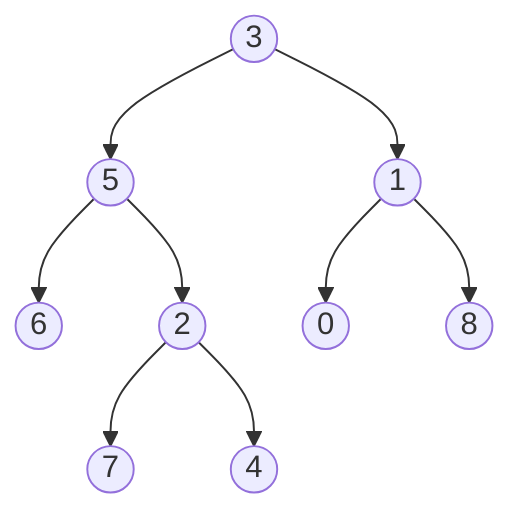
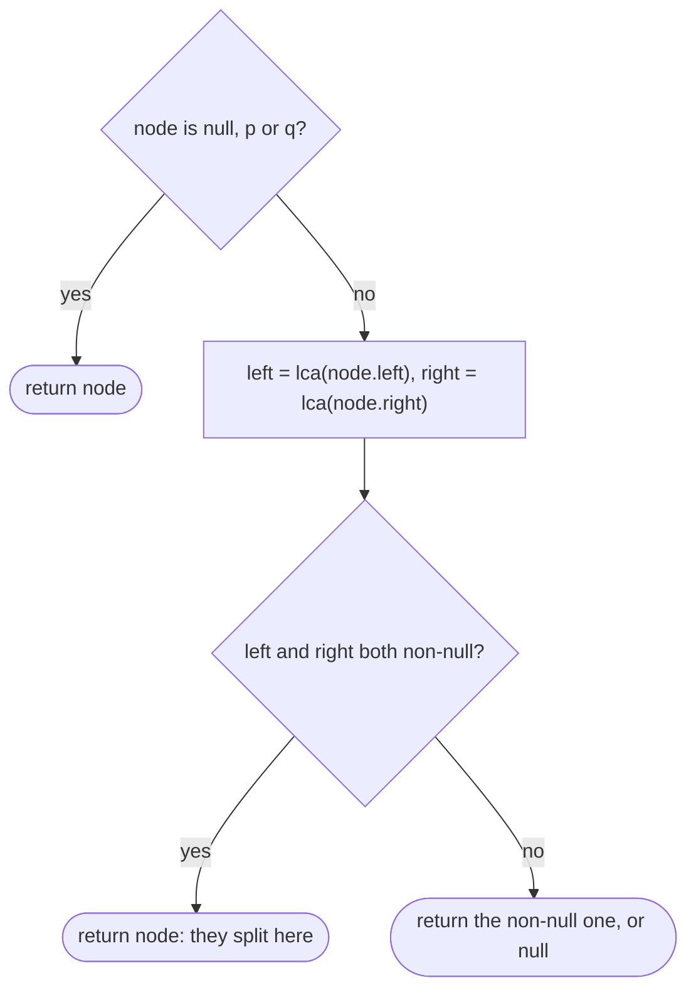

## Introduction

Take two files on a computer, `/home/ana/projects/site/index.html` and `/home/ana/projects/api/server.js`. The deepest folder that contains both is `/home/ana/projects`. Finding that folder is finding the **lowest common ancestor** (LCA) of the two files in the directory tree.

In a rooted tree, an **ancestor** of a node is any node on the path from the root down to it. By convention a node counts as an ancestor of itself — that convention matters, as you will see. A **common ancestor** of `p` and `q` is a node that is an ancestor of both. The root is always one, because it is an ancestor of everything. The **lowest** common ancestor is the common ancestor that is deepest in the tree, which is the same as the one closest to `p` and `q`.

The idea shows up wherever hierarchies do. Version control asks for the most recent commit two branches share before it can merge them. Biologists ask for the most recent common ancestor of two species in a phylogenetic tree. A browser computing the region covered by a text selection needs the deepest DOM element containing both ends of it. And in algorithms, the LCA is the standard tool for the distance between two nodes, because the unique path between them goes up to the LCA and back down.

In interviews, *Lowest Common Ancestor of a Binary Tree* is one of the most frequently asked tree problems. Its solution is short, but explaining *why* it works — especially when one node is the ancestor of the other — is what interviewers listen for. This lesson builds that explanation and then the variants built on top of it.

## Before you start

- **Binary trees** — `TreeNode`, subtrees, leaves and the level-order notation such as `[3,5,1,6,2]`. See [[a6-binary-trees]].
- **Tree DFS** — postorder, and the idea of a call *returning* information to its parent. See [[a6-dfs]].
- **Height and depth** — the depth of a node is its distance from the root. See [[a6-height-depth]].
- **HashMap and HashSet** — used by the parent-map variant. See [[a1-hashmap]] and [[a1-hashset]].

The binary search tree shortcut assumes the BST property from [[a6-bst]].

## The intuition

Every node has exactly one path up to the root. Write down the path from the root to `p` and the path from the root to `q`. Both paths start at the root, so they agree for a while, and then at some node they go different ways and never meet again — they cannot, because rejoining would give some node two parents. The **last node the two paths share is the LCA**.

Here is the tree used throughout this lesson, which LeetCode writes as `[3,5,1,6,2,0,8,null,null,7,4]`:



For `p = 7` and `q = 8`, the paths are `3 → 5 → 2 → 7` and `3 → 1 → 8`. They share only `3`, so the LCA is `3`. For `p = 6` and `q = 4`, the paths are `3 → 5 → 6` and `3 → 5 → 2 → 4`. They share `3 → 5`, so the LCA is `5`.

Now take `p = 5` and `q = 4`. The paths are `3 → 5` and `3 → 5 → 2 → 4`. The whole of the first path is a prefix of the second, so the last shared node is `5` — which is `p` itself. That is why the definition lets a node be its own ancestor: when `p` lies above `q`, **the LCA is `p`**. Forgetting this case is the most common source of wrong answers.

There is a second way to see the LCA that leads to a faster algorithm. Stand at any node `v` and ask where `p` and `q` are relative to it:

- If `p` is in `v`'s left subtree and `q` is in its right subtree (or the reverse), then `v` is where the paths split, so `v` is the LCA.
- If `v` *is* `p` and `q` is somewhere below it (or the reverse), then `v` is the LCA.
- If both are in the same subtree, the LCA is deeper, inside that subtree.
- If neither is below `v`, the LCA is not in `v`'s subtree at all.

## The naive approach

The four cases above suggest a top-down search. Start at the root. Check whether `p` is in the left subtree and whether `q` is in the left subtree. If the answers differ, they split here and the current node is the LCA. If both are on the left, move left; if both are on the right, move right.

```java
static boolean covers(TreeNode root, TreeNode target) {
    if (root == null) return false;
    if (root == target) return true;
    return covers(root.left, target) || covers(root.right, target);
}

static TreeNode lcaNaive(TreeNode root, TreeNode p, TreeNode q) {
    if (root == null || root == p || root == q) return root;
    boolean pLeft = covers(root.left, p);
    boolean qLeft = covers(root.left, q);
    if (pLeft != qLeft) return root;              // they split here
    return lcaNaive(pLeft ? root.left : root.right, p, q);
}
```

This is correct, and it is a good thing to say first in an interview. But it is slow. At each level of the descent, `covers` may search the entire remaining subtree, and the descent can last `h` levels, where `h` is the height of the tree. Searching the same nodes again at every level costs O(n · h) in the worst case: O(n log n) for a balanced tree, and O(n²) for a tree shaped like a chain, where each `covers` call walks most of the chain.

A second idea is to build the two root-to-node paths explicitly, as in the intuition, and compare them. Each path costs one O(n) search, so the whole thing is O(n) time and O(h) extra space for the lists. That is already optimal in time, and you will see the code later. Its weakness is that it traverses the tree twice and stores the paths. The classic solution does everything in a single traversal with no lists at all.

## The one-pass postorder solution

The waste in the naive version is that the question "is `p` below this node?" gets answered from scratch at every level. A **postorder** traversal answers it once per node: each subtree is fully explored before its parent looks at the results, so the parent can build its answer from what its children report.

Here is the whole algorithm:

```java
static TreeNode lca(TreeNode root, TreeNode p, TreeNode q) {
    if (root == null || root == p || root == q) return root;
    TreeNode left = lca(root.left, p, q);
    TreeNode right = lca(root.right, p, q);
    if (left != null && right != null) return root;   // p and q split here
    return left != null ? left : right;               // pass up whatever was found
}
```

It is short enough to memorise, and that is the danger: if you cannot say what the return value *means*, you cannot adapt it to variants or defend it in an interview. So let us state the contract precisely. Assuming both `p` and `q` are in the tree, `lca(node, p, q)` returns:

- `null` if neither `p` nor `q` is in `node`'s subtree;
- `p` (or `q`) if exactly one of them is in the subtree — the call reports *which* target it found;
- the LCA of `p` and `q` if both are in the subtree.

Check each line against the contract.

**The base case.** An empty subtree contains neither node, so it returns `null`. If `node` is `p`, then the subtree contains `p`, and either `q` is not below it (return `p`, "I found p") or `q` is below it — in which case `p` is an ancestor of `q` and the LCA is `p` itself. In both situations the right answer is `p`, so returning `node` immediately is correct and the subtree below it never needs to be searched.

**Both sides non-null.** The left subtree found one target and the right subtree found the other. They are on opposite sides of `node`, so `node` is where the paths split: return `node`. (Both sides cannot each contain *both* targets, because the two subtrees are disjoint.)

**One side non-null.** Everything that was found is on that side. If that side found only one target, the other target is not in this subtree at all, so this subtree also "found one" — pass it up. If that side already found the LCA, pass the LCA up unchanged. Either way, return the non-null side. If both are `null`, this returns `null`, which is also right.

Notice the elegance of the ancestor case. For `p = 5`, `q = 4`, the search reaches `5`, returns it at once and never looks at `2`, `7` or `4`. The root then sees `5` from its left side and `null` from its right side, and passes `5` up as the answer. The algorithm never verified that `4` is below `5`, and it did not need to: we assumed both nodes exist, so if `q` is not in the right subtree of the root, it must be below `5`.

> [!IMPORTANT] The assumption that makes it work
> The five-line solution relies on both `p` and `q` being in the tree. If one might be missing, a returned `p` could mean "p found, q absent" as well as "p is the ancestor of q", and the algorithm cannot tell them apart. The fix is shown in the variants section.



## Worked example

```java title="Lca.java"
import java.util.ArrayDeque;
import java.util.List;
import java.util.Queue;

public class Lca {
    static class TreeNode {
        int val;
        TreeNode left, right;
        TreeNode(int val) { this.val = val; }
    }

    // ---- Naive: descend towards the side that covers both nodes ----
    static boolean covers(TreeNode root, TreeNode target) {
        if (root == null) return false;
        if (root == target) return true;
        return covers(root.left, target) || covers(root.right, target);
    }

    static TreeNode lcaNaive(TreeNode root, TreeNode p, TreeNode q) {
        if (root == null || root == p || root == q) return root;
        boolean pLeft = covers(root.left, p);
        boolean qLeft = covers(root.left, q);
        if (pLeft != qLeft) return root;              // they split here
        return lcaNaive(pLeft ? root.left : root.right, p, q);
    }

    // ---- One pass: postorder, report what each subtree found ----
    static TreeNode lca(TreeNode root, TreeNode p, TreeNode q) {
        if (root == null || root == p || root == q) return root;
        TreeNode left = lca(root.left, p, q);
        TreeNode right = lca(root.right, p, q);
        if (left != null && right != null) return root;   // p and q split here
        return left != null ? left : right;               // pass up whatever was found
    }

    static TreeNode fromLevelOrder(Integer[] v) {
        TreeNode root = new TreeNode(v[0]);
        Queue<TreeNode> q = new ArrayDeque<>(List.of(root));
        for (int i = 1; i < v.length; i += 2) {
            TreeNode p = q.remove();
            if (v[i] != null) q.add(p.left = new TreeNode(v[i]));
            if (i + 1 < v.length && v[i + 1] != null) q.add(p.right = new TreeNode(v[i + 1]));
        }
        return root;
    }

    static TreeNode find(TreeNode root, int val) {
        if (root == null || root.val == val) return root;
        TreeNode left = find(root.left, val);
        return left != null ? left : find(root.right, val);
    }

    public static void main(String[] args) {
        TreeNode root = fromLevelOrder(new Integer[] {3, 5, 1, 6, 2, 0, 8, null, null, 7, 4});
        int[][] queries = {{5, 1}, {5, 4}, {7, 4}, {6, 4}, {7, 8}};
        for (int[] qr : queries) {
            TreeNode p = find(root, qr[0]), q = find(root, qr[1]);
            System.out.printf("lca(%d, %d) = %d  (naive %d)%n",
                    qr[0], qr[1], lca(root, p, q).val, lcaNaive(root, p, q).val);
        }
    }
}
```

```output
lca(5, 1) = 3  (naive 3)
lca(5, 4) = 5  (naive 5)
lca(7, 4) = 2  (naive 2)
lca(6, 4) = 5  (naive 5)
lca(7, 8) = 3  (naive 3)
```

The `fromLevelOrder` helper builds the tree from LeetCode notation, as explained in [[a6-binary-trees]], and `find` locates a node by value so the queries can pass node references. The comparisons `root == p` use **reference equality**: LeetCode passes the actual node objects, and two different nodes may hold the same value. When a problem gives only values and the values are unique, compare `root.val == p` instead.

### Dry run

Trace `lca(root, 6, 4)`. Each row is one call, listed in the order the calls *finish*, which is postorder.

| Call on | `left` returned | `right` returned | Rule applied | Returns |
|---|---|---|---|---|
| 6 | — | — | node is `p` | 6 |
| 7 | null | null | nothing found | null |
| 4 | — | — | node is `q` | 4 |
| 2 | null | 4 | one side | 4 |
| 5 | 6 | 4 | both sides: split | **5** |
| 0 | null | null | nothing found | null |
| 8 | null | null | nothing found | null |
| 1 | null | null | nothing found | null |
| 3 | 5 | null | one side | 5 |

Read the column of return values as messages travelling upward. Node `2` tells its parent "I found 4". Node `5` hears "6" from the left and "4" from the right and concludes it is the split point. From then on the answer `5` is passed up unchanged: the root hears `5` from one side and nothing from the other, and an LCA found deeper is never overwritten, because a node returns itself only when *both* sides report something.

## Complexity

**Time.** Every node is visited at most once, and each visit does O(1) work besides its two recursive calls, so the running time is **O(n)**. It can be less: the search never descends below `p` or `q`. Nothing better is possible in general, because without an ordering the targets could be anywhere, and any algorithm must be prepared to look at every node.

**Space.** The only extra memory is the recursion stack, which holds one frame per node on the current root-to-node path: **O(h)**. That is O(log n) for a balanced tree and O(n) for a chain. A chain of a few hundred thousand nodes can overflow Java's default thread stack; the parent-map version below avoids recursion entirely.

## Variants

The one-pass solution is the centre of a family. Each variant changes one assumption.

### Comparing root-to-node paths

When you need the paths anyway — for example, to print the route between two nodes — build them and take the last common node:

```java
static boolean pathTo(TreeNode node, TreeNode target, List<TreeNode> path) {
    if (node == null) return false;
    path.add(node);
    if (node == target || pathTo(node.left, target, path)
            || pathTo(node.right, target, path)) return true;
    path.remove(path.size() - 1);                 // dead end: backtrack
    return false;
}

static TreeNode lcaByPaths(TreeNode root, TreeNode p, TreeNode q) {
    List<TreeNode> a = new ArrayList<>(), b = new ArrayList<>();
    if (!pathTo(root, p, a) || !pathTo(root, q, b)) return null;
    TreeNode last = null;
    for (int i = 0; i < Math.min(a.size(), b.size()) && a.get(i) == b.get(i); i++) {
        last = a.get(i);                          // last node the paths share
    }
    return last;
}
```

`pathTo` is the backtracking pattern from [[a6-dfs]]: add a node on the way down and remove it if the target was not found beneath it. It is O(n) time and O(h) space, and it naturally handles a missing node by returning `null`.

### Nodes with parent pointers

Some trees store a `parent` reference in each node, as DOM nodes do with `parentNode`. Then you do not need the root at all. Walking up from `p` gives a linked list `p → … → root`, and walking up from `q` gives another list that ends at the same root. The LCA is where the two lists **merge** — exactly the intersection of two linked lists ([[a4-intersection]]).

The neat solution uses two pointers. Each walks up from its own node, and when it falls off the top it restarts from the *other* node. After at most `depth(p) + depth(q) + 2` steps, both pointers have walked the same total distance and they meet at the merge point:

```java
static TreeNode lcaWithParents(TreeNode p, TreeNode q) {
    TreeNode a = p, b = q;
    while (a != b) {                              // same trick as list intersection
        a = (a == null) ? q : a.parent;
        b = (b == null) ? p : b.parent;
    }
    return a;
}
```

Why they meet: say `p` is `x` steps below the LCA, `q` is `y` steps below it, and the LCA is `z` steps below the root. Pointer `a` takes `x + z` steps to the root, one step off the top to `null`, one step to restart at `q`, and then `y` more to reach the LCA from `q`'s side; pointer `b` takes `y + z`, then two, then `x`. Both totals are `x + y + z + 2`, so they arrive together. (If `p` and `q` are at the same depth, `x = y` and they meet at the LCA on the first pass.) This is O(h) time and O(1) extra space. A simpler alternative stores all of `p`'s ancestors in a `HashSet` and walks up from `q` until it hits one, at the cost of O(h) extra space.

### No parent pointers, no recursion

If the tree is too deep for recursion, build the parent references yourself with an iterative BFS ([[a6-bfs]]), stopping once both targets have been seen, and then use the hash-set walk:

```java
static TreeNode lcaWithParentMap(TreeNode root, TreeNode p, TreeNode q) {
    Map<TreeNode, TreeNode> parent = new HashMap<>();
    parent.put(root, null);
    Queue<TreeNode> queue = new ArrayDeque<>(List.of(root));
    while (!parent.containsKey(p) || !parent.containsKey(q)) {
        TreeNode node = queue.remove();           // stop as soon as both are seen
        if (node.left != null) { parent.put(node.left, node); queue.add(node.left); }
        if (node.right != null) { parent.put(node.right, node); queue.add(node.right); }
    }
    Set<TreeNode> ancestorsOfP = new HashSet<>();
    for (TreeNode a = p; a != null; a = parent.get(a)) ancestorsOfP.add(a);
    TreeNode b = q;
    while (!ancestorsOfP.contains(b)) b = parent.get(b);
    return b;
}
```

The root is stored with a `null` parent so the upward walk knows where to stop. This version is O(n) time and O(n) space for the map, but it never uses the call stack. As written, it assumes both nodes exist; if they might not, the `queue.remove()` would eventually throw on an empty queue, so add an `isEmpty` check and return `null`.

### When a node might be missing

*Lowest Common Ancestor of a Binary Tree II* says `p` or `q` may not be in the tree, and the answer is then `null`. The short-circuit in the base case is now a problem: stopping at `p` means we never learn whether `q` exists. The fix is to **always recurse first**, count how many targets were actually seen, and only trust the result if the count is two:

```java
static TreeNode lcaSafe(TreeNode root, TreeNode p, TreeNode q) {
    int[] found = {0};
    TreeNode candidate = search(root, p, q, found);
    return found[0] == 2 ? candidate : null;
}

static TreeNode search(TreeNode node, TreeNode p, TreeNode q, int[] found) {
    if (node == null) return null;
    TreeNode left = search(node.left, p, q, found);   // recurse first: never stop early
    TreeNode right = search(node.right, p, q, found);
    if (node == p || node == q) {
        found[0]++;
        return node;
    }
    if (left != null && right != null) return node;
    return left != null ? left : right;
}
```

Moving the target check *after* the recursive calls is what guarantees the whole tree is searched. The return logic is unchanged; only the trust in it is. This always visits all `n` nodes, so it loses the early exit, but it stays O(n).

### Binary search trees

In a BST every key in the left subtree is smaller than the node and every key in the right subtree is larger ([[a6-bst]]). That ordering tells you, at each node, which side each target is on without searching. If both values are smaller than the node, the LCA is on the left; if both are larger, it is on the right; otherwise they split here (or the node equals one of them), and this node is the LCA:

```java
static TreeNode lcaBst(TreeNode root, int p, int q) {
    TreeNode node = root;
    while (node != null) {
        if (p < node.val && q < node.val) node = node.left;
        else if (p > node.val && q > node.val) node = node.right;
        else return node;                         // split point, or equal to p or q
    }
    return null;
}
```

This is O(h) time and O(1) space, because it follows a single root-to-node path. It is the BST version of the naive "descend towards the side that covers both" idea, except that the ordering answers the `covers` question in O(1). Like the basic version, it assumes both keys are present; a value that is absent can still produce a node.

### Sets of nodes and deepest leaves

The postorder pattern extends to more than two targets. For the LCA of a whole set of nodes, the base case becomes "is this node in the set?", and nothing else changes: a subtree reports a node if it contains any targets, and the split rule still finds the deepest node with targets on both sides or at itself.

```java
static TreeNode lcaOfSet(TreeNode node, Set<TreeNode> targets) {
    if (node == null || targets.contains(node)) return node;
    TreeNode left = lcaOfSet(node.left, targets);
    TreeNode right = lcaOfSet(node.right, targets);
    if (left != null && right != null) return node;
    return left != null ? left : right;
}
```

On the example tree, the LCA of `{7, 6, 4}` is `5`, and of `{7, 4, 0}` is `3`. A close relative is *Lowest Common Ancestor of Deepest Leaves*: there the targets are not given but defined as the deepest nodes. Each call returns a pair — the height of its subtree and the LCA of the deepest nodes inside it. If the two children have equal height, the deepest nodes are on both sides and this node is their LCA; otherwise the taller side's answer is passed up:

```java
record Info(int height, TreeNode lca) {}

static Info deepest(TreeNode node) {
    if (node == null) return new Info(0, null);
    Info l = deepest(node.left), r = deepest(node.right);
    if (l.height() == r.height()) return new Info(l.height() + 1, node); // tie: meet here
    return l.height() > r.height() ? new Info(l.height() + 1, l.lca())
                                   : new Info(r.height() + 1, r.lca());
}
```

On the example tree the deepest leaves are `7` and `4`, and the result is `2`. Returning a pair like this — one value the parent needs, plus the answer so far — is the same "return one thing, carry another" idea used for the diameter in [[a6-diameter]].

## Distance between two nodes

The path between `p` and `q` climbs from `p` to their LCA and descends to `q`. So the distance in edges is

```text
dist(p, q) = depth(p) + depth(q) - 2 * depth(lca)
```

where depths are measured from the root. Subtracting `2 * depth(lca)` removes the shared part of the two root paths, which is counted once in each depth but is not on the path between them. Equivalently, measure the depths of `p` and `q` *from the LCA* and add them, which is what the full program below does.

```java title="LcaVariants.java"
import java.util.ArrayDeque;
import java.util.ArrayList;
import java.util.HashMap;
import java.util.HashSet;
import java.util.List;
import java.util.Map;
import java.util.Queue;
import java.util.Set;

public class LcaVariants {
    static class TreeNode {
        int val;
        TreeNode left, right, parent;     // parent is used only by the pointer variants
        TreeNode(int val) { this.val = val; }
    }

    // ---- 1. Compare the two root-to-node paths ----
    static boolean pathTo(TreeNode node, TreeNode target, List<TreeNode> path) {
        if (node == null) return false;
        path.add(node);
        if (node == target || pathTo(node.left, target, path)
                || pathTo(node.right, target, path)) return true;
        path.remove(path.size() - 1);                 // dead end: backtrack
        return false;
    }

    static TreeNode lcaByPaths(TreeNode root, TreeNode p, TreeNode q) {
        List<TreeNode> a = new ArrayList<>(), b = new ArrayList<>();
        if (!pathTo(root, p, a) || !pathTo(root, q, b)) return null;
        TreeNode last = null;
        for (int i = 0; i < Math.min(a.size(), b.size()) && a.get(i) == b.get(i); i++) {
            last = a.get(i);                          // last node the paths share
        }
        return last;
    }

    // ---- 2. Parent pointers: the intersection of two upward lists ----
    static TreeNode lcaWithParents(TreeNode p, TreeNode q) {
        TreeNode a = p, b = q;
        while (a != b) {                              // same trick as list intersection
            a = (a == null) ? q : a.parent;
            b = (b == null) ? p : b.parent;
        }
        return a;
    }

    // ---- 3. No parent field: build a parent map iteratively, then walk up ----
    static TreeNode lcaWithParentMap(TreeNode root, TreeNode p, TreeNode q) {
        Map<TreeNode, TreeNode> parent = new HashMap<>();
        parent.put(root, null);
        Queue<TreeNode> queue = new ArrayDeque<>(List.of(root));
        while (!parent.containsKey(p) || !parent.containsKey(q)) {
            TreeNode node = queue.remove();           // stop as soon as both are seen
            if (node.left != null) { parent.put(node.left, node); queue.add(node.left); }
            if (node.right != null) { parent.put(node.right, node); queue.add(node.right); }
        }
        Set<TreeNode> ancestorsOfP = new HashSet<>();
        for (TreeNode a = p; a != null; a = parent.get(a)) ancestorsOfP.add(a);
        TreeNode b = q;
        while (!ancestorsOfP.contains(b)) b = parent.get(b);
        return b;
    }

    // ---- 4. p or q may be missing: search the whole tree and count ----
    static TreeNode lcaSafe(TreeNode root, TreeNode p, TreeNode q) {
        int[] found = {0};
        TreeNode candidate = search(root, p, q, found);
        return found[0] == 2 ? candidate : null;
    }

    static TreeNode search(TreeNode node, TreeNode p, TreeNode q, int[] found) {
        if (node == null) return null;
        TreeNode left = search(node.left, p, q, found);   // recurse first: never stop early
        TreeNode right = search(node.right, p, q, found);
        if (node == p || node == q) {
            found[0]++;
            return node;
        }
        if (left != null && right != null) return node;
        return left != null ? left : right;
    }

    // ---- 5. Distance in edges between two nodes ----
    static int depthOf(TreeNode from, TreeNode target, int depth) {
        if (from == null) return -1;
        if (from == target) return depth;
        int d = depthOf(from.left, target, depth + 1);
        return d != -1 ? d : depthOf(from.right, target, depth + 1);
    }

    static int distance(TreeNode root, TreeNode p, TreeNode q) {
        TreeNode a = lcaSafe(root, p, q);
        return depthOf(a, p, 0) + depthOf(a, q, 0);   // depths measured from the LCA
    }

    // ---- helpers ----
    static TreeNode fromLevelOrder(Integer[] v) {
        TreeNode root = new TreeNode(v[0]);
        Queue<TreeNode> q = new ArrayDeque<>(List.of(root));
        for (int i = 1; i < v.length; i += 2) {
            TreeNode p = q.remove();
            if (v[i] != null) { p.left = new TreeNode(v[i]); p.left.parent = p; q.add(p.left); }
            if (i + 1 < v.length && v[i + 1] != null) {
                p.right = new TreeNode(v[i + 1]); p.right.parent = p; q.add(p.right);
            }
        }
        return root;
    }

    static TreeNode find(TreeNode root, int val) {
        if (root == null || root.val == val) return root;
        TreeNode left = find(root.left, val);
        return left != null ? left : find(root.right, val);
    }

    public static void main(String[] args) {
        TreeNode root = fromLevelOrder(new Integer[] {3, 5, 1, 6, 2, 0, 8, null, null, 7, 4});
        TreeNode n5 = find(root, 5), n1 = find(root, 1), n4 = find(root, 4),
                 n6 = find(root, 6), n7 = find(root, 7), n8 = find(root, 8);
        TreeNode stranger = new TreeNode(10);         // not in the tree

        System.out.println("paths      lca(6, 4) = " + lcaByPaths(root, n6, n4).val);
        System.out.println("parents    lca(7, 8) = " + lcaWithParents(n7, n8).val);
        System.out.println("parent map lca(5, 4) = " + lcaWithParentMap(root, n5, n4).val);
        System.out.println("safe       lca(5, 1) = " + lcaSafe(root, n5, n1).val);
        System.out.println("safe       lca(5, stranger) = " + lcaSafe(root, n5, stranger));
        System.out.println("distance(7, 8) = " + distance(root, n7, n8));
        System.out.println("distance(5, 4) = " + distance(root, n5, n4));
    }
}
```

```output
paths      lca(6, 4) = 5
parents    lca(7, 8) = 3
parent map lca(5, 4) = 5
safe       lca(5, 1) = 3
safe       lca(5, stranger) = null
distance(7, 8) = 5
distance(5, 4) = 2
```

Check the distances by hand. From `7` to `8` the path is `7 → 2 → 5 → 3 → 1 → 8`: five edges, with the LCA `3` in the middle. From `5` to `4` it is `5 → 2 → 4`: two edges, and since `5` is the LCA, its own depth from the LCA is 0. The same LCA-then-split idea answers *Step-By-Step Directions From a Binary Tree Node to Another*: the directions are "up" once for each edge from the start node to the LCA, followed by the left/right turns from the LCA down to the destination.

## Many queries: binary lifting

Everything so far costs O(n) or O(h) per query. That is fine for one query, but if a tree with 100,000 nodes must answer 100,000 LCA queries — distances in a road network shaped like a tree, or ancestry queries in a large hierarchy — O(n) per query means about 10¹⁰ steps. The standard fix is to **preprocess** the tree once so that each query is fast.

Start from the simplest per-query method that uses depths: lift the deeper node until both are at the same depth, then lift both together one step at a time until they meet. The meeting point is the LCA, but each lift is one step, so a query can take O(h).

**Binary lifting** makes the lifts take big jumps. For every node `v` and every `k`, store `up[k][v]`: the ancestor of `v` that is `2^k` steps above it. Row `k = 0` is just the parent. Each later row is built from the one before, because jumping `2^k` steps is the same as jumping `2^(k-1)` steps twice:

```text
up[k][v] = up[k-1][ up[k-1][v] ]
```

With these tables, lifting a node by any distance `d` takes one jump per 1-bit in the binary representation of `d`. Lifting by 5 (binary `101`) is a jump of 4 followed by a jump of 1.

A query then has two phases. First, lift the deeper node by the depth difference, so both nodes are at the same depth. If they are now the same node, one was the ancestor of the other, and that node is the answer. Otherwise, try jumps from the largest to the smallest: if jumping both nodes by `2^k` lands them on *different* ancestors, the LCA is still above, so take the jump; if it lands them on the same ancestor, that ancestor might be above the LCA, so do not jump. When all sizes have been tried, the two nodes sit directly below the LCA, and their parent is the answer.

```java title="BinaryLifting.java"
import java.util.ArrayDeque;
import java.util.ArrayList;
import java.util.List;
import java.util.Queue;

public class BinaryLifting {
    final int log;
    final int[][] up;      // up[k][v] = the ancestor 2^k steps above v (root maps to itself)
    final int[] depth;

    BinaryLifting(int n, int[][] edges, int root) {
        List<List<Integer>> adj = new ArrayList<>();
        for (int i = 0; i < n; i++) adj.add(new ArrayList<>());
        for (int[] e : edges) { adj.get(e[0]).add(e[1]); adj.get(e[1]).add(e[0]); }

        int lg = 1;
        while ((1 << lg) < n) lg++;
        log = lg;
        up = new int[log + 1][n];
        depth = new int[n];

        // BFS from the root fills depth and the direct parent (row 0)
        boolean[] seen = new boolean[n];
        Queue<Integer> queue = new ArrayDeque<>(List.of(root));
        seen[root] = true;
        up[0][root] = root;
        while (!queue.isEmpty()) {
            int u = queue.remove();
            for (int v : adj.get(u)) {
                if (seen[v]) continue;                 // the edge back to the parent
                seen[v] = true;
                depth[v] = depth[u] + 1;
                up[0][v] = u;
                queue.add(v);
            }
        }
        // a jump of 2^k is two jumps of 2^(k-1)
        for (int k = 1; k <= log; k++) {
            for (int v = 0; v < n; v++) up[k][v] = up[k - 1][up[k - 1][v]];
        }
    }

    int lca(int a, int b) {
        if (depth[a] < depth[b]) { int t = a; a = b; b = t; }
        int diff = depth[a] - depth[b];
        for (int k = 0; diff > 0; k++, diff >>= 1) {   // lift a by diff, one bit at a time
            if ((diff & 1) == 1) a = up[k][a];
        }
        if (a == b) return a;                          // b was an ancestor of a
        for (int k = log; k >= 0; k--) {               // largest jumps first
            if (up[k][a] != up[k][b]) { a = up[k][a]; b = up[k][b]; }
        }
        return up[0][a];                               // both now sit just below the LCA
    }

    public static void main(String[] args) {
        //              0
        //            /   \
        //           1     2
        //          / \     \
        //         3   4     5
        //        /   / \
        //       6   7   8
        //                \
        //                 9
        int[][] edges = {{0, 1}, {0, 2}, {1, 3}, {1, 4}, {2, 5},
                         {3, 6}, {4, 7}, {4, 8}, {8, 9}};
        BinaryLifting bl = new BinaryLifting(10, edges, 0);
        int[][] queries = {{6, 9}, {7, 9}, {9, 5}, {4, 9}, {3, 3}};
        for (int[] q : queries) {
            System.out.printf("lca(%d, %d) = %d%n", q[0], q[1], bl.lca(q[0], q[1]));
        }
        System.out.println("up[1][9] = " + bl.up[1][9] + ", up[2][9] = " + bl.up[2][9]);
    }
}
```

```output
lca(6, 9) = 1
lca(7, 9) = 4
lca(9, 5) = 0
lca(4, 9) = 4
lca(3, 3) = 3
up[1][9] = 4, up[2][9] = 0
```

The tree here is given the way graph problems give it — numbered nodes and undirected edges — so the constructor runs a BFS from the root to discover parents and depths, skipping the neighbour it came from ([[a8-bfs]]). The root is its own parent, so a jump that would overshoot the root simply stays there; that keeps every table entry valid without special cases.

Trace `lca(6, 9)`. Node `9` has depth 4 and node `6` has depth 3, so `9` is lifted by 1, to `8`. Now `8` and `6` are different nodes at depth 3. Here `n = 10`, so `log = 4` and the jump sizes tried are 16, 8, 4, 2 and 1. For 16, 8, 4 and 2, both nodes land on the same ancestor (`0` for the large jumps, and `1` for the jump of 2), so no jump is taken. For a jump of 1, `8` would go to `4` and `6` to `3` — different — so both move. They are now `4` and `3`, siblings directly below the LCA, and the answer is their parent, `1`.

**Complexity.** The table has `log + 1` rows of `n` entries, each computed in O(1), so preprocessing is **O(n log n)** time and space. A query does at most `log` jumps in each phase: **O(log n)**. For 100,000 nodes, `log` is 17, so 100,000 queries take a few million steps instead of ten billion. The same table also answers *Kth Ancestor of a Tree Node* directly — that is the first phase on its own.

Two other classic techniques are worth knowing by name. An **Euler tour** writes down nodes in the order a DFS enters and returns to them; the LCA of two nodes is then the shallowest node between their positions in that sequence, which is a range-minimum query answerable in O(1) after O(n log n) preprocessing with a sparse table ([[a12-sparse-tables]]). **Tarjan's offline LCA** answers a batch of queries known in advance during a single DFS, using union-find ([[a8-union-find]]), in nearly linear total time. In interviews, binary lifting is the one people are expected to explain.

## In real systems

**Version control.** Before `git merge` can combine two branches, it needs their **merge base**: the most recent commit both branches descend from. A three-way merge then compares each branch against that base to see who changed what. Git's history is a directed acyclic graph rather than a tree — a merge commit has two parents — so there can be more than one "best" common ancestor, which is why `git merge-base` has an `--all` option. The tree LCA is the simplest version of this idea.

**The DOM.** A text selection in a browser is a `Range` with two endpoints, and its `commonAncestorContainer` property is the deepest node that contains both — an LCA in the DOM tree ([[b3-dom-tree-model]]). DOM nodes carry `parentNode` references, so it can be computed by walking upward, as in the parent-pointer variant.

**File systems and hierarchies.** The deepest shared directory of a set of paths is the LCA of those paths, and permission or configuration systems that inherit settings down a hierarchy (organisation → team → project) use the nearest shared ancestor to decide which settings two resources have in common.

**Biology.** In a phylogenetic tree, the most recent common ancestor of two species is literally their LCA, and the distance formula above (with weighted edges) measures how far apart they have evolved.

**Routing in tree networks.** In a tree-shaped network, the route between two nodes goes up to their LCA and back down. Systems that answer many such route or distance queries precompute ancestor tables in the binary-lifting style.

## Trade-offs and alternatives

| Approach | Time per query | Extra space | Needs | Best when |
|---|---|---|---|---|
| Naive top-down with `covers` | O(n · h) | O(h) | Root | Explaining the idea first |
| One-pass postorder | O(n) | O(h) stack | Root; both nodes present | The standard single-query answer |
| Compare root paths | O(n) | O(h) | Root | You also need the actual paths |
| Parent pointers, two pointers | O(h) | O(1) | `parent` field | Nodes know their parents (DOM-like) |
| Parent map via BFS | O(n) | O(n) | Root | Very deep trees; avoid recursion |
| Counting version | O(n), full scan | O(h) | Root | Nodes may be missing |
| BST walk | O(h) | O(1) | BST ordering | Any BST |
| Binary lifting | O(log n) after O(n log n) prep | O(n log n) | Root, many queries | Many queries on a fixed tree |

The choice comes down to what the input gives you and how many queries there are. For one query on a plain binary tree, the postorder solution is optimal and the shortest to write. Parent pointers let you skip the root and get O(h). An ordering (BST) lets you skip searching. Many queries justify preprocessing.

## Common mistakes

> [!MISTAKE] Requiring a target on both sides
> Code that returns the current node only when `p` is on one side and `q` on the other misses the case where `p` is an ancestor of `q`. The base case `if (root == p || root == q) return root;` handles it: when the search reaches `p` first, `p` is the answer whether or not `q` is below it.

**Using the five-line version when nodes may be missing.** It will happily return `p` when `q` does not exist. Either the problem guarantees both exist, or you need the counting version that searches the whole tree.

**Comparing values instead of references.** If two nodes hold the same value, `root.val == p.val` can match the wrong node. Compare references when you are given nodes; compare values only when values are unique and you are given values.

**BST walk with the wrong comparisons.** The loop must move only when *both* values are on the same side. Moving left when just one value is smaller abandons the other value's side.

**Forgetting the root's parent in a parent map.** If the root is never put in the map, `parent.get(root)` returns `null` by accident, which happens to work, but `containsKey(root)` is false and loops that test membership misbehave. Store the root with an explicit `null` parent.

**Using `log` too small in binary lifting.** The number of rows must allow jumps up to the full height of the tree. Computing it from `n` (the smallest `log` with `2^log ≥ n`) is always safe.

## Interview perspective

The basic question appears constantly, usually as a warm-up or the first half of a two-part problem. Interviewers want to hear the contract of the recursive function and the ancestor case, not only the code.

> [!INTERVIEW] Explaining the postorder solution
> "Each call returns `null` if neither node is in its subtree, the node it found if only one is there, and the LCA if both are. If the current node is `p` or `q`, I return it — if the other target is below, this node is the LCA anyway. If both children return something, the targets split here, so this node is the LCA. Otherwise I pass up the non-null side. It's O(n) time and O(h) stack, and it assumes both nodes exist."

Questions to be ready for:

- **What if one node is an ancestor of the other?** The ancestor is the LCA; the base case returns it without searching below.
- **What if a node might not exist?** Recurse before checking, count the targets found, and return `null` unless both were found.
- **What if nodes have parent pointers?** Two pointers walking up and switching starts, like linked-list intersection: O(h) time, O(1) space.
- **What if it is a BST?** Walk down while both values are on the same side: O(h) time, O(1) space.
- **Distance between two nodes?** `depth(p) + depth(q) - 2 · depth(lca)`.
- **LCA of k nodes?** Same recursion with a set lookup in the base case.
- **Many queries?** Binary lifting: O(n log n) preprocessing, O(log n) per query. Mention Euler tour plus sparse table for O(1) queries.

```quiz
Q: In the tree [3,5,1,6,2,0,8,null,null,7,4], what is the LCA of 5 and 4?
- [ ] 3, because the root is the only node above both
- [x] 5, because 5 is an ancestor of 4 and a node counts as its own ancestor
- [ ] 2, because 2 is the parent of 4
- [ ] There is no LCA, because 5 is on the path to 4
> The LCA is the deepest node that has both nodes in its subtree, and a node's subtree includes itself. 4 is below 5, so 5 qualifies and nothing deeper does. 3 is a common ancestor but not the lowest; 2 does not contain 5.

Q: In the one-pass postorder solution, a call receives a non-null result from its left child and null from its right child. What does it return?
- [ ] The current node, because something was found below it
- [x] The left child's result, unchanged
- [ ] null, because only one side found something
- [ ] The current node's left child
> Everything found so far is on the left. That result is either a single target or the LCA already found deeper; in both cases the correct report for this subtree is the same value. The current node becomes the answer only when both sides report something.

Q: Why does the five-line solution give a wrong answer when q might not be in the tree?
- [ ] It throws a NullPointerException
- [ ] It runs forever
- [x] Returning p cannot distinguish "p is an ancestor of q" from "q is absent"
- [ ] It only works on balanced trees
> The base case returns p without searching below it, trusting that q exists somewhere. If q is absent, the root still receives p from one side and returns it as the LCA. The fix is to search the whole tree and count how many targets were actually found.

Q: Binary lifting has been built for a tree with n nodes. What does each LCA query cost?
- [ ] O(1)
- [x] O(log n)
- [ ] O(h)
- [ ] O(n)
> The deeper node is lifted by the depth difference using one jump per set bit, and then both nodes descend through jump sizes 2^log down to 1, at most one jump per size. Both phases take O(log n). The O(n log n) cost is paid once, when the table is built.
```

## Practice

1. **Lowest Common Ancestor of a Binary Tree.** Write the postorder solution and trace it on a case where one node is the ancestor of the other.
2. **Lowest Common Ancestor of a Binary Search Tree.** Solve iteratively in O(h) time and O(1) space.
3. **Lowest Common Ancestor of a Binary Tree II.** Nodes may be missing; return `null` in that case.
4. **Lowest Common Ancestor of a Binary Tree III.** Nodes have parent pointers and the root is not given; use O(1) extra space.
5. **Find Distance in a Binary Tree.** Use the LCA and depths.
6. **Step-By-Step Directions From a Binary Tree Node to Another.** Build the two root paths as strings of `L`/`R` moves, strip the common prefix, and replace the start's remainder with `U`s.
7. **Lowest Common Ancestor of Deepest Leaves.** Return a (height, node) pair.
8. **Kth Ancestor of a Tree Node.** Build the binary-lifting table.

The DSA explorer lists these under Trees; start with *Lowest Common Ancestor of a Binary Tree* and *Lowest Common Ancestor of a Binary Search Tree*.

## Quick revision {#quick-revision}

- LCA: the deepest node with both `p` and `q` in its subtree; a node is its own ancestor, so if `p` is above `q`, the LCA is `p`.
- Picture: the last shared node of the two root-to-node paths.
- Postorder: `if (root == null || root == p || root == q) return root;` then both children non-null → `root`, else return the non-null child.
- Contract: returns `null` (nothing found), one target (one found), or the LCA (both found). Assumes both exist.
- O(n) time, O(h) stack; naive top-down with `covers` is O(n · h).
- Missing nodes: recurse first, count found targets, trust the result only if the count is 2.
- Parent pointers: two pointers walking up, switching to the other start at the top — O(h) time, O(1) space.
- Deep trees: BFS parent map plus ancestor set, no recursion.
- BST: move left if both smaller, right if both larger, otherwise stop — O(h), O(1).
- Set of nodes: base case becomes a set lookup. Deepest leaves: return (height, lca).
- Distance: `depth(p) + depth(q) - 2 · depth(lca)`.
- Many queries: binary lifting `up[k][v] = up[k-1][up[k-1][v]]`; O(n log n) prep, O(log n) query. Euler tour + sparse table gives O(1) queries.

## Key takeaways {#key-takeaways}

- The lowest common ancestor is where the two root-to-node paths part ways, and it can be one of the two nodes itself.
- The postorder solution works because each call reports what its subtree contains, and the first node to hear reports from both sides is the split point.
- Being able to state what the recursive function returns is what lets you handle the ancestor case, missing nodes and sets of nodes with small changes.
- Extra structure buys speed: parent pointers make it O(h) with O(1) space, and BST ordering removes the search entirely.
- The distance between two nodes is the two depths minus twice the LCA's depth, which makes LCA the standard building block for path queries.
- When there are many queries on one tree, precompute ancestor jumps of size 2^k so each query takes O(log n).
