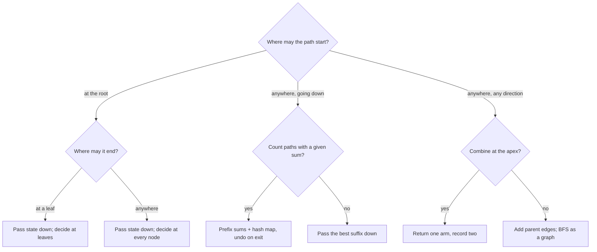

## Introduction

A **path** in a tree is a sequence of nodes in which each consecutive pair is joined by an edge and no node repeats. Because a tree has no cycles, there is exactly one path between any two nodes. Path problems ask a question about such paths: does some path add up to a target, how many paths do, what is the largest sum, how long is the longest path with some property, which nodes are a given distance away?

There are dozens of these problems on LeetCode, and learning them one by one is hopeless. The good news is that they differ mainly in **which paths count**. Once you know where a path is allowed to start and where it is allowed to end, the technique almost picks itself. This lesson sorts path problems into four families:

| Family | A path starts at | A path ends at | Technique | Example problems |
|---|---|---|---|---|
| Root to leaf | the root | a leaf | Pass state down; decide at the leaf | Path Sum, Sum Root to Leaf Numbers, Path Sum II |
| Root to any node | the root | any node | Pass state down; decide at every node | Count Good Nodes |
| Downward | any node | any descendant | Prefix sums along the current root path | Path Sum III, Longest Consecutive Sequence |
| Any to any | any node | any node | Return one arm, record two; or treat as a graph | Maximum Path Sum, All Nodes Distance K |

The first two families are the easiest: the path is fully determined by the node where it ends, so one top-down traversal sees every path exactly once. The third family has many more paths — every ancestor–descendant pair — and the prefix-sum trick is what keeps it linear. The fourth family allows paths that go up and then down, which requires either combining results from two children or giving up on the root and walking the tree like a graph.

Path problems matter beyond interviews. File paths, decision trees, inheritance chains and routes in tree-shaped networks are all root-to-node paths, and "the cost along the route" is a path sum.

## Before you start

- **Tree DFS** — top-down (pass information to children) and bottom-up (return information to the parent), and backtracking a shared list. See [[a6-dfs]].
- **Prefix sums** — the sum of a subarray is the difference of two prefix sums. See [[a2-prefix-suffix]].
- **HashMap** — counting with `merge` and `getOrDefault`. See [[a1-hashmap]].
- **Tree diameter** — the "return one arm, record two arms" pattern. See [[a6-diameter]].

## The intuition: what flows down and what flows up

In a tree, information can travel in two directions during a DFS. It can flow **down**, as parameters: when a call reaches a node, it knows everything about the path from the root to that node — the running sum, the maximum so far, the digits seen. And it can flow **up**, as return values: when a call finishes, it can tell its parent something about the subtree below.

Root-to-node paths are made entirely of information flowing down. By the time the DFS stands on a node, the path from the root to that node is exactly the chain of calls on the stack. So any question about "the path from the root to here" can be answered by passing the right summary down. The art is choosing a summary that is small — a number or a bitmask rather than the whole list — when the question allows it.

Paths that bend, by contrast, need information from both children, so they flow up. And downward paths that start in the middle need something in between: a record of all the root-to-ancestor sums, so that "the path from ancestor `a` down to here" can be computed as a difference.

## Family 1 and 2: root-to-leaf and root-to-node paths

### Path Sum: deciding only at leaves

*Path Sum* asks whether some root-to-leaf path adds up to `target`. Carry the amount still needed down the tree. At each node subtract its value; at a leaf, check whether nothing remains.

```java
static boolean hasPathSum(TreeNode node, int remaining) {
    if (node == null) return false;
    remaining -= node.val;
    if (isLeaf(node)) return remaining == 0;          // only leaves may finish a path
    return hasPathSum(node.left, remaining) || hasPathSum(node.right, remaining);
}
```

The leaf check is where most bugs live. It is tempting to write `if (node == null) return remaining == 0;`, treating "fell off the tree" as the end of a path. That is wrong for a node with only one child: falling off its empty side would count a path that stops at a non-leaf. In the tree below, `3 → 1` sums to 4, but node `1` has a child, so `[3, 1]` is not a root-to-leaf path and the answer for target 4 must be `false`. A **leaf** is a node whose two children are both `null`, and only a leaf may finish the path.

Because `remaining` is an `int`, each call gets its own copy. Nothing needs to be undone when a call returns, which is why primitive state is the easiest kind to carry down.

### Numbers, strings, maxima and parities

The same skeleton solves a surprising number of problems. Only the summary carried down changes.

**Sum Root to Leaf Numbers.** Each root-to-leaf path spells a number with one digit per node: `3 → 1 → 3` is 313. Carrying the number built so far, a child appends its digit with `prefix * 10 + node.val`, exactly as you would read digits left to right. At a leaf, return the finished number; at other nodes, return the sum of what the children return.

**Binary Tree Paths.** Return every root-to-leaf path as a string such as `"3->1->3"`. Carry the string built so far. Java strings are **immutable**, so `soFar + "->" + node.val` creates a new string and the parent's copy is unchanged. That gives backtracking for free, at the cost of copying the string at every level.

**Count Good Nodes.** A node is good if no node above it on its root path has a larger value. Carry the maximum seen so far; a node is good if its value is at least that maximum. This is a root-to-*node* problem: every node gets a verdict, not only leaves.

**Pseudo-Palindromic Paths.** Node values are digits 1–9, and a root-to-leaf path counts if its digits can be rearranged into a palindrome. A multiset can form a palindrome exactly when **at most one digit appears an odd number of times**. Carrying the full count of each digit would work, but only the *parity* of each count matters, and nine parities fit in the bits of one `int`. Flip bit `d` with `mask ^= 1 << d` on each visit. At a leaf, "at most one bit set" is the test `(mask & (mask - 1)) == 0`, because `mask - 1` clears the lowest set bit, leaving zero only if there was at most one ([[a13-bitmasking]]).

```java title="RootToLeaf.java"
import java.util.ArrayDeque;
import java.util.ArrayList;
import java.util.List;
import java.util.Queue;

public class RootToLeaf {
    static class TreeNode {
        int val;
        TreeNode left, right;
        TreeNode(int val) { this.val = val; }
    }

    static boolean isLeaf(TreeNode n) { return n.left == null && n.right == null; }

    // Path Sum: does some root-to-leaf path add up to target?
    static boolean hasPathSum(TreeNode node, int remaining) {
        if (node == null) return false;
        remaining -= node.val;
        if (isLeaf(node)) return remaining == 0;          // only leaves may finish a path
        return hasPathSum(node.left, remaining) || hasPathSum(node.right, remaining);
    }

    // Sum Root to Leaf Numbers: each path spells a number, e.g. 1 -> 2 -> 5 is 125
    static int sumNumbers(TreeNode node, int prefix) {
        if (node == null) return 0;
        int number = prefix * 10 + node.val;              // append this digit
        if (isLeaf(node)) return number;
        return sumNumbers(node.left, number) + sumNumbers(node.right, number);
    }

    // Binary Tree Paths: strings are immutable, so no explicit undo is needed
    static void paths(TreeNode node, String soFar, List<String> out) {
        if (node == null) return;
        String path = soFar.isEmpty() ? String.valueOf(node.val) : soFar + "->" + node.val;
        if (isLeaf(node)) { out.add(path); return; }
        paths(node.left, path, out);
        paths(node.right, path, out);
    }

    // Count Good Nodes: a node is good if no node above it on its path is larger
    static int goodNodes(TreeNode node, int maxAbove) {
        if (node == null) return 0;
        int good = node.val >= maxAbove ? 1 : 0;
        int newMax = Math.max(maxAbove, node.val);
        return good + goodNodes(node.left, newMax) + goodNodes(node.right, newMax);
    }

    // Pseudo-Palindromic Paths (digits 1-9): bit d of mask = parity of digit d's count
    static int pseudoPalindromic(TreeNode node, int mask) {
        if (node == null) return 0;
        mask ^= 1 << node.val;                            // flip this digit's parity
        if (isLeaf(node)) return (mask & (mask - 1)) == 0 ? 1 : 0; // at most one odd count
        return pseudoPalindromic(node.left, mask) + pseudoPalindromic(node.right, mask);
    }

    static TreeNode fromLevelOrder(Integer[] v) {
        TreeNode root = new TreeNode(v[0]);
        Queue<TreeNode> q = new ArrayDeque<>(List.of(root));
        for (int i = 1; i < v.length; i += 2) {
            TreeNode p = q.remove();
            if (v[i] != null) q.add(p.left = new TreeNode(v[i]));
            if (i + 1 < v.length && v[i + 1] != null) q.add(p.right = new TreeNode(v[i + 1]));
        }
        return root;
    }

    public static void main(String[] args) {
        //        3
        //       / \
        //      1   4
        //     /   / \
        //    3   1   5
        TreeNode t = fromLevelOrder(new Integer[] {3, 1, 4, 3, null, 1, 5});
        System.out.println("hasPathSum 7:  " + hasPathSum(t, 7));    // 3 + 1 + 3
        System.out.println("hasPathSum 4:  " + hasPathSum(t, 4));    // 3 + 1 stops at a non-leaf
        System.out.println("sumNumbers:    " + sumNumbers(t, 0));    // 313 + 341 + 345
        List<String> out = new ArrayList<>();
        paths(t, "", out);
        System.out.println("paths:         " + out);
        System.out.println("goodNodes:     " + goodNodes(t, Integer.MIN_VALUE));

        //        2
        //       / \
        //      3   1
        //     / \   \
        //    3   1   1
        TreeNode d = fromLevelOrder(new Integer[] {2, 3, 1, 3, 1, null, 1});
        System.out.println("pseudo-palindromic paths: " + pseudoPalindromic(d, 0));
    }
}
```

```output
hasPathSum 7:  true
hasPathSum 4:  false
sumNumbers:    999
paths:         [3->1->3, 3->4->1, 3->4->5]
goodNodes:     4
pseudo-palindromic paths: 2
```

Check the outputs against the tree. The three root-to-leaf numbers are 313, 341 and 345, which add up to 999. The good nodes are the root `3`, the lower-left `3` (equal to the maximum above it, which counts), `4` and `5`; the two `1`s have a larger value above them. In the second tree, the paths are `2-3-3` (one odd digit, the `2`: a palindrome such as `323`), `2-3-1` (three odd digits: no) and `2-1-1` (one odd digit: `121`), so the answer is 2.

Every function here visits each node once and does O(1) work there, except `paths`, whose string concatenation costs O(h) per node. So all of them are **O(n)** time (O(n · h) for the string version) and **O(h)** stack space.

### Path Sum II: when the summary is the whole path

*Path Sum II* asks for the paths themselves, not just whether one exists. Now the state carried down is a list of values, and copying a list at every node would cost O(h) per node. The standard solution shares **one** list among all calls: add the node on arrival, remove it on departure, and copy the list only at a successful leaf.

```java
static void dfs(TreeNode node, int remaining, List<Integer> path,
                List<List<Integer>> result) {
    if (node == null) return;
    path.add(node.val);                                   // choose
    remaining -= node.val;
    if (node.left == null && node.right == null) {
        if (remaining == 0) result.add(new ArrayList<>(path)); // save a copy
    } else {
        dfs(node.left, remaining, path, result);          // explore
        dfs(node.right, remaining, path, result);
    }
    path.remove(path.size() - 1);                         // un-choose
}
```

This choose–explore–un-choose shape is **backtracking**, and the full program with a step-by-step trace is in [[a6-dfs]]. The two rules to remember: the removal must run on every exit from the call, and the saved path must be a copy, because the shared list is emptied again as the search unwinds.

## Family 3: downward paths that start anywhere

### The problem

*Path Sum III* asks: how many paths add up to `target`, where a path must go **downward** (from a node to one of its descendants) but may start and end at any nodes? Here is the standard example with `target = 8`:

```text
            10
           /  \
          5    -3
         / \     \
        3   2     11
       / \   \
      3  -2   1
```

The answer is 3: `5 → 3`, `5 → 2 → 1` and `-3 → 11`. None of them starts at the root and only one ends at a leaf, so the family-1 technique does not apply directly.

### The naive approach

Every downward path has a top node. So: for every node, start a fresh search downward from it, carrying the remaining amount, and count every node where the remaining amount hits zero. Note that a path may end at *any* node, so the check happens at every node, not just leaves.

```java
static int countFrom(TreeNode node, long remaining) {
    if (node == null) return 0;
    remaining -= node.val;
    int here = remaining == 0 ? 1 : 0;               // a path may end at any node
    return here + countFrom(node.left, remaining) + countFrom(node.right, remaining);
}

static int pathSumNaive(TreeNode node, int target) {
    if (node == null) return 0;
    return countFrom(node, target)                   // paths starting here
            + pathSumNaive(node.left, target)        // paths starting lower down
            + pathSumNaive(node.right, target);
}
```

How much work is that? `countFrom` started at a node visits its whole subtree, so each node is visited once for every ancestor it has (plus itself): about `depth + 1` times. Summed over all nodes, that is O(n · h): O(n log n) for a balanced tree, and O(n²) for a chain of length `n`, where depths add up to about `n²/2`. With LeetCode's limit of 1,000 nodes that passes, but it does not scale, and the interviewer will ask for better.

### Deriving the better idea

Look at what the DFS knows when it stands on a node. The path from the root to that node is like an array: in the example, standing on the lower `1`, it is `[10, 5, 2, 1]`. Every downward path that **ends** at this node is a suffix of that array: `[1]`, `[2, 1]`, `[5, 2, 1]` and `[10, 5, 2, 1]`. So the question "how many downward paths end here and sum to `target`?" is the array question "how many suffixes of the root path sum to `target`?"

That array question has a classic answer ([[a2-prefix-suffix]]). Let `prefix` be the sum of the whole root path, and let `P` be the sum of some shorter prefix of it — the root path to some ancestor. The part between them, from just below that ancestor down to here, sums to `prefix - P`. We want `prefix - P == target`, that is, `P == prefix - target`. So the number of good paths ending here equals **the number of ancestors (counting the empty prefix above the root) whose root-path sum is `prefix - target`**.

Keep a hash map from "root-path sum" to "how many nodes on the current root path have it". Then each node needs one map lookup. The only subtlety is that the map must describe the **current** root path only. When the DFS finishes a node's subtree and returns to the parent, that node is no longer on the path, so its prefix sum must be removed from the map — otherwise it would be counted for nodes in its sibling's subtree, which are not its descendants.

```java
static int pathSum(TreeNode root, int target) {
    Map<Long, Integer> seen = new HashMap<>();
    seen.put(0L, 1);                                 // the empty prefix above the root
    return dfs(root, 0L, target, seen);
}

static int dfs(TreeNode node, long prefix, int target, Map<Long, Integer> seen) {
    if (node == null) return 0;
    prefix += node.val;                              // sum from the root to this node
    int count = seen.getOrDefault(prefix - target, 0);   // paths ending here
    seen.merge(prefix, 1, Integer::sum);             // make this prefix visible below
    count += dfs(node.left, prefix, target, seen);
    count += dfs(node.right, prefix, target, seen);
    seen.merge(prefix, -1, Integer::sum);            // leaving: hide it from siblings
    return count;
}
```

Three details are each load-bearing:

- **The entry `0 → 1`** represents the empty prefix above the root. Without it, paths that start at the root itself are never counted, because their "ancestor prefix" is the empty one.
- **Look up before inserting.** The lookup must see only strict ancestors. If the current prefix were inserted first, then with `target = 0` every node would match itself and count an empty path.
- **Undo on the way out.** The `merge(prefix, -1, …)` is the same backtracking step as removing the last element of the path list in Path Sum II, applied to a map.

### Dry run

Trace the example with `target = 8`. Rows are in the order nodes are visited (preorder). "Map before" lists the prefix sums on the path above the node, which is exactly what the lookup sees.

| Node | `prefix` | Look up `prefix - 8` | Map before (sum: count) | Found | Path found |
|---|---|---|---|---|---|
| 10 | 10 | 2 | 0:1 | 0 | |
| 5 | 15 | 7 | 0:1, 10:1 | 0 | |
| 3 | 18 | 10 | 0:1, 10:1, 15:1 | 1 | `5 → 3` |
| 3 (leaf) | 21 | 13 | 0, 10, 15, 18 | 0 | |
| -2 | 16 | 8 | 0, 10, 15, 18 | 0 | |
| 2 | 17 | 9 | 0, 10, 15 | 0 | |
| 1 | 18 | 10 | 0, 10, 15, 17 | 1 | `5 → 2 → 1` |
| -3 | 7 | -1 | 0, 10 | 0 | |
| 11 | 18 | 10 | 0, 10, 7 | 1 | `-3 → 11` |

Look at the row for node `2`: the prefix 18 from the inner `3` is gone from the map, because that `3` is in the left subtree of `5` and `2` is in the right. And look at node `1`: the lookup finds 10, the prefix at the root, which means the path from just below the root — starting at `5` — down to `1` sums to `18 - 10 = 8`. The map stores counts rather than booleans because several ancestors can share a prefix sum when values are zero or negative, and each is the top of a different path.

### Overflow, and why `long`

LeetCode allows node values from −10⁹ to 10⁹. Four values of 10⁹ on one path already exceed `Integer.MAX_VALUE` (about 2.1 × 10⁹), and Java `int` arithmetic wraps around silently. A wrapped prefix can collide with a real one and create paths that do not exist. The program below includes a chain whose true sum is 2³² — exactly one full wrap — so the `int` version sees its prefix return to 0, matches the empty prefix, and reports a path summing to 0 that is really over four billion.

```java title="PathSumIII.java"
import java.util.ArrayDeque;
import java.util.HashMap;
import java.util.List;
import java.util.Map;
import java.util.Queue;

public class PathSumIII {
    static class TreeNode {
        int val;
        TreeNode left, right;
        TreeNode(int val) { this.val = val; }
    }

    // ---- Naive: start a downward search at every node. O(n * h) ----
    static int countFrom(TreeNode node, long remaining) {
        if (node == null) return 0;
        remaining -= node.val;
        int here = remaining == 0 ? 1 : 0;               // a path may end at any node
        return here + countFrom(node.left, remaining) + countFrom(node.right, remaining);
    }

    static int pathSumNaive(TreeNode node, int target) {
        if (node == null) return 0;
        return countFrom(node, target)                   // paths starting here
                + pathSumNaive(node.left, target)        // paths starting lower down
                + pathSumNaive(node.right, target);
    }

    // ---- Prefix sums on the current root-to-node path. O(n) ----
    static int pathSum(TreeNode root, int target) {
        Map<Long, Integer> seen = new HashMap<>();
        seen.put(0L, 1);                                 // the empty prefix above the root
        return dfs(root, 0L, target, seen);
    }

    static int dfs(TreeNode node, long prefix, int target, Map<Long, Integer> seen) {
        if (node == null) return 0;
        prefix += node.val;                              // sum from the root to this node
        int count = seen.getOrDefault(prefix - target, 0);   // paths ending here
        seen.merge(prefix, 1, Integer::sum);             // make this prefix visible below
        count += dfs(node.left, prefix, target, seen);
        count += dfs(node.right, prefix, target, seen);
        seen.merge(prefix, -1, Integer::sum);            // leaving: hide it from siblings
        return count;
    }

    // The same algorithm with an int prefix, to show the overflow bug
    static int pathSumInt(TreeNode root, int target) {
        Map<Integer, Integer> seen = new HashMap<>();
        seen.put(0, 1);
        return dfsInt(root, 0, target, seen);
    }

    static int dfsInt(TreeNode node, int prefix, int target, Map<Integer, Integer> seen) {
        if (node == null) return 0;
        prefix += node.val;                              // silently wraps past 2^31 - 1
        int count = seen.getOrDefault(prefix - target, 0);
        seen.merge(prefix, 1, Integer::sum);
        count += dfsInt(node.left, prefix, target, seen);
        count += dfsInt(node.right, prefix, target, seen);
        seen.merge(prefix, -1, Integer::sum);
        return count;
    }

    static TreeNode fromLevelOrder(Integer[] v) {
        TreeNode root = new TreeNode(v[0]);
        Queue<TreeNode> q = new ArrayDeque<>(List.of(root));
        for (int i = 1; i < v.length; i += 2) {
            TreeNode p = q.remove();
            if (v[i] != null) q.add(p.left = new TreeNode(v[i]));
            if (i + 1 < v.length && v[i + 1] != null) q.add(p.right = new TreeNode(v[i + 1]));
        }
        return root;
    }

    public static void main(String[] args) {
        TreeNode root = fromLevelOrder(new Integer[]
                {10, 5, -3, 3, 2, null, 11, 3, -2, null, 1});
        System.out.println("target 8:  " + pathSum(root, 8) + " (naive " + pathSumNaive(root, 8) + ")");
        System.out.println("target 18: " + pathSum(root, 18) + " (naive " + pathSumNaive(root, 18) + ")");

        // four times 10^9 plus 294,967,296 is exactly 2^32, which wraps to 0 in an int
        TreeNode chain = fromLevelOrder(new Integer[] {1_000_000_000, 1_000_000_000, null,
                1_000_000_000, null, 1_000_000_000, null, 294_967_296});
        System.out.println("chain, target 0 (long): " + pathSum(chain, 0));
        System.out.println("chain, target 0 (int):  " + pathSumInt(chain, 0));
        TreeNode zeros = fromLevelOrder(new Integer[] {0, 0});
        System.out.println("zeros, target 0: " + pathSum(zeros, 0));
    }
}
```

```output
target 8:  3 (naive 3)
target 18: 3 (naive 3)
chain, target 0 (long): 0
chain, target 0 (int):  1
zeros, target 0: 3
```

The target-18 query shows paths that *do* start at the root — `10 → 5 → 3`, `10 → 5 → 2 → 1` and `10 → -3 → 11` — which are found only because of the `0 → 1` entry. The two-zero tree has three paths summing to 0: the root alone, the child alone, and both together. That case catches implementations that insert before looking up (they report more) or forget that a single node is a path (they report fewer).

### Complexity

**Time.** Each node does one map lookup and two map updates, each O(1) on average for a `HashMap`, so the total is **O(n)** expected time, compared with O(n · h) for the naive version. **Space.** At any moment only the prefixes of the current root path have a non-zero count, so at most O(h) entries are live. Entries whose count drops back to 0 stay in the map, which is harmless for correctness but means the map can grow to O(n) entries over the whole run; removing a key when its count reaches 0 keeps it at O(h). The recursion stack is O(h). So the space is **O(h)** with that cleanup, and O(n) in the worst case either way for a chain.

### Other downward problems

Not every downward problem needs a map. *Binary Tree Longest Consecutive Sequence* asks for the longest downward path where each child's value is exactly one more than its parent's. Here the question about suffixes has a simple answer: the longest good suffix ending at a node is one longer than the parent's if `node.val == parent.val + 1`, and 1 otherwise. So the summary carried down is a single integer, the current run length, and the answer is the largest run seen anywhere. The general rule: if the best suffix ending at a node can be computed from the best suffix ending at its parent, pass that down; if you need to count *all* suffixes with some sum, use prefix sums and a map.

## Family 4: paths between any two nodes

### Bending paths: return one arm, record two

When a path may start and end anywhere, it may go up and then down. Every such path has a unique highest node, its **apex**. *Binary Tree Maximum Path Sum* finds the largest sum of any path. The solution, taught in full in [[a6-diameter]], is a postorder DFS in which each node:

- receives from each child the best sum of a downward path starting at that child (its **gain**), treating a negative gain as 0 because a path does not have to extend into a bad side;
- records `node.val + leftGain + rightGain` — the best path whose apex is this node — in a global maximum;
- returns `node.val + max(leftGain, rightGain)` — one arm only, because a parent can extend only a straight path upward.

The global maximum starts at `Integer.MIN_VALUE`, because when every value is negative the best path is a single negative node. The diameter, *Longest Univalue Path* and maximum path sum are all this pattern with a different notion of "arm".

### When there is no single apex to combine at: treat the tree as a graph

*All Nodes Distance K in Binary Tree* asks for every node exactly `k` edges from a given target node. Some of those nodes are below the target, but others are reached by going *up* first — to the parent, the grandparent, and then down into other branches. A `TreeNode` only has references downward, so the natural move is to add the missing upward edges: record each node's parent in a map, after which every node has up to three neighbours (left, right, parent). Now the tree is an undirected graph, and "nodes at distance `k`" is a breadth-first search from the target that stops after `k` rings ([[a8-bfs]]).

Unlike tree BFS, this search needs a `visited` set. With parent edges, a node's child can step straight back to it, and without the set the search would bounce back and forth forever.

```java title="AnyPaths.java"
import java.util.ArrayDeque;
import java.util.ArrayList;
import java.util.HashMap;
import java.util.HashSet;
import java.util.List;
import java.util.Map;
import java.util.Queue;
import java.util.Set;

public class AnyPaths {
    static class TreeNode {
        int val;
        TreeNode left, right;
        TreeNode(int val) { this.val = val; }
    }

    // ---- Longest consecutive sequence going downward (parent + 1 = child) ----
    static int longestConsecutive(TreeNode node, TreeNode parent, int run, int[] best) {
        if (node == null) return 0;
        run = (parent != null && node.val == parent.val + 1) ? run + 1 : 1;
        best[0] = Math.max(best[0], run);
        longestConsecutive(node.left, node, run, best);
        longestConsecutive(node.right, node, run, best);
        return best[0];
    }

    // ---- Maximum path sum: any node to any node ----
    static int gain(TreeNode node, int[] best) {
        if (node == null) return 0;
        int left = Math.max(0, gain(node.left, best));   // a negative arm is dropped
        int right = Math.max(0, gain(node.right, best));
        best[0] = Math.max(best[0], node.val + left + right); // path bending here
        return node.val + Math.max(left, right);              // one arm for the parent
    }

    // ---- All nodes at distance k: treat the tree as an undirected graph ----
    static List<Integer> distanceK(TreeNode root, TreeNode target, int k) {
        Map<TreeNode, TreeNode> parent = new HashMap<>();
        Queue<TreeNode> q = new ArrayDeque<>(List.of(root));
        while (!q.isEmpty()) {                            // record every parent edge
            TreeNode n = q.remove();
            if (n.left != null) { parent.put(n.left, n); q.add(n.left); }
            if (n.right != null) { parent.put(n.right, n); q.add(n.right); }
        }
        Set<TreeNode> visited = new HashSet<>(List.of(target));
        Queue<TreeNode> frontier = new ArrayDeque<>(List.of(target));
        for (int dist = 0; dist < k && !frontier.isEmpty(); dist++) {
            for (int i = frontier.size(); i > 0; i--) {   // expand one ring outward
                TreeNode n = frontier.remove();
                for (TreeNode next : new TreeNode[] {n.left, n.right, parent.get(n)}) {
                    if (next != null && visited.add(next)) frontier.add(next);
                }
            }
        }
        List<Integer> result = new ArrayList<>();
        for (TreeNode n : frontier) result.add(n.val);
        return result;
    }

    static TreeNode fromLevelOrder(Integer[] v) {
        TreeNode root = new TreeNode(v[0]);
        Queue<TreeNode> q = new ArrayDeque<>(List.of(root));
        for (int i = 1; i < v.length; i += 2) {
            TreeNode p = q.remove();
            if (v[i] != null) q.add(p.left = new TreeNode(v[i]));
            if (i + 1 < v.length && v[i + 1] != null) q.add(p.right = new TreeNode(v[i + 1]));
        }
        return root;
    }

    public static void main(String[] args) {
        //      1
        //       \
        //        3
        //       / \
        //      2   4
        //           \
        //            5
        TreeNode c = fromLevelOrder(new Integer[] {1, null, 3, 2, 4, null, null, null, 5});
        System.out.println("longest consecutive: " + longestConsecutive(c, null, 0, new int[1]));

        TreeNode t = fromLevelOrder(new Integer[] {-10, 9, 20, null, null, 15, 7});
        int[] best = {Integer.MIN_VALUE};
        gain(t, best);
        System.out.println("max path sum: " + best[0]);

        TreeNode g = fromLevelOrder(new Integer[] {3, 5, 1, 6, 2, 0, 8, null, null, 7, 4});
        System.out.println("distance 2 from 5: " + distanceK(g, g.left, 2));
    }
}
```

```output
longest consecutive: 3
max path sum: 42
distance 2 from 5: [7, 4, 1]
```

In the first tree the run `3 → 4 → 5` has length 3; the `1 → 3` edge breaks the sequence because 3 is not 1 + 1. In the second, the best path is `15 → 20 → 7` with sum 42, which avoids the negative root. In the third, from node `5`, the ring at distance 1 is `{6, 2, 3}` and the ring at distance 2 is `{7, 4}` (below `2`) and `1` (reached through the parent `3`). The search never returns to `5` because it is in `visited`.

`distanceK` is O(n) time — each node enters the parent map once and the frontier at most once — and O(n) space for the map and set. The alternative without a parent map is a DFS that returns each node's distance to the target and launches a downward search into the "other" child at each ancestor; it is also O(n) but harder to get right under pressure.

### Paths between two given nodes

When the two endpoints are given, the path between them goes up from one to their **lowest common ancestor** and down to the other. So the length is `depth(p) + depth(q) - 2 · depth(lca)`, and the nodes on it are the root path of `p` from the LCA, reversed, followed by the root path of `q` below the LCA. This is taught in [[a6-lca]].

## Recognising the family in an unseen problem

Ask one question first: **where may a path start and end?** The problem statement nearly always says it explicitly — "root-to-leaf", "must go downwards", "any node to any node", "the path does not need to pass through the root".



Then ask **what summary of the path the question needs**. If it needs only a number — a sum, a maximum, a count, a parity mask — pass that number and nothing needs undoing. If it needs the path itself, share a list and backtrack. If it needs counts over all suffixes, use a prefix map and backtrack the map.

## In real systems

**File systems and URLs.** A file's full path is the root-to-node path in the directory tree, and computing it is exactly "pass the path so far down the tree". Disk-usage tools do the opposite — they total sizes bottom-up — but tools that report "every file under a directory with its full path" are root-to-leaf enumerations.

**Decision trees.** A trained decision tree classifies an input by following one root-to-leaf path, and each leaf's prediction is reached by the conditions along that path. Explaining a prediction means printing that path, and rule extraction converts every root-to-leaf path into one if-then rule.

**Configuration and permission inheritance.** In hierarchical settings — organisation, team, project — the effective value at a node is computed from the values on its root path, like "the nearest ancestor that sets this flag". That is a root-to-node fold, the same shape as Count Good Nodes.

**Cost along routes.** When a network or supply chain is tree-shaped, the latency or cost between two points is a path sum through their common ancestor, and "how many segments cost exactly `c`" is a downward-path counting question.

## Trade-offs and alternatives

| Technique | Time | Extra space | Use for |
|---|---|---|---|
| Pass a primitive down | O(n) | O(h) | Root-to-leaf or root-to-node with a small summary |
| Pass a string down | O(n · h) | O(h) per level of strings | Short outputs where code clarity matters |
| Shared list with backtracking | O(n + total output) | O(h) | Enumerating the paths themselves |
| Restart a search at every node | O(n · h), up to O(n²) | O(h) | A first answer; small inputs |
| Prefix sums + hash map | O(n) expected | O(h) | Counting downward paths with a target sum |
| Return one arm, record two | O(n) | O(h) | Best path between any two nodes |
| Parent map + BFS | O(n) | O(n) | Distances in any direction from a node |

Enumerating paths is limited by output size, not by the algorithm. A tree can have about `n / 2` leaves, each with a path of length about `log n` in a balanced tree or much more in a skewed one, and copying them all costs that much whatever you do.

## Common mistakes

> [!MISTAKE] Ending a root-to-leaf path at `null`
> Writing `if (node == null) return remaining == 0;` counts paths that stop at a node with one child, which is not a leaf. Check for a leaf explicitly — both children `null` — and make `null` return `false` or 0.

**Saving the shared list instead of a copy.** `result.add(path)` stores a reference to the one list that backtracking keeps modifying; at the end every saved entry is empty. Save `new ArrayList<>(path)`.

**Forgetting to backtrack.** If the `path.remove(...)` or the map decrement is skipped on some exit path, entries from one subtree leak into its sibling and produce paths that are not downward. Put the undo at the single exit point of the function.

**Missing `0 → 1` in Path Sum III.** Without the empty prefix, paths starting at the root are never counted.

**Inserting before looking up.** With `target = 0`, every node would match its own prefix and count an empty path. Look up first, then insert.

**Using `int` for sums.** Path sums can exceed the `int` range long before the tree is large. Use `long` for prefix sums and running totals whenever values can be near 10⁹.

**Starting a maximum at 0.** For maximum path sum with negative values, the answer can be negative; start at `Integer.MIN_VALUE`.

## Interview perspective

Path problems are among the most common tree questions because they test whether you can pick the right direction of information flow. Strong candidates clarify the path definition before coding.

> [!INTERVIEW] Clarify the path first
> "Before I start: must the path begin at the root? Must it end at a leaf, or can it stop anywhere? Does it have to go downward, or can it turn at a node? Can values be negative, and how large can they be?" Each answer changes the algorithm, and asking shows you know the families.

Questions to be ready for:

- **Path Sum vs Path Sum III?** The first is root-to-leaf: pass the remaining amount down, decide at leaves. The second is any downward path: prefix sums with a backtracked map, O(n).
- **Why must the prefix map be decremented on the way back?** The map must describe only the current root path; otherwise a node is treated as an ancestor of nodes in its sibling's subtree.
- **Why `long`?** Values up to 10⁹ overflow `int` after three additions, and wrapped sums can collide with real ones.
- **Maximum path sum vs diameter?** Same pattern; values instead of edge counts, negative arms clipped to 0, and the record starts at the minimum value.
- **Nodes at distance k?** Add parent links, then BFS `k` rings with a visited set.
- **Follow-up: return the paths in Path Sum III.** Keep the current path list as well; when the map reports matches, scan back through the path list to find where each match starts. The output can be O(n · h).

```quiz
Q: For the tree [3,1,4,3,null,1,5] (3 has children 1 and 4; 1 has only a left child 3), what should Path Sum return for target 4?
- [x] false, because 3 -> 1 ends at a node that still has a child
- [ ] true, because 3 + 1 = 4
- [ ] true, because node 4 alone sums to 4
- [ ] It depends on whether the tree is balanced
> Path Sum counts only root-to-leaf paths, so a path must start at the root and node 4 alone does not qualify. Node 1 has a left child, so [3, 1] is not a complete path, and the only paths are 3-1-3 (7), 3-4-1 (8) and 3-4-5 (12). Code that checks the sum when it reaches null would wrongly accept 3-1 through 1's empty right side.

Q: In Path Sum III, why does the map start with the entry 0 -> 1?
- [ ] To avoid a NullPointerException on the first lookup
- [x] It represents the empty prefix above the root, so paths that start at the root are counted
- [ ] It counts the root node as a path of sum 0
- [ ] It is needed only when the target is 0
> A downward path from ancestor a to the current node sums to prefix minus the root-path sum just above a. For a path starting at the root, the "sum above" is the empty prefix, 0. Without the entry, such paths are never matched, whatever the target.

Q: What goes wrong if the prefix-sum count is not decremented when the DFS leaves a node?
- [ ] Nothing; the counts are only used for lookups
- [ ] The recursion never terminates
- [x] Prefix sums from one subtree are matched by nodes in a sibling subtree, counting paths that do not go downward
- [ ] The algorithm becomes O(n²)
> The map must describe the current root-to-node path only. A node in the left subtree is not an ancestor of nodes in the right subtree, so its prefix must disappear when the DFS returns from it. Leaving it in creates fake "paths" that would have to go up and down.

Q: Which technique fits "return all nodes exactly k edges from a target node"?
- [ ] Prefix sums with a hash map
- [ ] Passing the distance down from the root only
- [x] Recording parent links, then BFS from the target with a visited set
- [ ] Return one arm, record two
> Some answers are reached by going up through ancestors and then down into other branches. With parent links the tree becomes an undirected graph, and BFS rings give exact distances. The visited set stops the search from walking straight back along the edge it came from.
```

## Practice

1. **Path Sum.** Then write the buggy `null`-check version and find a tree where it fails.
2. **Sum Root to Leaf Numbers.** Explain why `prefix * 10 + node.val` builds the number.
3. **Path Sum II.** Share one list and backtrack; count how many copies you make.
4. **Count Good Nodes in Binary Tree.** Pass the maximum so far.
5. **Pseudo-Palindromic Paths in a Binary Tree.** Use bits 1–9 of an `int` as parity flags.
6. **Path Sum III.** Write the naive version, then the prefix-sum version, and test with zeros and with values near 10⁹.
7. **Binary Tree Longest Consecutive Sequence.** Pass the current run length down.
8. **Binary Tree Maximum Path Sum.** Test an all-negative tree.
9. **All Nodes Distance K in Binary Tree.** Parent map plus BFS.

The DSA explorer lists these under Trees; start with *Path Sum*, *Path Sum III* and *Binary Tree Maximum Path Sum*.

## Quick revision {#quick-revision}

- Classify first: root-to-leaf, root-to-node, downward (any start), any-to-any.
- Root-to-leaf: pass the remaining amount or summary down; decide only at a real leaf (both children `null`).
- Summaries: `remaining -= val`; number `prefix * 10 + val`; maximum so far; parity mask `mask ^= 1 << d` with `(mask & (mask - 1)) == 0` meaning at most one odd count.
- Primitives and immutable strings need no undo; a shared list needs add → recurse → remove, and a copy when saving.
- Path Sum III naive: search down from every node, O(n · h).
- Path Sum III fast: map of root-path sums on the current path; `count += map[prefix - target]`; insert; recurse; decrement. Start with `{0: 1}`. Look up before inserting. Use `long`. O(n) time, O(h) space.
- Longest consecutive (downward): pass the run length; reset to 1 when the chain breaks.
- Any-to-any best path: postorder, return `val + max(L, R)` with arms clipped at 0, record `val + L + R`, start best at `Integer.MIN_VALUE`.
- Distances in any direction: parent map, then BFS rings with a visited set.
- Path between given nodes: through the LCA; length `depth(p) + depth(q) - 2 · depth(lca)`.

## Key takeaways {#key-takeaways}

- Most tree path problems are solved by first deciding where a path may start and end, which places them in one of four families.
- Root-to-node paths are exactly the DFS call stack, so passing a small summary down answers them in one O(n) pass.
- Shared mutable state — a path list or a prefix map — must be undone when the DFS leaves a node, so it always describes the current root path.
- Counting downward paths with a target sum is the subarray-sum problem applied to the current root path: prefix sums and a hash map make it O(n).
- Paths that bend are handled by returning one arm and recording two; paths that must go up through ancestors are easiest after adding parent links and searching the tree as a graph.
- Use `long` for sums and `Integer.MIN_VALUE` for maxima whenever values can be large or negative.
