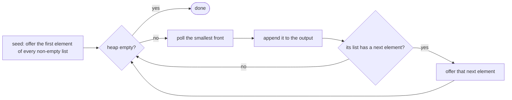

## Introduction

Merge sort's final step takes two sorted lists and combines them into one by repeatedly taking the smaller of the two front elements. That **two-way merge** is simple and linear. Now suppose there are not two lists but **k**: ten sorted log files from ten servers, a hundred sorted chunks a database wrote to disk while sorting a huge table, or a thousand sorted result lists returned by the shards of a search engine. You need one sorted output.

The question at each step is the same as in two-way merge — *which list's front element is smallest?* — but with k candidates instead of two. Comparing all k fronts at every step costs O(k) per output element. A min heap that holds the k fronts answers the question in O(log k). That is the **k-way merge** pattern: seed a heap with the first element of each list, then repeatedly poll the smallest, output it, and push the next element from the *same* list.

The pattern reaches well beyond literally merging lists. Many problems contain k sorted sequences hidden in their structure — the rows of a sorted matrix, the sums `a[i] + b[j]` for each fixed `i` — and k-way merge lets you walk through their combined order one element at a time without generating everything. This lesson covers the core algorithm and those variations; the linked-list version and the divide-and-conquer alternative are also taught in [[a4-merge-lists]].

## Before you start

- **Merging two sorted lists** — the two-pointer merge this pattern generalises. See [[a4-merge-lists]] and [[a3-merge-sort]].
- **Min heaps and PriorityQueue** — O(log n) offer and poll, comparators with `Integer.compare`. See [[a7-min-heap]] and [[a7-priority-queues]].
- **Records** — used here for heap entries with named fields. See [[a1-custom-classes]].

## The intuition: k fingers

Put one finger on the first element of each sorted list. The smallest element of everything that remains is under one of your fingers — it cannot be further along any list, because each list is sorted and its front is its smallest remaining element. So take the smallest value under your fingers, write it down, and move *that* finger one step along its list. Repeat until every finger has fallen off the end of its list.

The fingers are the whole state of the algorithm. The rest of each list does not matter yet. A min heap is the natural place to keep the k finger values, because the only question you ever ask of them is "which is smallest?", and after answering it you change exactly one of them.



## From naive to heap

Let N be the total number of elements across all k lists.

**Concatenate and sort.** Throw everything into one array and sort it: O(N log N). It ignores the fact that the lists are already sorted, and it needs all N elements in memory.

**Merge one list at a time.** Merge list 1 with list 2, then the result with list 3, and so on. Each merge is linear in the size of the growing result, so with k lists of equal length N/k the total work is about N/k · (2 + 3 + … + k), which is O(N · k). Early elements are copied again in every round.

**Scan the k fronts.** Keep k pointers and, at each step, scan all k fronts for the smallest: O(k) per element, O(N · k) total. No repeated copying, but the scan wastes time re-comparing the k − 1 fronts that did not change.

**Heap of fronts.** Keep the k fronts in a min heap. Each step polls the smallest (O(log k)) and offers one replacement (O(log k)). Every element enters and leaves the heap exactly once, so the total is **O(N log k)**. Compared with sorting, the improvement is log N down to log k; compared with the scan, k down to log k.

**Divide and conquer.** Merge the lists in pairs — 1 with 2, 3 with 4, and so on — then merge the results in pairs, like the levels of merge sort. There are log k rounds and each round touches every element once: also O(N log k), with no heap. It needs all lists present up front, so it does not work on streams; the heap version does. Details and code are in [[a4-merge-lists]].

## What a heap entry must carry

When you poll an element, you must know *which list it came from and where in that list it was*, so that you can push its successor. A bare value is not enough: if two lists both contain `4`, the value alone cannot tell you which list to advance.

| Source | Heap entry | How to advance |
|---|---|---|
| Sorted arrays | `(value, listIndex, position)` | `lists[listIndex][position + 1]` |
| Linked lists | the `ListNode` itself | `node.next` |
| Iterators or streams | `(value, iterator)` | `iterator.next()` if `hasNext()` |
| Implicit lists (matrix rows, pair sums) | the coordinates `(i, j)` | compute the next coordinate |

The comparator looks only at the value; the rest is payload that lets you advance.

## Implementation over arrays

```java title="MergeKArrays.java"
import java.util.*;

public class MergeKArrays {
    /** One heap entry: the current front value of list `list`, found at position `index`. */
    record Cursor(int value, int list, int index) {}

    static List<Integer> merge(int[][] lists) {
        PriorityQueue<Cursor> heap = new PriorityQueue<>(Comparator.comparingInt(Cursor::value));
        for (int i = 0; i < lists.length; i++) {
            if (lists[i].length > 0) heap.offer(new Cursor(lists[i][0], i, 0));  // skip empty lists
        }
        List<Integer> out = new ArrayList<>();
        while (!heap.isEmpty()) {
            Cursor c = heap.poll();                        // smallest front among all lists
            out.add(c.value());
            int next = c.index() + 1;
            if (next < lists[c.list()].length) {           // advance the same list
                heap.offer(new Cursor(lists[c.list()][next], c.list(), next));
            }
        }
        return out;
    }

    public static void main(String[] args) {
        System.out.println(merge(new int[][]{{1, 4, 5}, {1, 3, 4}, {2, 6}}));
        System.out.println(merge(new int[][]{{}, {-2, 0}, {}, {-5, 7, 9}}));
        System.out.println(merge(new int[][]{}));
    }
}
```

```output
[1, 1, 2, 3, 4, 4, 5, 6]
[-5, -2, 0, 7, 9]
[]
```

The seeding loop skips empty lists; offering `lists[i][0]` for an empty list would throw `ArrayIndexOutOfBoundsException`. With no lists at all, the heap starts empty and the method returns an empty list without special-casing. `Comparator.comparingInt` compares with `Integer.compare` internally, so negative and extreme values are ordered correctly.

**Invariant.** At the start of each iteration, the heap holds exactly one entry for every list that still has unconsumed elements — its current front — and every value already output is ≤ every value still unconsumed. Polling the heap's minimum therefore produces the next value of the merged order, and offering the successor restores the "one front per non-empty list" part.

### Dry run

Lists L0 = `[1, 4, 5]`, L1 = `[1, 3, 4]`, L2 = `[2, 6]`. Entries are written as value(list).

| Step | Heap before poll | Polled | Offered | Output so far |
|---|---|---|---|---|
| 1 | 1(L0), 1(L1), 2(L2) | 1(L0) | 4(L0) | 1 |
| 2 | 1(L1), 2(L2), 4(L0) | 1(L1) | 3(L1) | 1 1 |
| 3 | 2(L2), 3(L1), 4(L0) | 2(L2) | 6(L2) | 1 1 2 |
| 4 | 3(L1), 4(L0), 6(L2) | 3(L1) | 4(L1) | 1 1 2 3 |
| 5 | 4(L0), 4(L1), 6(L2) | 4(L0) | 5(L0) | 1 1 2 3 4 |
| 6 | 4(L1), 5(L0), 6(L2) | 4(L1) | — (L1 done) | 1 1 2 3 4 4 |
| 7 | 5(L0), 6(L2) | 5(L0) | — (L0 done) | … 5 |
| 8 | 6(L2) | 6(L2) | — (L2 done) | … 5 6 |

The heap never holds more than three entries — one per list — no matter how long the lists are. When two fronts are equal (steps 1 and 5), either may come out first; the merged values are the same either way. If the merge must be **stable** — equal values keep the order of their source lists, as when merging records sorted by timestamp — add the list index as a tie-breaker: `Comparator.comparingInt(Cursor::value).thenComparingInt(Cursor::list)`.

## Complexity

**Time.** Seeding offers up to k entries: O(k log k), or O(k) with the heapify constructor. Each of the N elements is then polled once and offered at most once, each at O(log k) because the heap never exceeds k entries. Total **O(N log k)** (plus O(k log k) seeding, which is dominated when every list is non-empty, since then k ≤ N).

**Space.** The heap holds at most k entries: **O(k)** extra. The output itself is O(N) if you materialise it; if you stream the output (next section), nothing beyond the heap is needed.

When k = 2, the heap is pointless: a two-pointer merge is O(N) with tiny constants. When k = 1, return the list. The heap pays off as k grows.

## Lazy merging over streams

Because the algorithm only ever looks at the front of each source, the sources do not need to be in memory. They can be iterators over files, network streams or database cursors, and the output can be produced one element at a time on demand. This version wraps k sorted iterators in an iterator that yields the merged order lazily.

```java title="MergingIterator.java"
import java.util.*;

/** Lazily merges k sorted iterators: each next() costs O(log k), memory O(k). */
public class MergingIterator<T> implements Iterator<T> {
    private record Head<T>(T value, Iterator<T> source) {}

    private final PriorityQueue<Head<T>> heap;

    public MergingIterator(List<Iterator<T>> sources, Comparator<? super T> order) {
        heap = new PriorityQueue<>((a, b) -> order.compare(a.value(), b.value()));
        for (Iterator<T> it : sources) {
            if (it.hasNext()) heap.offer(new Head<>(it.next(), it));
        }
    }

    @Override public boolean hasNext() { return !heap.isEmpty(); }

    @Override public T next() {
        if (heap.isEmpty()) throw new NoSuchElementException();
        Head<T> h = heap.poll();
        if (h.source().hasNext()) heap.offer(new Head<>(h.source().next(), h.source()));
        return h.value();
    }

    public static void main(String[] args) {
        List<Iterator<String>> logs = List.of(
                List.of("09:00 api start", "09:05 api ok", "09:20 api ok").iterator(),
                List.of("09:01 db start", "09:19 db slow").iterator(),
                List.of("09:02 cache start").iterator());
        MergingIterator<String> merged = new MergingIterator<>(logs, Comparator.naturalOrder());
        while (merged.hasNext()) System.out.println(merged.next());
    }
}
```

```output
09:00 api start
09:01 db start
09:02 cache start
09:05 api ok
09:19 db slow
09:20 api ok
```

Each source contributes exactly one element to the heap at a time, so memory is O(k) regardless of how large the logs are. The example sorts log lines by their text, which works because the lines start with zero-padded `HH:MM` timestamps; real log merging would compare parsed timestamps. A caller that stops after the first ten lines does only the work for those ten.

## Variation: k-th smallest in a sorted matrix

*An n × n matrix has every row and every column sorted ascending. Return the k-th smallest element.* For

```text
 1   5   9
10  11  13
12  13  15
```

and k = 8, the sorted order is `1 5 9 10 11 12 13 13 15`, so the answer is `13`.

Each **row is a sorted list**, so the matrix is n sorted lists, and the k-th smallest element is the k-th element of their merge. Seed the heap with the first element of each row, poll k − 1 times (advancing along the row each time), and the heap's root is then the k-th smallest. Only the first min(n, k) rows can contribute to the first k elements, so seed only those.

```java title="KthSmallestMatrix.java"
import java.util.*;

public class KthSmallestMatrix {
    /** Rows and columns are sorted ascending; returns the k-th smallest (1-based). */
    static int kthSmallest(int[][] m, int k) {
        int n = m.length;
        // entries are {value, row, col}; each row is one sorted list
        PriorityQueue<int[]> heap = new PriorityQueue<>((a, b) -> Integer.compare(a[0], b[0]));
        for (int r = 0; r < Math.min(n, k); r++) heap.offer(new int[]{m[r][0], r, 0});
        for (int i = 1; i < k; i++) {                       // discard the k - 1 smallest
            int[] e = heap.poll();
            if (e[2] + 1 < m[e[1]].length) heap.offer(new int[]{m[e[1]][e[2] + 1], e[1], e[2] + 1});
        }
        return heap.peek()[0];
    }

    public static void main(String[] args) {
        int[][] m = {{1, 5, 9}, {10, 11, 13}, {12, 13, 15}};
        System.out.println(kthSmallest(m, 8));
        System.out.println(kthSmallest(m, 1));
    }
}
```

```output
13
1
```

The time is O(min(n, k) + k log min(n, k)): k polls on a heap of at most min(n, k) entries. This uses only the row ordering; the column ordering is unused. For large k, binary search on the *value* — counting how many entries are ≤ a candidate in O(n) using both orderings — gives O(n log(max − min)), which is better when k is close to n²; see [[a3-binary-search-on-answer]].

## Variation: k pairs with smallest sums

*Given two sorted arrays `a` and `b`, return the k pairs `(a[i], b[j])` with the smallest sums.* Generating all n · m pairs and sorting them is O(nm log(nm)), wasteful when k is small.

The hidden lists: for each fixed `i`, the sums `a[i] + b[0], a[i] + b[1], …` are sorted, because `b` is sorted. So there are n sorted lists, list `i` being "a[i] paired with every b[j]", and the k smallest pairs are the first k elements of their merge. A heap entry is the coordinate pair `(i, j)`; advancing list `i` means moving to `(i, j + 1)`.

```java title="KSmallestPairs.java"
import java.util.*;

public class KSmallestPairs {
    static List<List<Integer>> kSmallestPairs(int[] a, int[] b, int k) {
        List<List<Integer>> result = new ArrayList<>();
        if (a.length == 0 || b.length == 0) return result;
        // entry {i, j} stands for the pair (a[i], b[j]); list i is a[i] paired with all of b
        PriorityQueue<int[]> heap = new PriorityQueue<>(
                (p, q) -> Long.compare((long) a[p[0]] + b[p[1]], (long) a[q[0]] + b[q[1]]));
        for (int i = 0; i < Math.min(a.length, k); i++) heap.offer(new int[]{i, 0});
        while (!heap.isEmpty() && result.size() < k) {
            int[] p = heap.poll();
            result.add(List.of(a[p[0]], b[p[1]]));
            if (p[1] + 1 < b.length) heap.offer(new int[]{p[0], p[1] + 1});  // next in list i
        }
        return result;
    }

    public static void main(String[] args) {
        System.out.println(kSmallestPairs(new int[]{1, 7, 11}, new int[]{2, 4, 6}, 3));
        System.out.println(kSmallestPairs(new int[]{1, 1, 2}, new int[]{1, 2, 3}, 2));
    }
}
```

```output
[[1, 2], [1, 4], [1, 6]]
[[1, 1], [1, 1]]
```

Seeding every list at `j = 0` and advancing only `j` means each pair `(i, j)` can enter the heap in exactly one way, so no visited set is needed. A tempting alternative — start from `(0, 0)` and push both `(i + 1, j)` and `(i, j + 1)` after each poll — reaches the same pair along two paths and produces duplicates unless you track visited coordinates. The comparator computes sums in `long`, because two `int`s near the limits can overflow when added. The time is O(k log min(n, k)), since the heap holds at most min(n, k) entries and at most k polls happen.

## Variation: smallest range covering k lists

*Given k sorted lists, find the smallest range `[lo, hi]` that includes at least one number from each list.* For `[4, 10, 15, 24, 26]`, `[0, 9, 12, 20]`, `[5, 18, 22, 30]` the answer is `[20, 24]` (it contains 24, 20 and 22).

Any candidate range is defined by choosing one element from each list; the best range for a choice is `[min, max]` of the chosen elements. Start with the front of every list. The range is `[heap minimum, current maximum]`. To have any chance of a smaller range, you must raise the minimum — raising anything else only increases the maximum — so poll the minimum and replace it with the next element of the same list, updating the running maximum. Record the best range seen. The moment a list runs out, stop: you can no longer pick an element from that list while raising the minimum.

```java title="SmallestRange.java"
import java.util.*;

public class SmallestRange {
    /** Smallest [lo, hi] containing at least one number from each sorted list. */
    static int[] smallestRange(List<List<Integer>> lists) {
        PriorityQueue<int[]> heap = new PriorityQueue<>((a, b) -> Integer.compare(a[0], b[0]));
        int max = Integer.MIN_VALUE;                        // largest value currently in the heap
        for (int i = 0; i < lists.size(); i++) {
            int v = lists.get(i).get(0);
            heap.offer(new int[]{v, i, 0});
            max = Math.max(max, v);
        }
        int bestLo = heap.peek()[0], bestHi = max;
        while (true) {
            int[] e = heap.poll();                          // the minimum of the current window
            if ((long) max - e[0] < (long) bestHi - bestLo) { bestLo = e[0]; bestHi = max; }
            int next = e[2] + 1;
            if (next == lists.get(e[1]).size()) break;      // this list is exhausted: no more windows
            int v = lists.get(e[1]).get(next);
            heap.offer(new int[]{v, e[1], next});
            max = Math.max(max, v);
        }
        return new int[]{bestLo, bestHi};
    }

    public static void main(String[] args) {
        List<List<Integer>> lists = List.of(
                List.of(4, 10, 15, 24, 26), List.of(0, 9, 12, 20), List.of(5, 18, 22, 30));
        System.out.println(Arrays.toString(smallestRange(lists)));
        System.out.println(Arrays.toString(smallestRange(List.of(
                List.of(1, 2, 3), List.of(1, 2, 3), List.of(1, 2, 3)))));
    }
}
```

```output
[20, 24]
[1, 1]
```

A heap gives the minimum, but not the maximum; the running variable `max` supplies it, and it only ever increases because each new element replaces a smaller one from the same list. The range widths are compared as `long` because `max - min` can overflow `int` for extreme values. The update uses strict `<`, so among equally wide ranges the first found — the one with the smaller `lo` — is kept. Time is O(N log k), space O(k). This is a k-way merge combined with a sliding window ([[a2-sliding-window]]): the heap's contents are the window.

```quiz
Q: When merging k sorted lists with a total of N elements, why is the heap-based merge O(N log k) rather than O(N log N)?
- [ ] Because the heap is rebuilt only k times
- [x] Because the heap holds at most one front element per list, so each operation costs O(log k)
- [ ] Because each list is merged only once
- [ ] Because the comparator is O(1)
> Every element is offered and polled once, but the heap never contains more than k entries — one front per list. Heap operations cost the log of the heap's size, not of the total data size.

Q: Why must each heap entry include the source list (or node, or iterator), not only the value?
- [ ] To make the comparator faster
- [ ] So that duplicates are removed
- [x] Because after polling an element you must push the next element of the same list
- [ ] Because PriorityQueue cannot store plain integers
> Advancing the correct list is the heart of the algorithm. A bare value cannot tell you which list it came from, especially when several lists contain equal values.

Q: In "k pairs with smallest sums", why seed (i, 0) for every i and then only move j forward?
- [ ] It makes the heap smaller than k
- [x] Each pair is then reachable along exactly one path, so no duplicates and no visited set are needed
- [ ] It is required because b is sorted in descending order
- [ ] It guarantees O(1) time per pair
> Treating each fixed i as one sorted list means pair (i, j) can only be pushed after (i, j - 1). Pushing both (i + 1, j) and (i, j + 1) from (i, j) reaches some pairs twice and needs a visited set to avoid duplicates.
```

## In real systems

**External sorting.** When a database must sort more data than fits in memory — PostgreSQL does this for large `ORDER BY` queries, index builds and merge joins once a sort exceeds `work_mem` — it sorts memory-sized chunks, writes each to disk as a sorted **run**, then merges the runs with a heap that holds the current front of each run. Each run is read sequentially, which disks and SSDs handle efficiently, and memory holds only a buffer per run. If there are too many runs to merge at once, it merges them in several passes.

**LSM-tree storage engines.** Databases such as RocksDB, LevelDB and Cassandra write data into many immutable sorted files. A read that scans a key range, and the background **compaction** that combines files, both perform a k-way merge across those sorted sources; RocksDB's merging iterator keeps the sources' current keys in a heap. When the same key appears in several files, the merge keeps the newest version — a merge with a tie-breaking rule.

**Distributed query results.** A search engine or a sharded database sends a query to many shards, each of which returns its results already sorted by score or key. The coordinator k-way merges those sorted lists to produce the final page, often stopping after the first k results.

**Log aggregation.** Combining per-server log files into one timeline is exactly the `MergingIterator` above, with timestamps as keys and a tie-breaker so that events with the same timestamp keep a deterministic order.

## Trade-offs and alternatives

| Approach | Time | Extra space | Streams? | Notes |
|---|---|---|---|---|
| Concatenate and sort | O(N log N) | O(N) | no | Ignores existing order |
| Merge sequentially | O(N · k) | O(N) | no | Early elements are copied k times |
| Scan k fronts | O(N · k) | O(k) | yes | Fine for very small k |
| Min heap of fronts | O(N log k) | O(k) | **yes** | The standard k-way merge |
| Divide and conquer (pairwise) | O(N log k) | O(1) for linked lists | no | No heap; needs all lists up front |
| Two pointers (k = 2) | O(N) | O(1) | yes | The heap is overkill for two lists |

For very small k (say, up to 4–8), a linear scan of the fronts can be faster than a heap in practice because of lower overhead, even though its bound is worse. For large k with all data present, divide and conquer avoids the heap's overhead; with streaming sources, the heap is the only practical choice.

## Common mistakes

> [!MISTAKE] Pushing a successor from the wrong list
> If the heap stores only values, you cannot tell which list to advance, and implementations end up advancing the wrong pointer or all pointers. Always carry the source — list index and position, the node, or the iterator — in the entry.

**Offering empty lists or `null` heads.** Reading `lists[i][0]` of an empty array throws, and offering a `null` `ListNode` into a `PriorityQueue` throws `NullPointerException`. Filter during seeding.

**Concatenating then sorting "because it is simpler".** It works, but it gives up the O(N log k) bound and the ability to stream. In an interview, mention it as the baseline and then improve on it.

**Overflow in comparators.** `(x, y) -> x.val - y.val` and sums like `a[i] + b[j]` can overflow. Use `Integer.compare`, and compute sums in `long`.

**Generating duplicate pairs.** In pair and matrix problems, pushing both neighbours of a coordinate without a visited set causes duplicates. Prefer a seeding scheme where each coordinate has one predecessor.

**Continuing the smallest-range loop after a list ends.** Once any list is exhausted, no further range can include an element from it while raising the minimum, so the loop must stop.

## Interview perspective

*Merge k Sorted Lists* is one of the most common heap interview questions, and interviewers expect the heap solution, its complexity, and awareness of the divide-and-conquer alternative.

> [!INTERVIEW] Explaining the merge in two sentences
> "The smallest remaining element must be the front of one of the k lists, so I keep the k fronts in a min heap and repeatedly poll the smallest, append it, and push its successor from the same list. The heap never exceeds k entries, so with N total elements it's O(N log k) time and O(k) extra space."

Follow-ups to expect:

- **Heap or divide and conquer?** Both are O(N log k). Divide and conquer uses no heap and O(1) extra space for linked lists; the heap works on streams and can stop early after the first few outputs.
- **What if the lists are huge files?** Use buffered readers as iterators and the lazy merging iterator; memory stays O(k) plus buffers.
- **What if k is 2?** Two pointers, O(N), no heap.
- **How do you make the merge stable?** Break ties by list index.
- **Kth smallest in a sorted matrix — heap or binary search?** Heap is O(k log n); binary search on the value is O(n log range) and wins when k is large.

## Practice

1. **Merge k Sorted Lists** (linked lists) — heap version, then divide and conquer; compare ([[a4-merge-lists]]).
2. **Merge k sorted arrays** — the `Cursor` version above, made stable.
3. **Kth Smallest Element in a Sorted Matrix** — heap, then binary search on the answer.
4. **Find K Pairs with Smallest Sums** — explain why no visited set is needed with the seeding used here.
5. **Smallest Range Covering Elements from K Lists** — trace the example by hand before coding.
6. **Ugly Number II** — a merge of three implicit sorted lists (multiples by 2, 3 and 5); solve it with a heap plus deduplication, then with three pointers.

The DSA explorer lists these problems under the K-way Merge topic.

## Quick revision {#quick-revision}

- Smallest remaining element is always some list's front → keep k fronts in a min heap.
- Loop: poll min → output → offer the next element of the same list (if any).
- Entry = value + how to advance: `(value, list, index)`, `ListNode`, `(value, iterator)`, or coordinates `(i, j)`.
- Time O(N log k), extra space O(k). Seed only non-empty lists. k = 2 → two pointers.
- Stable merge: tie-break by list index.
- Lazy/streaming: a merging iterator holds one element per source; works on files and cursors.
- Implicit lists: matrix rows (k-th smallest), `a[i] + b[j]` for fixed `i` (k smallest pairs).
- Smallest range: heap gives the min, a running variable tracks the max; stop when any list runs out.
- Divide-and-conquer pairwise merging is also O(N log k) but needs all lists up front.

## Key takeaways {#key-takeaways}

- K-way merge works because sorted lists put their smallest remaining element at the front, so only k candidates ever matter.
- A heap of those k fronts turns each step into O(log k), giving O(N log k) overall with O(k) extra memory.
- Each entry must carry enough state to advance its own source; the comparator reads only the value.
- Because it only touches fronts, the merge streams naturally — the reason databases and storage engines use it to merge sorted runs and files.
- Many problems hide k sorted lists — matrix rows, pair sums — and become k-way merges once you see them.
