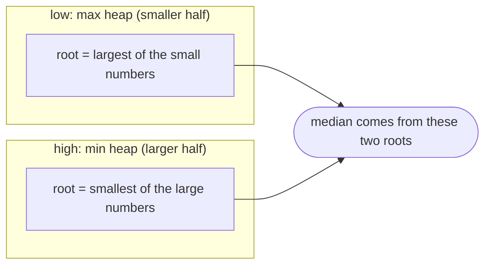

## Introduction

The **median** of a collection is its middle value once sorted: for `1, 3, 5, 8, 15` it is `5`. With an even count there are two middle values, and the median is their average: for `1, 3, 5, 15` it is `(3 + 5) / 2 = 4`. The median is popular in practice because, unlike the average, it is not dragged around by a few extreme values: one request that takes 30 seconds barely moves the median response time but wrecks the mean.

The **running median** problem — "Find Median from Data Stream" in interview form — asks for the median of a collection that keeps growing. Numbers arrive one at a time, and at any moment you may be asked for the median of everything seen so far. Think of a dashboard updating a median latency as requests complete, or a sensor feed smoothed by its median.

Sorting after every insertion would work but costs O(n log n) per new number. This lesson derives a structure that inserts in O(log n) and answers the median in O(1): **two heaps**, one holding the smaller half of the numbers and one holding the larger half. It is a classic example of choosing a data structure by asking *exactly which information the answer depends on*. The broader family of problems that use two heaps — sliding windows, percentiles, capital-and-profit scheduling — is covered in [[a7-two-heap-pattern]].

## Before you start

- **Min heaps and max heaps** — peek in O(1), insert and remove the root in O(log n), and how to build a max heap in Java. See [[a7-min-heap]] and [[a7-max-heap]].
- **PriorityQueue in Java** — `offer`, `poll`, `peek`, and `null` on empty. See [[a7-priority-queues]].
- **Binary search insertion** — used in the sorted-list baseline. See [[a3-binary-search]].

## The intuition: two piles meeting in the middle

Suppose you split all the numbers seen so far into two piles: a **low pile** with the smaller half and a **high pile** with the larger half, so that everything in the low pile is ≤ everything in the high pile. Where is the median?

It sits right at the boundary between the piles. If the piles are the same size, the median is the average of the *largest* number in the low pile and the *smallest* number in the high pile. If the low pile has one extra number, the median is the largest number in the low pile.

So you never need the whole sorted order. You need only two numbers: the maximum of the lower half and the minimum of the upper half. "Maximum of a changing set" is what a **max heap** gives; "minimum of a changing set" is what a **min heap** gives.



## Slower approaches, and why they are slow

Let n be the number of values seen so far.

**Sort on every query.** Store values in a list and sort it whenever the median is requested: O(n log n) per query. A stream with a million values and a query after each one does on the order of 10¹³ operations.

**Quickselect on every query.** Find the middle element without full sorting: O(n) average per query ([[a3-quickselect]]). Better, but still linear per query, so O(n²) over the stream.

**Keep a sorted list.** Insert each new value at its correct position, found by binary search, and read the middle directly.

```java title="SortedListMedian.java"
import java.util.*;

public class SortedListMedian {
    private final List<Integer> sorted = new ArrayList<>();

    void addNum(int num) {
        int pos = Collections.binarySearch(sorted, num);
        if (pos < 0) pos = -pos - 1;          // insertion point for a missing key
        sorted.add(pos, num);                 // O(log n) to find, O(n) to shift
    }

    double findMedian() {
        int n = sorted.size();
        return n % 2 == 1 ? sorted.get(n / 2)
                          : ((long) sorted.get(n / 2 - 1) + sorted.get(n / 2)) / 2.0;
    }

    public static void main(String[] args) {
        SortedListMedian m = new SortedListMedian();
        for (int x : new int[]{5, 15, 1, 3}) { m.addNum(x); System.out.print(m.findMedian() + " "); }
        System.out.println();
    }
}
```

```output
5.0 10.0 5.0 4.0 
```

The median query is O(1), and finding the position is O(log n), but `ArrayList.add(pos, x)` shifts every later element one slot right: O(n) per insert. It keeps the *entire* order up to date, which is more than the median needs. (For moderate n this is actually fast in practice, because shifting a contiguous array is a single memory move; it is the asymptotic cost that loses.)

**Two heaps.** Maintain only the two boundary values, with O(log n) per insert and O(1) per query — derived next.

## The invariants

Keep two heaps:

- `low` — a **max heap** holding the smaller half of the numbers.
- `high` — a **min heap** holding the larger half.

and maintain two invariants after every insertion.

**Ordering invariant.** Every value in `low` is ≤ every value in `high`. Because `low`'s root is its maximum and `high`'s root is its minimum, this is equivalent to `low.peek() <= high.peek()` (whenever `high` is non-empty).

**Size invariant.** `low.size() == high.size()` or `low.size() == high.size() + 1`. The choice that `low` holds the extra element on odd counts is a convention; it means the median for odd n is always `low.peek()`.

With both invariants true, the sorted order of all values is "the contents of `low`, then the contents of `high`", and the two roots are the middle one or two values. So:

- If `low` is larger (n odd): median = `low.peek()`.
- If the sizes are equal (n even): median = average of `low.peek()` and `high.peek()`.

## Inserting while keeping both invariants

The neat way to insert a number `x` is three steps:

1. Offer `x` to `low`.
2. Poll `low`'s root (its maximum) and offer it to `high`.
3. If `high` is now larger than `low`, poll `high`'s root (its minimum) and offer it to `low`.

**Why step 2 restores the ordering invariant.** After step 1, `x` might be larger than some values in `high`, which would violate ordering. Step 2 takes the largest value of `low` (which now includes `x`) and moves it to `high`. Two cases cover everything. If the moved value is `x`, then `x` was at least as large as the old `low` values, and those were already ≤ everything in `high`, so the remaining `low` values are still ≤ everything in `high` — including `x` itself. If the moved value is the old root of `low`, then `x` stayed in `low` and is ≤ that old root, which was already ≤ everything in `high`; so `x` and the rest of `low` are ≤ everything in `high`. Either way, after step 2 every value in `low` is ≤ every value in `high`.

**Why step 3 restores the size invariant without breaking ordering.** Before the insertion, `low` had either the same size as `high` or one more. Step 2 moved one value net from `low` to `high`, so now `high` may be one larger than `low`. Step 3 moves `high`'s minimum back to `low`. That value is ≤ everything else in `high` and ≥ everything in `low` (by ordering), so after moving it, ordering still holds — it becomes `low`'s new maximum.

The trick costs up to three heap operations per insertion, all O(log n). Its appeal is that there are no cases to get wrong: you never need to compare `x` against the roots yourself.

## Implementation

```java title="MedianFinder.java"
import java.util.*;

public class MedianFinder {
    // lower half: max heap, so its root is the largest of the small numbers
    private final PriorityQueue<Integer> low = new PriorityQueue<>(Comparator.reverseOrder());
    // upper half: min heap, so its root is the smallest of the large numbers
    private final PriorityQueue<Integer> high = new PriorityQueue<>();

    public void addNum(int num) {
        low.offer(num);                  // 1. tentatively put num in the lower half
        high.offer(low.poll());          // 2. the largest of the lower half moves up: order holds
        if (high.size() > low.size()) {  // 3. restore sizes: low may hold one extra
            low.offer(high.poll());
        }
    }

    public double findMedian() {
        if (low.isEmpty()) throw new IllegalStateException("no numbers yet");
        if (low.size() > high.size()) return low.peek();
        return ((long) low.peek() + high.peek()) / 2.0;   // long: the sum may overflow int
    }

    static String sorted(PriorityQueue<Integer> pq) {
        List<Integer> copy = new ArrayList<>(pq);
        Collections.sort(copy);
        return copy.toString();
    }

    public static void main(String[] args) {
        MedianFinder mf = new MedianFinder();
        for (int x : new int[]{5, 15, 1, 3, 8, 7}) {
            mf.addNum(x);
            System.out.printf("add %-2d low=%-10s high=%-10s median=%s%n",
                    x, sorted(mf.low), sorted(mf.high), mf.findMedian());
        }
        MedianFinder big = new MedianFinder();
        big.addNum(Integer.MAX_VALUE);
        big.addNum(Integer.MAX_VALUE - 2);
        System.out.println("large values: " + big.findMedian());
        int a = Integer.MAX_VALUE, b = Integer.MAX_VALUE - 2;
        System.out.println("int sum / 2.0: " + (a + b) / 2.0);
    }
}
```

```output
add 5  low=[5]        high=[]         median=5.0
add 15 low=[5]        high=[15]       median=10.0
add 1  low=[1, 5]     high=[15]       median=5.0
add 3  low=[1, 3]     high=[5, 15]    median=4.0
add 8  low=[1, 3, 5]  high=[8, 15]    median=5.0
add 7  low=[1, 3, 5]  high=[7, 8, 15] median=6.0
large values: 2.147483646E9
int sum / 2.0: -2.0
```

The `sorted` helper exists only to print the heaps readably; heaps do not store their contents in sorted order. The last two lines show why `findMedian` casts to `long` before adding. Two `int` roots near `Integer.MAX_VALUE` overflow when added as `int`, and the "median" of two huge positive numbers comes out as `-2.0`. Many published solutions write `(low.peek() + high.peek()) / 2.0`, which has exactly this bug; the `2.0` makes the *division* floating-point but not the addition. Casting one operand to `long` first fixes it.

`findMedian` throws on an empty stream rather than returning a made-up value. Whatever you choose, define it — `peek()` on an empty heap returns `null`, and unboxing that would throw a less helpful `NullPointerException`.

### Dry run

Here are the three steps for each insertion of the stream `5, 15, 1, 3, 8, 7`. Heaps are shown as sorted sets.

| Add | After step 1 (offer to low) | After step 2 (low's max → high) | Step 3 needed? | Final low | Final high | Median |
|---|---|---|---|---|---|---|
| 5 | low {5} | low {}, high {5} | yes: move 5 back | {5} | {} | 5 |
| 15 | low {5, 15} | low {5}, high {15} | no (1 = 1) | {5} | {15} | (5 + 15) / 2 = 10 |
| 1 | low {1, 5} | low {1}, high {5, 15} | yes: move 5 back | {1, 5} | {15} | 5 |
| 3 | low {1, 3, 5} | low {1, 3}, high {5, 15} | no (2 = 2) | {1, 3} | {5, 15} | (3 + 5) / 2 = 4 |
| 8 | low {1, 3, 8} | low {1, 3}, high {5, 8, 15} | yes: move 5 back | {1, 3, 5} | {8, 15} | 5 |
| 7 | low {1, 3, 5, 7} | low {1, 3, 5}, high {7, 8, 15} | no (3 = 3) | {1, 3, 5} | {7, 8, 15} | (5 + 7) / 2 = 6 |

Check the last row against a sort: `1 3 5 7 8 15` has middle values 5 and 7, median 6. Look at the insertion of `8`: it first went into `low`, immediately moved up to `high` because it was the largest, and then `high`'s smallest value `5` came back down to keep the sizes balanced. Each number ends up on the correct side without any explicit comparison in our code.

## An alternative insertion with explicit comparison

Some people prefer to route the new value directly and then rebalance:

```java
void addNum(int x) {
    if (low.isEmpty() || x <= low.peek()) low.offer(x);   // belongs in the lower half
    else high.offer(x);                                    // belongs in the upper half
    if (low.size() > high.size() + 1) high.offer(low.poll());
    else if (high.size() > low.size()) low.offer(high.poll());
}
```

Routing by comparison with `low.peek()` preserves ordering directly; the rebalance then moves at most one root across, which keeps ordering for the same reason as step 3 above. This version does fewer heap operations on average (often a single offer), at the cost of more branches to get right. Both versions were checked against a sort-based median on thousands of random streams with duplicates and negative numbers. Pick whichever you can explain clearly.

## Complexity

**Time.** `addNum` performs at most three `offer`/`poll` operations on heaps of size about n/2: O(log n). `findMedian` reads one or two roots: O(1). Over a stream of n insertions, total O(n log n) — the same as sorting once, but with the median available after every step.

**Space.** O(n): every value is stored in one of the two heaps. That is unavoidable for an exact median of an arbitrary stream, because any value might become the median later.

```quiz
Q: Why is the lower half stored in a max heap rather than a min heap?
- [ ] Max heaps are faster in Java
- [x] The median needs the largest value of the lower half, and a max heap keeps that at the root
- [ ] So that duplicates go to the lower half
- [ ] Because the lower half always has more elements
> The median sits at the boundary between halves: the largest of the small numbers and the smallest of the large numbers. A max heap exposes the first in O(1); the upper half's min heap exposes the second.

Q: After some insertions, low = {1, 3} and high = {5, 15}. What does findMedian return?
- [ ] 3
- [ ] 5
- [x] 4.0
- [ ] 8.0
> The sizes are equal, so the median is the average of the two roots: low's maximum 3 and high's minimum 5, giving 4.0. The sorted values 1 3 5 15 confirm it.

Q: What is wrong with returning (low.peek() + high.peek()) / 2.0 when both heaps hold Integer values?
- [ ] Nothing; the 2.0 makes the whole expression a double
- [x] The addition happens in int before the division and can overflow for large values
- [ ] peek() returns a double already
- [ ] It returns the wrong half for odd counts
> Java evaluates low.peek() + high.peek() as int arithmetic first; only the division is done in double. Two values near Integer.MAX_VALUE overflow to a negative sum. Cast one operand to long before adding.
```

## Edge cases and follow-up constraints

**Duplicates.** Equal values may sit in both heaps — for example, `low` = {5, 5} and `high` = {5}. The ordering invariant uses ≤, so this is valid, and the median is still correct.

**Negative numbers and extremes.** The heaps handle them without change; only the averaging needs `long` to avoid overflow.

**All values in a small range.** If every number is an integer in `[0, 100]`, you do not need heaps. Keep a count per value and walk the counts to find the middle rank: O(1) insert and O(101) = O(1) median.

```java title="CountingMedian.java"
public class CountingMedian {
    private final int[] count = new int[101];   // values are known to be in [0, 100]
    private int n = 0;

    void addNum(int num) { count[num]++; n++; }

    /** Value at 0-based rank r in sorted order. */
    private int valueAtRank(int r) {
        int seen = 0;
        for (int v = 0; v <= 100; v++) {
            seen += count[v];
            if (seen > r) return v;
        }
        throw new IllegalStateException();
    }

    double findMedian() {
        if (n % 2 == 1) return valueAtRank(n / 2);
        return (valueAtRank(n / 2 - 1) + valueAtRank(n / 2)) / 2.0;
    }

    public static void main(String[] args) {
        CountingMedian m = new CountingMedian();
        for (int x : new int[]{5, 15, 1, 3}) { m.addNum(x); System.out.print(m.findMedian() + " "); }
        System.out.println();
    }
}
```

```output
5.0 10.0 5.0 4.0 
```

**Most values in a small range.** If 99% of values are in `[0, 100]` but a few are outside, keep the counting array plus two counters for "below 0" and "above 100". The median is almost certainly inside the range; if the outliers ever pushed the middle rank outside it, you would need to store them, which a follow-up interviewer may ask you to discuss.

**Removing values or a sliding window.** Heaps cannot remove an arbitrary element efficiently. "Median of the last k values" needs lazy deletion or a balanced tree; it is developed in [[a7-two-heap-pattern]].

**Other percentiles.** The same structure computes the 90th percentile if you keep `low` at about 90% of the values instead of half. The size invariant changes; the ordering invariant does not.

**Median of two sorted arrays.** Despite the name, that is a different problem: both arrays are given up front and sorted, and binary search on the partition finds the median in O(log(min(m, n))) without heaps.

## In real systems

**Latency monitoring.** Services report median (p50), p95 and p99 response times. An exact two-heap median stores every sample, which is too much memory for high-traffic systems running indefinitely. Production monitoring therefore uses **approximate quantile sketches** such as t-digest, HdrHistogram or DDSketch, or fixed bucket histograms (the approach Prometheus histograms take), trading a small, bounded error for bounded memory. The two-heap structure is the right answer when the data set is bounded and exactness matters.

**Robust smoothing.** Median filters replace each sample with the median of its neighbours to remove spikes from sensor readings, audio or images without blurring sharp edges the way an average does. Over a moving window this is the sliding-window median.

**Online statistics in applications.** Game matchmaking, pricing dashboards and A/B-test monitors often show a live median of a bounded set — the current session, the last day's orders — where the two-heap structure fits directly.

## Trade-offs and alternatives

| Approach | Insert | Median | Space | Use when |
|---|---|---|---|---|
| Sort on each query | O(1) | O(n log n) | O(n) | Very few queries |
| Quickselect on each query | O(1) | O(n) average | O(n) | Few queries, many inserts |
| Sorted list (binary search + shift) | O(n) | O(1) | O(n) | Small n; simple and cache-friendly |
| **Two heaps** | **O(log n)** | **O(1)** | O(n) | General streaming median |
| Counting array | O(1) | O(range) | O(range) | Small integer range |
| Balanced BST / order-statistic tree | O(log n) | O(log n) | O(n) | Need deletions too |
| Quantile sketch (t-digest, etc.) | ~O(1) | ~O(1) | bounded | Huge or endless streams; approximate is acceptable |

## Common mistakes

> [!MISTAKE] Overflow in the average
> `(low.peek() + high.peek()) / 2.0` adds two `int`s before converting to `double`. For values near `Integer.MAX_VALUE` the sum wraps negative. Write `((long) low.peek() + high.peek()) / 2.0`.

**Both heaps with the same polarity.** If `low` is a min heap, its root is the smallest of the lower half — useless for the median. `low` must be a max heap and `high` a min heap.

**Skipping the move to the other heap.** Offering `x` to `low` and then only rebalancing by size can leave a large value in `low` while `high` contains smaller ones, breaking ordering. Either always pass `low`'s maximum to `high` (step 2), or route by comparing with `low.peek()` first.

**Letting the sizes drift.** If the rebalance condition is wrong — for instance allowing `high` to be larger — `findMedian` reads the wrong root on odd counts. Write the size invariant down and check that each branch restores it.

**Integer division for even counts.** `(a + b) / 2` with integers truncates `4.5` to `4`. Divide by `2.0`.

**Using `max - min` reasoning on a single heap.** One heap gives one end of the data, never the middle. The median needs two.

## Interview perspective

"Find Median from Data Stream" is a well-known hard-labelled problem, but it is mostly a test of whether you can derive the two-heap design and state its invariants.

> [!INTERVIEW] Lead with what the median depends on
> "The median depends only on the largest value of the lower half and the smallest of the upper half. So I'll keep a max heap for the lower half and a min heap for the upper half, with everything in the lower heap ≤ everything in the upper, and the lower heap holding the same number or one more. Insert is O(log n) and the median is O(1) from the roots."

Questions interviewers follow up with:

- **Why not keep a sorted list?** Binary search finds the position in O(log n), but inserting shifts O(n) elements.
- **What if all numbers are between 0 and 100?** A counting array gives O(1) insert and a constant-time median scan.
- **What if 99% are between 0 and 100?** Counting array plus outlier counters; discuss what happens if outliers shift the middle.
- **How would you support removal or a sliding window?** Lazy deletion in both heaps with a map of pending removals, or a `TreeMap`-based multiset ([[a7-two-heap-pattern]]).
- **What about a huge, endless stream?** Exact medians need O(n) memory; use an approximate sketch such as t-digest.

## Practice

1. **Find Median from Data Stream** — implement both insertion styles and test them on streams with duplicates and extreme values.
2. **Percentile finder** — generalise `MedianFinder` to return the p-th percentile for a fixed p, adjusting the size invariant.
3. **Bounded range** — implement the counting version and the "99% in range" version.
4. **Sliding Window Median** — continue in [[a7-two-heap-pattern]].
5. **Explain without code** — draw both heaps after inserting `2, 9, 4, 4, 1, 7` and give the median after each step.

The DSA explorer lists *Find Median from Data Stream* and related problems under the Running Median topic.

## Quick revision {#quick-revision}

- Median = middle of sorted order; even count → average of the two middle values.
- `low` = max heap (smaller half), `high` = min heap (larger half).
- Ordering invariant: `low.peek() <= high.peek()`. Size invariant: `low.size() - high.size()` is 0 or 1.
- Insert: offer to `low`; move `low.poll()` to `high`; if `high` is larger, move `high.poll()` to `low`.
- Median: `low.peek()` if `low` is larger, else `((long) low.peek() + high.peek()) / 2.0`.
- Time: O(log n) insert, O(1) median. Space: O(n).
- Small integer range → counting array. Deletions / windows → lazy deletion or a balanced tree. Endless streams → approximate sketches.

## Key takeaways {#key-takeaways}

- The median depends only on the boundary between the lower and upper halves, so you only need fast access to two values, not the full sorted order.
- A max heap for the lower half and a min heap for the upper half provide exactly those two values in O(1).
- Two invariants — every low value ≤ every high value, and sizes equal or low one larger — make the median a direct read from the roots.
- The three-step insert (into low, low's max to high, rebalance) preserves both invariants without case analysis.
- Average the roots in `long` arithmetic; the common `(a + b) / 2.0` overflows.
