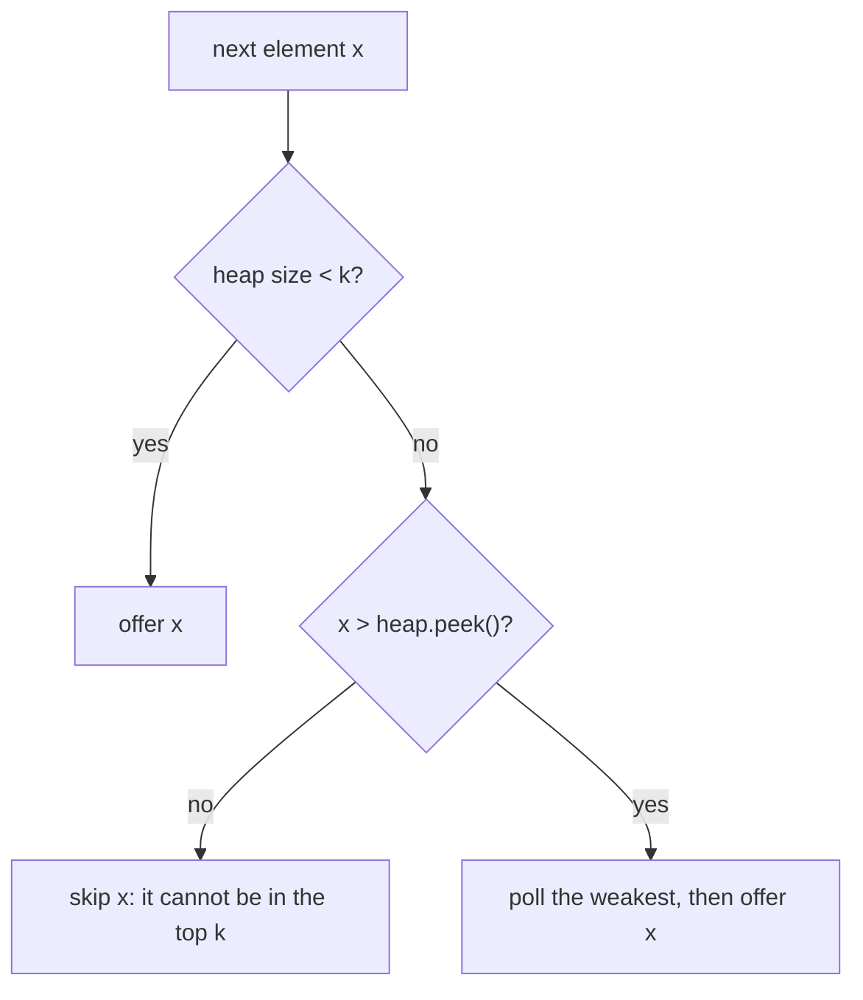

## Introduction

A music service wants the 10 most played songs out of 80 million. A monitoring system wants the 5 slowest requests in the last minute. A maps app wants the 20 restaurants closest to you. Each question has the same shape: out of many items, return the **k best** by some measure, where k is much smaller than the total.

The straightforward answer is to sort all n items and take the first k. That works, but it does far more than needed: it carefully orders millions of items whose relative order nobody asked about. Sorting costs O(n log n) time, and it needs all n items in memory at once — impossible when the items arrive as an endless stream.

The **top-K pattern** keeps only the k best items seen so far in a heap of size k. Each new item is compared with the *weakest* of the current k; if it is better, it replaces that weakest item. The result is O(n log k) time and O(k) memory, and it works on streams. When k = 10 and n = 80 million, log k is about 3.3 while log n is about 26, and the memory holds 10 items instead of 80 million.

This pattern is one of the most frequently asked in coding interviews — *Kth Largest Element in an Array*, *Top K Frequent Elements*, *K Closest Points to Origin* — and the most common mistake in all of them is choosing the wrong kind of heap. This lesson shows how to derive the right choice rather than memorise it.

## Before you start

- **Min heaps and max heaps** — the root is the minimum (or maximum), with O(log n) insert and remove. See [[a7-min-heap]] and [[a7-max-heap]].
- **Java's PriorityQueue and comparators** — including tie-breakers and why not to subtract. See [[a7-priority-queues]] and [[a1-comparable-comparator]].
- **Frequency counting with HashMap** — needed for the "most frequent" variants. See [[a2-frequency-counting]].
- **Quickselect** (optional) — the main alternative for a single query. See [[a3-quickselect]].

## The intuition: a leaderboard with k seats

Imagine a talent show with only three seats on the leaderboard. Contestants perform one after another. To decide whether a new contestant gets a seat, which current seat-holder do you compare them with?

Not the best one. Beating the current champion is not required to get onto a three-person leaderboard; beating the *weakest* seat-holder is enough. If the newcomer scores higher than the person in third place, that person loses their seat and the newcomer takes one. If not, the newcomer goes home and nothing changes.

So the only seat-holder you ever need instant access to is the **weakest of the k**. When "best" means largest, the weakest of the k largest is the *smallest* among them — and the structure that gives instant access to the smallest is a **min heap**. That is why the k largest elements use a min heap, which surprises most people the first time. The rule generalises:

| Goal | The k "best" are | The weakest of them is | So use |
|---|---|---|---|
| k largest values | the largest | the smallest of those | min heap of size k |
| k smallest values | the smallest | the largest of those | max heap of size k |
| k most frequent | highest counts | lowest count among them | min heap by count |
| k closest points | smallest distances | farthest among them | max heap by distance |

The heap's root is always the **eviction candidate**. Decide polarity by asking "which kept item do I throw out first?", not "what am I looking for?".

## From sorting to a bounded heap

Take the concrete problem: *return the k-th largest element of an unsorted array.* For `[3, 1, 4, 1, 5, 9, 2, 6]` and k = 3, the sorted order descending is `9, 6, 5, …`, so the answer is `5`.

**Approach 1 — sort.** Sort ascending and return `nums[n - k]`. Time O(n log n), space O(log n) to O(n) depending on the sort. Simple and often good enough, but it orders all n elements.

**Approach 2 — heapify everything, poll k times.** Build a max heap of all n elements in O(n) ([[a7-min-heap]] explains why heapify is linear), then poll k times at O(log n) each. Total O(n + k log n), but memory is O(n) and all data must be present up front.

**Approach 3 — bounded min heap.** Scan the elements once while keeping a min heap of the k largest seen so far.

- While the heap holds fewer than k elements, add each element.
- After that, for each element `x`: if `x` is larger than the root (the weakest of the current top k), remove the root and add `x`. Otherwise `x` cannot be in the top k, because at least k elements already seen are at least as large.

**Invariant.** After processing the first i elements, the heap contains the k largest of those i elements (or all of them, if i < k). The root is therefore the k-th largest so far. When the scan ends, the root is the k-th largest of the whole array.

The invariant is preserved at each step: if `x` is not larger than the root, the k elements in the heap are still the k largest; if it is larger, the root is now only the (k + 1)-th largest and must leave, while `x` belongs.

## Dry run

Here is the scan on `[3, 1, 4, 1, 5, 9, 2, 6]` with k = 3, written in the simpler "offer, then poll if the size exceeds k" style. The heap contents are shown as a sorted set for readability; the actual array is in heap order.

| Element | Heap after offer | Size > 3? | Polled | Heap after step | Root (3rd largest so far) |
|---|---|---|---|---|---|
| 3 | {3} | no | — | {3} | — |
| 1 | {1, 3} | no | — | {1, 3} | — |
| 4 | {1, 3, 4} | no | — | {1, 3, 4} | 1 |
| 1 | {1, 1, 3, 4} | yes | 1 | {1, 3, 4} | 1 |
| 5 | {1, 3, 4, 5} | yes | 1 | {3, 4, 5} | 3 |
| 9 | {3, 4, 5, 9} | yes | 3 | {4, 5, 9} | 4 |
| 2 | {2, 4, 5, 9} | yes | 2 | {4, 5, 9} | 4 |
| 6 | {4, 5, 6, 9} | yes | 4 | {5, 6, 9} | 5 |

The final heap is `{5, 6, 9}`, the three largest values, and its root `5` is the answer. Look at the row for `2`: it was offered and immediately polled again, because it was smaller than everything kept. That wasted work is what the "compare with `peek()` first" version below avoids.



## Implementation: k-th largest and the k largest

```java title="TopK.java"
import java.util.*;

public class TopK {
    /** The k-th largest value: keep the k largest seen so far in a min heap. */
    static int kthLargest(int[] nums, int k) {
        PriorityQueue<Integer> heap = new PriorityQueue<>();      // min heap
        for (int x : nums) {
            if (heap.size() < k) {
                heap.offer(x);                                    // still filling up
            } else if (x > heap.peek()) {
                heap.poll();                                      // evict the weakest survivor
                heap.offer(x);
            }                                                     // else: x cannot be in the top k
        }
        return heap.peek();
    }

    /** The k largest values, largest first. */
    static List<Integer> kLargest(int[] nums, int k) {
        PriorityQueue<Integer> heap = new PriorityQueue<>();
        for (int x : nums) {
            heap.offer(x);
            if (heap.size() > k) heap.poll();
        }
        List<Integer> result = new ArrayList<>();
        while (!heap.isEmpty()) result.add(heap.poll());          // ascending
        Collections.reverse(result);
        return result;
    }

    public static void main(String[] args) {
        int[] nums = {3, 1, 4, 1, 5, 9, 2, 6};
        System.out.println(kthLargest(nums, 3));
        System.out.println(kLargest(nums, 3));
        System.out.println(kthLargest(new int[]{7, 7, 7}, 2));
    }
}
```

```output
5
[9, 6, 5]
7
```

`kthLargest` uses the peek-first version: an element that cannot enter the top k costs one O(1) comparison instead of an offer and a poll. On random data most elements are rejected once the heap has warmed up, so this is noticeably faster. `kLargest` uses the shorter offer-then-poll form, which is easier to get right under interview pressure; both are O(n log k).

Duplicates need no special handling. With `[7, 7, 7]` and k = 2, the "2nd largest" is `7`: the problem counts positions in sorted order, not distinct values. If a problem asks for the k-th largest *distinct* value, deduplicate first (for example with a `HashSet`) — a different question, so read the statement carefully.

Notice also that `kLargest` must poll everything and reverse to return results largest-first. The heap holds the right *set*, not a sorted list. Draining it costs O(k log k), which is small.

## Why it is O(n log k)

**Time.** The heap never holds more than k + 1 elements, so every `offer` and `poll` costs O(log k). Each of the n elements causes at most one offer and one poll: O(n log k). Draining the final heap adds O(k log k), and k ≤ n, so the total is O(n log k).

Compare with sorting: when k is a small constant, O(n log k) is effectively O(n). When k approaches n, log k approaches log n and the heap is no better than sorting, so sort instead.

**Space.** O(k) for the heap, independent of n. That is what makes the approach work on streams and on data that does not fit in memory: you read items one at a time and keep only k of them.

```quiz
Q: You need the 100 largest values from a stream of 10 million numbers. Which structure fits best?
- [ ] A max heap of all 10 million values
- [x] A min heap capped at 100 elements
- [ ] A max heap capped at 100 elements
- [ ] A sorted array of all values
> The root of a size-100 min heap is the weakest of the current top 100, exactly the element to evict when a larger value arrives. A capped max heap would put the best value at the root and give no quick way to find the one to remove. Holding all 10 million values wastes memory.

Q: What is the time complexity of the bounded-heap approach for n elements?
- [ ] O(n log n)
- [x] O(n log k)
- [ ] O(k log n)
- [ ] O(n + k)
> The heap never exceeds k + 1 elements, so each offer or poll costs O(log k), and each of the n elements causes at most one of each.
```

## Variation: a stream with queries

*Design a class that is given k and a stream of numbers, and after each new number returns the k-th largest so far.* This is the bounded heap with the loop turned inside out: the heap lives in a field, and each `add` performs one step.

```java title="KthLargestStream.java"
import java.util.*;

public class KthLargestStream {
    private final int k;
    private final PriorityQueue<Integer> heap = new PriorityQueue<>();

    KthLargestStream(int k, int[] initial) {
        this.k = k;
        for (int x : initial) add(x);
    }

    /** Adds a value and returns the current k-th largest. */
    int add(int x) {
        heap.offer(x);
        if (heap.size() > k) heap.poll();
        return heap.peek();
    }

    public static void main(String[] args) {
        KthLargestStream s = new KthLargestStream(3, new int[]{4, 5, 8, 2});
        for (int x : new int[]{3, 5, 10, 9, 4}) System.out.print(s.add(x) + " ");
        System.out.println();
    }
}
```

```output
4 5 5 8 8 
```

After the initial values the heap holds `{4, 5, 8}`. Adding `3` changes nothing (answer `4`); adding `5` evicts `4` (answer `5`); `10` evicts `5`, leaving `{5, 8, 10}` (answer `5`); `9` evicts `5` (answer `8`); `4` is evicted at once (answer `8`). Each `add` is O(log k) and memory stays O(k) forever, no matter how long the stream runs. If the stream contained fewer than k values, `peek()` would return the smallest so far rather than a true k-th largest; real code should define that case explicitly.

## Variation: top k frequent, with ties

*Return the k most frequent words, most frequent first; words with equal counts in alphabetical order.* Two steps: count with a `HashMap` (O(n)), then run the bounded heap over the m distinct words, ordered by count.

The tie rule is where most solutions go wrong. The heap's root must be the **weakest** candidate, the one that would be ranked last. Among words with the same count, the one ranked last is the alphabetically **latest**. So the heap's comparator orders by count ascending, then by word in *reverse* alphabetical order — the opposite of the output order.

```java title="TopKFrequentWords.java"
import java.util.*;

public class TopKFrequentWords {
    /** Most frequent first; equal counts in alphabetical order. */
    static List<String> topK(String[] words, int k) {
        Map<String, Integer> count = new HashMap<>();
        for (String w : words) count.merge(w, 1, Integer::sum);

        // The heap's root must be the WEAKEST candidate: lowest count, and among equal
        // counts the alphabetically LATEST word (it would be ranked last).
        Comparator<String> weakestFirst = Comparator
                .comparingInt((String w) -> count.get(w))
                .thenComparing(Comparator.reverseOrder());
        PriorityQueue<String> heap = new PriorityQueue<>(weakestFirst);
        for (String w : count.keySet()) {
            heap.offer(w);
            if (heap.size() > k) heap.poll();
        }
        LinkedList<String> result = new LinkedList<>();
        while (!heap.isEmpty()) result.addFirst(heap.poll());     // weakest comes out first
        return result;
    }

    public static void main(String[] args) {
        System.out.println(topK(new String[]{"i", "love", "leetcode", "i", "love", "coding"}, 2));
        System.out.println(topK(new String[]{"the", "day", "is", "sunny", "the", "the",
                                             "the", "sunny", "is", "is"}, 4));
        System.out.println(topK(new String[]{"b", "a", "c", "a", "b", "c"}, 2));
    }
}
```

```output
[i, love]
[the, is, sunny, day]
[a, b]
```

If you write the tie-breaker the "natural" way, `.thenComparing(Comparator.naturalOrder())`, the heap evicts the alphabetically *earliest* word among ties, and the same program prints `[love, i]` for the first input and `[c, b]` for the last — wrong order and, in the last case, wrong words. Polling yields the weakest first, so `addFirst` builds the output from strongest to weakest.

Time is O(n) for counting plus O(m log k) for the heap, where m is the number of distinct words; space is O(m) for the map plus O(k) for the heap. The same structure solves *Top K Frequent Elements* for integers; the collections lesson [[a1-priorityqueue]] shows that version with `Map.Entry`.

## Variation: k closest points

*Given points on a plane, return the k closest to the origin.* Here "best" means smallest distance, so the weakest kept point is the **farthest** one, and the heap is a max heap by distance.

```java title="KClosest.java"
import java.util.*;

public class KClosest {
    static long dist2(int[] p) { return (long) p[0] * p[0] + (long) p[1] * p[1]; }

    /** The k points closest to the origin, in no particular order. */
    static int[][] kClosest(int[][] points, int k) {
        // max heap by distance: the root is the farthest of the k kept so far
        PriorityQueue<int[]> heap = new PriorityQueue<>(
                (a, b) -> Long.compare(dist2(b), dist2(a)));
        for (int[] p : points) {
            heap.offer(p);
            if (heap.size() > k) heap.poll();
        }
        return heap.toArray(new int[0][]);
    }

    public static void main(String[] args) {
        int[][] res = kClosest(new int[][]{{3, 3}, {5, -1}, {-2, 4}}, 2);
        Arrays.sort(res, Comparator.comparingLong(KClosest::dist2));
        System.out.println(Arrays.deepToString(res));
        int[][] big = kClosest(new int[][]{{50000, 50000}, {1, 1}, {-40000, 30000}}, 1);
        System.out.println(Arrays.deepToString(big));
        System.out.println("int overflow: " + (50000 * 50000 + 50000 * 50000));
    }
}
```

```output
[[3, 3], [-2, 4]]
[[1, 1]]
int overflow: 705032704
```

Two details make this correct. First, compare **squared distances**: the square root is monotonic, so it never changes which point is closer, and skipping it avoids floating-point work. Second, compute them in `long`. The last line shows why: 50,000² + 50,000² is five billion, which does not fit in an `int` and wraps to 705,032,704. With `int` arithmetic, a far-away point could be judged close. The cast `(long) p[0] * p[0]` happens before the multiplication, so the product is computed in 64 bits.

## Alternatives: quickselect and bucket sort

The bounded heap is the most general approach, but two others beat it in specific situations.

**Quickselect** partitions the array around a pivot, as quicksort does, but recurses into only the side that contains the k-th position. Its average time is O(n), independent of k, and it works in place with O(1) extra space. Its worst case is O(n²), made unlikely by choosing pivots at random. After quickselect places the k-th largest at its final index, the elements on one side of it are exactly the top k (unordered). It needs the whole array in memory and modifies it, so it cannot handle streams. Full treatment: [[a3-quickselect]].

**Bucket sort by frequency** works when the measure is a small bounded integer. A frequency in an array of length n is between 1 and n, so you can create n + 1 buckets, drop each value into the bucket for its count, and read buckets from the highest count down until k values are collected.

```java title="TopKBuckets.java"
import java.util.*;

public class TopKBuckets {
    /** Top k frequent values in O(n) using one bucket per possible frequency. */
    static List<Integer> topK(int[] nums, int k) {
        Map<Integer, Integer> count = new HashMap<>();
        for (int x : nums) count.merge(x, 1, Integer::sum);

        List<List<Integer>> buckets = new ArrayList<>();
        for (int i = 0; i <= nums.length; i++) buckets.add(new ArrayList<>());
        count.forEach((value, c) -> buckets.get(c).add(value));   // a count is at most n

        List<Integer> result = new ArrayList<>();
        for (int c = nums.length; c >= 1 && result.size() < k; c--) {
            for (int value : buckets.get(c)) {
                if (result.size() == k) break;
                result.add(value);
            }
        }
        return result;
    }

    public static void main(String[] args) {
        System.out.println(topK(new int[]{1, 1, 1, 2, 2, 3, 4, 4, 4, 4}, 2));
    }
}
```

```output
[4, 1]
```

This is O(n) time and O(n) space, with no comparisons at all. Values inside one bucket come out in `HashMap` iteration order, so add a sort per bucket if ties must be ordered. See [[a3-bucket-sort]].

| Approach | Time | Extra space | Streams? | Best when |
|---|---|---|---|---|
| Sort everything | O(n log n) | O(log n)–O(n) | no | k is close to n, or you need full order anyway |
| Heapify all, poll k | O(n + k log n) | O(n) | no | all data present, k moderate |
| Bounded heap | O(n log k) | O(k) | **yes** | k ≪ n, streaming, or memory-limited |
| Quickselect | O(n) average, O(n²) worst | O(1) | no | one query on an in-memory array |
| Bucket by count | O(n) | O(n) | no | the measure is a small bounded integer |
| `TreeMap` / `TreeSet` | O(n log n) | O(n) | yes | items must also be removed or updated later |

## How to recognise a top-K problem

The wording rarely says "heap". Look for these signals:

- The answer is **k items** (or the k-th item) chosen by a ranking: "largest", "smallest", "most frequent", "closest", "highest scoring", "cheapest".
- k is given separately and is typically much smaller than n.
- The data may arrive over time ("stream", "design a class that…", "after each insertion").

Then answer three questions before writing code. **What is the ranking key?** A value, a count from a map, a distance, a ratio. **Who is the weakest of the kept items?** That decides the polarity. **How are ties broken?** Encode the rule, inverted, in the heap's comparator.

Problems that look similar but are not top-K: merging k sorted lists picks the overall smallest *across lists* repeatedly — that is [[a7-k-way-merge]]. The median of a stream needs the middle, not the ends — that is [[a7-running-median]]. "k-th smallest in a sorted matrix" can be solved either as a k-way merge or with binary search on the value.

## In real systems

**Databases.** A query such as `SELECT … ORDER BY score DESC LIMIT 10` does not need a full sort. PostgreSQL switches to a bounded heap — shown as `Sort Method: top-N heapsort` in `EXPLAIN ANALYZE` — when the limit is small enough, keeping only the best rows in memory.

**Analytics and monitoring.** Dashboards show "top 10 endpoints by error count" or "5 slowest queries". Over unbounded streams, exact counting of every key costs too much memory, so systems use approximate algorithms such as **Count-Min Sketch** combined with a small heap of heavy hitters, or the **Space-Saving** algorithm, which are top-K with bounded memory and a controlled error.

**Search and recommendation.** A search engine scores many candidate documents but returns only the best 10 or 20; keeping a bounded heap per shard and merging the shards' small result lists is the standard design. Vector databases do the same for nearest-neighbour search: each partition returns its k closest vectors and a coordinator merges them.

**Distributed top-K.** Each machine computes its local top k, and a coordinator merges these small lists into the global top k. This is exact for "largest values" (the global top k must be among the local top k's) but not for "most frequent", where a key's count may be split across machines below each local cutoff — a classic interview follow-up.

## Common mistakes

> [!MISTAKE] Choosing the heap by what you want rather than what you evict
> Using a max heap for the k largest leaves the *best* element at the root and the element you must evict buried somewhere inside. The fix: the root must be the weakest kept item — min heap for the k largest, max heap for the k smallest.

**Never capping the heap.** Offering every element and only polling at the end keeps all n items: O(n log n) time and O(n) memory. The `if (heap.size() > k) heap.poll()` line is the whole pattern.

**Inverting the tie-breaker the wrong way.** The heap's comparator ranks from weakest to strongest; the output ranks from strongest to weakest. Every rule, including ties, flips between them, as the top k frequent words example showed.

**Overflow in keys and comparators.** Squaring a single coordinate of 46,341 already overflows `int`, and the sum of two squares overflows sooner; compute in `long`. Comparators must use `Integer.compare` or `Long.compare`, not subtraction.

**Confusing "k-th" with "top k".** The k-th largest is the heap's root; the top k is the heap's whole content. Also check whether duplicates count as separate positions (usually yes) or whether the problem wants distinct values.

**Returning the heap's iteration order as sorted.** `new ArrayList<>(heap)` is in heap order. Poll and reverse, or sort the k results.

## Interview perspective

State the plan in one breath before coding: the ranking key, the heap polarity and why, and the complexity. Interviewers listen for whether you justify the polarity unprompted.

> [!INTERVIEW] A complete answer for Kth Largest Element
> "I'll keep a min heap of the k largest elements seen so far. Its root is the smallest of those, which is the k-th largest so far and also the one to evict when a bigger element arrives. That's O(n log k) time and O(k) space. If the whole array is in memory and I'm allowed to modify it, quickselect gets O(n) on average, with an O(n²) worst case that random pivots make unlikely."

Follow-ups to prepare for:

- **Why not sort?** Sorting is O(n log n) and needs all data; the heap is O(n log k) with O(k) memory and works on streams. If k is close to n, sorting is fine.
- **What if the stream is infinite?** The bounded heap never grows beyond k, so it runs forever with fixed memory and can answer at any time.
- **How do you handle ties?** Add a secondary key to the comparator, inverted relative to the output order.
- **Top k frequent in O(n)?** Bucket sort by frequency, since counts are bounded by n.
- **Data spread across many machines?** Local top k, then merge; explain why this is exact for values but not for frequencies.

## Practice

1. **Kth Largest Element in an Array** — solve with a bounded heap, then with quickselect, and compare.
2. **Kth Largest Element in a Stream** — the class version above; handle fewer than k values explicitly.
3. **Top K Frequent Elements** — heap version, then the O(n) bucket version.
4. **Top K Frequent Words** — get the tie-breaker right without looking at this lesson.
5. **K Closest Points to Origin** — use `long` squared distances; then solve it with quickselect.
6. **Find K Closest Elements** (to a value `x` in a sorted array) — a heap works, but binary search plus two pointers gives O(log n + k); explain why the sorted input changes the best answer.

The DSA explorer lists these problems under the Top-K topic.

## Quick revision {#quick-revision}

- Keep the k best in a heap whose root is the **weakest** kept item; evict the root when something better arrives.
- k largest → min heap of size k; k smallest → max heap of size k; k most frequent → min heap by count; k closest → max heap by distance.
- Invariant: after i elements, the heap holds the k best of those i; the root is the k-th best so far.
- Time O(n log k), space O(k); works on streams. Drain + reverse for sorted output, O(k log k).
- Peek-first optimisation: skip `x` with one comparison if it cannot beat the root.
- Ties: the heap comparator is the output order inverted, including the tie-breaker.
- Use `long` for squared distances; `Integer.compare` / `Long.compare` in comparators.
- Alternatives: sort (k ≈ n), quickselect (one query, O(n) average, in place), bucket sort (bounded integer keys, O(n)).

## Key takeaways {#key-takeaways}

- Top-K means keeping a small leaderboard, not sorting the whole field: O(n log k) time and O(k) memory.
- The heap's root must be the item you would throw out next, which is why the k largest use a min heap.
- Every ranking rule, including tie-breaks, appears inverted in the heap's comparator compared with the output.
- The bounded heap is the only common approach that works on unbounded streams; quickselect and bucket sort can be faster for one-off queries on in-memory data.
- Recognise the pattern by "k items chosen by a ranking", then decide the key, the polarity and the ties before coding.
