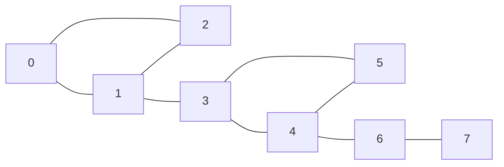
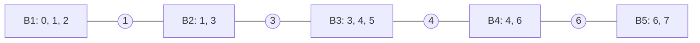

## Introduction

A delivery company runs its network through a handful of hub airports. If one particular hub closes for a day, some cities can no longer be reached from others at all — every route between them passed through that hub. Other hubs can close without cutting anyone off, because traffic can be rerouted. Planners want to know, in advance, which hubs are the critical ones.

In an **undirected graph**, a vertex whose removal (together with all edges touching it) increases the number of connected components is called an **articulation point** or **cut vertex**. Articulation points are the single points of failure among the *nodes* of a graph, just as bridges ([[a8-bridges]]) are the single points of failure among the *edges*.

They matter wherever a graph models something that must stay connected when a node fails: routers and switches in a computer network, substations in a power grid, junctions in a road network, servers in a cluster, or people in a communication network whose departure would split a team. Inside algorithms, articulation points define the **biconnected components** — the pieces of a graph that survive any single vertex failure — which are used in network design, planarity testing and graph drawing. In interviews they appear directly ("find all articulation points") and in disguise, for example in "minimum number of days to disconnect an island".

This lesson derives the efficient algorithm — one depth-first search with **discovery times** and **low-link values**, due to John Hopcroft and Robert Tarjan (1973) — then compares cut vertices with bridges, and finally splits a graph into its biconnected components.

## Before you start

You need:

- **Depth-first search and the DFS tree** — discovery order and tree edges. See [[a8-dfs]].
- **Connected components** — counting components of an undirected graph. See [[a8-connected-components]].
- **Bridges, if possible** — the bridge lesson introduces `disc` and `low` with a slightly simpler condition. See [[a8-bridges]]; this lesson re-explains everything it needs.
- **Recursion** — the main implementation is recursive. See [[a1-recursion]].

## The intuition

Here is the example graph used in both this lesson and the bridges lesson: two triangles joined by the edge `1–3`, with a tail `4–6–7`.



Remove vertex 0: vertices 1 and 2 are still connected by their own edge, and the rest of the graph hangs off 1 as before — nothing splits. Remove vertex 1: the pair `{0, 2}` is cut off from `{3, 4, 5, 6, 7}`. So 1 is a cut vertex and 0 is not. By the same test, 3 (separating the left triangle from the rest), 4 (separating `{6, 7}`) and 6 (separating 7) are cut vertices, while 0, 2, 5 and 7 are not.

What distinguishes them? A vertex `u` is a cut vertex when some group of vertices can only reach the rest of the graph **through `u`**. Every route out of that group passes through `u`, so removing `u` strands it. When a DFS is involved, "a group of vertices" becomes "a subtree of the DFS tree", and "a route out" becomes "a back edge". That translation is what makes the problem solvable in one pass.

## The naive approach

The definition gives a direct algorithm: for each vertex `u`, delete it, count connected components with BFS or DFS, and compare with the original count. Each count costs O(V + E) and there are V vertices, so this takes **O(V · (V + E))**. For 10⁵ vertices and 2 × 10⁵ edges that is around 3 × 10¹⁰ operations, which is far too slow. It remains the right oracle for testing the fast algorithm on small random graphs.

## Finding Articulation Points (disc / low) {#a8-articulation-tarjan}

The disc/low method finds every articulation point of an undirected graph in one depth-first search. Each vertex gets a **discovery time** `disc[v]` and a **low-link** `low[v]`, the earliest discovery time that `v`'s DFS subtree can reach through a single back edge. A non-root vertex `u` is a cut vertex exactly when it has a DFS child `v` with `low[v] >= disc[u]` — that child's subtree cannot get above `u` without passing through `u`. The root of the DFS is a cut vertex exactly when it has two or more DFS children. The algorithm runs in O(V + E) time.

### The DFS tree has only tree edges and back edges

Run DFS from a start vertex. Each edge along which DFS first reaches a new vertex is a **tree edge**, and together they form the **DFS tree**. In an undirected graph, every other edge joins a vertex to one of its **ancestors**; it is called a **back edge**. There are no edges between separate branches, because whichever endpoint DFS discovers first explores that edge before finishing, making the other endpoint its descendant.

In the example, DFS from 0 (neighbours in input order) gives tree edges `0–1`, `1–2`, `1–3`, `3–4`, `4–5`, `4–6`, `6–7` and back edges `2–0` and `5–3`.

This structure limits how a subtree can connect to the rest of the graph. Take a non-root vertex `u` and one of its children `v`. The subtree rooted at `v` touches the outside world through only two kinds of edges: the tree edge `v–u` itself, and back edges from inside the subtree to ancestors of `v`. If every such back edge lands on `u` or on something inside the subtree, then every path from the subtree to the rest of the graph passes through `u`. Remove `u`, and the subtree is stranded.

### Discovery time and low-link

- `disc[v]` is the value of a counter when DFS first enters `v`. Ancestors have smaller discovery times than their descendants.
- `low[v]` is the smallest discovery time reachable from `v` by going down tree edges within `v`'s subtree and then taking **at most one back edge**, without using the edge from `v` to its parent.

It is computed bottom-up during the DFS: start with `low[v] = disc[v]`; for each back edge `v–w`, take `min(low[v], disc[w])`; for each DFS child `c`, after its call returns, take `min(low[v], low[c])`.

### The non-root condition: `low[v] >= disc[u]`

For a non-root vertex `u` with DFS child `v`:

> **`u` is an articulation point if `low[v] >= disc[u]` for at least one child `v`.**

If `low[v] < disc[u]`, some back edge from `v`'s subtree reaches a proper ancestor of `u`, which is outside the subtree and still connected to the rest of the graph after `u` is removed — the subtree has an escape route that avoids `u`. If `low[v] >= disc[u]`, the highest the subtree can reach is `u` itself, and `u` is about to be deleted. Since `u` is not the root, it has a parent, and that parent is now unreachable from `v`'s subtree. The graph splits.

Compare this with the bridge test, `low[v] > disc[u]`. The difference is the equality case. `low[v] == disc[u]` means a back edge from the subtree lands exactly on `u`. That is a detour around the *edge* `u–v` — so the edge is not a bridge — but it is no help when the *vertex* `u` itself is removed, because the detour ends at `u`. So for vertices, equality still means "cut".

### The root rule: two or more children

The non-root argument used `u`'s parent as the "rest of the graph" that becomes unreachable. The root has no parent, and every `low` value is at least `disc[root]`, so the condition `low[v] >= disc[root]` holds for every child — applying it to the root would wrongly mark every root as a cut vertex.

The correct rule is: **the root is an articulation point exactly when it has at least two DFS children.** If it has two children `v₁` and `v₂`, there is no edge between their subtrees (there are no cross edges in an undirected DFS), so every path between them goes through the root; removing it separates them. If it has exactly one child, then removing the root leaves that one subtree, which is connected through its own tree edges. Note that "children" means **DFS-tree children**, not neighbours: in a triangle rooted at 0, vertex 0 has two neighbours but only one DFS child, because DFS reaches the second neighbour through the first.

### The procedure

1. Set `disc[v] = -1` for all vertices and `timer = 0`.
2. For every unvisited vertex `s`, call `dfs(s, parent = -1)`, so every component is covered.
3. In `dfs(u, parent)`: set `disc[u] = low[u] = timer++` and `children = 0`. For each neighbour `v`:
   - if `v` is the parent, skip it;
   - if `v` is unvisited: `children++`, recurse, `low[u] = min(low[u], low[v])`, and if `u` is not the root and `low[v] >= disc[u]`, mark `u`;
   - otherwise (a back edge): `low[u] = min(low[u], disc[v])`.
4. After the loop, if `u` is the root and `children >= 2`, mark `u`.

A vertex can satisfy the condition for several children; marking it with a Boolean array prevents reporting it more than once.

### Implementation

```java title="ArticulationPoints.java"
import java.util.*;

public class ArticulationPoints {
    static List<List<Integer>> adj;
    static int[] disc, low;
    static boolean[] isCut;
    static int timer;

    static void dfs(int u, int parent) {
        disc[u] = low[u] = timer++;
        int children = 0;                              // DFS-tree children of u
        for (int v : adj.get(u)) {
            if (v == parent) continue;
            if (disc[v] == -1) {                       // tree edge
                children++;
                dfs(v, u);
                low[u] = Math.min(low[u], low[v]);
                // v's subtree cannot climb above u: removing u cuts it off.
                if (parent != -1 && low[v] >= disc[u]) isCut[u] = true;
            } else {                                   // back edge
                low[u] = Math.min(low[u], disc[v]);
            }
        }
        // The root has nothing above it, so it is a cut vertex only when it
        // holds two or more subtrees together.
        if (parent == -1 && children >= 2) isCut[u] = true;
    }

    static List<Integer> find(int n, int[][] edges) {
        adj = new ArrayList<>();
        for (int i = 0; i < n; i++) adj.add(new ArrayList<>());
        for (int[] e : edges) {
            adj.get(e[0]).add(e[1]);
            adj.get(e[1]).add(e[0]);
        }
        disc = new int[n];
        low = new int[n];
        isCut = new boolean[n];
        Arrays.fill(disc, -1);
        timer = 0;
        for (int s = 0; s < n; s++) {
            if (disc[s] == -1) dfs(s, -1);
        }
        List<Integer> result = new ArrayList<>();
        for (int u = 0; u < n; u++) if (isCut[u]) result.add(u);
        return result;
    }

    public static void main(String[] args) {
        int[][] edges = {
            {0, 1}, {1, 2}, {2, 0}, {1, 3}, {3, 4}, {4, 5}, {5, 3}, {4, 6}, {6, 7}
        };
        System.out.println("cut vertices: " + find(8, edges));
        System.out.println("disc = " + Arrays.toString(disc));
        System.out.println("low  = " + Arrays.toString(low));

        System.out.println("path 1-0-2, root 0: " + find(3, new int[][]{{0, 1}, {0, 2}}));
        System.out.println("triangle, root 0:   " + find(3, new int[][]{{0, 1}, {1, 2}, {2, 0}}));
        int[][] bowtie = {{0, 1}, {1, 2}, {2, 0}, {2, 3}, {3, 4}, {4, 2}};
        System.out.println("bowtie: " + find(5, bowtie) + " low = " + Arrays.toString(low));
    }
}
```

```output
cut vertices: [1, 3, 4, 6]
disc = [0, 1, 2, 3, 4, 5, 6, 7]
low  = [0, 0, 0, 3, 3, 3, 6, 7]
path 1-0-2, root 0: [0]
triangle, root 0:   []
bowtie: [2] low = [0, 0, 0, 2, 2]
```

The extra tests isolate the root rule. In the path `1–0–2`, DFS from 0 reaches 1 and 2 separately, so the root has two children and is correctly reported. In the triangle, the root's only DFS child is 1 (2 is reached from 1), so 0 is not a cut vertex — even though the non-root test, if wrongly applied to it, would say it is. The **bowtie** — two triangles sharing vertex 2 — is used below to show two classic mistakes.

Skipping the parent *vertex* (rather than the parent edge by id, as the bridge algorithm does) is safe here even when the graph has parallel edges: a second copy of the edge to the parent would only lower `low[v]` to `disc[u]`, and the cut-vertex test `low[v] >= disc[u]` gives the same answer either way. We checked this implementation against the brute-force definition on 100,000 random multigraphs.

### Dry run

The DFS follows the same order as in the bridge lesson. The table records each test as the child's call returns.

| Step | Event | `low` after the step | Test |
|---|---|---|---|
| 1 | enter 0 (root), 1, 2 — disc 0, 1, 2 | | |
| 2 | 2: skip parent 1; back edge to 0 | `low[2] = 0` | |
| 3 | return to 1 | `low[1] = 0` | 1 is not root: `low[2] = 0 >= disc[1] = 1`? no |
| 4 | 1 → 3 → 4 → 5 — disc 3, 4, 5; 5 has back edge to 3 | `low[5] = 3` | |
| 5 | return to 4 | `low[4] = 3` | `low[5] = 3 >= disc[4] = 4`? no |
| 6 | 4 → 6 → 7 — disc 6, 7; return to 6 | `low[7] = 7`, `low[6] = 6` | `low[7] = 7 >= disc[6] = 6`? **yes: 6 is a cut vertex** |
| 7 | return to 4 | `low[4] = 3` | `low[6] = 6 >= disc[4] = 4`? **yes: 4** |
| 8 | return to 3; 3 sees 5 from above (no change) | `low[3] = 3` | `low[4] = 3 >= disc[3] = 3`? **yes: 3** (equality) |
| 9 | return to 1 | `low[1] = 0` | `low[3] = 3 >= disc[1] = 1`? **yes: 1** |
| 10 | return to 0; 0 sees 2 from above (no change) | | root rule: 0 has 1 child, not a cut vertex |

Step 8 shows the equality case. The back edge `5–3` lets the subtree of 4 reach exactly vertex 3 and no higher. That saves the *edge* `3–4` from being a bridge, but if vertex 3 is deleted the back edge disappears with it, and `{4, 5, 6, 7}` is cut off from `{0, 1, 2}`. Vertex 1 is marked in step 9 even though its other child, 2, can reach above it; one stranded child is enough.

Notice also which vertices are never marked: 2, 5 and 7 are **leaves of the DFS tree**. A leaf has no children, so the non-root test never runs for it — and indeed removing a DFS-tree leaf leaves the rest of the tree connected.

### Two mistakes, shown on the bowtie

The bowtie has edges `0–1`, `1–2`, `2–0`, `2–3`, `3–4`, `4–2`, and its only cut vertex is 2. DFS from 0 visits 0, 1, 2, 3, 4 in that order, so `disc = [0, 1, 2, 3, 4]`.

**Using `low[w]` instead of `disc[w]` on back edges.** When 4 meets the back edge to 2, the correct update is `low[4] = min(4, disc[2]) = 2`. If the code uses `low[2]` instead, it picks up the value 0 that 2 got from its own back edge to 0, so `low[4] = 0`, then `low[3] = 0`, and the test at 2, `low[3] = 0 >= disc[2] = 2`, fails. Vertex 2 is missed. The value `low[2]` describes routes that go *through* 2, which is exactly the vertex being removed, so it must not be borrowed. (For bridges and for SCCs this substitution happens not to change the result, which is why it survives in some code; for cut vertices it is a real bug, found in 240 of 200,000 random graphs we tested.)

**Using `>` instead of `>=`.** With the correct `low[3] = 2`, the test at 2 is `2 >= 2`, true. With a strict `>`, it is `2 > 2`, false, and vertex 2 is missed again. The bowtie has **no bridges** at all — every edge lies on a triangle — so a strict test, which is the bridge condition, finds nothing.

### Complexity

**Time.** Each vertex is entered once, and each undirected edge appears twice in the adjacency lists and is examined once from each end with O(1) work. Total **O(V + E)**.

**Space.** `disc`, `low`, `isCut` and the result are O(V); the recursion depth is at most V; the adjacency lists are O(V + E). For very deep graphs, the same iterative technique shown for bridges in [[a8-critical-connections]] applies: keep a per-vertex next-neighbour index, and when a vertex is popped, update its parent's `low`, increment the parent's child count, and run the cut test there.

### Edge cases

- **Disconnected graphs:** the outer loop runs a DFS per component, and the root rule applies separately to each root. A vertex is a cut vertex if removing it increases the *total* number of components.
- **Isolated vertices** are never cut vertices (removing one *decreases* the count). A single edge `0–1` has no cut vertices: removing either endpoint leaves one vertex, still one component.
- **Self-loops** never matter; the loop is seen as a back edge to the vertex itself and changes nothing.
- **A path** of length at least 2: every internal vertex is a cut vertex. **A cycle:** none. **A star:** only the centre.

## Bridges vs Articulation Points {#a8-bridges-vs-articulation}

Bridges and articulation points are the two kinds of single point of failure in an undirected graph. A **bridge** is an edge whose removal disconnects the graph; an **articulation point** is a vertex whose removal (with its edges) disconnects it. Both are found by the same disc/low depth-first search, and they differ in only two places: the comparison (`low[v] > disc[u]` for bridges, `low[v] >= disc[u]` for vertices) and a special rule for the DFS root, which only cut vertices need. Knowing exactly how they relate prevents a common interview slip — assuming that one implies the other.

### Side by side

| | Bridge (cut edge) | Articulation point (cut vertex) |
|---|---|---|
| What fails | one edge | one vertex and all its edges |
| Characterisation | the edge lies on no cycle | some DFS child's subtree cannot get above the vertex |
| Test on tree edge `u → v` | `low[v] > disc[u]` | `low[v] >= disc[u]` (non-root `u`) |
| Root of the DFS | no special case | cut vertex iff it has at least 2 DFS children |
| Parallel edges | must skip the incoming edge by **id** | skipping the parent vertex is fine |
| How many | at most V − 1 (they form a forest) | at most V − 2 |
| Pieces that survive any single failure | 2-edge-connected components | biconnected components |

### How they relate

**A bridge's endpoints are usually cut vertices.** If `u–v` is a bridge and `u` has at least one other neighbour, removing `u` separates `v` from that neighbour, so `u` is a cut vertex. The only exception is an endpoint of degree 1: removing a leaf disconnects nothing else. In the example, the bridges `1–3`, `4–6` and `6–7` have endpoints 1, 3, 4, 6 (all cut vertices) and 7 (degree 1, not a cut vertex).

**A cut vertex does not imply any bridge.** The bowtie has cut vertex 2 and no bridges at all, because every edge lies on a triangle.

**A bridge does not imply any cut vertex.** The single edge `0–1` is a bridge, yet removing either vertex leaves one vertex — still connected.

**For a connected graph with at least three vertices, "no cut vertices" implies "no bridges".** Any bridge would have an endpoint with another neighbour (otherwise the graph would be just that edge), and that endpoint would be a cut vertex. The converse fails, as the bowtie shows. In words: surviving any single node failure is a stronger guarantee than surviving any single link failure.

### Finding both in one pass

Because the two tests run at the same moment — just after a child's call returns — one DFS can report both. Using edge ids keeps the bridge part correct for parallel edges.

```java title="CutFinder.java"
import java.util.*;

public class CutFinder {
    static List<List<int[]>> adj;
    static int[] disc, low;
    static boolean[] isCut;
    static List<String> bridges;
    static int timer;

    static void dfs(int u, int parentEdge) {
        disc[u] = low[u] = timer++;
        int children = 0;
        for (int[] e : adj.get(u)) {
            int v = e[0], id = e[1];
            if (id == parentEdge) continue;
            if (disc[v] == -1) {
                children++;
                dfs(v, id);
                low[u] = Math.min(low[u], low[v]);
                if (low[v] > disc[u]) bridges.add(u + "-" + v);                  // edge test
                if (parentEdge != -1 && low[v] >= disc[u]) isCut[u] = true;    // vertex test
            } else {
                low[u] = Math.min(low[u], disc[v]);
            }
        }
        if (parentEdge == -1 && children >= 2) isCut[u] = true;                // root rule
    }

    static void run(String name, int n, int[][] edges) {
        adj = new ArrayList<>();
        for (int i = 0; i < n; i++) adj.add(new ArrayList<>());
        for (int id = 0; id < edges.length; id++) {
            adj.get(edges[id][0]).add(new int[]{edges[id][1], id});
            adj.get(edges[id][1]).add(new int[]{edges[id][0], id});
        }
        disc = new int[n];
        low = new int[n];
        isCut = new boolean[n];
        bridges = new ArrayList<>();
        Arrays.fill(disc, -1);
        timer = 0;
        for (int s = 0; s < n; s++) if (disc[s] == -1) dfs(s, -1);
        List<Integer> cuts = new ArrayList<>();
        for (int u = 0; u < n; u++) if (isCut[u]) cuts.add(u);
        System.out.println(name + ": bridges " + bridges + ", cut vertices " + cuts);
    }

    public static void main(String[] args) {
        run("example", 8, new int[][]{
            {0, 1}, {1, 2}, {2, 0}, {1, 3}, {3, 4}, {4, 5}, {5, 3}, {4, 6}, {6, 7}});
        run("bowtie", 5, new int[][]{{0, 1}, {1, 2}, {2, 0}, {2, 3}, {3, 4}, {4, 2}});
        run("single edge", 2, new int[][]{{0, 1}});
        run("square", 4, new int[][]{{0, 1}, {1, 2}, {2, 3}, {3, 0}});
    }
}
```

```output
example: bridges [6-7, 4-6, 1-3], cut vertices [1, 3, 4, 6]
bowtie: bridges [], cut vertices [2]
single edge: bridges [0-1], cut vertices []
square: bridges [], cut vertices []
```

The four graphs cover the four combinations: both kinds of failure point, only a cut vertex, only a bridge, and neither. The square (a 4-cycle) is the smallest graph on more than three vertices that survives any single failure of either kind.

### Choosing which one a problem wants

Read what is being removed. "Which roads, cables, connections or friendships…" asks about edges: bridges. "Which servers, junctions, hubs or people…" asks about vertices: articulation points. "Can the network survive any single failure?" needs you to ask *which kind* of failure. If both nodes and links can fail, check for cut vertices, because (for three or more vertices) their absence also rules out bridges.

## Biconnected Components {#a8-biconnected-components}

A **biconnected component** (also called a **block** or 2-connected component) is a maximal piece of an undirected graph that has no articulation point of its own: removing any single vertex inside it leaves the rest of the piece connected. Equivalently, any two edges of the same block lie on a common simple cycle, unless the block is a single edge (a bridge). The blocks **partition the edges** of the graph, while cut vertices belong to several blocks at once — they are exactly where blocks meet. All blocks can be found in the same single DFS used for articulation points, by keeping a stack of edges.

### Seeing the blocks

In the example graph, the blocks are:

| Block | Vertices | Edges | Kind |
|---|---|---|---|
| B1 | 0, 1, 2 | 0–1, 1–2, 2–0 | a cycle |
| B2 | 1, 3 | 1–3 | a bridge |
| B3 | 3, 4, 5 | 3–4, 4–5, 5–3 | a cycle |
| B4 | 4, 6 | 4–6 | a bridge |
| B5 | 6, 7 | 6–7 | a bridge |

Every edge is in exactly one block. Vertex 1 is in B1 and B2, vertex 3 in B2 and B3, vertex 4 in B3 and B4, vertex 6 in B4 and B5 — precisely the four cut vertices. Every bridge forms a block on its own, because a single edge cannot share a cycle with anything.

This is why blocks are defined on **edges** rather than vertices: if you tried to put each vertex in one component, cut vertices would have nowhere to go. The vertex-based notion that *does* partition vertices is the 2-edge-connected component from the bridge lesson, where `{3, 4, 5}` and `{0, 1, 2}` are components but the bridges belong to none.

### The block-cut tree

Make one node for each block and one node for each cut vertex, and connect a cut vertex to every block containing it. The result is always a tree (a forest for a disconnected graph), called the **block-cut tree**. For the example it is a path:



It cannot contain a cycle, because a cycle through several blocks would let their edges share a simple cycle, merging them into one block. The block-cut tree turns questions about single vertex failures into tree questions: "which vertices lie on *every* path from `a` to `b`?" is answered by the cut vertices on the tree path between the blocks containing `a` and `b`.

### Deriving the algorithm

Run the articulation-point DFS and push every edge onto a stack the first time it is examined — tree edges just before descending, back edges when seen from the lower end. Now consider the moment a child `v` of `u` returns with `low[v] >= disc[u]`. The edges pushed since the tree edge `u–v` are the edges of `v`'s subtree and the back edges leaving it, minus any already popped into deeper blocks. None of them reaches above `u` (that is what the condition says), so `u` separates them from the rest of the graph, and they cannot be split further (any deeper separation would already have popped them). So **pop edges down to and including `u–v`; they form one block**.

At the root, `low[v] >= disc[root]` always holds, so every child of the root closes a block. That is correct: if the root has several children, each child's subtree is a separate block through the root; if it has only one, that subtree plus the root is the final block. So, unlike the cut-vertex test, the block algorithm **needs no special root rule**.

Two details keep each edge on the stack exactly once. A back edge is pushed only from its lower end, which is when `disc[v] < disc[u]` (the neighbour is an ancestor); when the ancestor later sees the same edge from above, `disc[v] > disc[u]`, and it is ignored. The edge to the parent is skipped, as before.

### Implementation

```java title="Biconnected.java"
import java.util.*;

public class Biconnected {
    static List<List<Integer>> adj;
    static int[] disc, low;
    static int timer;
    static Deque<int[]> edgeStack;
    static List<List<int[]>> blocks;

    static void dfs(int u, int parent) {
        disc[u] = low[u] = timer++;
        for (int v : adj.get(u)) {
            if (v == parent) continue;
            if (disc[v] == -1) {
                edgeStack.push(new int[]{u, v});          // tree edge, pushed before recursing
                dfs(v, u);
                low[u] = Math.min(low[u], low[v]);
                if (low[v] >= disc[u]) {                  // u separates v's subtree: close a block
                    List<int[]> block = new ArrayList<>();
                    int[] e;
                    do {
                        e = edgeStack.pop();
                        block.add(e);
                    } while (e[0] != u || e[1] != v);
                    blocks.add(block);
                }
            } else if (disc[v] < disc[u]) {               // back edge to an ancestor, once
                edgeStack.push(new int[]{u, v});
                low[u] = Math.min(low[u], disc[v]);
            }
        }
    }

    static List<List<int[]>> find(int n, int[][] edges) {
        adj = new ArrayList<>();
        for (int i = 0; i < n; i++) adj.add(new ArrayList<>());
        for (int[] e : edges) {
            adj.get(e[0]).add(e[1]);
            adj.get(e[1]).add(e[0]);
        }
        disc = new int[n];
        low = new int[n];
        Arrays.fill(disc, -1);
        timer = 0;
        edgeStack = new ArrayDeque<>();
        blocks = new ArrayList<>();
        for (int s = 0; s < n; s++) {
            if (disc[s] == -1) dfs(s, -1);
        }
        return blocks;
    }

    public static void main(String[] args) {
        int[][] edges = {
            {0, 1}, {1, 2}, {2, 0}, {1, 3}, {3, 4}, {4, 5}, {5, 3}, {4, 6}, {6, 7}
        };
        for (List<int[]> block : find(8, edges)) {
            Set<Integer> vertices = new TreeSet<>();
            StringBuilder sb = new StringBuilder();
            for (int[] e : block) {
                sb.append(e[0]).append('-').append(e[1]).append(' ');
                vertices.add(e[0]);
                vertices.add(e[1]);
            }
            System.out.println("block " + vertices + " edges: " + sb.toString().trim());
        }
    }
}
```

```output
block [6, 7] edges: 6-7
block [4, 6] edges: 4-6
block [3, 4, 5] edges: 5-3 4-5 3-4
block [1, 3] edges: 1-3
block [0, 1, 2] edges: 2-0 1-2 0-1
```

Blocks come out deepest-first, because a block is closed when the call for the cut vertex above it resumes. Trace the third line: the stack holds `0-1`, `1-2`, `2-0` (block B1 is still open, waiting for the root), then `1-3`, `3-4`, `4-5`, `5-3`; `4-6` and `6-7` were pushed and popped as their own blocks. When the call for 4 returns to 3 with `low[4] = 3 >= disc[3] = 3`, the code pops `5-3`, `4-5`, `3-4` and stops at the tree edge `3-4`. When 3 returns to 1, it pops just `1-3`. Finally, when 1 returns to the root 0, the same condition (`low[1] = 0 >= disc[0] = 0`) pops the remaining triangle.

The `while (e[0] != u || e[1] != v)` loop stops at the exact tree edge `u–v` that was pushed before descending, which works because tree edges are always stored as `{parent, child}`. We checked the blocks against the definition (two edges share a block exactly when no single vertex removal separates them) on 100,000 random graphs.

**Complexity.** The DFS is O(V + E), and every edge is pushed once and popped once, so the total is **O(V + E)** time and O(V + E) space for the edge stack and adjacency lists. Isolated vertices have no edges and therefore appear in no block; if your application needs them, add each as a trivial block of its own.

### Where blocks are used

- **Fault tolerance.** A network survives any single node failure exactly when it is one block (and has at least three vertices). Designers aim for biconnected backbones; the block-cut tree shows where to add links — a new link between two leaf blocks puts every block on the tree path between them onto a common cycle, merging them into one block.
- **Graph algorithms that work block by block.** Planarity testing, some graph-drawing layouts and several counting problems decompose a graph into blocks first, because a graph is planar exactly when each of its blocks is, and many properties combine simply across cut vertices.
- **Cactus graphs** — graphs where every block is a single edge or a simple cycle — are recognised by inspecting the blocks, and many hard problems become easy on them.

```quiz
Q: For a non-root vertex u with DFS child v, why is u a cut vertex when low[v] == disc[u], while the edge u–v is not a bridge in that case?
- [ ] Because equality only occurs at the root
- [x] Equality means a back edge from v's subtree lands exactly on u; that is a detour around the edge u–v, but it disappears when u itself is removed
- [ ] Because low values are not defined for cut vertices
- [ ] Because bridges use disc[v] and cut vertices use low[v]
> The back edge to u gives v's subtree a second connection to u, so cutting the edge u–v disconnects nothing. Removing the vertex u removes that back edge too, and the subtree loses every connection to u's ancestors.

Q: Why does the root of the DFS need its own rule?
- [ ] The root never has back edges
- [ ] The root always has the largest low value
- [x] Every low value is at least disc[root], so the non-root test would mark every root; the root is a cut vertex only if it has two or more DFS children
- [ ] The root is always a cut vertex
> The non-root argument relies on u's parent being cut off. The root has no parent. With one DFS child, removing the root leaves a single connected subtree; with two or more, there are no edges between their subtrees, so removing the root separates them.

Q: Which statement is true for connected undirected graphs?
- [ ] Every articulation point is an endpoint of a bridge
- [ ] Every bridge has an articulation point as an endpoint
- [x] If the graph has at least three vertices and no articulation points, it has no bridges
- [ ] Biconnected components partition the vertices
> A bridge in a connected graph with three or more vertices has an endpoint with another neighbour, and that endpoint is a cut vertex. The bowtie has a cut vertex but no bridge, a single edge has a bridge but no cut vertex, and cut vertices belong to several blocks, so blocks partition edges, not vertices.
```

## In real systems

**Network design.** Telecommunications and data-centre networks are designed so that no single router or switch is a cut vertex; where one exists, operators add redundant links or duplicate the device. Checking a topology for articulation points is a standard automated validation step before changes are rolled out. The same idea applies to power grids (substations), transport networks (interchanges) and supply chains (single-source suppliers).

**Distributed systems.** In a cluster or a service mesh, a node through which all traffic between two groups flows is both a performance bottleneck and an availability risk. Modelling the communication graph and finding cut vertices surfaces such nodes early. Ad hoc wireless and sensor networks, whose topology changes as devices move, recompute biconnectivity to decide which nodes must stay up for the network to remain connected.

**Social and organisational graphs.** In a communication graph of a company, a person who is an articulation point is the only bridge between two groups — a knowledge-transfer risk if they leave, and a natural point for information to be filtered. Network analysts call such people brokers; articulation points are their strict, graph-theoretic version.

**Algorithms.** Biconnected components and block-cut trees are building blocks for planarity testing, for counting spanning trees and paths in graphs with many cut vertices, and for problems on cactus graphs. The single DFS that finds cut vertices also yields bridges and blocks, so libraries usually expose all three together.

## Trade-offs and alternatives

| Approach | Time | Use when |
|---|---|---|
| Remove each vertex, recount components | O(V · (V + E)) | Tiny graphs, or as a test oracle |
| disc/low DFS (recursive) | O(V + E) | Standard choice |
| disc/low DFS (iterative) | O(V + E) | Very deep graphs where recursion would overflow |
| Edge-stack DFS for blocks | O(V + E) | You need the biconnected components themselves |
| Max-flow / Menger | polynomial, much slower | You need *k*-vertex connectivity for *k* > 2, such as "how many nodes must fail to separate `a` from `b`?" |

The disc/low method only answers questions about **one** failure at a time. Whether a graph survives *two* simultaneous vertex failures (3-connectivity) needs more advanced methods — SPQR trees, or flow-based vertex connectivity — which are beyond typical interviews. Like bridge finding, the method is static: if the graph changes, rerun it.

## Common mistakes

> [!MISTAKE] Applying the non-root test to the root
> Every `low` value is at least `disc[root]`, so `low[v] >= disc[root]` is always true and every root would be reported. Use the separate rule: the root is a cut vertex only when it has two or more **DFS-tree** children.

**Counting neighbours instead of DFS children at the root.** In a triangle, the root has two neighbours but one DFS child. Increment `children` only when a recursive call is made.

**Using `>` (the bridge condition) instead of `>=`.** On the bowtie, the shared vertex is missed, because a back edge reaching exactly `u` does not help when `u` itself is removed.

**Updating with `low[w]` on a back edge.** Use `disc[w]`. Borrowing `low[w]` imports routes that pass through `w`, which may be the very vertex being tested; on the bowtie it hides the cut vertex.

**Reporting a vertex several times.** A vertex can satisfy the test for several children. Mark a Boolean array and collect afterwards, rather than appending to a list inside the loop.

**Expecting blocks to partition vertices.** Cut vertices belong to several blocks. If you need a vertex partition, you probably want 2-edge-connected components (remove the bridges) instead.

**Forgetting disconnected graphs and deep recursion.** Start a DFS from every unvisited vertex, apply the root rule per DFS root, and use an iterative DFS when a long path could overflow the Java stack.

## Interview perspective

Articulation points are usually asked directly ("find all critical nodes") or as the follow-up after Critical Connections. Interviewers look for the derivation, the root case and the `>=`.

> [!INTERVIEW] What a strong answer sounds like
> "In an undirected DFS every non-tree edge goes to an ancestor, so a child v's subtree can only escape upward through back edges. I'll compute low[v], the earliest discovery time it can reach with one back edge. If low[v] >= disc[u] for some child, removing u strands that subtree — equality counts because the back edge to u disappears with u. The root has no parent, so it's a cut vertex only with two or more DFS children. One DFS, O(V + E)."

Questions to be ready for:

- **Why `>=` here but `>` for bridges?** A back edge to `u` bypasses the edge `u–v` but not the vertex `u`.
- **Why the special root rule?** The non-root argument needs a parent to be cut off; the root's children are separated from each other only if there are at least two.
- **Can a leaf of the DFS tree be a cut vertex?** No; removing it leaves the rest of the tree connected.
- **Is every bridge endpoint a cut vertex?** Only if its degree is at least 2.
- **What are biconnected components, and how do you find them?** Maximal pieces without an internal cut vertex; partition the edges; pop an edge stack whenever `low[v] >= disc[u]`.
- **Minimum Number of Days to Disconnect Island (LeetCode 1568).** Treat land cells as vertices. If the grid does not already have exactly one island, the answer is 0. If there is exactly one land cell, or some land cell is an articulation point, the answer is 1. Otherwise it is 2, because a corner-most land cell can always be isolated by removing at most two of its neighbours.

## Practice

1. **Oracle test.** Implement the O(V · (V + E)) brute force and compare it with `ArticulationPoints.find` on thousands of random small graphs, including disconnected ones.
2. **Root cases.** Predict, then verify, the output for a star, a path, a cycle and two triangles joined at a vertex, each rooted at different vertices (rotate the vertex numbers so the DFS starts elsewhere).
3. **Count the damage.** For each cut vertex, report how many components the graph splits into when it is removed. (Hint: count the children `v` with `low[v] >= disc[u]`, plus one if `u` is not the root.)
4. **Iterative version.** Rewrite the cut-vertex search without recursion, using the frame technique from [[a8-critical-connections]].
5. **Blocks.** Return the number of biconnected components and the size of the largest; then build the block-cut tree.
6. **Island grid.** Solve *Minimum Number of Days to Disconnect Island* using the articulation-point test on grid cells.

The DSA explorer lists matching problems under this topic, including *Articulation Point*, *Biconnected Graph* and *Minimum Number of Days to Disconnect Island*.

## Quick revision {#quick-revision}

- Articulation point (cut vertex): a vertex whose removal increases the number of connected components. Naive check O(V · (V + E)).
- Undirected DFS: only tree edges and back edges (to ancestors). `disc[v]` = discovery time; `low[v]` = earliest `disc` reachable from `v`'s subtree through one back edge, without the edge to the parent.
- Updates: tree child `c` → `low[u] = min(low[u], low[c])`; back edge `u–w` → `low[u] = min(low[u], disc[w])` (never `low[w]`).
- Non-root `u` is a cut vertex iff some DFS child `v` has `low[v] >= disc[u]` (equality counts).
- Root is a cut vertex iff it has at least 2 DFS-tree children.
- DFS-tree leaves are never cut vertices. One DFS per component; O(V + E) time, O(V) extra space.
- Bridges vs cut vertices: `>` vs `>=`; bridges need no root rule; bridges need edge-id skipping with parallel edges, cut vertices do not. Bridge endpoint with degree ≥ 2 is a cut vertex; cut vertex does not imply a bridge (bowtie); bridge does not imply a cut vertex (single edge). No cut vertices (V ≥ 3, connected) ⇒ no bridges.
- Biconnected components (blocks): maximal pieces with no internal cut vertex; partition the edges; cut vertices are shared; bridges are single-edge blocks.
- Block algorithm: push tree edges before descending and back edges from the lower end; when `low[v] >= disc[u]` (root included), pop edges down to `u–v` — one block. O(V + E).
- Block-cut tree: blocks and cut vertices as nodes; always a tree.

| Question | Test after child `v` of `u` returns | Root |
|---|---|---|
| Is `u–v` a bridge? | `low[v] > disc[u]` | no special case |
| Is `u` a cut vertex? | `low[v] >= disc[u]` (non-root `u`) | ≥ 2 DFS children |
| Close a block? | `low[v] >= disc[u]` | same test, no special case |

## Key takeaways {#key-takeaways}

- A cut vertex is a node every route out of some group must pass through; DFS turns "some group" into "a child's subtree".
- `low[v] >= disc[u]` says the subtree under `v` cannot get above `u` except through `u`, so removing `u` strands it.
- The root has no parent, so it is a cut vertex only when it joins two or more DFS subtrees.
- Use `disc[w]` on back edges and `>=` in the test; the bowtie graph breaks both common mistakes.
- Bridges and cut vertices come from the same DFS but neither implies the other; surviving every single node failure is the stronger guarantee.
- Biconnected components partition the edges, meet at cut vertices, and come out of the same DFS with an edge stack in O(V + E).
