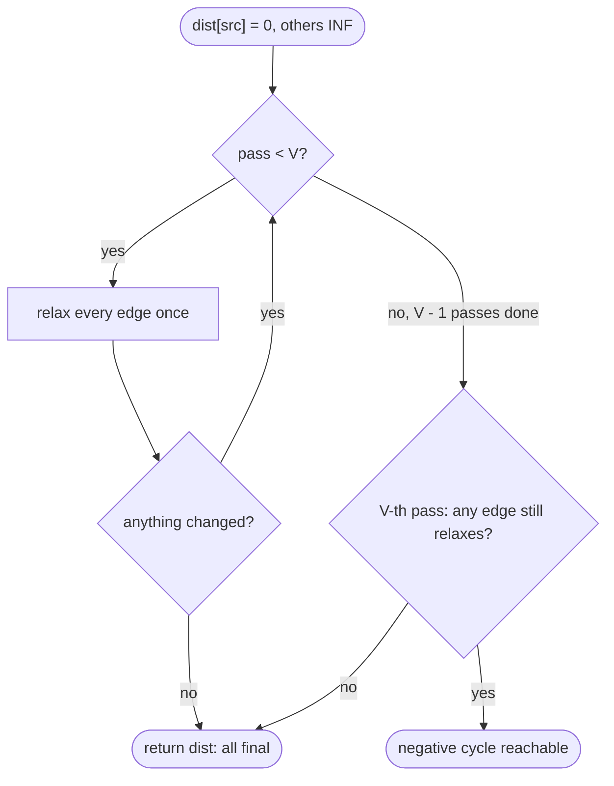

## Introduction

Dijkstra's algorithm ([[a8-dijkstra]]) is the default answer to "cheapest route from one source", but it carries a hard requirement: no edge may have a negative weight. Real problems break that requirement more often than you might expect. A currency exchange graph uses negative logarithms of exchange rates as weights. A scheduling problem phrased as "task B must start at least 3 minutes after task A" turns into edges of weight −3. A game map can have a tile that refunds energy. In each case Dijkstra gives a confident, wrong answer.

The **Bellman-Ford algorithm** solves the single-source shortest-path problem for *any* real edge weights. Its idea is almost brute force: keep a tentative distance for every vertex, and improve distances by looking at every edge, over and over, until nothing can improve. The cleverness is in knowing exactly how many rounds are enough — `V − 1`, where `V` is the number of vertices — and in what it means if a further round still finds an improvement: the graph contains a **negative cycle**, a loop you can go round forever to make a route cheaper without limit.

That second ability is as important as the first. Detecting negative cycles is how you find arbitrage opportunities, how you decide whether a set of timing constraints can be satisfied at all, and how you know whether shortest distances even exist.

The algorithm is named after Richard Bellman and Lester Ford Jr., who published it in the 1950s (Edward Moore found it independently, so you will also see "Bellman-Ford-Moore"). It runs in O(V · E) time — slower than Dijkstra's O((V + E) log V) — and that cost is the price of handling negative weights. This lesson teaches the relaxation passes and why `V − 1` is enough, then negative-cycle detection, then the variations that interviews use most: "at most K edges", difference constraints and the queue-based variant called SPFA.

## Before you start

- **Dijkstra's algorithm and relaxation** — what `dist[]` means, what it means to relax an edge, and why Dijkstra fails on negative edges. See [[a8-dijkstra]] and [[a8-dijkstra-limitations]].
- **Graph representations** — Bellman-Ford reads a flat list of edges `(from, to, weight)`; see [[a8-edge-list]] and [[a8-graph-representation]].
- **Big-O analysis** — counting loop iterations to derive a running time. See [[a1-time-complexity]].
- **Basic Java** — records, `long` arithmetic and `Arrays.fill`.

## The intuition

Picture a group of towns where nobody has a map. The source town knows its own distance: zero. Every morning, each road reports to the town at its far end: "if you came through my starting town, your distance would be *its* distance plus my length." A town keeps whichever report is lowest.

On the first morning, only towns one road away from the source hear a useful report, so they learn their best one-road distance. On the second morning, towns two roads away hear from those neighbours, and so on. Information spreads outward by at least one road per morning. A shortest route that never revisits a town crosses at most `V − 1` roads, so after `V − 1` mornings every town has heard about its best route, whatever the order in which the roads reported.

Negative roads do not break this picture, because nothing is ever "finalised" early; every town keeps listening every morning. What does break it is a loop of roads whose lengths add up below zero. Each trip around the loop lowers the reports, so the towns on it keep improving every single morning. If anything still improves on morning `V`, a loop like that must exist. That is the whole algorithm, and the rest of the lesson makes each sentence of this paragraph precise.

## The problem and why Dijkstra is not enough

We have a **directed** graph with `V` vertices and `E` edges; edge `u → v` has a weight `w(u, v)`, which may be negative. An undirected edge is two directed edges. The **length** of a path is the sum of its weights, and `dist(v)` is the minimum length of a path from the source `s` to `v`, or infinity if `v` is unreachable.

Two facts shape everything that follows.

**Shortest paths may not exist.** If a cycle has negative total weight and is reachable from `s`, and `v` is reachable from that cycle, then you can go round the cycle as often as you like before heading to `v`. Every lap makes the route cheaper, so there is no minimum: `dist(v)` is minus infinity. Any correct algorithm must detect this instead of returning a number.

**Without negative cycles, shortest paths can be taken simple.** A **simple path** never repeats a vertex. If a shortest path repeated a vertex, the stretch between the two visits would be a cycle of weight zero or more (no negative cycles exist), and cutting it out would not make the path longer. So some shortest path is simple, and a simple path in a graph with `V` vertices has at most `V − 1` edges. This bound is the reason for the magic number `V − 1`.

Why not use Dijkstra? Dijkstra finalises the closest unsettled vertex and never revisits it. The proof of that step assumes the rest of any path adds a non-negative amount, which a negative edge violates; the lesson [[a8-dijkstra-limitations]] shows a four-vertex graph where Dijkstra returns 2 for a vertex whose true distance is 1. Enumerating all simple paths is correct but exponential. Bellman-Ford sits in between: polynomial time, no assumptions about signs.

## Edge Relaxation & V−1 Iterations {#a8-bellman-ford-relaxation}

**Edge relaxation** is the single operation every shortest-path algorithm is built from, and Bellman-Ford's main loop is nothing but relaxation repeated in a fixed pattern: `V − 1` **passes**, each of which relaxes every edge in the graph once. This section explains what relaxation does, proves why `V − 1` passes are enough, and turns that into a complete implementation.

### What relaxing an edge means

Keep an array `dist[]` with `dist[s] = 0` and every other entry at infinity. To **relax** the edge `u → v` of weight `w` is to ask: is going to `u` and then along this edge cheaper than the best route to `v` found so far? If so, take it.

```java
if (dist[u] != INF && dist[u] + w < dist[v]) {
    dist[v] = dist[u] + w;      // a cheaper route to v, through u
    parent[v] = u;              // remember where it came from
}
```

Relaxation has one property that makes it safe to apply in any order, any number of times: **`dist[v]` is always the length of some real path from `s` to `v`, or infinity.** It starts true (`dist[s] = 0` is the empty path), and each update sets `dist[v]` to a real path to `u` plus a real edge. So `dist[v]` can never drop below the true shortest distance — relaxation can only move estimates *down towards* the truth, never past it. The question is only how many relaxations it takes to get there.

The guard `dist[u] != INF` matters. If `u` has not been reached, `INF + w` with a negative `w` is a number slightly smaller than `INF`, which would make an unreachable vertex look reachable. With `int` and `Integer.MAX_VALUE`, the addition would overflow into a large negative number instead, which is worse.

### Why V − 1 passes are enough

Here is the invariant that makes the algorithm work:

> After pass `k`, for every vertex `v`, `dist[v]` is at most the length of the shortest path from `s` to `v` that uses **at most `k` edges**.

It holds after pass 0 (before any pass): the only path with zero edges is the empty path to `s`, and `dist[s] = 0`. Suppose it holds after pass `k − 1`, and take the shortest path to `v` with at most `k` edges. Its last edge is some `u → v`, and the part before it is a path to `u` with at most `k − 1` edges — so, by the invariant, `dist[u]` is already no more than that prefix's length when pass `k` begins. During pass `k` the edge `u → v` is relaxed, which forces `dist[v] ≤ dist[u] + w(u, v)`, the length of the whole path. Values only go down during a pass, so this still holds at its end.

Now combine this with the fact from the previous section. With no negative cycle reachable, every vertex has a shortest path that is simple, with at most `V − 1` edges. After pass `V − 1`, `dist[v]` is at most that path's length; relaxation never goes below the true distance; so `dist[v]` equals it exactly. **Pass `V − 1` is the last one ever needed.**

Notice what the invariant does *not* say: it does not say that after pass `k`, `dist[v]` is exactly the best `k`-edge distance. It can be better, because a single pass can chain several relaxations if the edges happen to be listed in a helpful order. The guarantee is a worst case.

### A complete implementation

```java title="BellmanFord.java"
import java.util.*;

public class BellmanFord {
    record Edge(int from, int to, long w) {}

    static final long INF = Long.MAX_VALUE / 4;   // room to add weights without overflow

    // Returns shortest distances from src, or null if a negative cycle is reachable.
    static long[] shortestPaths(int n, List<Edge> edges, int src, int[] parent) {
        long[] dist = new long[n];
        Arrays.fill(dist, INF);
        Arrays.fill(parent, -1);
        dist[src] = 0;

        for (int pass = 1; pass <= n - 1; pass++) {
            boolean changed = false;
            for (Edge e : edges) {
                if (dist[e.from()] == INF) continue;          // u not reached yet
                if (dist[e.from()] + e.w() < dist[e.to()]) {
                    dist[e.to()] = dist[e.from()] + e.w();
                    parent[e.to()] = e.from();
                    changed = true;
                }
            }
            System.out.println("after pass " + pass + ": " + show(dist));
            if (!changed) break;                               // fixed point reached early
        }
        for (Edge e : edges) {                                 // the extra, V-th pass
            if (dist[e.from()] != INF && dist[e.from()] + e.w() < dist[e.to()]) return null;
        }
        return dist;
    }

    static String path(int[] parent, int target) {
        List<Integer> p = new ArrayList<>();
        for (int v = target; v != -1; v = parent[v]) p.add(v);
        Collections.reverse(p);
        return p.toString();
    }

    static String show(long[] dist) {
        StringJoiner sj = new StringJoiner(", ", "[", "]");
        for (long d : dist) sj.add(d == INF ? "INF" : Long.toString(d));
        return sj.toString();
    }

    public static void main(String[] args) {
        int n = 5;
        List<Edge> edges = List.of(          // directed; deliberately listed "backwards"
            new Edge(3, 4, 2),
            new Edge(2, 3, -3),
            new Edge(1, 2, 5),
            new Edge(1, 3, 4),
            new Edge(0, 1, 6),
            new Edge(0, 2, 7),
            new Edge(2, 1, -2));
        int[] parent = new int[n];
        long[] dist = shortestPaths(n, edges, 0, parent);
        System.out.println("distances: " + show(dist));
        System.out.println("path to 4: " + path(parent, 4));
    }
}
```

```output
after pass 1: [0, 5, 7, INF, INF]
after pass 2: [0, 5, 7, 4, INF]
after pass 3: [0, 5, 7, 4, 6]
after pass 4: [0, 5, 7, 4, 6]
distances: [0, 5, 7, 4, 6]
path to 4: [0, 2, 3, 4]
```

Walk through the method. Distances are `long`, and infinity is `Long.MAX_VALUE / 4` rather than `Long.MAX_VALUE`, so that adding a weight to it can never overflow. The outer loop runs at most `n − 1` passes, and each pass scans the whole edge list. The `changed` flag gives **early termination**: if a full pass improves nothing, no later pass can either (the next pass would see exactly the same values), so we stop. After the loop, one more scan checks whether any edge can still be relaxed; that is the negative-cycle test, explained in the next section. `parent[v]` records the vertex that last improved `v`, and following parents back from any target rebuilds its path.

### Dry run

The edges are processed in the listed order: `3→4 (2)`, `2→3 (−3)`, `1→2 (5)`, `1→3 (4)`, `0→1 (6)`, `0→2 (7)`, `2→1 (−2)`.

| Pass | Successful relaxations, in order | `dist` after the pass |
|---|---|---|
| 1 | `0→1` gives 6, `0→2` gives 7, `2→1` gives 7 − 2 = 5 | [0, 5, 7, INF, INF] |
| 2 | `2→3` gives 7 − 3 = 4 | [0, 5, 7, 4, INF] |
| 3 | `3→4` gives 4 + 2 = 6 | [0, 5, 7, 4, 6] |
| 4 | none, so the loop stops | [0, 5, 7, 4, 6] |

Two things are worth seeing. First, in pass 1 the edge `2→1` used the value `dist[2] = 7` that had been set earlier *in the same pass*, so vertex 1 got its two-edge distance in a single pass. Second, `3→4` is first in the list, so in pass 2 it was examined before `dist[3]` became finite, and vertex 4 had to wait until pass 3. The order of the edge list changes how many passes are actually needed, but never the final answer.

Listing the same seven edges in "forward" order — `0→1`, `0→2`, `2→1`, `1→2`, `1→3`, `2→3`, `3→4` — and calling the same method prints:

```text
after pass 1: [0, 5, 7, 4, 6]
after pass 2: [0, 5, 7, 4, 6]
```

The second pass exists only to confirm nothing changed. In a DAG, ordering the edges by a topological order of their source always gives this best case, which is exactly the O(V + E) algorithm of [[a8-shortest-path-dag]].

### Complexity derivation

**Time.** Each pass looks at every edge once and does constant work per edge: O(E). There are at most `V − 1` passes plus the checking pass, so the total is O(V · E). Initialising `dist` and `parent` adds O(V). The bound is tight: with edges listed in the worst order, a path of `V − 1` edges really needs `V − 1` passes, and on dense graphs (E ≈ V²) that is O(V³). Early termination helps on friendly inputs but does not change the worst case.

**Space.** O(V) for `dist` and `parent`. The edge list is the input; Bellman-Ford needs no adjacency list at all, because it never asks "what are the neighbours of `u`?" — it only ever walks the full list of edges.

```quiz
Q: A graph has 6 vertices and no negative cycles. Why are 5 passes of Bellman-Ford always enough?
- [ ] Because each pass fixes exactly one vertex's distance
- [x] Because some shortest path to every vertex is simple, so it has at most 5 edges, and after pass k every path with at most k edges has been accounted for
- [ ] Because the graph can have at most 5 negative edges
- [ ] Because Bellman-Ford processes vertices in order of distance
> Pass k guarantees dist[v] is no more than the best path using at most k edges. Without negative cycles, cutting loops out of a path never makes it longer, so a shortest path visits each of the 6 vertices at most once and uses at most 5 edges. A pass can fix several vertices at once, so "one vertex per pass" is wrong; it is only the worst case that needs all 5.

Q: Bellman-Ford relaxes the edge u -> v with weight -4 while dist[u] is still INF = Long.MAX_VALUE / 4. What goes wrong without the guard dist[u] != INF?
- [ ] Nothing, because INF - 4 is still larger than any real distance
- [ ] The program throws an ArithmeticException
- [x] dist[v] becomes INF - 4, which is no longer equal to INF, so v looks reachable even though it is not
- [ ] dist[v] overflows to a large negative number
> Comparisons against INF use equality, so INF - 4 counts as a real distance. Later relaxations from v spread the bogus value, and the final answer reports an unreachable vertex as reachable. Because INF is a quarter of the long range, there is no overflow here; the overflow happens if you use Long.MAX_VALUE or Integer.MAX_VALUE as infinity and add a positive weight.
```

## Negative Cycle Detection (Nth Iteration) {#a8-bellman-ford-negative-cycle}

A **negative cycle** is a directed cycle whose edge weights sum to less than zero. When one is reachable from the source, shortest distances to everything downstream of it do not exist, and Bellman-Ford's job changes from "compute distances" to "report that they are undefined". The detection method is one extra pass — the **N-th iteration**, where N is the number of vertices — run after the usual `N − 1`. If any edge can still be relaxed, a negative cycle is reachable. This section proves that test, then extends it to say *which* vertices are affected and *which* cycle is responsible. The general topic of negative cycles, including arbitrage, is also covered in [[a8-negative-cycle-detection]].

### Why one more improvement proves a cycle

The test has two directions, and both are short.

**No negative cycle reachable ⇒ pass N changes nothing.** The previous section proved that after `N − 1` passes every reachable vertex holds its true shortest distance, and relaxation never goes below the truth. So no edge can relax.

**Negative cycle reachable ⇒ pass N changes something.** Let the cycle be `v₀ → v₁ → … → v_k = v₀` with total weight `W < 0`; every vertex on it is reachable, so all its `dist` values are finite. Suppose, for contradiction, that no edge on the cycle can relax: `dist[vᵢ] ≤ dist[vᵢ₋₁] + w(vᵢ₋₁, vᵢ)` for each `i`. Add these `k` inequalities. Each `dist` value appears once on the left and once on the right, so they cancel, leaving `0 ≤ W` — which contradicts `W < 0`. So at least one cycle edge is always relaxable, on pass N and on every pass after it.

That second argument is worth remembering because it explains the symptom you see in practice: on a negative cycle, the distances never settle. They keep dropping by the cycle's weight, lap after lap.

### Which vertices are affected

"There is a negative cycle" is often not enough. Many problems want a distance for each vertex, with three possible outcomes: a finite number, unreachable (`INF`), or **minus infinity** — reachable through a negative cycle. Pass N tells you some vertices that can still improve, but not all of them: a vertex far downstream of the cycle may not change on this particular pass.

The fix is a second step. Every vertex that relaxes on pass N lies on, or downstream of, a negative cycle. Anything reachable from such a vertex can be made arbitrarily cheap as well. So collect the vertices that relax on pass N and run a BFS from all of them; everything the BFS reaches gets minus infinity.

```java title="NegativeCycles.java"
import java.util.*;

public class NegativeCycles {
    record Edge(int from, int to, long w) {}

    static final long INF = Long.MAX_VALUE / 4;
    static final long NEG_INF = Long.MIN_VALUE / 4;

    // dist[v] is a number, INF (unreachable) or NEG_INF (no shortest path exists).
    static long[] distancesWithNegInf(int n, List<Edge> edges, int src) {
        long[] dist = new long[n];
        Arrays.fill(dist, INF);
        dist[src] = 0;
        for (int pass = 1; pass <= n - 1; pass++) {
            for (Edge e : edges) {
                if (dist[e.from()] != INF && dist[e.from()] + e.w() < dist[e.to()]) {
                    dist[e.to()] = dist[e.from()] + e.w();
                }
            }
        }
        // V-th pass: every vertex that can still improve is on or behind a negative cycle.
        Deque<Integer> queue = new ArrayDeque<>();
        boolean[] bad = new boolean[n];
        for (Edge e : edges) {
            if (dist[e.from()] != INF && dist[e.from()] + e.w() < dist[e.to()] && !bad[e.to()]) {
                bad[e.to()] = true;
                queue.add(e.to());
            }
        }
        // Everything reachable from a bad vertex can be made arbitrarily cheap too.
        List<List<Integer>> adj = new ArrayList<>();
        for (int i = 0; i < n; i++) adj.add(new ArrayList<>());
        for (Edge e : edges) adj.get(e.from()).add(e.to());
        while (!queue.isEmpty()) {
            int u = queue.poll();
            for (int v : adj.get(u)) {
                if (!bad[v]) { bad[v] = true; queue.add(v); }
            }
        }
        for (int v = 0; v < n; v++) if (bad[v]) dist[v] = NEG_INF;
        return dist;
    }

    static String show(long[] dist) {
        StringJoiner sj = new StringJoiner(", ", "[", "]");
        for (long d : dist) {
            sj.add(d == INF ? "INF" : d == NEG_INF ? "-INF" : Long.toString(d));
        }
        return sj.toString();
    }

    public static void main(String[] args) {
        List<Edge> edges = List.of(
            new Edge(0, 1, 4),
            new Edge(0, 2, 1),
            new Edge(2, 3, 2),
            new Edge(3, 2, -3),     // cycle 2 -> 3 -> 2 has weight -1
            new Edge(3, 4, 1),
            new Edge(1, 5, 2),
            new Edge(6, 7, -5),     // cycle 6 -> 7 -> 6 (weight -4) is not reachable from 0
            new Edge(7, 6, 1));
        System.out.println(show(distancesWithNegInf(8, edges, 0)));
    }
}
```

```output
[0, 4, -INF, -INF, -INF, 6, INF, INF]
```

Read the output vertex by vertex. Vertices 1 and 5 are reached by ordinary paths that never touch the cycle, so they keep finite distances 4 and 6. Vertices 2 and 3 form the cycle of weight −1, and vertex 4 hangs off it, so all three are minus infinity. Vertices 6 and 7 also form a negative cycle, but nothing leads to it from vertex 0, so they are reported as unreachable. **A source-based check only sees cycles reachable from the source** — which is exactly what you want when the question is about distances from that source.

The BFS adds O(V + E), so the whole procedure stays O(V · E). An alternative you will see in competitive programming code is to run another `N − 1` passes in which any relaxation sets the target to minus infinity; it gives the same answer at a higher constant cost.

### Checking the whole graph, not one source

Sometimes the question is "does this graph contain a negative cycle anywhere?" — for arbitrage, or constraint feasibility. Then initialise **every** `dist[v]` to 0 instead of `dist[s] = 0` and the rest to infinity. That is equivalent to adding an imaginary source with a zero-weight edge to every vertex: every cycle becomes reachable, and the same N-pass test finds any negative cycle in the graph. The guard against infinity becomes unnecessary because nothing starts at infinity.

### Extracting the cycle

To print an actual cycle, record `parent[v]` on every successful relaxation and remember a vertex `x` that relaxed on pass N. Following parent links back from `x` retraces the edges that most recently improved each distance. A standard property of Bellman-Ford is that once a relaxation happens on pass N, the parent pointers contain a cycle, that cycle has negative total weight, and `x` lies on it or leads into it. A chain of parents can pass through at most N distinct vertices before it repeats, so after N steps back from `x` you are guaranteed to be standing on the cycle. From there, follow parents until you return to the same vertex.

```java title="CycleFromSource.java"
import java.util.*;

public class CycleFromSource {
    record Edge(int from, int to, long w) {}
    static final long INF = Long.MAX_VALUE / 4;

    // Returns one negative cycle reachable from src, in edge order, or an empty list.
    static List<Integer> negativeCycle(int n, List<Edge> edges, int src) {
        long[] dist = new long[n];
        int[] parent = new int[n];
        Arrays.fill(dist, INF);
        Arrays.fill(parent, -1);
        dist[src] = 0;
        int witness = -1;
        for (int pass = 1; pass <= n; pass++) {          // n passes: the last is the check
            witness = -1;
            for (Edge e : edges) {
                if (dist[e.from()] != INF && dist[e.from()] + e.w() < dist[e.to()]) {
                    dist[e.to()] = dist[e.from()] + e.w();
                    parent[e.to()] = e.from();
                    witness = e.to();
                }
            }
            if (witness == -1) return List.of();        // stable: no reachable negative cycle
        }
        int x = witness;
        for (int i = 0; i < n; i++) x = parent[x];      // n steps back lands on the cycle
        List<Integer> cycle = new ArrayList<>();
        int v = x;
        do { cycle.add(v); v = parent[v]; } while (v != x);
        cycle.add(x);
        Collections.reverse(cycle);
        return cycle;
    }

    public static void main(String[] args) {
        List<Edge> edges = List.of(
            new Edge(0, 1, 4), new Edge(0, 2, 1), new Edge(2, 3, 2),
            new Edge(3, 2, -3), new Edge(3, 4, 1), new Edge(1, 5, 2),
            new Edge(6, 7, -5), new Edge(7, 6, 1));
        System.out.println("from 0: " + negativeCycle(8, edges, 0));
        System.out.println("from 5: " + negativeCycle(8, edges, 5));
        System.out.println("from 6: " + negativeCycle(8, edges, 6));
    }
}
```

```output
from 0: [2, 3, 2]
from 5: []
from 6: [6, 7, 6]
```

From vertex 0 the reachable cycle is `2 → 3 → 2`. Vertex 5 has no outgoing edges, so nothing is reachable and the method returns an empty list — after the very first pass, thanks to the early exit. From vertex 6 the other cycle is found. Parents point backwards along edges, which is why the collected list is reversed before returning.

> [!WARNING] A negative undirected edge is a negative cycle
> An undirected edge `{u, v}` of weight −1 becomes the two directed edges `u → v` and `v → u`, which together form a cycle of weight −2. So Bellman-Ford on an undirected graph with any negative edge always reports a negative cycle. "Shortest simple path" with negative undirected edges is a different, NP-hard problem; Bellman-Ford does not solve it.

```quiz
Q: After the usual V - 1 passes, the V-th pass relaxes the edge 3 -> 4. What can you conclude?
- [ ] Vertex 4 is on a negative cycle
- [ ] Bellman-Ford needed one more pass and dist[4] is now correct
- [x] A negative cycle is reachable from the source, and vertex 4 is on it or downstream of it
- [ ] The edge 3 -> 4 has a negative weight
> Without a reachable negative cycle, all distances are final after V - 1 passes, so any later improvement proves such a cycle exists. Vertex 4 improved, so it is reachable from the cycle, but it need not lie on it — it could be several edges downstream. The edge 3 -> 4 itself can have any sign.

Q: You want to know whether a graph contains a negative cycle anywhere, not only one reachable from vertex 0. What is the simplest change?
- [ ] Run Bellman-Ford from vertex 0 for 2V passes instead of V
- [x] Start every dist[v] at 0, as if a virtual source had a zero-weight edge to every vertex
- [ ] Reverse all edges and run from vertex 0 again
- [ ] Use Floyd-Warshall, because Bellman-Ford cannot answer this question
> With dist[v] = 0 everywhere, every vertex is "reached" from the start, so every cycle is reachable and the N-th-pass test sees all of them. Extra passes from vertex 0 do not help: an unreachable cycle keeps INF distances and is never relaxed. Floyd-Warshall would work too, but costs O(V^3).
```

## Variations you will meet

The relaxation loop is flexible. Small changes to how many passes run, how values are copied, or which vertices are rescanned give three widely used variations.

### At most K edges: Cheapest Flights Within K Stops

"Find the cheapest flight from `src` to `dst` with at most `k` stops" is the most common Bellman-Ford interview problem. At most `k` stops means at most `k + 1` flights (edges). The invariant from the relaxation section says pass `i` accounts for paths with at most `i` edges — so run exactly `k + 1` passes.

There is a catch. The invariant was an upper bound: a pass can also chain several edges if they are listed in a helpful order. For shortest paths that only helps; here it breaks the limit, because a single pass might use a two-flight route. The fix is to make each pass read only the values from the *previous* pass, by relaxing into a copy.

```java title="CheapestFlights.java"
import java.util.*;

public class CheapestFlights {
    // At most k stops = at most k + 1 edges, so run exactly k + 1 rounds.
    static int findCheapestPrice(int n, int[][] flights, int src, int dst, int k) {
        final int INF = Integer.MAX_VALUE;
        int[] dist = new int[n];
        Arrays.fill(dist, INF);
        dist[src] = 0;
        for (int round = 0; round <= k; round++) {
            int[] next = dist.clone();               // read old values, write new ones
            for (int[] f : flights) {
                int u = f[0], v = f[1], price = f[2];
                if (dist[u] != INF && dist[u] + price < next[v]) next[v] = dist[u] + price;
            }
            dist = next;
        }
        return dist[dst] == INF ? -1 : dist[dst];
    }

    // The same loop without the copy: a round can chain several edges together.
    static int buggy(int n, int[][] flights, int src, int dst, int k) {
        final int INF = Integer.MAX_VALUE;
        int[] dist = new int[n];
        Arrays.fill(dist, INF);
        dist[src] = 0;
        for (int round = 0; round <= k; round++) {
            for (int[] f : flights) {
                if (dist[f[0]] != INF && dist[f[0]] + f[2] < dist[f[1]]) dist[f[1]] = dist[f[0]] + f[2];
            }
        }
        return dist[dst] == INF ? -1 : dist[dst];
    }

    public static void main(String[] args) {
        int[][] flights = {{0, 1, 100}, {1, 2, 100}, {2, 0, 100}, {1, 3, 600}, {2, 3, 200}};
        System.out.println(findCheapestPrice(4, flights, 0, 3, 1));
        int[][] chain = {{0, 1, 100}, {1, 2, 100}, {0, 2, 500}};
        System.out.println(findCheapestPrice(3, chain, 0, 2, 0));
        System.out.println(buggy(3, chain, 0, 2, 0));
    }
}
```

```output
700
500
200
```

In the first graph, the route `0 → 1 → 2 → 3` costs 400 but uses two stops, so with `k = 1` the answer is `0 → 1 → 3` at 700. The second graph shows the bug: with `k = 0` (direct flights only) the right answer is 500, but without the copy, the single round relaxes `0 → 1` and then immediately `1 → 2` with the fresh value, and returns the two-flight price 200. The copy costs O(V) per round, so the total is O(k · (V + E)).

### Difference constraints

A **system of difference constraints** is a set of inequalities of the form `x_j − x_i ≤ c`. Scheduling produces them naturally: "B starts at least 3 minutes after A" is `x_A − x_B ≤ −3`; "C starts at most 5 minutes after A" is `x_C − x_A ≤ 5`.

Rewrite each constraint as `x_j ≤ x_i + c`. That is exactly the relaxation condition `dist[j] ≤ dist[i] + w` for an edge `i → j` of weight `c`. So build a graph with one vertex per variable and one edge per constraint, give it a virtual source (start every value at 0) and run Bellman-Ford. If it settles, the final `dist` values satisfy every constraint, because a settled state means no edge can relax — every `dist[j] ≤ dist[i] + c`. If a negative cycle exists, the system has no solution: adding the constraints around the cycle gives `0 ≤ (negative number)`.

```java title="DiffConstraints.java"
import java.util.*;

public class DiffConstraints {
    // Each constraint {i, j, c} means x[j] - x[i] <= c, i.e. an edge i -> j of weight c.
    static long[] solve(int n, int[][] constraints) {
        long[] x = new long[n];                      // all 0 = virtual source to every vertex
        for (int pass = 1; pass <= n; pass++) {
            boolean changed = false;
            for (int[] c : constraints) {
                if (x[c[0]] + c[2] < x[c[1]]) { x[c[1]] = x[c[0]] + c[2]; changed = true; }
            }
            if (!changed) return x;                  // stable: every constraint holds
        }
        return null;                                 // still changing: negative cycle
    }

    public static void main(String[] args) {
        // Tasks A=0, B=1, C=2 with start times x:
        // B starts at least 3 after A:   x0 - x1 <= -3
        // C starts at most 5 after A:    x2 - x0 <= 5
        // C starts at least 1 after B:   x1 - x2 <= -1
        int[][] ok = {{1, 0, -3}, {0, 2, 5}, {2, 1, -1}};
        System.out.println(Arrays.toString(solve(3, ok)));
        // Tighten: C at most 3 after A, but B needs 3 after A and C needs 1 after B.
        int[][] impossible = {{1, 0, -3}, {0, 2, 3}, {2, 1, -1}};
        System.out.println(Arrays.toString(solve(3, impossible)));
    }
}
```

```output
[-4, -1, 0]
null
```

Check the first answer: `x_A − x_B = −4 − (−1) = −3 ≤ −3`, `x_C − x_A = 0 − (−4) = 4 ≤ 5`, and `x_B − x_C = −1 ≤ −1`. Adding 4 to every value (which keeps all differences) gives the schedule A at 0, B at 3, C at 4. The second system is contradictory — B is at least 3 after A, C at least 1 after B, yet C at most 3 after A — and the three edges form a cycle of weight `3 − 1 − 3 = −1`. The loop runs `n` passes because the virtual source adds one vertex: `n − 1` passes to settle plus one to check.

### SPFA: only rescan what changed

Most passes of plain Bellman-Ford waste time relaxing edges out of vertices whose distance did not change since the last pass; such a relaxation cannot succeed. The **Shortest Path Faster Algorithm (SPFA)** keeps a FIFO queue of vertices whose distance has improved and relaxes only their outgoing edges, which needs an adjacency list.

```java title="Spfa.java"
import java.util.*;

public class Spfa {
    static final long INF = Long.MAX_VALUE / 4;

    // adj.get(u) holds {v, w}. Returns distances, or null if a negative cycle is reachable.
    static long[] spfa(List<List<int[]>> adj, int src) {
        int n = adj.size();
        long[] dist = new long[n];
        int[] edgesUsed = new int[n];               // edges on the path that set dist[v]
        boolean[] inQueue = new boolean[n];
        Arrays.fill(dist, INF);
        dist[src] = 0;
        Deque<Integer> queue = new ArrayDeque<>(List.of(src));
        inQueue[src] = true;
        while (!queue.isEmpty()) {
            int u = queue.poll();
            inQueue[u] = false;
            for (int[] e : adj.get(u)) {
                int v = e[0];
                if (dist[u] + e[1] < dist[v]) {
                    dist[v] = dist[u] + e[1];
                    edgesUsed[v] = edgesUsed[u] + 1;
                    if (edgesUsed[v] >= n) return null; // a simple path has at most n - 1 edges
                    if (!inQueue[v]) { queue.add(v); inQueue[v] = true; }
                }
            }
        }
        return dist;
    }

    public static void main(String[] args) {
        int[][] edges = {{0, 1, 6}, {0, 2, 7}, {2, 1, -2}, {1, 2, 5},
                         {1, 3, 4}, {2, 3, -3}, {3, 4, 2}};
        List<List<int[]>> adj = new ArrayList<>();
        for (int i = 0; i < 5; i++) adj.add(new ArrayList<>());
        for (int[] e : edges) adj.get(e[0]).add(new int[]{e[1], e[2]});
        System.out.println(Arrays.toString(spfa(adj, 0)));
        adj.get(3).add(new int[]{2, 1});            // closes 2 -> 3 -> 2 with weight -2
        System.out.println(Arrays.toString(spfa(adj, 0)));
    }
}
```

```output
[0, 5, 7, 4, 6]
null
```

The negative-cycle test counts edges rather than passes: `edgesUsed[v]` is the number of edges on the path that produced the current `dist[v]`. A path with `n` or more edges repeats a vertex, and a strictly improving path can only repeat a vertex by going round a negative cycle. Another common version counts how many times each vertex enters the queue and stops at `n`; with a FIFO queue that check also works, but the path-length argument is easier to justify in an interview.

> [!NOTE] SPFA is not faster in the worst case
> On random graphs SPFA usually touches each vertex only a few times. But its worst case is still O(V · E), and graphs that force that worst case are easy to construct; competitive-programming problem setters routinely include them. Treat SPFA as a practical speed-up for Bellman-Ford, never as a replacement for Dijkstra on non-negative weights.

## How it works internally

The algorithm's control flow is short enough to draw in full.



Two internal details are worth knowing. First, Bellman-Ford is a form of **dynamic programming** over path length: the textbook formulation keeps `d[k][v]` = best distance to `v` using at most `k` edges, with `d[k][v] = min(d[k−1][v], min over edges u→v of d[k−1][u] + w)`. The in-place version you implemented collapses the `k` dimension into one array; it computes values at least as good as the table, which is why it can only finish sooner. The copy-per-round version from the K-stops problem is the table, kept one row at a time.

Second, Bellman-Ford's memory access pattern is a sequential scan over an array of edges, which is cache-friendly and easy to parallelise within a pass. That is one reason it remains in use on GPUs and in distributed settings despite its higher operation count.

## In real systems

**Distance-vector routing.** The Routing Information Protocol (RIP) is a distributed Bellman-Ford. Each router keeps a distance to every network and periodically sends its table to its neighbours; a router updates its entry when a neighbour's distance plus the link cost is lower — relaxation, carried out over the network. RIP's known weakness, "count to infinity", is what happens when a link fails and routers keep relaxing through each other with stale information; RIP caps distances at 15 hops (16 means unreachable) to bound it. Link-state protocols such as OSPF use Dijkstra instead, on a full map of the network.

**Arbitrage and finance.** With exchange rates as edges, weight each edge `−ln(rate)`. A loop of trades that multiplies money by more than 1 has log-rates summing above 0, so its negated weights sum below 0: arbitrage is a negative cycle. The detection and the logarithm trick are taught in [[a8-negative-cycle-detection]].

**Timing and scheduling.** Difference constraints appear in chip timing analysis, project scheduling with minimum and maximum lags, and layout tools that keep elements within distance bounds. Bellman-Ford both tests feasibility and returns a concrete solution.

**As a building block.** Johnson's algorithm ([[a8-johnsons-algorithm]]) runs Bellman-Ford once to compute vertex "potentials" that remove negative weights, then runs Dijkstra from every vertex. Minimum-cost flow algorithms use Bellman-Ford or SPFA for the same purpose on residual graphs, which have negative edges by construction.

## Trade-offs and alternatives

| Algorithm | Weights allowed | Time | Detects negative cycles | Use when |
|---|---|---|---|---|
| BFS | All equal | O(V + E) | n/a | Unweighted graphs |
| DAG relaxation | Any | O(V + E) | n/a (no cycles) | The graph is a DAG |
| Dijkstra | Non-negative | O((V + E) log V) | No | The default for non-negative weights |
| Bellman-Ford | Any | O(V · E) | Yes | Negative edges, single source; feasibility checks |
| SPFA | Any | O(V · E) worst, often far less | Yes | Same as Bellman-Ford when speed on typical data matters |
| Floyd-Warshall | Any | O(V³) | Yes, via the diagonal | All pairs, V up to a few hundred ([[a8-floyd-warshall]]) |

Bellman-Ford's advantages are generality and simplicity: any weights, an edge list as input, a built-in negative-cycle test, and a natural fit for "at most K edges". Its cost is speed. For `V = E = 10⁵` it can need about 10¹⁰ relaxations, which is far too slow, while Dijkstra needs a few million operations. So check the cheaper special cases first — are the weights actually non-negative, is the graph actually a DAG — and reach for Bellman-Ford only when negative weights are real. The decision tree in [[a8-shortest-path-decision]] lays out the full choice.

## Common mistakes

> [!MISTAKE] Relaxing from infinity
> Without `if (dist[u] == INF) continue;`, an unreachable `u` plus a negative weight produces a value below `INF`, and unreachable vertices start looking reachable. With `Integer.MAX_VALUE` as infinity, adding a positive weight overflows to a large negative number instead. Use `Long.MAX_VALUE / 4` (or `1e18`) and keep the guard.

**Too few passes.** The loop must allow `V − 1` passes; `V − 2` fails on a path graph whose edges are listed in reverse. Off-by-one errors are common when vertices are numbered from 1 or when a virtual source adds a vertex — count the vertices the algorithm actually sees.

**Using `int` for distances.** Repeated relaxation adds many weights together. A path of 10⁵ edges with weights up to 10⁵ reaches 10¹⁰, which overflows `int`. Use `long`.

**Treating any negative edge as a negative cycle.** A negative edge is fine; only a cycle whose total is negative is a problem. Conversely, remember that an undirected negative edge *is* a negative cycle.

**Expecting a source-based run to find every negative cycle.** With `dist[src] = 0` and the rest infinite, cycles unreachable from `src` are invisible. Use the all-zeros start when the question is about the whole graph.

**Forgetting the copy in "at most K edges".** In-place relaxation can chain edges inside one pass, so the K-limit is silently exceeded.

**Trusting the V-th pass to list every affected vertex.** It finds some vertices on or behind a negative cycle, not all of them. Propagate with a BFS to mark every minus-infinity vertex.

## Interview perspective

Interviewers use Bellman-Ford to test whether you understand *why* shortest-path algorithms work, not only how to type them. The strongest signal is stating the invariant: after `k` passes, every path with at most `k` edges has been accounted for.

> [!INTERVIEW] A strong explanation
> "Without a negative cycle, some shortest path to each vertex is simple, so it has at most V − 1 edges. Each pass extends the correct prefixes by at least one edge, so V − 1 passes are enough, in O(V·E). If a V-th pass still improves something, distances never settle, which only happens with a reachable negative cycle — adding the no-relax inequalities around a cycle would give 0 ≤ its weight."

Questions to be ready for:

- **Why not Dijkstra?** Dijkstra finalises a vertex when it is the closest unsettled one, which assumes later edges cannot reduce the cost. A negative edge breaks that.
- **Why exactly V − 1?** Simple paths have at most V − 1 edges, and a pass extends the guarantee by one edge.
- **How do you detect a negative cycle, and how do you print it?** The V-th pass; then walk `parent` V times from a relaxed vertex and follow parents around the loop.
- **Cheapest Flights Within K Stops.** K + 1 rounds with a copy per round; explain why the copy is needed. Dijkstra with state `(vertex, stops)` is an alternative.
- **SPFA versus Bellman-Ford?** Same worst case; SPFA skips useless relaxations and is often much faster in practice.
- **Model these constraints.** Map `x_j − x_i ≤ c` to edge `i → j` with weight `c`; infeasible exactly when there is a negative cycle.

Follow-up to anticipate: *"Can you make it faster?"* For non-negative weights, switch to Dijkstra. For a DAG, use topological order. For all pairs with negative edges, Johnson's algorithm does one Bellman-Ford and then V Dijkstras.

## Practice

1. **Network Delay Time with negative weights.** Solve the classic problem (time for a signal to reach all nodes) with Bellman-Ford instead of Dijkstra, and return −1 if any node is unreachable.
2. **Cheapest Flights Within K Stops.** Implement the K + 1-round version, then explain in one sentence why removing `clone()` gives wrong answers.
3. **Minus-infinity vertices.** Given a source, label every vertex as a number, unreachable, or minus infinity.
4. **Arbitrage.** Given an exchange-rate matrix, decide whether some sequence of trades makes a profit, and print the sequence.
5. **Scheduling feasibility.** Given "at least" and "at most" gaps between tasks, output a valid start time for each task or report that none exists.

The DSA explorer lists matching problems under this topic; start with *Network Delay Time*, *Cheapest Flights Within K Stops* and CSES *High Score* and *Cycle Finding*.

## Quick revision {#quick-revision}

- Single-source shortest paths with any real weights; O(V · E) time, O(V) extra space; input is a plain edge list.
- Relax `u → v`: `if (dist[u] != INF && dist[u] + w < dist[v]) dist[v] = dist[u] + w`. `dist[v]` is always a real path length, so it never goes below the truth.
- Invariant: after pass `k`, `dist[v]` ≤ best path with at most `k` edges. Simple shortest paths have ≤ `V − 1` edges ⇒ `V − 1` passes suffice.
- Early exit when a pass changes nothing; edge order affects pass count, not the answer.
- V-th pass relaxes something ⇔ negative cycle reachable from the source (sum the no-relax inequalities round a cycle to see why).
- Minus-infinity vertices: BFS from every vertex relaxed on the V-th pass.
- Any negative cycle anywhere: start all `dist` at 0 (virtual source).
- Cycle extraction: walk `parent` V times from a relaxed vertex, then loop.
- At most K edges: K rounds with a copy per round. Difference constraints `x_j − x_i ≤ c` ⇒ edge `i → j` weight `c`.
- SPFA: queue of improved vertices; cycle if a path reaches V edges; worst case still O(V · E).
- Use `long` and `INF = Long.MAX_VALUE / 4`. An undirected negative edge is a negative cycle.

## Key takeaways {#key-takeaways}

- Bellman-Ford trades speed for generality: it handles negative weights because it never finalises a vertex early, and it pays O(V · E) for that.
- `V − 1` passes are enough because some shortest path is simple, and each pass extends the guarantee by one edge.
- A V-th improvement can only come from a reachable negative cycle, which makes distances downstream of it minus infinity rather than numbers.
- The same relaxation loop answers "at most K edges" (with a copy per round) and "can these difference constraints be satisfied?".
- SPFA is often much faster in practice but has the same worst case; Dijkstra remains the right choice whenever weights are non-negative.
