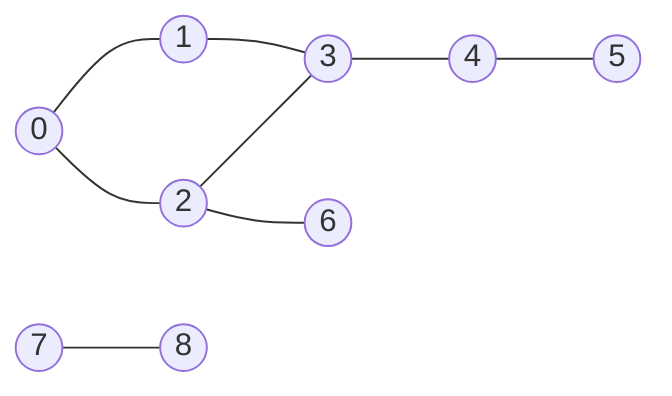

## Introduction

Once a problem is modelled as a graph ([[a8-graph-representation]]), the first thing you almost always need is a way to **visit every vertex you can reach**, each exactly once. "Which computers can this infected machine reach?" "How many separate islands are on this map?" "What is the fewest number of moves to solve this puzzle?" "Does this set of course prerequisites contain a loop?" All of these start with a systematic walk through the graph.

There are two fundamental ways to do that walk. **Breadth-first search (BFS)** explores outward in rings: first the start, then everything one edge away, then everything two edges away, and so on. **Depth-first search (DFS)** follows one route as far as it can go, then backs up to the most recent fork and tries the next route. Both visit the same set of vertices in O(V + E) time. They differ in the *order* of visits, and that order is what makes each useful: BFS's ring order gives shortest paths in unweighted graphs; DFS's go-deep-then-return order exposes structure such as cycles, dependency order and connected regions.

This lesson teaches both properly, because nearly every graph algorithm you will learn later is one of them with extra bookkeeping. Dijkstra is BFS with a priority queue. Topological sort, strongly connected components, bridges and articulation points are DFS with timestamps. Multi-source BFS, 0-1 BFS, bipartite checking and flood fill are small variations. If you understand BFS and DFS deeply — what invariant each maintains and why each line is there — the rest of the graph track becomes a set of modest extensions.

The lesson also covers two classic applications: computing shortest paths with BFS, and **cloning** a graph, which is a traversal that builds a copy as it goes.

## Before you start

- **Graph representation** — vertices, edges, directed versus undirected, and the adjacency list `List<List<Integer>>`. See [[a8-graph-representation]].
- **Queues and stacks** — first-in-first-out (FIFO) versus last-in-first-out (LIFO), and Java's `ArrayDeque`. See [[a5-queue]] and [[a5-stack]].
- **Recursion** — how the call stack stores unfinished calls. See [[a1-recursion]].
- **Tree traversals** (recommended) — BFS and DFS on trees are the same algorithms without the visited set. See [[a6-bfs]] and [[a6-dfs]].
- **HashMap** — used as a visited set and lookup table when cloning. See [[a1-hashmap]].

## The intuition

Drop a stone into a still pond. A ring of ripples spreads out; every point on the first ring is the same distance from where the stone landed, and the second ring is reached only after the first. That is BFS. It reaches every vertex at distance 1 before any vertex at distance 2, which is exactly why it finds shortest routes when every step costs the same.

Now picture exploring a cave system with a ball of string. You take the first tunnel you see and keep going, always taking an unexplored tunnel when you reach a junction. When you hit a dead end, or a junction whose tunnels you have all explored, you follow the string back to the previous junction and try its next tunnel. That is DFS. The string is the recursion stack: it records the route back.

Both explorers need one more thing in a graph that they did not need in a tree: **chalk**. Caves loop back on themselves. Without marking the junctions you have visited, the DFS explorer would walk around a loop forever, and the BFS ripple would keep re-spreading from places it has already covered. The visited set is the chalk mark.

## Why graphs need a visited set

On a tree, traversal is simple: start at the root, visit children, and you will never meet the same node twice, because a tree has exactly one path between any two nodes. A general graph breaks that guarantee in two ways. It can have **cycles**, so following edges can bring you back to where you started; and it can have **several paths** to the same vertex, so you can arrive at a vertex more than once even without a cycle.

The naive traversal — "process a vertex, then process all of its neighbours" — therefore never terminates on the simplest undirected graph: 0's neighbour is 1, 1's neighbour is 0, 0's neighbour is 1, and so on. Every undirected edge is a cycle of length two for a traversal that does not remember where it has been.

The fix is a **visited** array (or set) of size V. Before scheduling a vertex for processing, you check it and mark it. Each vertex is then scheduled at most once, which bounds the total work. *When* you mark is subtle and differs between BFS and DFS; it is one of the most important details in this lesson.

Throughout the lesson we use this undirected graph. It has two components, so it also shows why a traversal must be restarted from every unvisited vertex.



Built from the edge list in this order, the adjacency lists are: `0: [1, 2]`, `1: [0, 3]`, `2: [0, 3, 6]`, `3: [1, 2, 4]`, `4: [3, 5]`, `5: [4]`, `6: [2]`, `7: [8]`, `8: [7]`. The exact visiting orders below depend on this neighbour order.

## Breadth-first search

### The algorithm

BFS keeps a **queue** of vertices that have been discovered but not yet processed. This queue is called the **frontier**. The algorithm is:

1. Mark the start vertex visited and add it to the queue.
2. While the queue is not empty, remove the vertex at the front; call it u.
3. For each neighbour v of u: if v is not visited, mark it visited and add it to the back of the queue.

Because a queue is first-in-first-out, vertices leave in the same order they were discovered. The start discovers its neighbours (distance 1); those are processed before anything they discover (distance 2); and so on outward.

```java title="Bfs.java"
import java.util.*;

public class Bfs {

    static List<List<Integer>> undirected(int n, int[][] edges) {
        List<List<Integer>> adj = new ArrayList<>();
        for (int i = 0; i < n; i++) adj.add(new ArrayList<>());
        for (int[] e : edges) {
            adj.get(e[0]).add(e[1]);
            adj.get(e[1]).add(e[0]);
        }
        return adj;
    }

    /** Visits every vertex reachable from start, in order of distance. */
    static List<Integer> bfs(int start, List<List<Integer>> adj, boolean[] visited) {
        List<Integer> order = new ArrayList<>();
        ArrayDeque<Integer> queue = new ArrayDeque<>();
        visited[start] = true;            // mark when it enters the queue
        queue.offer(start);
        while (!queue.isEmpty()) {
            int u = queue.poll();
            order.add(u);
            for (int v : adj.get(u)) {
                if (!visited[v]) {
                    visited[v] = true;    // claimed now, so no one else enqueues it
                    queue.offer(v);
                }
            }
        }
        return order;
    }

    public static void main(String[] args) {
        int n = 9;
        int[][] edges = {{0, 1}, {0, 2}, {1, 3}, {2, 3}, {2, 6}, {3, 4}, {4, 5}, {7, 8}};
        List<List<Integer>> adj = undirected(n, edges);

        boolean[] visited = new boolean[n];
        System.out.println("from 0: " + bfs(0, adj, visited));

        // The graph may be disconnected: start a new BFS at every unvisited vertex.
        int components = 1;
        for (int s = 0; s < n; s++) {
            if (!visited[s]) {
                components++;
                System.out.println("from " + s + ": " + bfs(s, adj, visited));
            }
        }
        System.out.println("components: " + components);
    }
}
```

```output
from 0: [0, 1, 2, 3, 6, 4, 5]
from 7: [7, 8]
components: 2
```

`ArrayDeque` is the right queue in Java: `offer` adds at the tail and `poll` removes from the head, both in amortised O(1). (`LinkedList` also implements `Queue` but allocates a node object per element; the legacy `Stack` and `Vector` classes are synchronised and slower.) The `visited` array is passed in rather than created inside `bfs`, so the outer loop in `main` can reuse it to find vertices that the first BFS never reached.

### Mark on enqueue, not on dequeue

Look at where `visited[v] = true` sits: at the moment v is **added** to the queue, not when it is removed. This is deliberate. Several vertices in the current frontier may share a neighbour. In our graph, both 1 and 2 are adjacent to 3. When 1 is processed, it discovers 3 and marks it. When 2 is processed a moment later, 3 is already marked, so 2 does not add a second copy.

If you mark only when a vertex is removed, nothing stops 2 from enqueueing 3 again — 3 is in the queue but not yet "visited". With a skip check on removal (`if (visited[u]) continue;`) the answer is still correct, but the queue can hold one entry per *edge* instead of one per *vertex*. Without the skip check, a vertex is expanded once per copy, and on graphs built from layers the copies multiply layer by layer. This program counts queue insertions on a complete graph, where every vertex is adjacent to every other:

```java title="MarkLate.java"
import java.util.*;

public class MarkLate {
    // Counts how many times vertices are added to the queue on a complete graph K_n.
    static int run(int n, boolean markOnEnqueue) {
        boolean[] visited = new boolean[n];
        ArrayDeque<Integer> q = new ArrayDeque<>();
        q.offer(0);
        if (markOnEnqueue) visited[0] = true;
        int pushes = 1;
        while (!q.isEmpty()) {
            int u = q.poll();
            if (!markOnEnqueue) {
                if (visited[u]) continue;     // stale copy: skip it
                visited[u] = true;
            }
            for (int v = 0; v < n; v++) {
                if (v == u || visited[v]) continue;
                if (markOnEnqueue) visited[v] = true;
                q.offer(v);
                pushes++;
            }
        }
        return pushes;
    }

    public static void main(String[] args) {
        for (int n : new int[]{10, 100, 1000}) {
            System.out.println("n=" + n + "  mark on enqueue: " + run(n, true)
                    + "  mark on dequeue: " + run(n, false));
        }
    }
}
```

```output
n=10  mark on enqueue: 10  mark on dequeue: 46
n=100  mark on enqueue: 100  mark on dequeue: 4951
n=1000  mark on enqueue: 1000  mark on dequeue: 499501
```

Marking on enqueue adds each vertex exactly once. Marking on dequeue — even with the skip check — adds about n²/2 entries, one per edge. On a graph with a million edges, that is a million queue entries instead of a few thousand, and in a grid or state-space search it is the difference between passing and running out of memory.

> [!IMPORTANT] The BFS marking rule
> In BFS, mark a vertex visited at the moment you add it to the queue. "Visited" really means "discovered and claimed": once any vertex has claimed it, no other vertex needs to.

### Dry run

Trace `bfs(0, ...)` on the example graph. Each row is one removal from the queue.

| Step | Removed u | Neighbours of u | Newly marked and enqueued | Queue after |
|---|---|---|---|---|
| 0 | — | — | 0 | [0] |
| 1 | 0 | 1, 2 | 1, 2 | [1, 2] |
| 2 | 1 | 0, 3 | 3 | [2, 3] |
| 3 | 2 | 0, 3, 6 | 6 (3 is already marked) | [3, 6] |
| 4 | 3 | 1, 2, 4 | 4 | [6, 4] |
| 5 | 6 | 2 | — | [4] |
| 6 | 4 | 3, 5 | 5 | [5] |
| 7 | 5 | 4 | — | [] |

The removal order is 0, 1, 2, 3, 6, 4, 5. Group it by distance from 0 and the rings appear: {0}, then {1, 2}, then {3, 6}, then {4}, then {5}. Step 3 is the case that marking on enqueue exists for: vertex 2 sees 3, but 1 already claimed it.

Notice the shape of the queue at every step: it never holds vertices from more than two consecutive distances, and the nearer ones are always at the front. After step 2 it holds 2 (distance 1) then 3 (distance 2). This is the **BFS invariant**:

> At every moment, the distances of the vertices in the queue, read from front to back, are non-decreasing and differ by at most one.

It holds at the start (just the source, distance 0). When the front vertex, at distance d, is removed, any vertex it adds has distance d + 1 and goes to the back, behind vertices of distance d or d + 1. So the property is preserved. The invariant is what makes BFS's order "by distance", and it is the heart of the shortest-path proof in the next section.

### Covering every component

A single BFS from vertex 0 reaches only 0's connected component — 7 and 8 were never touched. Whenever a graph might be disconnected and you need to visit everything, wrap the BFS in a loop over all vertices and start a new search from each one that is still unvisited, sharing one `visited` array. Each start of a new search is a new component, so the same loop counts components. The total cost is still O(V + E), because the shared array guarantees every vertex is processed once across all the searches.

### Processing one level at a time

Many problems want the answer level by level: the minimum number of steps, the vertices at exactly distance k, or the time at which something spreads to the last cell. Because of the invariant, at the moment you finish a level, the queue contains *exactly* the next level. Recording `queue.size()` before processing lets you drain one level per iteration of an outer loop:

```java title="Levels.java"
import java.util.*;

public class Levels {
    public static void main(String[] args) {
        int n = 7;
        int[][] edges = {{0, 1}, {0, 2}, {1, 3}, {2, 3}, {2, 6}, {3, 4}, {4, 5}};
        List<List<Integer>> adj = new ArrayList<>();
        for (int i = 0; i < n; i++) adj.add(new ArrayList<>());
        for (int[] e : edges) { adj.get(e[0]).add(e[1]); adj.get(e[1]).add(e[0]); }

        boolean[] visited = new boolean[n];
        ArrayDeque<Integer> queue = new ArrayDeque<>();
        visited[0] = true;
        queue.offer(0);
        int level = 0;
        while (!queue.isEmpty()) {
            int size = queue.size();          // exactly the vertices at distance `level`
            List<Integer> layer = new ArrayList<>();
            for (int i = 0; i < size; i++) {
                int u = queue.poll();
                layer.add(u);
                for (int v : adj.get(u)) {
                    if (!visited[v]) { visited[v] = true; queue.offer(v); }
                }
            }
            System.out.println("level " + level + ": " + layer);
            level++;
        }
    }
}
```

```output
level 0: [0]
level 1: [1, 2]
level 2: [3, 6]
level 3: [4]
level 4: [5]
```

The snapshot `size` must be taken before the inner loop, because the inner loop adds next-level vertices to the same queue; using `queue.size()` directly as the loop bound would mix levels. The alternative is a `dist[]` array, shown in the next section, which records each vertex's level individually and needs no outer loop.

### Why BFS is O(V + E)

Each vertex is marked once, so it enters and leaves the queue at most once: O(V) queue operations in total. When a vertex u is removed, BFS scans its adjacency list, doing O(1) work per neighbour. Across the whole search, the scanned lists add up to the sum of all degrees, which is 2E for an undirected graph and E for a directed one (the handshake lemma from [[a8-graph-terminology]]). So the total time is **O(V + E)**.

The space is **O(V)**: the `visited` array has V entries, and the queue never holds more than V vertices because each enters only once. On an adjacency matrix the same algorithm costs Θ(V²), because scanning a vertex's neighbours means reading a whole row.

## BFS Shortest Path (Unweighted) {#a8-bfs-shortest-unweighted}

In an **unweighted graph** — or any graph where every edge has the same cost — the shortest path between two vertices is the one with the fewest edges. BFS finds it, for every vertex reachable from the source, in a single O(V + E) pass. It is the standard tool for "minimum number of moves", "fewest hops", "shortest transformation sequence" and "minimum steps in a grid" problems.

### Why the first discovery is the shortest

The naive approach would be to try every path from the source and keep the shortest, which takes exponential time on graphs with many routes. BFS avoids this by exploring in order of distance.

Here is the argument. Let dist(v) be the true shortest distance from the source s. Suppose BFS processes vertices in non-decreasing order of dist — which the BFS invariant guarantees. Take any vertex v at true distance k ≥ 1. On a shortest path from s to v, the vertex just before v, call it u, has distance k − 1. Every vertex at distance k − 1 is removed from the queue before any vertex at distance k, and no vertex at distance less than k − 1 can be adjacent to v (otherwise v would be closer than k). So the first vertex to discover v is one at distance exactly k − 1, and BFS records `dist[v] = (k − 1) + 1 = k`. The first discovery is the shortest, and it never needs to be revised.

That is why you can **assign the distance at discovery time and never change it**. The `dist` array can double as the visited array: `-1` means "not discovered yet".

### Distances and parent pointers

To report the path itself, not just its length, store a **parent pointer** when a vertex is discovered: `parent[v] = u` says "the shortest route to v arrives from u". Following parents back from the target walks the path in reverse.

```java title="ShortestPath.java"
import java.util.*;

public class ShortestPath {

    /** dist[v] = fewest edges from src to v, or -1 if v is unreachable. */
    static int[] bfsDistances(int src, List<List<Integer>> adj, int[] parent) {
        int n = adj.size();
        int[] dist = new int[n];
        Arrays.fill(dist, -1);                 // -1 also means "not discovered yet"
        Arrays.fill(parent, -1);
        ArrayDeque<Integer> queue = new ArrayDeque<>();
        dist[src] = 0;
        queue.offer(src);
        while (!queue.isEmpty()) {
            int u = queue.poll();
            for (int v : adj.get(u)) {
                if (dist[v] == -1) {           // first discovery is the shortest one
                    dist[v] = dist[u] + 1;
                    parent[v] = u;
                    queue.offer(v);
                }
            }
        }
        return dist;
    }

    static List<Integer> path(int dst, int[] dist, int[] parent) {
        if (dist[dst] == -1) return List.of();
        ArrayDeque<Integer> path = new ArrayDeque<>();
        for (int v = dst; v != -1; v = parent[v]) path.addFirst(v);  // walk back to src
        return new ArrayList<>(path);
    }

    public static void main(String[] args) {
        int n = 9;
        int[][] edges = {{0, 1}, {0, 2}, {1, 3}, {2, 3}, {2, 6}, {3, 4}, {4, 5}, {7, 8}};
        List<List<Integer>> adj = new ArrayList<>();
        for (int i = 0; i < n; i++) adj.add(new ArrayList<>());
        for (int[] e : edges) { adj.get(e[0]).add(e[1]); adj.get(e[1]).add(e[0]); }

        int[] parent = new int[n];
        int[] dist = bfsDistances(0, adj, parent);
        System.out.println("dist:   " + Arrays.toString(dist));
        System.out.println("parent: " + Arrays.toString(parent));
        System.out.println("0 -> 5: " + path(5, dist, parent));
        System.out.println("0 -> 8: " + path(8, dist, parent));
    }
}
```

```output
dist:   [0, 1, 1, 2, 3, 4, 2, -1, -1]
parent: [-1, 0, 0, 1, 3, 4, 2, -1, -1]
0 -> 5: [0, 1, 3, 4, 5]
0 -> 8: []
```

Read the `parent` array: vertex 3 records parent 1, because 1 was removed from the queue before 2 and discovered 3 first. The path 0 – 2 – 3 – 4 – 5 is equally short; BFS returns *a* shortest path, and which one depends on neighbour order. Vertices 7 and 8 keep `dist = -1`, which is how the method reports "unreachable". The reconstruction pushes each vertex to the front of a deque, so the result comes out in source-to-target order without a separate reverse step, and it takes O(length of path) time.

If you only need the distance to one target, you can stop as soon as it is discovered (or removed from the queue). That does not change the worst-case complexity, but it often saves most of the work.

### Grids: the most common shortest-path setting

In grid problems each open cell is a vertex and each move to an adjacent open cell is an edge ([[a8-grid-as-graph]]). Nothing is pre-built; neighbours come from a direction array, and the bounds and wall checks replace "is this a real neighbour?".

```java title="GridBfs.java"
import java.util.*;

public class GridBfs {
    static final int[][] DIRS = {{1, 0}, {-1, 0}, {0, 1}, {0, -1}};

    /** Fewest moves from S to E through '.' cells, or -1. Each cell is a vertex. */
    static int shortest(String[] grid) {
        int rows = grid.length, cols = grid[0].length();
        int[][] dist = new int[rows][cols];
        for (int[] row : dist) Arrays.fill(row, -1);
        ArrayDeque<int[]> queue = new ArrayDeque<>();
        for (int r = 0; r < rows; r++)
            for (int c = 0; c < cols; c++)
                if (grid[r].charAt(c) == 'S') { dist[r][c] = 0; queue.offer(new int[]{r, c}); }

        while (!queue.isEmpty()) {
            int[] cell = queue.poll();
            int r = cell[0], c = cell[1];
            if (grid[r].charAt(c) == 'E') return dist[r][c];   // first time E leaves the queue
            for (int[] d : DIRS) {
                int nr = r + d[0], nc = c + d[1];
                if (nr < 0 || nc < 0 || nr >= rows || nc >= cols) continue;  // off the grid
                if (grid[nr].charAt(nc) == '#' || dist[nr][nc] != -1) continue;
                dist[nr][nc] = dist[r][c] + 1;
                queue.offer(new int[]{nr, nc});
            }
        }
        return -1;
    }

    public static void main(String[] args) {
        String[] maze = {
            "S.#.....",
            ".##.###.",
            "....#...",
            ".##...#E",
        };
        System.out.println(shortest(maze));
        System.out.println(shortest(new String[]{"S#E"}));
    }
}
```

```output
12
-1
```

The shortest route goes down the left column, along row 2, dips into row 3 to get round the wall at (2, 4), and climbs back to reach E: 12 moves. The route over the top is 14 moves, and BFS never commits to it because it reaches E through the shorter route first. The second maze has a wall between S and E, so the queue empties and the method returns `-1`. For an R × C grid, V = RC and each cell has at most four edges, so the search is O(RC).

Two details are easy to get wrong in grids. The bounds check must come *before* reading `grid[nr]`, or the program throws `ArrayIndexOutOfBoundsException`. And if diagonal moves are allowed (as in "Shortest Path in Binary Matrix"), the direction array has eight entries, not four.

### Where it stops working

BFS counts edges. The moment edges have different costs, "fewest edges" and "cheapest" diverge. Suppose A connects to B directly with cost 10, and also through C with costs 1 and 1:

| Route | Edges | Total cost |
|---|---|---|
| A → B | 1 | 10 |
| A → C → B | 2 | 2 |

BFS discovers B from A in the first ring and fixes its distance at one edge — the expensive route. For weighted graphs, use Dijkstra's algorithm ([[a8-dijkstra]]), which replaces the FIFO queue with a priority queue ordered by cost so far. There is one useful middle ground: when every weight is 0 or 1, **0-1 BFS** ([[a8-0-1-bfs]]) uses a deque, pushing 0-cost neighbours to the front and 1-cost neighbours to the back, and keeps O(V + E) time.

### Variations worth recognising

- **Multi-source BFS** ([[a8-multi-source-bfs]]). To find each cell's distance to the *nearest* of several sources — the nearest exit, or how long until every orange rots — put all sources in the queue at distance 0 before starting. It behaves as if a virtual super-source were connected to all of them.
- **Bidirectional BFS.** When you know both start and target, search from both ends and stop when the frontiers meet. If each vertex branches into b neighbours and the answer is at depth d, one search explores about b^d vertices; two half-depth searches explore about 2·b^(d/2). Word Ladder is the classic use.
- **State-space BFS.** When the "position" includes more than a vertex — a cell plus the set of keys collected, or a lock's four digits — the vertex is the whole state. The visited set is indexed by state, for example `visited[row][col][keyMask]`, and the state count must be small enough to fit in memory.

## DFS (Depth-First Search) {#a8-dfs}

**Depth-first search (DFS)** explores a graph by going as deep as possible along one route before backing up. From the current vertex it moves to an unvisited neighbour, then to an unvisited neighbour of *that* vertex, and so on. When it reaches a vertex with no unvisited neighbours, it returns to the previous vertex and tries its next neighbour. DFS visits the same vertices as BFS in the same O(V + E) time, but in a different order, and that order exposes structure — cycles, dependency order, connected regions — that BFS's ring order does not.

### The recursive implementation

DFS is most naturally written recursively, because "explore everything reachable from v, then come back" is exactly what a recursive call does. The call stack plays the role of the ball of string from the intuition.

```java title="Dfs.java"
import java.util.*;

public class Dfs {
    static List<List<Integer>> adj;
    static boolean[] visited;
    static int[] enter, exit;
    static int clock = 0;
    static List<Integer> pre = new ArrayList<>(), post = new ArrayList<>();

    static void dfs(int u) {
        visited[u] = true;                 // mark before exploring, or a cycle re-enters u
        enter[u] = clock++;
        pre.add(u);                        // preorder: u is first discovered
        for (int v : adj.get(u)) {
            if (!visited[v]) dfs(v);
        }
        exit[u] = clock++;
        post.add(u);                       // postorder: everything reachable from u is done
    }

    public static void main(String[] args) {
        int n = 9;
        int[][] edges = {{0, 1}, {0, 2}, {1, 3}, {2, 3}, {2, 6}, {3, 4}, {4, 5}, {7, 8}};
        adj = new ArrayList<>();
        for (int i = 0; i < n; i++) adj.add(new ArrayList<>());
        for (int[] e : edges) { adj.get(e[0]).add(e[1]); adj.get(e[1]).add(e[0]); }

        visited = new boolean[n];
        enter = new int[n];
        exit = new int[n];
        int components = 0;
        for (int s = 0; s < n; s++) {
            if (!visited[s]) { components++; dfs(s); }
        }
        System.out.println("preorder:  " + pre);
        System.out.println("postorder: " + post);
        for (int u = 0; u < n; u++) System.out.print(u + "[" + enter[u] + "," + exit[u] + "] ");
        System.out.println();
        System.out.println("components: " + components);
    }
}
```

```output
preorder:  [0, 1, 3, 2, 6, 4, 5, 7, 8]
postorder: [6, 2, 5, 4, 3, 1, 0, 8, 7]
0[0,13] 1[1,12] 2[3,6] 3[2,11] 4[7,10] 5[8,9] 6[4,5] 7[14,17] 8[15,16] 
components: 2
```

The core is the six-line `dfs` method; everything else is instrumentation to show what it does. In DFS, a vertex is marked at the moment the call for it *starts*. That is the same idea as "mark on enqueue" in BFS: the vertex is claimed before anyone else could schedule it, so it is entered exactly once. Marking after the loop instead would let a cycle lead straight back into u while u is still being explored, recursing forever.

The method has two natural hook points. Code placed before the loop runs in **preorder** — when u is first discovered. Code placed after the loop runs in **postorder** — when u is **finished**, meaning everything reachable from u through unvisited vertices has been fully explored. Many algorithms hang their work on the postorder hook: a vertex's postorder position is the moment all of its "descendants" are complete, which is exactly what topological sort ([[a8-topo-dfs]]) and strongly connected components ([[a8-kosaraju]]) need.

### Dry run

Trace the calls from 0. The call-stack column shows the recursion depth, and the clock ticks on every entry and exit.

| Event | Call stack after the event | Note |
|---|---|---|
| enter 0 (t=0) | 0 | first neighbour is 1 |
| enter 1 (t=1) | 0, 1 | 0 is visited, so try 3 |
| enter 3 (t=2) | 0, 1, 3 | 1 is visited, so try 2 |
| enter 2 (t=3) | 0, 1, 3, 2 | 0 and 3 are visited, so try 6 |
| enter 6 (t=4) | 0, 1, 3, 2, 6 | 6's only neighbour, 2, is visited |
| exit 6 (t=5) | 0, 1, 3, 2 | back in 2; no neighbours left |
| exit 2 (t=6) | 0, 1, 3 | back in 3; next neighbour is 4 |
| enter 4 (t=7) | 0, 1, 3, 4 | 3 is visited, so try 5 |
| enter 5 (t=8), exit 5 (t=9) | 0, 1, 3, 4 | 5 is a dead end |
| exit 4, 3, 1 (t=10, 11, 12) | 0 | unwinding |
| exit 0 (t=13) | empty | 0's second neighbour, 2, is already visited |

Compare with BFS. BFS reached 2 directly from 0, at distance 1. DFS reached 2 by the long route 0 → 1 → 3 → 2 because it committed to 1 first and kept going. That is why DFS does not find shortest paths.

The `[enter, exit]` intervals have a striking property: any two are either nested or disjoint. 6's interval [4, 5] is inside 2's [3, 6], which is inside 3's [2, 11]; 2's and 4's intervals do not overlap. This **parenthesis property** holds because a call cannot finish until every call it started has finished. Nesting means "is a descendant of" in the **DFS tree** — the tree formed by the edges along which DFS discovered new vertices (here 0–1, 1–3, 3–2, 2–6, 3–4, 4–5). Bridges, articulation points and SCC algorithms ([[a8-bridges]], [[a8-tarjan-scc]]) are all built on these timestamps.

### Complexity and the recursion limit

DFS enters each vertex once and scans each adjacency list once, so it runs in **O(V + E)** time, by the same argument as BFS. The space is **O(V)** for `visited` plus the recursion depth, which in the worst case — a long path — is also V.

That depth is a real constraint in Java. Every call occupies a frame on the thread's stack, which has a fixed size (commonly 1 MB by default on 64-bit platforms, controlled by `-Xss`). A path graph with a million vertices overflows it:

```java title="DeepChain.java"
import java.util.*;

public class DeepChain {
    static List<List<Integer>> adj;
    static boolean[] seen;
    static void dfs(int u) {
        seen[u] = true;
        for (int v : adj.get(u)) if (!seen[v]) dfs(v);
    }
    public static void main(String[] args) {
        int n = 1_000_000;                         // a path 0 - 1 - 2 - ... - (n-1)
        adj = new ArrayList<>();
        for (int i = 0; i < n; i++) adj.add(new ArrayList<>());
        for (int i = 0; i + 1 < n; i++) { adj.get(i).add(i + 1); adj.get(i + 1).add(i); }
        seen = new boolean[n];
        try {
            dfs(0);
            System.out.println("finished");
        } catch (StackOverflowError e) {
            System.out.println("StackOverflowError");
        }
    }
}
```

```output
StackOverflowError
```

The exact depth at which this fails depends on the JVM, its settings and the size of each frame, so do not rely on a specific number; anything from tens of thousands of levels upward is at risk. There are two fixes. The portable one is to remove recursion with an explicit stack ([[a8-iterative-dfs]]). The quick one, common in competitive programming, is to run the recursive code on a thread created with a large stack: `new Thread(null, () -> dfs(0), "dfs", 1L << 29)`, then `start()` and `join()` it. That requests a 512 MB stack for that thread; the JVM treats the size as a hint, but on mainstream 64-bit JVMs it lets the million-vertex path above finish.

### What DFS is used for

**Connected components and flood fill.** Run DFS from every unvisited vertex; each top-level call colours one component. On grids this is "Number of Islands" and "Flood Fill" ([[a8-number-of-islands]], [[a8-flood-fill]]): each DFS sinks one island, often by overwriting land cells in place instead of keeping a separate visited array. BFS works equally well; DFS is chosen because the recursive code is shortest.

**Cycle detection in undirected graphs.** During DFS, every undirected edge is seen twice — once from each end — so the edge back to the vertex you just came from always looks like a visited neighbour. Pass the **parent** into each call and ignore it. Any *other* visited neighbour means there are two different routes to it: a cycle. See [[a8-cycle-undirected]].

**Cycle detection in directed graphs.** A Boolean visited array is not enough here. In the diamond 0 → 1, 0 → 2, 1 → 2, the edge 0 → 2 reaches 2 after 2 has already been fully explored via 1, but there is no cycle. What matters is whether the edge points to a vertex that is *still on the current recursion path*. Three colours capture that: white (unvisited), gray (in progress) and black (finished).

```java
static final int WHITE = 0, GRAY = 1, BLACK = 2;

static boolean hasDirectedCycle(int u) {          // color[] and adj are fields
    color[u] = GRAY;                              // u is on the current recursion path
    for (int v : adj.get(u)) {
        if (color[v] == GRAY) return true;        // edge back into the path: a cycle
        if (color[v] == WHITE && hasDirectedCycle(v)) return true;
    }
    color[u] = BLACK;                             // finished; edges into u are now harmless
    return false;
}
```

The caller runs it from every white vertex. On the diamond it returns `false`; on 0 → 1 → 2 → 0 it returns `true`. This is the standard Course Schedule check, covered fully in [[a8-cycle-detection]].

**Topological order.** In a directed acyclic graph, listing vertices in *reverse postorder* gives an order where every edge points forward, because a vertex finishes only after everything it points to has finished. See [[a8-topo-dfs]].

**Paths and backtracking.** To find *any* path from s to t, DFS and stop when t is reached. To enumerate *all* simple paths, add the vertex to a path list on entry, remove it on exit, and *unmark* it on exit too so other paths may reuse it — that is backtracking ([[a9-grid-search]]), and it is exponential in the worst case because the number of paths can be.

**Edge classification.** In a directed graph, DFS sorts every edge u → v into one of four kinds: a **tree edge** (v was white and discovered through this edge), a **back edge** (v is gray — an ancestor on the current path; these are exactly the cycle edges), a **forward edge** (v is black and a descendant of u) and a **cross edge** (v is black and in a different, already-finished branch). In an undirected graph only tree and back edges occur. You rarely need the full classification in interviews, but "back edge means cycle" is worth remembering.

## Iterative DFS with Explicit Stack {#a8-iterative-dfs}

**Iterative DFS** performs a depth-first traversal without recursion, by managing the stack yourself with an `ArrayDeque` used through `push` and `pop`. You need it when the graph can be deep enough to overflow the call stack, as shown above, and it is a common interview follow-up: "now do it without recursion".

The naive translation — "replace the queue in BFS with a stack" — is close, but where you mark visited decides whether the result is really depth-first. This program compares recursive DFS with two stack versions on the connected part of the example graph:

```java title="IterativeDfs.java"
import java.util.*;

public class IterativeDfs {

    static List<Integer> recursive(List<List<Integer>> adj, int s) {
        List<Integer> order = new ArrayList<>();
        go(s, adj, new boolean[adj.size()], order);
        return order;
    }
    static void go(int u, List<List<Integer>> adj, boolean[] seen, List<Integer> order) {
        seen[u] = true;
        order.add(u);
        for (int v : adj.get(u)) if (!seen[v]) go(v, adj, seen, order);
    }

    /** True DFS order: mark on pop, push neighbours in reverse. */
    static List<Integer> markOnPop(List<List<Integer>> adj, int s) {
        boolean[] seen = new boolean[adj.size()];
        List<Integer> order = new ArrayList<>();
        ArrayDeque<Integer> stack = new ArrayDeque<>();
        stack.push(s);
        while (!stack.isEmpty()) {
            int u = stack.pop();
            if (seen[u]) continue;                 // a stale duplicate: already expanded
            seen[u] = true;
            order.add(u);
            List<Integer> nbrs = adj.get(u);
            for (int i = nbrs.size() - 1; i >= 0; i--) {   // reverse, so the first pops first
                int v = nbrs.get(i);
                if (!seen[v]) stack.push(v);
            }
        }
        return order;
    }

    /** Visits everything once, but NOT in depth-first order. */
    static List<Integer> markOnPush(List<List<Integer>> adj, int s) {
        boolean[] seen = new boolean[adj.size()];
        List<Integer> order = new ArrayList<>();
        ArrayDeque<Integer> stack = new ArrayDeque<>();
        seen[s] = true;
        stack.push(s);
        while (!stack.isEmpty()) {
            int u = stack.pop();
            order.add(u);
            List<Integer> nbrs = adj.get(u);
            for (int i = nbrs.size() - 1; i >= 0; i--) {
                int v = nbrs.get(i);
                if (!seen[v]) { seen[v] = true; stack.push(v); }
            }
        }
        return order;
    }

    /** Postorder without recursion: each frame remembers how far through its list it got. */
    static List<Integer> postorder(List<List<Integer>> adj, int s) {
        boolean[] seen = new boolean[adj.size()];
        int[] next = new int[adj.size()];          // next neighbour index to try, per vertex
        List<Integer> post = new ArrayList<>();
        ArrayDeque<Integer> stack = new ArrayDeque<>();
        seen[s] = true;
        stack.push(s);
        while (!stack.isEmpty()) {
            int u = stack.peek();
            if (next[u] < adj.get(u).size()) {
                int v = adj.get(u).get(next[u]++);
                if (!seen[v]) { seen[v] = true; stack.push(v); }   // "call" dfs(v)
            } else {
                stack.pop();                       // "return" from dfs(u)
                post.add(u);
            }
        }
        return post;
    }

    public static void main(String[] args) {
        int n = 7;
        int[][] edges = {{0, 1}, {0, 2}, {1, 3}, {2, 3}, {2, 6}, {3, 4}, {4, 5}};
        List<List<Integer>> adj = new ArrayList<>();
        for (int i = 0; i < n; i++) adj.add(new ArrayList<>());
        for (int[] e : edges) { adj.get(e[0]).add(e[1]); adj.get(e[1]).add(e[0]); }

        System.out.println("recursive:    " + recursive(adj, 0));
        System.out.println("mark on pop:  " + markOnPop(adj, 0));
        System.out.println("mark on push: " + markOnPush(adj, 0));
        System.out.println("postorder:    " + postorder(adj, 0));
    }
}
```

```output
recursive:    [0, 1, 3, 2, 6, 4, 5]
mark on pop:  [0, 1, 3, 2, 6, 4, 5]
mark on push: [0, 1, 3, 4, 5, 2, 6]
postorder:    [6, 2, 5, 4, 3, 1, 0]
```

### Mark on pop: the faithful version

`markOnPop` reproduces the recursive order exactly. Two details make that happen. First, the neighbours are pushed in **reverse**, so that the first neighbour in the list ends up on top of the stack and is explored first, as in the recursive loop. Second, a vertex is marked when it is **popped**, not when it is pushed. A vertex may be pushed several times — once by each visited neighbour that saw it before it was explored — and only the first pop expands it; the `if (seen[u]) continue;` line discards the stale copies.

Why must DFS tolerate those duplicates when BFS avoided them? Because in DFS the *most recent* discovery should win. When 3 is explored, it pushes 2 even though 0 pushed 2 earlier; the copy pushed by 3 is on top, so 2 is explored as 3's child, matching recursion. The cost is stack space: with one push per edge, the stack can hold **O(E)** entries rather than O(V). Time is still O(V + E).

### Mark on push: a valid traversal, but not DFS

`markOnPush` marks vertices as they are pushed, exactly as BFS does. It visits every reachable vertex once and uses only O(V) stack space, so it is perfectly good for questions that only care about *which* vertices are reachable — counting components, flood fill, checking connectivity. But its order, `[0, 1, 3, 4, 5, 2, 6]`, is not a depth-first order. When 0 was expanded it claimed both 1 and 2, so when 3 later looked at 2, it could not take it; 2 became a child of 0 instead of 3. Algorithms that rely on DFS-tree properties — parent-based undirected cycle detection, discovery and finish times, low-link values — can give wrong answers with this version.

> [!WARNING] "Stack instead of queue" is not automatically DFS
> Swapping BFS's queue for a stack while keeping BFS's mark-on-enqueue rule gives a traversal that visits everything but does not follow depth-first order. Use it for reachability only. When the problem depends on DFS structure, mark on pop or emulate frames.

### Postorder without recursion

Neither stack version above has a natural postorder moment: when a vertex is popped, its descendants have not been explored yet. To get postorder, emulate what the call stack actually stores — not just "which vertex", but "how far through its neighbour list it has got". The `postorder` method keeps `next[u]`, the index of u's next neighbour to try. Each iteration looks at the top vertex without removing it (`peek`). If it has untried neighbours, it advances `next[u]` and, if that neighbour is unvisited, pushes it — the equivalent of making a recursive call. When the top vertex has no neighbours left, it is popped and recorded — the equivalent of returning. The output `[6, 2, 5, 4, 3, 1, 0]` matches the recursive postorder. Here marking on push is correct, because a vertex is pushed only when it is actually being descended into.

This frame-emulation pattern is the general way to turn any recursive graph algorithm iterative, including iterative topological sort and iterative Tarjan. Each frame can carry more state — a parent, a running low-link value — by using parallel arrays or pushing small `int[]` records.

### Complexity

All three iterative versions run in **O(V + E)** time, since each adjacency entry is examined a constant number of times. Space is O(V) for the frame-emulation and mark-on-push versions, and O(V + E) in the worst case for mark-on-pop because of duplicate entries. All of it lives on the heap, which is limited by `-Xmx` (typically hundreds of megabytes or more) rather than the thread stack.

## BFS vs DFS — When to Use Which {#a8-bfs-vs-dfs}

BFS and DFS both visit every reachable vertex in O(V + E) time, so the choice between them is not about speed. It is about **which order of visits answers the question**, and secondarily about memory and code simplicity. This section turns the differences into decision rules.

| | BFS | DFS |
|---|---|---|
| Frontier structure | Queue (FIFO) | Call stack or explicit stack (LIFO) |
| Visiting order | By distance from the start, ring by ring | One branch to the end, then backtrack |
| Shortest path, unweighted | Yes — first discovery is shortest | No — may find a long path first |
| Natural hooks | Level boundaries | Preorder (entry) and postorder (exit) |
| Extra memory | O(width): the largest ring | O(depth): the longest active path |
| Typical code | Loop with a queue | Short recursive function |
| Signature problems | Minimum moves, nearest X, spreading over time | Components, cycles, topological order, all paths |

### Choose BFS when distance or time matters

If the question contains "minimum number of steps", "shortest", "nearest", "fewest" or "after how many minutes", and edges are unweighted, use BFS. Its ring order is the answer. The same is true for anything that spreads simultaneously from one or more starting points — rotting oranges, fire spreading, signal propagation — which is multi-source BFS. BFS is also safer on huge or infinite implicit graphs where the answer is shallow: it finds a solution at depth d after exploring only depths up to d, while DFS can wander down an endless branch and never return.

### Choose DFS when structure matters

If the question is about cycles, dependency order, connectivity structure (bridges, articulation points, strongly connected components), or enumerating paths and configurations, use DFS. Its postorder hook and the "currently on the path" information are exactly what those algorithms need, and BFS does not provide them naturally. DFS is also the default for exhaustive search with backtracking.

### When either works

Counting connected components, flood fill, checking whether t is reachable from s, and checking whether a graph is bipartite ([[a8-bipartite]]) all work with either traversal. Pick the one you can write correctly fastest. Many people choose recursive DFS for brevity, and switch to BFS or iterative DFS when the input could be deep — a 1000 × 1000 grid that is all land gives a recursion depth of up to a million cells.

### Memory profile

The difference in memory depends on the graph's shape. On a wide, shallow graph — a star with one centre and a million leaves — BFS's queue holds a million vertices while DFS goes only two levels deep. On a long, thin graph — a path of a million vertices — DFS's stack holds a million frames while BFS's queue never holds more than two vertices. In a grid, BFS's frontier is roughly a diagonal band, O(R + C) cells for an open grid, while DFS can snake through all R × C cells in one path. Neither is better in general; think about the shape you expect.

```quiz
Q: In BFS, why must a vertex be marked visited when it is added to the queue rather than when it is removed?
- [ ] Marking on removal gives wrong distances in every graph
- [x] Otherwise several frontier vertices can add the same neighbour, so the queue can hold one entry per edge instead of one per vertex
- [ ] Java's ArrayDeque does not allow duplicate elements
- [ ] Marking on removal makes BFS behave like DFS
> When several vertices in the frontier share an unvisited neighbour, each of them would enqueue it if it is not yet marked. With a skip check on removal the result is still correct but memory grows to O(E); without the check, vertices are expanded repeatedly. Marking on enqueue claims the vertex the first time it is seen, so it enters the queue exactly once.

Q: Which problem should you solve with BFS rather than DFS?
- [ ] Detect whether a directed graph of course prerequisites has a cycle
- [ ] List every simple path from s to t
- [x] Find the minimum number of knight moves between two squares on a chessboard
- [ ] Produce a topological order of build tasks
> Every knight move costs the same, so the minimum number of moves is a shortest path in an unweighted implicit graph, which BFS finds by exploring in order of distance. Directed cycle detection and topological sorting rely on DFS's in-progress and postorder information, and enumerating all paths is backtracking DFS.

Q: The iterative DFS that marks vertices when they are pushed produces the order [0, 1, 3, 4, 5, 2, 6] while recursive DFS produces [0, 1, 3, 2, 6, 4, 5]. Why?
- [ ] The adjacency lists were built differently
- [ ] Iterative DFS always visits vertices in reverse order
- [x] Marking on push lets an early vertex claim a neighbour before a deeper vertex can explore it, so the traversal is not truly depth-first
- [ ] The stack overflowed and some vertices were skipped
> Vertex 0 marked both 1 and 2 when it pushed them. Later, 3 could not take 2 because it was already marked, so 2 was explored only after 3's whole branch, as a child of 0. Recursive DFS reaches 2 through 3. Marking on pop, with neighbours pushed in reverse, reproduces the recursive order.
```

## Clone Graph (BFS / DFS) {#a8-clone-graph}

**Cloning a graph** means producing a **deep copy**: a brand-new set of node objects with the same values and the same connections, sharing no objects with the original. The standard version (LeetCode 133, "Clone Graph") gives you one node of a connected undirected graph, where each node has an integer `val` and a `List<Node> neighbors`, and asks for the corresponding node of the copy. It is a traversal problem in disguise, and it tests whether you can combine a traversal with a lookup table correctly.

### Why the obvious approach fails

The first idea is recursive: "to copy a node, create a new node, then copy each neighbour and add it." On a tree that works. On a graph it fails in two ways. Because every undirected edge points both ways, copying node 1 copies neighbour 2, which copies *its* neighbour 1, which copies 2 again, forever — a `StackOverflowError`. And even in a graph without cycles, a node reachable by two routes would be copied twice, producing two separate objects where the original had one, so the copy would have a different shape.

Both problems have the same cause: the copier does not remember which originals it has already copied. The fix is a **map from original node to its copy**. The map serves two purposes at once. It is the **visited set** (an original is visited exactly when it has an entry), and it is the **lookup table** used to wire edges between copies (the copy of neighbour v is `map.get(v)`).

### BFS version

```java title="CloneGraph.java"
import java.util.*;

public class CloneGraph {
    static class Node {
        int val;
        List<Node> neighbors = new ArrayList<>();
        Node(int val) { this.val = val; }
    }

    /** BFS: the map is both the visited set and the original -> copy lookup. */
    static Node cloneBfs(Node start) {
        if (start == null) return null;
        Map<Node, Node> copies = new HashMap<>();
        copies.put(start, new Node(start.val));
        ArrayDeque<Node> queue = new ArrayDeque<>();
        queue.offer(start);
        while (!queue.isEmpty()) {
            Node u = queue.poll();
            for (Node v : u.neighbors) {
                if (!copies.containsKey(v)) {          // first sighting: create, then explore
                    copies.put(v, new Node(v.val));
                    queue.offer(v);
                }
                copies.get(u).neighbors.add(copies.get(v));  // wire every edge, seen or not
            }
        }
        return copies.get(start);
    }

    /** DFS: register the copy BEFORE recursing, so a cycle back to u finds it. */
    static Node cloneDfs(Node u, Map<Node, Node> copies) {
        if (u == null) return null;
        Node existing = copies.get(u);
        if (existing != null) return existing;
        Node copy = new Node(u.val);
        copies.put(u, copy);
        for (Node v : u.neighbors) copy.neighbors.add(cloneDfs(v, copies));
        return copy;
    }

    // Describe a graph by walking it, and collect the identities of its nodes.
    static String describe(Node start, Set<Node> seen) {
        TreeMap<Integer, List<Integer>> out = new TreeMap<>();
        ArrayDeque<Node> q = new ArrayDeque<>();
        seen.add(start);
        q.offer(start);
        while (!q.isEmpty()) {
            Node u = q.poll();
            List<Integer> vals = new ArrayList<>();
            for (Node v : u.neighbors) {
                vals.add(v.val);
                if (seen.add(v)) q.offer(v);
            }
            out.put(u.val, vals);
        }
        return out.toString();
    }

    public static void main(String[] args) {
        // The square 1 - 2 - 3 - 4 - 1 (LeetCode 133's first example).
        Node[] n = new Node[5];
        for (int i = 1; i <= 4; i++) n[i] = new Node(i);
        int[][] edges = {{1, 2}, {2, 3}, {3, 4}, {4, 1}};
        for (int[] e : edges) {
            n[e[0]].neighbors.add(n[e[1]]);
            n[e[1]].neighbors.add(n[e[0]]);
        }

        Set<Node> original = new HashSet<>(), bfsNodes = new HashSet<>(), dfsNodes = new HashSet<>();
        System.out.println("original: " + describe(n[1], original));
        Node a = cloneBfs(n[1]);
        System.out.println("bfs copy: " + describe(a, bfsNodes));
        Node b = cloneDfs(n[1], new HashMap<>());
        System.out.println("dfs copy: " + describe(b, dfsNodes));

        // A deep copy shares no node objects with the original.
        bfsNodes.retainAll(original);
        dfsNodes.retainAll(original);
        System.out.println("shared nodes: " + bfsNodes.size() + ", " + dfsNodes.size());
    }
}
```

```output
original: {1=[2, 4], 2=[1, 3], 3=[2, 4], 4=[3, 1]}
bfs copy: {1=[2, 4], 2=[1, 3], 3=[2, 4], 4=[3, 1]}
dfs copy: {1=[2, 4], 2=[1, 3], 3=[2, 4], 4=[3, 1]}
shared nodes: 0, 0
```

In `cloneBfs`, the copy of a node is created the moment the node is first seen — the cloning equivalent of "mark on enqueue". The crucial line is the last one inside the loop: `copies.get(u).neighbors.add(copies.get(v))` runs for **every** neighbour, whether v was just discovered or copied long ago. Placing that line inside the `if` is a common bug: edges leading to already-seen nodes would be dropped, and the copy of the square would lose two of its edges. Because each original node is dequeued exactly once and scans its own neighbour list once, each undirected edge is added once from each end, so every copied list matches the original list in the same order.

The `main` method checks the result two ways: the copy's structure (values and neighbour lists) matches the original, and no node object is shared — the deep-copy requirement. `Node` does not override `equals` or `hashCode`, so `HashMap` and `HashSet` compare nodes by identity, which is exactly right here.

### DFS version

`cloneDfs` is the recursive form. The one rule that matters is the order of the two middle lines: **put the copy in the map before recursing into the neighbours**. When the recursion reaches a neighbour whose neighbour list leads back to u, the lookup finds u's copy and returns it instead of creating a new one. If the `put` came after the loop, the cycle 1 → 2 → 1 would recurse forever. The DFS version is shorter; the BFS version avoids deep recursion on large graphs.

### Complexity and edge cases

Every node is copied once and every adjacency entry is processed once, so both versions take **O(V + E)** time. The map holds V entries and the queue or recursion stack up to V, so extra space is **O(V)**, not counting the copy itself.

The edge cases interviewers check: a `null` input returns `null`; a single node with no neighbours returns a single new node; and the graph's values need not be unique — the map is keyed by node *identity*, not by `val`, so duplicates are harmless. If the node class overrides `equals` by value, use `IdentityHashMap` instead of `HashMap` so that two different nodes with equal values still get separate copies. If the input might be disconnected and you are given a list of all nodes, loop over them and start a clone from each one not yet in the map, sharing the map.

The same "original → copy" map solves related problems such as "Copy List with Random Pointer", where each node has a `next` pointer plus a `random` pointer to any node — a small graph that must be copied without duplicating or losing shared targets.

## Clone a Directed Acyclic Graph {#a8-clone-dag}

**Cloning a DAG** means deep-copying a directed acyclic graph: creating a new node for every original node reachable from the given start, with the same directed edges. Since a DAG has no cycles, it is tempting to think the copy can be made with plain recursion — copy a node, then recursively copy each child — exactly as for a tree. That is the trap this problem is designed around.

### Why "no cycles" is not enough

A DAG can still have **shared nodes**: a node with several parents. The simplest example is a **diamond**: a top node points to a left and a right node, and both of those point to the same join node. Plain recursion reaches the join node once through the left and once through the right, and creates two separate copies. The copy is then no longer the same graph — it is a tree with duplicated nodes — and anything that relies on the sharing (for example, updating the join node and seeing the change from both sides) breaks.

Worse, the duplication compounds. Chain k diamonds together, each one's join node being the next one's top, and the number of distinct routes from the start to the bottom doubles with every diamond. Plain recursion copies each node once per route, so the work grows exponentially even though the graph has only 3k + 1 nodes. This program measures it:

```java title="CloneDag.java"
import java.util.*;

public class CloneDag {
    static class Node {
        int val;
        List<Node> next = new ArrayList<>();
        Node(int val) { this.val = val; }
    }

    static int created = 0;

    /** No memo: every path to a node produces a separate copy of it. */
    static Node naive(Node u) {
        Node c = new Node(u.val);
        created++;
        for (Node v : u.next) c.next.add(naive(v));
        return c;
    }

    /** Memo: each original node is copied exactly once and shared by all parents. */
    static Node memo(Node u, Map<Node, Node> copies) {
        Node done = copies.get(u);
        if (done != null) return done;
        Node c = new Node(u.val);
        created++;
        copies.put(u, c);
        for (Node v : u.next) c.next.add(memo(v, copies));
        return c;
    }

    // A chain of k "diamonds": each level splits into two nodes that rejoin.
    static Node diamonds(int k) {
        int id = 0;
        Node top = new Node(id++), cur = top;
        for (int i = 0; i < k; i++) {
            Node left = new Node(id++), right = new Node(id++), join = new Node(id++);
            cur.next.add(left);
            cur.next.add(right);
            left.next.add(join);
            right.next.add(join);
            cur = join;
        }
        return top;
    }

    public static void main(String[] args) {
        for (int k : new int[]{1, 5, 10, 20}) {
            Node g = diamonds(k);                  // 3k + 1 distinct nodes
            created = 0;
            naive(g);
            int naiveCount = created;
            created = 0;
            Node copy = memo(g, new HashMap<>());
            boolean shared = copy.next.get(0).next.get(0) == copy.next.get(1).next.get(0);
            System.out.println("k=" + k + "  nodes=" + (3 * k + 1) + "  naive copies=" + naiveCount
                    + "  memo copies=" + created + "  join shared=" + shared);
        }
    }
}
```

```output
k=1  nodes=4  naive copies=5  memo copies=4  join shared=true
k=5  nodes=16  naive copies=125  memo copies=16  join shared=true
k=10  nodes=31  naive copies=4093  memo copies=31  join shared=true
k=20  nodes=61  naive copies=4194301  memo copies=61  join shared=true
```

Twenty diamonds — 61 nodes — make the naive copier allocate over four million nodes. The memoised version allocates exactly 61, and the `join shared` check confirms that the copied left and right nodes point to the *same* copied join node, preserving the diamond.

### The memoised DFS

The fix is the same original-to-copy map as in [[a8-clone-graph]], used as a **memo**: before copying a node, look it up; if a copy exists, return it. This is DFS on the DAG with the map as the visited set, and it turns exponential work into **O(V + E)** time with **O(V)** extra space for the map and the recursion stack.

One subtle point distinguishes the DAG case from the general one. In `memo`, the copy is registered in the map *before* the recursive calls. For a DAG that ordering is not needed for termination: while u's children are being copied, the recursion can never come back to u, because that would require a path from a descendant of u back to u — a cycle. Registering after the loop would still share nodes correctly. Registering first costs nothing, though, and makes the same function correct on graphs that do have cycles, so it is the better habit.

### Variations

- **Several roots.** A DAG may have many source nodes (in-degree 0). Clone from each source in turn while sharing one map, so nodes reachable from more than one source are still copied once.
- **Without recursion.** Because the graph is acyclic, you can create all copies in one pass over the reachable nodes (BFS or iterative DFS), then wire edges in a second pass using the map. Alternatively, process nodes in reverse topological order ([[a8-topological-sorting]]) so every child's copy exists before its parents are copied. Both avoid deep recursion on long chains.
- **Index-based DAGs.** If the DAG is given as an adjacency list over integer ids, "cloning" is just copying the lists — `new ArrayList<>(adj.get(u))` for each u — because integer ids are already shared references by value. The map is needed only when nodes are objects with identity.

The broader lesson applies to every recursive computation on a DAG: whenever a node can be reached by more than one path, memoise by node, or the work multiplies with the number of paths. Counting paths and longest paths in DAGs ([[a8-dag-dp]]) use exactly this idea.

## How it works internally

`ArrayDeque`, which backs both the BFS queue and the explicit DFS stack, is a **circular array**: an `Object[]` with head and tail indices that wrap around. `offer` writes at the tail and `poll` reads at the head, so neither shifts elements; when the array fills, it grows to a larger array and copies the contents, which is why the cost is amortised O(1). It stores references, so an `ArrayDeque<Integer>` holds boxed `Integer` objects; on very large graphs, a plain `int[]` of size V with head and tail indices is a faster BFS queue, since each vertex is enqueued at most once.

Recursive DFS uses the **thread's call stack**. Each call to `dfs(u)` pushes a frame holding the parameter `u`, the local variables and — importantly — the state of the `for` loop over `adj.get(u)`, which in Java is an `Iterator` object. When a recursive call returns, the loop resumes from where it was. The frame-emulation version of iterative DFS stores exactly that loop position in `next[u]`, which is why it reproduces recursive behaviour, including postorder.

The `visited` array is what turns both searches from potentially infinite into linear. It is the only memory that grows with V besides the frontier, and in grid problems it is often replaced by overwriting the grid itself (for example, setting visited land cells to water) to save the separate allocation — at the cost of destroying the input, which some interviewers will ask you to avoid.

## In real systems

**Web crawlers** treat pages as vertices and links as edges. A crawler starting from seed URLs typically expands outward in a broadly breadth-first way, so pages close to well-known sites are fetched first, with the visited set held in a large distributed store and the frontier prioritised by politeness and importance rather than strict FIFO.

**Garbage collectors** decide which objects are still in use by tracing the object graph from roots such as stack variables and static fields; anything not reached is garbage. That is graph traversal with a visited mark per object. Cheney's classic copying collector is literally a BFS: objects copied into the new space form the queue, scanned in order.

**Social networks** label connections by degree — first, second, third — and those labels are BFS distances from you.

**File-system walkers** are DFS. Java's `Files.walk` documents that the file tree is traversed depth-first, and Unix tools such as `find` and `du` work the same way, because postorder is exactly when a directory's total size is known.

**Serialization and deep copy.** Java's `ObjectOutputStream` writes an object graph by traversing it, and keeps a table of objects it has already written so that a second reference to the same object is written as a back-reference. That is the clone-graph map in production form: without it, shared objects would be duplicated and cyclic graphs would never finish serialising.

**Build tools and package managers** walk dependency graphs depth-first to produce build orders and to detect cycles, using exactly the gray/black colouring shown above.

## Trade-offs and alternatives

BFS and DFS are not the only ways to answer the questions they answer, and sometimes a different tool is clearly better.

| Need | BFS / DFS | Alternative | When to prefer the alternative |
|---|---|---|---|
| Connectivity of a fixed graph | O(V + E) traversal | Union-find ([[a8-union-find]]) | Edges arrive over time and you query connectivity between additions |
| Shortest path, weighted | Not correct | Dijkstra, Bellman-Ford | Any time edges have different costs |
| Shortest path, weights 0 or 1 | Plain BFS is not correct | 0-1 BFS | Moves are sometimes free |
| Shortest path to one known target | BFS explores in all directions | Bidirectional BFS, or A* with a good heuristic | Large graphs where the target is known |
| All-pairs reachability | V traversals | Transitive closure ([[a8-transitive-closure]]) | Small V and many queries |

Within BFS and DFS themselves, the trade-offs are the ones already covered: BFS gives distances but its frontier can be wide; recursive DFS is concise but limited by stack depth; iterative DFS removes the depth limit at the cost of more careful code.

## Common mistakes

> [!MISTAKE] Forgetting the visited set, or marking too late
> Without a visited set, any cycle — including every undirected edge — makes the traversal loop forever. In BFS, marking on dequeue lets the same vertex enter the queue many times. Mark when the vertex is first discovered: on enqueue in BFS, on entry in recursive DFS.

**Using DFS for shortest paths.** DFS finds *a* path, not the shortest. In the example graph it reaches 2 by a three-edge route even though 2 is adjacent to the start. Use BFS for unweighted shortest paths.

**Using BFS on weighted graphs.** BFS minimises the number of edges, not their total cost. Use Dijkstra for non-negative weights, or 0-1 BFS when weights are only 0 and 1.

**Starting only from vertex 0.** A disconnected graph has vertices that a single traversal never reaches. Loop over all vertices and start a traversal from each unvisited one.

**Taking the level size inside the loop.** In level-by-level BFS, `for (int i = 0; i < queue.size(); i++)` re-reads a size that grows as you enqueue the next level. Save `queue.size()` in a variable first.

**Ignoring recursion depth.** Recursive DFS on a 10⁵-vertex path or a large all-land grid can throw `StackOverflowError`. Use an explicit stack, BFS, or a thread with a larger stack.

**Using a Boolean visited array for directed cycle detection.** A visited neighbour in a directed graph might be finished and harmless (the diamond). Track the in-progress state with three colours.

**Wiring only newly discovered nodes when cloning.** The edge from u's copy to v's copy must be added even when v was copied earlier; otherwise edges to already-seen nodes vanish.

**Registering the clone after recursing.** In recursive cloning of a graph with cycles, the copy must be in the map before the neighbours are visited, or the recursion loops forever.

## Interview perspective

BFS and DFS questions are the most common graph questions in interviews, and they are judged less on whether you know the algorithms than on whether you apply them without the classic bugs. State the graph model, the traversal you chose and why, and the visited rule.

> [!INTERVIEW] What a strong answer sounds like
> "Each cell is a vertex and moves are unweighted edges, so the minimum number of moves is a BFS distance. I'll use a `dist` array initialised to -1 as both the visited marker and the answer, mark cells when I enqueue them, and return as soon as the target is reached. That's O(R × C) time and space."

Questions to be ready for:

- **Why does BFS give shortest paths in unweighted graphs?** It removes vertices in non-decreasing order of distance, so the first vertex to discover v is at distance dist(v) − 1, and v's first recorded distance is optimal.
- **Why mark on enqueue?** So each vertex enters the queue once; otherwise the frontier can hold O(E) entries.
- **What is the complexity of BFS and DFS?** O(V + E) time with an adjacency list (Θ(V²) with a matrix) and O(V) extra space — plus O(E) for mark-on-pop iterative DFS.
- **How do you reconstruct the path?** Store `parent[v] = u` on first discovery and walk back from the target.
- **Write DFS without recursion.** Mark on pop and push neighbours in reverse for true DFS order; emulate frames with a per-vertex index when postorder is needed.
- **How do you detect a cycle?** Undirected: a visited neighbour that is not the parent. Directed: an edge to a gray (in-progress) vertex.
- **How do you clone a graph?** Traverse with a map from original to copy; create copies on first sight, wire every edge through the map, and register before recursing.
- **Why can't you clone a DAG with plain recursion?** Shared nodes would be copied once per path, breaking sharing and taking exponential time.

Common follow-ups: "What if the grid is 10⁴ × 10⁴?" (watch memory: an `int[][]` distance array is 400 MB — consider marking in place or using a `boolean[]`); "What if there are several start points?" (multi-source BFS); "What if some moves cost 0?" (0-1 BFS); "Can you do better than BFS from one end?" (bidirectional BFS).

## Practice

Work through these roughly in order.

1. **Find if Path Exists in Graph.** Build an adjacency list and run BFS or DFS from the source. Then solve it again with the other traversal.
2. **Number of Islands.** Count components in a grid with DFS, then with BFS. Try it on a fully land 1000 × 1000 grid and observe the recursion depth issue.
3. **Shortest Path in Binary Matrix.** BFS with eight directions; the answer counts cells, not moves.
4. **Rotting Oranges.** Multi-source BFS with level-by-level processing.
5. **Word Ladder.** BFS over an implicit graph of words; then add bidirectional search.
6. **Clone Graph.** Write both BFS and DFS versions and test on a single node, a cycle, and a graph with duplicate values.
7. **Course Schedule.** Directed cycle detection with three colours.
8. **Iterative postorder.** Convert the recursive `Dfs.java` to produce the same preorder, postorder and timestamps without recursion.
9. **Clone a DAG.** Clone a DAG with several sources, sharing nodes across sources, and verify sharing with `==` checks.

The DSA explorer lists the matching LeetCode and GeeksforGeeks problems under this topic and its nested concepts.

## Quick revision {#quick-revision}

- Graph traversals need a **visited** set; trees do not. Restart from every unvisited vertex to cover all components.
- **BFS:** queue (FIFO), mark on enqueue, visits in non-decreasing distance; queue holds at most two consecutive distances.
- **Level loop:** save `size = queue.size()` before draining a level.
- **BFS shortest path (unweighted):** `dist[]` initialised to -1 doubles as visited; set `dist[v] = dist[u] + 1` and `parent[v] = u` on first discovery; walk parents back for the path. Weighted → Dijkstra; 0/1 weights → 0-1 BFS; several sources → multi-source BFS.
- **DFS:** recursion (or stack), mark on entry; preorder before the loop, postorder after; `[enter, exit]` intervals nest or are disjoint.
- Undirected cycle: visited neighbour ≠ parent. Directed cycle: edge to a **gray** vertex. Topological order: reverse postorder.
- Recursion depth up to V → `StackOverflowError` on deep graphs; use an explicit stack or a big-stack thread.
- **Iterative DFS:** mark on pop + push neighbours in reverse = recursive order, O(E) stack. Mark on push = reachability only, not DFS order. Postorder: per-vertex `next[u]` index and `peek`.
- **BFS vs DFS:** distance, nearest, minimum moves, spreading → BFS. Cycles, order, structure, all paths → DFS. Reachability and components → either.
- **Clone graph:** map original → copy is the visited set and the wiring table; add every edge through the map; register before recursing.
- **Clone DAG:** shared nodes make plain recursion duplicate nodes and take exponential time; memoise by node for O(V + E).
- Time O(V + E) for all of these on an adjacency list; extra space O(V) (O(V + E) for mark-on-pop).

| Need | Use |
|---|---|
| Fewest edges / minimum moves | BFS |
| Distance from nearest of many sources | Multi-source BFS |
| Cycle, topological order, SCC, bridges | DFS |
| Components, flood fill, reachability | Either |
| Deep graph, no recursion | Iterative DFS or BFS |

## Key takeaways {#key-takeaways}

- BFS and DFS both visit every reachable vertex once in O(V + E) time; they differ only in order, and the order is what each is used for.
- BFS's FIFO queue processes vertices in non-decreasing distance, so in an unweighted graph the first time a vertex is discovered gives its shortest distance.
- Mark vertices when they are first discovered — on enqueue in BFS, on entry in recursive DFS — so each one is scheduled exactly once.
- DFS's preorder and postorder hooks, and its knowledge of which vertices are on the current path, are the foundation of cycle detection, topological sort and connectivity algorithms.
- Iterative DFS needs care: marking on pop with reversed pushes reproduces recursion; marking on push only guarantees reachability.
- Cloning is a traversal plus a map from original to copy; the map prevents infinite loops on cycles and duplicate copies of shared nodes, which in a DAG would otherwise cost exponential time.
