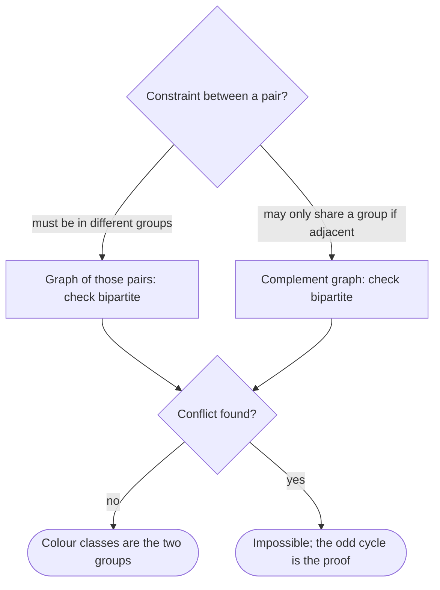

## Introduction

Suppose you have to split a class into two teams, and some pairs of students refuse to be on the same team. Is there a split that keeps every such pair apart? Or suppose you schedule exams into two time slots, and some pairs of exams share a student and so cannot be held at the same time. Can two slots work? Both questions have the same shape: things (students, exams) and pairwise "must be different" constraints, with only two options available.

Draw each thing as a vertex and each constraint as an edge. The question becomes: can the vertices be divided into two groups so that **every edge goes between the groups** and no edge stays inside one? A graph where that is possible is called **bipartite**, and the two groups are its **parts** (or sides). An equivalent way to say it: you can colour every vertex with one of two colours so that the two ends of every edge have different colours. That is a **2-colouring**.

Bipartite graphs are everywhere once you look. Any relationship between two different kinds of thing is bipartite by construction: users and the products they bought, job applicants and the jobs they qualify for, students and the courses they take, authors and papers. Recommendation systems are built on user–item bipartite graphs. Matching problems — assign drivers to riders, workers to shifts, ads to slots — are solved on bipartite graphs with algorithms such as Hopcroft-Karp ([[a8-hopcroft-karp]]). Grids are bipartite because of chessboard colouring, which is a frequent shortcut in grid puzzles. And in interviews, "Is Graph Bipartite?" and "Possible Bipartition" are standard questions.

The good news is that checking bipartiteness is easy: O(V + E) with a single BFS or DFS. That is surprising, because the general **graph colouring** problem — "can this graph be coloured with `k` colours?" — is NP-complete already for `k = 3` ([[a8-graph-coloring]]). Two colours are special, and this lesson explains exactly why.

This lesson covers:

- [[a8-bipartite-bfs]] — 2-colouring level by level with a queue.
- [[a8-bipartite-dfs]] — the same idea with recursion, applied to Possible Bipartition, plus the Union-Find alternative.
- [[a8-odd-cycle-bipartite]] — the theorem that a graph is bipartite exactly when it has no odd cycle, and how to print that cycle.
- [[a8-two-clique-problem]] — deciding whether a graph splits into two cliques, by checking whether its complement is bipartite.

## Before you start

- **BFS** with a queue and **DFS** with recursion, including the outer loop over every unvisited vertex. See [[a8-bfs]] and [[a8-dfs]].
- **Adjacency lists for undirected graphs** — each edge `u–v` appears in both `u`'s and `v`'s list. See [[a8-adjacency-list]].
- **Connected components** — a graph can come in several pieces, and each must be checked. See [[a8-connected-components]].
- **Cycles in undirected graphs** — what a cycle is and what its length means. See [[a8-cycle-undirected]] and [[a8-graph-terminology]].
- **Union-Find**, only for the alternative approach. See [[a8-union-find]].

## The intuition

Try to 2-colour a graph by hand. Pick any vertex and colour it red. Now look at its neighbours: each one *must* be blue — there is no choice. Their neighbours must be red, and so on. Colour spreads outward from the first vertex like a ripple, and every colour after the first one is **forced**.

That is why two colours are easy. With three colours, a neighbour of a red vertex could be blue *or* green, and a wrong guess may only be discovered much later, so you would have to backtrack. With two colours, nothing is guessed after the first vertex. Either the ripple colours the whole component without contradiction — and the graph is bipartite — or at some point it reaches an edge whose two ends were both forced to the same colour, and then *no* colouring works, because none of the colours were choices.

What about the first vertex? Colouring it blue instead of red swaps every colour in its component; the swapped colouring is valid exactly when the original was. So the choice does not matter, and each connected component has exactly two valid 2-colourings (if any), which are mirror images.

The chessboard is the picture to keep in mind. Squares that share a side always differ in colour. Moving one step flips the colour, so after an even number of steps you are on your starting colour and after an odd number you are on the other. A walk that returns to its start must take an even number of steps. That parity argument is the whole theory of bipartite graphs, and it is made precise in [[a8-odd-cycle-bipartite]].

## Definitions and examples

A graph `G` is **bipartite** if its vertex set can be partitioned into two sets `L` and `R` (either may be empty) such that every edge has one endpoint in `L` and the other in `R`. Equivalently, there is a function `color` from vertices to `{0, 1}` with `color[u] ≠ color[v]` for every edge `u–v`.

Some families worth knowing:

| Graph | Bipartite? | Why |
|---|---|---|
| Any tree or forest | Yes | Colour by depth parity; a tree has no cycles at all |
| Cycle with an even number of vertices (square, hexagon) | Yes | Colours alternate and close up correctly |
| Cycle with an odd number of vertices (triangle, pentagon) | No | Alternating colours clash when the cycle closes |
| Grid graph (cells joined to side neighbours) | Yes | Colour cell `(r, c)` by `(r + c) % 2` |
| Complete bipartite graph `K(m, n)` | Yes | Every left vertex joined to every right vertex, nothing else |
| Complete graph on 3 or more vertices | No | Contains a triangle |
| Graph with a self-loop | No | The loop joins a vertex to itself, so its ends cannot differ |
| Graph with no edges | Yes | Any split works |

Two points about the definition trip people up. First, bipartiteness is about the **existence** of a split, not about any particular split being given. Second, a bipartite graph need not be connected; a graph is bipartite exactly when **each** of its connected components is.

Bipartiteness is defined for undirected graphs. If a problem gives directed edges but means "these two must differ", treat each edge as undirected — store it in both adjacency lists — because "must be in different groups" is symmetric.

## Bipartite Check via BFS 2-Coloring {#a8-bipartite-bfs}

The BFS method decides whether an undirected graph is bipartite by colouring it with breadth-first search. It colours a starting vertex `0`, then gives every newly discovered neighbour the opposite colour of the vertex that discovered it, spreading outwards level by level. If it ever finds an edge whose two ends already have the same colour, the graph is not bipartite. If every component is coloured without such a conflict, the graph is bipartite and the two colours are the two sides.

### The procedure

1. Create `color[]` filled with `-1`, meaning "not coloured".
2. For each vertex `s` that is still uncoloured (a new component): set `color[s] = 0` and put `s` in a queue.
3. While the queue is not empty, remove `u`. For each neighbour `v`:
   - if `v` is uncoloured, set `color[v] = color[u] ^ 1` (the other colour) and enqueue `v`;
   - else if `color[v] == color[u]`, return "not bipartite".
4. If all components finish without a conflict, return the colouring.

`color[u] ^ 1` uses bitwise XOR to flip `0` to `1` and `1` to `0`; `1 - color[u]` does the same.

### Why BFS colouring is the same as depth parity

BFS discovers vertices in layers: the start at distance 0, its neighbours at distance 1, their new neighbours at distance 2, and so on. Each newly discovered vertex gets the opposite colour of its discoverer, which is one layer up, so **a vertex's colour is its BFS distance modulo 2**. Even layers get colour 0, odd layers colour 1.

In an undirected graph, BFS has a property that makes conflicts easy to interpret: the two ends of any edge are in the same layer or in adjacent layers. (If `u` is at distance `d`, its neighbour `v` is at most `d + 1` away — and by symmetry `u` is at most one more than `v`.) Edges between adjacent layers join different parities and are fine. So **a conflict is always an edge between two vertices in the same layer**. That fact is used in [[a8-odd-cycle-bipartite]] to build an odd cycle from the conflict.

Correctness in one sentence each: if the algorithm returns a colouring, every edge was checked from at least one end and found to have different colours, so the colouring is valid. If it reports a conflict, every colour in that component was forced by the start vertex's colour, and flipping the start only swaps all colours, so the conflict exists in every possible colouring — no valid one exists.

### Implementation

The input format is LeetCode 785's: `graph[u]` lists the neighbours of `u`, and every edge appears in both lists. The method returns the colour array (or `null`), so the caller gets the two sides, not only a yes/no answer.

```java title="BipartiteBfs.java"
import java.util.*;

public class BipartiteBfs {

    // graph[u] lists u's neighbours; every edge appears in both lists (LeetCode 785 format).
    // Returns color[] with 0/1 for each vertex, or null if the graph is not bipartite.
    static int[] twoColor(int[][] graph) {
        int n = graph.length;
        int[] color = new int[n];
        Arrays.fill(color, -1);                        // -1 = not coloured yet
        ArrayDeque<Integer> queue = new ArrayDeque<>();
        for (int s = 0; s < n; s++) {
            if (color[s] != -1) continue;              // already in an earlier component
            color[s] = 0;                              // free choice: one per component
            queue.offer(s);
            while (!queue.isEmpty()) {
                int u = queue.poll();
                for (int v : graph[u]) {
                    if (color[v] == -1) {
                        color[v] = color[u] ^ 1;       // forced: the opposite side
                        queue.offer(v);
                    } else if (color[v] == color[u]) {
                        return null;                   // an edge inside one side
                    }
                }
            }
        }
        return color;
    }

    static void report(String name, int[][] graph) {
        int[] color = twoColor(graph);
        if (color == null) {
            System.out.println(name + ": not bipartite");
            return;
        }
        List<Integer> left = new ArrayList<>(), right = new ArrayList<>();
        for (int u = 0; u < color.length; u++) (color[u] == 0 ? left : right).add(u);
        System.out.println(name + ": " + left + " | " + right);
    }

    public static void main(String[] args) {
        report("square  ", new int[][] {{1, 3}, {0, 2}, {1, 3}, {0, 2}});
        report("triangle", new int[][] {{1, 2}, {0, 2}, {0, 1}});
        // two components (0-1-2 path and 3-4 edge) plus isolated vertex 5
        report("forest  ", new int[][] {{1}, {0, 2}, {1}, {4}, {3}, {}});
    }
}
```

```output
square  : [0, 2] | [1, 3]
triangle: not bipartite
forest  : [0, 2, 3, 5] | [1, 4]
```

The outer `for` loop is what makes the method handle disconnected graphs. In the forest, the BFS from 0 colours 0, 1 and 2; the loop then skips 1 and 2, starts a new BFS at 3 (colour 0) which colours 4 (colour 1), and finally starts at 5, an isolated vertex, which gets colour 0 and has nothing to check. Without the outer loop, vertices 3, 4 and 5 would stay at `-1` and a conflict in that part of the graph would go unnoticed.

Colours are assigned when a vertex is **enqueued**, not when it is dequeued. That guarantees each vertex is enqueued once, and it means a neighbour already in the queue already has its colour, so the conflict check compares real colours.

### Dry run

On the square `0–1–2–3–0`:

| Step | Dequeue | Neighbours examined | Colours after (0..3) | Queue |
|---|---|---|---|---|
| start | — | colour 0 as 0 | [0, −1, −1, −1] | [0] |
| 1 | 0 | 1 → colour 1, 3 → colour 1 | [0, 1, −1, 1] | [1, 3] |
| 2 | 1 | 0 differs, 2 → colour 0 | [0, 1, 0, 1] | [3, 2] |
| 3 | 3 | 0 differs, 2 differs | [0, 1, 0, 1] | [2] |
| 4 | 2 | 1 differs, 3 differs | [0, 1, 0, 1] | [] |

No conflict: the sides are `{0, 2}` and `{1, 3}`. On the triangle `0–1–2`: vertex 0 gets 0; dequeuing 0 colours 1 and 2 both as 1; dequeuing 1 finds neighbour 2 already coloured 1 — the same as 1's colour. Conflict, and the edge `1–2` lies in a single layer (both at distance 1), as predicted.

### Complexity

Each vertex is coloured and enqueued exactly once and dequeued once: O(V). When a vertex is dequeued, its adjacency list is scanned once, and each undirected edge appears in two lists, so all scans total O(2E) = O(E). Total **O(V + E)** time. The `color` array and the queue use **O(V)** extra space. There is no recursion, so large inputs are safe.

### Variations

- **Edge list input.** Build an adjacency list first, adding each edge in both directions. Storing only one direction breaks the method both ways. Colour stops spreading across edges that are stored only at the far end, so with the single edge stored as `1 → 0`, the outer loop colours 0 on its own as 0, then starts a fresh search at 1, also as 0, and reports a conflict on a graph that is plainly bipartite.
- **Grids.** For a grid where cells connect to side neighbours, no search is needed: `(r + c) % 2` is a valid colouring. When some cells are blocked or edges are irregular, run the BFS on the implicit graph.
- **Sizes of the sides.** Count colours per component. Because each component's colouring can be flipped, problems such as "maximise the larger group" are solved by choosing, per component, which colour goes to which side.

## Bipartite Check via DFS 2-Coloring {#a8-bipartite-dfs}

The DFS method decides bipartiteness by colouring vertices during a depth-first search: colour the current vertex, then recursively colour each uncoloured neighbour with the opposite colour; if any neighbour already has the *same* colour, the graph is not bipartite. It enforces exactly the same rule as the BFS method in [[a8-bipartite-bfs]] — every edge must join different colours — and runs in the same O(V + E) time; it only explores in a different order. It is often the shorter thing to write in an interview, and it maps naturally onto problems phrased as "put these people into two groups".

### The procedure

1. Fill `color[]` with `-1`.
2. For each uncoloured vertex `s`, call `dfs(s, 0)`; if it returns `false`, the graph is not bipartite.
3. `dfs(u, c)`: set `color[u] = c`. For each neighbour `v`: if `color[v] == c`, return `false`; if `v` is uncoloured and `dfs(v, c ^ 1)` returns `false`, return `false`. After the loop, return `true`.

In DFS, a vertex's colour is the parity of its depth in the DFS tree rather than its BFS distance, but the argument is the same: every colour is forced by the root's colour, so a conflict means no colouring exists.

The one recursion-specific bug is ignoring the child's result — writing `dfs(v, c ^ 1);` without checking it. A conflict deep in the recursion then returns `false` to its caller, which throws the result away and carries on, and the method reports "bipartite" for a graph that is not.

### Worked problem: Possible Bipartition

In *Possible Bipartition* (LeetCode 886), people are numbered `1` to `n`, and `dislikes[i] = [a, b]` means `a` and `b` must not be in the same group. Can everyone be split into two groups? Each dislike is a "must differ" constraint, so build an undirected graph with an edge per dislike and ask whether it is bipartite.

```java title="PossibleBipartition.java"
import java.util.*;

public class PossibleBipartition {

    // LeetCode 886: people 1..n, dislikes[i] = {a, b} means a and b must be in different groups.
    static boolean possibleBipartition(int n, int[][] dislikes) {
        List<List<Integer>> adj = new ArrayList<>();
        for (int i = 0; i <= n; i++) adj.add(new ArrayList<>());
        for (int[] d : dislikes) {                     // "must differ" is symmetric
            adj.get(d[0]).add(d[1]);
            adj.get(d[1]).add(d[0]);
        }
        int[] group = new int[n + 1];
        Arrays.fill(group, -1);
        for (int p = 1; p <= n; p++) {
            if (group[p] == -1 && !dfs(p, 0, adj, group)) return false;
        }
        return true;
    }

    // Puts u in group g; returns false if that contradicts an earlier assignment.
    static boolean dfs(int u, int g, List<List<Integer>> adj, int[] group) {
        group[u] = g;
        for (int v : adj.get(u)) {
            if (group[v] == g) return false;                       // enemy on my side
            if (group[v] == -1 && !dfs(v, g ^ 1, adj, group)) return false;
        }
        return true;
    }

    public static void main(String[] args) {
        System.out.println(possibleBipartition(4, new int[][] {{1, 2}, {1, 3}, {2, 4}}));
        System.out.println(possibleBipartition(3, new int[][] {{1, 2}, {1, 3}, {2, 3}}));
        System.out.println(possibleBipartition(5,
            new int[][] {{1, 2}, {2, 3}, {3, 4}, {4, 5}, {1, 5}}));
    }
}
```

```output
true
false
false
```

The first input splits as `{1, 4}` and `{2, 3}`. The second is a triangle of mutual dislikes: three people who all dislike each other cannot fit into two groups. The third is a ring of five dislikes — an odd cycle — and also fails, even though no three people mutually dislike each other. That third case is why "look for a triangle" is not a correct shortcut: any odd cycle, of any length, makes the split impossible.

Two modelling details. People are numbered from 1, so the arrays have size `n + 1` and index 0 is unused; mixing 0-based and 1-based numbering is a classic off-by-one source here. And each dislike is added in both directions, because the input lists each pair once.

Trace the third input. `dfs(1, 0)` puts 1 in group 0 and visits 2 (group 1), which visits 3 (group 0), then 4 (group 1), then 5 (group 0). Vertex 5's neighbours are 4 (group 1, fine) and 1 — which is in group 0, the same as 5. Conflict: `false` propagates up through 4, 3, 2 and 1, and the outer loop returns `false`.

### Complexity and recursion depth

Each vertex is coloured once and each adjacency list scanned once: **O(V + E)** time. The colour array is O(V), and the recursion depth can reach `V` on a long path, so **O(V)** space. In Java, deep recursion — tens of thousands of frames on a default thread stack — risks `StackOverflowError`. When `V` can be large (LeetCode 886 allows `n` up to 2,000, which is fine; many judge problems allow 10⁵ or more), prefer the BFS version or an explicit stack.

### The Union-Find alternative

There is a third way that never colours anything. In a bipartite graph, all neighbours of a vertex `u` must be on the same side — the side opposite `u`. So for each vertex `u`, merge all its neighbours into one Union-Find set. If at any point `u` and one of its neighbours end up in the same set, they were forced to the same side, and the graph is not bipartite.

```java title="UnionFindBipartite.java"
public class UnionFindBipartite {
    static int[] parent;

    static int find(int x) {
        while (parent[x] != x) {
            parent[x] = parent[parent[x]];             // path halving
            x = parent[x];
        }
        return x;
    }

    // All neighbours of u must share one side, and that side must not contain u.
    static boolean isBipartite(int[][] graph) {
        int n = graph.length;
        parent = new int[n];
        for (int i = 0; i < n; i++) parent[i] = i;
        for (int u = 0; u < n; u++) {
            for (int v : graph[u]) {
                if (find(u) == find(v)) return false;  // u and a neighbour forced together
                parent[find(v)] = find(graph[u][0]);   // merge v into u's "other side" set
            }
        }
        return true;
    }

    public static void main(String[] args) {
        System.out.println(isBipartite(new int[][] {{1, 3}, {0, 2}, {1, 3}, {0, 2}}));
        System.out.println(isBipartite(new int[][] {{1, 2}, {0, 2}, {0, 1}}));
    }
}
```

```output
true
false
```

Inside the inner loop, `graph[u][0]` exists because the loop only runs when `u` has at least one neighbour. On the triangle, processing vertex 0 merges 1 and 2 into one set; processing vertex 1 then checks its neighbour 2, finds `find(1) == find(2)`, and reports the conflict. The Union-Find approach runs in O((V + E) · α(V)), where `α` is the practically-constant inverse Ackermann function, once union by size or rank is added (this short version uses only path halving). It is most useful when constraints arrive one at a time and you must report the first constraint that makes a split impossible; the "parity" variant of Union-Find, which stores each vertex's colour relative to its root, handles that online case directly and is covered with Union-Find in [[a8-union-find]].

## Odd Cycle ⇔ Not Bipartite {#a8-odd-cycle-bipartite}

This is the fundamental theorem about bipartite graphs: **an undirected graph is bipartite if and only if it contains no cycle of odd length.** (It is usually credited to Dénes Kőnig, 1936.) An odd cycle — a triangle, a pentagon, a loop of seven vertices — is the *only* thing that can stop a 2-colouring. That makes it a **certificate**: when a bipartite check fails, you can hand back an odd cycle as proof, and anyone can verify it by counting edges. When the check succeeds, the colouring itself is the proof.

### Why an odd cycle cannot be 2-coloured

Walk around a cycle `v₀ – v₁ – … – v_{k−1} – v₀` with `k` edges in a properly 2-coloured graph. Every edge flips the colour, so after `k` edges the colour has flipped `k` times. You are back at `v₀`, which has its original colour, so the number of flips must be even. If `k` is odd, that is a contradiction. So **any graph containing an odd cycle is not bipartite.** This direction is the easy one, and it explains every failing example so far: the triangle (3), the ring of five dislikes (5), a self-loop (a cycle of length 1).

### Why no odd cycle means bipartite

The converse is the useful direction: if 2-colouring fails, an odd cycle must exist. The BFS method makes this concrete. Run BFS from a vertex `s` and colour by distance parity. Suppose some edge `u–v` has `color[u] == color[v]`. As shown in [[a8-bipartite-bfs]], BFS distances of adjacent vertices differ by at most 1, so equal parity means `u` and `v` are at the **same distance `d`** from `s`.

Follow BFS parent links upwards from `u` and from `v`. Both chains eventually reach `s`, so they meet; let `a` be the first vertex where they meet (their lowest common ancestor in the BFS tree), at distance `d_a`. The path from `a` down to `u` has `d − d_a` edges, the path from `a` down to `v` also has `d − d_a` edges, and the two paths share only `a`. Joining them with the edge `u–v` gives a cycle of length

`(d − d_a) + (d − d_a) + 1 = 2(d − d_a) + 1`,

which is odd. So every BFS conflict produces an odd cycle, and if a graph has no odd cycle, BFS never finds a conflict and its colouring is valid. Together with the easy direction, that proves the theorem — and the proof is an algorithm.

### Extracting the odd cycle

```java title="OddCycle.java"
import java.util.*;

public class OddCycle {

    // Returns an odd cycle (first vertex repeated at the end), or an empty list if bipartite.
    static List<Integer> findOddCycle(int[][] graph) {
        int n = graph.length;
        int[] depth = new int[n], parent = new int[n];
        Arrays.fill(depth, -1);
        ArrayDeque<Integer> queue = new ArrayDeque<>();
        for (int s = 0; s < n; s++) {
            if (depth[s] != -1) continue;
            depth[s] = 0;
            parent[s] = -1;
            queue.offer(s);
            while (!queue.isEmpty()) {
                int u = queue.poll();
                for (int v : graph[u]) {
                    if (depth[v] == -1) {
                        depth[v] = depth[u] + 1;       // colour = depth % 2
                        parent[v] = u;
                        queue.offer(v);
                    } else if (depth[v] % 2 == depth[u] % 2) {
                        return cycleThrough(u, v, parent);
                    }
                }
            }
        }
        return List.of();
    }

    // In BFS a same-parity edge joins two vertices at the SAME depth, so climbing both
    // in lockstep meets at their lowest common ancestor.
    static List<Integer> cycleThrough(int u, int v, int[] parent) {
        LinkedList<Integer> left = new LinkedList<>(), right = new LinkedList<>();
        while (u != v) {
            left.addLast(u);                           // u, parent(u), ...
            right.addFirst(v);                         // ..., parent(v), v
            u = parent[u];
            v = parent[v];
        }
        List<Integer> cycle = new ArrayList<>(left);
        cycle.add(u);                                  // the common ancestor
        cycle.addAll(right);
        cycle.add(cycle.get(0));                       // close with the edge v - u
        return cycle;
    }

    public static void main(String[] args) {
        // A 5-cycle 0-1-2-3-4-0 with an extra vertex 5 hanging off vertex 2
        int[][] pentagon = {{1, 4}, {0, 2}, {1, 3, 5}, {2, 4}, {3, 0}, {2}};
        List<Integer> c = findOddCycle(pentagon);
        System.out.println(c + " has " + (c.size() - 1) + " edges");
        int[][] hexagon = {{1, 5}, {0, 2}, {1, 3}, {2, 4}, {3, 5}, {4, 0}};
        System.out.println(findOddCycle(hexagon));
    }
}
```

```output
[2, 1, 0, 4, 3, 2] has 5 edges
[]
```

The colour is stored implicitly as `depth % 2`, and `parent` records the BFS tree. On the pentagon, BFS from 0 puts 1 and 4 at depth 1, then 2 and 3 at depth 2. When 2 is dequeued, its neighbour 3 is also at depth 2: conflict. `cycleThrough(2, 3)` climbs both together — 2 to 1, 3 to 4 — then both to 0, where they meet. The left chain is `2, 1`, the meeting point `0`, the right chain `4, 3`, and closing the loop gives `2 – 1 – 0 – 4 – 3 – 2`, five edges. Vertex 5, hanging off the cycle, is correctly left out. The hexagon is an even cycle, so BFS finds no conflict and the method returns an empty list.

The lockstep climb relies on the BFS property that both ends are at the same depth. If you extract a cycle from a **DFS** conflict instead, the two ends can be at different depths: there, the conflicting edge goes from a vertex to one of its DFS ancestors, and the cycle is the tree path from the ancestor down to the vertex plus that edge. Its length is the depth difference plus one, which is odd exactly because the colours (depth parities) are equal.

### Consequences worth knowing

- **Trees are bipartite**, because they have no cycles at all.
- **Even cycles are bipartite**, and so is any graph whose cycles are all even, such as grids and hypercubes.
- **The shortest odd cycle** is found by running the BFS extraction from every vertex and keeping the shortest result. A single BFS returns *an* odd cycle, not necessarily the shortest one.
- **Directed graphs.** "Bipartite" refers to the underlying undirected graph, so ignore directions. A directed odd cycle is a different question.
- **Odd cycles and matching.** In bipartite graphs, maximum matching equals minimum vertex cover (Kőnig's theorem about matchings, a different result from the same author). That equality fails in general graphs, and odd cycles are the reason — which is why general matching algorithms need special handling of odd cycles ("blossoms") while bipartite matching does not ([[a8-bipartite-matching-flow]]).

## Two Clique Problem {#a8-two-clique-problem}

The two-clique problem asks whether the vertices of an undirected graph can be split into two groups such that **every pair of vertices inside each group is connected** — that is, each group is a **clique**. The trick is to look at the **complement** graph, which has an edge exactly where the original graph does *not*. Two vertices that are not adjacent in the original cannot share a clique, so they must be on different sides; that is a "must differ" constraint, and the question becomes **"is the complement bipartite?"**

### From cliques to colouring

Let `Ḡ` be the complement of `G`: same vertices, and `u–v` is an edge of `Ḡ` exactly when `u ≠ v` and `u–v` is *not* an edge of `G`.

- If `G` splits into two cliques `A` and `B`, then any non-edge of `G` cannot lie inside `A` (all pairs there are edges) or inside `B`, so it goes between `A` and `B`. Every edge of `Ḡ` crosses the split, so `Ḡ` is bipartite with sides `A` and `B`.
- Conversely, if `Ḡ` is bipartite with sides `A` and `B`, no edge of `Ḡ` lies inside `A`, meaning every pair inside `A` is an edge of `G`. So `A` is a clique in `G`, and likewise `B`.

So **`G` splits into two cliques if and only if `Ḡ` is bipartite**, and the two colour classes are the cliques. One side may be empty: a complete graph is already a single clique, and its complement has no edges at all.

### Implementation

Building `Ḡ` explicitly costs O(V²) memory. It is simpler to run BFS on `G`'s adjacency matrix and treat "not adjacent" as the edge relation, generating complement neighbours on the fly.

```java title="TwoCliques.java"
import java.util.*;

public class TwoCliques {

    // Splits the vertices into two cliques, or returns null if impossible.
    // adj[i][j] is true when i and j are joined by an edge.
    static int[] splitIntoTwoCliques(boolean[][] adj) {
        int n = adj.length;
        int[] side = new int[n];
        Arrays.fill(side, -1);
        ArrayDeque<Integer> queue = new ArrayDeque<>();
        for (int s = 0; s < n; s++) {
            if (side[s] != -1) continue;
            side[s] = 0;
            queue.offer(s);
            while (!queue.isEmpty()) {
                int u = queue.poll();
                for (int v = 0; v < n; v++) {
                    if (v == u || adj[u][v]) continue;     // complement edge = NON-edge of G
                    if (side[v] == -1) {
                        side[v] = side[u] ^ 1;             // non-neighbours cannot share a clique
                        queue.offer(v);
                    } else if (side[v] == side[u]) {
                        return null;                       // odd cycle in the complement
                    }
                }
            }
        }
        return side;
    }

    static boolean[][] build(int n, int[][] edges) {
        boolean[][] adj = new boolean[n][n];
        for (int[] e : edges) adj[e[0]][e[1]] = adj[e[1]][e[0]] = true;
        return adj;
    }

    public static void main(String[] args) {
        // Triangle {0,1,2} and edge {3,4}, joined by the extra edge 2-3
        int[][] g1 = {{0, 1}, {1, 2}, {0, 2}, {3, 4}, {2, 3}};
        System.out.println(Arrays.toString(splitIntoTwoCliques(build(5, g1))));
        // Three vertices with no edges: no way to use only two cliques
        System.out.println(Arrays.toString(splitIntoTwoCliques(build(3, new int[0][]))));
    }
}
```

```output
[0, 0, 0, 1, 1]
null
```

In the first graph, the triangle `{0, 1, 2}` and the pair `{3, 4}` are both cliques, and the extra edge `2–3` between them does no harm — edges between the two cliques are allowed. The method recovers exactly that split. In the second graph, three vertices with no edges form a triangle in the complement, an odd cycle, so no split into two cliques exists: any two of the three would have to share a group, and they are not adjacent.

### Complexity

The BFS dequeues each vertex once and scans all `V` possible neighbours, so it is **O(V²)** time — the same as reading the adjacency matrix, so it cannot be improved for matrix input. The colour array and queue are O(V) beyond the input matrix. With adjacency-list input on a sparse graph, the complement is dense — nearly `V²/2` edges — but a cheap count rejects most such inputs first. Two cliques of sizes `a` and `b` with `a + b = V` contain at least `a(a−1)/2 + b(b−1)/2` edges, and that total is smallest for an even split, where it is about `V²/4 − V/2`. A graph with fewer edges than that minimum cannot be two cliques.

### Where the complement trick reappears

The same reasoning applies whenever a problem says "these pairs *can* be together" and you need two groups: invert to "these pairs *cannot* be together" and check bipartiteness. Splitting a graph into **two independent sets** is bipartiteness itself; splitting into **two cliques** is bipartiteness of the complement. Three or more groups, in either form, is general graph colouring and is NP-complete.

## How the methods compare

| Method | Time | Extra space | Gives the sides? | Gives an odd cycle? | Notes |
|---|---|---|---|---|---|
| BFS 2-colouring | O(V + E) | O(V) | Yes | Yes, via parents and same-depth conflict | No recursion; default choice |
| DFS 2-colouring | O(V + E) | O(V) + recursion | Yes | Yes, via ancestor path | Short to write; watch stack depth |
| Union-Find on neighbours | O((V + E) α(V)) | O(V) | Not directly | No | Fits edges arriving one at a time |
| Complement + BFS (two cliques) | O(V²) | O(V) | Yes | Yes, in the complement | For dense or matrix input |



## In real systems

**Matching and assignment.** Assigning drivers to riders, applicants to positions, or tasks to machines is maximum matching in a bipartite graph. These systems rarely need to *check* bipartiteness — the graph is bipartite by construction, with one kind of entity on each side — but every matching algorithm relies on it, as covered in [[a8-bipartite-matching-flow]] and [[a8-hopcroft-karp]]. The GfG "channel assignment" problem ([[a8-channel-assignment]]) is one such matching.

**Recommendation systems.** User–item interactions form a bipartite graph. Collaborative filtering, random-walk recommenders and graph neural network recommenders all operate on it; "users who bought this also bought" is a two-step walk item → user → item.

**Two-resource scheduling.** Conflict graphs where each edge means "cannot share a slot" can be scheduled into two slots, rooms or shifts exactly when the graph is bipartite. When the check fails, the odd cycle tells the operator which constraints clash, which is far more useful than a bare "no".

**Data validation.** Any model that claims to have two kinds of node — two-mode network data in sociology, a schema where only cross-type references are allowed — can be validated with a 2-colouring pass.

## Trade-offs and alternatives

**BFS versus DFS.** They decide the same thing in the same time. BFS has no recursion-depth risk and its conflicts produce odd cycles of a predictable shape; DFS is a few lines shorter and fits naturally when you are already writing recursive code. In Java, prefer BFS when `V` can exceed a few tens of thousands.

**Colouring versus Union-Find.** Colouring needs the whole graph up front. Union-Find can process constraints incrementally, which is the right tool when edges arrive over time and you must report the first edge that makes the split impossible. For a one-off check on a given graph, colouring is simpler.

**Beyond two.** Three-colouring is NP-complete, so no fast exact algorithm for `k ≥ 3` is expected. Real colouring tasks (register allocation, frequency assignment) use heuristics such as greedy colouring by degree. If an interview problem asks for two groups, the linear algorithm applies; if it asks for three, look for extra structure in the problem rather than a general algorithm.

**Bipartite is a yes/no property.** It does not tell you the "best" split by any other measure. Maximum cut, balanced partitions and minimum bisection are different (and hard) problems.

## Common mistakes

> [!MISTAKE] Checking only one component
> Starting a single BFS from vertex 0 colours only 0's component. A triangle elsewhere goes unnoticed and the method wrongly reports "bipartite". Loop over every vertex and start a new search from each uncoloured one.

**Treating an isolated vertex as a failure.** An uncoloured vertex with no neighbours is not a problem; it starts its own component and takes colour 0.

**Adding edges in one direction only.** For "must differ" constraints given as pairs, add the edge to both endpoints' lists. If only one direction is stored, a vertex may never see a conflicting neighbour, and some vertices may be coloured from a different root than you expect.

**Ignoring the recursive result.** In the DFS version, `dfs(v, c ^ 1);` without checking the return value swallows the conflict.

**Overwriting an existing colour.** Assigning `color[v] = color[u] ^ 1` without first checking whether `v` was already coloured erases evidence of a conflict. Check first, assign only if uncoloured.

**Looking for triangles instead of odd cycles.** A five-cycle has no triangle but is not bipartite.

**Off-by-one numbering.** Possible Bipartition numbers people from 1. Size arrays `n + 1` or subtract 1 consistently.

## Interview perspective

Interviewers ask bipartiteness both directly ("Is Graph Bipartite?") and in disguise ("split into two groups", "two teams", "two time slots", "can this be coloured like a chessboard?"). The signal is pairwise *must-differ* constraints with exactly two options.

> [!INTERVIEW] What a strong answer sounds like
> "Each dislike means the two people must be in different groups, so I'll build an undirected graph with an edge per dislike and 2-colour it. Once I colour a starting person, every neighbour's colour is forced, so I never need to backtrack. If an edge ever has both ends the same colour, there's an odd cycle of dislikes and it's impossible. I'll start a BFS from every uncoloured vertex so disconnected groups are covered. That's O(V + E) time and O(V) space."

Questions to be ready for:

- **Why is 2-colouring linear while 3-colouring is NP-complete?** With two colours every colour after the first is forced; with three there are choices, and wrong choices may only be detected much later.
- **Prove that odd cycles are the only obstacle.** Easy direction by parity; hard direction by the BFS same-depth conflict giving a cycle of length `2(d − d_a) + 1`.
- **Return the two groups.** The colour array is the answer.
- **Return the reason it fails.** Extract the odd cycle from parents.
- **Are trees bipartite?** Yes — colour by depth parity.
- **Two groups where each group must be fully connected.** Complement graph, then bipartite check.
- **Constraints arrive one at a time; report the first that breaks it.** Union-Find with parity.

```quiz
Q: Why can a 2-colouring be found greedily, without backtracking, when 3-colouring cannot?
- [ ] Because bipartite graphs are always trees
- [x] Because after the first vertex in a component, every colour is forced by its neighbour, so there are no choices to undo
- [ ] Because BFS visits vertices in sorted order
- [ ] Because two colours can be stored in a boolean
> With two colours, a neighbour of a colour-0 vertex must be colour 1 — there is no alternative. So a conflict proves that no colouring exists, and success needs no second attempt. With three colours a neighbour has two options, and a wrong choice may surface much later, which is what makes the general problem hard. Bipartite graphs need not be trees; an even cycle is bipartite.

Q: A BFS bipartite check starts only from vertex 0 and reports "bipartite". When can that be wrong?
- [ ] Never, BFS visits every vertex
- [ ] Only when vertex 0 is isolated
- [x] When another connected component contains an odd cycle that the search never reached
- [ ] Only when the graph has self-loops
> BFS from vertex 0 reaches only 0's component. A triangle in a different component is never coloured, so its conflict is never seen. The outer loop that starts a new BFS from every uncoloured vertex fixes this.

Q: During BFS colouring, an edge `u–v` is found with `color[u] == color[v]`. What do you know about their BFS distances?
- [ ] They differ by exactly 1
- [ ] They differ by an even number greater than 0
- [x] They are equal, so climbing BFS parents from both leads to an odd cycle
- [ ] Nothing can be concluded
> In an undirected BFS, adjacent vertices have distances that differ by at most 1. Equal colour means equal parity, so the distances are equal. The two parent paths up to their meeting point have the same length, and adding the edge `u–v` makes a cycle of length `2k + 1`, which is odd.

Q: A graph on 6 vertices is a ring of 5 vertices plus one extra vertex attached to one ring vertex. Is it bipartite?
- [ ] Yes, because it has no triangle
- [ ] Yes, because one vertex has degree 1
- [x] No, because the 5-vertex ring is an odd cycle
- [ ] It depends on which vertex BFS starts from
> Any odd cycle prevents 2-colouring, regardless of triangles or other vertices. The answer cannot depend on the start vertex, because a conflict exists in every possible colouring once the graph contains an odd cycle.

Q: To decide whether a graph splits into two cliques, which graph do you check for bipartiteness?
- [ ] The graph itself
- [x] Its complement, where edges join pairs that are NOT adjacent in the original
- [ ] Its line graph
- [ ] The graph with all edges reversed
> Two non-adjacent vertices cannot share a clique, so each non-edge is a "must differ" constraint. Those constraints are exactly the complement's edges. The complement is bipartite exactly when the original splits into two cliques, and the colour classes are the cliques.
```

## Practice

1. **Is Graph Bipartite?** Solve it with BFS, then with DFS, and return the two sides.
2. **Possible Bipartition.** Solve it, then modify it to print an odd cycle of dislikes when the answer is no.
3. **Shortest odd cycle.** Find the length of the shortest odd cycle in an undirected graph by running BFS from every vertex. State the complexity.
4. **Largest group.** Given dislike pairs, split people into two groups so that the larger group is as large as possible. Hint: each component's colouring can be flipped independently.
5. **Grid check.** Decide whether a grid with some blocked cells and some extra "teleport" edges is bipartite.
6. **Two cliques.** Implement the complement check for adjacency-list input and add the early edge-count rejection.
7. **Online constraints.** Process dislike pairs one at a time and print the index of the first pair after which no valid split exists, using Union-Find with parity.

The DSA explorer lists the matching problems under this topic; start with *Is Graph Bipartite?* and *Possible Bipartition*.

## Quick revision {#quick-revision}

- Bipartite = vertices split into two sides with every edge crossing = 2-colourable.
- Trees, even cycles, grids (`(r + c) % 2`) are bipartite; odd cycles, triangles, self-loops are not.
- BFS/DFS 2-colouring: `color = -1` initially; colour a root 0; uncoloured neighbour gets `color ^ 1`; same-colour neighbour ⇒ not bipartite.
- Every colour after the root is forced ⇒ no backtracking; each component has exactly two colourings (mirror images).
- Start a search from every uncoloured vertex; isolated vertices are fine.
- Time O(V + E), space O(V). DFS recursion depth up to `V` — prefer BFS for large inputs in Java.
- BFS colour = distance parity; a conflict edge joins two vertices at the same depth.
- Bipartite ⇔ no odd cycle. Odd cycle from a BFS conflict: climb parents of both ends to their meeting point, length `2(d − d_a) + 1`.
- Possible Bipartition: dislike = undirected edge; 1-based people; check the recursive result.
- Union-Find: merge all neighbours of `u`; `u` in the same set as a neighbour ⇒ not bipartite.
- Two cliques ⇔ complement is bipartite; O(V²) with an adjacency matrix.
- Three or more colours/groups: NP-complete in general.

## Key takeaways {#key-takeaways}

- A graph is bipartite when it can be 2-coloured so that every edge joins different colours, which is the model for any "two groups, these pairs must differ" problem.
- Two colours are easy because each colour after the first is forced, so one BFS or DFS per component decides the question in O(V + E).
- The only obstacle to a 2-colouring is an odd cycle, and a failed BFS check can always produce one as a proof.
- Check every connected component; a bipartite graph is one whose every component is bipartite.
- Reframe related problems: two independent sets is bipartiteness itself, two cliques is bipartiteness of the complement.
- Prefer BFS in Java for large inputs, DFS for brevity, and Union-Find when constraints arrive one at a time.
