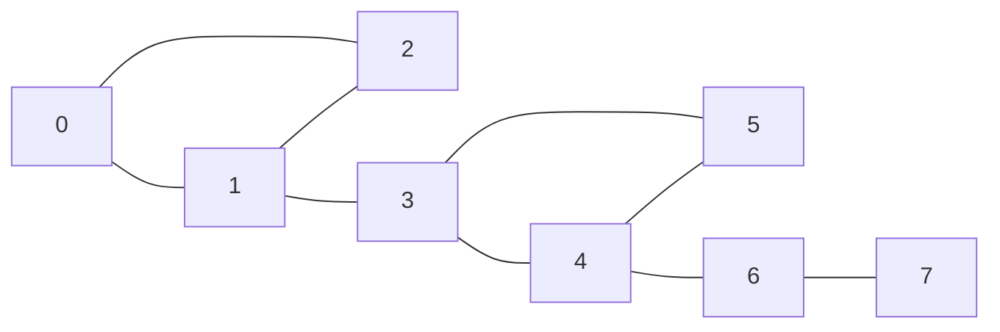

## Introduction

A company connects its offices with network cables. Some offices are linked in rings, so if one cable is cut, traffic simply goes the other way round. Other offices hang off the network by a single cable. If that cable is cut, those offices are isolated — no rerouting can help. Before an outage happens, the operations team wants a list of every cable whose failure would split the network.

In graph terms, the offices are vertices of an **undirected graph** and the cables are edges. An edge whose removal increases the number of connected components is called a **bridge** (also a **cut edge** or, in the LeetCode version of the problem, a **critical connection**). Bridges are the single points of failure among the links of a graph.

Finding them matters wherever a graph models something that must stay connected: computer networks, power grids, road and rail networks, pipelines, and dependency graphs between services. It also appears inside other algorithms — Fleury's algorithm for Euler paths must avoid crossing bridges too early ([[a8-fleury-algorithm]]) — and it is a classic interview problem, because the efficient solution needs a genuine insight about depth-first search rather than a memorised template.

This lesson builds that insight. It starts from the slow, obvious method, shows the property of DFS trees that makes a fast method possible, derives the **disc/low** technique (credited to Robert Tarjan, 1974), and then applies it to the Critical Connections problem.

## Before you start

You need:

- **Depth-first search and the DFS tree** — discovery order, recursion, and the edges along which DFS first reaches each vertex. See [[a8-dfs]].
- **Connected components** — what it means for an undirected graph to be connected, and how to count components. See [[a8-connected-components]].
- **Undirected cycles** — why a visited neighbour that is not your parent means a cycle. See [[a8-cycle-undirected]].
- **Recursion and the call stack** — needed to understand both the recursive code and the iterative rewrite. See [[a1-recursion]].

The companion lesson [[a8-articulation-points]] uses the same machinery for vertices instead of edges; reading this one first makes that one easier.

## The intuition

Look at the graph below. It has two triangles joined by the edge `1–3`, and a tail `4–6–7` hanging off the second triangle.



Cut the edge `0–1`. Is anything disconnected? No — 0 can still reach 1 through 2. The same is true of every edge in either triangle, because each lies on a cycle and the rest of the cycle is a detour. Now cut `1–3`. The left triangle and everything to the right of it fall apart: there is no other route between them. The same happens for `4–6` and `6–7`.

That is the whole characterisation:

> **An edge is a bridge exactly when it does not lie on any cycle.**

If the edge `u–v` is on a cycle, the rest of the cycle is another path from `u` to `v`, so removing the edge disconnects nothing. Conversely, if removing `u–v` leaves `u` and `v` still connected, the remaining path from `v` back to `u`, plus the edge itself, is a cycle containing it. So "is not a bridge" and "is on a cycle" are the same statement.

The algorithmic question is therefore: how can one traversal decide, for every edge at once, whether it sits on a cycle? Depth-first search can, because of the special shape of its tree.

## The naive approach

The definition gives a direct method: for each edge, remove it, count connected components with a BFS or DFS, and put it back. If the count went up, the edge is a bridge.

Each connectivity check costs O(V + E), and there are E edges, so this is **O(E · (V + E))**. For a network with 100,000 vertices and 100,000 edges that is about 2 × 10¹⁰ operations — minutes at best. It is still worth writing, because it is the reference you test the fast algorithm against on small random graphs.

The waste is that each check rediscovers the same structure from scratch. One DFS already contains everything needed.

## The DFS tree of an undirected graph

Run DFS on a connected undirected graph. Every edge is examined from both ends, and when DFS crosses an edge to an unvisited vertex, that edge becomes a **tree edge**. The tree edges form the **DFS tree**, rooted at the start vertex. Every other edge is a **non-tree edge**.

In an undirected graph, **every non-tree edge connects a vertex to one of its ancestors** in the DFS tree. Such an edge is called a **back edge**. There are no "cross edges" between separate branches. The reason: suppose an edge `u–w` joins two vertices in different branches, and `u` is discovered first. While `u`'s call is running, DFS examines all of `u`'s edges, including `u–w`. If `w` is still unvisited at that point, DFS goes to `w` from `u`, making `w` a descendant of `u`. If `w` was visited already during `u`'s call, it was visited inside `u`'s subtree. Either way `w` ends up a descendant of `u` — not in a different branch.

For the example graph, DFS from 0 (neighbours in input order) produces:

| Edge | Kind |
|---|---|
| 0–1, 1–2, 1–3, 3–4, 4–5, 4–6, 6–7 | tree edges |
| 2–0 | back edge from 2 to its ancestor 0 |
| 5–3 | back edge from 5 to its ancestor 3 |

Now apply the cycle characterisation to each kind of edge:

- **A back edge is never a bridge.** It joins a vertex to an ancestor, and the tree path between them completes a cycle.
- **A tree edge `u–v` (where `u` is the parent) is a bridge exactly when no back edge leaves `v`'s subtree to a vertex above `v`.** Removing `u–v` cuts `v`'s subtree off from the rest of the tree. The only edges that could reconnect it are back edges, and back edges from inside the subtree go to ancestors. If one of them lands on `u` or higher, it is a detour; if none does, the subtree is stranded.

So the whole problem reduces to one question per vertex `v`: **how high can `v`'s subtree climb using a single back edge?**

## Discovery time and low-link

Give every vertex a **discovery time** `disc[v]`: the value of a counter when DFS first enters `v` (0, 1, 2, …). Ancestors always have smaller discovery times than their descendants, so "higher in the tree" means "smaller `disc`" along any root-to-leaf path.

Define the **low-link** `low[v]` as the smallest discovery time reachable from `v` by going down any number of tree edges inside `v`'s subtree and then following **at most one back edge** — never using the tree edge from `v` to its parent. It measures how high the subtree hanging from `v` can reach without the edge above it.

It can be computed bottom-up during the DFS itself:

```text
low[v] = min( disc[v],
              disc[w]  for every back edge v–w,
              low[c]   for every DFS child c of v )
```

The first term covers "stay at `v`". The second covers back edges leaving `v` directly. The third covers everything deeper: whatever a child's subtree can reach, `v`'s subtree can reach too, since the child's subtree is part of `v`'s.

With `low` in hand, the bridge test for a tree edge from parent `u` to child `v` is:

> **`u–v` is a bridge if and only if `low[v] > disc[u]`.**

If `low[v] ≤ disc[u]`, some back edge from `v`'s subtree reaches `u` or an ancestor of `u`, so there is a detour around `u–v`. If `low[v] > disc[u]`, everything the subtree can reach is inside the subtree itself (its discovery times are all larger than `disc[u]`), so the edge `u–v` is its only link to the rest of the graph.

Notice the strict inequality. `low[v] == disc[u]` means a back edge from the subtree lands exactly on `u` — that is a second route between `u` and the subtree, so `u–v` is *not* a bridge. (The articulation-point test uses `>=` at this spot, for a reason explained in [[a8-articulation-tarjan]].)

## Finding Bridges (disc / low) {#a8-bridges-tarjan}

The disc/low method finds every bridge of an undirected graph with a single depth-first search. Each vertex gets a **discovery time** `disc[v]` when DFS first reaches it and a **low-link** `low[v]`, the earliest discovery time its DFS subtree can reach through one back edge. A tree edge from parent `u` to child `v` is a bridge exactly when `low[v] > disc[u]`: nothing below `v` can get back above `v` except through that edge. The algorithm runs in O(V + E) time and is the standard way to find cut edges.

### The procedure

1. Set `disc[v] = -1` for every vertex (unvisited) and a global `timer = 0`.
2. For every vertex `s` still unvisited, run `dfs(s)` with no parent edge, so every connected component is covered.
3. In `dfs(u, parentEdge)`: set `disc[u] = low[u] = timer++`. Then for each edge `u–v`:
   - if it is the edge we arrived by, skip it;
   - if `v` is unvisited, recurse into `v`, then set `low[u] = min(low[u], low[v])`, and if `low[v] > disc[u]` record `u–v` as a bridge;
   - otherwise `v` is visited, so this is a back edge: set `low[u] = min(low[u], disc[v])`.

### Why skip the edge we arrived by — and why by edge id

In an adjacency list, the undirected edge `u–v` appears twice: in `u`'s list and in `v`'s list. When DFS goes from `u` down to `v`, it will later see `u` in `v`'s list. That is the same edge, not a back edge. If it were treated as one, `low[v]` would become `disc[u]` and no tree edge could ever pass the test `low[v] > disc[u]` — the algorithm would report no bridges at all.

The common shortcut is to skip the **parent vertex**: `if (v == parent) continue;`. That is correct for **simple graphs**, but wrong when there are **parallel edges** — two separate cables between the same two offices. With two `0–1` edges, neither is a bridge: cutting one leaves the other. Skipping by parent vertex skips *both* copies when DFS is at 1, so it never sees the second cable as a back edge and wrongly reports `0–1` as a bridge.

The robust fix is to give each undirected edge an **id**, store `{neighbour, id}` in both lists, and skip only the edge whose id matches the one we arrived by. The second parallel copy has a different id, is treated as a back edge to the parent, sets `low[v] = disc[u]`, and the edge correctly fails the strict test.

### Implementation

```java title="Bridges.java"
import java.util.*;

public class Bridges {
    static List<List<int[]>> adj;          // adj[u] holds {neighbour, edgeId}
    static int[] disc, low;
    static int timer;
    static List<int[]> bridges;

    static void dfs(int u, int parentEdge) {
        disc[u] = low[u] = timer++;
        for (int[] next : adj.get(u)) {
            int v = next[0], id = next[1];
            if (id == parentEdge) continue;              // the edge we arrived by
            if (disc[v] == -1) {                         // tree edge
                dfs(v, id);
                low[u] = Math.min(low[u], low[v]);
                if (low[v] > disc[u]) bridges.add(new int[]{u, v});
            } else {                                     // back edge
                low[u] = Math.min(low[u], disc[v]);
            }
        }
    }

    static List<int[]> find(int n, int[][] edges) {
        adj = new ArrayList<>();
        for (int i = 0; i < n; i++) adj.add(new ArrayList<>());
        for (int id = 0; id < edges.length; id++) {
            int a = edges[id][0], b = edges[id][1];
            adj.get(a).add(new int[]{b, id});
            adj.get(b).add(new int[]{a, id});            // same id in both directions
        }
        disc = new int[n];
        low = new int[n];
        Arrays.fill(disc, -1);
        timer = 0;
        bridges = new ArrayList<>();
        for (int s = 0; s < n; s++) {                    // every component
            if (disc[s] == -1) dfs(s, -1);
        }
        return bridges;
    }

    static String show(List<int[]> list) {
        StringBuilder sb = new StringBuilder("[");
        for (int[] e : list) {
            if (sb.length() > 1) sb.append(", ");
            sb.append(e[0]).append('-').append(e[1]);
        }
        return sb.append(']').toString();
    }

    public static void main(String[] args) {
        int[][] edges = {
            {0, 1}, {1, 2}, {2, 0}, {1, 3}, {3, 4}, {4, 5}, {5, 3}, {4, 6}, {6, 7}
        };
        System.out.println("bridges: " + show(find(8, edges)));
        System.out.println("disc = " + Arrays.toString(disc));
        System.out.println("low  = " + Arrays.toString(low));

        // Two parallel cables between 0 and 1: neither is a bridge. 1-2 still is.
        int[][] parallel = {{0, 1}, {0, 1}, {1, 2}};
        System.out.println("with parallel edge: " + show(find(3, parallel)));
    }
}
```

```output
bridges: [6-7, 4-6, 1-3]
disc = [0, 1, 2, 3, 4, 5, 6, 7]
low  = [0, 0, 0, 3, 3, 3, 6, 7]
with parallel edge: [1-2]
```

Read the `dfs` method in three parts. The first line stamps `u` with its discovery time and starts `low[u]` at that value — "without any back edges, the subtree can reach `u` itself". The loop then handles each incident edge by kind. The bridge test sits immediately after the recursive call returns, because only then is `low[v]` final: every vertex in `v`'s subtree has been explored.

The bridges come out deepest-first (`6-7` before `4-6` before `1-3`) because each is recorded when its lower endpoint's call returns. If the output order matters to the caller, sort it.

### Dry run

Follow the DFS from vertex 0. "low updates" lists every change to a `low` value in that step.

| Step | Event | low updates | Bridge test |
|---|---|---|---|
| 1 | enter 0, 1, 2 (disc 0, 1, 2) | | |
| 2 | 2 sees 1: arrived by that edge, skip. 2 sees 0: back edge | `low[2] = min(2, disc[0]) = 0` | |
| 3 | return to 1 | `low[1] = min(1, low[2]) = 0` | `low[2] = 0 > disc[1] = 1`? no |
| 4 | 1 → 3, 3 → 4, 4 → 5 (disc 3, 4, 5) | | |
| 5 | 5 sees 3: back edge | `low[5] = min(5, disc[3]) = 3` | |
| 6 | return to 4 | `low[4] = min(4, 3) = 3` | `low[5] = 3 > disc[4] = 4`? no |
| 7 | 4 → 6, 6 → 7 (disc 6, 7); 7 has only its parent edge | | |
| 8 | return to 6 | `low[6]` stays 6 | `low[7] = 7 > disc[6] = 6`? **yes: 6–7** |
| 9 | return to 4 | `low[4]` stays 3 | `low[6] = 6 > disc[4] = 4`? **yes: 4–6** |
| 10 | return to 3 | `low[3] = min(3, 3) = 3`; 3 then sees 5 (back edge from above, disc 5, no change) | `low[4] = 3 > disc[3] = 3`? no |
| 11 | return to 1 | `low[1]` stays 0 | `low[3] = 3 > disc[1] = 1`? **yes: 1–3** |
| 12 | return to 0; 0 sees 2 (disc 2, no change) | | |

Step 10 is worth a second look. The tree edge `3–4` fails the test only because of equality: `low[4] = 3 = disc[3]`, thanks to the back edge `5–3` landing exactly on 3. That back edge is the detour that makes `3–4` safe. With `>=` instead of `>`, the code would wrongly report `3–4` as a bridge.

In step 10, vertex 3 also sees the edge `3–5` from the ancestor side. Vertex 5 is visited, so the code takes the back-edge branch and computes `min(low[3], disc[5]) = min(3, 5)`, which changes nothing. Seeing a back edge from its upper end is always harmless for exactly this reason: the descendant's discovery time is larger.

### Complexity

**Time.** Each vertex is entered once, and the outer loop over `s` adds O(V). Each undirected edge is stored twice, so the adjacency lists hold 2E entries, and each entry is examined once with O(1) work. Total **O(V + E)**.

**Space.** `disc`, `low` and the result list are O(V) (a graph has at most V − 1 bridges, because the bridges of a graph form a forest). The adjacency lists are O(V + E). The recursion depth is at most V, so the call stack is O(V).

### Edge cases

- **Disconnected graphs.** The outer loop starts a fresh DFS in each component, so bridges anywhere are found. Removing a bridge increases the component count by exactly one.
- **Self-loops** (`v–v`) lie on a cycle of length one and are never bridges. In the code, the loop's second copy is seen as a back edge to `v` itself, `min(low[v], disc[v])`, which changes nothing.
- **Parallel edges** are never bridges; the edge-id skip handles them, as the second run in the output shows.
- **A tree** (connected, `V − 1` edges, no cycles): every edge is a bridge.
- **An isolated vertex** has no edges and contributes nothing.

### The recursion-depth caveat and an iterative version

The recursive DFS uses one Java stack frame per level. A graph that is a long path forces a recursion as deep as the path. On OpenJDK 26 with default settings, the recursive `Bridges.find` above handled a 10,000-vertex path but threw `StackOverflowError` on a 100,000-vertex path; the exact limit depends on the JVM version, flags and frame size. Two fixes exist: run the recursive code on a thread created with a larger stack (`new Thread(null, task, "dfs", 1L << 27)`), or remove the recursion. The iterative version is shown in the next section, in the setting where it is most often needed.

## Critical Connections in a Network {#a8-critical-connections}

**Critical Connections in a Network** (LeetCode 1192) is the interview form of bridge finding. There are `n` servers numbered `0` to `n − 1` and a list of undirected connections between them; any server can reach any other through the network. A connection is **critical** if removing it makes some server unable to reach another. Return all critical connections in any order. In graph terms: the servers are vertices, the connections are edges, and the critical connections are exactly the **bridges** of a connected undirected graph. The constraints allow up to 10⁵ servers and 10⁵ connections, which rules out the remove-and-recheck approach and calls for the O(V + E) disc/low algorithm.

### Recognising it

The problem never says "bridge". The signals are: an **undirected** network, a question about **edges** (not nodes) whose **removal disconnects** something, and input sizes that forbid trying each edge. Whenever you see "single point of failure among links", "which roads must never close", or "which cables need a backup", think bridges. If the question is about nodes instead — "which servers, if they crash, split the network?" — you want articulation points ([[a8-articulation-points]]).

The problem statement says there are no repeated connections, so skipping the parent *vertex* would be safe here. The solution below still uses edge ids, which costs nothing and stays correct if the input changes.

### An iterative solution

With 10⁵ servers, a path-shaped network makes recursive DFS 10⁵ levels deep, which can overflow the call stack (see the caveat above). The iterative version simulates the recursion with an explicit stack. The trick is to remember, for each vertex, which neighbour to try next (`next[u]`), and to perform the two "after the recursive call returns" steps — `low[parent] = min(low[parent], low[child])` and the bridge test — at the moment a vertex is popped.

```java title="CriticalConnections.java"
import java.util.*;

public class CriticalConnections {
    // LeetCode 1192 signature. Iterative, so a 100,000-vertex chain cannot
    // overflow the call stack.
    public List<List<Integer>> criticalConnections(int n, List<List<Integer>> connections) {
        List<List<int[]>> adj = new ArrayList<>();
        for (int i = 0; i < n; i++) adj.add(new ArrayList<>());
        for (int id = 0; id < connections.size(); id++) {
            int a = connections.get(id).get(0), b = connections.get(id).get(1);
            adj.get(a).add(new int[]{b, id});
            adj.get(b).add(new int[]{a, id});
        }
        int[] disc = new int[n], low = new int[n];
        int[] parent = new int[n], parentEdge = new int[n], next = new int[n];
        Arrays.fill(disc, -1);
        int[] stack = new int[n];
        int timer = 0;
        List<List<Integer>> result = new ArrayList<>();

        for (int s = 0; s < n; s++) {
            if (disc[s] != -1) continue;
            int top = 0;
            stack[top++] = s;
            disc[s] = low[s] = timer++;
            parent[s] = -1;
            parentEdge[s] = -1;
            while (top > 0) {
                int u = stack[top - 1];
                if (next[u] < adj.get(u).size()) {
                    int[] e = adj.get(u).get(next[u]++);
                    int v = e[0], id = e[1];
                    if (id == parentEdge[u]) continue;
                    if (disc[v] == -1) {                     // "call" dfs(v)
                        disc[v] = low[v] = timer++;
                        parent[v] = u;
                        parentEdge[v] = id;
                        stack[top++] = v;
                    } else {
                        low[u] = Math.min(low[u], disc[v]);  // back edge
                    }
                } else {                                     // u finished: "return"
                    top--;
                    int p = parent[u];
                    if (p != -1) {
                        low[p] = Math.min(low[p], low[u]);
                        if (low[u] > disc[p]) result.add(List.of(p, u));
                    }
                }
            }
        }
        return result;
    }

    public static void main(String[] args) {
        CriticalConnections solver = new CriticalConnections();
        List<List<Integer>> example = List.of(List.of(0, 1), List.of(1, 2),
                                              List.of(2, 0), List.of(1, 3));
        System.out.println(solver.criticalConnections(4, example));

        int n = 100_000;
        List<List<Integer>> chain = new ArrayList<>();
        for (int i = 0; i + 1 < n; i++) chain.add(List.of(i, i + 1));
        System.out.println("chain bridges: " + solver.criticalConnections(n, chain).size());
    }
}
```

```output
[[1, 3]]
chain bridges: 99999
```

The first test is LeetCode's sample: a triangle `0–1–2` with server 3 hanging off server 1, so only `1–3` is critical. The second is the chain that overflowed the recursive version: every one of its 99,999 edges is a bridge, and the iterative code finds them without deep recursion.

Compare the two versions line by line and they match one to one. Pushing `v` onto `stack` is the recursive call; the `else` branch that pops `u` is the code after the loop in `dfs(u)`, plus the code after `dfs(v)` returns in the parent. Each vertex is pushed and popped once, and `next[u]` advances through each adjacency list once, so the time is still **O(V + E)** and the extra space is O(V) for the arrays plus O(V + E) for the adjacency lists. We checked this version against the recursive one on 100,000 random graphs, including disconnected graphs and graphs with parallel edges and self-loops.

### Variation: 2-edge-connected components and the bridge tree

Remove every bridge, and the graph falls apart into pieces in which every edge lies on a cycle. These pieces are the **2-edge-connected components**: within one, any two vertices stay connected after deleting any single edge. Shrink each component to a node and put the bridges back between them, and the result is always a **tree** (a forest, if the original graph was disconnected) — the **bridge tree**. It cannot have a cycle, because a cycle among components would put the bridges on it on a cycle too.

```java title="TwoEdgeConnected.java"
import java.util.*;

public class TwoEdgeConnected {
    public static void main(String[] args) {
        int n = 8;
        int[][] edges = {
            {0, 1}, {1, 2}, {2, 0}, {1, 3}, {3, 4}, {4, 5}, {5, 3}, {4, 6}, {6, 7}
        };
        // Step 1: find the bridges with Bridges.find from the previous program.
        Set<Long> bridge = new HashSet<>();
        for (int[] b : Bridges.find(n, edges)) bridge.add(key(b[0], b[1]));

        // Step 2: flood-fill using only non-bridge edges.
        List<List<Integer>> adj = new ArrayList<>();
        for (int i = 0; i < n; i++) adj.add(new ArrayList<>());
        for (int[] e : edges) {
            if (bridge.contains(key(e[0], e[1]))) continue;
            adj.get(e[0]).add(e[1]);
            adj.get(e[1]).add(e[0]);
        }
        int[] comp = new int[n];
        Arrays.fill(comp, -1);
        int c = 0;
        for (int s = 0; s < n; s++) {
            if (comp[s] != -1) continue;
            Deque<Integer> stack = new ArrayDeque<>(List.of(s));
            comp[s] = c;
            while (!stack.isEmpty()) {
                int u = stack.pop();
                for (int v : adj.get(u)) {
                    if (comp[v] == -1) { comp[v] = c; stack.push(v); }
                }
            }
            c++;
        }
        System.out.println("comp[] = " + Arrays.toString(comp));

        // Step 3: the bridges, seen between components, form a tree
        // (a forest if the graph was disconnected).
        int[] degree = new int[c];
        for (int[] e : edges) {
            if (!bridge.contains(key(e[0], e[1]))) continue;
            System.out.println("tree edge C" + comp[e[0]] + " - C" + comp[e[1]]);
            degree[comp[e[0]]]++;
            degree[comp[e[1]]]++;
        }
        int leaves = 0;
        for (int d : degree) if (d == 1) leaves++;
        System.out.println("leaves=" + leaves + ", links needed to remove all bridges="
            + (c == 1 ? 0 : (leaves + 1) / 2));
    }

    static long key(int a, int b) { return (long) Math.min(a, b) << 32 | Math.max(a, b); }
}
```

```output
comp[] = [0, 0, 0, 1, 1, 1, 2, 3]
tree edge C0 - C1
tree edge C1 - C2
tree edge C2 - C3
leaves=2, links needed to remove all bridges=1
```

Compile it together with `Bridges.java` from the previous section. The key function packs an unordered pair into one `long` (smaller endpoint in the high 32 bits) so that `1–3` and `3–1` match; it assumes the simple graph used here, since parallel copies of a pair would share a key.

The bridge tree answers a classic follow-up: **what is the minimum number of new links that removes every bridge?** Each leaf of the bridge tree is a component hanging by one bridge, so it needs at least one new link touching it, and one new link can serve two leaves. Pairing leaves cleverly always works, so the answer is **⌈leaves / 2⌉** for a connected graph whose bridge tree has more than one node, and 0 otherwise. Here the tree is a path with two leaves, so one new link — say `0–7` — puts every edge on a cycle. This count assumes a new link may duplicate an existing one; we confirmed it by exhaustive search on about 10,000 small random connected graphs.

Other questions that reduce to the bridge tree: "is there a route from `a` to `b` that survives any single link failure?" (yes exactly when `a` and `b` are in the same 2-edge-connected component), and "which links lie on *every* route from `a` to `b`?" (the bridges on the tree path between their components).

```quiz
Q: In the disc/low algorithm, a tree edge goes from parent u to child v. Which condition makes it a bridge?
- [ ] low[v] >= disc[u]
- [x] low[v] > disc[u]
- [ ] low[u] > disc[v]
- [ ] disc[v] > disc[u]
> low[v] is the highest point (smallest discovery time) v's subtree can reach through one back edge. If it is still greater than disc[u], nothing below v reaches u or above, so u–v is the only link. Equality means a back edge lands exactly on u, which is a detour, so >= would wrongly report such edges; disc[v] > disc[u] is true for every tree edge.

Q: Why does the code skip the incoming edge by its id rather than skipping the parent vertex?
- [ ] Skipping by vertex is slower
- [ ] Skipping by id avoids recursion
- [x] With parallel edges, the second copy to the parent is a genuine detour; skipping the parent vertex would hide it and report a false bridge
- [ ] Edge ids are required to detect back edges at all
> In a simple graph both methods agree. With two cables between u and v, the one we did not arrive by must count as a back edge so that low[v] becomes disc[u]. Skipping every edge to the parent loses it.

Q: A connected graph's bridge tree has 5 leaves. What is the minimum number of new links that leaves no bridges?
- [ ] 2
- [x] 3
- [ ] 4
- [ ] 5
> Each leaf component hangs by a single bridge, so each needs a new link touching it, and one link can cover at most two leaves: ceil(5 / 2) = 3. Pairing the leaves appropriately always achieves this bound.
```

## In real systems

**Network reliability.** Operators of data-centre and enterprise networks look for links whose failure partitions the network, and add redundant paths so that no bridge remains. The bridge tree tells them where: one new link per pair of leaf components. The same analysis applies to power transmission grids, water and gas pipelines, and transport networks, where a "bridge" is a line, pipe or road segment with no alternative.

**Service dependency graphs.** In a microservice architecture, if the connectivity between groups of services runs through a single network path, proxy or gateway, that link is a single point of failure. Modelling the topology as a graph and finding bridges (or, for components, articulation points) is a quick way to surface such risks during design reviews.

**Algorithms that build on bridges.** Fleury's algorithm for Euler paths avoids crossing a bridge of the remaining graph unless it has no other choice ([[a8-fleury-algorithm]]). Graph decompositions used in planarity testing and in network design start from 2-edge-connected or biconnected components. Bridges also give a quick check before expensive computations: an edge that is a bridge carries all flow between its two sides, so it bounds the maximum flow across that cut ([[a8-max-flow]]).

## Trade-offs and alternatives

| Approach | Time | When it fits |
|---|---|---|
| Remove each edge and recheck connectivity | O(E · (V + E)) | Tiny graphs, or as a test oracle |
| disc/low DFS, recursive | O(V + E) | Most inputs; simplest to write |
| disc/low DFS, iterative | O(V + E) | Deep graphs (long paths) where recursion overflows |
| Chain decomposition (Schmidt, 2013) | O(V + E) | Same results via a different DFS-based argument; rarely asked |
| Dynamic / online bridge structures | polylogarithmic per update | Edges inserted or deleted over time; beyond interview scope |

The disc/low method is static: if the graph changes, you rerun it. For interviews and most production analyses, rerunning a linear algorithm is perfectly acceptable. The only practical concern is recursion depth in Java, solved by the iterative form.

Bridges only answer questions about **single** edge failures. "Which *pairs* of edges, removed together, disconnect the graph?" or "how many edges must fail to disconnect `a` from `b`?" need edge connectivity, which is computed with maximum flow (Menger's theorem: the minimum number of edges separating `a` from `b` equals the maximum number of edge-disjoint `a`–`b` paths).

## Common mistakes

> [!MISTAKE] Treating the edge back to the parent as a back edge
> If the DFS does not skip the edge it arrived by, `low[v]` always becomes at most `disc[u]`, and no edge ever passes the bridge test. Skip exactly that one edge — by id in multigraphs, or by parent vertex when the graph is guaranteed simple.

**Using `>=` instead of `>`.** `low[v] == disc[u]` means a back edge lands on `u`, providing a detour around `u–v`. In the example, `3–4` would be falsely reported because of the back edge `5–3`.

**Updating `low` with `low[v]` versus `disc[v]` on back edges.** For bridges, using `low[v]` on a back edge happens to give the same answers on simple graphs, but `disc[v]` matches the definition and is the version that also works for articulation points. Write `disc[v]` and avoid having to remember which algorithm tolerates what.

**Running DFS only from vertex 0.** If the graph may be disconnected, start a DFS from every unvisited vertex. Critical Connections guarantees connectivity; most other problems do not.

**Testing the bridge condition before the recursive call returns.** `low[v]` is final only after `dfs(v)` has explored the whole subtree. Checking it earlier, or checking it for back edges, gives nonsense.

**Forgetting to reset global state.** Static `timer`, `disc` and result lists must be reinitialised for each new graph, especially in online judges that call the method several times.

**Stack overflow on long paths.** A recursive DFS on a path of 10⁵ vertices can exceed the default Java thread stack. Use the iterative version or a thread with a larger stack.

## Interview perspective

Critical Connections is a common hard-level question, and interviewers listen for whether you can *derive* the condition rather than recite it.

> [!INTERVIEW] What a strong answer sounds like
> "An edge is critical exactly when it's on no cycle. In an undirected DFS every non-tree edge goes to an ancestor, so a tree edge u–v is critical unless something in v's subtree has a back edge to u or above. I'll track disc and low — low is the earliest discovery time the subtree reaches with one back edge — and report u–v when low[v] > disc[u]. It's one DFS, so O(V + E). I'll skip the incoming edge by id so parallel edges work."

Questions you should be able to answer:

- **Why can only tree edges be bridges?** A back edge plus the tree path between its ends forms a cycle.
- **Why are there no cross edges in an undirected DFS?** Whichever endpoint is discovered first explores the edge before finishing, so the other endpoint becomes its descendant.
- **Why `>` rather than `>=`?** Equality means a back edge reaches `u` itself, which is an alternative route.
- **What is the maximum number of bridges?** `V − 1` per connected graph: the bridges form a forest, so a tree is the extreme case where every edge is a bridge.
- **How would you handle a graph too deep for recursion?** Iterative DFS with a per-vertex next-neighbour index, doing the child-to-parent `low` update on pop.
- **Follow-up: minimum links to add so no bridge remains?** Build the bridge tree and answer ⌈leaves / 2⌉.

A frequent follow-up turns the question around: *"Now find the servers whose failure splits the network."* That is the articulation-point problem; the code changes in two places (the `>=` comparison and a special rule for the DFS root), explained in [[a8-articulation-tarjan]].

## Practice

1. **Brute-force oracle.** Write the O(E · (V + E)) remove-and-recheck version, then compare it with `Bridges.find` on 10,000 random graphs with up to 8 vertices, including parallel edges.
2. **Critical Connections.** Solve LeetCode 1192 with the recursive version, then with the iterative one.
3. **Parallel edges.** Change `Bridges.java` to skip the parent vertex instead of the parent edge, and find the smallest input on which it fails.
4. **Bridge tree.** Return the number of 2-edge-connected components and the size of the largest one.
5. **Hardening a network.** Return an actual set of ⌈leaves / 2⌉ new links that removes every bridge. (Hint: order the leaves by DFS discovery time in the bridge tree and pair leaf `i` with leaf `i + L/2`.)
6. **Two-route queries.** Answer many queries "do `a` and `b` stay connected after any single link fails?" in O(1) each after O(V + E) preprocessing.

The DSA explorer lists matching problems under this topic, starting with *Critical Connections in a Network* and *Bridge edge in a graph*.

## Quick revision {#quick-revision}

- Bridge (cut edge, critical connection): an edge whose removal increases the number of connected components. Bridge ⇔ the edge lies on no cycle.
- Naive: remove each edge and recheck connectivity, O(E · (V + E)).
- Undirected DFS has only tree edges and back edges (to ancestors). Back edges are never bridges.
- `disc[v]`: discovery time. `low[v]`: smallest `disc` reachable from `v`'s subtree using one back edge, without the edge to the parent.
- Updates: tree child `c` → `low[u] = min(low[u], low[c])`; back edge `u–w` → `low[u] = min(low[u], disc[w])`.
- Tree edge `u → v` is a bridge iff `low[v] > disc[u]` (strict). Test it after `dfs(v)` returns.
- Skip only the edge you arrived by; use edge ids when parallel edges are possible.
- Run DFS from every unvisited vertex for disconnected graphs. O(V + E) time, O(V) extra space.
- Deep graphs: iterative DFS with `next[u]`, doing `low[parent] = min(low[parent], low[u])` and the bridge test on pop.
- Removing bridges leaves 2-edge-connected components; components plus bridges form the bridge tree. Links needed to eliminate all bridges: ⌈leaves / 2⌉.

| Situation for edge `u–v` during `dfs(u)` | Action |
|---|---|
| Edge we arrived by | skip |
| `v` unvisited | recurse; `low[u] = min(low[u], low[v])`; bridge if `low[v] > disc[u]` |
| `v` visited | `low[u] = min(low[u], disc[v])` |

## Key takeaways {#key-takeaways}

- A bridge is an edge on no cycle; finding bridges means finding which edges have no detour.
- In an undirected DFS, every non-tree edge points to an ancestor, so a subtree can only escape upward through back edges.
- `low[v]` records how high `v`'s subtree can climb; a tree edge `u–v` is a bridge exactly when `low[v] > disc[u]`.
- Skip only the edge you arrived on, by id when parallel edges are possible, and start DFS from every unvisited vertex.
- One DFS gives every bridge in O(V + E); use an iterative DFS when recursion could be very deep.
- Removing bridges yields 2-edge-connected components whose bridge tree answers redundancy questions such as how many links to add.
