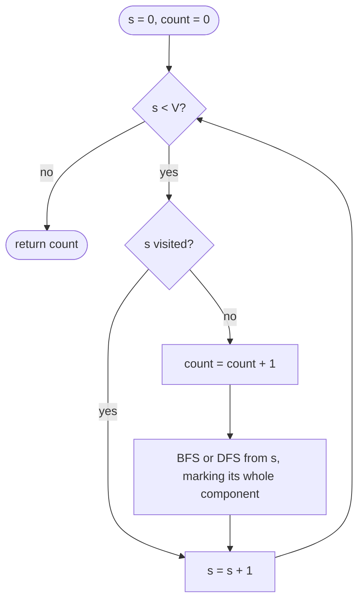

## Introduction

A social network has millions of users and the friendships between them. Some questions about it are about individual users, but many are about *groups*: how many separate friend circles are there, which circle does this user belong to, and how big is the biggest one? Two users are in the same circle if you can get from one to the other by following friendships, even through several intermediate people.

Those groups are the **connected components** of the graph. In an undirected graph, a connected component is a set of vertices in which every vertex can reach every other by a path, and which cannot be enlarged — no vertex outside the set is reachable from inside it. Every vertex belongs to exactly one component, so the components split the graph into separate pieces with no edges between them.

The same question appears under many names. "Number of Islands" asks for the components of land cells in a grid. "Number of Provinces" asks for the components of a city graph given as a matrix. Image-processing libraries label the connected blobs of pixels in a photo. A network operator asks which data centres can still talk to each other after a cable cut. Kruskal's minimum spanning tree algorithm repeatedly asks whether two vertices are already in the same component.

The algorithm behind all of them is short: loop over the vertices, and whenever you find one that has not been visited yet, run a BFS or DFS from it. That traversal visits exactly one component. Counting the traversals counts the components. This lesson explains why that works, implements it on adjacency lists, matrices and grids, and then applies it to five classic variations: BFS and DFS versions, the largest region in a matrix, counting trees in a forest, and two directed-graph questions about **sinks** — vertices with no way out.

## Before you start

- **BFS** — the queue-based traversal, marking vertices visited when they are enqueued. See [[a8-bfs]].
- **DFS** — recursive and iterative depth-first traversal, and the recursion-depth limit. See [[a8-dfs]] and [[a8-iterative-dfs]].
- **Graph representation** — adjacency lists, adjacency matrices and the difference between directed and undirected edges. See [[a8-graph-representation]].
- **Grids as graphs** (helpful) — treating each cell as a vertex and its neighbours as edges. See [[a8-grid-as-graph]].

## The intuition

Imagine a map of islands drawn on paper and a pot of paint. Put your brush on any land that is still unpainted and flood it: the paint spreads to every piece of land connected to that spot and stops at the water. You have painted one island. Now scan the map for unpainted land, pick a new colour, and flood again. When no unpainted land remains, the number of colours you used is the number of islands, and the colour of any spot tells you which island it belongs to.

That is the whole algorithm. The flood is a BFS or DFS, which reaches exactly the vertices connected to its starting point. The scan for unpainted land is an outer loop over all vertices. The paint is the visited marker — and if you store *which* colour each vertex got, you have a **component label** that answers "are these two in the same group?" in constant time.

The analogy is faithful in one important way: a flood never jumps across water. A traversal follows edges only, so it can never leak into another component, and it never stops early inside its own component.

## What a connected component is

To reason about components precisely, start from reachability. In an undirected graph, say vertex `u` **reaches** `v` if there is a path from `u` to `v`. This relation has three properties:

- **Reflexive** — every vertex reaches itself (by the empty path).
- **Symmetric** — if `u` reaches `v`, then `v` reaches `u`, because the same path can be walked backwards along undirected edges.
- **Transitive** — if `u` reaches `v` and `v` reaches `w`, then `u` reaches `w` by joining the two paths.

A relation with these three properties is an **equivalence relation**, and an equivalence relation always splits its set into disjoint classes. Those classes are the connected components. This is why components never overlap and why every vertex, including a vertex with no edges at all, belongs to exactly one of them. An **isolated vertex** is a component of size one — a frequent source of off-by-one bugs.

Some vocabulary follows directly:

- A graph is **connected** when it has exactly one component.
- A **component label** (or component id) is a number `comp[v]` with `comp[u] == comp[v]` exactly when `u` and `v` are in the same component.
- For any undirected graph with `V` vertices, `E` edges and `C` components, `E ≥ V − C`. Each component with `k` vertices needs at least `k − 1` edges to be connected. Equality holds exactly when the graph has no cycle, which is the basis of [[a8-count-trees-in-forest|counting trees in a forest]].

**Directed graphs are different.** Symmetry fails: a one-way edge `a → b` lets `a` reach `b` but not the reverse. Two notions replace the undirected one. A **weakly connected component** is a component of the graph you get by ignoring edge directions — use it when you only care whether things are linked at all. A **strongly connected component** is a maximal set in which every vertex reaches every other *along edge directions*; finding those needs a different algorithm, taught in [[a8-scc]]. Running the plain component algorithm on a directed adjacency list gives neither answer reliably, because the result then depends on which vertex the outer loop happens to start from.

## The counting pattern

Here is the procedure, independent of BFS or DFS:

1. Create a `visited` array (or a `comp` array filled with `-1`).
2. For each vertex `s` from `0` to `V − 1`:
   - if `s` is already visited, skip it;
   - otherwise, increase the component count and run a traversal from `s` that marks every vertex it reaches (with the current component id, if labelling).
3. When the loop ends, the count is the number of components.

### Why each traversal is exactly one component

Two facts make this correct.

First, **a traversal from `s` visits exactly the component of `s`**. It visits only vertices reachable from `s`, because it follows edges. And it visits all of them, because BFS and DFS do not stop until every reachable unvisited vertex has been processed (this is the completeness property proved in [[a8-bfs]]).

Second, **every traversal the outer loop starts opens a new component**. When the loop reaches an unvisited vertex `s`, no earlier traversal reached `s`. If `s` were in the same component as an earlier start `t`, then the traversal from `t` would have reached `s`. So `s` belongs to a component that none of the earlier traversals touched.

Together: every component is discovered (its lowest-numbered vertex is unvisited when the loop reaches it), and no component is discovered twice (once one traversal marks it, the loop skips all its vertices). The count is exact.

### Why the whole thing is O(V + E)

It is tempting to say "the loop runs `V` times and each traversal is O(V + E), so the total is O(V · (V + E))". That over-counts, because the traversals share one visited array. Count the work per vertex and per edge instead:

- Each vertex is marked once and dequeued (or entered by DFS) once in total, across all traversals. The outer loop also looks at each vertex once. That is O(V).
- Each vertex's adjacency list is scanned once, when that vertex is processed. In an undirected graph each edge appears in two lists, so the scans total 2E. That is O(E).

So the total is **O(V + E)** time, the same as a single traversal of a connected graph. The space is **O(V)**: the visited or label array, plus the queue or stack, which never holds more than `V` vertices.

With an adjacency matrix the edge scan for one vertex costs `V` regardless of its degree, so the total becomes O(V²). On a grid of `R` rows and `C` columns, each cell has at most 4 (or 8) neighbours, so the total is O(R · C).

### Count, label, or aggregate

The same loop answers three increasingly rich questions:

| You need | Store | Example question |
|---|---|---|
| How many components | a counter and `boolean[] visited` | Number of Provinces |
| Which component each vertex is in | `int[] comp`, with `-1` as unvisited | "Are `u` and `v` connected?" for many queries |
| A statistic per component | a value accumulated during each traversal | Size of the largest island; sum of values per group |

Labelling costs nothing extra — the label array can double as the visited array, as the code below shows — and once you have labels, any number of "same component?" queries cost O(1) each.



## Components via BFS (Graph & Grid) {#a8-components-bfs}

**Components via BFS** means running the counting loop above with breadth-first search as the traversal: each unvisited start vertex is pushed onto a queue, and the queue is drained, marking every reachable vertex. BFS is the safe default for component problems in Java because it uses an explicit queue on the heap, so it cannot overflow the thread's call stack no matter how large a component is.

### On an adjacency list

The program below labels every vertex with a component id. The label array `comp` starts at `-1` and serves as the visited marker, so there is no separate `boolean[]`.

```java title="ComponentsBfs.java"
import java.util.*;

public class ComponentsBfs {

    /** comp[v] = component id (0, 1, 2, ...). The label doubles as the visited mark. */
    static int[] label(List<List<Integer>> adj) {
        int n = adj.size();
        int[] comp = new int[n];
        Arrays.fill(comp, -1);
        int id = 0;
        ArrayDeque<Integer> queue = new ArrayDeque<>();
        for (int s = 0; s < n; s++) {
            if (comp[s] != -1) continue;      // already inside an earlier component
            comp[s] = id;                     // s is unreachable from all earlier starts
            queue.add(s);
            while (!queue.isEmpty()) {
                int u = queue.poll();
                for (int v : adj.get(u)) {
                    if (comp[v] == -1) {
                        comp[v] = id;         // mark on enqueue, never twice
                        queue.add(v);
                    }
                }
            }
            id++;
        }
        return comp;
    }

    static List<List<Integer>> undirected(int n, int[][] edges) {
        List<List<Integer>> adj = new ArrayList<>();
        for (int i = 0; i < n; i++) adj.add(new ArrayList<>());
        for (int[] e : edges) {
            adj.get(e[0]).add(e[1]);
            adj.get(e[1]).add(e[0]);
        }
        return adj;
    }

    public static void main(String[] args) {
        int[][] edges = {{0, 1}, {1, 2}, {3, 4}, {5, 6}, {6, 7}, {7, 5}};
        int[] comp = label(undirected(9, edges));
        int count = Arrays.stream(comp).max().orElse(-1) + 1;
        System.out.println("labels     = " + Arrays.toString(comp));
        System.out.println("components = " + count);
        System.out.println("same(0, 2) = " + (comp[0] == comp[2]));
        System.out.println("same(2, 3) = " + (comp[2] == comp[3]));
    }
}
```

```output
labels     = [0, 0, 0, 1, 1, 2, 2, 2, 3]
components = 4
same(0, 2) = true
same(2, 3) = false
```

The graph has a path `0–1–2`, an edge `3–4`, a triangle `5–6–7` and an isolated vertex `8`. Notice three details in the code. The vertex is labelled at the moment it is **enqueued**, not when it is dequeued; labelling on dequeue would let the same vertex enter the queue several times (in the triangle, vertex 7 would be added by both 5 and 6). The `undirected` helper adds each edge to *both* lists; forgetting the second `add` turns the graph into a directed one and can split a component in two. And vertex 8 needs no special case — the outer loop reaches it, finds it unlabelled, and its empty adjacency list ends the BFS immediately, giving it its own component.

### Dry run

Adjacency lists, in insertion order: `0:[1]`, `1:[0,2]`, `2:[1]`, `3:[4]`, `4:[3]`, `5:[6,7]`, `6:[5,7]`, `7:[6,5]`, `8:[]`.

| Outer `s` | Action | Queue as it drains | Labels assigned | `id` after |
|---|---|---|---|---|
| 0 | new component 0 | `[0]` → `[1]` → `[2]` → `[]` | 0, 1, 2 → 0 | 1 |
| 1, 2 | already labelled, skip | | | 1 |
| 3 | new component 1 | `[3]` → `[4]` → `[]` | 3, 4 → 1 | 2 |
| 4 | skip | | | 2 |
| 5 | new component 2 | `[5]` → `[6, 7]` → `[7]` → `[]` | 5, 6, 7 → 2 | 3 |
| 6, 7 | skip | | | 3 |
| 8 | new component 3 | `[8]` → `[]` | 8 → 3 | 4 |

When vertex 6 is dequeued, both of its neighbours (5 and 7) are already labelled, so nothing is added — the triangle's extra edge costs one array check, not a second visit.

### On a grid

A grid is a graph you never build explicitly. Each cell `(r, c)` is a vertex, and its neighbours are the cells directly above, below, left and right (**4-directional** connectivity) — or those plus the four diagonals (**8-directional**). The problem statement decides which; "Number of Islands" uses 4.

```java title="GridComponentsBfs.java"
import java.util.*;

public class GridComponentsBfs {
    static final int[][] DIRS = {{1, 0}, {-1, 0}, {0, 1}, {0, -1}};

    static int countIslands(char[][] grid) {
        int rows = grid.length, cols = grid[0].length;
        boolean[][] seen = new boolean[rows][cols];
        ArrayDeque<int[]> queue = new ArrayDeque<>();
        int islands = 0;
        for (int r = 0; r < rows; r++) {
            for (int c = 0; c < cols; c++) {
                if (grid[r][c] != '1' || seen[r][c]) continue;
                islands++;                            // a new, unvisited piece of land
                seen[r][c] = true;
                queue.add(new int[]{r, c});
                while (!queue.isEmpty()) {
                    int[] cell = queue.poll();
                    for (int[] d : DIRS) {
                        int nr = cell[0] + d[0], nc = cell[1] + d[1];
                        if (nr < 0 || nc < 0 || nr >= rows || nc >= cols) continue;
                        if (grid[nr][nc] != '1' || seen[nr][nc]) continue;
                        seen[nr][nc] = true;
                        queue.add(new int[]{nr, nc});
                    }
                }
            }
        }
        return islands;
    }

    public static void main(String[] args) {
        char[][] grid = {
            "11000".toCharArray(),
            "11011".toCharArray(),
            "00010".toCharArray(),
            "10000".toCharArray(),
            "10111".toCharArray(),
        };
        System.out.println("islands = " + countIslands(grid));
        System.out.println("all water = " + countIslands(new char[][]{"000".toCharArray()}));
        System.out.println("one cell  = " + countIslands(new char[][]{"1".toCharArray()}));
    }
}
```

```output
islands = 4
all water = 0
one cell  = 1
```

The four islands are the 2 × 2 block at the top left, the three cells around `(1, 3)`, the two cells in column 0 at the bottom, and the three cells along the bottom right. The two nested `for` loops are the outer loop of the pattern — they visit vertices in row-major order — and the `DIRS` table replaces the adjacency list. The bounds check must come before the grid access, or the first cell on an edge throws `ArrayIndexOutOfBoundsException`.

**Complexity.** Each of the `R · C` cells is examined by the outer loop once and enqueued at most once; each dequeued cell checks four neighbours. Total time O(R · C); the `seen` array is O(R · C) space, and the queue holds at most O(R · C) cells.

### Edge cases and variations

- **Empty graph** (`V = 0`): the loop never runs, the answer is 0. **All isolated**: `V` components.
- **Directed input, weakly connected components wanted**: build the adjacency list with both directions before running the loop.
- **Component sizes**: count the dequeues in each BFS. **Component members**: append each dequeued vertex to a list for that id.
- **Is the graph connected?** One BFS from vertex 0, then check that it reached all `V` vertices — no outer loop needed.

## Components via DFS (Graph & Grid) {#a8-components-dfs}

**Components via DFS** runs the same counting loop with depth-first search as the traversal. For undirected graphs, DFS and BFS visit exactly the same set of vertices from a given start — the component — so they always produce the same count and the same partition; only the order in which vertices are visited differs. DFS is often shorter to write recursively and is the natural choice when the surrounding problem already needs DFS (cycle detection, collecting members in a particular order, or backtracking).

### Recursive DFS on an adjacency list

This version returns the members of each component, which shows that a component is exactly "everything one DFS call tree touched".

```java title="ComponentsDfs.java"
import java.util.*;

public class ComponentsDfs {

    // Recursive DFS: the call stack remembers where to resume.
    static void dfs(int u, List<List<Integer>> adj, int[] comp, int id, List<Integer> members) {
        comp[u] = id;
        members.add(u);
        for (int v : adj.get(u)) {
            if (comp[v] == -1) dfs(v, adj, comp, id, members);
        }
    }

    static List<List<Integer>> components(List<List<Integer>> adj) {
        int[] comp = new int[adj.size()];
        Arrays.fill(comp, -1);
        List<List<Integer>> result = new ArrayList<>();
        for (int s = 0; s < adj.size(); s++) {
            if (comp[s] != -1) continue;
            List<Integer> members = new ArrayList<>();
            dfs(s, adj, comp, result.size(), members);
            result.add(members);
        }
        return result;
    }

    // Iterative DFS on a grid: an explicit stack cannot overflow the thread stack.
    static int countIslands(char[][] grid) {
        int rows = grid.length, cols = grid[0].length, islands = 0;
        int[][] dirs = {{1, 0}, {-1, 0}, {0, 1}, {0, -1}};
        ArrayDeque<Integer> stack = new ArrayDeque<>();
        for (int r = 0; r < rows; r++) {
            for (int c = 0; c < cols; c++) {
                if (grid[r][c] != '1') continue;
                islands++;
                grid[r][c] = '0';                    // sink the land: the grid is the visited set
                stack.push(r * cols + c);            // encode (r, c) as one int
                while (!stack.isEmpty()) {
                    int cell = stack.pop();
                    int cr = cell / cols, cc = cell % cols;
                    for (int[] d : dirs) {
                        int nr = cr + d[0], nc = cc + d[1];
                        if (nr < 0 || nc < 0 || nr >= rows || nc >= cols) continue;
                        if (grid[nr][nc] != '1') continue;
                        grid[nr][nc] = '0';
                        stack.push(nr * cols + nc);
                    }
                }
            }
        }
        return islands;
    }

    public static void main(String[] args) {
        int[][] edges = {{0, 1}, {1, 2}, {3, 4}, {5, 6}, {6, 7}, {7, 5}};
        List<List<Integer>> adj = new ArrayList<>();
        for (int i = 0; i < 9; i++) adj.add(new ArrayList<>());
        for (int[] e : edges) { adj.get(e[0]).add(e[1]); adj.get(e[1]).add(e[0]); }
        System.out.println(components(adj));

        char[][] grid = {
            "11000".toCharArray(),
            "11011".toCharArray(),
            "00010".toCharArray(),
            "10000".toCharArray(),
            "10111".toCharArray(),
        };
        System.out.println("islands = " + countIslands(grid));
    }
}
```

```output
[[0, 1, 2], [3, 4], [5, 6, 7], [8]]
islands = 4
```

The recursive `dfs` marks `u` on entry and then recurses into each unmarked neighbour. Marking on entry, before the loop, is what stops the triangle `5–6–7` from recursing forever: when the call for 7 looks back at 5, 5 is already labelled. The id passed down is `result.size()`, which is the number of components found so far, so ids run 0, 1, 2, … without a separate counter.

### The recursion-depth problem

Recursive DFS has a cost that does not show up in big-O notation: every active call occupies a stack frame, and the deepest chain of calls can be as long as the component. On a path graph with 100,000 vertices, or on a large all-land grid, the recursion goes that deep. Java's thread stack has a fixed size (by default typically 1 MB on 64-bit Linux and 2 MB on Apple-silicon macOS; set with `-Xss`), and when it runs out the JVM throws `StackOverflowError`.

```java title="DeepRecursion.java"
public class DeepRecursion {
    static int rows, cols;
    static boolean[][] seen;

    static int area(int r, int c) {                 // textbook recursive flood fill
        if (r < 0 || c < 0 || r >= rows || c >= cols || seen[r][c]) return 0;
        seen[r][c] = true;
        return 1 + area(r + 1, c) + area(r - 1, c) + area(r, c + 1) + area(r, c - 1);
    }

    public static void main(String[] args) {
        for (int n : new int[]{100, 1000}) {         // an all-land n x n grid
            rows = cols = n;
            seen = new boolean[n][n];
            try {
                System.out.println(n + " x " + n + ": area = " + area(0, 0));
            } catch (StackOverflowError e) {
                System.out.println(n + " x " + n + ": StackOverflowError");
            }
        }
    }
}
```

```output
100 x 100: area = 10000
1000 x 1000: StackOverflowError
```

This output is from JDK 26 with default settings on macOS; the exact grid size at which recursion fails depends on the stack size, the JVM, and even on whether the method has been JIT-compiled yet (compiled frames are smaller). With `java -Xss256m DeepRecursion` the same program completes the 1000 × 1000 grid. Interview platforms often run with limits you cannot change, so the reliable fix is to avoid deep recursion: use BFS, or the iterative stack version of DFS shown in `countIslands` above. The iterative version pushes cells onto an `ArrayDeque` on the heap, which is limited only by heap memory.

Two implementation details in the iterative version are worth copying. It **marks a cell when pushing** it, so no cell is pushed twice and the stack holds at most `R · C` entries. (Strict DFS order would require marking on pop; for counting components the order does not matter, so marking on push is simpler and cheaper — see [[a8-iterative-dfs]].) And it encodes `(r, c)` as the single integer `r * cols + c`, avoiding an `int[]` allocation per cell.

### Mutating the input as the visited set

`countIslands` overwrites land with water (`'1'` → `'0'`) instead of keeping a separate `seen` array. That saves O(R · C) memory and is a common interview idiom, but it destroys the caller's data. Say so explicitly in an interview, and in production code copy the grid or use a separate visited array unless you own the data.

### Adjacency matrix input

"Number of Provinces" gives the graph as an `n × n` matrix with `isConnected[i][j] == 1` when cities `i` and `j` are linked. The pattern is identical; only the neighbour loop changes:

```java
static void dfs(int u, int[][] m, boolean[] seen) {
    seen[u] = true;
    for (int v = 0; v < m.length; v++) {           // scan the whole row: every possible neighbour
        if (m[u][v] == 1 && !seen[v]) dfs(v, m, seen);
    }
}
```

This method sits inside the same class as the outer counting loop. Each vertex scans a full row of length `n`, so the total is O(n²) — optimal here, because reading the input matrix already costs O(n²). Scan the full row, not only the upper triangle: the vertex you need may have a smaller index.

### BFS or DFS for components?

| Concern | BFS | Recursive DFS | Iterative DFS |
|---|---|---|---|
| Result (count, labels, sizes) | same | same | same |
| Risk of `StackOverflowError` | none | yes, on large components | none |
| Code length | medium | shortest | medium |
| Natural when the problem also needs… | distances, levels | cycle detection, post-order, backtracking | DFS order on huge inputs |

For pure counting and labelling, pick whichever you write most reliably, and switch away from recursion when components can exceed a few thousand vertices.

```quiz
Q: A graph has 1,000 vertices and no edges. How many traversals does the component-counting loop start, and what does it return?
- [ ] 1 traversal, returns 1
- [ ] 0 traversals, returns 0
- [x] 1,000 traversals, returns 1,000
- [ ] It throws, because the adjacency lists are empty
> Every vertex is an isolated component. The outer loop finds each one unvisited, starts a traversal that ends immediately (empty adjacency list), and counts it. Forgetting that isolated vertices are components is a classic off-by-n mistake.

Q: Why is counting components O(V + E) even though the outer loop may start up to V traversals?
- [ ] Because each traversal is O(1)
- [x] Because all traversals share one visited array, so each vertex is processed once and each adjacency list scanned once in total
- [ ] Because BFS is faster than DFS on disconnected graphs
- [ ] It is actually O(V · (V + E))
> The traversals never revisit a vertex marked by an earlier one, so their costs add up to one pass over all vertices and all adjacency lists. Multiplying V by the cost of a full traversal over-counts work that is never repeated.

Q: Recursive DFS counts islands correctly on small tests but crashes on a 2000 × 2000 grid of all land. What is the most robust fix?
- [ ] Switch from 4-directional to 8-directional neighbours
- [ ] Mark cells when they are popped instead of when they are pushed
- [x] Replace recursion with BFS or an explicit-stack DFS so the depth no longer uses the thread stack
- [ ] Use an adjacency matrix instead of the grid
> One island of four million cells makes the recursion up to four million calls deep, which overflows Java's fixed-size thread stack. An explicit queue or stack lives on the heap. Raising -Xss also works locally, but you often cannot control it on a judge or in a shared service.
```

## Largest Region in a Boolean Matrix {#a8-largest-region}

The **largest region** problem gives a matrix of 0s and 1s and asks for the number of cells in the biggest connected group of 1s. It is the "aggregate a statistic per component" form of the counting pattern: instead of only counting floods, measure each flood's size and keep the maximum. LeetCode calls it "Max Area of Island" and uses 4-directional neighbours; the GeeksforGeeks version, "length of largest region of 1s", treats diagonal cells as connected too (8-directional). The two definitions give different answers on the same matrix, so read the statement carefully.

### Solving it

For every unvisited 1-cell, run a traversal that counts the cells it visits; the answer is the largest count seen (or 0 if there are no 1s). The program below takes the neighbour table as a parameter, so the same code solves both versions.

```java title="LargestRegion.java"
import java.util.*;

public class LargestRegion {
    static final int[][] FOUR  = {{1, 0}, {-1, 0}, {0, 1}, {0, -1}};
    static final int[][] EIGHT = {{1, 0}, {-1, 0}, {0, 1}, {0, -1},
                                  {1, 1}, {1, -1}, {-1, 1}, {-1, -1}};

    /** Size of the largest region of 1s; dirs decides which cells count as neighbours. */
    static int largestRegion(int[][] grid, int[][] dirs) {
        int rows = grid.length, cols = grid[0].length, best = 0;
        boolean[][] seen = new boolean[rows][cols];
        ArrayDeque<int[]> queue = new ArrayDeque<>();
        for (int r = 0; r < rows; r++) {
            for (int c = 0; c < cols; c++) {
                if (grid[r][c] != 1 || seen[r][c]) continue;
                int area = 0;
                seen[r][c] = true;
                queue.add(new int[]{r, c});
                while (!queue.isEmpty()) {
                    int[] cell = queue.poll();
                    area++;                              // count when a cell leaves the queue
                    for (int[] d : dirs) {
                        int nr = cell[0] + d[0], nc = cell[1] + d[1];
                        if (nr < 0 || nc < 0 || nr >= rows || nc >= cols) continue;
                        if (grid[nr][nc] != 1 || seen[nr][nc]) continue;
                        seen[nr][nc] = true;
                        queue.add(new int[]{nr, nc});
                    }
                }
                best = Math.max(best, area);
            }
        }
        return best;
    }

    public static void main(String[] args) {
        int[][] grid = {
            {1, 1, 0, 0, 0},
            {0, 1, 0, 0, 1},
            {1, 0, 0, 1, 1},
            {0, 0, 0, 0, 0},
            {1, 0, 1, 0, 1},
        };
        System.out.println("4-directional: " + largestRegion(grid, FOUR));
        System.out.println("8-directional: " + largestRegion(grid, EIGHT));
        System.out.println("no land:       " + largestRegion(new int[][]{{0, 0}}, EIGHT));
    }
}
```

```output
4-directional: 3
8-directional: 4
no land:       0
```

With 4-directional neighbours, the largest regions are the L-shape `(0,0), (0,1), (1,1)` and the L-shape `(1,4), (2,3), (2,4)`, both of size 3. With 8-directional neighbours, cell `(2,0)` touches `(1,1)` diagonally, so the top-left region grows to 4. Each cell is counted exactly once — when it leaves the queue — because it can enter the queue only once.

### Complexity

The outer loops visit each of the `R · C` cells once, each cell is enqueued at most once, and each dequeued cell checks 4 or 8 neighbours — a constant. Time is **O(R · C)**. Space is O(R · C) for `seen` (O(1) extra if you are allowed to overwrite visited 1s with 0s) plus the queue.

### Why not recursion here?

The recursive one-liner `return 1 + dfs(down) + dfs(up) + dfs(right) + dfs(left)` is elegant and is what most solutions show. It is correct, but as the previous section demonstrated, it overflows the stack on large regions. Interview grids for this problem are usually at most 50 × 50, where recursion is fine; mention the limit and offer the BFS version if the interviewer asks about scale.

### Variations

- **Count and largest together**: increment a counter at each new start and track the maximum area in the same loop.
- **Largest region after flipping one 0** ("Making a Large Island"): label every region with an id and store its size; then, for each 0-cell, sum the sizes of the *distinct* region ids among its neighbours, plus one. Using a set of ids matters — two neighbours can belong to the same region.
- **Perimeter of a region**: during the flood, add one for every neighbour step that leaves the grid or lands on a 0.
- **Distinct island shapes**: record each region's cells relative to its first cell and put the normalised shape in a set.
- **Regions that change over time** — cells turning into land one by one — are better served by [[a8-dsu-on-grids|Union-Find on grids]], which avoids re-flooding after every change.

## Count Trees in a Forest {#a8-count-trees-in-forest}

A **tree** is a connected undirected graph with no cycles, and a **forest** is an undirected graph with no cycles — in other words, a collection of trees, where each connected component is one tree. "Count the trees in a forest" therefore means "count the connected components of an acyclic graph". An isolated vertex is a tree with one vertex and no edges, so it counts.

### The direct approach: count components

Because every component of a forest is a tree, the component-counting loop answers the question directly, in O(V + E) time with BFS or DFS. That is the expected answer when the input is guaranteed to be a forest.

### The shortcut: V − E

A tree with `k` vertices has exactly `k − 1` edges. (Intuition: start with `k` separate vertices and add the tree's edges one at a time; each edge joins two previously separate pieces, because an edge inside one piece would close a cycle. Going from `k` pieces to 1 piece takes exactly `k − 1` joins.)

Now add this up over a forest with `T` trees of sizes `k₁, k₂, …, k_T`:

```text
E = (k₁ − 1) + (k₂ − 1) + … + (k_T − 1) = V − T      so      T = V − E
```

So **the number of trees in a forest is `V − E`**, computable in O(1) once you know the counts. For a forest with 10 vertices and 5 edges, there are 5 trees.

The formula's catch is its precondition. For a general graph, the true relationship is `V − E = C − (number of independent cycles)`: every edge that closes a cycle reduces `V − E` without reducing the number of components. On a graph that is *not* a forest, `V − E` silently gives a wrong answer — it can even be zero or negative.

### When the input might contain cycles

Some versions ask a slightly different question: "how many components of this graph are trees?" Then check each component during the traversal. A component with `nodes` vertices is a tree exactly when it has `nodes − 1` edges, and the number of edges in a component is half the sum of its vertices' degrees (each edge appears in two adjacency lists).

```java title="CountTrees.java"
import java.util.*;

public class CountTrees {

    /** Counts components that are trees: connected and exactly (nodes - 1) edges. */
    static int countTreeComponents(int n, int[][] edges) {
        List<List<Integer>> adj = new ArrayList<>();
        for (int i = 0; i < n; i++) adj.add(new ArrayList<>());
        for (int[] e : edges) {
            adj.get(e[0]).add(e[1]);
            adj.get(e[1]).add(e[0]);
        }
        boolean[] seen = new boolean[n];
        int trees = 0;
        ArrayDeque<Integer> queue = new ArrayDeque<>();
        for (int s = 0; s < n; s++) {
            if (seen[s]) continue;
            int nodes = 0, degreeSum = 0;
            seen[s] = true;
            queue.add(s);
            while (!queue.isEmpty()) {
                int u = queue.poll();
                nodes++;
                degreeSum += adj.get(u).size();      // every edge is counted from both ends
                for (int v : adj.get(u)) {
                    if (!seen[v]) { seen[v] = true; queue.add(v); }
                }
            }
            int componentEdges = degreeSum / 2;
            if (componentEdges == nodes - 1) trees++;
        }
        return trees;
    }

    public static void main(String[] args) {
        int[][] forest = {{0, 1}, {0, 2}, {3, 4}, {6, 7}, {7, 8}};
        System.out.println("forest, V - E      = " + (10 - forest.length));
        System.out.println("forest, traversal  = " + countTreeComponents(10, forest));

        // Same forest plus a square 9-10-11-12 with diagonal 9-11: not a tree.
        int[][] mixed = {{0, 1}, {0, 2}, {3, 4}, {6, 7}, {7, 8},
                         {9, 10}, {10, 11}, {11, 12}, {12, 9}, {9, 11}};
        System.out.println("mixed, V - E       = " + (13 - mixed.length));
        System.out.println("mixed, traversal   = " + countTreeComponents(13, mixed));
    }
}
```

```output
forest, V - E      = 5
forest, traversal  = 5
mixed, V - E       = 3
mixed, traversal   = 4
```

The forest has trees `{0,1,2}`, `{3,4}`, `{5}`, `{6,7,8}` and `{9}` — five, and both methods agree. The mixed graph adds a component `{9,10,11,12}` with 5 edges and two independent cycles. It has five components, four of which are trees; `V − E = 13 − 10 = 3` is wrong because the two cycle-closing edges each subtracted one.

Counting degrees rather than detecting cycles with a parent check has a practical advantage: it is correct even with **parallel edges** (two copies of `u–v` form a cycle of length 2 that a naive parent check misses) and **self-loops** (a self-loop appears twice in `adj[u]`, adding 2 to the degree sum and 1 to the edge count). For parent-based cycle detection and its pitfalls, see [[a8-cycle-undirected]].

### Related problem: Graph Valid Tree

"Is this graph a single tree?" combines both facts: the graph is a tree exactly when it has `V − 1` edges *and* is connected (one component). Either condition alone is not enough — 4 vertices with 3 edges can be a triangle plus an isolated vertex. Checking `E == V − 1` first is a cheap early exit; then one traversal confirms connectivity. Union-Find solves it too, by reporting a cycle the moment an edge joins two already-connected vertices.

## Universal Sink {#a8-universal-sink}

In a directed graph, a **universal sink** is a vertex that every other vertex points to and that points to nothing: in-degree `V − 1` and out-degree 0. Think of a company where everyone reports problems to the help desk and the help desk reports to no one. The problem — an exercise in the textbook *Introduction to Algorithms* (CLRS) — is to decide whether a universal sink exists, given the graph as an adjacency matrix, in O(V) time rather than the O(V²) it takes to read the whole matrix.

### There is at most one

Suppose `s` and `t` were both universal sinks. Because `t` is universal, every other vertex points to it, including `s`, so the edge `s → t` exists. But `s` is a sink, so it has no outgoing edges. Contradiction. So a graph has either no universal sink or exactly one. This uniqueness is what makes an O(V) algorithm possible: we only need to find one candidate and check it.

### From O(V²) to O(V) by elimination

The naive method computes every vertex's in- and out-degree from the matrix — O(V²). The faster method uses one matrix lookup to rule a vertex out. Look at `m[i][j]` for two different vertices:

- If `m[i][j] == 1`, the edge `i → j` exists, so `i` has an outgoing edge: **`i` is not the sink**.
- If `m[i][j] == 0`, `i` does not point to `j`, so `j`'s in-degree is less than `V − 1`: **`j` is not the sink**.

Either way, one lookup eliminates one vertex. Keep a single candidate, compare it with each other vertex in turn, and keep whichever survives. After `V − 1` lookups only one candidate remains. Elimination proves only that every *other* vertex is not the sink; it does not prove the survivor *is* one. So finish by checking the survivor's row (all zeros) and column (all ones except the diagonal) — another `2(V − 1)` lookups.

```java title="UniversalSink.java"
public class UniversalSink {

    /** Returns the universal sink of adjacency matrix m, or -1. Assumes no self-loops. */
    static int find(int[][] m) {
        int n = m.length;
        int candidate = 0;
        for (int j = 1; j < n; j++) {
            // An edge candidate -> j means candidate has an outgoing edge: it cannot be
            // the sink. No edge means j is missing an incoming edge: j cannot be the sink.
            if (m[candidate][j] == 1) candidate = j;
        }
        for (int k = 0; k < n; k++) {
            if (k == candidate) continue;
            if (m[candidate][k] == 1 || m[k][candidate] == 0) return -1;
        }
        return candidate;
    }

    public static void main(String[] args) {
        int[][] m = {
            {0, 1, 1, 0},   // 0 -> 1, 0 -> 2
            {0, 0, 1, 0},   // 1 -> 2
            {0, 0, 0, 0},   // 2 has no outgoing edges
            {1, 0, 1, 0},   // 3 -> 0, 3 -> 2
        };
        System.out.println("universal sink = " + find(m));
        m[3][2] = 0;        // remove 3 -> 2: vertex 2 now misses one incoming edge
        System.out.println("after removing 3 -> 2 = " + find(m));
    }
}
```

```output
universal sink = 2
after removing 3 -> 2 = -1
```

### Dry run

| `j` | `candidate` before | `m[candidate][j]` | Conclusion | `candidate` after |
|---|---|---|---|---|
| 1 | 0 | `m[0][1] = 1` | 0 has an out-edge, eliminate 0 | 1 |
| 2 | 1 | `m[1][2] = 1` | 1 has an out-edge, eliminate 1 | 2 |
| 3 | 2 | `m[2][3] = 0` | 3 lacks the edge from 2, eliminate 3 | 2 |

Verification of 2: row 2 is all zeros, and column 2 has ones from 0, 1 and 3, so 2 is the universal sink. After deleting `3 → 2` the elimination still ends at 2 — the walk never looked at `m[3][2]` — but the verification finds the missing edge and returns `-1`. That is exactly why the verification step cannot be skipped.

Why can't the elimination discard the real sink? If `s` is the sink, any comparison involving it keeps it: as the candidate, its row is all zeros so it never moves; as `j`, the current candidate points to it (`m[candidate][s] == 1`), so the candidate moves to `s`. So if a sink exists, it is the survivor. The implementation above was also checked against a brute-force degree count on 200,000 random graphs with no disagreement.

**Complexity.** `V − 1` lookups to eliminate plus at most `2(V − 1)` to verify: **O(V)** time and O(1) extra space, far below the O(V²) size of the matrix — the algorithm reads only a thin slice of it.

The trick depends on O(1) edge lookup. With an adjacency list, "does `i → j` exist?" is no longer constant time, and the simple approach — compute out-degrees and in-degrees in one O(V + E) pass and look for out 0, in `V − 1` — is the right one. This same elimination idea solves the "find the celebrity" interview problem, where everyone knows the celebrity and the celebrity knows no one.

## Number of Sinks in a Graph {#a8-number-of-sinks}

A **sink** in a directed graph is a vertex with **out-degree 0** — no outgoing edges, so once a walk reaches it, it cannot continue. Unlike a universal sink, an ordinary sink need not receive edges from anyone, and a graph can have many sinks. "Number of sinks" asks how many such vertices there are. Sinks model end states: final steps in a workflow, leaf pages with no outgoing links, terminal states of a state machine.

### Counting sinks in one pass

A vertex is a sink exactly when no edge starts at it. So count out-degrees from the edge list — only an edge's tail gains out-degree — and report the vertices that end with 0.

```java title="NumberOfSinks.java"
import java.util.*;

public class NumberOfSinks {

    /** Vertices 1..n, directed edges {from, to}. Returns the sinks in increasing order. */
    static List<Integer> sinks(int n, int[][] edges) {
        int[] outDegree = new int[n + 1];
        for (int[] e : edges) outDegree[e[0]]++;    // only the tail of an edge gains out-degree
        List<Integer> result = new ArrayList<>();
        for (int v = 1; v <= n; v++) {
            if (outDegree[v] == 0) result.add(v);
        }
        return result;
    }

    public static void main(String[] args) {
        int[][] edges = {{2, 3}, {4, 3}, {4, 5}, {5, 1}, {2, 1}};
        List<Integer> s = sinks(6, edges);
        System.out.println("sinks = " + s + ", count = " + s.size());

        int[][] cycle = {{1, 2}, {2, 3}, {3, 1}};
        System.out.println("cycle sinks = " + sinks(3, cycle));
    }
}
```

```output
sinks = [1, 3, 6], count = 3
cycle sinks = []
```

Vertices 1 and 3 receive edges but send none. Vertex 6 has no edges at all; with the out-degree definition it is a sink too. Some problem statements say "a sink must have at least one incoming edge" — if so, also count in-degrees and require `inDegree[v] > 0`. The directed cycle `1 → 2 → 3 → 1` has no sink: every vertex has a way out.

The array is sized `n + 1` because the vertices are numbered from 1, a common format in GeeksforGeeks-style problems; index 0 is unused. **Complexity**: O(V + E) time — one pass over the edges, one over the vertices — and O(V) space. With an adjacency list already built, a sink is a vertex whose list is empty, so the count is O(V).

### Why sinks matter beyond counting

- **Every directed acyclic graph (DAG) has at least one sink.** Start anywhere and keep following outgoing edges; with no cycles you can never revisit a vertex, so with finitely many vertices the walk must stop — at a sink. This is why reverse topological orders exist (see [[a8-topological-sorting]]).
- **Eventually safe states** (a LeetCode classic) asks for vertices from which *every* walk ends at a sink. Reverse the edges and run Kahn's algorithm starting from the sinks: a vertex becomes safe once all of its original outgoing edges lead to safe vertices.
- **Sink components.** In a graph with cycles there may be no sink vertex, but the graph of strongly connected components always has a sink component. Questions such as "minimum number of vertices to reach everything" or "which group of states does the system eventually get trapped in" are answered on that condensed graph (see [[a8-condensation-dag]]).
- A **source** is the mirror image — in-degree 0 — and is counted the same way with `e[1]`.

```quiz
Q: In a 4 × 4 adjacency matrix, the elimination walk for a universal sink ends with candidate 2. What must happen next?
- [ ] Return 2 — the walk has proven it is the sink
- [x] Check that row 2 is all zeros and column 2 is all ones except the diagonal, and return -1 if not
- [ ] Repeat the walk starting from vertex 3
- [ ] Count the out-degrees of all vertices
> The walk proves only that no other vertex can be the sink. The survivor might still be missing an incoming edge or have an outgoing one, as in a graph with no universal sink at all. The O(V) verification of one row and one column settles it.

Q: A graph is guaranteed to be a forest with 50 vertices and 41 edges. How many trees does it contain?
- [ ] 41
- [ ] 50
- [x] 9
- [ ] It cannot be known without a traversal
> Each tree with k vertices has k - 1 edges, so a forest with T trees has V - T edges. 50 - 41 = 9. The formula is valid only because the graph is guaranteed to be acyclic; on a graph with cycles, V - E undercounts.

Q: Which statement about sinks in directed graphs is true?
- [ ] Every directed graph has at least one sink
- [ ] A graph can have at most one sink
- [x] Every directed acyclic graph has at least one sink
- [ ] A sink must have in-degree V - 1
> Following outgoing edges in a DAG can never repeat a vertex, so the walk must end at a vertex with out-degree 0. A directed cycle has no sink, and a graph can have many sinks. In-degree V - 1 is the extra requirement for a universal sink.
```

## Union-Find: the other way to find components

BFS and DFS compute components from a complete graph in one pass. **Union-Find** (Disjoint Set Union, DSU) builds them incrementally: start with every vertex in its own set and, for each edge, merge the sets of its endpoints. After all edges, the number of sets is the number of components, and "same component?" is "same set representative?".

```java
int components = n;
for (int[] e : edges) {
    if (uf.union(e[0], e[1])) components--;    // union returns false if already connected
}
```

This fragment assumes a Union-Find object `uf` like the one built in [[a8-union-find]]. With path compression and union by rank or size, it runs in O(V + E · α(V)), where α is the inverse Ackermann function — effectively constant. For a fixed graph it is no faster than a traversal. Its strength is that edges can arrive one at a time with queries in between: after every new edge you can still answer "how many components?" without re-traversing. Use a traversal when the whole graph is known and you need sizes, members or an order; use Union-Find when edges stream in, when you need to know which edge first connects two groups, or inside Kruskal's algorithm.

## In real systems

**Image processing.** Connected-component labelling of pixels is a standard operation: OpenCV's `connectedComponents` and `connectedComponentsWithStats` assign a label to every blob of foreground pixels and report each blob's area and bounding box. They default to 8-connectivity, the same choice as the GeeksforGeeks largest-region problem. Document scanners use it to find characters, and medical-imaging tools use it to separate regions in a scan.

**Social and identity graphs.** Grouping accounts that share an email address, phone number or payment card — "entity resolution" — is a component computation where vertices are records and edges are shared identifiers. Fraud teams look at unusually large components; data teams merge each component into a single customer profile.

**Network health.** After a link failure, operators want to know whether the network has split. Computing components over the surviving links answers it, and the component labels show which sites can still reach which. The same check validates that a generated topology, game map or maze is fully connected before it is used.

**Paint-bucket tools and game maps.** The fill tool in an image editor is a flood fill — a single-component traversal from the clicked pixel. Strategy games precompute region labels so that "can this unit walk from here to there?" becomes an O(1) label comparison instead of a pathfinding run.

**Deadlock and dependency analysis.** Sinks in a wait-for graph or state graph mark terminal states; a system that can reach a state with no exit, or a group of states it can never leave, is found by looking for sinks and sink components.

## Trade-offs and alternatives

| Approach | Time | Extra space | Best when |
|---|---|---|---|
| BFS from each unvisited vertex | O(V + E) | O(V) | Default for static graphs and grids; no recursion risk |
| Recursive DFS | O(V + E) | O(V) stack | Small components, or DFS is needed anyway |
| Iterative DFS | O(V + E) | O(V) | Huge components where recursion would overflow |
| Union-Find over the edge list | O(V + E · α(V)) | O(V) | Edges arrive online; Kruskal; first edge that joins groups |
| Matrix input, any traversal | O(V²) | O(V) | Input is already a matrix (Number of Provinces) |
| SCC algorithm (Tarjan, Kosaraju) | O(V + E) | O(V) | Directed graph, mutual reachability needed |

The traversal approaches have one limit: they answer for a snapshot. If edges keep being added, re-running a traversal after each addition costs O(V + E) every time; Union-Find handles insertions in near-constant time. If edges are *deleted*, neither approach handles it cheaply online — see the dynamic connectivity patterns in [[a8-dynamic-connectivity]].

## Common mistakes

**Forgetting the outer loop.** A single BFS from vertex 0 explores one component. Code that "counts components" with one traversal returns 1 on every graph. The outer loop over all vertices is the algorithm.

**Adding undirected edges in one direction only.** If the input lists `u–v` once and you add only `adj[u].add(v)`, a traversal starting at `v` cannot reach `u`, and one component can be counted as two. Add both directions.

**Treating a directed graph as if it had components.** On a directed adjacency list, the plain loop's answer depends on vertex numbering. Decide whether the problem wants weakly connected components (symmetrise the edges first) or strongly connected ones ([[a8-scc]]).

**Marking on dequeue.** In BFS, marking a vertex only when it leaves the queue lets it be enqueued several times. The count stays right, but work and memory blow up, and area counts become wrong because the same cell is counted more than once.

**Ignoring isolated vertices.** Building the vertex set from the edge list (`for each edge, add both endpoints`) silently drops vertices with no edges. Loop over `0..n-1`, not over the edges.

**Using the wrong neighbourhood.** 4-directional and 8-directional connectivity give different answers. The difference shows up only on inputs with diagonal touches, so small tests can pass with the wrong one.

> [!MISTAKE] Trusting V − E on any graph
> `V − E` counts trees only in a forest. With cycles it undercounts, and with enough cycles it becomes zero or negative. If the input is not guaranteed acyclic, count components with a traversal and check each component's edge count.

**Skipping the universal-sink verification.** The elimination walk always produces a candidate, even when no sink exists. Returning it without checking its row and column is wrong for every graph that has no universal sink.

## Interview perspective

Component problems are among the most common graph questions because they test three things at once: whether you can model the input as a graph (a grid, a matrix, a list of pairs, accounts sharing emails), whether you remember the outer loop, and whether you can justify O(V + E).

> [!INTERVIEW] A strong answer to "Number of Islands"
> "Each land cell is a vertex with up to four land neighbours. I'll scan the grid; whenever I find unvisited land I count a new island and flood it with BFS, marking cells as I enqueue them. Every cell is enqueued at most once and checks four neighbours, so it's O(R·C) time and O(R·C) space for the visited array. I'm using BFS rather than recursion because a large island would overflow the stack. If you'd prefer, I can mark visited cells by overwriting the grid to save memory, but that mutates the input."

Questions to be ready for:

- **How do you count components, and what is the complexity?** Outer loop plus traversal from each unvisited vertex; O(V + E) because the traversals share one visited array.
- **BFS, DFS or Union-Find?** Same answer for a static graph; BFS avoids stack overflow; Union-Find when edges arrive incrementally or inside Kruskal.
- **What changes for a directed graph?** Weakly connected: ignore direction. Strongly connected: Tarjan or Kosaraju.
- **Largest island, and the follow-up "flip one 0 to maximise it"?** Measure each flood; for the follow-up, label regions with ids and sizes, then examine each 0-cell's distinct neighbouring ids.
- **When is a graph a valid tree?** Exactly `V − 1` edges and connected.
- **Find the universal sink (or celebrity) in O(V).** One lookup eliminates one vertex; verify the survivor.

A common follow-up is "what if the grid is too large for memory?" A good answer processes it row by row with Union-Find, keeping labels only for the previous and current row. Image-processing libraries use the same idea in their classic two-pass labelling algorithms, which assign provisional labels row by row and merge labels that turn out to be equivalent with Union-Find.

## Practice

1. **Number of Connected Components in an Undirected Graph.** Given `n` and an edge list, return the number of components. Write it with BFS, then with Union-Find, and compare.
2. **Number of Provinces.** The graph is an adjacency matrix. State why O(n²) is optimal.
3. **Number of Islands** with recursion, then rewrite it iteratively and run it on a 2000 × 2000 all-land grid.
4. **Max Area of Island** (4-directional), then the 8-directional GeeksforGeeks variant. Construct an input where the answers differ.
5. **Making a Large Island.** Flip at most one 0 to 1 and return the largest possible island.
6. **Graph Valid Tree** and **count the trees in a forest**, including a test with an isolated vertex.
7. **Find the universal sink** in a matrix, and the **celebrity problem** using only a `knows(a, b)` function.
8. **Find Eventual Safe States**, using sinks as the starting point.

The DSA explorer lists the matching LeetCode and GeeksforGeeks problems under this topic and under [[a8-number-of-islands]].

## Quick revision {#quick-revision}

- A connected component is a maximal set of mutually reachable vertices in an undirected graph; components partition the vertices, and an isolated vertex is its own component.
- Pattern: for each vertex, if unvisited, count a new component and BFS/DFS from it. Each traversal covers exactly one component.
- Time O(V + E) (shared visited array); O(V²) with a matrix; O(R · C) on a grid. Space O(V).
- Labels (`comp[v]`) give O(1) "same component?" queries and double as the visited array.
- BFS: mark on enqueue. Recursive DFS: mark on entry; risks `StackOverflowError` on large components — use BFS or an explicit stack.
- Grids: 4- vs 8-directional neighbours change the answer; bounds check before access.
- Largest region: measure each flood's size, keep the max; O(R · C).
- Forest: trees = `V − E`, valid only if acyclic. In general, a component is a tree iff edges = nodes − 1 (edges = degree sum / 2).
- Universal sink: in-degree `V − 1`, out-degree 0, at most one; matrix elimination in `V − 1` lookups, then verify row and column; O(V).
- Sink: out-degree 0; count from the edge list in O(V + E). Every DAG has at least one sink.
- Directed graphs: weakly connected (ignore direction) vs strongly connected (SCC algorithms).

## Key takeaways {#key-takeaways}

- Counting components is one traversal per unvisited vertex; the outer loop is what turns a traversal into a component algorithm.
- The work is O(V + E), not V times a traversal, because every vertex and edge is processed once across all traversals.
- BFS and DFS give identical components; prefer BFS or iterative DFS in Java when a component can be large.
- Per-component statistics — size, members, edge count — are gathered during the same traversal at no extra asymptotic cost.
- Formulas like trees = `V − E` are fast but rely on preconditions (no cycles); verify the precondition or fall back to a traversal.
- In directed graphs, "connected" splits into weak and strong connectivity, and degree-based questions such as sinks and universal sinks replace undirected components.
