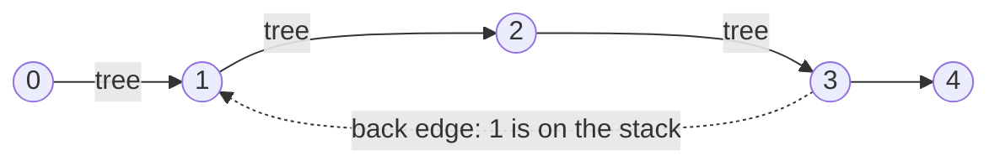
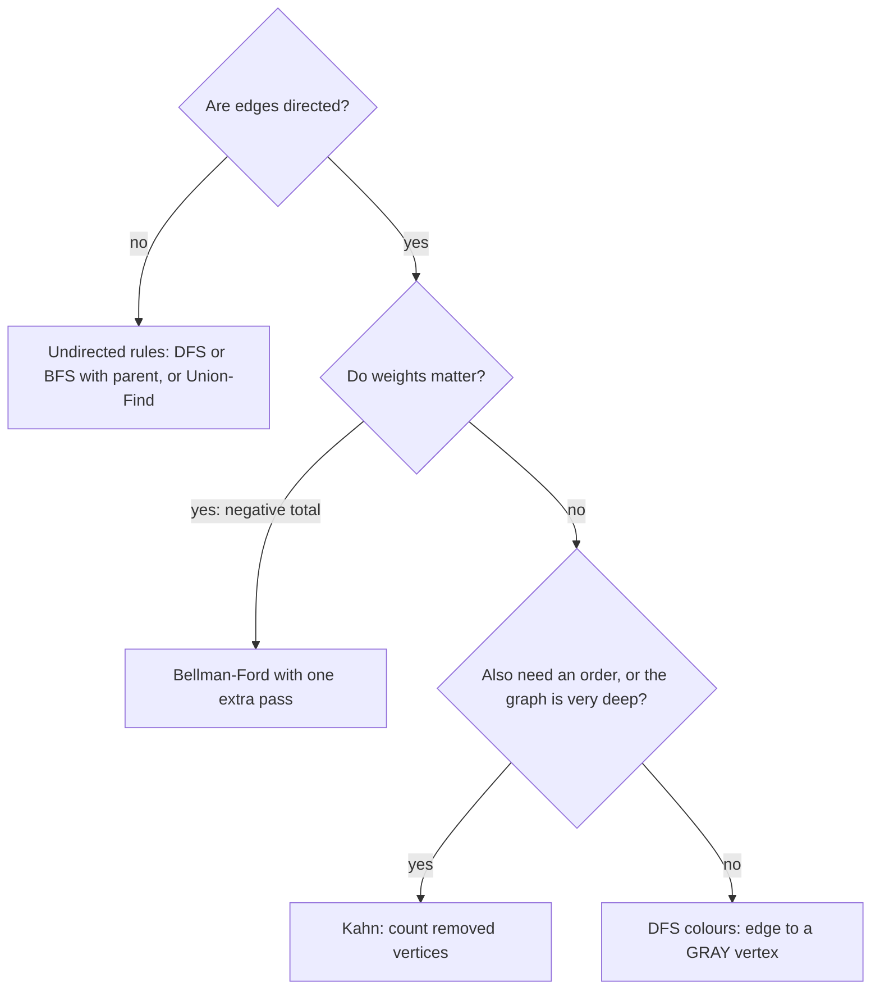

## Introduction

A **directed graph** is a set of vertices joined by one-way edges: an edge `u → v` lets you travel from `u` to `v` but not back. A **directed cycle** is a path that follows edges in their direction and returns to where it started, such as `A → B → C → A`. A directed graph with no directed cycle is called a **directed acyclic graph**, or **DAG**.

Whether a directed graph has a cycle is one of the most practical questions in graph theory, because directed edges usually mean *dependencies*. "Course B requires course A" is an edge `A → B`. "Module `orders` imports module `payments`" is an edge. "Cell C1 is computed from cell B1" is an edge. "Transaction T1 is waiting for a lock that T2 holds" is an edge. In every one of these, a cycle is a contradiction: courses that require each other can never be taken, modules that import each other in a loop cannot be initialised in a clean order, spreadsheet cells that depend on themselves have no value, and transactions waiting for each other in a ring are **deadlocked** and will wait forever.

So a cycle check is usually the first thing a dependency-driven system does. Build tools refuse to run a task graph with a loop in it; spreadsheets report a circular reference; databases periodically search their "who is waiting for whom" graph and abort one transaction when they find a cycle. In interviews the same question appears as "Course Schedule", "Find Eventual Safe States", "detect a cycle in a directed graph", and as the hidden validity check inside every topological-sort problem.

There are two classic O(V + E) tests, and a third, related problem:

- [[a8-cycle-directed-dfs]] — run DFS and watch for an edge back to a vertex still on the current recursion path.
- [[a8-cycle-using-colors]] — the same DFS written with three colours (white, gray, black), which also classifies every edge and powers problems such as finding safe states.
- [[a8-cycle-directed-bfs-kahn]] — repeatedly delete vertices that have no incoming edges; if you get stuck before deleting everything, a cycle remains.
- [[a8-negative-cycle-detection]] — in a weighted graph, find a cycle whose edge weights sum to less than zero, which makes "shortest path" meaningless.

Undirected graphs need a different rule (a visited neighbour that is not your parent) and are covered in [[a8-cycle-undirected]]. This lesson explains why that rule fails here.

## Before you start

- **Depth-first search** — the recursive "go as deep as possible, then backtrack" traversal, and the outer loop that restarts it from every unvisited vertex. See [[a8-dfs]].
- **Breadth-first search and queues** — Kahn's algorithm is queue-driven like BFS. See [[a8-bfs]].
- **Adjacency lists for directed graphs** — `adj.get(u)` holds the targets of `u`'s outgoing edges, and each edge is stored once. See [[a8-adjacency-list]] and [[a8-graph-types]].
- **Indegree** — the number of edges pointing *into* a vertex. See [[a8-graph-terminology]].
- **Recursion and the call stack**, because the DFS method's "current path" is literally the Java call stack. See [[a1-recursion]].
- For the negative-cycle section only, the idea of **edge relaxation** from shortest paths. It is explained there, and taught in full in [[a8-bellman-ford]].

## The intuition

Picture a city where every street is one-way. You leave your hotel and wander, unrolling a ball of string behind you so that you can retrace your steps. Whenever you reach a dead end — a junction with no unexplored streets leaving it — you walk back along the string to the previous junction and wind the string up as you go.

Two kinds of familiar junction can appear in front of you.

- A junction you visited **earlier but have already wound your string back from**. You explored everything reachable from there and came back; it did not lead back to where you are now, or you would have found that out at the time. Reaching it again tells you nothing about loops.
- A junction your string **is still lying on** — one you passed on the way to where you are standing now. There is a one-way route from that junction to you (along the string), and you have now found a one-way street from you back to it. Together they form a loop you could drive around forever.

That distinction is the entire DFS method. "Visited" is not the question. The question is "is that vertex **on my current path**?" Only the second kind of junction proves a cycle.

Kahn's method uses a different picture. Think of a pile of tasks where each task lists the tasks it waits for. Any task that waits for nothing can be done now; doing it may free others. Keep doing free tasks. If the pile empties, there was no circular waiting. If you are left with tasks that all still wait for something in the pile, those tasks are trapped behind a circle of waiting.

## What counts as a directed cycle

A few definitions settle the edge cases before any code.

A directed cycle needs at least one edge and must respect edge directions. The graph `A → B, A → C, B → D, C → D` — a **diamond** — has no directed cycle, even though its underlying shape is a square. You can reach `D` from `A` by two routes, but you cannot get back to `A`. Drawn without arrows it would be a cycle; with arrows it is a DAG.

A **two-vertex cycle** `u → v, v → u` is a genuine cycle in a directed graph. In an undirected graph, going from `u` to `v` and back along the same edge is not a cycle, which is why undirected algorithms deliberately ignore the edge to the parent. Here the two edges are different edges, so the loop is real.

A **self-loop** `u → u` is a cycle of length 1. Any correct method below reports it without special handling.

A graph can be acyclic in the part reachable from vertex 0 and cyclic somewhere else. As with every graph traversal, the algorithms below must start from **every** vertex that has not been reached yet, not only from vertex 0.

## Why the undirected tricks fail

Two shortcuts that work on undirected graphs give wrong answers here, and understanding why is the fastest way to understand the correct method.

**"A visited neighbour means a cycle" reports false cycles.** Run DFS on the diamond, visiting neighbours in index order. DFS goes `A → B → D`, finishes `D` and `B`, returns to `A`, then goes `A → C` and finds that `C`'s neighbour `D` is already visited. There is no cycle, yet a visited-means-cycle rule would report one. The problem is that `D` was reached by two different *forward* routes. In a directed graph, meeting a visited vertex only means two paths converge, not that a path returns.

**The undirected parent rule misses real cycles and still reports false ones.** The undirected rule says "a visited neighbour other than my parent is a cycle". On the two-vertex cycle `0 → 1, 1 → 0`, DFS goes from 0 to 1, sees neighbour 0 — which is 1's parent — and skips it. The real cycle is missed. On the diamond, `D` is visited and is not `C`'s parent, so the false cycle is still reported. The parent rule is the right fix for undirected graphs, where every edge is stored in both directions; it is the wrong model for one-way edges.

What both shortcuts lack is information about *where* the visited vertex is relative to the current search. A vertex can be visited and finished (harmless), or visited and still on the current path (a cycle). Every correct method tracks that difference, either with a second boolean array, with three colours, or — in Kahn's method — by never looking at visited flags at all.

## Directed Cycle via DFS Colors / Recursion Stack {#a8-cycle-directed-dfs}

This method detects a cycle in a directed graph by running depth-first search while remembering which vertices are on the **recursion stack** — the chain of calls from the starting vertex down to the vertex being explored right now. An edge from the current vertex to any vertex on that chain closes a loop, so the graph has a cycle. Any other edge, including one to a vertex that was visited earlier and has already finished, is harmless.

### The state you need

Keep two boolean arrays:

- `visited[v]` becomes `true` the first time DFS enters `v` and never goes back to `false`. It stops the search from exploring the same vertex twice, which keeps the running time linear.
- `onStack[v]` is `true` exactly while `dfs(v)` is running — set on entry, cleared on exit. At any moment, the vertices with `onStack == true` are precisely the current path from the DFS root to the vertex being explored.

The rule is then one line: **while exploring `u`, an edge `u → v` with `onStack[v] == true` is a cycle.** Because `v` is on the current path, there is a path of tree edges `v → … → u`, and the edge `u → v` completes it into a loop.

The same state is often written as three colours — white (never visited), gray (on the stack), black (finished). That formulation, and the extra power it gives, is the subject of [[a8-cycle-using-colors]]; the two are the same algorithm.

### The procedure

1. Mark every vertex unvisited and off the stack.
2. For each vertex `s` in order, if it is unvisited, call `dfs(s)`.
3. In `dfs(u)`: set `visited[u] = true` and `onStack[u] = true`.
4. For each outgoing edge `u → v`:
   - if `onStack[v]`, a cycle exists — stop;
   - else if `!visited[v]`, record `parent[v] = u` and call `dfs(v)`;
   - else `v` is finished — ignore the edge.
5. When every edge of `u` has been examined, set `onStack[u] = false` and return.

Step 5 is the step beginners forget, and forgetting it turns the algorithm back into the broken "visited means cycle" rule, because nothing ever leaves the stack.

### Why this is correct

There are two claims to prove: every reported cycle is real, and every real cycle gets reported.

*Every report is real.* If `onStack[v]` is true while exploring `u`, then `v` is an ancestor of `u` in the DFS tree — the recursion went from `v` down through tree edges to `u`. So the graph contains the path `v → … → u` and the edge `u → v`, which is a directed cycle.

*Every cycle is found.* Suppose the graph has a cycle. Among its vertices, let `w` be the first one DFS enters. At that moment none of the cycle's other vertices has been visited, and they are all reachable from `w` by following the cycle. A basic property of DFS (the **white-path theorem**) says that every vertex reachable from `w` through unvisited vertices at the moment `w` is entered will be entered and finished *before* `w` finishes. So the cycle's last vertex `x`, the one with the edge `x → w`, is explored while `dfs(w)` is still running. When DFS examines the edge `x → w`, `w` is on the stack, and the cycle is reported. It may report a *different* cycle first if it meets one earlier, but it cannot finish without reporting some cycle.

The same argument shows why a finished vertex is safe to ignore. If DFS meets an edge `u → v` where `v` is visited but finished, then everything reachable from `v` was already explored, and none of it reached `u` — if it had, `u` would have been entered inside `dfs(v)` and would be finished too, but `u` is still running. So no path leads from `v` back to `u`, and the edge `u → v` cannot be part of a cycle through `u`.

### Implementation with cycle recovery

Interviewers often follow "is there a cycle?" with "print it". Recording each vertex's DFS parent makes that cheap: when the back edge `u → v` is found, walk from `u` up the parent links until you reach `v`.

```java title="DirectedCycle.java"
import java.util.*;

public class DirectedCycle {

    private final List<List<Integer>> adj;
    private final boolean[] visited;   // has DFS ever entered this vertex?
    private final boolean[] onStack;   // is it on the current recursion path?
    private final int[] parent;        // DFS tree parent, for printing the cycle
    private List<Integer> cycle;       // first cycle found, or null

    DirectedCycle(List<List<Integer>> adj) {
        this.adj = adj;
        int n = adj.size();
        visited = new boolean[n];
        onStack = new boolean[n];
        parent = new int[n];
        Arrays.fill(parent, -1);
        for (int s = 0; s < n && cycle == null; s++) {
            if (!visited[s]) dfs(s);          // every vertex, not only vertex 0
        }
    }

    private void dfs(int u) {
        visited[u] = true;
        onStack[u] = true;
        for (int v : adj.get(u)) {
            if (cycle != null) return;        // stop as soon as one cycle is known
            if (onStack[v]) {
                cycle = buildCycle(u, v);     // back edge u -> v closes a cycle
            } else if (!visited[v]) {
                parent[v] = u;
                dfs(v);
            }
            // visited but not on the stack: finished earlier, cannot close a cycle
        }
        onStack[u] = false;                   // leaving u: it is no longer on the path
    }

    // The tree path v -> ... -> u plus the back edge u -> v.
    private List<Integer> buildCycle(int u, int v) {
        Deque<Integer> path = new ArrayDeque<>();
        for (int x = u; x != v; x = parent[x]) path.push(x);
        path.push(v);
        List<Integer> result = new ArrayList<>(path);
        result.add(v);                        // repeat the start to show it closes
        return result;
    }

    boolean hasCycle() { return cycle != null; }
    List<Integer> cycle() { return cycle; }

    static List<List<Integer>> graph(int n, int[][] edges) {
        List<List<Integer>> adj = new ArrayList<>();
        for (int i = 0; i < n; i++) adj.add(new ArrayList<>());
        for (int[] e : edges) adj.get(e[0]).add(e[1]);
        return adj;
    }

    public static void main(String[] args) {
        int[][][] tests = {
            {{0, 1}, {0, 2}, {1, 3}, {2, 3}},           // diamond: a DAG
            {{0, 1}, {1, 2}, {2, 3}, {3, 1}, {3, 4}},   // 1 -> 2 -> 3 -> 1
            {{0, 1}, {1, 0}},                           // two-vertex cycle
            {{0, 1}, {2, 2}},                           // self-loop on 2
        };
        int[] sizes = {4, 5, 2, 3};
        for (int i = 0; i < tests.length; i++) {
            DirectedCycle dc = new DirectedCycle(graph(sizes[i], tests[i]));
            System.out.println(dc.hasCycle() ? "cycle " + dc.cycle() : "no cycle");
        }
    }
}
```

```output
no cycle
cycle [1, 2, 3, 1]
cycle [0, 1, 0]
cycle [2, 2]
```

The constructor is the outer loop: it starts a DFS from every vertex not yet visited, so a cycle in any part of the graph is found. Inside `dfs`, the three branches correspond exactly to the three situations a neighbour can be in. The `onStack[u] = false` line runs on the way out, whether or not anything interesting happened below `u`.

`buildCycle` exploits the fact that the parent links of the vertices on the stack form a chain from `u` back up to `v`. Pushing onto a `Deque` while walking upwards reverses the walk, so the result reads in edge direction: `1 → 2 → 3 → 1`. The self-loop case needs no special code: in `dfs(2)`, vertex 2 is on the stack when its own edge `2 → 2` is examined, and the parent walk ends immediately because `u == v`.

Notice what happened on the diamond. Vertex 3 was reached twice — from 1 and later from 2 — but on the second visit it was finished and off the stack, so the edge `2 → 3` was correctly ignored.

### Dry run

Trace the second graph: edges `0 → 1, 1 → 2, 2 → 3, 3 → 1, 3 → 4`.

| Step | Event | `onStack` after the step | Note |
|---|---|---|---|
| 1 | enter 0 | {0} | outer loop starts at 0 |
| 2 | edge 0 → 1, 1 unvisited | {0, 1} | `parent[1] = 0` |
| 3 | edge 1 → 2, 2 unvisited | {0, 1, 2} | `parent[2] = 1` |
| 4 | edge 2 → 3, 3 unvisited | {0, 1, 2, 3} | `parent[3] = 2` |
| 5 | edge 3 → 1 | {0, 1, 2, 3} | 1 is on the stack: back edge, cycle |
| 6 | build cycle | — | walk 3 → 2 → stop at 1, giving `[1, 2, 3, 1]` |

Vertex 4 was never visited because the search stopped at the first cycle. If you only need a yes/no answer, stopping early is correct and saves work.



### Complexity

Every vertex is entered at most once, because `visited` prevents re-entry. Inside `dfs(u)`, the loop examines each outgoing edge of `u` once. Summed over all vertices, that is every edge once, so the time is **O(V + E)**. Building the cycle walks at most `V` parent links, which does not change the bound.

The arrays `visited`, `onStack` and `parent` use O(V) memory. The recursion depth can reach `V` on a long chain, so the call stack is also O(V). Together the auxiliary space is **O(V)**, on top of the O(V + E) adjacency list itself.

### Iterative DFS for deep graphs

Recursion depth equals the length of the current path, and a graph whose vertices form one long chain makes that path as long as the graph. Java's default thread stack holds tens of thousands of frames for a method like this, not millions: on the JDK used to check this lesson, a recursive version threw `StackOverflowError` on a 50,000-vertex chain with default settings. Problems with `n` up to 10⁵ or more need an iterative version (or Kahn's algorithm, which never recurses).

The iterative version simulates the call stack. Each stack entry is a vertex, and a separate array `next[u]` remembers which of `u`'s edges to try next — the job the `for` loop's hidden index did in the recursive version. It is written here with the colour names from [[a8-cycle-using-colors]]: `GRAY` means "on the stack", `BLACK` means "finished".

```java title="IterativeCycle.java"
import java.util.*;

public class IterativeCycle {
    static final int WHITE = 0, GRAY = 1, BLACK = 2;

    static boolean hasCycle(List<List<Integer>> adj) {
        int n = adj.size();
        int[] color = new int[n];
        int[] next = new int[n];             // next[u] = index of u's next edge to try
        int[] stack = new int[n];            // explicit recursion stack
        for (int s = 0; s < n; s++) {
            if (color[s] != WHITE) continue;
            int top = 0;
            stack[top++] = s;
            color[s] = GRAY;
            while (top > 0) {
                int u = stack[top - 1];
                if (next[u] < adj.get(u).size()) {
                    int v = adj.get(u).get(next[u]++);
                    if (color[v] == GRAY) return true;          // back edge
                    if (color[v] == WHITE) {                   // "recursive call"
                        color[v] = GRAY;
                        stack[top++] = v;
                    }
                } else {                                       // all edges done: "return"
                    color[u] = BLACK;
                    top--;
                }
            }
        }
        return false;
    }

    public static void main(String[] args) {
        int n = 1_000_000;
        List<List<Integer>> adj = new ArrayList<>();
        for (int i = 0; i < n; i++) adj.add(new ArrayList<>());
        for (int i = 0; i + 1 < n; i++) adj.get(i).add(i + 1);   // a path 0 -> 1 -> ... -> n-1
        System.out.println(hasCycle(adj));
        adj.get(n - 1).add(0);                                   // close it into one big cycle
        System.out.println(hasCycle(adj));
    }
}
```

```output
false
true
```

The crucial detail is that a vertex is popped only when *all* its edges are done, exactly as a recursive call returns only after its loop ends. A tempting shortcut — pushing all neighbours at once, as in a plain iterative DFS traversal — breaks the cycle test, because a vertex would then be marked finished before its descendants were explored, and "on the stack" would no longer mean "on the current path". The stack can never hold more than `n` entries because each vertex is pushed once, when it turns gray.

## Cycle Detection Using Colors (White / Gray / Black) {#a8-cycle-using-colors}

The colour method is a way of writing directed-graph DFS so that each vertex carries one of three states. **White** means DFS has not reached the vertex yet. **Gray** means DFS has entered the vertex and is still exploring below it — the vertex is on the current path. **Black** means DFS has finished the vertex and everything reachable from it. An edge into a gray vertex is a cycle; edges into white or black vertices are not. It is the same algorithm as the recursion-stack method in [[a8-cycle-directed-dfs]], with `visited` and `onStack` folded into one array — but the colours make the reasoning easier to state, and they extend naturally to edge classification, topological sorting and "safe state" problems.

### Mapping the colours to the two-array version

| Colour | `visited` | `onStack` | Meaning |
|---|---|---|---|
| White | false | false | not yet discovered |
| Gray | true | true | discovered, still being explored — on the current path |
| Black | true | false | finished — everything reachable from it is explored |

Each vertex moves strictly white → gray → black, once. One `int[] color` array replaces two boolean arrays, and the combination "not visited but on the stack", which is meaningless, cannot even be represented.

```java title="ColorCycle.java (core method)"
static final int WHITE = 0, GRAY = 1, BLACK = 2;

// Returns true if a cycle is reachable from u. color[] starts all WHITE.
static boolean dfs(int u, List<List<Integer>> adj, int[] color) {
    color[u] = GRAY;
    for (int v : adj.get(u)) {
        if (color[v] == GRAY) return true;                         // back edge
        if (color[v] == WHITE && dfs(v, adj, color)) return true;  // explore
        // BLACK: finished, cannot lead back to u
    }
    color[u] = BLACK;
    return false;
}
```

The caller loops over every vertex and calls `dfs(s)` on each one that is still white. Java's `new int[n]` initialises every element to `0`, which is why `WHITE` is given the value `0`: no separate fill is needed.

### The four kinds of edges

When DFS examines an edge `u → v`, the colour of `v` tells you what kind of edge it is in the **DFS forest** — the trees formed by the edges DFS actually followed. Adding a timestamp on entry (`disc`) and on exit (`fin`) separates the last two cases.

| Colour of `v` when `u → v` is examined | Edge type | What it means |
|---|---|---|
| White | **Tree edge** | DFS follows it; `v` becomes `u`'s child |
| Gray | **Back edge** | `v` is an ancestor of `u` on the current path — a cycle |
| Black, and `disc[u] < disc[v]` | **Forward edge** | `v` is a descendant of `u` already finished via another route |
| Black, and `disc[u] > disc[v]` | **Cross edge** | `v` is in a branch or tree that finished before `u` started |

The program below runs colour DFS on a small graph that contains all four kinds and prints each edge's type, followed by each vertex's `[disc, fin]` interval.

```java title="EdgeTypes.java"
import java.util.*;

public class EdgeTypes {
    static final int WHITE = 0, GRAY = 1, BLACK = 2;

    static List<List<Integer>> adj;
    static int[] color, disc, fin;
    static int time = 0;

    static void dfs(int u) {
        color[u] = GRAY;
        disc[u] = time++;
        for (int v : adj.get(u)) {
            String kind;
            if (color[v] == WHITE) {
                kind = "tree";
            } else if (color[v] == GRAY) {
                kind = "back    <- cycle";
            } else {
                // BLACK: finished. Discovered after u means it is u's descendant.
                kind = disc[u] < disc[v] ? "forward" : "cross";
            }
            System.out.println(u + " -> " + v + "  " + kind);
            if (color[v] == WHITE) dfs(v);
        }
        color[u] = BLACK;
        fin[u] = time++;
    }

    public static void main(String[] args) {
        int n = 4;
        int[][] edges = {{0, 1}, {0, 2}, {1, 2}, {2, 0}, {3, 1}};
        adj = new ArrayList<>();
        for (int i = 0; i < n; i++) adj.add(new ArrayList<>());
        for (int[] e : edges) adj.get(e[0]).add(e[1]);
        color = new int[n];
        disc = new int[n];
        fin = new int[n];
        for (int s = 0; s < n; s++) if (color[s] == WHITE) dfs(s);
        for (int u = 0; u < n; u++) {
            System.out.println("vertex " + u + ": [" + disc[u] + ", " + fin[u] + "]");
        }
    }
}
```

```output
0 -> 1  tree
1 -> 2  tree
2 -> 0  back    <- cycle
0 -> 2  forward
3 -> 1  cross
vertex 0: [0, 5]
vertex 1: [1, 4]
vertex 2: [2, 3]
vertex 3: [6, 7]
```

Read the output in the order DFS produced it. From 0, DFS follows `0 → 1` and `1 → 2` as tree edges. At 2 it sees `2 → 0`, and 0 is gray — still on the path `0 → 1 → 2` — so that is a back edge and the graph has the cycle `0 → 1 → 2 → 0`. After 2 and 1 finish, DFS returns to 0 and examines `0 → 2`; vertex 2 is black and was discovered after 0, so it is a forward edge — a shortcut to a descendant. Finally the outer loop starts a new tree at 3, and `3 → 1` points to a black vertex discovered earlier: a cross edge.

The intervals show the structure. A descendant's interval nests inside its ancestor's: `[2, 3]` inside `[1, 4]` inside `[0, 5]`. Vertex 3's interval `[6, 7]` is disjoint from vertex 1's, which is what a cross edge looks like. This nesting is called the **parenthesis theorem**, and it is what makes finishing times useful for topological sorting in [[a8-topo-departure-time]].

### Why only gray means a cycle

The table above is the proof in compact form. A **directed graph has a cycle if and only if DFS finds a back edge.** A back edge closes a cycle with the tree path below its target. Tree, forward and cross edges all point to a vertex that finishes *before* `u` finishes — for tree and forward edges because `v` is a descendant, for cross edges because `v` already finished. If every edge pointed to something that finishes earlier, then following edges would always move to strictly earlier finishing times, and you could never return to where you started. So a graph whose DFS has no back edges has no cycle.

That last observation has a useful flip side: in a DAG, **every edge `u → v` has `fin[u] > fin[v]`**. Sorting vertices by decreasing finishing time therefore puts every edge forward — which is exactly a topological order ([[a8-topological-sorting]]).

### Black as a memo: Find Eventual Safe States

Black has a second meaning worth naming: "everything reachable from here has been explored, and no cycle was found below it". That makes black a cached answer, which turns the colour method into a tool for more than yes/no questions.

In LeetCode 802, *Find Eventual Safe States*, a vertex is **safe** if every path starting from it ends at a terminal vertex (one with no outgoing edges) — equivalently, no path from it reaches a cycle. The colours answer this directly. Run colour DFS; if a vertex finishes, mark it black and call it safe. If the search below a vertex hits a gray vertex or an unsafe vertex, return immediately and *leave the vertex gray*. A gray vertex left behind means "this vertex is on a cycle or leads into one", and any later search that reaches it treats gray as unsafe.

```java title="SafeStates.java"
import java.util.*;

public class SafeStates {
    static final int WHITE = 0, GRAY = 1, BLACK = 2;

    // graph[u] lists the targets of u's outgoing edges (LeetCode 802 format).
    static List<Integer> eventualSafeNodes(int[][] graph) {
        int[] color = new int[graph.length];
        List<Integer> safe = new ArrayList<>();
        for (int u = 0; u < graph.length; u++) {
            if (isSafe(u, graph, color)) safe.add(u);
        }
        return safe;
    }

    // BLACK = proven safe. GRAY left behind = on or leading into a cycle.
    static boolean isSafe(int u, int[][] graph, int[] color) {
        if (color[u] != WHITE) return color[u] == BLACK;
        color[u] = GRAY;
        for (int v : graph[u]) {
            if (!isSafe(v, graph, color)) return false;  // u stays GRAY: unsafe
        }
        color[u] = BLACK;
        return true;
    }

    public static void main(String[] args) {
        int[][] graph = {{1, 2}, {2, 3}, {5}, {0}, {5}, {}, {}};
        System.out.println(eventualSafeNodes(graph));
    }
}
```

```output
[2, 4, 5, 6]
```

Here `0 → 1 → 3 → 0` is a cycle, so 0, 1 and 3 are unsafe; 2, 4, 5 and 6 can only reach the terminal vertices 5 and 6. The first call, `isSafe(0)`, turns 0 and 1 gray, proves 2 and 5 safe (black) along the way, then reaches 3, whose edge back to gray 0 fails; 3, 1 and 0 are left gray. Every later call returns in O(1) for an already-coloured vertex, so the whole run is O(V + E). This "leave it gray on failure" trick is the difference from plain cycle detection — the ordinary version never needs to know *which* vertices are affected.

### Colours versus visited and onStack

The two formulations are interchangeable for detection; pick the one you can explain clearly. Colours are more common in textbooks and make edge classification direct. Two booleans can read more naturally when explaining "the recursion stack" aloud. Do not reuse three-colour DFS on an *undirected* graph: there, every tree edge is stored in both directions, so the child would see its gray parent and report a cycle on every edge. Undirected graphs use the parent check from [[a8-cycle-undirected]].

## Directed Cycle via BFS (Kahn / Toposort) {#a8-cycle-directed-bfs-kahn}

This method detects a cycle in a directed graph without depth-first search. It repeatedly removes a vertex that has **no incoming edges** (indegree 0), deleting its outgoing edges as it goes, which may bring other vertices down to indegree 0. If every vertex is eventually removed, the graph is a DAG. If the process stops with vertices left over, those vertices contain a cycle. The method is **Kahn's algorithm**, the same procedure that produces a topological order in [[a8-topo-kahn]]; here we use only its count.

### Why removing sources works

Two facts make the method correct.

**Every DAG has a vertex with indegree 0.** Suppose some non-empty DAG had none. Start anywhere and walk *backwards* along incoming edges: every vertex has at least one, so you can always take another step. With only `V` vertices, some vertex must repeat within `V` steps, and the repeated stretch is a cycle — contradicting "acyclic". Removing a vertex from a DAG leaves a DAG, so the argument applies again to what remains. Therefore Kahn's process removes every vertex of a DAG.

**Leftover vertices always contain a cycle.** When the process stops, every remaining vertex still has indegree at least 1, and its remaining incoming edges all come from other remaining vertices (edges from removed vertices were deleted). The same backwards walk, restricted to the remaining vertices, must repeat a vertex — so a cycle exists among them.

Together: **the graph is acyclic exactly when Kahn's algorithm removes all `V` vertices.**

You do not need to delete edges physically. Keep an `indeg[]` array, and "removing `u`" means decrementing `indeg[v]` for each edge `u → v`. A vertex enters the queue at the moment its count reaches zero.

### The procedure

1. Compute `indeg[v]` for every vertex by scanning all edges once.
2. Put every vertex with `indeg == 0` into a queue.
3. While the queue is not empty: remove a vertex `u`, count it, and for every edge `u → v` decrement `indeg[v]`; if it becomes `0`, add `v` to the queue.
4. If the count equals `V`, there is no cycle. Otherwise there is one, and the uncounted vertices are exactly those that lie on a cycle or can be reached from one.

The last claim deserves a sentence. A vertex is removed only after all its predecessors are removed, so a vertex stays stuck exactly when some path leads to it from a cycle. That means the leftovers are not only "the cycle" — vertices downstream of a cycle are stuck too.

### Implementation, with the trapped vertices and a cycle

```java title="KahnCycle.java"
import java.util.*;

public class KahnCycle {

    // Returns the vertices Kahn's algorithm could NOT remove (empty list = no cycle).
    static List<Integer> leftovers(List<List<Integer>> adj) {
        int n = adj.size();
        int[] indeg = new int[n];
        for (List<Integer> out : adj) for (int v : out) indeg[v]++;

        ArrayDeque<Integer> queue = new ArrayDeque<>();
        for (int u = 0; u < n; u++) if (indeg[u] == 0) queue.offer(u);

        boolean[] removed = new boolean[n];
        int count = 0;
        while (!queue.isEmpty()) {
            int u = queue.poll();
            removed[u] = true;
            count++;
            for (int v : adj.get(u)) {
                if (--indeg[v] == 0) queue.offer(v);   // last prerequisite just finished
            }
        }
        List<Integer> stuck = new ArrayList<>();
        for (int u = 0; u < n; u++) if (!removed[u]) stuck.add(u);
        System.out.println("removed " + count + " of " + n);
        return stuck;
    }

    // Every stuck vertex has an incoming edge from another stuck vertex.
    // Walking those edges backwards must eventually repeat a vertex: that is a cycle.
    static List<Integer> extractCycle(List<List<Integer>> adj, List<Integer> stuck) {
        boolean[] isStuck = new boolean[adj.size()];
        for (int u : stuck) isStuck[u] = true;
        int[] pred = new int[adj.size()];
        for (int u : stuck) for (int v : adj.get(u)) if (isStuck[v]) pred[v] = u;

        int[] seenAt = new int[adj.size()];
        Arrays.fill(seenAt, -1);
        List<Integer> walk = new ArrayList<>();
        int x = stuck.get(0);
        while (seenAt[x] == -1) {
            seenAt[x] = walk.size();
            walk.add(x);
            x = pred[x];
        }
        // walk[seenAt[x]..] is the cycle, traversed against the edges; reverse it.
        List<Integer> cycle = new ArrayList<>(walk.subList(seenAt[x], walk.size()));
        Collections.reverse(cycle);
        cycle.add(cycle.get(0));
        return cycle;
    }

    public static void main(String[] args) {
        int n = 6;
        int[][] edges = {{0, 1}, {1, 2}, {2, 3}, {3, 1}, {3, 4}, {5, 4}};
        List<List<Integer>> adj = new ArrayList<>();
        for (int i = 0; i < n; i++) adj.add(new ArrayList<>());
        for (int[] e : edges) adj.get(e[0]).add(e[1]);

        List<Integer> stuck = leftovers(adj);
        System.out.println("stuck " + stuck);
        if (!stuck.isEmpty()) System.out.println("cycle " + extractCycle(adj, stuck));
    }
}
```

```output
removed 2 of 6
stuck [1, 2, 3, 4]
cycle [2, 3, 1, 2]
```

`leftovers` is plain Kahn. The expression `--indeg[v] == 0` decrements first and then tests, so `v` joins the queue at the exact moment its last remaining predecessor is removed — never earlier, and never twice.

`extractCycle` turns the proof into code. For each stuck vertex it remembers one stuck predecessor, then walks predecessors from any stuck vertex, recording the step at which each vertex was first seen. The first repeated vertex marks where the walk entered a loop; the part of the walk from that point on is a cycle, read against the edge direction, so it is reversed before returning. The predecessor array may keep any one of several stuck predecessors; the proof works for whichever one it keeps.

### Dry run

Edges `0 → 1, 1 → 2, 2 → 3, 3 → 1, 3 → 4, 5 → 4`.

| Step | Queue before | Removed | Indegree changes | Queue after |
|---|---|---|---|---|
| start | — | — | `indeg = [0, 2, 1, 1, 2, 0]` | [0, 5] |
| 1 | [0, 5] | 0 | `indeg[1]`: 2 → 1 | [5] |
| 2 | [5] | 5 | `indeg[4]`: 2 → 1 | [] |
| end | [] | 2 of 6 | 1, 2, 3, 4 never reach 0 | — |

Vertex 1 is waiting on 3, 3 on 2, and 2 on 1 — the cycle. Vertex 4 is not on the cycle, but it is waiting on 3, so it is stuck too. This is why Kahn's leftovers answer "which vertices can never be completed?" rather than "which vertices form the loop?".

### Complexity

Computing indegrees scans every edge once: O(V + E). Each vertex enters the queue at most once, because it enters only when its indegree hits zero, which happens once. When a vertex leaves the queue, its outgoing edges are scanned once. So the main loop is also O(V + E), and the total is **O(V + E)** time. The `indeg` array, `removed` array and queue are O(V) space. There is no recursion, so a million-vertex chain is no problem.

### DFS colours or Kahn?

| Question | DFS (colours or stack) | Kahn |
|---|---|---|
| Yes/no: is there a cycle? | Yes, O(V + E) | Yes, O(V + E) |
| Show one actual cycle | Direct: parent walk from the back edge | Possible with the predecessor walk above |
| Which vertices can never finish? | Needs the safe-state variant | Direct: the leftovers |
| Also produce a topological order | Reverse finishing order | The removal order itself |
| Deep graphs (10⁵+ vertices on a chain) | Needs an iterative rewrite | Never recurses |
| Natural for "levels" or "rounds" | No | Yes — process the queue one layer at a time |

In interviews, both are acceptable for Course Schedule. Kahn is often the safer default in Java because it cannot overflow the stack, and its cycle test is a single comparison of a count with `V`.

> [!MISTAKE] Checking the wrong thing at the end
> Kahn's verdict is `count == V`, computed after the loop. An empty initial queue does prove a cycle (a non-empty DAG always has a source), but a non-empty initial queue proves nothing — a cycle can sit downstream of the sources, as vertices 1, 2 and 3 do above. Always count removed vertices.

## Negative Weight Cycle Detection {#a8-negative-cycle-detection}

In a weighted directed graph, a **negative-weight cycle** (or negative cycle) is a directed cycle whose edge weights add up to less than zero. Detecting one is a different question from detecting *any* cycle: a graph can be full of cycles and still have none that is negative. The question matters because a reachable negative cycle destroys the idea of a shortest path. If going around a loop once lowers your cost by 2, going around it again lowers it by 4, and there is no cheapest route — the cost goes to minus infinity. The standard detector is the **Bellman-Ford algorithm** run for one extra round; the full shortest-path algorithm is taught in [[a8-bellman-ford]], and its negative-cycle step in [[a8-bellman-ford-negative-cycle]].

### Why it matters

**Shortest-path correctness.** Dijkstra's algorithm assumes non-negative weights, and Bellman-Ford's answers are only meaningful if no negative cycle can be reached from the source. Any system that accepts arbitrary weights has to check.

**Currency arbitrage.** Suppose one US dollar buys 0.90 euros, one euro buys 0.84 pounds, and one pound buys 1.34 dollars. Converting around the loop multiplies your money by 0.90 × 0.84 × 1.34 ≈ 1.013 — a 1.3% profit for nothing. Detecting such a loop looks like a product problem, but taking logarithms turns products into sums: give each conversion edge the weight `-ln(rate)`. A loop whose rates multiply to more than 1 has logarithms summing to more than 0, so its negated weights sum to less than 0. Arbitrage is exactly a negative cycle.

**Constraint systems.** A set of constraints of the form `x_j − x_i ≤ c` (common in scheduling and timing analysis) has a solution exactly when the graph with an edge `i → j` of weight `c` per constraint has no negative cycle. That makes negative-cycle detection a feasibility test.

### Relaxation and the V − 1 bound

Bellman-Ford keeps a tentative distance `dist[v]` for every vertex and repeatedly **relaxes** edges: for an edge `u → v` of weight `w`, if `dist[u] + w < dist[v]`, the route through `u` is better, so set `dist[v] = dist[u] + w` and remember `parent[v] = u`. One **pass** relaxes every edge once.

The key fact is about path length. If there is no negative cycle, every shortest path can be taken to be **simple** — it never repeats a vertex, since a repeated stretch would be a cycle of non-negative weight that you could cut out without increasing the cost. A simple path in a graph with `V` vertices has at most `V − 1` edges. After pass `k`, every shortest path that uses at most `k` edges has been found (each pass extends correct prefixes by one more edge). So after `V − 1` passes, all distances are final.

That gives the test: **run one more pass. If any edge can still be relaxed, distances were not final after `V − 1` passes, which is only possible if a negative cycle exists.** Conversely, if a negative cycle is reachable, some edge on it can always be relaxed: summing `dist[u] + w ≥ dist[v]` around the cycle would give "total weight ≥ 0", contradicting negativity.

### From one source, or anywhere

There are two versions of the question, and they differ only in initialisation.

- **Reachable from a source `s`.** Set `dist[s] = 0` and every other distance to infinity. Only cycles reachable from `s` can ever relax. This is the right check before trusting shortest paths from `s`. Skip edges whose `dist[u]` is still infinite, and use a large-but-safe infinity such as `Long.MAX_VALUE / 4`, or `infinity + negative weight` will overflow or produce nonsense.
- **Anywhere in the graph.** Set every `dist[v] = 0`. This is the same as adding an imaginary source with a zero-weight edge to every vertex, so every cycle is "reachable". Arbitrage and constraint feasibility want this version.

### Implementation, with the cycle printed

To print the cycle, keep `parent[]`. Take any vertex `x` relaxed in the final pass and follow `parent` links `V` times. Following parents from `x` walks backwards along edges that most recently improved a distance, and that walk is guaranteed to enter the negative cycle within `V` steps; after `V` steps you are standing on it. From there, follow parents until you return to the same vertex.

```java title="NegativeCycle.java"
import java.util.*;

public class NegativeCycle {
    record Edge(int from, int to, long w) {}

    // Finds a negative cycle anywhere in the graph, or returns an empty list.
    static List<Integer> findNegativeCycle(int n, List<Edge> edges) {
        long[] dist = new long[n];        // all 0: as if a virtual source had a
        int[] parent = new int[n];        // 0-weight edge to every vertex
        Arrays.fill(parent, -1);

        int changed = -1;
        for (int pass = 1; pass <= n; pass++) {        // n passes, not n - 1
            changed = -1;
            for (Edge e : edges) {
                if (dist[e.from()] + e.w() < dist[e.to()]) {
                    dist[e.to()] = dist[e.from()] + e.w();
                    parent[e.to()] = e.from();
                    changed = e.to();
                }
            }
            if (changed == -1) return List.of();       // stable early: no negative cycle
        }
        // A relaxation in pass n proves a negative cycle. Walking parents n times
        // from the changed vertex is guaranteed to land inside the cycle.
        int x = changed;
        for (int i = 0; i < n; i++) x = parent[x];

        List<Integer> cycle = new ArrayList<>();
        for (int v = x; ; v = parent[v]) {
            cycle.add(v);
            if (v == x && cycle.size() > 1) break;
        }
        Collections.reverse(cycle);                    // parents point backwards
        return cycle;
    }

    public static void main(String[] args) {
        List<Edge> edges = List.of(
            new Edge(0, 1, 4), new Edge(1, 2, -2), new Edge(2, 3, 3),
            new Edge(3, 1, -2), new Edge(3, 4, 5));
        System.out.println("cycle weight -1: " + findNegativeCycle(5, edges));

        List<Edge> noCycle = List.of(
            new Edge(0, 1, 4), new Edge(1, 2, -2), new Edge(2, 3, 3),
            new Edge(3, 1, -1), new Edge(3, 4, 5));
        System.out.println("cycle weight 0:  " + findNegativeCycle(5, noCycle));
    }
}
```

```output
cycle weight -1: [2, 3, 1, 2]
cycle weight 0:  []
```

In the first graph, the loop `1 → 2 → 3 → 1` has weight `−2 + 3 − 2 = −1`, and the program prints it as `2 → 3 → 1 → 2` — the same cycle starting from a different vertex. In the second graph the same loop weighs `−2 + 3 − 1 = 0`. A zero-weight cycle is still a cycle, but going round it gains nothing, so shortest paths stay well defined and the method correctly reports nothing.

The loop runs `n` passes instead of `n − 1`, and records the last vertex that changed in each pass. If a pass changes nothing, every distance is final and the method returns early — a cheap optimisation that often ends long before `n` passes. If pass `n` still changes something, `changed` is the witness vertex. The distances use `long` because weights are added repeatedly; with `int`, a long path of large weights could overflow and wrap around to a misleadingly small value.

### Dry run

All distances start at 0, and every pass relaxes the edges in the listed order. For the first graph:

| Pass | Successful relaxations, in order | `dist` after the pass |
|---|---|---|
| 1 | `1 → 2` gives −2, `3 → 1` gives −2 | [0, −2, −2, 0, 0] |
| 2 | `1 → 2` gives −4, `2 → 3` gives −1, `3 → 1` gives −3 | [0, −3, −4, −1, 0] |
| 3 | `1 → 2` gives −5, `2 → 3` gives −2, `3 → 1` gives −4 | [0, −4, −5, −2, 0] |
| 4 | `1 → 2` gives −6, `2 → 3` gives −3, `3 → 1` gives −5 | [0, −5, −6, −3, 0] |
| 5 | `1 → 2` gives −7, `2 → 3` gives −4, `3 → 1` gives −6 | [0, −6, −7, −4, 0] |

From pass 2 onwards, every pass lowers vertices 1, 2 and 3 by exactly 1 — the weight of the cycle. That is the signature of a negative cycle: the values never settle. Pass 5 is the extra pass for `V = 5`, and it still relaxes; the last vertex it changed is 1. Following `parent` five times from 1 cycles around `1 ← 3 ← 2 ← 1 ← 3 ← 2`, landing on 2, and walking parents from 2 until it repeats gives the cycle.

For the zero-weight version, pass 1 sets `dist[1] = −1` and `dist[2] = −2`, pass 2 lowers `dist[2]` to −3, and pass 3 changes nothing, so the method returns an empty list after three passes instead of five.

### Complexity and alternatives

Each pass relaxes all `E` edges, and there are at most `V` passes, so Bellman-Ford's detection costs **O(V · E)** time and **O(V)** extra space for `dist` and `parent`. That is much slower than the O(V + E) cycle tests above, but those tests answer a different question — they ignore weights entirely.

Two alternatives are worth knowing:

- **Floyd-Warshall** computes all-pairs shortest distances in O(V³). Afterwards, `dist[i][i] < 0` for any vertex `i` means `i` lies on a negative cycle. It is the natural choice when you need all-pairs distances anyway or `V` is small (a few hundred). See [[a8-floyd-warshall]].
- **SPFA** (the queue-based Bellman-Ford variant) detects a negative cycle when some vertex is relaxed `V` or more times. It is often faster in practice but has the same O(V · E) worst case.

If you need the cycle with the smallest *average* weight per edge rather than any negative cycle, that is a separate problem: [[a8-minimum-mean-weight-cycle]].

> [!WARNING] A negative edge is not a negative cycle
> Negative edges alone are harmless to Bellman-Ford and to shortest paths in a DAG ([[a8-shortest-path-dag]]). Only a cycle whose *total* is negative breaks shortest paths. Do not reject an input merely because some weight is below zero — and do not use Dijkstra on it either, since Dijkstra can be wrong with any negative edge.

## How the methods compare

| Method | Detects | Time | Extra space | Finds the cycle? | Best for |
|---|---|---|---|---|---|
| DFS + recursion stack | Any directed cycle | O(V + E) | O(V) + recursion | Yes, by parent walk | Printing a cycle; interview default |
| DFS with colours | Any directed cycle | O(V + E) | O(V) + recursion | Yes | Edge classification, safe states, DFS topological sort |
| Kahn's elimination | Any directed cycle | O(V + E) | O(V) | With extra walk | Course schedules; deep graphs; ordering at the same time |
| Bellman-Ford extra pass | Negative-weight cycle | O(V · E) | O(V) | Yes, by parent walk | Weighted graphs; arbitrage; constraint feasibility |
| Floyd-Warshall diagonal | Negative-weight cycle | O(V³) | O(V²) | With extra work | Small dense graphs needing all-pairs distances |



## In real systems

**Build tools and task runners.** Gradle, Bazel and Make all model work as a directed graph of tasks or targets. Before running anything they check the graph for cycles; Gradle, for example, stops with a "circular dependency" error that names the tasks in the loop. Printing the cycle — not only saying one exists — is what makes the error actionable.

**Infrastructure as code.** Terraform builds a dependency graph of resources so it can create independent resources in parallel and dependent ones in order. A configuration where resource A references B and B references A produces a "Cycle:" error listing the resources involved.

**Dependency injection.** Spring builds a graph of beans and their constructor dependencies. Since Spring Boot 2.6, circular references between beans are prohibited by default and startup fails with a description of the cycle, unless `spring.main.allow-circular-references` is set. Constructor injection cannot be satisfied around a cycle at all, because each bean would need the other to exist first.

**Database deadlock detection.** When a transaction waits for a lock, the database records "T1 waits for T2". A cycle in that **wait-for graph** is a deadlock. PostgreSQL, for instance, waits `deadlock_timeout` (1 second by default) before running its deadlock check, and when it finds a cycle it aborts one transaction so the others can proceed.

**Spreadsheets.** Cells form a dependency graph. A formula that ends up depending on its own cell — directly or through a chain — is a circular reference, which spreadsheet applications detect and report instead of looping forever.

**Finance.** Arbitrage detection is literally negative-cycle detection on a graph of exchange rates with `-log(rate)` weights, though production systems also account for fees, latency and the fact that rates change faster than a naive scan.

## Trade-offs and alternatives

The two O(V + E) tests are equally fast asymptotically; the choice is about what else you need. DFS gives you the actual cycle almost for free and slots into anything else built on DFS — topological sort by finishing time, strongly connected components ([[a8-scc]]), safe states. Its cost is recursion depth, which in Java means rewriting it iteratively for large inputs. Kahn's algorithm never recurses, produces an order at the same time, tells you which vertices are blocked, and has a verdict that is impossible to get subtly wrong. It is less direct at producing the cycle itself.

Do not reach for **Union-Find** on directed graphs. Union-Find answers "are these two vertices already connected, ignoring direction?", which is exactly right for undirected cycles and exactly wrong here: in the diamond, adding `C → D` joins two vertices already connected through `A`, which Union-Find would call a cycle.

For a **functional graph** — every vertex has exactly one outgoing edge, as in a linked list or `next[i]` array — Floyd's tortoise-and-hare algorithm finds a cycle in O(1) extra space. That only works because each vertex has one successor; it does not generalise to arbitrary directed graphs.

When the question is about **strongly connected components** — groups where every vertex reaches every other — a cycle test is a special case: a directed graph is acyclic exactly when every strongly connected component is a single vertex without a self-loop. Tarjan's and Kosaraju's algorithms ([[a8-tarjan-scc]], [[a8-kosaraju]]) find all such groups in O(V + E), which also lists *all* vertices that lie on some cycle — something a single back edge does not give you.

## Common mistakes

**Using one visited array.** The most common bug. It reports a cycle in the diamond and in any DAG where two paths converge. A directed cycle needs "on the current path", not "seen before".

**Forgetting to clear the stack flag.** Setting `onStack[u] = true` but never back to `false` (or never colouring `u` black) means every visited vertex stays "on the path" forever, which is the one-visited-array bug in disguise.

**Applying the undirected parent rule.** It misses `u → v, v → u` and still reports false cycles. Use colours or Kahn for directed graphs, the parent rule only for undirected ones.

**Starting only from vertex 0.** A cycle in a part of the graph that vertex 0 cannot reach is missed. Loop over every vertex as a potential start (DFS) or put every indegree-0 vertex in the initial queue (Kahn).

**Reversing edge direction.** In Course Schedule, `prerequisites[i] = [a, b]` means "take `b` before `a`", the edge `b → a`. For a pure cycle check, reversing every edge does not change the answer — a cycle reversed is still a cycle — but the moment you also return an order, the order comes out backwards. Decide the direction once and comment it.

**Pushing all neighbours in an iterative DFS.** An iterative traversal that pushes all neighbours at once does not keep "on the stack" equal to "on the current path". Keep a per-vertex edge index, as in `IterativeCycle`.

**Bellman-Ford with `n − 1` passes only, or with overflow.** Without the extra pass you cannot tell a converged answer from a negative cycle. Adding a weight to an "infinite" `Integer.MAX_VALUE` wraps around to a large negative number and fakes a relaxation — skip unreachable vertices and use `long`.

## Interview perspective

Directed cycle detection is rarely asked as "detect a cycle". It appears as Course Schedule (can all courses be finished?), Course Schedule II (return an order or an empty array), Find Eventual Safe States, Alien Dictionary (are the letter constraints consistent?), and "detect a deadlock among processes". Recognise that the question is "is this dependency graph a DAG?" and say so.

> [!INTERVIEW] What a strong answer sounds like
> "Edges are dependencies, so a valid schedule exists exactly when the graph is a DAG. I'll run DFS with three colours: white unvisited, gray on the current path, black finished. An edge to a gray vertex is a back edge, which means a cycle. An edge to a black vertex is safe because everything reachable from it is already explored and didn't reach the current path. It's O(V + E). If recursion depth is a concern, Kahn's algorithm gives the same answer — the graph is acyclic exactly when all V vertices get removed."

Questions to be ready for:

- **Why isn't a visited array enough?** Draw the diamond. Two paths reaching the same vertex is convergence, not a loop.
- **Why are black vertices safe?** Everything reachable from a black vertex has been explored; if it could reach the current vertex, the current vertex would have been explored inside it and would be black too.
- **Return the cycle.** Keep `parent[]`; on a back edge `u → v`, walk from `u` up to `v`.
- **Return all vertices that are on some cycle.** One back edge is not enough, and Kahn's leftovers also include vertices merely downstream of a cycle. Compute strongly connected components: a vertex is on a cycle exactly when its component has two or more vertices, or it has a self-loop.
- **What if the graph has a million vertices in a chain?** Recursion overflows the Java stack; use Kahn or an iterative DFS with a per-vertex edge index.
- **Detect arbitrage.** Weights `-ln(rate)`, Bellman-Ford from all-zero distances, one extra pass.
- **Kahn's initial queue is empty — what does that mean?** A cycle, since every non-empty DAG has a source. The reverse is not true.

```quiz
Q: DFS on a directed graph is exploring vertex `u` and finds an edge `u → v` where `v` is already visited but finished (black). What can you conclude?
- [ ] The graph has a cycle through `u` and `v`
- [x] This edge cannot close a cycle; it is a forward or cross edge
- [ ] The graph is definitely acyclic
- [ ] `v` must be `u`'s parent
> A finished vertex has had everything reachable from it explored. If `v` could reach `u`, `u` would have been entered during `dfs(v)` and would be finished too, but `u` is still running. So `u → v` is a forward or cross edge. It says nothing about cycles elsewhere in the graph, so "definitely acyclic" is also wrong.

Q: Kahn's algorithm on a graph with 8 vertices removes 5 of them and the queue becomes empty. Which statement is true?
- [ ] The 3 leftover vertices form exactly one cycle
- [ ] The graph has a cycle only if the initial queue was empty
- [x] The graph has a cycle, and each leftover vertex is on a cycle or reachable from one
- [ ] The algorithm should be restarted from a leftover vertex
> Leftover vertices all still have an incoming edge from another leftover vertex, so walking backwards among them must repeat a vertex — a cycle. Vertices downstream of a cycle are also stuck, so the leftovers can include vertices not on any cycle, and they may contain more than one cycle.

Q: Why does the undirected "visited neighbour that is not my parent" rule fail on the directed graph `0 → 1, 1 → 0`?
- [x] It skips the edge back to 0 because 0 is 1's parent, so it misses a real cycle
- [ ] It reports a cycle where there is none
- [ ] It never visits vertex 1
- [ ] It works correctly on this graph
> DFS goes 0 → 1, then sees neighbour 0, which is 1's parent, so the rule ignores it. In an undirected graph that would be the same edge walked backwards, but here `1 → 0` is a different edge and the two edges form a genuine directed cycle.

Q: Bellman-Ford with all distances initialised to 0 still relaxes an edge in pass V. What does that prove?
- [ ] Some edge has a negative weight
- [ ] The graph has a cycle of total weight zero
- [x] The graph has a negative-weight cycle somewhere
- [ ] The source cannot reach every vertex
> Without a negative cycle, all shortest paths are simple and have at most V − 1 edges, so distances are final after V − 1 passes. An improvement in pass V is only possible around a negative cycle. All-zero initialisation acts like a virtual source connected to every vertex, so the cycle can be anywhere. A single negative edge, or a zero-weight cycle, does not cause it.
```

## Practice

1. **Course Schedule.** Given `numCourses` and pairs `[a, b]` meaning "take `b` before `a`", decide whether all courses can be finished. Solve it once with colours and once with Kahn, and check that both agree on a graph with a cycle downstream of a source.
2. **Print the cycle.** Extend your colour DFS to return the vertices of the first cycle found, in edge order.
3. **Find Eventual Safe States.** Return every vertex from which every path ends at a terminal vertex. Then solve it a second way: reverse every edge and run Kahn from the terminal vertices.
4. **All vertices on cycles.** Return every vertex that lies on at least one directed cycle (not merely downstream of one). Hint: a vertex is on a cycle exactly when its strongly connected component has at least two vertices or it has a self-loop ([[a8-scc]]). Being stuck in Kahn's algorithm on both the graph and its reverse is not enough — a vertex sitting on a path from one cycle to a different cycle is stuck in both.
5. **Deep input.** Rewrite your DFS iteratively and test it on a 10⁶-vertex chain closed into one cycle.
6. **Arbitrage.** Given an `n × n` table of exchange rates, decide whether a profitable loop exists, and print one.

The DSA explorer lists the matching problems under this topic; start with *Course Schedule*, *Find Eventual Safe States* and *Detect Cycle in a Directed Graph*.

## Quick revision {#quick-revision}

- Directed cycle = path following edge directions back to its start. Self-loops and `u → v, v → u` count. No directed cycle = DAG.
- A plain visited array gives false cycles (diamond); the undirected parent rule misses `u → v → u`.
- DFS test: an edge to a vertex **on the current recursion path** (gray / `onStack`) is a back edge, which is a cycle. Edges to finished (black) vertices are safe.
- Clear `onStack[u]` (or colour `u` black) when `dfs(u)` returns. Start DFS from every unvisited vertex.
- Edge types by colour of `v`: white = tree, gray = back (cycle), black = forward (`disc[u] < disc[v]`) or cross.
- Cycle ⇔ DFS finds a back edge. In a DAG every edge has `fin[u] > fin[v]`.
- Print the cycle: keep `parent[]`, walk from `u` up to `v` on back edge `u → v`.
- Safe states: leave a vertex gray when its search fails; black = proven safe.
- Kahn: remove indegree-0 vertices; acyclic ⇔ all `V` removed. Leftovers = on a cycle or downstream of one.
- All three run in O(V + E) time, O(V) space. Java recursion overflows on very deep graphs: use Kahn or iterative DFS.
- Negative cycle: Bellman-Ford, `V − 1` passes plus one; any relaxation in the extra pass proves it. All-zero init = anywhere; INF init = reachable from source. O(V · E).
- Recover a negative cycle: from the vertex relaxed last, follow `parent` V times, then loop until it repeats.

## Key takeaways {#key-takeaways}

- In a directed graph, the question is not "have I seen this vertex?" but "is this vertex on my current path?" — only that proves a cycle.
- Three colours make DFS precise: an edge into gray is a back edge and a cycle, while black vertices are finished and can never lead back.
- Kahn's algorithm is an equivalent test: a graph is acyclic exactly when repeatedly removing indegree-0 vertices removes all of them.
- Both tests are O(V + E); choose DFS when you want the cycle or DFS-based follow-ups, Kahn when you want an order, the blocked vertices, or no recursion.
- A cycle with negative total weight is a separate problem solved by Bellman-Ford's extra pass in O(V · E), and it is what makes shortest paths undefined.
- Undirected graphs need the parent rule instead; directed and undirected cycle detection are not interchangeable.
