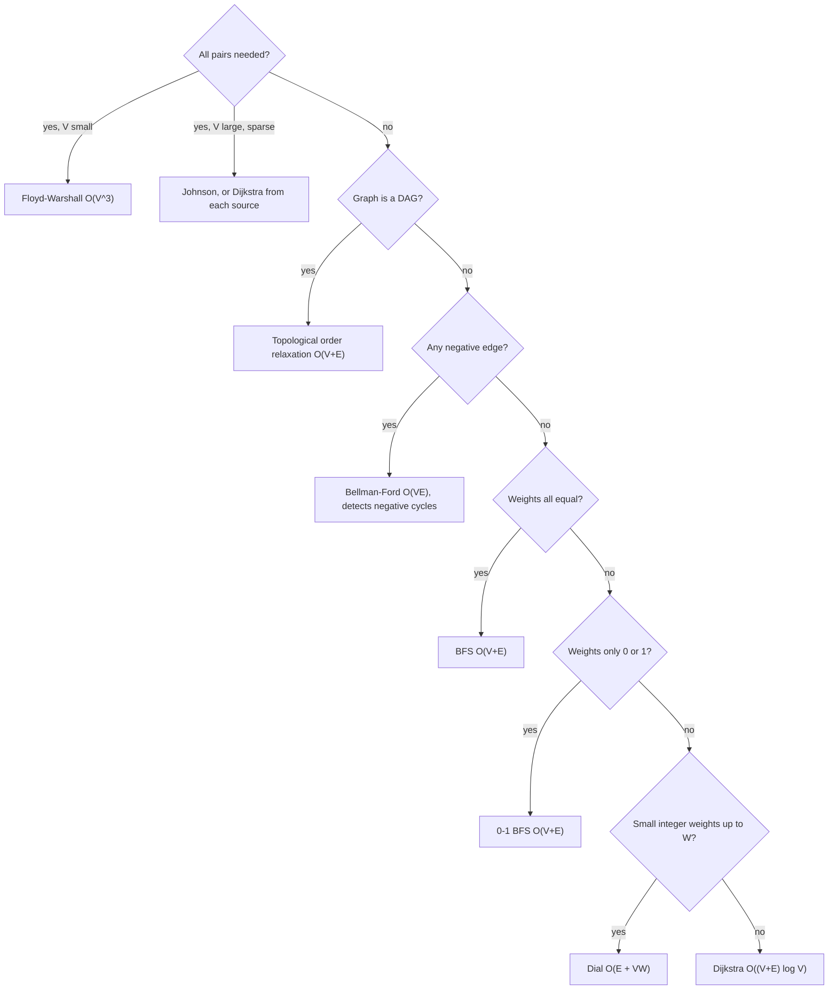

## Introduction

A map application has to get you from home to the airport. The roads form a graph: intersections are vertices, road segments are edges, and each edge has a **weight** — its travel time in minutes. The best route is not the one with the fewest road segments; a motorway with six segments can beat a back road with two. You need the path whose weights add up to the smallest total.

That is the **single-source shortest-path problem** on a weighted graph: given a source vertex, find the minimum total weight of a path to every other vertex. Breadth-first search solves it when every edge costs the same ([[a8-bfs-shortest-unweighted]]), but it counts edges, not weights. **Dijkstra's algorithm**, published by Edsger Dijkstra in 1959, solves it for any graph whose edge weights are **non-negative**, in O((V + E) log V) time with a binary heap.

Dijkstra is the most important weighted-graph algorithm to know. Internet routers running OSPF or IS-IS compute their forwarding tables with it. Road-routing engines build on it. In interviews, "Network Delay Time", "Path With Minimum Effort", "Swim in Rising Water" and "Cheapest Flights Within K Stops" are all Dijkstra or a close variant. And understanding *why* it works — and exactly when it stops working — is what lets you choose between it and its relatives: BFS, 0-1 BFS, Dial's algorithm, Bellman-Ford and others. This lesson covers the standard priority-queue version in depth, then the set-based and array-based versions, path printing, the negative-edge limitation, a decision tree for choosing an algorithm, and two specialised alternatives: Dial's algorithm and the D'Esopo-Pape algorithm.

## Before you start

- **BFS and unweighted shortest paths** — why the first time BFS reaches a vertex is along a shortest path. Dijkstra generalises exactly this. See [[a8-bfs]] and [[a8-bfs-shortest-unweighted]].
- **Priority queues and heaps** — `offer` and `poll` in O(log n), smallest element first. See [[a1-priorityqueue]] and [[a7-priority-queues]].
- **Weighted adjacency lists** — storing each edge as a `{neighbour, weight}` pair. See [[a8-graph-representation]].
- **TreeSet** (for the set-based version) — an ordered set with `pollFirst` and `remove` in O(log n). See [[a1-treeset]].

## The intuition

Pour water into a network of pipes at the source. The water spreads along every pipe at the same speed, and a pipe's weight is its length. The time at which water first reaches a junction is exactly that junction's shortest distance: water takes every route at once, and the first arrival is the shortest one. Junctions get wet in increasing order of distance.

Dijkstra simulates this, but it does not tick a clock. It jumps from one "arrival" to the next. At every moment it knows a **tentative distance** for each junction — the shortest route found so far — and it picks the not-yet-finalised junction with the smallest tentative distance. That junction is the next one the water reaches, so its distance is final. From there, the water starts down every pipe leaving it, which may give shorter tentative distances to its neighbours. Repeat until every reachable junction is wet.

The analogy also shows the limit. Water cannot arrive *earlier* by taking a longer route, because pipe lengths are never negative. If some pipe had negative length — a shortcut that went back in time — the first arrival would no longer be the final answer. That is precisely why Dijkstra requires non-negative weights.

## The problem and the naive approaches

Let the graph have `V` vertices and `E` edges, each edge `u → v` with weight `w(u, v)`. The **length** of a path is the sum of its edge weights, and `dist(v)` is the minimum length over all paths from the source `s` to `v` (infinity if `v` is unreachable). An undirected edge is two directed edges, one each way, with the same weight.

**Why BFS is not enough.** BFS processes vertices in order of *edge count*. Take edges `0 → 1` with weight 4, `0 → 2` with weight 1 and `2 → 1` with weight 2. BFS finalises vertex 1 at distance 4 using the single edge, but the two-edge route through 2 costs 3. Fewer edges is not the same as less weight.

**Enumerating paths.** Trying every simple path is correct but exponential: a graph can have more simple paths between two vertices than there are atoms in the universe.

**Repeated relaxation (Bellman-Ford).** Improving distances edge by edge until nothing changes takes O(V · E) time and handles negative weights ([[a8-bellman-ford]]). It works, but for a road network with millions of vertices it is far too slow. Dijkstra gets to O((V + E) log V) by exploiting non-negative weights.

### Relaxation

Every shortest-path algorithm in this lesson is built on one operation. Keep an array `dist[]`, with `dist[s] = 0` and every other entry at infinity. To **relax** the edge `u → v` means: if going to `u` and then along the edge is cheaper than the best route to `v` known so far, take it.

```java
if (dist[u] + w < dist[v]) {
    dist[v] = dist[u] + w;      // found a shorter route to v, through u
}
```

Relaxation preserves an important property: `dist[v]` is always the length of *some* real path to `v` (or infinity), so it never drops below the true distance. Algorithms differ only in **which edges they relax, and in what order**. Bellman-Ford relaxes every edge `V − 1` times. Dijkstra relaxes each vertex's edges exactly once, in a carefully chosen order, and that order is the whole idea.

## The greedy choice and why it is correct

Dijkstra keeps two kinds of vertices: **settled** ones, whose `dist` is known to be final, and the rest, which have tentative distances. Each step:

1. Pick the unsettled vertex `u` with the smallest tentative `dist[u]`.
2. Mark `u` settled.
3. Relax every edge leaving `u`.

**Claim:** when `u` is picked, `dist[u]` is already the true shortest distance.

Suppose not: some path `P` from `s` to `u` is shorter than `dist[u]`. `P` starts at the settled source and ends at the unsettled `u`, so somewhere it crosses from settled to unsettled for the first time — an edge `x → y` with `x` settled and `y` unsettled. When `x` was settled, its edges were relaxed, so `dist[y] ≤ dist[x] + w(x, y)`, which is the length of `P` up to `y`. Because **every weight is non-negative**, the rest of `P` from `y` to `u` adds zero or more, so the prefix up to `y` is no longer than all of `P`. Putting it together:

```text
dist[y] ≤ length(P up to y) ≤ length(P) < dist[u]
```

But then `y` is unsettled with a smaller tentative distance than `u`, contradicting the choice of `u` as the minimum. So no shorter path exists, and `dist[u]` is final.

The proof uses non-negativity exactly once, in "the rest of `P` adds zero or more". With a negative edge after `y`, a path that looks longer at `y` could end up shorter at `u`, and the argument collapses — the subject of [[a8-dijkstra-limitations]].

The remaining question is how to find "the unsettled vertex with the smallest tentative distance" quickly. Scanning all vertices costs O(V) per step and O(V²) overall. A priority queue does it in O(log V). The next three sections are three answers to that question.

## Dijkstra with Priority Queue (Standard) {#a8-dijkstra-priority-queue}

The standard implementation keeps candidate `{distance, vertex}` pairs in a **min-heap** — Java's `PriorityQueue` — so that `poll()` returns the pair with the smallest distance in O(log n). This is the version to write in interviews and contests. It runs in O((V + E) log V) and handles a missing heap operation with a technique called **lazy deletion**.

### The decrease-key problem and lazy deletion

When relaxation lowers `dist[v]`, `v`'s entry in the heap should move up. Textbook heaps provide a **decrease-key** operation for this, but `java.util.PriorityQueue` does not; its `remove(Object)` is a linear scan, O(n). The standard workaround is simple: **push a new pair with the smaller distance and leave the old one in the heap**. The new pair has a smaller key, so it is polled first. When the old, outdated pair is eventually polled, its distance is larger than `dist[v]` — it is **stale** — and the algorithm skips it.

That stale check, `if (d > dist[u]) continue;`, is also what implements "settled": the first time a vertex is polled, its entry carries the current (final) distance; every later entry for it is stale.

```java title="DijkstraPQ.java"
import java.util.*;

public class DijkstraPQ {
    static final long INF = Long.MAX_VALUE / 4;     // room to add a weight without overflow

    /** adj.get(u) holds {v, w} pairs with w >= 0. Returns dist[], INF if unreachable. */
    static long[] dijkstra(List<List<int[]>> adj, int src) {
        long[] dist = new long[adj.size()];
        Arrays.fill(dist, INF);
        dist[src] = 0;
        // Heap entries are {distance, vertex}, smallest distance first.
        PriorityQueue<long[]> pq = new PriorityQueue<>(Comparator.comparingLong(e -> e[0]));
        pq.add(new long[]{0, src});
        while (!pq.isEmpty()) {
            long[] top = pq.poll();
            long d = top[0];
            int u = (int) top[1];
            if (d > dist[u]) continue;               // stale copy: u was improved after this push
            for (int[] e : adj.get(u)) {             // u is settled: dist[u] is final
                int v = e[0];
                long nd = d + e[1];
                if (nd < dist[v]) {                  // relax: a shorter route to v through u
                    dist[v] = nd;
                    pq.add(new long[]{nd, v});       // no decrease-key: push a fresh entry
                }
            }
        }
        return dist;
    }

    static List<List<int[]>> undirected(int n, int[][] edges) {
        List<List<int[]>> adj = new ArrayList<>();
        for (int i = 0; i < n; i++) adj.add(new ArrayList<>());
        for (int[] e : edges) {
            adj.get(e[0]).add(new int[]{e[1], e[2]});
            adj.get(e[1]).add(new int[]{e[0], e[2]});
        }
        return adj;
    }

    public static void main(String[] args) {
        int[][] edges = {{0, 1, 4}, {0, 2, 1}, {2, 1, 2}, {1, 3, 5}, {2, 3, 8},
                         {2, 4, 10}, {3, 4, 2}, {3, 5, 6}, {4, 5, 3}};
        long[] dist = dijkstra(undirected(7, edges), 0);    // vertex 6 has no edges
        for (int v = 0; v < dist.length; v++) {
            System.out.println(v + ": " + (dist[v] == INF ? "unreachable" : dist[v]));
        }
    }
}
```

```output
0: 0
1: 3
2: 1
3: 8
4: 10
5: 13
6: unreachable
```

Walk through the design decisions:

- **`long` distances and `INF = Long.MAX_VALUE / 4`.** A path of 100,000 edges of weight 10⁹ sums to 10¹⁴, far beyond `int`. Dividing the sentinel by 4 leaves room for `INF + w` without overflowing into a negative number, which would look like a very short path.
- **`Comparator.comparingLong(e -> e[0])`.** The popular `(a, b) -> a[0] - b[0]` overflows when the difference exceeds `int` range and silently mis-orders the heap. Use `comparingLong` or `Long.compare`.
- **`nd = d + e[1]` uses the popped `d`.** Because stale entries are skipped, `d == dist[u]` at this point, so either works; using `d` avoids a second array read.
- **The stale check is required for speed, not correctness.** Without it, a stale entry would re-scan `u`'s edges; every relaxation would fail (they were already done with a smaller `dist[u]`), so answers stay right but the work can multiply.

### Dry run

The graph is undirected with edges `0–1 (4)`, `0–2 (1)`, `2–1 (2)`, `1–3 (5)`, `2–3 (8)`, `2–4 (10)`, `3–4 (2)`, `3–5 (6)`, `4–5 (3)`, plus an isolated vertex 6. Each row is one `poll`.

| Poll | Stale? | Settles | Successful relaxations | Heap after (distance, vertex) |
|---|---|---|---|---|
| (0, 0) | no | 0 | dist[1] = 4, dist[2] = 1 | (1,2) (4,1) |
| (1, 2) | no | 2 | dist[1] = 3, dist[3] = 9, dist[4] = 11 | (3,1) (4,1) (9,3) (11,4) |
| (3, 1) | no | 1 | dist[3] = 8 | (4,1) (8,3) (9,3) (11,4) |
| (4, 1) | yes, 4 > 3 | — | — | (8,3) (9,3) (11,4) |
| (8, 3) | no | 3 | dist[4] = 10, dist[5] = 14 | (9,3) (10,4) (11,4) (14,5) |
| (9, 3) | yes | — | — | (10,4) (11,4) (14,5) |
| (10, 4) | no | 4 | dist[5] = 13 | (11,4) (13,5) (14,5) |
| (11, 4) | yes | — | — | (13,5) (14,5) |
| (13, 5) | no | 5 | none | (14,5) |
| (14, 5) | yes | — | — | empty |

(The table was checked against a traced run of the same program.) Three things are visible. Vertices are settled in increasing distance order: 0, 1, 3, 8, 10, 13 — the water-arrival order. Tentative distances only ever decrease: vertex 1 went 4 → 3, vertex 3 went 9 → 8, vertex 4 went 11 → 10, vertex 5 went 14 → 13. And every decrease left a stale entry behind, which was skipped when it surfaced. Vertex 6 never enters the heap and stays at `INF`.

### Complexity derivation

- Every vertex is settled at most once, and when it is settled its adjacency list is scanned once. So the total number of edge relaxations is at most `E` (2E for an undirected graph's two directions; still O(E)).
- Each successful relaxation pushes one entry, so the heap receives at most `E + 1` entries in total and is polled at most that many times.
- Each push and poll costs O(log(heap size)) = O(log E). Since `E ≤ V²`, log E ≤ 2 log V, so that is O(log V).

Total time: **O((V + E) log V)**, often written O(E log V) for connected graphs. Space: O(V) for `dist` plus up to O(E) heap entries, so **O(V + E)**, excluding the graph itself. A Fibonacci heap with true decrease-key improves the theoretical bound to O(E + V log V), but its constant factors are large and it is rarely used in practice.

### Practical variations

- **Single target**: stop as soon as the target is polled (not stale) — its distance is final at that moment.
- **Multiple sources**: push every source with distance 0 before the loop, exactly as in [[a8-multi-source-bfs]].
- **Grids with cell costs**: vertices are cells, and moving into a cell costs its value. "Path With Minimum Effort" changes the path cost to the *maximum* step along the path instead of the sum; Dijkstra still works because extending a path never decreases its cost.
- **Extra state**: "Cheapest Flights Within K Stops" needs the vertex *and* the number of stops used in each heap entry, because the cheapest route to a city may use too many stops. The state space becomes `(vertex, stops)`.

## Dijkstra with Set {#a8-dijkstra-set}

**Dijkstra with a set** replaces the heap with an ordered set of `{distance, vertex}` pairs — Java's `TreeSet`, a red-black tree. Because a balanced tree supports removing an *arbitrary* element in O(log n), it can perform a real **decrease-key**: when `dist[v]` improves, remove `v`'s old pair and insert the new one. There are no stale entries, the set never holds more than one entry per vertex, and the first element is always the next vertex to settle. This is the version commonly written in C++ with `std::set`, and the same idea works in Java.

```java title="DijkstraSet.java"
import java.util.*;

public class DijkstraSet {
    static final long INF = Long.MAX_VALUE / 4;

    static long[] dijkstra(List<List<int[]>> adj, int src) {
        int n = adj.size();
        long[] dist = new long[n];
        Arrays.fill(dist, INF);
        dist[src] = 0;
        // Order by distance, then by vertex id so that two vertices with equal
        // distance are different elements (a TreeSet drops "equal" elements).
        TreeSet<long[]> set = new TreeSet<>((a, b) ->
                a[0] != b[0] ? Long.compare(a[0], b[0]) : Long.compare(a[1], b[1]));
        set.add(new long[]{0, src});
        while (!set.isEmpty()) {
            long[] top = set.pollFirst();            // the closest unsettled vertex
            int u = (int) top[1];
            for (int[] e : adj.get(u)) {
                int v = e[0];
                long nd = dist[u] + e[1];
                if (nd < dist[v]) {
                    if (dist[v] != INF) set.remove(new long[]{dist[v], v});  // decrease-key:
                    dist[v] = nd;                                            // remove old key,
                    set.add(new long[]{nd, v});                              // insert new key
                }
            }
        }
        return dist;
    }

    public static void main(String[] args) {
        int[][] edges = {{0, 1, 4}, {0, 2, 1}, {2, 1, 2}, {1, 3, 5}, {2, 3, 8},
                         {2, 4, 10}, {3, 4, 2}, {3, 5, 6}, {4, 5, 3}};
        List<List<int[]>> adj = new ArrayList<>();
        for (int i = 0; i < 6; i++) adj.add(new ArrayList<>());
        for (int[] e : edges) {
            adj.get(e[0]).add(new int[]{e[1], e[2]});
            adj.get(e[1]).add(new int[]{e[0], e[2]});
        }
        System.out.println(Arrays.toString(dijkstra(adj, 0)));
    }
}
```

```output
[0, 3, 1, 8, 10, 13]
```

### Two details that make it work

**Removing by value.** `set.remove(new long[]{dist[v], v})` passes a *new* array, which is a different object from the one stored. It still works because a `TreeSet` finds elements with its comparator, not with `equals`: any array comparing equal on distance and vertex is "the same" element. The order of statements matters — remove using the *old* `dist[v]` before overwriting it.

**The tie-breaker in the comparator.** A `TreeSet` treats two elements whose comparator returns 0 as duplicates and keeps only one. With a comparator on distance alone, two different vertices at the same distance collide:

```java
TreeSet<long[]> s = new TreeSet<>((x, y) -> Long.compare(x[0], y[0]));
s.add(new long[]{5, 1});
s.add(new long[]{5, 2});
System.out.println("distance-only comparator keeps " + s.size() + " of 2 entries");
```

```output
distance-only comparator keeps 1 of 2 entries
```

Vertex 2 is silently dropped and never settled, so its neighbours may keep wrong distances. Comparing by vertex id on ties fixes it. A `PriorityQueue` does not have this problem — it allows duplicates — which is one reason the heap version is the safer default in Java.

### Complexity and comparison

Each vertex is polled once (O(log V)), and each successful relaxation does at most one `remove` and one `add` (O(log V) each). Total **O((V + E) log V)**, the same as the heap version, but the set holds at most `V` entries instead of up to `E`.

| | PriorityQueue (lazy) | TreeSet (decrease-key) |
|---|---|---|
| Time | O((V + E) log V) | O((V + E) log V) |
| Container size | up to O(E), with stale entries | at most V |
| Stale check needed | yes | no |
| Comparator pitfall | none (duplicates allowed) | must tie-break on vertex |
| Constant factor in Java | smaller (array-backed heap) | larger (tree nodes, rebalancing) |

In Java the heap version is usually faster in practice because `PriorityQueue` is a compact array while `TreeSet` allocates a tree node per entry; the set version is mainly worth knowing because interviewers ask about decrease-key and because it is the idiomatic C++ form.

### The O(V²) version for dense graphs

There is a third way to find the minimum: scan all unsettled vertices. That costs O(V) per step, O(V²) in total — and no heap at all.

```java title="DenseDijkstra.java"
import java.util.*;

public class DenseDijkstra {
    static final long INF = Long.MAX_VALUE / 4;

    /** w[u][v] = weight, or -1 for "no edge". O(V^2) with no heap at all. */
    static long[] dijkstra(int[][] w, int src) {
        int n = w.length;
        long[] dist = new long[n];
        boolean[] settled = new boolean[n];
        Arrays.fill(dist, INF);
        dist[src] = 0;
        for (int round = 0; round < n; round++) {
            int u = -1;
            for (int v = 0; v < n; v++) {            // linear scan replaces the heap
                if (!settled[v] && (u == -1 || dist[v] < dist[u])) u = v;
            }
            if (dist[u] == INF) break;               // the rest is unreachable
            settled[u] = true;
            for (int v = 0; v < n; v++) {
                if (w[u][v] >= 0 && dist[u] + w[u][v] < dist[v]) dist[v] = dist[u] + w[u][v];
            }
        }
        return dist;
    }

    public static void main(String[] args) {
        int[][] edges = {{0, 1, 4}, {0, 2, 1}, {2, 1, 2}, {1, 3, 5}, {2, 3, 8},
                         {2, 4, 10}, {3, 4, 2}, {3, 5, 6}, {4, 5, 3}};
        int[][] w = new int[6][6];
        for (int[] row : w) Arrays.fill(row, -1);
        for (int[] e : edges) { w[e[0]][e[1]] = e[2]; w[e[1]][e[0]] = e[2]; }
        System.out.println(Arrays.toString(dijkstra(w, 0)));
    }
}
```

```output
[0, 3, 1, 8, 10, 13]
```

When the graph is **dense** — `E` close to `V²` — the heap version costs O(V² log V), so this simpler O(V²) version is asymptotically *faster*. It is also Dijkstra's original 1959 formulation. Rule of thumb: adjacency matrix or `E ≈ V²` → array scan; sparse adjacency list → heap.

## Print Shortest Path (Dijkstra) {#a8-dijkstra-print-path}

**Printing the shortest path** means returning the actual sequence of vertices from the source to a target, not only its length. Dijkstra computes the path implicitly; to recover it, record a **parent pointer** each time a relaxation succeeds — `parent[v] = u` means "the best route to `v` found so far arrives from `u`" — and at the end follow the pointers backwards from the target.

```java title="DijkstraPath.java"
import java.util.*;

public class DijkstraPath {
    static final long INF = Long.MAX_VALUE / 4;

    /** Returns one shortest path src -> dst as a vertex list, or an empty list. */
    static List<Integer> shortestPath(List<List<int[]>> adj, int src, int dst) {
        int n = adj.size();
        long[] dist = new long[n];
        int[] parent = new int[n];                   // parent[v]: previous vertex on the best path
        Arrays.fill(dist, INF);
        Arrays.fill(parent, -1);
        dist[src] = 0;
        PriorityQueue<long[]> pq = new PriorityQueue<>(Comparator.comparingLong(e -> e[0]));
        pq.add(new long[]{0, src});
        while (!pq.isEmpty()) {
            long[] top = pq.poll();
            long d = top[0];
            int u = (int) top[1];
            if (d > dist[u]) continue;
            if (u == dst) break;                     // dst is settled: its path is final
            for (int[] e : adj.get(u)) {
                int v = e[0];
                long nd = d + e[1];
                if (nd < dist[v]) {
                    dist[v] = nd;
                    parent[v] = u;                   // remember who gave v this distance
                    pq.add(new long[]{nd, v});
                }
            }
        }
        if (dist[dst] == INF) return List.of();      // unreachable
        LinkedList<Integer> path = new LinkedList<>();
        for (int v = dst; v != -1; v = parent[v]) path.addFirst(v);   // walk back to src
        return path;
    }

    public static void main(String[] args) {
        int[][] edges = {{0, 1, 4}, {0, 2, 1}, {2, 1, 2}, {1, 3, 5}, {2, 3, 8},
                         {2, 4, 10}, {3, 4, 2}, {3, 5, 6}, {4, 5, 3}};
        List<List<int[]>> adj = new ArrayList<>();
        for (int i = 0; i < 7; i++) adj.add(new ArrayList<>());
        for (int[] e : edges) {
            adj.get(e[0]).add(new int[]{e[1], e[2]});
            adj.get(e[1]).add(new int[]{e[0], e[2]});
        }
        System.out.println("0 -> 5: " + shortestPath(adj, 0, 5));
        System.out.println("0 -> 3: " + shortestPath(adj, 0, 3));
        System.out.println("0 -> 0: " + shortestPath(adj, 0, 0));
        System.out.println("0 -> 6: " + shortestPath(adj, 0, 6));
    }
}
```

```output
0 -> 5: [0, 2, 1, 3, 4, 5]
0 -> 3: [0, 2, 1, 3]
0 -> 0: [0]
0 -> 6: []
```

The path to 5 has weight 1 + 2 + 5 + 2 + 3 = 13, matching `dist[5]`. It uses five edges, while the route `0 → 2 → 4 → 5` uses three but costs 14 — the reason BFS cannot solve this problem.

### Why the parent pointers are right

`parent[v]` is overwritten on every improvement, so it ends up recording the vertex that produced the *final* `dist[v]`. That vertex `u` was settled with its final distance, so `dist[v] = dist[u] + w(u, v)` — the last edge of a shortest path. Applying the same argument to `u`, then to its parent, and so on, reaches the source, which is the only vertex with `parent == -1`. The pointers of all vertices together form the **shortest-path tree**: a tree rooted at the source that contains one shortest path to every reachable vertex.

Walking `parent` produces the path in reverse (target first), so the code prepends with `addFirst`. An `ArrayList` followed by `Collections.reverse` works equally well. Reconstruction costs O(path length), at most O(V). The early `break` when the target is settled saves work for single-target queries; it is safe because a settled vertex's distance and parent never change again.

Edge cases the output covers: source equals target returns `[0]`; an unreachable target returns an empty list — check `dist[dst] == INF` before walking, because an unreachable vertex's `parent` is `-1` and the walk would wrongly return `[dst]`.

### Variations

- **Ties.** With several shortest paths, this code returns whichever the relaxation order found first, because it replaces the parent only on a strict `<`. To prefer, say, fewer edges among equal-weight paths, compare `(distance, edges)` pairs.
- **Counting shortest paths.** Keep `ways[v]`. On a strict improvement, set `ways[v] = ways[u]`; on an equal distance (`nd == dist[v]`), add `ways[u]`. Because vertices settle in distance order, each `ways[u]` is final before it is used, provided zero-weight edges are absent or handled carefully.
- **All shortest paths.** Store a *list* of parents for each vertex (append on equality, reset on improvement), then enumerate paths with DFS over that parent graph.
- **Path to every vertex.** Run without the early `break` and keep the `parent` array; each path is a separate walk.

## Why Dijkstra Fails on Negative Edges {#a8-dijkstra-limitations}

Dijkstra's correctness rests on one assumption: once the closest unsettled vertex is chosen, no later route can reach it more cheaply. A **negative edge weight** breaks that assumption, because a route that looks longer partway can become shorter after crossing the negative edge. The result is not an error message but a silently wrong distance.

### A concrete counterexample

Take the directed edges `0 → 1 (2)`, `0 → 2 (3)`, `2 → 1 (−2)` and `1 → 3 (1)`. The true distances are `dist(1) = 1` (via 2: 3 − 2) and `dist(3) = 2`. Textbook Dijkstra, which never touches a vertex again once it is settled, gets them wrong; Bellman-Ford gets them right.

```java title="NegativeEdge.java"
import java.util.*;

public class NegativeEdge {
    static final long INF = Long.MAX_VALUE / 4;

    // Textbook Dijkstra: once a vertex is settled it is never touched again.
    static long[] settleOnce(List<List<int[]>> adj, int src) {
        int n = adj.size();
        long[] dist = new long[n];
        boolean[] settled = new boolean[n];
        Arrays.fill(dist, INF);
        dist[src] = 0;
        PriorityQueue<long[]> pq = new PriorityQueue<>(Comparator.comparingLong(e -> e[0]));
        pq.add(new long[]{0, src});
        while (!pq.isEmpty()) {
            int u = (int) pq.poll()[1];
            if (settled[u]) continue;
            settled[u] = true;
            for (int[] e : adj.get(u)) {
                int v = e[0];
                if (!settled[v] && dist[u] + e[1] < dist[v]) {
                    dist[v] = dist[u] + e[1];
                    pq.add(new long[]{dist[v], v});
                }
            }
        }
        return dist;
    }

    static long[] bellmanFord(int n, int[][] edges, int src) {
        long[] dist = new long[n];
        Arrays.fill(dist, INF);
        dist[src] = 0;
        for (int pass = 1; pass < n; pass++) {
            for (int[] e : edges) {
                if (dist[e[0]] != INF && dist[e[0]] + e[2] < dist[e[1]]) {
                    dist[e[1]] = dist[e[0]] + e[2];
                }
            }
        }
        return dist;
    }

    public static void main(String[] args) {
        int n = 4;
        int[][] edges = {{0, 1, 2}, {0, 2, 3}, {2, 1, -2}, {1, 3, 1}};   // directed
        List<List<int[]>> adj = new ArrayList<>();
        for (int i = 0; i < n; i++) adj.add(new ArrayList<>());
        for (int[] e : edges) adj.get(e[0]).add(new int[]{e[1], e[2]});

        System.out.println("Dijkstra (settle once): " + Arrays.toString(settleOnce(adj, 0)));
        System.out.println("Bellman-Ford:           " + Arrays.toString(bellmanFord(n, edges, 0)));
    }
}
```

```output
Dijkstra (settle once): [0, 2, 3, 3]
Bellman-Ford:           [0, 1, 3, 2]
```

Trace the failure. From 0, tentative distances are 2 for vertex 1 and 3 for vertex 2. Vertex 1 is closest, so it is settled at 2 and relaxes `1 → 3`, giving 3. Then vertex 2 is settled at 3, and its edge `2 → 1` offers 3 + (−2) = 1 — but vertex 1 is already "final". The proof's step "the rest of the path adds zero or more" is exactly what failed: the path `0 → 2` looked longer (3 > 2) at vertex 2, and the negative edge after it made it shorter. The error then spreads: vertex 3's distance was computed from the wrong value of vertex 1.

### What the lazy Java version does instead

The lazy `PriorityQueue` implementation from [[a8-dijkstra-priority-queue]] has no `settled` array: whenever `dist[v]` improves, it pushes `v` again and will process it again. On this graph it actually returns the correct `[0, 1, 3, 2]` — vertex 1 is improved to 1, re-pushed and re-processed, and vertex 3 is improved to 2. In general, with negative edges but **no negative cycle**, the lazy version still terminates with correct distances, because it has become a "keep relaxing until nothing improves" method. What it loses is the running-time guarantee: vertices can be re-processed many times, and adversarial graphs make the number of re-processings grow exponentially. "Seems to work on my tests" is therefore not evidence that Dijkstra is safe with negative edges.

With a **negative cycle** — a cycle whose weights sum below zero, such as `1 → 2 (−3)`, `2 → 1 (1)` — distances can be lowered forever, and the lazy version never terminates (in our test it was still running after a million vertex settlements). Shortest distances are not even defined for vertices reachable through such a cycle.

### A tempting fix that does not work

"Add a constant to every weight so they are all non-negative, then run Dijkstra." This changes which path is shortest, because the constant is added once *per edge*, penalising paths with more edges. Example: `0 → 2` directly with weight 1, or `0 → 1 (2)` then `1 → 2 (−2)` with total 0. The second path is shorter. Add 2 to every edge: the direct path becomes 3, the two-edge path 4 + 0 = 4, and Dijkstra now picks the direct path — the wrong one. A correct reweighting exists, but it uses a different value per vertex computed by Bellman-Ford; that is Johnson's algorithm ([[a8-johnsons-algorithm]]).

### What to use instead

- Negative edges, single source: **Bellman-Ford**, O(V · E), which also detects negative cycles ([[a8-bellman-ford]], [[a8-negative-cycle-detection]]).
- Negative edges in a **DAG**: relax edges in topological order, O(V + E) — negative weights are fine because there are no cycles ([[a8-shortest-path-dag]]).
- Negative edges, all pairs: **Floyd-Warshall** for small `V`, or Johnson's algorithm for large sparse graphs.
- Negative edges, practical speed without guarantees: **D'Esopo-Pape** or the queue-based Bellman-Ford variant (SPFA), both later in this lesson or in [[a8-bellman-ford]].

```quiz
Q: In the lazy PriorityQueue version of Dijkstra, a polled entry (9, 3) is found while dist[3] is 8. What should happen?
- [ ] Relax vertex 3's edges again using distance 9
- [ ] Update dist[3] back to 9
- [x] Skip the entry: it is a stale copy left behind when dist[3] improved to 8
- [ ] Stop the algorithm, because the heap is corrupted
> Java's PriorityQueue has no decrease-key, so improving dist[3] pushed a new entry (8, 3) and left (9, 3) behind. The smaller entry was polled first and settled vertex 3. The old one carries an outdated distance and must be ignored; processing it would only repeat work.

Q: Why must the TreeSet comparator in set-based Dijkstra compare vertex ids when distances are equal?
- [ ] To make the algorithm settle vertices in id order
- [x] A TreeSet treats comparator-equal elements as duplicates, so two vertices at the same distance would collapse into one and a vertex could be lost
- [ ] Because TreeSet cannot store arrays otherwise
- [ ] It improves the running time from O(V²) to O(V log V)
> TreeSet keeps only one of any two elements whose comparator returns 0. Without the tie-breaker, adding (5, vertex 2) after (5, vertex 1) does nothing, vertex 2 is never polled, and distances beyond it can be wrong. PriorityQueue allows duplicates, so the heap version does not have this pitfall.

Q: A directed graph has the edges 0 -> 1 (2), 0 -> 2 (3), 2 -> 1 (-2). What does textbook Dijkstra (settle each vertex once) report for vertex 1, and what is correct?
- [ ] Reports 1, correct is 1
- [x] Reports 2, correct is 1
- [ ] Reports 3, correct is 2
- [ ] Reports 1, correct is 2
> Vertex 1 (tentative 2) is closer than vertex 2 (tentative 3), so it is settled first at 2. When vertex 2 is settled later, the edge 2 -> 1 offers 3 - 2 = 1, but vertex 1 is already final and is not updated. The negative edge made a path that looked longer at vertex 2 end up shorter, which is exactly the step the correctness proof rules out.
```

## Shortest-Path Algorithm Decision Tree {#a8-shortest-path-decision}

The **shortest-path decision tree** is a way to choose the algorithm from the problem's properties instead of from habit. Each shortest-path algorithm is correct only under certain conditions on the weights and the graph's structure, and the special cases are faster than the general ones. The questions to ask, in order, are: how many sources (one, or all pairs)? What weights (all equal, only 0 and 1, small non-negative integers, non-negative, or possibly negative)? Is the graph a DAG? Can there be a negative cycle?



| Situation | Algorithm | Time | Notes |
|---|---|---|---|
| Unweighted, or all weights equal | BFS | O(V + E) | [[a8-bfs-shortest-unweighted]] |
| Weights 0 or 1 | 0-1 BFS (deque) | O(V + E) | 0-edges to the front, 1-edges to the back; [[a8-0-1-bfs]] |
| Small non-negative integers ≤ W | Dial's algorithm | O(E + V · W) | Bucket queue; later in this lesson |
| DAG, any weights | Topological relaxation | O(V + E) | Negative edges allowed; [[a8-shortest-path-dag]] |
| Non-negative weights, sparse | Dijkstra with heap | O((V + E) log V) | The default |
| Non-negative weights, dense | Dijkstra with array scan | O(V²) | Beats the heap when E ≈ V² |
| Negative edges, single source | Bellman-Ford | O(V · E) | Detects negative cycles; [[a8-bellman-ford]] |
| Negative edges, fast in practice | D'Esopo-Pape, SPFA | no good worst-case bound | No negative cycles allowed; later in this lesson |
| All pairs, V up to a few hundred | Floyd-Warshall | O(V³) | Handles negative edges; [[a8-floyd-warshall]] |
| All pairs, large sparse, negative edges | Johnson | O(V · E log V) | Bellman-Ford once, then Dijkstra from each vertex; [[a8-johnsons-algorithm]] |

### Reading the table well

**Check the special cases first.** Dijkstra on an unweighted graph is correct but carries a needless log factor; BFS is simpler and faster. Dijkstra on a DAG with negative edges is wrong, while topological relaxation is both correct and linear. A Dijkstra-shaped problem whose weights are 0 and 1 ("minimum walls to break", "minimum edge reversals") is a 0-1 BFS problem.

**Watch for disguised weights.** "Minimise the maximum step" (Path With Minimum Effort) or "minimise the time at which you can pass" (Swim in Rising Water) are not sums, but they are still monotone — extending a path never makes it better — so Dijkstra applies with a different combining rule. Problems with constraints like "at most K stops" need extra state in each vertex.

**Count the queries.** One source: one run. Many sources to one target: reverse the edges and run once from the target. Many unrelated pairs on a small graph: Floyd-Warshall. Many unrelated pairs on a huge graph (road networks): specialised preprocessing such as contraction hierarchies.

**Read the constraints.** `V ≤ 400` hints at Floyd-Warshall; `V, E ≤ 2 · 10⁵` with non-negative weights means heap Dijkstra; `V · E ≤ 10⁷` or so makes Bellman-Ford affordable; weights in `{0, 1}` mean 0-1 BFS.

## Dial's Algorithm {#a8-dials-algorithm}

**Dial's algorithm** (Robert Dial, 1969) is Dijkstra for graphs whose edge weights are **small non-negative integers**, with a **bucket queue** instead of a heap. Since every distance is an integer between 0 and some maximum, keep an array of buckets where `bucket[d]` holds the vertices whose tentative distance is `d`. Then "find the smallest tentative distance" becomes "move forward to the next non-empty bucket" — no comparisons, no log factor.

### Why the buckets can be scanned in one pass

Dijkstra settles vertices in non-decreasing distance order. When the algorithm is processing bucket `d`, every relaxation produces `d + w ≥ d`, because weights are non-negative. So no vertex is ever put into a bucket *behind* the current one, and a single forward sweep over the buckets visits every vertex in the right order. As in the lazy heap version, a vertex whose distance improves is added to its new bucket; its old copy, found later in a higher bucket, is skipped as stale.

With maximum edge weight `W`, no shortest simple path is longer than `(V − 1) · W`, which bounds the number of buckets.

```java title="DialsAlgorithm.java"
import java.util.*;

public class DialsAlgorithm {
    static final int INF = Integer.MAX_VALUE;

    /** Integer weights in [0, maxW]. Bucket d holds vertices whose tentative distance is d. */
    static int[] dial(List<List<int[]>> adj, int src, int maxW) {
        int n = adj.size();
        int[] dist = new int[n];
        Arrays.fill(dist, INF);
        dist[src] = 0;
        int maxDist = (n - 1) * maxW;                // no simple path is longer than this
        List<ArrayDeque<Integer>> bucket = new ArrayList<>();
        for (int d = 0; d <= maxDist; d++) bucket.add(new ArrayDeque<>());
        bucket.get(0).add(src);
        for (int d = 0; d <= maxDist; d++) {         // scan distances in increasing order
            while (!bucket.get(d).isEmpty()) {
                int u = bucket.get(d).poll();
                if (dist[u] != d) continue;          // stale: u moved to a smaller bucket
                for (int[] e : adj.get(u)) {
                    int v = e[0], nd = d + e[1];
                    if (nd < dist[v]) {
                        dist[v] = nd;
                        bucket.get(nd).add(v);       // nd >= d, so it is never behind us
                    }
                }
            }
        }
        return dist;
    }

    public static void main(String[] args) {
        int[][] edges = {{0, 1, 4}, {0, 2, 1}, {2, 1, 2}, {1, 3, 5}, {2, 3, 8},
                         {2, 4, 10}, {3, 4, 2}, {3, 5, 6}, {4, 5, 3}};
        List<List<int[]>> adj = new ArrayList<>();
        for (int i = 0; i < 6; i++) adj.add(new ArrayList<>());
        for (int[] e : edges) {
            adj.get(e[0]).add(new int[]{e[1], e[2]});
            adj.get(e[1]).add(new int[]{e[0], e[2]});
        }
        System.out.println(Arrays.toString(dial(adj, 0, 10)));
    }
}
```

```output
[0, 3, 1, 8, 10, 13]
```

The answer matches the heap version on the same graph (and a randomised comparison against Bellman-Ford on 30,000 small graphs found no differences). With 6 vertices and `W = 10`, there are 51 buckets; vertex 1 is first added to bucket 4, then to bucket 3 when the route through 2 is found, and its copy in bucket 4 is skipped.

### Complexity

The sweep visits each of the `(V − 1) · W + 1` buckets once, and each edge is relaxed once when its tail is settled, with O(1) bucket insertions. Total time **O(E + V · W)**; space O(V · W) for the buckets.

That is better than Dijkstra's O(E log V) when `V · W` is small relative to `E log V` — for example, a grid where moving costs between 1 and 9. When `W` is large (weights up to 10⁹), the bucket array is impossibly big and the heap version is the only option.

### Saving space with circular buckets

At any moment, every tentative distance in the queue lies in the range `[d, d + W]`, where `d` is the current bucket: anything larger would have come from a vertex not yet settled. So only `W + 1` buckets are ever in use at once, and they can be reused cyclically with index `distance % (W + 1)`. Space drops to O(V + W). The sweep then needs a separate count of non-empty buckets (or of remaining vertices) to know when to stop, since it can no longer run to the end of the array.

0-1 BFS is Dial's algorithm with `W = 1`, where the two active buckets are the front and back of a deque.

## D'Esopo-Pape Algorithm {#a8-desopo-pape}

The **D'Esopo-Pape algorithm** is a single-source shortest-path method that, unlike Dijkstra, accepts **negative edge weights** (as long as no negative cycle is reachable). It is a label-correcting algorithm, a relative of Bellman-Ford: vertices whose distance improves are put in a deque to be processed again. Its distinctive rule is *where* they go: a vertex seen for the first time goes to the **back**, while a vertex that was already processed before and has just improved goes to the **front**.

### The idea behind the rule

When a vertex that was already processed gets a better distance, every vertex whose distance was computed through it is now out of date. Processing it immediately, at the front, pushes the correction to its neighbours before the algorithm spends effort on vertices that would then be corrected again. New vertices, by contrast, can wait their turn at the back, giving a breadth-first flavour like BFS.

Each vertex is in one of three states: never queued (0), currently in the deque (1), or queued before but currently out (2). A vertex already in the deque is not added again; its improved `dist` will be used when it comes out.

```java title="DesopoPape.java"
import java.util.*;

public class DesopoPape {
    static final long INF = Long.MAX_VALUE / 4;

    /** Works with negative edges as long as no negative cycle is reachable. */
    static long[] shortest(List<List<int[]>> adj, int src) {
        int n = adj.size();
        long[] dist = new long[n];
        Arrays.fill(dist, INF);
        dist[src] = 0;
        // state 0: never queued, 1: in the deque now, 2: was queued before, now out
        int[] state = new int[n];
        ArrayDeque<Integer> deque = new ArrayDeque<>();
        deque.add(src);
        state[src] = 1;
        while (!deque.isEmpty()) {
            int u = deque.pollFirst();
            state[u] = 2;
            for (int[] e : adj.get(u)) {
                int v = e[0];
                if (dist[u] + e[1] < dist[v]) {
                    dist[v] = dist[u] + e[1];
                    if (state[v] == 0) deque.addLast(v);        // first visit: back
                    else if (state[v] == 2) deque.addFirst(v);  // seen before: front
                    // state 1: already waiting; its improved dist[] will be used
                    state[v] = 1;
                }
            }
        }
        return dist;
    }

    public static void main(String[] args) {
        int n = 4;
        int[][] edges = {{0, 1, 2}, {0, 2, 3}, {2, 1, -2}, {1, 3, 1}};   // directed
        List<List<int[]>> adj = new ArrayList<>();
        for (int i = 0; i < n; i++) adj.add(new ArrayList<>());
        for (int[] e : edges) adj.get(e[0]).add(new int[]{e[1], e[2]});
        System.out.println(Arrays.toString(shortest(adj, 0)));
    }
}
```

```output
[0, 1, 3, 2]
```

This is the negative-edge graph that broke textbook Dijkstra, and D'Esopo-Pape gets it right. Trace: 0 is processed and puts 1 and 2 at the back (`dist` 2 and 3). Vertex 1 is processed (state 2) and puts 3 at the back with `dist` 3. Vertex 2 is processed and improves vertex 1 to 1 — vertex 1 has state 2, so it goes to the **front**. It is processed next and improves vertex 3 to 2; vertex 3 is still waiting in the deque, so it is not added again. Finally vertex 3 is processed with its corrected distance. Its result also matched Bellman-Ford on 30,000 random graphs with negative weights and no cycles.

### Complexity and when to use it

On many practical graphs — it comes from 1970s work on transport networks — D'Esopo-Pape is fast, often faster than Dijkstra. But its worst case is **exponential**: there are known graph families on which vertices are pushed to the front over and over. It has no polynomial guarantee, unlike Bellman-Ford's O(V · E), and with a negative cycle it never terminates. Space is O(V).

So treat it as an engineering heuristic, not an interview default. When negative edges appear and you need a guarantee, use Bellman-Ford; when weights are non-negative, use Dijkstra. Knowing D'Esopo-Pape is useful for recognising it and its relative SPFA (the queue-based Bellman-Ford), and for knowing why contest problem setters often include tests that make them slow.

```quiz
Q: Edge weights are integers from 0 to 5, and the graph has 100,000 vertices and 400,000 edges. Which algorithm avoids the log factor while staying correct?
- [ ] BFS, because the weights are small
- [x] Dial's algorithm with a bucket queue
- [ ] Bellman-Ford, because it handles any weights
- [ ] D'Esopo-Pape, because it is usually fast
> With non-negative integer weights at most W = 5, Dial's algorithm runs in O(E + V·W), about 900,000 steps here, with no heap. BFS is wrong whenever weights differ. Bellman-Ford is correct but O(V·E). D'Esopo-Pape has no polynomial worst-case guarantee.

Q: In D'Esopo-Pape, a vertex that has already been processed once gets a smaller distance. Where does it go, and why?
- [ ] To the back, like every improved vertex
- [x] To the front, so the correction spreads to its neighbours before they are processed with outdated values
- [ ] Nowhere, because processed vertices are final
- [ ] To a separate priority queue ordered by distance
> Vertices whose distances were derived from it are now outdated. Processing it immediately propagates the improvement early. New vertices go to the back. Processed vertices are not final here, because negative edges are allowed.

Q: Which problem should NOT be solved with Dijkstra's algorithm?
- [ ] Shortest travel time on roads with positive travel times
- [ ] Path With Minimum Effort, where cost is the largest height difference along the path
- [x] Shortest path in a general directed graph that has some negative edge weights
- [ ] Network Delay Time with positive delays
> Dijkstra requires that extending a path never makes it cheaper. Positive times and the "maximum step" cost both satisfy that. Negative edge weights violate it; use Bellman-Ford, or topological relaxation if the graph is a DAG.
```

## How it works internally

**The heap.** `PriorityQueue` is a binary heap stored in an array: `offer` places the new entry at the end and sifts it up; `poll` moves the last entry to the root and sifts it down. Each is O(log n) with small constants. The lazy version's heap can grow to about `E` entries; on a graph with 10⁶ edges that is 10⁶ small `long[]` objects, which is noticeable memory but rarely a problem. Encoding each entry as a single `long` (distance in the high bits, vertex in the low bits) is a common optimisation when distances are known to be small enough.

**The order of settlement.** Dijkstra settles vertices in non-decreasing distance — the same "frontier" behaviour as BFS, but measured by weight. BFS is Dijkstra in which every weight is 1 and the heap degenerates to a FIFO queue, because distances enter the queue in non-decreasing order on their own. 0-1 BFS and Dial's algorithm are Dijkstra with cheaper priority queues that exploit restricted weights.

**Shortest-path tree.** Tracking `parent[]` produces a tree rooted at the source. It is generally *not* a minimum spanning tree: Dijkstra minimises each vertex's distance from the source, Prim's algorithm ([[a8-mst-prim]]) minimises the total weight of the tree. The code of the two is almost identical — Prim's key is the single edge weight `w`, Dijkstra's is `dist[u] + w` — which makes them easy to confuse.

## In real systems

**Internet routing.** Link-state routing protocols — OSPF inside organisations and IS-IS inside many large networks — have every router learn the full topology and run Dijkstra, which the standards call the Shortest Path First (SPF) computation, to decide where to forward packets. Link costs are configured as positive numbers, which is exactly Dijkstra's requirement.

**Maps and navigation.** Road networks have millions of vertices, and running plain Dijkstra per query is too slow for a web service. Production routing engines (OSRM is an open-source example) preprocess the graph with techniques such as contraction hierarchies, then answer each query with a heavily pruned bidirectional Dijkstra search. A* search, which adds a distance-to-target estimate to the priority, is the other common acceleration, especially in games.

**Networks and distributed systems.** Latency-aware load balancing, choosing the cheapest chain of currency conversions with positive costs, and computing the "network delay time" of a broadcast are all single-source shortest paths with non-negative weights.

**Where negative weights do appear.** Converting exchange rates to `−log(rate)` turns profitable arbitrage into a negative cycle, which is why that application uses Bellman-Ford rather than Dijkstra.

## Trade-offs and alternatives

| Variant | Time | Space | Use when |
|---|---|---|---|
| Heap, lazy deletion | O((V + E) log V) | O(V + E) | Default for sparse graphs in Java |
| TreeSet, decrease-key | O((V + E) log V) | O(V) | You want at most one entry per vertex; idiomatic in C++ |
| Array scan | O(V²) | O(V) | Dense graphs, adjacency matrices |
| Dial (buckets) | O(E + V · W) | O(V · W), or O(V + W) circular | Small integer weights |
| Fibonacci heap | O(E + V log V) | O(V + E) | Theory; rarely worth it in practice |

Dijkstra's advantages are a strong guarantee, a short implementation and the fact that it finalises vertices in order — useful for early exit at a target. Its limits: no negative edges, no all-pairs answer without running it `V` times, and no bound on how long the path is in edges (use extra state for that).

## Common mistakes

**Using Dijkstra with negative edges.** The settle-once version returns wrong distances; the lazy version may be right but exponentially slow; with a negative cycle it never stops. Check the weights before choosing the algorithm.

**Integer overflow.** `int` distances overflow on long paths, and `Integer.MAX_VALUE + w` wraps to a negative number that then looks like the best path. Use `long`, an `INF` well below the maximum, and skip relaxing from vertices whose distance is still `INF`.

**A subtracting comparator.** `(a, b) -> a[0] - b[0]` overflows when distances differ by more than about two billion, mis-ordering the heap. Use `Comparator.comparingLong` or `Long.compare`.

> [!MISTAKE] Marking a vertex as done when it is pushed
> A vertex's distance is final when it is *polled* with the smallest key, not when it is first pushed. Marking it visited on push (as BFS does) freezes the first, possibly non-shortest, distance — in the example graph vertex 1 would stay at 4 instead of 3.

**Forgetting the stale check.** Without `if (d > dist[u]) continue;` the answers remain correct with non-negative weights, but stale entries re-scan their vertices' edges, and the work can grow far beyond O(E log V) on dense graphs.

**A TreeSet comparator without a tie-breaker.** Vertices with equal distances collapse into one element and are lost.

**Reconstructing a path to an unreachable vertex.** Check `dist[target] == INF` first; otherwise the parent walk returns `[target]` alone.

**Using plain `dist[]` when the problem has extra constraints.** "At most K stops" or "with fuel" needs the constraint in the state; the cheapest way to a vertex may be unusable later.

## Interview perspective

Interviewers expect you to write the heap version fluently, explain why it is correct, and know its boundaries.

> [!INTERVIEW] A strong answer to "Network Delay Time"
> "This is single-source shortest paths with positive delays, so Dijkstra applies. I'll keep dist[] as longs, push (0, k), and repeatedly poll the smallest. Java's PriorityQueue has no decrease-key, so I push duplicates and skip entries whose distance is larger than dist[u]. Each edge causes at most one push, so it's O(E log V). The answer is the maximum distance, or -1 if some node stays at infinity."

Questions you should be able to answer:

- **Why does Dijkstra need non-negative weights?** The proof that the polled minimum is final assumes the rest of any path adds zero or more; give the four-vertex counterexample.
- **Why skip stale entries, and why are they there?** No decrease-key in `PriorityQueue`; old entries carry larger distances.
- **What is the complexity, and what does the log come from?** O((V + E) log V); at most E pushes and polls, each O(log E) = O(log V).
- **Heap or array?** Heap for sparse graphs; O(V²) scan for dense graphs.
- **How do you print the path?** Parent on each successful relaxation, walk back from the target, reverse.
- **What would you use with weights 0/1, or with negative weights?** 0-1 BFS; Bellman-Ford.
- **How is Dijkstra related to BFS and to Prim?** BFS is Dijkstra with unit weights; Prim uses the edge weight as the key instead of the path length.

Typical follow-ups: "count the number of shortest paths" (ways array, add on equal distance), "shortest path with at most K edges" (state `(vertex, edges used)`, or Bellman-Ford limited to K passes), and "minimise the maximum edge on the path" (Dijkstra with `max` instead of `+`, or Union-Find with sorted edges).

## Practice

1. Implement heap Dijkstra from memory, then trace it on the example graph and compare with the dry-run table.
2. **Network Delay Time** — basic Dijkstra plus the maximum distance.
3. **Path With Minimum Effort** and **Swim in Rising Water** — Dijkstra with a `max` cost.
4. **Cheapest Flights Within K Stops** — add stops to the state, or use K-limited Bellman-Ford.
5. **Number of Ways to Arrive at Destination** — count shortest paths modulo 10⁹ + 7.
6. **Path With Maximum Probability** — maximise a product of probabilities in [0, 1]; explain why a max-heap works.
7. Print the shortest path between two cities, and return an empty list when unreachable.
8. Construct a graph with a negative edge on which settle-once Dijkstra is wrong, then solve it with Bellman-Ford.
9. Implement Dial's algorithm with circular buckets for a grid whose cell costs are 1–9.

The DSA explorer lists these under this topic; continue with [[a8-bellman-ford]] for negative weights.

## Quick revision {#quick-revision}

- Single-source shortest paths, **non-negative** weights only. Settle the unsettled vertex with the smallest tentative distance; relax its edges.
- Relax: `if (dist[u] + w < dist[v]) dist[v] = dist[u] + w`. `dist[v]` never drops below the true distance.
- Correctness: a shorter path would leave the settled set at some `y` with `dist[y] < dist[u]` — needs non-negative weights.
- Heap version: push `{dist, v}` on every improvement; poll; skip if `d > dist[u]` (stale). O((V + E) log V) time, O(V + E) space.
- `long` distances, `INF = Long.MAX_VALUE / 4`, `Comparator.comparingLong`. Final when polled, not when pushed.
- TreeSet version: remove old `{dist[v], v}`, insert new; tie-break on vertex id; at most V entries; same complexity.
- Dense graphs: O(V²) array scan beats the heap.
- Path: `parent[v] = u` on each successful relaxation; walk back from the target; check unreachable first. Parents form the shortest-path tree.
- Negative edges: settle-once Dijkstra is wrong; lazy version can be exponential; negative cycle → no termination. Adding a constant to all weights is wrong. Use Bellman-Ford, DAG relaxation or Johnson.
- Decision: equal weights → BFS; 0/1 → 0-1 BFS; small integers → Dial; DAG → topological relaxation; non-negative → Dijkstra; negative → Bellman-Ford; all pairs and small V → Floyd-Warshall.
- Dial: buckets indexed by distance, one forward sweep, O(E + V·W); circular `W + 1` buckets save space.
- D'Esopo-Pape: deque; new vertices to the back, re-improved ones to the front; handles negative edges without negative cycles; exponential worst case.

## Key takeaways {#key-takeaways}

- Dijkstra is BFS generalised to weights: it settles vertices in order of distance, and with non-negative weights the closest unsettled vertex is always final.
- In Java, the standard form pushes duplicate heap entries and skips stale ones, because `PriorityQueue` has no decrease-key; this gives O((V + E) log V).
- Choose the container to fit the graph: heap for sparse graphs, array scan for dense ones, buckets for small integer weights.
- Parent pointers recorded during relaxation give the actual path and form a shortest-path tree.
- Negative edges break the greedy proof; the right replacement depends on structure — Bellman-Ford in general, topological relaxation for DAGs.
- Pick the shortest-path algorithm by the weights, the structure and the number of queries, starting from the most special case that applies.
