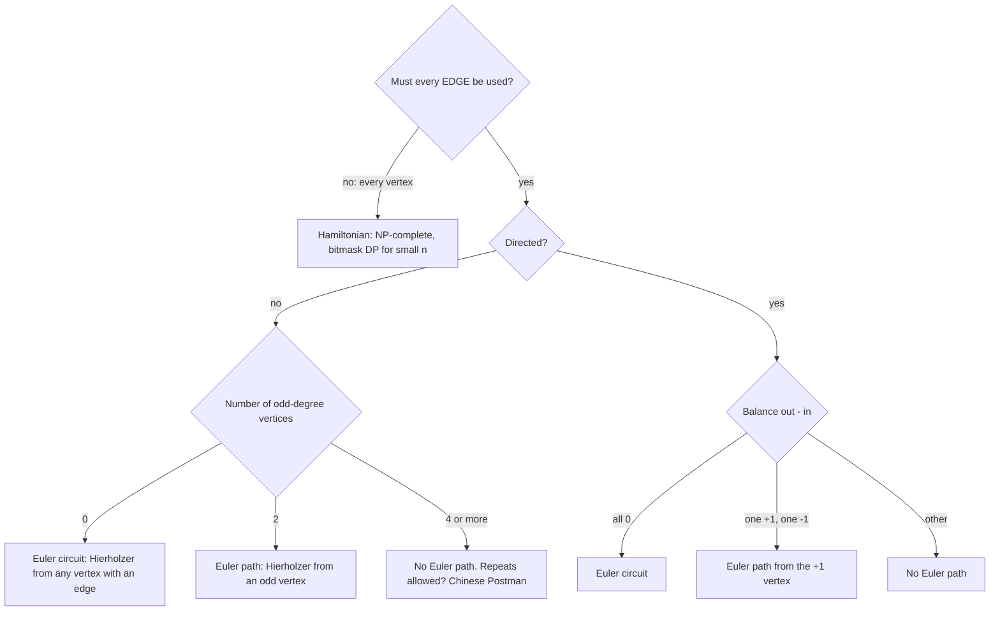

## Introduction

There is an old puzzle: draw a picture of a house — a square with both diagonals and a triangular roof — in one stroke, without lifting the pen and without going over any line twice. People try a few starting points, get stuck, and try again. With the right idea, the puzzle stops being trial and error. You can tell at a glance whether a drawing can be done, which point you must start from, and how to construct the stroke step by step.

The lines are the **edges** of a graph and the corners are its **vertices**. A route that uses every edge exactly once is an **Euler path**. If it ends where it started, it is an **Euler circuit**. They are named after Leonhard Euler, whose 1736 solution of the Königsberg bridges puzzle is usually counted as the first result in graph theory.

The question looks like a toy, but it shows up in real work. A snowplough or a street sweeper must cover every street, and wants to repeat as few as possible. DNA sequencing machines produce millions of short overlapping fragments, and some genome assemblers rebuild the original sequence by finding an Euler path in a graph of those fragments. A plotter or laser cutter that draws every line of a design wastes time on every pen-up move between lines. In interviews, "Reconstruct Itinerary" (use every plane ticket once) and "Cracking the Safe" (type a sequence that contains every password) are Euler path problems in disguise.

This lesson starts with the existence test and the Königsberg puzzle that produced it. It then contrasts Euler paths with Hamiltonian paths, which sound similar and are vastly harder. Then come two construction algorithms, Fleury's and Hierholzer's, the rules for directed graphs, and finally the **Chinese Postman** problem: the shortest route that covers every edge when an Euler circuit does not exist.

## Before you start

- **Graph vocabulary** — vertices, edges, degree, directed and undirected graphs, multigraphs. See [[a8-graph-terminology]].
- **Adjacency lists** — storing each vertex's edges in a list, here with an edge id attached. See [[a8-adjacency-list]].
- **DFS and connected components** — Euler paths need the edges to form one connected piece. See [[a8-dfs]] and [[a8-connected-components]].
- **Strongly connected components** — for the directed version. See [[a8-scc]].
- **Bridges** — Fleury's algorithm refuses to cross a bridge too early. See [[a8-bridges]].

## The intuition

Follow the pen as it draws. Every time it passes *through* a corner, it arrives on one line and leaves on another. So each visit to a corner uses up **two** of that corner's lines. If the pen neither starts nor ends at a corner, all of that corner's lines must be used in such arrive-and-leave pairs, which means the corner has an **even** number of lines.

The only corners that can break this rule are the start and the end. The start uses one extra line to leave at the very beginning, and the end uses one extra line to arrive at the very end. If they are the same corner, the two extras pair up, and every corner is even.

That one observation decides the whole question. Count the lines at each corner. If every count is even, a closed stroke may be possible from anywhere. If exactly two counts are odd, a stroke may be possible, but it must start at one odd corner and end at the other. If more than two are odd, it is impossible, however clever the drawing order.

For the house, the two bottom corners each have three lines (one side of the square, the bottom, and a diagonal), and every other corner has an even count. So the stroke must start at one bottom corner and end at the other. Anyone who starts at the roof will always get stuck.

## Definitions and the existence theorem

A **walk** is a sequence of vertices in which consecutive vertices are joined by an edge. A **trail** is a walk that never reuses an edge (it may revisit vertices). An **Euler path** (also called an Euler trail) is a trail that uses *every* edge of the graph exactly once. An **Euler circuit** (or Euler tour) is an Euler path that starts and ends at the same vertex. A graph with an Euler circuit is called **Eulerian**, and one with an Euler path but no circuit is **semi-Eulerian**.

The graphs here may be **multigraphs**: two vertices can be joined by several parallel edges, as the bridges of Königsberg are. The **degree** of a vertex is the number of edge-ends at it. A **self-loop** from a vertex to itself adds 2 to its degree, because the pen arrives and leaves through it.

**Theorem (undirected graphs).** A graph has an Euler circuit if and only if every vertex has even degree and all vertices with at least one edge belong to one connected component. It has an Euler path that is not a circuit if and only if exactly two vertices have odd degree and the same connectivity condition holds. The path then starts at one odd vertex and ends at the other.

**Why the degree condition is necessary** is the pen argument above: every pass through a vertex uses two of its edges, so only the endpoints of the path can have odd degree.

**Why the count of odd vertices is never 1 or 3.** Each edge adds 1 to the degree of each of its two ends, so the sum of all degrees is `2E`, an even number. This is the **handshake lemma**. A sum of numbers is even only if it contains an even number of odd terms. So the number of odd-degree vertices is always 0, 2, 4, and so on. A graph with "exactly one odd vertex" cannot exist.

**Why connectivity matters.** Two separate triangles have only even degrees, but no single trail can visit both. Isolated vertices with no edges do not matter, since an Euler path is about edges, not vertices. The condition is about the vertices that have edges.

**Why the conditions are also sufficient** is the harder direction. Euler stated it in 1736 without proof, and Carl Hierholzer proved it in a paper published in 1873. His proof is a construction, and it is the algorithm this lesson recommends. It appears in the Hierholzer section below.

## Seven Bridges of Königsberg {#a8-seven-bridges-konigsberg}

The **Seven Bridges of Königsberg** is the puzzle that started graph theory. The Prussian city of Königsberg (now Kaliningrad, Russia) was built on both banks of the Pregel river and on two islands in it, Kneiphof and Lomse. Seven bridges joined these four land masses. Residents asked whether one could walk through the city crossing each bridge exactly once.

### Euler's model

Euler saw that the shape of the city, the lengths of the streets and the order of the walk were irrelevant. Only two things mattered: which land masses there were, and which bridges joined which. In modern terms, he turned the map into a multigraph with a vertex per land mass and an edge per bridge:

| Land mass | Bridges to | Degree |
|---|---|---|
| Kneiphof island | North bank ×2, South bank ×2, Lomse island ×1 | 5 |
| North bank | Kneiphof ×2, Lomse ×1 | 3 |
| South bank | Kneiphof ×2, Lomse ×1 | 3 |
| Lomse island | Kneiphof, North bank, South bank | 3 |

```mermaid title="Königsberg as a multigraph: four land masses, seven bridges"
flowchart LR
    N(("North bank")) --- K(("Kneiphof"))
    N --- K
    S(("South bank")) --- K
    S --- K
    N --- L(("Lomse"))
    S --- L
    K --- L
```

All four vertices have odd degree. A walk that uses every bridge once can have at most two odd vertices, as its endpoints. With four, no such walk exists — not a closed one, and not an open one either.

```java title="SevenBridges.java"
public class SevenBridges {
    public static void main(String[] args) {
        String[] land = {"North bank", "South bank", "Kneiphof island", "Lomse island"};
        // Each bridge joins two land masses: 0 = North, 1 = South, 2 = Kneiphof, 3 = Lomse.
        int[][] bridges = {{0, 2}, {0, 2}, {1, 2}, {1, 2}, {0, 3}, {1, 3}, {2, 3}};
        int[] degree = new int[4];
        for (int[] b : bridges) { degree[b[0]]++; degree[b[1]]++; }
        int odd = 0;
        for (int v = 0; v < 4; v++) {
            System.out.println(land[v] + ": " + degree[v] + " bridges");
            if (degree[v] % 2 == 1) odd++;
        }
        System.out.println("odd-degree land masses: " + odd);
        System.out.println(odd == 0 ? "closed walk possible"
                : odd == 2 ? "open walk possible" : "no walk crosses every bridge once");
    }
}
```

```output
North bank: 3 bridges
South bank: 3 bridges
Kneiphof island: 5 bridges
Lomse island: 3 bridges
odd-degree land masses: 4
no walk crosses every bridge once
```

The program is the whole of Euler's argument. It does not search through walks — there are thousands — but counts degrees, which takes one pass over the bridges.

### What would change the answer

Each new bridge changes the parity of the two land masses it joins. Adding one bridge between the North and South banks makes both even, leaving Kneiphof and Lomse as the only odd vertices: an open walk becomes possible, starting on one island and ending on the other. Adding a second bridge, between Kneiphof and Lomse, makes every degree even, and a closed walk becomes possible from anywhere. Removing a bridge has the same effect as adding one between the same land masses. In general, a graph with `2k` odd vertices needs at least `k` added edges to become Eulerian. That is the starting point of the Chinese Postman problem at the end of this lesson.

### Why it matters

Euler's real contribution was the abstraction, not the parity count. He threw away geometry and kept only connections, which is exactly what a graph is. The same move — "what are the things, and which pairs are related?" — is the first step of every graph problem in this curriculum.

```quiz
Q: A city has five land masses whose bridge counts are 3, 3, 4, 2 and 2, and all land masses are connected. What kind of walk over every bridge exactly once is possible?
- [ ] A closed walk starting anywhere
- [x] An open walk that must start at one of the land masses with 3 bridges and end at the other
- [ ] No walk, because one land mass has 4 bridges
- [ ] An open walk starting at the land mass with 4 bridges
> Exactly two vertices have odd degree, and the graph is connected, so an Euler path exists and its endpoints must be the two odd vertices. Even degrees, such as 4, never block a walk; only odd ones constrain where it can start and end.
```

## Euler vs Hamiltonian {#a8-euler-vs-hamiltonian}

A **Hamiltonian path** visits every **vertex** exactly once, and a **Hamiltonian cycle** does so and returns to its start. The names sound alike, and the questions look alike — "use every edge once" against "visit every vertex once" — but they are at opposite ends of the difficulty scale.

| | Euler path / circuit | Hamiltonian path / cycle |
|---|---|---|
| Must cover | Every edge, exactly once | Every vertex, exactly once |
| May repeat | Vertices, as often as needed | Nothing: each vertex once, and most edges are never used |
| Existence test | Degree parity + connectivity, O(V + E) | No simple test known; NP-complete |
| Construction | Hierholzer, O(V + E) | Backtracking or bitmask DP, O(2^V · V²) |
| Typical problem | Route covering every street, itinerary from tickets | Visit every city once, Travelling Salesman |

### Neither implies the other

Two small graphs show the conditions are independent.

- **The bowtie**: two triangles sharing one vertex. Degrees are 2, 2, 4, 2, 2, all even, so it has an Euler circuit. But a Hamiltonian cycle would pass through the shared vertex twice, once for each triangle, so it has none.
- **The complete graph K4**: four vertices, each joined to every other. It has a Hamiltonian cycle (0, 1, 2, 3, 0). But every vertex has degree 3, four odd vertices, so it has no Euler path at all.

```java title="Hamiltonian.java"
import java.util.*;

public class Hamiltonian {
    /** True if the undirected graph has a cycle visiting every vertex exactly once. */
    static boolean hasHamiltonianCycle(int n, int[][] edges) {
        boolean[][] adj = new boolean[n][n];
        for (int[] e : edges) adj[e[0]][e[1]] = adj[e[1]][e[0]] = true;
        // reach[mask][v]: a path starts at 0, visits exactly the vertices in mask, ends at v.
        boolean[][] reach = new boolean[1 << n][n];
        reach[1][0] = true;
        for (int mask = 1; mask < (1 << n); mask++)
            for (int v = 0; v < n; v++) {
                if (!reach[mask][v]) continue;
                for (int w = 0; w < n; w++)
                    if (adj[v][w] && (mask & (1 << w)) == 0) reach[mask | (1 << w)][w] = true;
            }
        int all = (1 << n) - 1;
        for (int v = 1; v < n; v++) if (reach[all][v] && adj[v][0]) return true;
        return false;
    }

    static boolean hasEulerCircuit(int n, int[][] edges) {   // connected graphs only
        int[] deg = new int[n];
        for (int[] e : edges) { deg[e[0]]++; deg[e[1]]++; }
        for (int d : deg) if (d % 2 == 1) return false;
        return true;
    }

    public static void main(String[] args) {
        int[][] bowtie = {{0, 1}, {1, 2}, {2, 0}, {2, 3}, {3, 4}, {4, 2}};
        int[][] k4 = {{0, 1}, {0, 2}, {0, 3}, {1, 2}, {1, 3}, {2, 3}};
        System.out.println("bowtie: Euler " + hasEulerCircuit(5, bowtie)
                + ", Hamiltonian " + hasHamiltonianCycle(5, bowtie));
        System.out.println("K4:     Euler " + hasEulerCircuit(4, k4)
                + ", Hamiltonian " + hasHamiltonianCycle(4, k4));
    }
}
```

```output
bowtie: Euler true, Hamiltonian false
K4:     Euler false, Hamiltonian true
```

Look at how different the two methods are. `hasEulerCircuit` counts degrees: one pass over the edges. (It skips the connectivity check because both example graphs are connected.) `hasHamiltonianCycle` is a **bitmask dynamic program** ([[a11-bitmask-dp]]): `reach[mask][v]` records whether some path from vertex 0 visits exactly the set of vertices in `mask` and ends at `v`. A cycle can be rotated to start anywhere, so fixing the start at 0 loses nothing. The table has `2^V · V` entries and each is extended in O(V) time, so the method is **O(2^V · V²)** time and O(2^V · V) memory. That is fine for 20 vertices and hopeless for 60.

### Why the difference is so large

The Euler condition is **local**: whether a trail can pass through a vertex depends only on that vertex's degree, so the existence question splits into independent per-vertex checks plus one connectivity check. The Hamiltonian condition is **global**: whether a vertex can be visited depends on which vertices the path has already used and which it still needs, and no local count captures that. Deciding whether a Hamiltonian cycle exists is **NP-complete**, so no polynomial algorithm is known, and finding one would prove P = NP.

There are *sufficient* conditions for Hamiltonian cycles. **Dirac's theorem** says that a simple graph with `n ≥ 3` vertices in which every vertex has degree at least `n / 2` has one. **Ore's theorem** weakens this to "every pair of non-adjacent vertices has degrees summing to at least `n`". When those conditions fail, the graph may or may not have a Hamiltonian cycle, and you are back to search.

The optimisation version, the cheapest Hamiltonian cycle in a weighted graph, is the **Travelling Salesman Problem** ([[a8-traveling-salesman]]). Its edge-covering counterpart, the cheapest closed walk that uses every edge at least once, is the Chinese Postman problem — and that one, like Euler paths, is solvable in polynomial time.

> [!TIP] Recognising which one a problem wants
> Ask what must be used exactly once. Tickets, dominoes, bridges, streets, words chained by letters, pairs `[a, b]` that must link end to start: these are **edges**, so look for an Euler path. Cities, rooms, cells or people to visit: these are **vertices**, which means Hamiltonian, and with small `n` a bitmask DP.

## Fleury's Algorithm for Euler Path / Circuit {#a8-fleury-algorithm}

**Fleury's algorithm** (1883) builds an Euler path the way a careful person draws one: walk edge by edge, erasing each edge as you cross it, and **never cross a bridge of the remaining graph unless there is no other choice**. A **bridge** is an edge whose removal disconnects the part of the graph that contains it.

### Why "don't burn your bridges" works

Suppose you stand at vertex `u` and one of its remaining edges is a bridge leading to a region with unused edges, while another edge keeps you on the near side. If you cross the bridge now, it is erased, and every unused edge on the near side becomes unreachable forever. You would get stuck with edges left over. If you stay on the near side and use up its edges first, you can cross the bridge later, when it is the only edge left at your vertex. Fleury proved that this rule never gets stuck as long as you start at an odd vertex (or anywhere, if all degrees are even). The rule has one exception: when the bridge is your vertex's **only** remaining edge, you must take it, and doing so is safe.

### Procedure

1. Check the degree conditions. Start at an odd-degree vertex if there is one; otherwise anywhere with an edge.
2. At the current vertex `u`, look at its unused edges. If there is exactly one, take it.
3. Otherwise take any unused edge that is not a bridge of the graph formed by the unused edges.
4. Erase the edge, move across it, and repeat until no edges remain.

### Implementation

To test whether an edge `u — v` is a bridge right now, count the vertices reachable from `u`, remove the edge, count again, and put it back. If the count dropped, the edge was a bridge.

```java title="Fleury.java"
import java.util.*;

public class Fleury {
    static List<List<int[]>> adj = new ArrayList<>();   // adj[u] = {neighbour, edgeId}
    static boolean[] removed;

    // Vertices reachable from u using edges that are not removed.
    static int reachable(int u) {
        boolean[] seen = new boolean[adj.size()];
        Deque<Integer> stack = new ArrayDeque<>(List.of(u));
        seen[u] = true;
        int count = 1;
        while (!stack.isEmpty()) {
            int x = stack.pop();
            for (int[] e : adj.get(x))
                if (!removed[e[1]] && !seen[e[0]]) {
                    seen[e[0]] = true;
                    count++;
                    stack.push(e[0]);
                }
        }
        return count;
    }

    // Taking edge e out of u is safe if it is u's last edge or if it is not a bridge.
    static boolean safe(int u, int[] e) {
        int remaining = 0;
        for (int[] f : adj.get(u)) if (!removed[f[1]]) remaining++;
        if (remaining == 1) return true;                  // no choice: take the last edge
        int before = reachable(u);
        removed[e[1]] = true;                             // try deleting it
        int after = reachable(u);
        removed[e[1]] = false;                            // put it back
        return after == before;                           // still connected: not a bridge
    }

    static List<Integer> fleury(int n, int[][] edges) {
        adj = new ArrayList<>();
        for (int i = 0; i < n; i++) adj.add(new ArrayList<>());
        for (int id = 0; id < edges.length; id++) {
            adj.get(edges[id][0]).add(new int[]{edges[id][1], id});
            adj.get(edges[id][1]).add(new int[]{edges[id][0], id});
        }
        removed = new boolean[edges.length];
        int start = edges[0][0];                          // assumes an Euler path exists
        for (int v = 0; v < n; v++) if (adj.get(v).size() % 2 == 1) { start = v; break; }

        List<Integer> path = new ArrayList<>(List.of(start));
        int u = start;
        for (int step = 0; step < edges.length; step++) {
            for (int[] e : adj.get(u)) {
                if (!removed[e[1]] && safe(u, e)) {
                    removed[e[1]] = true;                 // walk across and burn the edge
                    u = e[0];
                    path.add(u);
                    break;
                }
            }
        }
        return path;
    }

    public static void main(String[] args) {
        // Two triangles joined by the bridge 2-3. The bridge is listed first on purpose.
        int[][] edges = {{2, 3}, {0, 1}, {1, 2}, {2, 0}, {3, 4}, {4, 5}, {5, 3}};
        System.out.println(fleury(6, edges));
    }
}
```

```output
[2, 1, 0, 2, 3, 4, 5, 3]
```

The graph is two triangles, `0-1-2` and `3-4-5`, joined by the edge `2 — 3`. Vertices 2 and 3 have degree 3, so the path must run from 2 to 3. At the start, vertex 2's first edge in its list is the bridge to 3. A naive walk would take it, finish the right triangle, and end at vertex 3 with the left triangle untouched. Fleury's `safe` check sees that removing `2 — 3` shrinks the reachable set from 6 vertices to 3, rejects it, and goes round the left triangle first. Back at vertex 2, the bridge is the only edge left, so it is taken, and the walk finishes the right triangle.

Each edge is stored twice, once from each end, with the same id, so marking `removed[id]` erases it in both directions. The method assumes the input has an Euler path; check the conditions first, as in the Hierholzer code below.

### Complexity

Each test runs two graph searches costing O(V + E). At any vertex with two or more remaining edges, at most one of them can be a bridge: if two were, the walk would have to cross into both regions behind them and could only come back over a bridge it had already erased. So each of the `E` steps rejects at most one edge and runs at most two tests, and the total is **O(E · (V + E))**, which is **O(E²)** for connected graphs. With a dynamic bridge-finding structure the bound improves, but the code becomes far more complex than Hierholzer's. Fleury's algorithm is worth knowing because the "don't burn bridges" rule is intuitive and makes a good explanation in an interview. For actual use, Hierholzer's algorithm is linear and simpler.

## Hierholzer's Algorithm (Directed / Undirected) {#a8-hierholzer-algorithm}

**Hierholzer's algorithm** builds an Euler path or circuit in **O(V + E)** time. Instead of avoiding mistakes like Fleury, it lets the walk get stuck and then repairs the result by **splicing in detours**.

### The idea

Start at a valid vertex and walk along unused edges, erasing each one, until you reach a vertex with no unused edges. When all degrees are even, you can only get stuck back at the start: every other vertex you enter has an odd number of used edges at that moment, so it still has an unused one to leave by. The walk is therefore a closed circuit — but it may not use every edge.

If some vertex on the circuit still has unused edges, start a new walk from it. That walk is also a closed circuit, from that vertex back to itself, and it can be inserted into the first circuit at that vertex: go round the first circuit, take the detour when you reach the vertex, and continue. Repeat until no vertex on the combined circuit has unused edges. Connectivity guarantees that by then every edge is used. This is also the proof that the degree conditions are sufficient.

### The stack version

Splicing lists by hand is fiddly. A stack does it automatically:

1. Push the start vertex.
2. Look at the vertex `u` on top of the stack. If it has an unused edge `u — v`, mark the edge used and push `v`.
3. If `u` has no unused edges, pop it and **append it to the answer**.
4. When the stack is empty, **reverse** the answer.

A vertex is appended only when it is finished — when no unused edges remain at it — so the answer is built back to front, like a postorder in DFS. Detours are spliced into the right place automatically: when the walk is stuck at `u`, the algorithm pops back to the most recent vertex with unused edges and walks a detour from there, and that detour's vertices are appended *before* the vertices that came earlier in the main walk, which, after the final reversal, puts the detour in the middle.

### Choosing the start vertex

- **Undirected:** start at an odd-degree vertex if there are two. If all degrees are even, start at **any vertex with an edge** — not automatically vertex 0, which may be isolated.
- **Directed:** start at the vertex whose out-degree is one more than its in-degree, if one exists. Otherwise at any vertex with an outgoing edge.

### Implementation (undirected)

In an undirected graph, the edge `u — v` appears in both `u`'s list and `v`'s list, and using it from one side must use it from the other. Giving each edge an id and marking `used[id]` handles that. A per-vertex cursor `next[u]` moves past edges that are already used, so no list is ever scanned twice.

```java title="EulerUndirected.java"
import java.util.*;

public class EulerUndirected {
    /**
     * Returns an Euler path (vertex sequence) of an undirected multigraph, or an empty
     * list if none exists. edges[i] = {u, v}; the edge's id is its index i.
     */
    static List<Integer> eulerPath(int n, int[][] edges) {
        List<List<int[]>> adj = new ArrayList<>();          // adj[u] = {neighbour, edgeId}
        for (int i = 0; i < n; i++) adj.add(new ArrayList<>());
        for (int id = 0; id < edges.length; id++) {
            int u = edges[id][0], v = edges[id][1];
            adj.get(u).add(new int[]{v, id});
            adj.get(v).add(new int[]{u, id});               // same id from both ends
        }
        if (edges.length == 0) return List.of();

        // Degree check: 0 odd vertices (circuit) or 2 (path between them).
        int odd = 0, start = edges[0][0];                   // any vertex that has an edge
        for (int v = 0; v < n; v++) {
            if (adj.get(v).size() % 2 == 1) {
                odd++;
                start = v;                                  // an odd vertex must be an end
            }
        }
        if (odd != 0 && odd != 2) return List.of();

        boolean[] used = new boolean[edges.length];
        int[] next = new int[n];                            // per-vertex cursor into adj
        Deque<Integer> stack = new ArrayDeque<>();
        List<Integer> path = new ArrayList<>();
        stack.push(start);
        while (!stack.isEmpty()) {
            int u = stack.peek();
            List<int[]> list = adj.get(u);
            while (next[u] < list.size() && used[list.get(next[u])[1]]) next[u]++;  // skip spent
            if (next[u] == list.size()) {
                path.add(stack.pop());                      // u is finished: fix its place
            } else {
                int[] e = list.get(next[u]++);
                used[e[1]] = true;                          // consume the edge in both directions
                stack.push(e[0]);
            }
        }
        if (path.size() != edges.length + 1) return List.of();  // edges in another component
        Collections.reverse(path);
        return path;
    }

    public static void main(String[] args) {
        // The "house": square 0-1-2-3, both diagonals, and a roof 3-4-2.
        int[][] house = {{0, 1}, {1, 2}, {2, 3}, {3, 0}, {0, 2}, {1, 3}, {3, 4}, {4, 2}};
        System.out.println("house:     " + eulerPath(5, house));

        // Two triangles sharing vertex 2: the walk gets stuck once and splices a detour.
        int[][] bowtie = {{0, 1}, {1, 2}, {2, 0}, {2, 3}, {3, 4}, {4, 2}};
        System.out.println("bowtie:    " + eulerPath(5, bowtie));

        int[][] twoLoops = {{0, 1}, {1, 2}, {2, 0}, {3, 4}, {4, 5}, {5, 3}};
        System.out.println("two loops: " + eulerPath(6, twoLoops));

        int[][] star = {{0, 1}, {0, 2}, {0, 3}};
        System.out.println("star:      " + eulerPath(4, star));
    }
}
```

```output
house:     [1, 0, 3, 2, 1, 3, 4, 2, 0]
bowtie:    [0, 1, 2, 3, 4, 2, 0]
two loops: []
star:      []
```

The house has two odd corners, 0 and 1 (the bottom corners), so the stroke runs from 1 to 0, matching the intuition section. "Two loops" has only even degrees but two components; the walk uses three edges, and the final length check (`E + 1` vertices for `E` edges) rejects it. The star has four odd vertices and is rejected by the degree check before any walking.

The length check is how the code tests connectivity without a separate search. If the degree conditions hold, Hierholzer's walk uses every edge that is reachable from the start. So it has used every edge exactly when the edges form one connected piece.

### Dry run on the bowtie

Edges in input order: `0—1`, `1—2`, `2—0`, `2—3`, `3—4`, `4—2`. All degrees are even, so the start is the first edge's first vertex, 0.

| Step | Top `u` | Action | Stack (bottom → top) | Answer so far |
|---|---|---|---|---|
| 1 | 0 | use `0—1`, push 1 | 0 1 | |
| 2 | 1 | use `1—2`, push 2 | 0 1 2 | |
| 3 | 2 | use `2—0`, push 0 | 0 1 2 0 | |
| 4 | 0 | no edges left, pop | 0 1 2 | 0 |
| 5 | 2 | use `2—3`, push 3 | 0 1 2 3 | 0 |
| 6 | 3 | use `3—4`, push 4 | 0 1 2 3 4 | 0 |
| 7 | 4 | use `4—2`, push 2 | 0 1 2 3 4 2 | 0 |
| 8–13 | each | no edges left, pop | empty | 0 2 4 3 2 1 0 |

At step 4, the walk is stuck at 0 after one triangle, with the second triangle unused. A plain walk would fail here. Instead, 0 is finished and popped, and the top of the stack is 2, which still has unused edges, so the detour round the second triangle begins there. Reversing the answer gives `0 1 2 3 4 2 0`: the second triangle has been spliced in at vertex 2.

### Directed graphs

The directed version is simpler, because each edge appears in only one list: `u → v` is in `u`'s out-list. There is no edge id to share, and the cursor `next[u]` alone records which out-edges are used. The degree check changes to in- and out-degrees, which the next section explains, and the start vertex is the one with one extra outgoing edge.

### Complexity

Every edge is pushed once and every vertex appearance is popped once. Each cursor `next[u]` only moves forward, so all adjacency lists are scanned once in total. Time is **O(V + E)**, and space is O(V + E) for the adjacency lists, the stack and the answer.

A recursive version is common in contest code: visit all unused edges of `u` recursively, then append `u`. It is the same algorithm, but its recursion depth can reach `E`, which overflows Java's default stack for graphs with around 10⁴ to 10⁵ edges. The explicit stack avoids that.

### Lexicographically smallest Euler path

"Reconstruct Itinerary" asks for the Euler path that is smallest in dictionary order. Sort each vertex's out-list (or use a priority queue) so that Hierholzer always takes the smallest unused edge first. Because detours are spliced in at the right place, greedy smallest-first plus Hierholzer produces the lexicographically smallest valid path. A plain greedy walk without Hierholzer's splicing can walk into a dead end. The full worked solution is in [[a8-find-itinerary]].

## Euler Circuit in a Directed Graph {#a8-euler-circuit-directed}

In a **directed** graph, every edge has a direction, and an Euler circuit must follow it. Each visit to a vertex now uses one **incoming** edge to arrive and one **outgoing** edge to leave. The degree rule becomes a balance rule.

### The conditions

**Theorem (directed graphs).** A directed graph has an Euler circuit if and only if:

1. every vertex has **in-degree equal to out-degree**, and
2. all vertices with at least one edge belong to a single **strongly connected component** (each can reach every other along directed edges).

It has an Euler path that is not a circuit if and only if exactly one vertex has `out − in = 1` (the start), exactly one has `in − out = 1` (the end), every other vertex is balanced, and the graph is connected when edge directions are ignored (**weakly connected**), considering only vertices with edges.

The balance rule follows from the arrive-and-leave argument. Connectivity is subtler. In a balanced graph, weak connectivity is enough to imply strong connectivity of the vertices with edges, which is why many implementations check only the simpler weak version, or rely on Hierholzer's length check as the code below does. But balance alone is not enough. Two separate cycles `0 → 1 → 0` and `2 → 3 → 2` are balanced, and no single circuit covers both.

### Implementation

```java title="EulerDirected.java"
import java.util.*;

public class EulerDirected {
    /** Euler path or circuit of a directed multigraph; empty list if none exists. */
    static List<Integer> eulerPath(int n, int[][] edges) {
        List<List<Integer>> out = new ArrayList<>();
        for (int i = 0; i < n; i++) out.add(new ArrayList<>());
        int[] balance = new int[n];                         // out-degree minus in-degree
        for (int[] e : edges) {
            out.get(e[0]).add(e[1]);
            balance[e[0]]++;
            balance[e[1]]--;
        }
        if (edges.length == 0) return List.of();

        int start = edges[0][0], starts = 0, ends = 0;
        for (int v = 0; v < n; v++) {
            if (balance[v] == 1) { starts++; start = v; }   // one extra exit: must start here
            else if (balance[v] == -1) ends++;              // one extra entry: must end here
            else if (balance[v] != 0) return List.of();
        }
        if (!((starts == 0 && ends == 0) || (starts == 1 && ends == 1))) return List.of();

        int[] next = new int[n];                            // edges of u used so far
        Deque<Integer> stack = new ArrayDeque<>();
        List<Integer> path = new ArrayList<>();
        stack.push(start);
        while (!stack.isEmpty()) {
            int u = stack.peek();
            if (next[u] < out.get(u).size()) stack.push(out.get(u).get(next[u]++));
            else path.add(stack.pop());
        }
        if (path.size() != edges.length + 1) return List.of(); // some edges unreachable
        Collections.reverse(path);
        return path;
    }

    public static void main(String[] args) {
        // Vertices are 2-bit strings 00,01,10,11 (0..3). Each 3-bit string abc is an edge
        // from ab to bc, so an Euler circuit visits every 3-bit string exactly once.
        int[][] edges = new int[8][];
        for (int x = 0; x < 8; x++) edges[x] = new int[]{x >> 1, x & 3};
        List<Integer> circuit = eulerPath(4, edges);
        System.out.println("circuit: " + circuit);

        StringBuilder seq = new StringBuilder("00");        // the start vertex's two bits
        for (int i = 1; i < circuit.size(); i++) seq.append(circuit.get(i) & 1);
        System.out.println("sequence: " + seq);

        int[][] chain = {{1, 0}, {0, 2}, {2, 1}, {1, 3}};
        System.out.println("path: " + eulerPath(4, chain));
        int[][] twoCycles = {{0, 1}, {1, 0}, {2, 3}, {3, 2}};
        System.out.println("two cycles: " + eulerPath(4, twoCycles));
    }
}
```

```output
circuit: [0, 0, 1, 2, 1, 3, 3, 2, 0]
sequence: 0001011100
path: [1, 0, 2, 1, 3]
two cycles: []
```

### Reading the example: a De Bruijn sequence

The first example builds a **De Bruijn sequence**: the shortest string that contains every 3-bit pattern as a substring. Each vertex is a 2-bit string, and each 3-bit string `abc` is an edge from `ab` to `bc` — "having seen `ab`, typing `c` leaves you at `bc`". Every vertex has two outgoing edges (append 0 or 1) and two incoming ones, so the graph is balanced and an Euler circuit exists. Walking it and appending the last bit of each new vertex gives `0001011100`. Its ten characters contain all eight 3-bit windows exactly once: `000, 001, 010, 101, 011, 111, 110, 100`. Read cyclically, the first eight characters, `00010111`, are enough.

The edge `000` is a **self-loop** from `00` to itself. Hierholzer handles self-loops with no special code: the edge is pushed and popped like any other.

The second example, `1 → 0 → 2 → 1 → 3`, has vertex 1 with one extra outgoing edge and vertex 3 with one extra incoming edge, so the path starts at 1 and ends at 3. The third has balanced degrees but two disconnected cycles, and the length check rejects it.

### Where directed Euler paths appear

- **Reconstruct Itinerary**: airports are vertices and tickets are directed edges. See [[a8-find-itinerary]].
- **Circle of strings**: can words be arranged in a circle where each word's last letter equals the next word's first letter? Letters are vertices and each word is an edge from its first letter to its last. See [[a8-string-chain-circle]].
- **Valid Arrangement of Pairs**: order pairs `[a, b]` so that each pair's `b` equals the next pair's `a` — an Euler path in which each pair is an edge.
- **Cracking the Safe**: a De Bruijn sequence over `k` digits with windows of length `n`, exactly like the example above.

```quiz
Q: A directed graph has in-degree equal to out-degree at every vertex. Why might it still have no Euler circuit?
- [ ] Because self-loops are not allowed in Euler circuits
- [x] Because its edges may form two or more separate pieces that no single circuit can connect
- [ ] Because a directed Euler circuit needs exactly one vertex with an extra outgoing edge
- [ ] Because in-degree must be twice the out-degree
> Balance guarantees that any walk can always leave the vertices it enters, but it says nothing about whether the edges are in one piece. Two disjoint cycles are balanced and have no Euler circuit. Self-loops are fine, and an extra outgoing edge is the condition for an open path, not a circuit.
```

## Chinese Postman / Route Inspection {#a8-chinese-postman}

The **Chinese Postman problem**, also called **route inspection**, asks for the **shortest closed walk that uses every edge at least once** in a connected, weighted, undirected graph. A postal worker must walk down every street on the route and return to the depot. A snowplough must clear every road. A safety inspector must check every pipe. When the graph has an Euler circuit, the answer is the total length of all edges, since nothing needs to be repeated. When it does not, some edges must be walked twice, and the problem is to choose them as cheaply as possible. It was posed by the Chinese mathematician Kwan Mei-Ko (Guan Meigu) in 1960, which gave it its name.

### From odd vertices to pairing

Walking an edge twice is the same as adding a parallel copy of it and then finding an Euler circuit in the bigger multigraph. So the question becomes: **which edges should be duplicated so that every vertex becomes even, at the smallest total cost?**

Duplicating every edge along a path from `a` to `b` adds 1 to the degree of `a` and of `b`, and adds 2 to every vertex in between, whose parity therefore does not change. So each duplicated path fixes the parity of exactly its two endpoints. Every odd vertex must be the endpoint of some duplicated path, and the cheapest way to connect two odd vertices is a shortest path between them. The problem reduces to:

1. List the odd-degree vertices. There are `2k` of them, by the handshake lemma.
2. Compute shortest-path distances between them (Dijkstra from each, or Floyd-Warshall, [[a8-floyd-warshall]]).
3. **Pair them up** so that the sum of distances between the pairs is as small as possible. This is a **minimum-weight perfect matching** on the odd vertices.
4. The answer is the total edge length plus that minimum pairing cost. To produce the actual route, duplicate the edges along each chosen shortest path and run Hierholzer.

With `2k` odd vertices there are `(2k − 1) × (2k − 3) × … × 1` possible pairings, which grows very fast, so the pairing needs care. For a small number of odd vertices, a **bitmask DP** works: `best[mask]` is the cheapest way to pair the odd vertices in `mask`, and each step pairs the lowest unpaired vertex with some other unpaired one. That takes O(2^(2k) · k) time. For large `k`, Edmonds' blossom algorithm finds a minimum-weight perfect matching in polynomial time, which gives the polynomial algorithm of Edmonds and Johnson (1973).

### Implementation

```java title="ChinesePostman.java"
import java.util.*;

public class ChinesePostman {
    static final long INF = Long.MAX_VALUE / 4;

    /** Length of the shortest closed walk using every edge of a connected weighted graph. */
    static long routeLength(int n, int[][] edges) {
        long total = 0;
        int[] degree = new int[n];
        long[][] d = new long[n][n];
        for (long[] row : d) Arrays.fill(row, INF);
        for (int v = 0; v < n; v++) d[v][v] = 0;
        for (int[] e : edges) {
            total += e[2];                                   // every street is walked once
            degree[e[0]]++;
            degree[e[1]]++;
            d[e[0]][e[1]] = Math.min(d[e[0]][e[1]], e[2]);
            d[e[1]][e[0]] = Math.min(d[e[1]][e[0]], e[2]);
        }
        for (int k = 0; k < n; k++)                          // Floyd-Warshall
            for (int i = 0; i < n; i++)
                for (int j = 0; j < n; j++)
                    if (d[i][k] + d[k][j] < d[i][j]) d[i][j] = d[i][k] + d[k][j];

        List<Integer> odd = new ArrayList<>();
        for (int v = 0; v < n; v++) if (degree[v] % 2 == 1) odd.add(v);
        int k = odd.size();                                  // always even
        // best[mask] = cheapest way to pair up the odd vertices whose bits are set in mask.
        long[] best = new long[1 << k];
        Arrays.fill(best, INF);
        best[0] = 0;
        for (int mask = 0; mask < (1 << k); mask++) {
            if (best[mask] == INF) continue;
            int i = 0;
            while (i < k && (mask & (1 << i)) != 0) i++;     // lowest unpaired odd vertex
            if (i == k) continue;
            for (int j = i + 1; j < k; j++) {
                if ((mask & (1 << j)) != 0) continue;
                int next = mask | (1 << i) | (1 << j);
                long cost = best[mask] + d[odd.get(i)][odd.get(j)];
                if (cost < best[next]) best[next] = cost;
            }
        }
        System.out.println("odd vertices " + odd + ", extra walking " + best[(1 << k) - 1]);
        return total + best[(1 << k) - 1];
    }

    public static void main(String[] args) {
        // Streets {from, to, metres}. Corners 0..5.
        int[][] streets = {{0, 1, 4}, {1, 2, 3}, {2, 3, 5}, {3, 0, 2}, {0, 2, 6},
                           {1, 4, 7}, {4, 5, 2}, {5, 2, 3}, {3, 5, 1}};
        System.out.println("route length = " + routeLength(6, streets));
    }
}
```

```output
odd vertices [0, 1, 3, 5], extra walking 5
route length = 38
```

The streets add up to 33 metres. Corners 0, 1, 3 and 5 each have three streets, so four corners are odd and two shortest paths must be repeated. There are three ways to pair four vertices:

| Pairing | Shortest distances | Extra |
|---|---|---|
| (0, 1) and (3, 5) | 4 (street 0–1) + 1 (street 3–5) | **5** |
| (0, 3) and (1, 5) | 2 (street 0–3) + 6 (1–2–5) | 8 |
| (0, 5) and (1, 3) | 3 (0–3–5) + 6 (1–0–3) | 9 |

The best pairing repeats streets `0–1` and `3–5`, so the route is 33 + 5 = 38 metres. Note that the shortest path between paired vertices can run through other vertices: in the third row, `0–3–5` passes corner 3. That is fine, because the intermediate vertex gains 2 and keeps its parity.

The DP processes masks in increasing order. Pairing the lowest unpaired vertex `i` first is what keeps each pairing from being counted many times over in different orders, and the `continue` when `best[mask]` is still infinite skips masks that cannot be reached that way.

### Complexity

Floyd-Warshall is O(V³) and the pairing DP is O(2^(2k) · k) for `2k` odd vertices, which is fine up to about 20 odd vertices. With Dijkstra from each odd vertex instead of Floyd-Warshall, the shortest-path part is O(k · E log V). With a blossom-based matching instead of the DP, the whole algorithm is polynomial.

### Variants

- **Open route.** If the postman may finish anywhere, two odd vertices can be left unpaired to serve as the start and end. With exactly two odd vertices, no edges need repeating.
- **Directed graphs.** Every vertex needs in-degree equal to out-degree. Vertices with surplus outgoing edges must receive extra paths and vice versa, and choosing the cheapest set of extra paths is a **min-cost flow** problem ([[a8-max-flow]] introduces flows).
- **Mixed graphs** (some one-way streets, some two-way) and the **rural postman** (only some edges must be covered) are NP-hard.

```quiz
Q: A connected weighted graph has exactly two odd-degree vertices, a and b. What is the length of the shortest closed walk covering every edge?
- [ ] The total edge weight, since an Euler path exists
- [x] The total edge weight plus the shortest-path distance between a and b
- [ ] The total edge weight plus the heaviest edge
- [ ] Twice the total edge weight
> An Euler path exists, but it ends at b, not back at a. Returning to the start means repeating a walk from b to a, and the cheapest one is the shortest path, which also makes both vertices even. Doubling every edge always works but is almost never optimal.
```

## How it all fits together



In every branch, also confirm that all edges are in one connected piece — Hierholzer's length check does this for free.

## In real systems

**Genome assembly.** Sequencing machines read millions of short overlapping fragments of DNA. De Bruijn graph assemblers cut the fragments into fixed-length substrings called k-mers, make each k-mer an edge between its prefix and its suffix, and recover long stretches of the genome as Euler paths in that graph. Real data adds sequencing errors and repeated regions, so production assemblers do a great deal of graph cleaning, but the Euler-path model is the core idea.

**Route inspection and logistics.** Street sweeping, snow clearing, mail and parcel delivery on residential streets, meter reading, and inspection of pipelines or power lines are all variants of the Chinese Postman problem. Real versions add one-way streets, turn penalties and vehicle capacity, which makes them harder (capacitated arc routing), but the pairing-of-odd-vertices idea remains the starting point.

**Drawing and cutting machines.** Pen plotters, laser cutters and embroidery machines waste time moving between lines without drawing. Ordering the strokes as few Euler paths as possible — one per pair of odd vertices — minimises those pen-up moves.

**Testing.** To exercise every transition of a state machine or every link of a network at least once, test generators walk an Euler circuit of the transition graph, adding repeated transitions with Chinese-Postman reasoning when the graph is unbalanced. De Bruijn sequences give the shortest input that contains every combination of `n` symbols, which is useful for testing and for brute-forcing keypads that accept a continuous stream of digits.

**Libraries.** NetworkX provides `is_eulerian`, `eulerian_circuit`, `eulerian_path` and `eulerize` (which adds edges to make a graph Eulerian). In Java, most teams write Hierholzer directly; it is about 30 lines.

## Trade-offs and alternatives

| Method | Time | Use it for | Limitations |
|---|---|---|---|
| Degree / balance check + connectivity | O(V + E) | Deciding existence | Does not construct the path |
| Hierholzer (iterative stack) | O(V + E) | Building any Euler path or circuit | Needs edge ids in undirected graphs |
| Hierholzer with sorted adjacency | O(E log E) | Lexicographically smallest path | Sorting cost |
| Fleury | O(E · (V + E)) | Explaining the idea; small graphs | Much slower; bridge tests are expensive |
| Chinese Postman (pairing DP) | O(V³ + 2^(2k) · k) | Shortest covering walk, few odd vertices | Exponential in the number of odd vertices |
| Chinese Postman (blossom matching) | Polynomial | Many odd vertices | Complex to implement |

## Common mistakes

> [!MISTAKE] Checking degrees but not connectivity
> Degrees can be perfect while the edges sit in two separate pieces, such as two disjoint triangles. Always confirm that the walk used all `E` edges (it has `E + 1` vertices), or run a connectivity check on the vertices that have edges.

**Starting at vertex 0 by default.** If all degrees are even, the start must still be a vertex that *has* an edge. Starting at an isolated vertex 0 returns the one-vertex path `[0]`. In an undirected graph with two odd vertices, or a directed graph with an unbalanced pair, the start is forced, and starting elsewhere produces a walk that misses edges.

**Marking only one direction of an undirected edge as used.** If `u — v` is stored in both lists but only `u`'s copy is marked, the walk can cross the same edge again from `v`. Give each undirected edge an id shared by both copies.

**Forgetting to reverse.** Hierholzer appends vertices as they finish, so the raw list is the path backwards. For an undirected graph the reversed path is still valid, which hides the bug, but a directed path comes out with every edge pointing the wrong way.

**Recursing on large inputs.** The recursive form of Hierholzer can recurse `E` levels deep. Use the explicit stack in Java for anything beyond a few thousand edges.

**Confusing Euler and Hamiltonian.** "Visit every city once" is Hamiltonian and NP-complete; "use every road once" is Euler and linear. Read which of the two must not repeat.

**Calling bridge-avoidance "Fleury" without testing bridges.** A DFS that takes edges in any order and records vertices in postorder is Hierholzer's algorithm, not Fleury's, whatever it is named. Fleury's defining step is the bridge test before each move.

## Interview perspective

Euler paths appear in interviews mostly in disguise. The skill being tested is recognising that "use each ticket / pair / word / domino exactly once" means "use each edge exactly once", building the graph, and running Hierholzer correctly.

> [!INTERVIEW] What a strong answer sounds like
> "Each ticket is used exactly once, so tickets are edges and airports are vertices, and I need an Euler path. A valid answer is guaranteed, so the start is JFK. I'll use Hierholzer: walk unused edges with a stack, smallest destination first; when an airport has no tickets left, it's final, so I add it to the answer, and I reverse at the end. That's O(E log E) for the sorting."

Questions to be ready for:

- **When does an Euler circuit exist?** Undirected: all degrees even and the edges connected. Directed: in = out everywhere and the edges in one strongly connected component.
- **Why can't a graph have exactly one odd vertex?** The degree sum is `2E`, which is even.
- **Why does Hierholzer append on pop rather than on push?** A vertex's position is only certain once all its edges are used; appending then splices detours into place.
- **Why is Hamiltonian path hard if Euler path is easy?** Euler conditions are local degree checks; the Hamiltonian condition depends on the whole path and the problem is NP-complete.
- **What if no Euler circuit exists but every street must be covered?** Chinese Postman: pair odd vertices by shortest paths with minimum total cost and duplicate those paths.
- **Fleury vs Hierholzer?** Fleury avoids bridges and costs O(E²); Hierholzer splices cycles and costs O(V + E).

## Practice

1. **Existence by hand.** For each of these degree sequences in a connected graph, say whether there is an Euler circuit, an Euler path, or neither: `[2, 2, 2, 2]`, `[3, 3, 2, 2]`, `[3, 3, 3, 3]`, `[1, 1, 4, 2]`.
2. **Dry run.** Trace `EulerUndirected` on the house graph and confirm the output `[1, 0, 3, 2, 1, 3, 4, 2, 0]`.
3. **Directed checker.** Write a method that returns "circuit", "path from x to y" or "none" for a directed graph, including the connectivity check.
4. **Reconstruct Itinerary.** Solve LeetCode 332 with Hierholzer and a priority queue per airport.
5. **Cracking the Safe.** Solve LeetCode 753 by generalising the De Bruijn example to `k` digits and windows of length `n`.
6. **Valid Arrangement of Pairs.** Solve LeetCode 2097, where the pairs are directed edges and the values can be large (use a `HashMap` for adjacency).
7. **Route inspection.** Extend `ChinesePostman` to print the actual route: duplicate the edges along each chosen shortest path, then run Hierholzer on the result.

The DSA explorer lists the matching problems under this topic. On CSES, *Mail Delivery* (undirected circuit), *Teleporters Path* (directed path) and *De Bruijn Sequence* cover the three main cases.

## Quick revision {#quick-revision}

- Euler path: every edge exactly once. Euler circuit: also returns to the start. Hamiltonian: every vertex exactly once.
- Undirected circuit ⇔ all degrees even + edges connected. Undirected path ⇔ exactly 0 or 2 odd vertices + edges connected; start at an odd vertex.
- Number of odd vertices is always even (degree sum = 2E).
- Directed circuit ⇔ in = out everywhere + edges in one SCC. Directed path ⇔ one vertex with out − in = 1 (start), one with in − out = 1 (end), others balanced, weakly connected.
- Königsberg: degrees 5, 3, 3, 3 → four odd vertices → no walk. Each added bridge flips the parity of its two ends.
- Hierholzer: stack; push along unused edges; pop to the answer when stuck; reverse. O(V + E). Shared edge ids for undirected; the answer has E + 1 vertices iff the edges are connected.
- Fleury: never cross a bridge of the remaining graph unless it is the last edge; O(E²) with naive bridge tests.
- Euler checks are local (O(V + E)); Hamiltonian is NP-complete (bitmask DP O(2^V · V²)).
- Chinese Postman: total edge weight + minimum-cost pairing of odd vertices by shortest paths; bitmask DP for few odd vertices, blossom matching in general; directed version is min-cost flow.
- Disguises: tickets, dominoes, word chains, pairs `[a, b]`, De Bruijn sequences.

## Key takeaways {#key-takeaways}

- An Euler path exists exactly when the edges are connected and at most two vertices have odd degree (undirected), or at most one vertex has an extra exit and one an extra entry (directed); checking takes linear time.
- Euler's solution to the Königsberg bridges was an abstraction — keep only what connects to what — and that abstraction is the start of every graph problem.
- Covering every edge (Euler) is easy, while visiting every vertex once (Hamiltonian) is NP-complete; always check which one a problem asks for.
- Hierholzer's algorithm builds an Euler path in O(V + E) by letting the walk get stuck and splicing detours, which a stack and a final reversal do automatically.
- Fleury's bridge-avoiding rule is intuitive but costs O(E²); use it to explain the idea, and Hierholzer to implement it.
- When an Euler circuit does not exist but every edge must be covered, the Chinese Postman solution pairs up odd vertices with the cheapest shortest paths and duplicates them.
