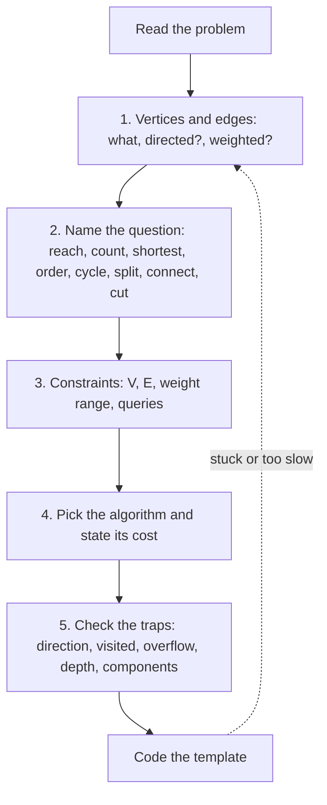
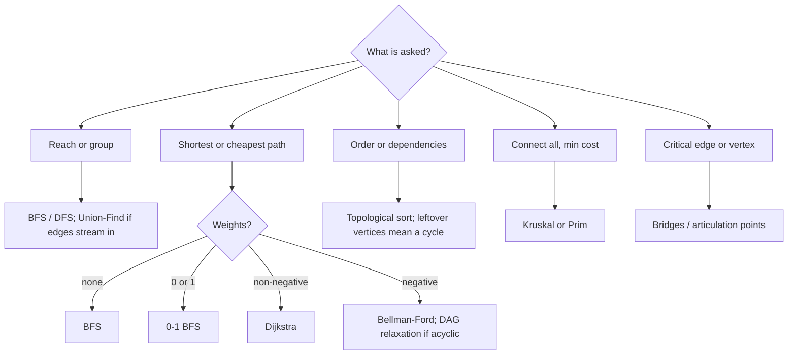

## Introduction

By this point in the graph track you have learned a lot of algorithms: breadth-first search, depth-first search, topological sorting, cycle detection, bipartite checks, Union-Find, Dijkstra and more. Each one, studied on its own, feels manageable. Yet the most common experience in a graph interview is not "I forgot how Dijkstra works". It is "I did not realise this was a graph problem", or "I picked the wrong algorithm and only noticed after twenty minutes of coding".

That happens because interview problems rarely arrive labelled. "Rotting oranges", "bus routes", "open the lock", "alien dictionary", "accounts merge" and "cheapest flights" are all graph problems, but none of them says *vertex* or *edge*. The skill being tested is the step *before* the algorithm: seeing the graph, describing it precisely, and letting that description choose the algorithm.

This lesson teaches that step as a **decision framework** — a fixed sequence of questions you ask about every graph problem:

1. **Model it.** What are the vertices? What are the edges? Are edges directed? Weighted? Can weights be negative?
2. **Name the question.** Is it reachability, counting groups, fewest steps, cheapest path, an ordering, a cycle, a split into two groups, cheapest connection, a single point of failure?
3. **Read the constraints.** How large are V and E? What do the sizes allow — linear, `n log n`, quadratic, cubic, exponential?
4. **Pick the algorithm and state its cost** before you write code.
5. **Check the known traps** — direction, visited marking, overflow, recursion depth, disconnected input.

The five nested sections of this lesson cover those steps in depth, and finish with two revision sheets: a pattern map and a complexity table. Every algorithm is linked to the lesson that teaches it, so this page also works as an index to the graph track.

## Before you start

This is a synthesis lesson, so it assumes you have met the algorithms it organises. You need:

- **Graph vocabulary and representations** — vertices, edges, degree, adjacency list versus matrix: [[a8-graph-representation]] and [[a8-when-to-use-representation]].
- **BFS and DFS** — the queue and stack traversals and why BFS gives shortest paths in unweighted graphs: [[a8-bfs]], [[a8-dfs]], [[a8-bfs-shortest-unweighted]].
- **Grid and state-space BFS** — cells as vertices and multi-source search: [[a8-multi-source-bfs]] and [[a8-grid-as-graph]].
- **Cycles, ordering and structure** — [[a8-cycle-undirected]], [[a8-cycle-detection]], [[a8-topological-sorting]], [[a8-bipartite]], [[a8-connected-components]].
- **Union-Find and Dijkstra** — [[a8-union-find]] and [[a8-dijkstra]].
- **Big-O reasoning** — [[a1-big-o]], so that "V up to 10⁵" turns into a time budget.

If one of these is shaky, the framework will still tell you *which* algorithm to use; follow the link to learn *how* it works.

## The intuition

Think of how a doctor works. A patient describes symptoms in everyday language — "I feel tired, and my ankles are swollen". The doctor does not jump to a treatment. They translate the symptoms into a precise description (blood pressure, heart rate, test results), narrow the possibilities with a fixed set of questions, and only then pick a treatment, while watching for known side effects.

Graph problems reward the same discipline. The problem statement is the patient's description. **Identifying vertices and edges** is the translation into precise terms. **Reading the question and the constraints** is the differential diagnosis: each answer rules out whole families of algorithms. The **algorithm** is the treatment, and the **common mistakes** are the side effects you check for.

The analogy stops at one point: a doctor sometimes has to act with uncertainty, but a graph model can almost always be made exact. If you cannot say in one sentence what a vertex is and when two vertices are joined, you are not ready to choose an algorithm — and that is a signal to keep modelling, not to start coding.

## The framework at a glance



The dotted arrow matters. When an approach turns out too slow, the fix is usually in the model, not in micro-optimising the code — a better choice of vertex (you will see one in Bus Routes below) can turn a quadratic edge set into a linear one.

| Step | The question you ask | What a good answer looks like |
|---|---|---|
| 1. Model | What is a vertex, what is an edge? | "Each word is a vertex; two words share an edge if they differ in one letter; undirected; unweighted" |
| 2. Question | Which family of problem is this? | "Fewest transformations — shortest path, unweighted" |
| 3. Constraints | How big, what weights, how many queries? | "5,000 words of length 10; one query" |
| 4. Algorithm | Which algorithm, and what does it cost? | "BFS with generated neighbours: O(N · L² · 26)" |
| 5. Traps | What usually goes wrong here? | "Target missing from the dictionary; mark on enqueue" |

## Identify Vertices & Edges First {#a8-identify-vertices-edges}

**Identifying vertices and edges** means turning the problem's objects and relationships into a precise graph before thinking about any algorithm: deciding what one vertex represents, which pairs of vertices are joined, whether those connections have a direction, and whether they carry a cost. It comes first because every later decision — which algorithm, what complexity, which pitfalls — depends on it. An algorithm applied to the wrong graph returns a confident wrong answer.

### The four questions

For every problem, write down answers to these four questions before anything else.

**What is a vertex?** Usually the "things" in the problem: cities, courses, people, accounts, cells of a grid, words. Sometimes it is less obvious: a *state* of a puzzle (a lock showing `0000`), a *group* of things (a bus route rather than a bus stop), or a thing *plus extra information* (a grid cell plus how many walls you may still break).

**What is an edge?** The relationship that lets you move from one vertex to another: a road, a prerequisite, a one-letter change, a legal move, "these two accounts share an email". Ask whether the edges are **given** (an edge list in the input), **implied by a rule** (any two words that differ in one letter) or **derived from comparisons** (adjacent words in an alien dictionary reveal one ordering constraint).

**Is the edge directed?** If moving from A to B does not imply you can move from B to A, the edge is directed. Prerequisites, one-way streets, "A follows B", "water flows from higher to lower" and "task A must finish before B" are directed. Friendships, two-way roads and "differ by one letter" are undirected. Getting the direction backwards is the single most common modelling error — see [[a8-common-graph-mistakes]].

**Is the edge weighted, and how?** If all moves cost the same, the graph is unweighted and BFS handles shortest paths. If moves have costs, note their range: only 0 and 1, small non-negative integers, arbitrary non-negative numbers, or possibly negative. That range is what later selects between BFS, 0-1 BFS, Dijkstra and Bellman-Ford ([[a8-graph-types]] covers the vocabulary).

Then add the details that change code but not the algorithm: are vertices numbered from 0 or 1? Can there be self-loops or duplicate edges? Is the graph guaranteed connected? How many vertices and edges will there be — including, for implicit graphs, how many states exist?

### Five ways problems hide their graph

**1. Explicit graphs.** The input is an edge list or adjacency list: "there are n cities and roads `[u, v, w]`". The modelling is done for you; your only decisions are direction, weights and representation ([[a8-adjacency-list]] is the default).

**2. Grids.** Each cell is a vertex; edges join a cell to its 4 (or 8) neighbours, usually only if both are passable. You almost never build an adjacency list — you generate neighbours with a direction array and a bounds check. A grid with `R` rows and `C` columns has `R · C` vertices and at most `4 · R · C` directed edge slots, so BFS on it is O(R · C). [[a8-grid-as-graph]] covers this in depth.

**3. Implicit state graphs.** The vertices are *configurations* and the edges are *moves*. In Open the Lock, a vertex is a four-digit string such as `"0000"` and an edge is turning one wheel one notch, so there are 10⁴ vertices and each has 8 neighbours. In the Water Jug problem a vertex is the pair of current volumes. The graph is never stored; you generate a vertex's neighbours when you dequeue it. Count the states before choosing an algorithm: the count is your V.

**4. Relation-derived graphs.** The edges come from facts you must extract. In Alien Dictionary, two adjacent words in the sorted list reveal one directed edge between the first pair of differing letters ([[a8-course-schedule]] walks through it). In Evaluate Division, the equation `a / b = 2` becomes an edge `a → b` with weight 2 and an edge `b → a` with weight 0.5, and a query `a / c` is the product of weights along a path. In Accounts Merge, two accounts are joined if they share an email, and the answer is the connected components.

**5. Graphs whose vertices need extra state.** Sometimes the same place must count as different vertices depending on what has happened so far. In Cheapest Flights Within K Stops, being in Paris after one flight and being in Paris after three flights are different situations, because the second has fewer flights left. In Shortest Path to Get All Keys, standing on a cell with keys `{a}` differs from standing there with keys `{a, b}`. The fix is **state expansion**: make the vertex a tuple — `(city, flights used)`, `(row, col, keys mask)` — and run the ordinary algorithm on the larger graph. The cost is that V is multiplied by the number of extra states, which the constraints must allow.

| Problem | Vertex | Edge | Directed? | Weights | Algorithm |
|---|---|---|---|---|---|
| Number of Islands | land cell | 4-neighbour land cell | no | none | flood fill per component |
| Rotting Oranges | cell | 4-neighbour fresh cell | no | unit | multi-source BFS |
| Course Schedule | course | prerequisite → course | yes | none | topological sort |
| Word Ladder | word | differ in one letter | no | unit | BFS |
| Open the Lock | 4-digit state | one wheel turn | no | unit | BFS, skipping dead ends |
| Network Delay Time | node | signal link | yes | positive | Dijkstra |
| Accounts Merge | email | same account | no | none | Union-Find |
| Evaluate Division | variable | equation | yes, both ways | ratio | DFS multiplying weights |
| Cheapest Flights, K stops | (city, flights used) | flight | yes | price | K-round Bellman-Ford or BFS by rounds |
| Obstacle Elimination | (row, col, breaks left) | step | no | unit | BFS on expanded states |

### Worked example: choosing the right vertex in Bus Routes

**Problem.** `routes[i]` lists the stops that bus `i` visits in a loop. You start at stop `source` and want to reach stop `target`. Return the fewest buses you must board, or -1 if it is impossible.

**First model: stops as vertices.** Join two stops if some bus visits both, then BFS from `source`. It is correct, but look at the edge count. A route with `k` stops connects every pair of its stops, which is `k(k − 1) / 2` edges. With a route of 10⁵ stops that is about 5 · 10⁹ edges — far beyond any time or memory limit. The model is right but too expensive to build.

**Second model: routes as vertices.** The question counts *buses*, not stops, so make each bus route a vertex. Two routes are adjacent if they share a stop, and the answer is the BFS distance from any route containing `source` to any route containing `target`, counting the first bus as 1. We still never build route-to-route edges explicitly; instead we keep an index from each stop to the routes that serve it, and expand each stop at most once. Every route is dequeued once and each of its stops is scanned once, so the total work is proportional to the sum of the route lengths.

```java title="BusRoutes.java"
import java.util.*;

public class BusRoutes {
    /** Fewest buses needed to travel from source to target, or -1. */
    static int numBusesToDestination(int[][] routes, int source, int target) {
        if (source == target) return 0;
        // Index: stop -> the routes that serve it. This replaces explicit edges.
        Map<Integer, List<Integer>> routesAt = new HashMap<>();
        for (int r = 0; r < routes.length; r++) {
            for (int stop : routes[r]) {
                routesAt.computeIfAbsent(stop, s -> new ArrayList<>()).add(r);
            }
        }
        boolean[] routeSeen = new boolean[routes.length];
        Set<Integer> stopSeen = new HashSet<>();
        ArrayDeque<Integer> queue = new ArrayDeque<>();
        // Vertices are routes. Every route through the source costs one bus.
        for (int r : routesAt.getOrDefault(source, List.of())) {
            routeSeen[r] = true;
            queue.add(r);
        }
        int buses = 1;
        while (!queue.isEmpty()) {
            for (int size = queue.size(); size > 0; size--) {
                int r = queue.poll();
                for (int stop : routes[r]) {
                    if (stop == target) return buses;
                    if (!stopSeen.add(stop)) continue;   // each stop expanded once
                    for (int next : routesAt.get(stop)) {
                        if (!routeSeen[next]) {
                            routeSeen[next] = true;
                            queue.add(next);
                        }
                    }
                }
            }
            buses++;
        }
        return -1;
    }

    public static void main(String[] args) {
        System.out.println(numBusesToDestination(new int[][] {{1, 2, 7}, {3, 6, 7}}, 1, 6));
        int[][] routes = {{7, 12}, {4, 5, 15}, {6}, {15, 19}, {9, 12, 13}};
        System.out.println(numBusesToDestination(routes, 15, 12));
        System.out.println(numBusesToDestination(routes, 4, 4));
    }
}
```

```output
2
-1
0
```

In the first test, stop 1 is only on route 0, so the queue starts with route 0 at one bus. Scanning route 0 reaches stop 7, which is also served by route 1, so route 1 enters the next layer. Scanning route 1 finds stop 6, the target, while `buses` is 2. In the second test, the routes through stop 15 (routes 1 and 3) never share a stop with the route through 12, so the BFS runs out and returns -1. The third test is the edge case where no bus is needed at all.

Two details are worth copying into other problems. First, the BFS is **multi-source**: all routes through `source` start at distance 1 together, exactly as in [[a8-multi-source-bfs]]. Second, the **stop index acts as a hub**: instead of `k²` route-to-route or stop-to-stop edges, each stop links to its routes once. The same trick — introduce one shared vertex for a group instead of joining every pair inside it — appears in Accounts Merge (join each email to its account) and in Union-Find "virtual node" problems ([[a8-dsu-on-grids]]).

### Worked example: state expansion in Obstacle Elimination

**Problem.** In a grid of 0s (empty) and 1s (walls), find the fewest steps from the top-left to the bottom-right corner if you may walk through at most `k` walls.

The cell alone is not enough as a vertex. Reaching cell `(2, 1)` with two breaks left is strictly better than reaching it with none, so a BFS that marks the *cell* visited the first time will throw away better futures. The fix is to make the vertex `(row, col, breaksLeft)`. All moves still cost one step, so plain BFS over these states finds the minimum.

```java title="ObstacleElimination.java"
import java.util.*;

public class ObstacleElimination {
    /** Fewest steps from top-left to bottom-right, removing at most k obstacles. */
    static int shortestPath(int[][] grid, int k) {
        int rows = grid.length, cols = grid[0].length;
        // A vertex is (row, col, eliminations left): same cell, different futures.
        boolean[][][] seen = new boolean[rows][cols][k + 1];
        ArrayDeque<int[]> queue = new ArrayDeque<>();
        queue.add(new int[] {0, 0, k});
        seen[0][0][k] = true;
        int[][] dirs = {{1, 0}, {-1, 0}, {0, 1}, {0, -1}};
        for (int steps = 0; !queue.isEmpty(); steps++) {
            for (int size = queue.size(); size > 0; size--) {
                int[] cur = queue.poll();
                if (cur[0] == rows - 1 && cur[1] == cols - 1) return steps;
                for (int[] d : dirs) {
                    int r = cur[0] + d[0], c = cur[1] + d[1];
                    if (r < 0 || r >= rows || c < 0 || c >= cols) continue;
                    int left = cur[2] - grid[r][c];       // entering a 1 spends one
                    if (left < 0 || seen[r][c][left]) continue;
                    seen[r][c][left] = true;
                    queue.add(new int[] {r, c, left});
                }
            }
        }
        return -1;
    }

    public static void main(String[] args) {
        int[][] a = {{0, 0, 0}, {1, 1, 0}, {0, 0, 0}, {0, 1, 1}, {0, 0, 0}};
        System.out.println(shortestPath(a, 1));
        System.out.println(shortestPath(a, 0));
        int[][] b = {{0, 1, 1}, {1, 1, 1}, {1, 0, 0}};
        System.out.println(shortestPath(b, 1));
    }
}
```

```output
6
10
-1
```

With one break allowed, the path goes down the left column and breaks through the wall at row 3, taking 6 steps. With none, it must snake around both walls and takes 10. In the second grid every route needs at least two breaks, so the answer is -1.

The expanded graph has `rows · cols · (k + 1)` vertices, and each has at most 4 edges, so the BFS runs in O(R · C · k) time and uses the same amount of memory. That is the general price of state expansion: **the extra dimension multiplies V**. Check it against the constraints before committing. (For this problem there is also a shortcut: if `k ≥ rows + cols − 2`, the straight Manhattan path is always possible, and the answer is `rows + cols − 2` without searching.)

### How to recognise a hidden graph

A problem is probably a graph problem if it has **things and pairwise relationships** and asks about **reaching, connecting, ordering or grouping** them. Phrases that should trigger the check: "minimum number of moves/steps/transformations", "can you reach", "connected", "groups", "depends on", "must come before", "network", "friends of friends", "spread", "infect", "flow". Grids with walls, puzzles with legal moves, and lists of pairs are the usual disguises.

> [!TIP] Say the model out loud
> In an interview, state the model in one sentence before choosing anything: "Each lock combination is a vertex, each single-wheel turn is an undirected unit edge, there are 10,000 vertices with 8 edges each, so BFS costs about 80,000 edge checks." The interviewer can correct a wrong model in seconds, and a correct one usually makes the algorithm obvious.

## Choose Algorithm from Constraints {#a8-constraint-driven-choice}

**Choosing an algorithm from constraints** means using two pieces of information — *what the question asks* and *how large the input can be* — to narrow the candidate algorithms to one, and to know its running time before you write code. The question type picks a family (shortest path, ordering, connectivity…). The constraints pick the member of the family and tell you whether a simpler, slower method is acceptable.

### First filter: what is being asked

Most graph questions fall into a small number of families. Once you have named the family, the candidate algorithms are few.

| The question asks… | Family | Algorithm | Lesson |
|---|---|---|---|
| Can A reach B? Which vertices are reachable? | Traversal | BFS or DFS | [[a8-bfs]], [[a8-dfs]] |
| How many groups? How big is the largest? | Components | Outer loop + BFS/DFS; Union-Find if edges arrive over time | [[a8-connected-components]], [[a8-union-find]] |
| Fewest steps, every step costs the same | Unweighted shortest path | BFS | [[a8-bfs-shortest-unweighted]] |
| Distance to the nearest of many sources; time to spread everywhere | Multi-source BFS | One BFS seeded with all sources | [[a8-multi-source-bfs]], [[a8-rotten-oranges]] |
| Cheapest path with weights | Weighted shortest path | 0-1 BFS, Dijkstra, Bellman-Ford, Floyd-Warshall by weights and queries | [[a8-shortest-path-decision]] |
| An order that respects dependencies; is the order possible? | Topological sort | Kahn or DFS postorder | [[a8-topological-sorting]] |
| Is there a cycle? | Cycle detection | Undirected: parent check or Union-Find; directed: colours or Kahn | [[a8-cycle-undirected]], [[a8-cycle-detection]] |
| Split into two groups so every conflict crosses | Bipartite check | BFS/DFS 2-colouring | [[a8-bipartite]] |
| Connect everything at minimum total cost | Minimum spanning tree | Kruskal or Prim | [[a8-mst-kruskal]], [[a8-mst-prim]] |
| Groups where everyone reaches everyone (directed) | Strongly connected components | Kosaraju or Tarjan | [[a8-scc]] |
| Which single edge or vertex disconnects the graph? | Cut edges and vertices | Tarjan low-link DFS | [[a8-bridges]], [[a8-articulation-points]] |
| Maximum throughput, minimum cut, maximum pairing | Flow and matching | Edmonds-Karp, Dinic, Hopcroft-Karp | [[a8-max-flow]], [[a8-bipartite-matching-flow]] |
| Use every edge exactly once | Euler path | Hierholzer | [[a8-euler-path]] |
| Visit every vertex once; cheapest tour | Hamiltonian path, TSP | Bitmask DP for small n (NP-hard in general) | [[a8-traveling-salesman]] |
| Colour with k ≥ 3 colours so neighbours differ | Graph colouring | Backtracking (NP-hard in general) | [[a8-graph-coloring]] |
| Optimise a value along paths of a DAG | DAG dynamic programming | Process in topological order | [[a8-dag-dp]], [[a8-longest-path-dag]] |

Two rows deserve a warning. "Longest simple path" in a general graph and "visit every vertex" are **NP-hard**: no known algorithm is polynomial, so if the constraints are large the problem must have extra structure — a DAG, a tree, or small n — that you are expected to exploit. And "shortest path" is not one family but several; the weights decide which algorithm is correct, not just which is fast.



### Second filter: what the sizes allow

Once you know the family, the input sizes decide how much work you can afford. A useful order-of-magnitude rule for Java on a typical online judge is that around 10⁸ simple operations take about a second. It is a rough guide — constant factors, memory access patterns and object allocation can move it by several times — but it is accurate enough to rule algorithms in or out.

| Largest n (vertices, or states) | Affordable complexity | Graph algorithms that fit |
|---|---|---|
| about 10–11 | O(n!) | Try every ordering: brute-force TSP, every Hamiltonian path |
| about 15–20 | O(2ⁿ · n) to O(2ⁿ · n²) | Bitmask DP: Held-Karp TSP, shortest path visiting all nodes |
| about 400–500 | O(n³) | Floyd-Warshall, Warshall transitive closure, BFS from every vertex on a dense graph |
| about 2,000–5,000 | O(n²) | Dense Prim or Dijkstra with an array, adjacency matrix, BFS from every vertex on a sparse graph |
| about 10⁵–10⁶ | O((V + E) log V) or O(V + E) | BFS, DFS, Kahn, Union-Find, heap Dijkstra, Kruskal, Tarjan |

Read constraints for more than V. **Edge count**: "E up to 2 · 10⁵" with "V up to 10⁵" means a sparse graph and an adjacency list; "every pair of points" means E ≈ V²/2 and favours the O(V²) versions of Prim and Dijkstra. **Weight range**: weights in `{0, 1}` mean 0-1 BFS; small integers up to W allow Dial's bucket queue; any negative weight rules out Dijkstra. **Number of queries**: one source means one run; "q queries of the shortest distance between two vertices" on a small graph means precomputing all pairs; queries interleaved with edge additions mean Union-Find. **Recursion depth**: V up to 10⁵ in a path-shaped graph makes recursive DFS risky in Java; plan an iterative version.

> [!NOTE] Multiply by the state, not just V
> For implicit and state-expanded graphs, n in the table is the number of *states*. A 40 × 40 grid with `k ≤ 40` breaks has 1,600 cells but 65,600 states. A 12-node graph where you track a visited set as a bitmask has 12 · 2¹² = 49,152 states. Compute the product before choosing.

### Worked example: one problem, three valid algorithms

The constraints sometimes allow several algorithms, and choosing well means knowing all of them. **Path With Minimum Effort** gives a grid of heights (up to 100 × 100, heights up to 10⁶). Moving between neighbouring cells costs the absolute height difference, and the *effort* of a route is the **largest** single step on it. Find the route from top-left to bottom-right with the smallest effort.

Step 1, the model: cells are vertices, 4-neighbour moves are undirected edges, and each edge has a weight `|h[a] − h[b]|`. Step 2, the question: a cheapest path — but the path's cost is a *maximum*, not a sum. Step 3, constraints: V = 10⁴, E ≈ 2 · 10⁴ undirected edges. Now three different algorithms all fit.

- **Dijkstra with `max` instead of `+`.** Dijkstra's proof only needs that extending a path never makes it cheaper. `max(effort, step)` satisfies that, so the closest-first greedy still works. Cost: O(E log V).
- **Binary search on the answer.** "Is there a route whose every step is ≤ X?" is a yes/no reachability question that BFS answers in O(V + E), and the answer is monotone in X (if X works, every larger X works). Binary search over X from 0 to 10⁶ takes about 20 BFS runs. Cost: O((V + E) · log H) where H is the height range.
- **Union-Find in Kruskal order.** Sort all edges by weight and add them cheapest first. The first edge whose addition connects the start cell to the end cell has the answer as its weight, because every edge added before it is no heavier. Cost: O(E log E) for the sort plus nearly linear Union-Find work.

```java title="MinimumEffort.java"
import java.util.*;

public class MinimumEffort {
    static final int[][] DIRS = {{1, 0}, {-1, 0}, {0, 1}, {0, -1}};

    // Method 1: Dijkstra where a path's cost is its largest step, not its sum.
    static int dijkstra(int[][] h) {
        int rows = h.length, cols = h[0].length;
        int[] best = new int[rows * cols];
        Arrays.fill(best, Integer.MAX_VALUE);
        best[0] = 0;
        PriorityQueue<int[]> pq = new PriorityQueue<>(Comparator.comparingInt(e -> e[0]));
        pq.add(new int[] {0, 0});
        while (!pq.isEmpty()) {
            int[] top = pq.poll();
            int effort = top[0], cell = top[1];
            if (effort > best[cell]) continue;                 // stale entry
            if (cell == rows * cols - 1) return effort;
            int r = cell / cols, c = cell % cols;
            for (int[] d : DIRS) {
                int nr = r + d[0], nc = c + d[1];
                if (nr < 0 || nr >= rows || nc < 0 || nc >= cols) continue;
                int step = Math.abs(h[nr][nc] - h[r][c]);
                int next = Math.max(effort, step);             // max instead of +
                if (next < best[nr * cols + nc]) {
                    best[nr * cols + nc] = next;
                    pq.add(new int[] {next, nr * cols + nc});
                }
            }
        }
        return best[rows * cols - 1];
    }

    // Method 2: binary search on the answer, BFS as the yes/no test.
    static int binarySearch(int[][] h) {
        int lo = 0, hi = 1_000_000;                            // heights are at most 10^6
        while (lo < hi) {
            int mid = lo + (hi - lo) / 2;
            if (reachable(h, mid)) hi = mid; else lo = mid + 1;
        }
        return lo;
    }

    static boolean reachable(int[][] h, int limit) {
        int rows = h.length, cols = h[0].length;
        boolean[] seen = new boolean[rows * cols];
        ArrayDeque<Integer> queue = new ArrayDeque<>();
        queue.add(0);
        seen[0] = true;
        while (!queue.isEmpty()) {
            int cell = queue.poll(), r = cell / cols, c = cell % cols;
            if (cell == rows * cols - 1) return true;
            for (int[] d : DIRS) {
                int nr = r + d[0], nc = c + d[1];
                if (nr < 0 || nr >= rows || nc < 0 || nc >= cols) continue;
                int id = nr * cols + nc;
                if (seen[id] || Math.abs(h[nr][nc] - h[r][c]) > limit) continue;
                seen[id] = true;
                queue.add(id);
            }
        }
        return false;
    }

    // Method 3: add edges cheapest first (Kruskal order) until start meets end.
    static int unionFind(int[][] h) {
        int rows = h.length, cols = h[0].length, n = rows * cols;
        if (n == 1) return 0;
        List<int[]> edges = new ArrayList<>();                 // {weight, a, b}
        for (int r = 0; r < rows; r++) {
            for (int c = 0; c < cols; c++) {
                if (r + 1 < rows) {
                    edges.add(new int[] {Math.abs(h[r][c] - h[r + 1][c]),
                                         r * cols + c, (r + 1) * cols + c});
                }
                if (c + 1 < cols) {
                    edges.add(new int[] {Math.abs(h[r][c] - h[r][c + 1]),
                                         r * cols + c, r * cols + c + 1});
                }
            }
        }
        edges.sort(Comparator.comparingInt(e -> e[0]));
        int[] parent = new int[n];
        for (int i = 0; i < n; i++) parent[i] = i;
        for (int[] e : edges) {
            parent[find(parent, e[1])] = find(parent, e[2]);
            if (find(parent, 0) == find(parent, n - 1)) return e[0];
        }
        return -1;                                             // unreachable for a grid
    }

    static int find(int[] parent, int x) {
        while (parent[x] != x) {
            parent[x] = parent[parent[x]];                     // path halving
            x = parent[x];
        }
        return x;
    }

    public static void main(String[] args) {
        int[][][] tests = {
            {{1, 2, 2}, {3, 8, 2}, {5, 3, 5}},
            {{1, 2, 3}, {3, 8, 4}, {5, 3, 5}},
            {{1, 2, 1, 1, 1}, {1, 2, 1, 2, 1}, {1, 2, 1, 2, 1}, {1, 2, 1, 2, 1},
             {1, 1, 1, 2, 1}},
        };
        for (int[][] h : tests) {
            System.out.println(dijkstra(h) + " " + binarySearch(h) + " " + unionFind(h));
        }
    }
}
```

```output
2 2 2
1 1 1
0 0 0
```

All three agree on every test (they also agreed on 3,000 random grids when cross-checked while writing this lesson). In the first grid the best route is `1 → 3 → 5 → 3 → 5` down the left column and along the bottom, whose largest step is 2. In the third, a path of 1s winds through the grid, so the effort is 0.

Which should you present? Dijkstra is the most direct and the easiest to extend (for example, to also return the path). Binary search plus BFS is the easiest to get right under pressure because each piece is a template you know, and it generalises to any monotone yes/no question. Union-Find is the neatest when the question is phrased as "the smallest threshold at which A and B become connected", and it extends to answering many such queries offline ([[a8-dynamic-connectivity]]). Mentioning that the others exist, and why each is correct, is exactly the kind of depth an interviewer looks for.

### When the constraints contradict your first idea

If your first algorithm is too slow for the stated sizes, do not optimise the code — go back to the model and the question. Common rescues: reverse the edges and search once from the target instead of once per source ([[a8-pacific-atlantic]]); seed all sources into one BFS; replace "BFS from every vertex" with Union-Find; notice the graph is a DAG so the "hard" longest-path problem becomes linear ([[a8-longest-path-dag]]); or notice n ≤ 20, which is the problem-setter's way of saying "bitmask DP is intended".

## Common Graph Mistakes {#a8-common-graph-mistakes}

**Common graph mistakes** are the small, recurring errors that make a correct algorithm produce wrong answers or run out of time. They are worth studying as a list because they are not random: the same dozen bugs account for most failed graph submissions, and most of them pass the sample tests and fail only on large or unusual input. Each one below is described by its symptom, its cause and its fix.

### Modelling mistakes

**Edge direction reversed.** In Course Schedule, a pair `[a, b]` means "to take a you must first take b", so the edge is `b → a`. Writing `a → b` produces the reverse order — still a valid-looking list, which is why the bug survives sample tests that only check feasibility. Fix: write the meaning of one input pair as a sentence and draw the arrow from "happens first" to "happens second" ([[a8-course-schedule]]).

**Undirected edge stored once.** For an undirected edge `{u, v}` you must add `v` to `u`'s list *and* `u` to `v`'s list. Storing it once silently turns the graph directed, and traversals from some vertices miss parts of the graph.

**Off-by-one vertex numbering.** Inputs that number vertices from 1 to n crash with `ArrayIndexOutOfBoundsException` on an array of size n, or, worse, silently ignore vertex n if you guard the index. Allocate `n + 1` or subtract 1 when reading, and do it in one place.

**Ignoring duplicate edges and self-loops.** A self-loop `u — u` is a cycle of length 1; parallel edges between `u` and `v` form a cycle of length 2 in an undirected multigraph. A plain "skip the parent" check misses the second case because it skips the parent *vertex* rather than the parent *edge* ([[a8-cycle-undirected-dfs]] explains the edge-id fix). For shortest paths, parallel edges are harmless — relaxation keeps the cheapest.

### Traversal mistakes

**Marking visited when dequeuing instead of when enqueuing.** If BFS marks a vertex only when it leaves the queue, the same vertex can be added many times by different neighbours before it is processed. With a "skip if already seen" check on dequeue, the result is still correct but the queue can hold O(E) entries instead of O(V); without that check, vertices are expanded repeatedly and the running time explodes. Mark at the moment of discovery ([[a8-bfs]] has the full argument).

**Forgetting disconnected components.** A single `bfs(0)` only explores vertex 0's component. Cycle detection, bipartite checks, topological sorts by DFS and component counts all need an outer loop that starts a traversal from every unvisited vertex. Sample inputs are often connected, so this bug usually appears only in hidden tests.

**Recursive DFS on deep graphs.** Java does not grow the call stack on demand. A path-shaped graph with 10⁵ vertices produces 10⁵ nested calls, which typically throws `StackOverflowError` with default thread stack sizes (the exact limit depends on the platform and the size of each frame). Fix: use iterative DFS with an explicit stack ([[a8-iterative-dfs]]), use BFS where the order does not matter, or run the recursion in a thread created with a larger stack, `new Thread(null, task, "dfs", 1 << 26)`.

**Visited state shared or not reset.** When you run a traversal from many starting points — BFS from every vertex to find the shortest cycle, or one search per query — the visited array must be reset for each run. The opposite mistake is resetting it when it should be shared, as in component counting, which turns O(V + E) into O(V · (V + E)).

**Using undirected rules on directed graphs.** In a directed graph, reaching an already-visited vertex does not mean a cycle — it may be a cross edge to a finished branch. Directed cycle detection needs the "on the current path" state (gray) from [[a8-cycle-using-colors]], or Kahn's leftover count. Conversely, the gray/black scheme without a parent check reports every undirected edge as a cycle.

### Algorithm-choice mistakes

**DFS for shortest paths.** DFS finds *a* path, not the shortest one. Making it find the shortest requires exploring all paths, which is exponential. Use BFS for unweighted graphs.

**BFS on weighted edges, or Dijkstra on negative ones.** BFS counts edges, so it is wrong as soon as edges have different costs. Dijkstra is wrong as soon as one edge is negative, because a vertex it has finalised can later be improved ([[a8-dijkstra-limitations]] gives a counterexample). Choose by the weight range, as in [[a8-shortest-path-decision]].

**Bounded-length relaxation done in place.** In Cheapest Flights Within K Stops, the K-round Bellman-Ford must read the previous round's distances. Relaxing in place lets one round chain several flights, so a "zero stops" answer can use a connection.

```java title="KStops.java"
import java.util.*;

public class KStops {
    /** Cheapest price from src to dst using at most k intermediate stops, or -1. */
    static int cheapest(int n, int[][] flights, int src, int dst, int k, boolean copy) {
        int inf = Integer.MAX_VALUE / 2;
        int[] dist = new int[n];
        Arrays.fill(dist, inf);
        dist[src] = 0;
        for (int round = 0; round <= k; round++) {        // k stops = k + 1 flights
            int[] prev = copy ? dist.clone() : dist;      // read last round's values
            for (int[] f : flights) {
                if (prev[f[0]] + f[2] < dist[f[1]]) dist[f[1]] = prev[f[0]] + f[2];
            }
        }
        return dist[dst] >= inf ? -1 : dist[dst];
    }

    public static void main(String[] args) {
        int[][] flights = {{0, 1, 100}, {1, 2, 100}, {0, 2, 500}};
        System.out.println("in place: " + cheapest(3, flights, 0, 2, 0, false));
        System.out.println("copied:   " + cheapest(3, flights, 0, 2, 0, true));
    }
}
```

```output
in place: 200
copied:   500
```

With `k = 0` only the direct flight (500) is allowed. The in-place version processes `0 → 1` first, sets `dist[1] = 100`, and then immediately uses it for `1 → 2` in the same round, returning 200 — a route with one stop.

### Numeric mistakes

Three bugs here produce no exception at all, only wrong answers. The program below shows each one.

```java title="SilentBugs.java"
import java.util.*;

public class SilentBugs {
    public static void main(String[] args) {
        // Bug 1: a subtraction comparator overflows when values have opposite signs.
        PriorityQueue<int[]> bad = new PriorityQueue<>((x, y) -> x[0] - y[0]);
        PriorityQueue<int[]> good = new PriorityQueue<>(Comparator.comparingInt(x -> x[0]));
        for (int d : new int[] {Integer.MAX_VALUE, -5}) {
            bad.add(new int[] {d});
            good.add(new int[] {d});
        }
        System.out.println("subtraction comparator polls " + bad.poll()[0]);
        System.out.println("comparingInt polls " + good.poll()[0]);

        // Bug 2: "infinity" plus a weight wraps around to a large negative number.
        int dist = Integer.MAX_VALUE, w = 3;
        System.out.println("MAX_VALUE + 3 = " + (dist + w) + ", looks shorter: "
                + (dist + w < 10));
        long safeInf = Long.MAX_VALUE / 4;
        System.out.println("safe infinity + 3 still huge: " + (safeInf + w > 10));

        // Bug 3: marking visited on dequeue lets the same vertex be queued many times.
        int n = 6;
        List<List<Integer>> adj = new ArrayList<>();
        for (int i = 0; i < n; i++) adj.add(new ArrayList<>());
        for (int i = 0; i < n; i++)                      // complete graph K6
            for (int j = 0; j < n; j++) if (i != j) adj.get(i).add(j);
        System.out.println("enqueues, mark on dequeue: " + countEnqueues(adj, false));
        System.out.println("enqueues, mark on enqueue: " + countEnqueues(adj, true));
    }

    static int countEnqueues(List<List<Integer>> adj, boolean markOnEnqueue) {
        boolean[] seen = new boolean[adj.size()];
        ArrayDeque<Integer> queue = new ArrayDeque<>();
        queue.add(0);
        if (markOnEnqueue) seen[0] = true;
        int pushes = 1;
        while (!queue.isEmpty()) {
            int u = queue.poll();
            if (!markOnEnqueue) {
                if (seen[u]) continue;
                seen[u] = true;
            }
            for (int v : adj.get(u)) {
                if (seen[v]) continue;
                if (markOnEnqueue) seen[v] = true;
                queue.add(v);
                pushes++;
            }
        }
        return pushes;
    }
}
```

```output
subtraction comparator polls 2147483647
comparingInt polls -5
MAX_VALUE + 3 = -2147483646, looks shorter: true
safe infinity + 3 still huge: true
enqueues, mark on dequeue: 16
enqueues, mark on enqueue: 6
```

**Subtraction comparators.** `(x, y) -> x[0] - y[0]` computes `MAX_VALUE − (−5)`, which overflows to a negative number, so the heap believes `MAX_VALUE` is smaller and polls it first. Use `Comparator.comparingInt` or `Integer.compare`, which compare without subtracting. **Infinity overflow.** Using `Integer.MAX_VALUE` as "unreached" and then adding an edge weight produces a negative distance that beats every real one. Either check `dist[u] != INF` before relaxing or pick an infinity with headroom, such as `Long.MAX_VALUE / 4`. **Sums that outgrow `int`.** Path costs of 10⁵ edges with weights up to 10⁹ reach 10¹⁴; store distances as `long`. The third result shows the visited-timing waste: on the complete graph K6, marking on dequeue queues 16 entries for 6 vertices, and on denser graphs the gap grows towards E versus V.

### Complexity mistakes

**Adjacency matrix for a large sparse graph.** A `boolean[V][V]` with V = 10⁵ needs 10¹⁰ bytes — about 10 GB — even if there are only 2 · 10⁵ edges. Use a list ([[a8-when-to-use-representation]]). **Hidden quadratic work**: scanning a whole matrix row for neighbours makes BFS O(V²); building string keys like `r + "," + c` for every grid state allocates millions of objects (encode as `r * cols + c` instead); copying a visited array per recursive call multiplies the cost by V. **Floyd-Warshall loop order**: the intermediate vertex `k` must be the *outermost* loop; putting it innermost gives wrong distances, not just slow ones.

### Output mistakes

Read what to return when a vertex is unreachable (-1? `Integer.MAX_VALUE`? an empty list?), and whether a path length counts **edges** or **vertices** — Word Ladder counts words, which is one more than the number of edges. For "minimum time until all are reached", remember to check that everything actually was reached before returning the time.

> [!MISTAKE] The bug that passes every sample
> The most expensive mistakes are the ones that sample tests cannot catch: a missing outer loop over components, recursion depth, overflow and `O(V²)` memory. All four only show up on large or disconnected hidden tests. Before submitting, ask: *what if the graph is disconnected, has 10⁵ vertices in a line, or has weights near 10⁹?*

### A pre-submit checklist

Before you run or submit a graph solution, check:

1. Edge direction matches the sentence meaning of one input pair.
2. Undirected edges are stored in both directions; vertex numbering is consistent.
3. Every vertex is covered (outer loop over unvisited vertices) when the graph may be disconnected.
4. Visited is marked on discovery; it is reset only where each run must be independent.
5. Distances are `long` where sums can exceed 2 · 10⁹, and infinity has headroom.
6. Comparators use `Integer.compare` / `Comparator.comparingInt`, never subtraction.
7. Recursion depth is safe for the largest V, or the traversal is iterative.
8. The algorithm's assumptions hold: non-negative weights for Dijkstra, a DAG for topological relaxation, undirected input for the parent check.
9. Unreachable targets and empty inputs return what the problem asks for.

## Must-Do Graph Patterns Cheat Sheet {#a8-must-do-graph-patterns}

The **must-do graph patterns** are the small set of recurring problem shapes that cover most graph interview questions. Each pattern pairs a recognisable signal in the problem statement with a core technique and a template you can write from memory. Knowing them turns "I have never seen this problem" into "this is pattern 6 with a twist".

### The pattern map

| # | Pattern | Recognise it when the problem says… | Core technique | Classic problems | Learn it in |
|---|---|---|---|---|---|
| 1 | Traversal and reachability | "can you reach", "visit all", "copy the graph" | BFS or DFS with a visited set | Clone Graph, Keys and Rooms, Find if Path Exists | [[a8-bfs]], [[a8-clone-graph]] |
| 2 | Connected components | "number of groups/provinces/islands", "largest region" | Outer loop + flood fill, or Union-Find | Number of Islands, Number of Provinces, Max Area of Island | [[a8-connected-components]], [[a8-number-of-islands]] |
| 3 | Grid BFS shortest path | "minimum steps in a maze/grid/board" | BFS over cells with direction arrays | Shortest Path in Binary Matrix, Knight moves, Snakes and Ladders | [[a8-shortest-path-binary-matrix]], [[a8-steps-by-knight]] |
| 4 | Multi-source BFS | "nearest", "every cell's distance to any", "minutes until all rot" | Seed all sources at distance 0 | Rotting Oranges, 01 Matrix, Walls and Gates | [[a8-multi-source-bfs]], [[a8-rotten-oranges]] |
| 5 | Reverse search from targets | "which cells can reach the border/ocean" | Search backwards from the targets once | Pacific Atlantic Water Flow, Surrounded Regions | [[a8-pacific-atlantic]] |
| 6 | Implicit state graph BFS | "minimum moves/transformations", puzzles, locks, words | Vertex = state; generate neighbours on the fly | Word Ladder, Open the Lock, Water Jug | [[a8-word-ladder]], [[a8-water-jug]] |
| 7 | State-expanded shortest path | "at most k stops/breaks", "collect all keys" | Vertex = (place, extra state) | Cheapest Flights Within K Stops, Shortest Path to Get All Keys | this lesson, [[a8-identify-vertices-edges]] |
| 8 | 0-1 BFS | moves cost 0 or 1: "minimum walls to remove", "minimum reversals" | Deque: 0-edges to front, 1-edges to back | Minimum Obstacle Removal, Minimum Cost to Make a Valid Path | [[a8-0-1-bfs]] |
| 9 | Weighted shortest path | "minimum time/cost/delay" with non-negative weights | Dijkstra with a heap, lazy deletion | Network Delay Time, Path With Minimum Effort, Swim in Rising Water | [[a8-dijkstra]] |
| 10 | Negative weights / bounded hops | negative costs, "at most k edges", arbitrage | Bellman-Ford (K rounds with copying) | Cheapest Flights Within K Stops, currency arbitrage | [[a8-bellman-ford]], [[a8-negative-cycle-detection]] |
| 11 | All-pairs on a small graph | "for every pair", n ≤ 400 | Floyd-Warshall | Find the City With the Smallest Number of Neighbors | [[a8-floyd-warshall]] |
| 12 | Topological ordering | "prerequisites", "build order", "is it possible to finish" | Kahn (indegree queue) or DFS postorder | Course Schedule I and II, Alien Dictionary, Parallel Courses | [[a8-topological-sorting]], [[a8-course-schedule]] |
| 13 | DAG dynamic programming | "longest/count/maximum along dependencies", increasing paths | DP in topological order or memoised DFS | Longest Increasing Path in a Matrix, critical path | [[a8-dag-dp]], [[a8-longest-path-dag]] |
| 14 | Cycle detection | "is there a deadlock/circular dependency", "valid tree" | Undirected: parent or Union-Find; directed: colours or Kahn | Graph Valid Tree, Redundant Connection, Find Eventual Safe States | [[a8-cycle-undirected]], [[a8-cycle-detection]] |
| 15 | Two-colouring | "split into two teams", "dislikes", "is the graph bipartite" | BFS/DFS 2-colouring per component | Is Graph Bipartite, Possible Bipartition | [[a8-bipartite]] |
| 16 | Dynamic connectivity | edges arrive over time, "are they connected now", "merge accounts" | Union-Find with path compression and union by size | Accounts Merge, Number of Islands II, Satisfiability of Equality Equations | [[a8-union-find]], [[a8-dynamic-connectivity]] |
| 17 | Minimum spanning tree | "connect all at minimum cost" | Kruskal (sort + Union-Find) or Prim (heap) | Min Cost to Connect All Points, Connecting Cities | [[a8-mst-kruskal]], [[a8-connect-all-cities]] |
| 18 | Strongly connected components | "mutually reachable", collapse cycles in a directed graph | Kosaraju or Tarjan, then the condensation DAG | Count SCCs, Circle of Strings | [[a8-scc]], [[a8-condensation-dag]] |
| 19 | Bridges and articulation points | "critical connection", "single point of failure" | Tarjan low-link DFS | Critical Connections in a Network | [[a8-bridges]], [[a8-articulation-points]] |
| 20 | Euler path | "use every ticket/edge exactly once" | Hierholzer | Reconstruct Itinerary, Cracking the Safe | [[a8-euler-path]], [[a8-find-itinerary]] |

Problem names are given by their usual titles on LeetCode and GeeksforGeeks so you can find them in the DSA explorer and elsewhere; the explorer groups them by the same topics.

### The five templates to know by heart

Almost every pattern above is one of five templates with a different vertex type or a different update rule. If you can write these five without looking, you can spend interview time on modelling rather than syntax.

```java title="GraphTemplates.java"
import java.util.*;

public class GraphTemplates {
    // 1. BFS: fewest edges from src to every vertex (-1 = unreachable).
    static int[] bfs(List<List<Integer>> adj, int src) {
        int[] dist = new int[adj.size()];
        Arrays.fill(dist, -1);
        ArrayDeque<Integer> queue = new ArrayDeque<>();
        dist[src] = 0;                                   // mark on enqueue
        queue.add(src);
        while (!queue.isEmpty()) {
            int u = queue.poll();
            for (int v : adj.get(u)) {
                if (dist[v] != -1) continue;
                dist[v] = dist[u] + 1;
                queue.add(v);
            }
        }
        return dist;
    }

    // 2. Iterative DFS: no recursion limit; mark on pop gives true DFS order.
    static List<Integer> dfs(List<List<Integer>> adj, int src) {
        boolean[] seen = new boolean[adj.size()];
        List<Integer> order = new ArrayList<>();
        ArrayDeque<Integer> stack = new ArrayDeque<>();
        stack.push(src);
        while (!stack.isEmpty()) {
            int u = stack.pop();
            if (seen[u]) continue;
            seen[u] = true;
            order.add(u);
            List<Integer> nbrs = adj.get(u);
            for (int i = nbrs.size() - 1; i >= 0; i--) {  // reverse: visit in list order
                if (!seen[nbrs.get(i)]) stack.push(nbrs.get(i));
            }
        }
        return order;
    }

    // 3. Kahn's topological sort: empty list means the graph has a cycle.
    static List<Integer> topoSort(List<List<Integer>> adj) {
        int n = adj.size();
        int[] indegree = new int[n];
        for (List<Integer> out : adj) for (int v : out) indegree[v]++;
        ArrayDeque<Integer> queue = new ArrayDeque<>();
        for (int v = 0; v < n; v++) if (indegree[v] == 0) queue.add(v);
        List<Integer> order = new ArrayList<>();
        while (!queue.isEmpty()) {
            int u = queue.poll();
            order.add(u);
            for (int v : adj.get(u)) if (--indegree[v] == 0) queue.add(v);
        }
        return order.size() == n ? order : List.of();
    }

    // 4. Dijkstra (lazy deletion): non-negative weights only. Edge = {to, weight}.
    static long[] dijkstra(List<List<int[]>> adj, int src) {
        long[] dist = new long[adj.size()];
        Arrays.fill(dist, Long.MAX_VALUE / 4);           // safe to add a weight to
        dist[src] = 0;
        PriorityQueue<long[]> pq =
                new PriorityQueue<>(Comparator.comparingLong(e -> e[0]));
        pq.add(new long[] {0, src});
        while (!pq.isEmpty()) {
            long[] top = pq.poll();
            int u = (int) top[1];
            if (top[0] > dist[u]) continue;              // stale entry, skip
            for (int[] e : adj.get(u)) {
                if (dist[u] + e[1] < dist[e[0]]) {
                    dist[e[0]] = dist[u] + e[1];
                    pq.add(new long[] {dist[e[0]], e[0]});
                }
            }
        }
        return dist;
    }

    // 5. Union-Find with path halving and union by size.
    static final class DSU {
        final int[] parent, size;
        DSU(int n) {
            parent = new int[n];
            size = new int[n];
            for (int i = 0; i < n; i++) { parent[i] = i; size[i] = 1; }
        }
        int find(int x) {
            while (parent[x] != x) { parent[x] = parent[parent[x]]; x = parent[x]; }
            return x;
        }
        boolean union(int a, int b) {                    // false = already joined
            a = find(a); b = find(b);
            if (a == b) return false;
            if (size[a] < size[b]) { int t = a; a = b; b = t; }
            parent[b] = a;
            size[a] += size[b];
            return true;
        }
    }

    static List<List<Integer>> graph(int n, int[][] edges, boolean directed) {
        List<List<Integer>> adj = new ArrayList<>();
        for (int i = 0; i < n; i++) adj.add(new ArrayList<>());
        for (int[] e : edges) {
            adj.get(e[0]).add(e[1]);
            if (!directed) adj.get(e[1]).add(e[0]);
        }
        return adj;
    }

    public static void main(String[] args) {
        List<List<Integer>> g = graph(6, new int[][] {{0, 1}, {0, 2}, {1, 3}, {2, 3}, {3, 4}},
                false);
        System.out.println("bfs  " + Arrays.toString(bfs(g, 0)));
        System.out.println("dfs  " + dfs(g, 0));

        List<List<Integer>> dag = graph(4, new int[][] {{0, 1}, {0, 2}, {1, 3}, {2, 3}}, true);
        List<List<Integer>> cyc = graph(3, new int[][] {{0, 1}, {1, 2}, {2, 0}}, true);
        System.out.println("topo " + topoSort(dag) + " cycle " + topoSort(cyc));

        List<List<int[]>> w = new ArrayList<>();
        for (int i = 0; i < 4; i++) w.add(new ArrayList<>());
        int[][] wEdges = {{0, 1, 4}, {0, 2, 1}, {2, 1, 2}, {1, 3, 5}};
        for (int[] e : wEdges) w.get(e[0]).add(new int[] {e[1], e[2]});
        System.out.println("dijk " + Arrays.toString(dijkstra(w, 0)));

        DSU dsu = new DSU(5);
        System.out.println("dsu  " + dsu.union(0, 1) + " " + dsu.union(1, 2) + " "
                + dsu.union(0, 2) + " " + (dsu.find(2) == dsu.find(0)) + " "
                + (dsu.find(3) == dsu.find(4)));
    }
}
```

```output
bfs  [0, 1, 1, 2, 3, -1]
dfs  [0, 1, 3, 2, 4]
topo [0, 1, 2, 3] cycle []
dijk [0, 3, 1, 8]
dsu  true true false true false
```

Read the output against each template. BFS reports vertex 5 as `-1` because it is isolated — the template does not crash on unreachable vertices. Iterative DFS visits `0, 1, 3` going deep before backing up to `2`. Kahn returns an empty list for the 3-cycle because no vertex ever reaches indegree 0. Dijkstra finds that vertex 1 is cheaper through vertex 2 (`1 + 2 = 3`) than directly (`4`). The third `union` returns `false` because 0 and 2 are already joined — which is exactly how Union-Find detects the redundant edge that closes a cycle.

Each pattern in the table changes one thing about a template. Multi-source BFS changes the initial queue. Grid BFS changes how neighbours are generated. 0-1 BFS changes the queue to a deque. Path With Minimum Effort changes `+` to `max`. Course Schedule II returns Kahn's order; Course Schedule I returns only whether it has all n vertices. Knowing *which one thing* changes is most of the skill.

## Graph Complexity Cheat Sheet {#a8-complexity-cheat-sheet}

The **graph complexity cheat sheet** collects the time and space cost of every standard graph algorithm in one place, together with the condition under which each algorithm is correct. V is the number of vertices, E the number of edges; costs assume an adjacency list unless stated otherwise.

### Why so many graph algorithms are O(V + E)

The most common bound deserves a derivation rather than memorisation. A traversal does two kinds of work. Each vertex is marked visited exactly once and enters the queue or stack once — O(V) in total. When a vertex is processed, the algorithm scans its adjacency list. Every vertex's list is scanned exactly once, so the total scanning work is the sum of all list lengths, which is E for a directed graph and 2E for an undirected one (each edge appears in two lists). Adding the two gives **O(V + E)**. The same argument covers Kahn's algorithm, cycle detection, bipartite checks, components, Tarjan's low-link algorithms and Hierholzer's algorithm: each does constant work per vertex and per edge on top of one traversal.

With an adjacency matrix, scanning one vertex's neighbours costs V regardless of its degree, so the same traversals become **O(V²)**. Heaps add a log factor per push and pop, which is where Dijkstra's and Prim's `log V` comes from. Repeating a linear algorithm from every vertex multiplies by V.

### Representations

| Structure | Space | Is `u — v` an edge? | List neighbours of `u` | Best for |
|---|---|---|---|---|
| Adjacency list | O(V + E) | O(deg u) | O(deg u) | Sparse graphs, traversals — the default |
| Adjacency matrix | O(V²) | O(1) | O(V) | Dense graphs, V up to a few thousand, Floyd-Warshall |
| Edge list | O(E) | O(E) | O(E) | Kruskal, Bellman-Ford, sorting edges |

### Traversal and structure

| Algorithm | Time | Extra space | Works on | Lesson |
|---|---|---|---|---|
| BFS, DFS (recursive or iterative) | O(V + E) | O(V) | Any graph | [[a8-bfs]], [[a8-dfs]] |
| Multi-source BFS | O(V + E) | O(V) | Unweighted | [[a8-multi-source-bfs]] |
| Connected components (traversal) | O(V + E) | O(V) | Undirected | [[a8-connected-components]] |
| Cycle detection, undirected (DFS/BFS + parent) | O(V + E) | O(V) | Undirected | [[a8-cycle-undirected]] |
| Cycle detection, directed (colours or Kahn) | O(V + E) | O(V) | Directed | [[a8-cycle-detection]] |
| Topological sort (Kahn or DFS) | O(V + E) | O(V) | DAG | [[a8-topological-sorting]] |
| Bipartite check (2-colouring) | O(V + E) | O(V) | Undirected | [[a8-bipartite]] |
| Shortest cycle (BFS from every vertex) | O(V · (V + E)) | O(V) | Undirected, unweighted | [[a8-print-shortest-cycle]] |
| Union-Find, m operations on n elements | O(m · α(n)) amortised with both optimisations | O(n) | Undirected connectivity | [[a8-union-find]] |
| Union-Find with only one optimisation | O(log n) per operation | O(n) | — | [[a8-dsu-union-by-rank]] |
| SCC (Kosaraju or Tarjan) | O(V + E) | O(V + E) Kosaraju (reversed graph), O(V) Tarjan | Directed | [[a8-scc]] |
| Bridges, articulation points | O(V + E) | O(V) | Undirected | [[a8-bridges]], [[a8-articulation-points]] |
| Euler path / circuit (Hierholzer) | O(V + E) | O(V + E) | Degree conditions hold | [[a8-euler-path]] |
| Transitive closure (Warshall) | O(V³) | O(V²) | Directed | [[a8-transitive-closure]] |

`α(n)` is the inverse Ackermann function, which is at most 4 for any input that fits in a computer, so Union-Find is effectively constant time per operation.

### Shortest paths

| Algorithm | Time | Weights allowed | Notes | Lesson |
|---|---|---|---|---|
| BFS | O(V + E) | All equal | Counts edges | [[a8-bfs-shortest-unweighted]] |
| 0-1 BFS | O(V + E) | 0 or 1 | Deque | [[a8-0-1-bfs]] |
| Dial's algorithm | O(E + V · W) | Integers 0..W | Bucket queue | [[a8-dials-algorithm]] |
| DAG relaxation | O(V + E) | Any, including negative | Graph must be acyclic | [[a8-shortest-path-dag]] |
| Dijkstra, binary heap | O((V + E) log V) | Non-negative | The default for weighted graphs | [[a8-dijkstra-priority-queue]] |
| Dijkstra, array scan | O(V²) | Non-negative | Better when E is close to V² | [[a8-dijkstra-set]] |
| Bellman-Ford | O(V · E) | Any | Detects negative cycles | [[a8-bellman-ford]] |
| Floyd-Warshall | O(V³) time, O(V²) space | Any | All pairs; `dist[i][i] < 0` means a negative cycle | [[a8-floyd-warshall]] |
| Johnson | O(V · E log V) | Any, no negative cycle | All pairs on large sparse graphs | [[a8-johnsons-algorithm]] |

### Spanning trees, flows and hard problems

| Algorithm | Time | Notes | Lesson |
|---|---|---|---|
| Kruskal | O(E log E) | Sort edges, Union-Find; `log E` and `log V` differ by at most a factor of 2 | [[a8-mst-kruskal]] |
| Prim, binary heap | O(E log V) | Grows one tree | [[a8-mst-prim]] |
| Prim, array scan | O(V²) | Best for dense graphs such as "all pairs of points" | [[a8-prim-vs-kruskal]] |
| Edmonds-Karp max flow | O(V · E²) | BFS augmenting paths | [[a8-ford-fulkerson]] |
| Dinic max flow | O(V² · E) | Much faster on unit-capacity graphs | [[a8-dinic]] |
| Hopcroft-Karp matching | O(E · √V) | Bipartite matching | [[a8-hopcroft-karp]] |
| Graph colouring with m colours (backtracking) | O(m^V) worst case | NP-complete for m ≥ 3 | [[a8-graph-coloring]] |
| TSP (Held-Karp bitmask DP) | O(V² · 2^V) time, O(V · 2^V) space | NP-hard; practical to V ≈ 20 | [[a8-traveling-salesman]] |

### Space notes that cause real failures

Recursion is space too: recursive DFS uses one stack frame per level, so its O(V) space is on the *call stack*, which is much smaller than the heap. A V × V `int` matrix costs 4V² bytes — 400 MB at V = 10⁴. Floyd-Warshall's O(V²) table is fine at V = 400 (160,000 entries) and impossible at V = 10⁵. Held-Karp's table at V = 20 has 20 · 2²⁰ ≈ 2 · 10⁷ entries, about 80 MB as `int`s, which is why it stops being practical past about 20 vertices.

## Applying the framework end to end

Here is the framework run on four problems you may not have seen, each in the order you would speak it in an interview.

**Find the City With the Smallest Number of Neighbors at a Threshold Distance.** *Model*: cities are vertices; roads are undirected weighted edges with positive weights. *Question*: for every city, how many cities are within distance T — an all-pairs shortest-path question. *Constraints*: n ≤ 100. *Algorithm*: Floyd-Warshall, O(n³) = 10⁶ operations; Dijkstra from every city would also pass but is more code. *Traps*: use a large but non-overflowing infinity; break ties by the largest city index as the problem asks.

**Critical Connections in a Network.** *Model*: servers are vertices, connections are undirected unweighted edges. *Question*: which edges, if removed, disconnect the network — bridges. *Constraints*: n up to 10⁵, E up to 10⁵. *Algorithm*: Tarjan's low-link DFS, O(V + E). *Traps*: recursion depth on a path-shaped network (use an iterative DFS or a larger thread stack); skip the parent *edge*, not the parent vertex, if parallel edges are possible ([[a8-critical-connections]]).

**Accounts Merge.** *Model*: emails are vertices; every email in an account is joined to that account's first email, so each account becomes a star rather than a clique. *Question*: which emails belong to the same person — connected components. *Constraints*: up to 1,000 accounts of 10 emails. *Algorithm*: Union-Find over email ids, then group by root and sort, O(N · α(N) + N log N) for N emails. *Traps*: two different people can share a *name*; only shared *emails* connect accounts.

**Shortest Path Visiting All Nodes.** *Model*: the graph is given, but you may revisit vertices and the goal depends on which have been seen, so the vertex must be `(current node, visited mask)`. *Question*: fewest edges, unit cost — BFS. *Constraints*: n ≤ 12, so there are 12 · 2¹² = 49,152 states. *Algorithm*: multi-source BFS starting from every `(i, {i})` at distance 0, stopping at the first state whose mask is full; O(2ⁿ · n²) in the worst case. *Traps*: the visited array is over states, not nodes; a node-level visited array would forbid the revisits the answer needs.

In each case the algorithm was never the hard part. The model and the constraints made it inevitable.

## In real systems

The same decision process runs in production systems, usually at much larger scale and with the algorithm hidden inside a library. **Build tools and package managers** (Maven, Gradle, npm) model modules as vertices and dependencies as directed edges, topologically sort them to choose a build order, and report a cycle when the sort gets stuck. **Routing** in maps and networks is weighted shortest paths with non-negative costs; at continental scale, plain Dijkstra is too slow per query, so services precompute structures such as contraction hierarchies — a case where "many queries" changed the choice of algorithm. **Network reliability** analysis looks for bridges and articulation points, the single links and routers whose failure partitions a network. **Social and fraud graphs** run connected components and Union-Find over billions of edges in batch frameworks to find linked accounts. In each case engineers start by deciding what a vertex is — a module, a road intersection, a router, an account — exactly as in step 1.

## Trade-offs and alternatives

The framework is a checklist, and checklists have costs. Applying all five steps carefully takes a few minutes, which can feel slow in a 45-minute interview. The alternative — pattern-matching from memory — is faster when it works and expensive when it does not, because a wrong model is usually discovered late. A good compromise is to do steps 1 and 3 *out loud* every time (they take under a minute and catch most errors) and to treat steps 2, 4 and 5 as a quick mental pass.

There is also a trade-off between the most specialised algorithm and the one you can write correctly. 0-1 BFS beats Dijkstra on 0/1 weights, and Dial's algorithm beats it on small integer weights, but Dijkstra is correct for both. If you are unsure of the specialised version, say that it exists, state its complexity, and write the general one. Correct and slightly slower beats fast and wrong.

## Interview perspective

Interviewers use graph questions to test modelling, not memory. What they listen for:

- **A stated model.** "Vertices are X, edges are Y, directed or not, weighted or not." Saying it lets the interviewer redirect you early.
- **A justified choice.** "Weights are non-negative so Dijkstra is correct; V is 10⁵ so O(E log V) is fine." Naming the condition that makes the algorithm *correct* is stronger than naming the algorithm.
- **Clarifying questions** that come from the framework: Is the graph directed? Can it be disconnected? Can weights be negative or zero? Are there duplicate edges or self-loops? Is the input 0- or 1-indexed? What should be returned if the target is unreachable? How large can V and E be?
- **Awareness of alternatives**, as in Path With Minimum Effort: "Dijkstra with max works; binary search plus BFS also works and is simpler to verify".
- **Edge cases before coding**: empty graph, single vertex, source equals target, unreachable target, disconnected input.

> [!INTERVIEW] A strong opening for an unseen graph problem
> "Let me model it first. Each cell is a vertex, and I can move to the four neighbours, so every step costs one. We want the minimum steps from every fresh orange to the nearest rotten one, and the answer is the largest of those — that's a multi-source BFS seeded with every rotten orange. The grid is at most 10 × 10, so it's O(R · C). I'll need to return −1 if a fresh orange is never reached, and 0 if there are no fresh oranges at all."

Common follow-ups: "What if the weights could be negative?" (Bellman-Ford, or DAG relaxation if acyclic.) "What if edges arrive one at a time and you must answer after each?" (Union-Find for connectivity.) "What if the graph does not fit in memory?" (Partition it, process in batches, or use an external graph-processing framework — and say what you would measure first.) "Can you print the path, not just its length?" (Parent pointers recorded at discovery or relaxation.)

```quiz
Q: A problem gives a grid in which some cells are walls. You may break at most k walls and want the fewest steps from one corner to the other. Why is a visited array indexed only by cell incorrect?
- [ ] BFS cannot be used on grids that contain walls
- [x] Reaching a cell with more breaks left is a different, better state, and marking the cell visited throws that state away
- [ ] The array would be too large for the grid size
- [ ] Walls make the graph directed, so BFS needs a parent check
> The future depends on how many breaks remain, so the vertex must be (row, col, breaksLeft). With a cell-only visited array, the first arrival at a cell — possibly having spent all breaks — blocks a later arrival that still has breaks to use. The memory is not the issue: the state array is larger, and that is the accepted cost of state expansion.
```

```quiz
Q: The constraints say n ≤ 18. Which family of solution does this most strongly suggest?
- [ ] Floyd-Warshall, because n is small
- [ ] Recursive DFS, because recursion depth is small
- [x] Bitmask dynamic programming over subsets, about 2ⁿ · n² operations
- [ ] Brute force over all n! orderings
> 2¹⁸ · 18² is about 8.5 · 10⁷, comfortably within a second, while 18! is about 6.4 · 10¹⁵. Floyd-Warshall would be fast too, but a limit as small as 18 is the setter's signal that subsets of vertices are part of the state — visiting all nodes, Hamiltonian paths, TSP. If plain all-pairs distances were enough, the limit would typically be in the hundreds.
```

```quiz
Q: For Course Schedule, the input pair [a, b] means "to take course a you must first take course b". Which edge should you add for Kahn's algorithm?
- [ ] a → b, because a is listed first
- [x] b → a, because b must come before a
- [ ] Both directions, because the relation involves both courses
- [ ] No edge; store the pair in a set and sort it
> Edges point from what happens first to what happens next, so the prerequisite b points to a. Adding a → b produces a valid-looking but reversed order, and adding both directions creates a 2-cycle for every pair, so Kahn's algorithm would report that no schedule exists.
```

```quiz
Q: A Dijkstra implementation stores distances in an int array initialised to Integer.MAX_VALUE and relaxes with dist[u] + w < dist[v] without checking whether u was reached. What can happen?
- [ ] Nothing; unreached vertices are never polled from the heap
- [ ] The algorithm becomes O(V²)
- [x] If an unreached vertex's distance is ever added to, it wraps to a negative number and beats every real distance
- [ ] Java throws an ArithmeticException on overflow
> Java int arithmetic wraps silently: MAX_VALUE + 3 is −2,147,483,646. In standard Dijkstra only reached vertices are polled, so the bug often stays hidden — until a variant (multiple sources, a Bellman-Ford loop over all edges) adds to an unreached distance. Use long with an infinity like Long.MAX_VALUE / 4, or check for infinity before adding.
```

## Practice

Work through these in order; each group exercises one step of the framework.

1. **Modelling only.** For each problem, write the vertex, edge, direction, weights and V without solving it: Open the Lock, Evaluate Division, Alien Dictionary, Bus Routes, Shortest Path to Get All Keys, Minimum Genetic Mutation.
2. **Constraint reading.** For each pair of constraints, name the largest complexity that fits and one algorithm: (n ≤ 15, all pairs of vertices matter); (n ≤ 300, all pairs of distances); (V, E ≤ 2 · 10⁵, positive weights); (grid 1000 × 1000, weights 0 or 1).
3. **Three ways.** Solve Swim in Rising Water with Dijkstra-max, with binary search plus BFS, and with Union-Find in sorted order, and check that all three agree.
4. **Bug hunt.** Take your Course Schedule II solution and deliberately reverse the edge direction, mark visited on dequeue, and start only from vertex 0. Predict which tests each change breaks, then run them.
5. **Pattern drills.** Solve one problem from each row of the pattern map, writing the template from memory each time.
6. **Mixed set.** Network Delay Time, Rotting Oranges, Accounts Merge, Cheapest Flights Within K Stops, Critical Connections in a Network, Reconstruct Itinerary, Shortest Path Visiting All Nodes.

The DSA explorer lists these under the graph topics linked in the pattern map. Continue with [[a8-graph-coloring]] and [[a8-gfg-must-do-extras]] for the remaining classic problems.

## Quick revision {#quick-revision}

- **Framework**: model → name the question → read constraints → pick algorithm and state cost → check traps → code.
- **Model**: vertex (thing, cell, state, group, or thing + extra state); edge (given, rule-based, derived); directed?; weights and their range; V counts *states* for implicit graphs.
- **Hidden graphs**: grids, puzzles/locks/words (implicit states), dependencies (directed), equations (weighted), shared attributes (components), "at most k" or "collect all" (state expansion multiplies V).
- **Choose the vertex** that the question counts: buses, not stops; use hub vertices instead of cliques.
- **Question → family**: reach/group → BFS/DFS/DSU; fewest steps → BFS; nearest of many → multi-source BFS; cheapest → by weights; order → topo sort; cycle → parent (undirected) or colours/Kahn (directed); two groups → 2-colouring; connect cheaply → MST; mutual reachability → SCC; single point of failure → bridges/APs; every edge once → Hierholzer; every vertex once → bitmask DP.
- **Shortest path by weights**: equal → BFS; 0/1 → 0-1 BFS; small ints → Dial; DAG → topo relaxation; non-negative → Dijkstra; negative → Bellman-Ford; all pairs, n ≤ ~400 → Floyd-Warshall.
- **Sizes (≈10⁸ ops/s in Java)**: n ≤ 11 → n!; n ≤ 20 → 2ⁿ·n²; n ≤ 500 → n³; n ≤ 5,000 → n²; n ≤ 10⁶ → (V + E) log V or linear.
- **Traps**: reversed direction; undirected edge stored once; 1-indexing; mark on enqueue; outer loop for components; recursion depth (iterative DFS or big-stack thread); reset visited per independent run; directed vs undirected cycle rules; copy the array in K-round Bellman-Ford; `long` distances, `Long.MAX_VALUE / 4`; `Comparator.comparingInt`, never subtraction; no V × V matrix for large sparse graphs; Floyd `k` outermost; edges vs vertices in path length.
- **Templates**: BFS (dist array as visited), iterative DFS (mark on pop), Kahn (order size < n ⇒ cycle), lazy Dijkstra (skip stale), DSU (path halving + union by size).
- **Costs**: traversal-based algorithms O(V + E) list / O(V²) matrix; heap Dijkstra and Prim O(E log V); Kruskal O(E log E); Bellman-Ford O(VE); Floyd O(V³); DSU α(n); Edmonds-Karp O(VE²); Held-Karp O(V²2^V).

## Key takeaways {#key-takeaways}

- Graph problems are solved in the model: decide what a vertex is, what an edge is, whether it is directed and how it is weighted, before choosing anything.
- When the future depends on history — stops used, walls broken, keys held — the vertex is a tuple, and V is multiplied by the extra state.
- The question picks the algorithm family and the constraints pick the member; the weight range in particular decides which shortest-path algorithm is *correct*, not only which is fast.
- Small limits are hints: n ≤ 20 suggests bitmask DP, n ≤ 400 suggests O(n³), and 10⁵ or more requires near-linear algorithms and iterative traversals.
- Most failed graph solutions come from a short list of bugs — reversed edges, late visited marking, missed components, overflow and recursion depth — that sample tests rarely catch, so check them deliberately.
- Five templates (BFS, iterative DFS, Kahn, lazy Dijkstra, Union-Find) cover most patterns; each pattern changes one thing about one template.
